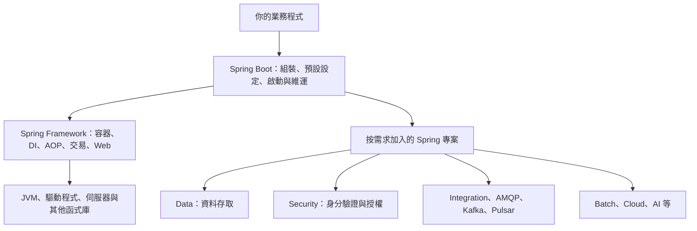
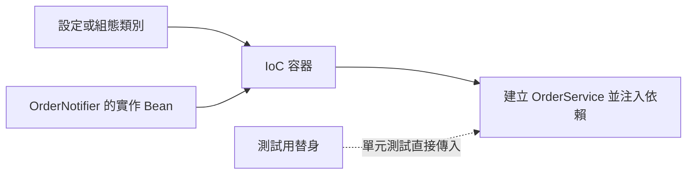
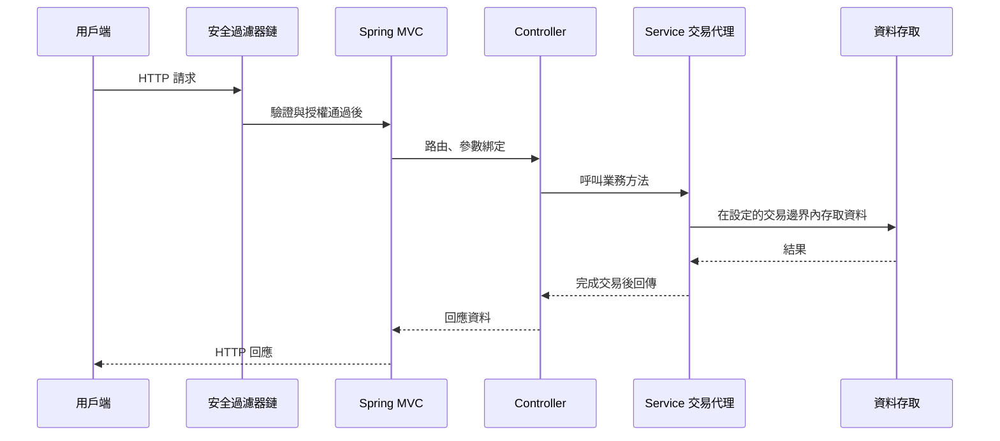
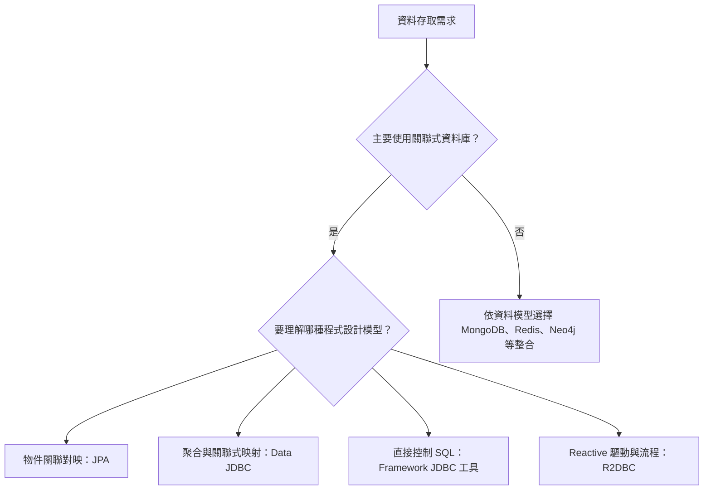
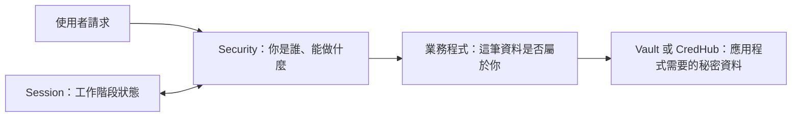
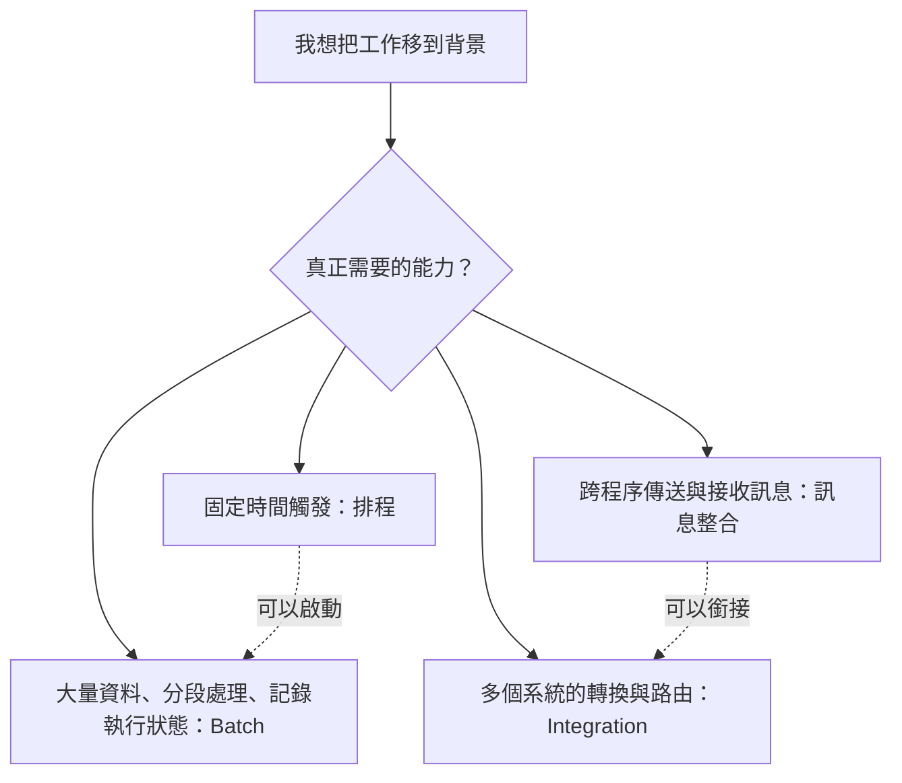
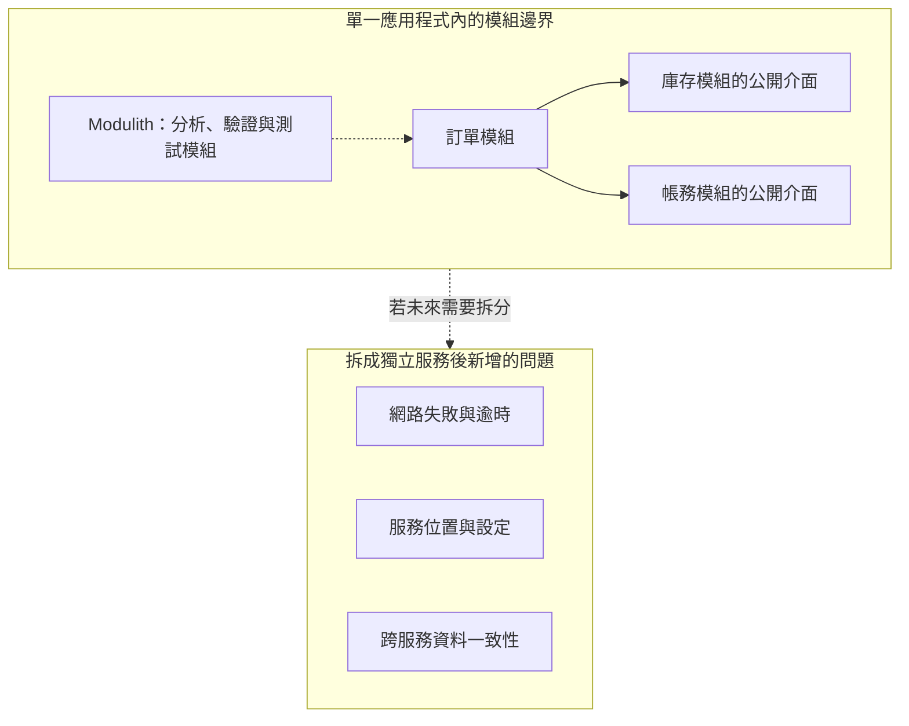
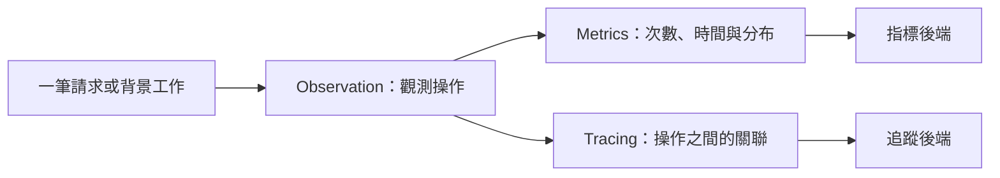
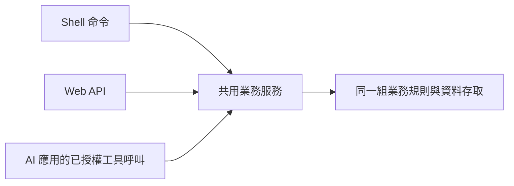
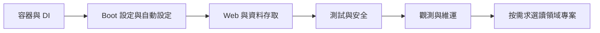

# Spring 生態系導讀：從你不想再手作的事情開始

> 本篇是譯者撰寫的概要導讀，**不是官方文件逐字翻譯**。功能資訊以各節英文官方入口為依據；情境、學習順序與 Mermaid 圖是補充說明。查閱日期：2026-10-20。
>
> 範圍涵蓋官方 Projects 主清單，以及 Data、Cloud 的主要分支；不是所有子專案 API 的完整目錄。完整 Reference 翻譯另見 [Boot](boot/CONTENTS.md)；Framework 可參閱[官方英文文件](https://docs.spring.io/spring-framework/reference/)。

## 1. 先分清楚 Framework、Boot 與其他專案

**Spring Framework** 提供容器、依賴注入、AOP、交易、Web 與資料存取等基礎能力。**Spring Boot** 整合這些能力及第三方函式庫，提供依賴管理、自動設定、啟動與維運功能。其他 Spring 專案則處理特定領域。

例如，你可以直接使用 Framework 建立物件與 Web 設定；使用 Boot 時，一部分常見設定會依 classpath、設定屬性及現有 Bean 自動補上。兩者共同使用，責任不同。[Spring Framework](https://spring.io/projects/spring-framework/) · [Spring Boot](https://spring.io/projects/spring-boot/)



這張圖表示功能責任，不是精確的 Maven 傳遞依賴圖。使用 Spring 不表示必須安裝全部專案。

## 2. 框架怎麼減少手作，又保留擴充能力？

以「寄送訂單通知」為例，手作時可能在每個使用點建立寄信物件、讀取設定、組合依賴。使用容器後，把實作註冊成 Bean，讓訂單服務透過建構子接收所需介面。設定與組裝集中管理，業務方法只處理訂單規則。

```kotlin
// 譯者示例：只示範依賴關係，並非可獨立執行的完整專案。
interface OrderNotifier {
    fun notify(orderId: String)
}

@Service
class OrderService(private val notifier: OrderNotifier) {
    fun complete(orderId: String) {
        // 訂單完成的業務規則放在這裡。
        notifier.notify(orderId)
    }
}
```

此例還需要一個 `OrderNotifier` Bean。若同時提供多個實作，必須明確選擇，例如使用 `@Qualifier`；容器不會知道你的商業意圖。



擴充通常有三種形式：提供介面實作、宣告自己的 Bean，或實作框架的擴充介面。Boot 自動設定是否會因自己的 Bean 而退讓，取決於那一項設定的條件，不能假設任何同名物件都能覆蓋它。[依賴注入](https://docs.spring.io/spring-framework/reference/core/beans/dependencies/factory-collaborators.html) · [Boot 自動設定](https://docs.spring.io/spring-boot/reference/using/auto-configuration.html)

## 3. HTTP、GraphQL、gRPC 與 SOAP：對外介面的選擇

| 能力／專案 | 省去哪些整合工作 | 仍需由你決定的事情 | 英文官方入口 |
| --- | --- | --- | --- |
| Spring MVC | HTTP 路由、參數綁定、訊息轉換與例外處理的整合 | URL、資料驗證、錯誤回應與業務邊界 | [Servlet Web](https://docs.spring.io/spring-framework/reference/web.html) |
| Spring WebFlux | Reactive Web 處理與非阻塞流程整合 | 是否具備端到端非阻塞的依賴與需求 | [Reactive Web](https://docs.spring.io/spring-framework/reference/web-reactive.html) |
| Spring for GraphQL | 將 GraphQL Java 與 Spring 程式設計模型整合 | Schema、查詢成本、權限與資料批次載入 | [GraphQL](https://spring.io/projects/spring-graphql/) |
| Spring gRPC | gRPC 服務及用戶端與 Spring 的整合 | `.proto` 契約、相容性與服務邊界 | [gRPC](https://spring.io/projects/spring-grpc/) |
| Spring Web Services | 以契約優先的方式建立 SOAP 服務 | XML 契約、互通性與版本管理 | [Web Services](https://spring.io/projects/spring-ws/) |
| Spring HATEOAS | 建構包含連結的資源表示 | 你的 API 是否採用超媒體互動模式 | [HATEOAS](https://spring.io/projects/spring-hateoas/) |
| Spring REST Docs | 從測試產生文件片段，與手寫說明結合 | 測試案例是否涵蓋真正的 API 契約 | [REST Docs](https://spring.io/projects/spring-restdocs/) |
| Spring Web Flow | 表達多步驟畫面流程與狀態轉移 | 步驟順序、返回行為與流程資料生命週期 | [Web Flow](https://spring.io/projects/spring-webflow/) |

以下是一個 Servlet 應用程式的簡化流程。只有已設定的安全過濾器及交易攔截才會參與；並非每個 Controller 都自動有交易。



**學習檢查點：**`@RestController` 解決的是 Web 入口的宣告方式；它不會替你完成訂單狀態檢查，也不會自動替任意方法建立交易。

## 4. Spring Data：把重複的資料存取模式集中起來

Spring Data 是一組資料存取專案。Repository 抽象與物件對映讓常見操作較一致，但不同資料庫的查詢、交易及一致性仍有差異。不能把「使用相同風格的介面」理解成「換資料庫不需要修改設計」。[Spring Data](https://spring.io/projects/spring-data/)

| 分支 | 主要角色 | 官方入口 |
| --- | --- | --- |
| Data Commons | 共用 Repository、分頁等基礎抽象 | [Commons](https://spring.io/projects/spring-data-commons/) |
| Data JPA | 整合 JPA 的 Repository；仍需理解 ORM 與持久化內容 | [JPA](https://spring.io/projects/spring-data-jpa/) |
| Data JDBC | 以關聯式資料庫與聚合為基礎的 Repository 模型 | [JDBC](https://spring.io/projects/spring-data-jdbc/) |
| Data R2DBC | 與 Reactive 關聯式資料存取整合 | [R2DBC](https://spring.io/projects/spring-data-r2dbc/) |
| Data MongoDB | MongoDB 文件對映、查詢與 Repository | [MongoDB](https://spring.io/projects/spring-data-mongodb/) |
| Data Redis | Redis 資料存取與 Spring 整合 | [Redis](https://spring.io/projects/spring-data-redis/) |
| Data Elasticsearch | Elasticsearch 搜尋及資料對映 | [Elasticsearch](https://spring.io/projects/spring-data-elasticsearch/) |
| Data Cassandra | Cassandra 資料存取 | [Cassandra](https://spring.io/projects/spring-data-cassandra/) |
| Data Couchbase | Couchbase 資料存取 | [Couchbase](https://spring.io/projects/spring-data-couchbase/) |
| Data Neo4j | 圖形資料庫物件對映與 Repository | [Neo4j](https://spring.io/projects/spring-data-neo4j/) |
| Data LDAP | LDAP 的 Repository 整合 | [LDAP](https://spring.io/projects/spring-data-ldap/) |
| Data REST | 將支援的 Repository 暴露為 REST 資源 | [REST](https://spring.io/projects/spring-data-rest/) |

以下是學習時的比較問題，不是自動替你選型的規則。



Framework 本身也提供 JDBC 工具與交易抽象，因此不是只有 Spring Data 才能操作資料庫。[Framework 資料存取](https://docs.spring.io/spring-framework/reference/data-access.html)

## 5. Security、Session、LDAP、Vault：分別管理什麼？

| 專案 | 主要解決的問題 | 使用時要辨別的邊界 | 英文官方入口 |
| --- | --- | --- | --- |
| Spring Security | 身分驗證、授權及常見 Web 安全整合 | 「已登入」不代表可以讀取所有使用者的資料 | [Security](https://spring.io/projects/spring-security/) |
| Spring Session | 將 HTTP session 等工作階段管理從特定容器實作分離 | Session 儲存方式與登入授權規則是不同問題 | [Session](https://spring.io/projects/spring-session/) |
| Spring LDAP | 以 Template 等抽象簡化 LDAP 操作 | 目錄查詢、目錄結構與應用程式權限仍需設計 | [LDAP](https://spring.io/projects/spring-ldap/) |
| Spring Vault | 與 HashiCorp Vault 的秘密資料服務整合 | 應用程式取得秘密的身分與權限 | [Vault](https://spring.io/projects/spring-vault/) |
| Spring CredHub | 與 CredHub 憑證／秘密資料服務互動 | 平台是否實際採用 CredHub | [CredHub](https://spring.io/projects/spring-credhub/) |



圖中每一條整合都需要適當設定；加入依賴並不等於完整的權限模型已建立。

## 6. 訊息、整合與批次：不是同一種背景工作

| 專案 | 典型角色 | 擴充點／仍需手作的決策 | 英文官方入口 |
| --- | --- | --- | --- |
| Spring AMQP | 對 AMQP 訊息操作提供 Spring 抽象，包含 RabbitMQ 整合 | 訊息格式、消費者處理、確認與重送策略 | [AMQP](https://spring.io/projects/spring-amqp/) |
| Spring for Apache Kafka | 生產者、消費者與 Kafka 整合 | 分區鍵、順序、重複處理與 offset 策略 | [Kafka](https://spring.io/projects/spring-kafka/) |
| Spring for Apache Pulsar | Pulsar 用戶端與 Spring 整合 | Topic、訂閱及訊息處理方式 | [Pulsar](https://spring.io/projects/spring-pulsar/) |
| Spring Integration | 使用訊息通道、路由、轉換器及 adapter 表達系統整合流程 | 每一步轉換與路由的業務規則 | [Integration](https://spring.io/projects/spring-integration/) |
| Spring Batch | 大量資料的批次工作、步驟與執行狀態管理 | Reader、Processor、Writer 與可重新執行的規則 | [Batch](https://spring.io/projects/spring-batch/) |



`@Scheduled` 能定時呼叫方法；大量匯入工作的進度紀錄與重啟語意則是另一層需求。這些能力可以組合。[Framework 排程](https://docs.spring.io/spring-framework/reference/integration/scheduling.html)

## 7. Cloud 與 Modulith：從實際部署邊界出發

Spring Cloud 提供分散式系統常見模式的整合，例如設定管理、路由、服務發現與斷路器。Cloud release train 與 Boot 有相容性要求，應依官方對照表選擇。[Spring Cloud 與相容性表](https://spring.io/projects/spring-cloud/)

| 能力群 | 例子 | 想避免的重複工作 |
| --- | --- | --- |
| 設定與秘密 | [Config](https://spring.io/projects/spring-cloud-config/)、[Vault](https://spring.io/projects/spring-cloud-vault/) | 每個服務各寫一份遠端設定載入程式 |
| 入口與路由 | [Gateway](https://spring.io/projects/spring-cloud-gateway/) | 重複實作入口路由與過濾流程 |
| 發現與協調 | [Consul](https://spring.io/projects/spring-cloud-consul/)、[Netflix](https://spring.io/projects/spring-cloud-netflix/)、[Zookeeper](https://spring.io/projects/spring-cloud-zookeeper/) | 自行維護服務位置與部分協調整合 |
| 呼叫韌性 | [Circuit Breaker](https://spring.io/projects/spring-cloud-circuitbreaker/)、[Commons](https://spring.io/projects/spring-cloud-commons/) | 各自整合斷路器、負載平衡等基礎能力 |
| 函式、訊息與工作 | [Function](https://spring.io/projects/spring-cloud-function/)、[Stream](https://spring.io/projects/spring-cloud-stream/)、[Task](https://spring.io/projects/spring-cloud-task/) | 重複串接函式執行、訊息 binding 與短期工作 |
| 執行平台 | [Kubernetes](https://spring.io/projects/spring-cloud-kubernetes/)、雲端供應商整合 | 平台服務與 Spring 程式的連接 |

上述每一項是選項，並非建立服務的必備清單。平台可能已提供部分功能。

**Spring Modulith** 則協助在 Spring Boot 應用程式中建立與檢查應用模組，包含模組測試、文件等支援。若訂單、庫存、帳務仍在同一個程序內，也能先把模組邊界整理好。[Spring Modulith](https://spring.io/projects/spring-modulith/)



這是設計上的比較，並不是 Modulith 會自動把程式拆成微服務。

## 8. Reactor 與 Micrometer：執行模型和可觀測性

**Project Reactor** 提供 Reactive 程式設計基礎。`Mono` 表達零或一個結果，`Flux` 表達零到多個結果。這是資料流與執行協調模型；在非阻塞流程中呼叫阻塞式 API，仍可能阻塞執行緒。[Project Reactor](https://projectreactor.io/)

**Micrometer** 提供可觀測性抽象，協助把應用程式的觀測資料接到不同後端。指標關注聚合數值；追蹤則用來串連一次操作經過的步驟。[Micrometer](https://micrometer.io/)



Boot Actuator 提供健康狀態等維運端點，並有相關可觀測性整合；它和 Micrometer 的職責不相同。[Boot 正式環境功能](https://docs.spring.io/spring-boot/reference/actuator/index.html)

## 9. AI 與 Shell：特定類型的應用入口

**Spring AI** 整合 AI 模型與應用資料、API，提供模型互動及相關抽象。業務端仍要決定模型能呼叫哪些工具、資料如何檢索，以及如何評估結果；框架整合不會保證模型回答正確。[Spring AI](https://spring.io/projects/spring-ai/)

**Spring Shell** 用來建立命令列應用程式，將命令宣告、輸入解析與互動等工作接到 Spring 程式。適合需要操作命令的工具，不等於 HTTP API 文件工具。[Spring Shell](https://spring.io/projects/spring-shell/)



這是譯者的架構例子：不同入口可以共用服務層，但每個入口都必須建立適合自己的身分與權限邊界。

## 10. 舊文章與目前生態系：先看專案狀態

官方清單另有 **Projects in the Attic**。查閱時，Spring Cloud Sleuth、Spring Retry、Spring Authorization Server、Spring Cloud Data Flow 等名稱出現在其中。這個分類不代表相關需求消失，也不能單憑名稱判定替代路線；應進入專案儲存庫確認移轉、整合或停止維護說明。[官方專案清單與 Attic](https://spring.io/projects/)

因此，不宜照著舊文章把每一項依賴都加進新專案。先確認自己的 Boot 版本，再確認相容性與功能所屬模組。

## 11. 配合兩套 Reference 的閱讀順序

以下是依照「理解框架省掉什麼手作」安排的譯者建議：

1. 閱讀 Framework 的 IoC、Bean、依賴注入與生命週期，理解誰建立物件、誰把依賴接起來。
2. 閱讀 Boot 的程式碼結構、自動設定與外部化設定，理解哪些設定是預設提供、何時應自己宣告。
3. 用一個 Kotlin Web API 串起 Controller、Service 與資料存取，分辨 Web 邊界與交易邊界。
4. 加入測試與 Security，觀察測試如何替換依賴、請求如何被驗證和授權。
5. 學習 Actuator、記錄、指標與追蹤，練習從執行中的程式找證據。
6. 依實際需求選讀 Batch、訊息、Cloud、AI 等領域。



每讀完一項功能，試著回答三個問題：**不用它時我要自己寫什麼？它替我提供哪個機制？我要改變預設行為時，應從哪個擴充點進入？**
