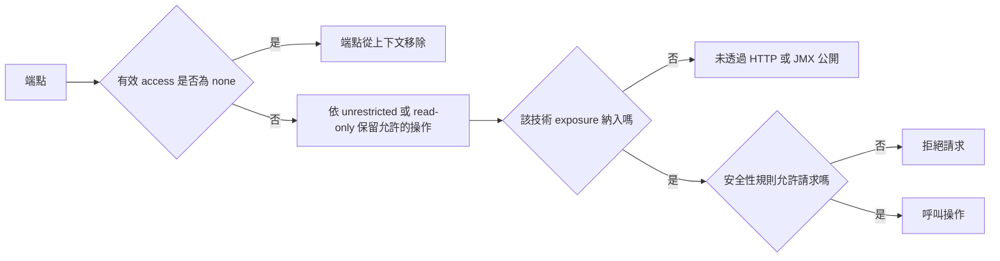
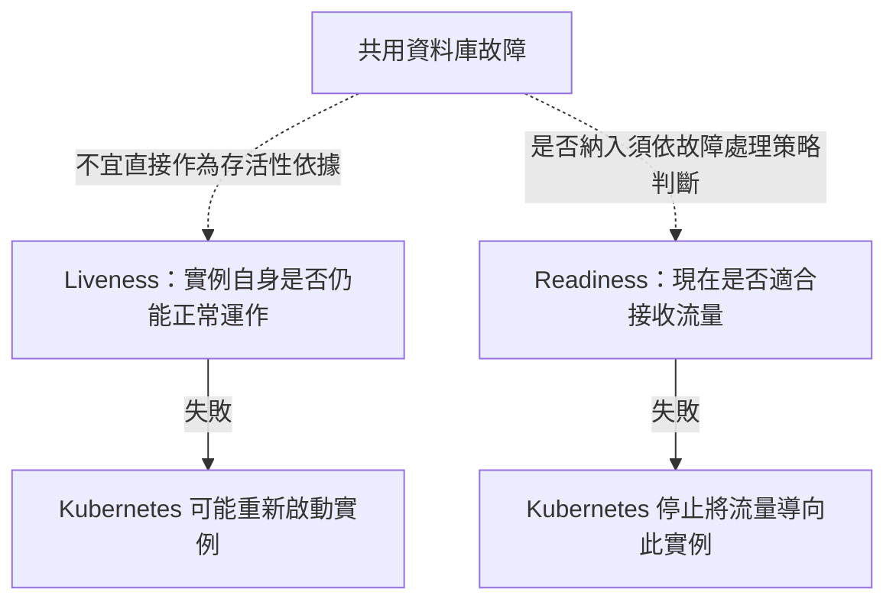

# 端點

<!-- source-attribution -->
> **非官方繁體中文翻譯** · Spring Boot 4.1.1 · 翻譯日期：2026-10-21  
> [官方英文網站](https://docs.spring.io/spring-boot/4.1/reference/actuator/endpoints.html) · [固定版本英文來源](https://github.com/spring-projects/spring-boot/blob/v4.1.1/documentation/spring-boot-docs/src/docs/antora/modules/reference/pages/actuator/endpoints.adoc) · [本地原文快照](../sources/spring-boot/documentation/spring-boot-docs/src/docs/antora/modules/reference/pages/actuator/endpoints.adoc)  
> 原始作者與授權見 [來源聲明](../NOTICE.md)。官方範例及設定鍵保留原文，額外圖解另標示為譯者補充。

<!-- translation-status: translated -->

Actuator 端點讓你監控應用程式，並與其互動。
Spring Boot 內建多個端點，也允許加入自己的端點。
例如 `health` 端點提供基本應用程式健康資訊。

你可以[控制個別端點的存取][actuator--endpoints-r1]，並[透過 HTTP 或 JMX 公開端點，讓遠端可存取][actuator--endpoints-r2]。
只有允許存取且已公開的端點，才視為可用。
內建端點只有在可用時才會自動設定。
大多數應用程式選擇透過 HTTP 公開，以 `/actuator` 前綴加上端點 ID 對應到 URL。
例如 `health` 預設對應到 `/actuator/health`。

> **提示：**
>
> 若要了解 Actuator 端點及其請求、回應格式，請參閱 [API 文件][actuator--endpoints-r3]。

提供以下不依賴特定技術的端點：

| ID | 說明 |
| --- | --- |
| `auditevents` | 公開目前應用程式的稽核事件資訊。需要 [`AuditEventRepository`][actuator--endpoints-r4] Bean。 |
| `beans` | 顯示應用程式所有 Spring Bean 的完整清單。 |
| `caches` | 公開可用快取。 |
| `conditions` | 顯示設定與自動設定類別上已評估的條件，以及符合或不符合的原因。 |
| `configprops` | 顯示所有 [`@ConfigurationProperties`][actuator--endpoints-r5] 的彙整清單。適用[敏感值遮罩][actuator--endpoints-r6]。 |
| `env` | 公開 Spring [`ConfigurableEnvironment`][actuator--endpoints-r7] 的屬性。適用[敏感值遮罩][actuator--endpoints-r6]。 |
| `flyway` | 顯示已套用的 Flyway 資料庫移轉。需要一或多個 [`Flyway`][actuator--endpoints-r8] Bean。 |
| `health` | 顯示應用程式健康資訊。 |
| `httpexchanges` | 顯示 HTTP 交換資訊，預設為最近 100 次 HTTP 請求與回應交換。需要 [`HttpExchangeRepository`][actuator--endpoints-r9] Bean。 |
| `info` | 顯示任意應用程式資訊。 |
| `integrationgraph` | 顯示 Spring Integration 圖。需要 `spring-integration-core` 依賴。 |
| `loggers` | 顯示並修改應用程式的 logger 設定。 |
| `liquibase` | 顯示已套用的 Liquibase 資料庫移轉。需要一或多個 [`Liquibase`][actuator--endpoints-r10] Bean。 |
| `metrics` | 顯示目前應用程式的指標資訊，用於診斷已記錄的指標。 |
| `mappings` | 顯示所有 [`@RequestMapping`][actuator--endpoints-r11] 路徑的彙整清單。 |
| `quartz` | 顯示 Quartz Scheduler 工作資訊。適用[敏感值遮罩][actuator--endpoints-r6]。 |
| `scheduledtasks` | 顯示應用程式中的排程工作。 |
| `sessions` | 允許從 Spring Session 的 session store 取得及刪除使用者工作階段。需要使用 Spring Session 的 Servlet Web 應用程式。 |
| `shutdown` | 讓應用程式優雅關閉。只適用於 jar 封裝。預設停用。 |
| `startup` | 顯示 [`ApplicationStartup`][actuator--endpoints-r13] 收集的[啟動步驟資料][actuator--endpoints-r12]。需要將 [`SpringApplication`][actuator--endpoints-r14] 設定為使用 [`BufferingApplicationStartup`][actuator--endpoints-r15]。 |
| `threaddump` | 執行執行緒傾印。 |

若應用程式是 Web 應用程式（Spring MVC、Spring WebFlux 或 Jersey），還能使用以下端點：

| ID | 說明 |
| --- | --- |
| `heapdump` | 回傳 heap dump 檔案。HotSpot JVM 回傳 `HPROF` 格式；OpenJ9 JVM 回傳 `PHD` 格式。 |
| `logfile` | 若已設定 `logging.file.name` 或 `logging.file.path`，回傳日誌檔內容。支援 HTTP `Range` 標頭，可取得部分內容。 |
| `prometheus` | 以 Prometheus 伺服器可抓取的格式公開指標。需要 `micrometer-registry-prometheus` 依賴。 |

## 控制端點存取

預設除 `shutdown` 與 `heapdump` 外，所有端點的存取皆不受限制。
若要設定端點允許的存取方式，請使用 `management.endpoint.<id>.access`。
下例允許對 `shutdown` 端點不受限制的存取：

```properties
management.endpoint.shutdown.access=unrestricted
```

```yaml
management:
  endpoint:
    shutdown:
      access: unrestricted
```

若偏好預設不允許、逐一啟用的方式，可將 `management.endpoints.access.default` 設為 `none`，再以個別端點的 `access` 屬性啟用。
下例只允許唯讀存取 `loggers`，拒絕其他所有端點：

```properties
management.endpoints.access.default=none
management.endpoint.loggers.access=read-only
```

```yaml
management:
  endpoints:
    access:
      default: none
  endpoint:
    loggers:
      access: read-only
```

> **注意：**
>
> 不可存取的端點會完全從應用程式上下文移除。
> 若只想修改端點透過哪些技術公開，請改用 [`include` 與 `exclude` 屬性][actuator--endpoints-r2]。

### 限制存取

可使用 `management.endpoints.access.max-permitted`，限制整個應用程式的端點存取。
其優先順序高於預設存取或個別端點的存取等級。
設為 `none` 會讓所有端點不可存取。
設為 `read-only` 則只允許讀取。

對 [`@Endpoint`][actuator--endpoints-r16]、[`@JmxEndpoint`][actuator--endpoints-r17] 與 [`@WebEndpoint`][actuator--endpoints-r18]，讀取存取代表標註 [`@ReadOperation`][actuator--endpoints-r19] 的方法。
對 [`@ControllerEndpoint`][actuator--endpoints-r20] 與 [`@RestControllerEndpoint`][actuator--endpoints-r21]，代表能處理 `GET` 與 `HEAD` 的請求對應。
對 [`@ServletEndpoint`][actuator--endpoints-r22]，代表 `GET` 與 `HEAD` 請求。

## 公開端點

預設只有 health 端點透過 HTTP 與 JMX 公開。
由於端點可能包含敏感資訊，應審慎考慮何時公開。

若要修改公開的端點，請使用以下各技術專用的 `include` 與 `exclude` 屬性：

| 屬性 | 預設值 |
| --- | --- |
| `management.endpoints.jmx.exposure.exclude` |  |
| `management.endpoints.jmx.exposure.include` | `health` |
| `management.endpoints.web.exposure.exclude` |  |
| `management.endpoints.web.exposure.include` | `health` |

`include` 列出要公開的端點 ID。
`exclude` 列出不應公開的端點 ID。
`exclude` 優先於 `include`。
兩者都可以設定端點 ID 清單。

例如只透過 JMX 公開 `health` 與 `info`：

```properties
management.endpoints.jmx.exposure.include=health,info
```

```yaml
management:
  endpoints:
    jmx:
      exposure:
        include: "health,info"
```

`*` 可選取所有端點。
例如透過 HTTP 公開除 `env` 與 `beans` 外的所有端點：

```properties
management.endpoints.web.exposure.include=*
management.endpoints.web.exposure.exclude=env,beans
```

```yaml
management:
  endpoints:
    web:
      exposure:
        include: "*"
        exclude: "env,beans"
```

> **注意：**
>
> `*` 在 YAML 有特殊意義，因此若要納入或排除所有端點，務必加上引號。

> **注意：**
>
> 如果應用程式公開對外，強烈建議也[保護端點安全][actuator--endpoints-r23]。

> **提示：**
>
> 若想實作自己的端點公開策略，可註冊 [`EndpointFilter`][actuator--endpoints-r24] Bean。

## 安全性

基於安全考量，預設只有 `/health` 透過 HTTP 公開。
可使用 `management.endpoints.web.exposure.include` 設定公開的端點。

> **注意：**
>
> 設定 `management.endpoints.web.exposure.include` 前，請確保公開的 actuator 不含敏感資訊、位於防火牆後方受到保護，或受 Spring Security 等機制保護。

若 classpath 有 Spring Security，且沒有其他 [`SecurityFilterChain`][actuator--endpoints-r25] Bean，Spring Boot 自動設定會保護 `/health` 以外的所有 actuator。
若定義自訂 [`SecurityFilterChain`][actuator--endpoints-r25] Bean，Spring Boot 自動設定就會退讓，讓你完全控制 actuator 存取規則。

若想為 HTTP 端點設定自訂安全性，例如只允許特定角色存取，Spring Boot 提供方便的 [`RequestMatcher`][actuator--endpoints-r26] 物件，可與 Spring Security 搭配。

典型設定可能如下：

```kotlin
import org.springframework.boot.security.autoconfigure.actuate.web.servlet.EndpointRequest
import org.springframework.context.annotation.Bean
import org.springframework.context.annotation.Configuration
import org.springframework.security.config.Customizer.withDefaults
import org.springframework.security.config.annotation.web.builders.HttpSecurity
import org.springframework.security.web.SecurityFilterChain

@Configuration(proxyBeanMethods = false)
class MySecurityConfiguration {

	@Bean
	fun securityFilterChain(http: HttpSecurity): SecurityFilterChain {
		http.securityMatcher(EndpointRequest.toAnyEndpoint()).authorizeHttpRequests { requests ->
			requests.anyRequest().hasRole("ENDPOINT_ADMIN")
		}
		http.httpBasic(withDefaults())
		return http.build()
	}

}
```

```java
import org.springframework.boot.security.autoconfigure.actuate.web.servlet.EndpointRequest;
import org.springframework.context.annotation.Bean;
import org.springframework.context.annotation.Configuration;
import org.springframework.security.config.annotation.web.builders.HttpSecurity;
import org.springframework.security.web.SecurityFilterChain;

import static org.springframework.security.config.Customizer.withDefaults;

@Configuration(proxyBeanMethods = false)
public class MySecurityConfiguration {

	@Bean
	public SecurityFilterChain securityFilterChain(HttpSecurity http) {
		http.securityMatcher(EndpointRequest.toAnyEndpoint());
		http.authorizeHttpRequests((requests) -> requests.anyRequest().hasRole("ENDPOINT_ADMIN"));
		http.httpBasic(withDefaults());
		return http.build();
	}

}
```

上例以 `EndpointRequest.toAnyEndpoint()` 比對任何端點的請求，再確保存取者具有 `ENDPOINT_ADMIN` 角色。
[`EndpointRequest`][actuator--endpoints-r27] 也提供其他比對方法。
詳見 [API 文件][actuator--endpoints-r3]。

> **注意：**
>
> 比對 Actuator 端點時，`EndpointRequest.to("endpoint")` 會考慮端點根路徑與所有子路徑。
> 即使端點未宣告巢狀路由，實際也會比對 `"/actuator/endpoint/**"`。

若應用程式部署於防火牆後方，你可能希望所有 actuator 端點不需驗證身分即可存取。
可如下修改 `management.endpoints.web.exposure.include`：

```properties
management.endpoints.web.exposure.include=*
```

```yaml
management:
  endpoints:
    web:
      exposure:
        include: "*"
```

此外，若存在 Spring Security，還需要加入允許未驗證存取的自訂安全性設定，如下例：

```kotlin
import org.springframework.boot.security.autoconfigure.actuate.web.servlet.EndpointRequest
import org.springframework.context.annotation.Bean
import org.springframework.context.annotation.Configuration
import org.springframework.security.config.annotation.web.builders.HttpSecurity
import org.springframework.security.web.SecurityFilterChain

@Configuration(proxyBeanMethods = false)
class MySecurityConfiguration {

	@Bean
	fun securityFilterChain(http: HttpSecurity): SecurityFilterChain {
		http.securityMatcher(EndpointRequest.toAnyEndpoint()).authorizeHttpRequests { requests ->
			requests.anyRequest().permitAll()
		}
		return http.build()
	}

}
```

```java
import org.springframework.boot.security.autoconfigure.actuate.web.servlet.EndpointRequest;
import org.springframework.context.annotation.Bean;
import org.springframework.context.annotation.Configuration;
import org.springframework.security.config.annotation.web.builders.HttpSecurity;
import org.springframework.security.web.SecurityFilterChain;

@Configuration(proxyBeanMethods = false)
public class MySecurityConfiguration {

	@Bean
	public SecurityFilterChain securityFilterChain(HttpSecurity http) {
		http.securityMatcher(EndpointRequest.toAnyEndpoint());
		http.authorizeHttpRequests((requests) -> requests.anyRequest().permitAll());
		return http.build();
	}

}
```

> **注意：**
>
> 上述兩個範例都只適用於 actuator 端點。
> 由於只要有任何 [`SecurityFilterChain`][actuator--endpoints-r25] Bean，Spring Boot 安全性設定就會完全退讓，因此還需要另外設定 [`SecurityFilterChain`][actuator--endpoints-r25] Bean，保護應用程式其餘部分。

### 跨站請求偽造防護

Spring Boot 採用 Spring Security 預設值，因此 CSRF 防護預設啟用。
這代表使用預設安全性設定時，需要 `POST`（shutdown 與 loggers）、`PUT` 或 `DELETE` 的 actuator 端點會收到 403（禁止）錯誤。

> **注意：**
>
> 只有在建立供非瀏覽器用戶端使用的服務時，才建議完全停用 CSRF 防護。

更多資訊請參閱 [Spring Security 參考指南][actuator--endpoints-r28]。

## 設定端點

端點會自動快取不接受任何參數之讀取操作的回應。
若要設定快取回應的時間，請使用 `cache.time-to-live` 屬性。
下例將 `beans` 端點的快取存活時間設為 10 秒：

```properties
management.endpoint.beans.cache.time-to-live=10s
```

```yaml
management:
  endpoint:
    beans:
      cache:
        time-to-live: "10s"
```

> **注意：**
>
> `management.endpoint.<name>` 前綴唯一識別正在設定的端點。

## 遮罩敏感值

`/env`、`/configprops` 與 `/quartz` 回傳的資訊可能敏感，因此預設一律完整遮罩，替換為 `******`。

只有符合下列條件，才能檢視未遮罩的值：

- `show-values` 設為 `never` 以外的值。
- 沒有適用的自訂 [`SanitizingFunction`][actuator--endpoints-r29] Bean。

支援遮罩的端點可將 `show-values` 設為：

- `never`：一律完整遮罩，替換為 `******`。
- `always`：向所有使用者顯示值，前提是沒有適用的 [`SanitizingFunction`][actuator--endpoints-r30] Bean。
- `when-authorized`：只向已授權使用者顯示值，前提是沒有適用的 [`SanitizingFunction`][actuator--endpoints-r30] Bean。

對 HTTP 端點，使用者若已驗證身分，並具有端點 roles 屬性設定的角色，就視為已授權。
預設任何已驗證身分的使用者都已授權。

對 JMX 端點，所有使用者一律視為已授權。

下例允許所有具有 `admin` 角色的使用者檢視 `/env` 原始值。
未授權或沒有 `admin` 角色的使用者只能看見遮罩值。

```properties
management.endpoint.env.show-values=when-authorized
management.endpoint.env.roles=admin
```

```yaml
management:
  endpoint:
    env:
      show-values: when-authorized
      roles: "admin"
```

> **注意：**
>
> 此範例假設未定義任何 [`SanitizingFunction`][actuator--endpoints-r29] Bean。

## Actuator Web 端點的超媒體

系統會加入包含所有端點連結的「探索頁面」。
預設位於 `/actuator`。

若要停用探索頁面，請加入以下應用程式屬性：

```properties
management.endpoints.web.discovery.enabled=false
```

```yaml
management:
  endpoints:
    web:
      discovery:
        enabled: false
```

設定自訂管理上下文路徑時，探索頁面會自動從 `/actuator` 移到管理上下文根路徑。
例如管理上下文路徑為 `/management`，探索頁面就在 `/management`。
若設為 `/`，則停用探索頁面，以避免與其他路徑對應衝突。

## CORS 支援

[跨來源資源共用][actuator--endpoints-r31]（CORS）是 [W3C 規範][actuator--endpoints-r32]，讓你彈性指定允許哪些跨網域請求。
使用 Spring MVC 或 Spring WebFlux 時，可設定 Actuator Web 端點支援此情境。

CORS 預設停用，只有設定 `management.endpoints.web.cors.allowed-origins` 後才會啟用。
下列設定允許來自 `example.com` 網域的 `GET` 與 `POST` 呼叫：

```properties
management.endpoints.web.cors.allowed-origins=https://example.com
management.endpoints.web.cors.allowed-methods=GET,POST
```

```yaml
management:
  endpoints:
    web:
      cors:
        allowed-origins: "https://example.com"
        allowed-methods: "GET,POST"
```

> **提示：**
>
> 完整選項清單請參閱 [`CorsEndpointProperties`][actuator--endpoints-r33]。

## JSON

處理 JSON 時，使用 Jackson 序列化與反序列化。
預設使用隔離的 [`JsonMapper`][actuator--endpoints-r34]。
這表示它不與應用程式的 `JsonMapper` 共用設定，也不受 `spring.jackson.*` 影響。
若要停用此行為，讓 Actuator 使用應用程式的 `JsonMapper`，請將 `management.endpoints.jackson.isolated-json-mapper` 設為 `false`。
也可定義自己的 [`EndpointJsonMapper`][actuator--endpoints-r35] Bean，產生符合需求的 `JsonMapper`。
Actuator 就會用它處理 JSON。

## 實作自訂端點

若加入標註 [`@Endpoint`][actuator--endpoints-r16] 的 [`@Bean`][actuator--endpoints-r36]，其中標註 [`@ReadOperation`][actuator--endpoints-r19]、[`@WriteOperation`][actuator--endpoints-r37] 或 [`@DeleteOperation`][actuator--endpoints-r38] 的方法會自動透過 JMX 公開；在 Web 應用程式也會透過 HTTP 公開。
HTTP 端點可使用 Jersey、Spring MVC 或 Spring WebFlux。
Jersey 與 Spring MVC 都可用時，使用 Spring MVC。

下例公開一個回傳自訂物件的讀取操作：

```kotlin
	@ReadOperation
	fun getData(): CustomData {
		return CustomData("test", 5)
	}
```

```java
	@ReadOperation
	public CustomData getData() {
		return new CustomData("test", 5);
	}
```

也可以使用 [`@JmxEndpoint`][actuator--endpoints-r17] 或 [`@WebEndpoint`][actuator--endpoints-r18] 撰寫技術專屬端點。
這些端點只限於各自技術。
例如 [`@WebEndpoint`][actuator--endpoints-r18] 只透過 HTTP 公開，不透過 JMX。

可使用 [`@EndpointWebExtension`][actuator--endpoints-r39] 與 [`@EndpointJmxExtension`][actuator--endpoints-r40] 撰寫技術專屬擴充。
這些註解讓你提供特定技術操作，擴充既有端點。
每個端點對每種類型最多只能有一個擴充。

最後，若需使用 Web 框架特有功能，可實作 Servlet 或 Spring [`@Controller`][actuator--endpoints-r41]、[`@RestController`][actuator--endpoints-r42] 端點；代價是它們無法透過 JMX 或其他 Web 框架使用。

### 接收輸入

端點操作透過參數接收輸入。
透過 Web 公開時，參數值來自 URL 查詢參數與 JSON 請求本文。
透過 JMX 公開時，則對應到 MBean 操作參數。
參數預設必填。
可標註 JSpecify 的 [`@Nullable`][actuator--endpoints-r43] 使其成為選填。
也支援 Kotlin null safety。

可以將 JSON 請求本文每個根屬性，對應到端點參數。
考慮以下 JSON 本文：

```json
{
	"name": "test",
	"counter": 42
}
```

可以用它呼叫接受 `String name` 與 `int counter` 的寫入操作，如下例：

```kotlin
	@WriteOperation
	fun updateData(name: String?, counter: Int) {
		// injects "test" and 42
	}
```

```java
	@WriteOperation
	public void updateData(String name, int counter) {
		// injects "test" and 42
	}
```

> **提示：**
>
> 因為端點不依賴特定技術，方法簽章只能指定簡單型別。
> 特別是，不支援以單一 [`CustomData`][actuator--endpoints-r44] 參數同時定義 `name` 與 `counter` 屬性。

> **注意：**
>
> 為了將輸入對應到操作方法參數，實作端點的 Java 程式碼應以 `-parameters` 編譯。
> Kotlin 程式碼請參閱 Spring Framework 參考文件的[建議][actuator--endpoints-r45]。
> 使用 Spring Boot Gradle plugin，或 Maven 搭配 `spring-boot-starter-parent` 時，會自動完成這項設定。

#### 輸入型別轉換

傳入端點操作方法的參數，必要時會自動轉成所需型別。
呼叫方法前，透過 JMX 或 HTTP 接收的輸入，會使用 [`ApplicationConversionService`][actuator--endpoints-r46] 實例，以及以 [`@EndpointConverter`][actuator--endpoints-r49] 限定的 [`Converter`][actuator--endpoints-r47] 或 [`GenericConverter`][actuator--endpoints-r48] Bean，轉換成所需型別。

### 自訂 Web 端點

[`@Endpoint`][actuator--endpoints-r16]、[`@WebEndpoint`][actuator--endpoints-r18] 或 [`@EndpointWebExtension`][actuator--endpoints-r39] 的操作，會自動使用 Jersey、Spring MVC 或 Spring WebFlux 透過 HTTP 公開。
Jersey 與 Spring MVC 都可用時，使用 Spring MVC。

#### Web 端點請求述詞

系統會為公開至 Web 的端點之每個操作，自動產生請求述詞。

#### 路徑

述詞路徑由端點 ID 與 Web 端點基底路徑決定。
預設基底路徑為 `/actuator`。
例如 ID 為 `sessions` 的端點，述詞路徑就是 `/actuator/sessions`。

可在操作方法的一或多個參數標註 [`@Selector`][actuator--endpoints-r50]，進一步自訂路徑。
這種參數會作為路徑變數加入路徑述詞。
呼叫端點操作時，變數值會傳入操作方法。
若要擷取剩餘所有路徑元素，可在最後一個參數加入 `@Selector(Match=ALL_REMAINING)`，並將其設為可與 `String[]` 相容轉換的型別。

#### HTTP 方法

述詞的 HTTP 方法由操作類型決定：

| 操作 | HTTP 方法 |
| --- | --- |
| [`@ReadOperation`][actuator--endpoints-r19] | `GET` |
| [`@WriteOperation`][actuator--endpoints-r37] | `POST` |
| [`@DeleteOperation`][actuator--endpoints-r38] | `DELETE` |

#### Consumes

使用請求本文的 [`@WriteOperation`][actuator--endpoints-r37]（HTTP `POST`），述詞的 `consumes` 子句為 `application/vnd.spring-boot.actuator.v2+json, application/json`。
其他操作的 `consumes` 為空。

#### Produces

述詞的 `produces` 子句可透過 [`@DeleteOperation`][actuator--endpoints-r38]、[`@ReadOperation`][actuator--endpoints-r19] 與 [`@WriteOperation`][actuator--endpoints-r37] 的 `produces` 屬性決定。
此屬性為選填。
未使用時，自動決定 `produces`。

若操作方法回傳 `void` 或 [`Void`][actuator--endpoints-r51]，`produces` 為空。
若回傳 [`Resource`][actuator--endpoints-r52]，則為 `application/octet-stream`。
其他操作則為 `application/vnd.spring-boot.actuator.v2+json, application/json`。

#### Web 端點回應狀態

端點操作的預設回應狀態，依操作類型（讀取、寫入或刪除），以及是否回傳內容而定。

[`@ReadOperation`][actuator--endpoints-r19] 回傳值時，狀態為 200（OK）。
未回傳值時，為 404（Not Found）。

[`@WriteOperation`][actuator--endpoints-r37] 或 [`@DeleteOperation`][actuator--endpoints-r38] 回傳值時，狀態為 200（OK）。
未回傳值時，為 204（No Content）。

若呼叫時缺少必要參數，或參數無法轉為所需型別，操作方法不會執行，回應狀態為 400（Bad Request）。

#### Web 端點範圍請求

可以透過 HTTP range request 請求 HTTP 資源的一部分。
使用 Spring MVC 或 Spring WebFlux 時，回傳 [`Resource`][actuator--endpoints-r52] 的操作會自動支援範圍請求。

> **注意：**
>
> Jersey 不支援範圍請求。

#### Web 端點安全性

Web 端點或 Web 專屬端點擴充的操作，可透過方法參數接收目前的 [`Principal`][actuator--endpoints-r53] 或 [`SecurityContext`][actuator--endpoints-r54]。
前者通常搭配 [`@Nullable`][actuator--endpoints-r43]，為已驗證與未驗證使用者提供不同處理。
後者通常透過 `isUserInRole(String)` 進行授權檢查。

## 健康資訊

你可以透過健康資訊檢查執行中應用程式的狀態。
監控軟體常利用它，在正式系統故障時通知人員。
`health` 公開的資訊取決於 `management.endpoint.health.show-details` 與 `management.endpoint.health.show-components`，可設為以下值：

| 名稱 | 說明 |
| --- | --- |
| `never` | 永不顯示詳細資訊。 |
| `when-authorized` | 只向已授權使用者顯示詳細資訊。可透過 `management.endpoint.health.roles` 設定授權角色。 |
| `always` | 向所有使用者顯示詳細資訊。 |

預設值為 `never`。
使用者只要具有端點設定的一或多個角色，就視為已授權。
若端點未設定角色（預設情況），所有已驗證身分的使用者都視為已授權。
可透過 `management.endpoint.health.roles` 設定角色。

> **注意：**
>
> 若應用程式已加上安全保護，又希望使用 `always`，安全性設定必須同時允許已驗證與未驗證使用者存取 health 端點。

健康資訊從 [`HealthContributorRegistry`][actuator--endpoints-r55] 的內容收集，預設為 [`ApplicationContext`][actuator--endpoints-r57] 中定義的所有 [`HealthContributor`][actuator--endpoints-r56] 實例。
Spring Boot 包含多個自動設定的 [`HealthContributor`][actuator--endpoints-r56] Bean，也可自行撰寫。

[`HealthContributor`][actuator--endpoints-r56] 可以是 [`HealthIndicator`][actuator--endpoints-r58] 或 [`CompositeHealthContributor`][actuator--endpoints-r59]。
[`HealthIndicator`][actuator--endpoints-r58] 提供實際健康資訊，包含 [`Status`][actuator--endpoints-r60]。
[`CompositeHealthContributor`][actuator--endpoints-r59] 則組合其他 [`HealthContributor`][actuator--endpoints-r56] 實例。
它們共同形成樹狀結構，呈現整體系統健康。

預設最終系統健康由 [`StatusAggregator`][actuator--endpoints-r61] 推導：依照有序狀態清單，排序各 [`HealthIndicator`][actuator--endpoints-r58] 的狀態。
排序後第一個狀態即作為整體健康狀態。
若沒有任何 [`HealthIndicator`][actuator--endpoints-r58] 回傳 [`StatusAggregator`][actuator--endpoints-r61] 認識的狀態，則使用 `UNKNOWN`。

> **提示：**
>
> 可使用 [`HealthContributorRegistry`][actuator--endpoints-r55]，在執行期間註冊及取消註冊健康指標。

### 自動設定的 HealthIndicator

適用時，Spring Boot 會自動設定下表的 [`HealthIndicator`][actuator--endpoints-r58] Bean。
也可以透過 `management.health.key.enabled` 啟用或停用個別指標，其中 `key` 如下表：

| Key | 名稱 | 說明 |
| --- | --- | --- |
| `cassandra` | [`CassandraDriverHealthIndicator`][actuator--endpoints-r62] | 檢查 Cassandra 資料庫是否正常運作。 |
| `couchbase` | [`CouchbaseHealthIndicator`][actuator--endpoints-r63] | 檢查 Couchbase 叢集是否正常運作。 |
| `db` | [`DataSourceHealthIndicator`][actuator--endpoints-r64] | 檢查能否取得 [`DataSource`][actuator--endpoints-r65] 連線。 |
| `diskspace` | [`DiskSpaceHealthIndicator`][actuator--endpoints-r66] | 檢查磁碟空間是否不足。 |
| `elasticsearch` | [`ElasticsearchRestClientHealthIndicator`][actuator--endpoints-r67] | 檢查 Elasticsearch 叢集是否正常運作。 |
| `hazelcast` | [`HazelcastHealthIndicator`][actuator--endpoints-r68] | 檢查 Hazelcast 伺服器是否正常運作。 |
| `jms` | [`JmsHealthIndicator`][actuator--endpoints-r69] | 檢查 JMS broker 是否正常運作。 |
| `ldap` | [`LdapHealthIndicator`][actuator--endpoints-r70] | 檢查 LDAP 伺服器是否正常運作。 |
| `mail` | [`MailHealthIndicator`][actuator--endpoints-r71] | 檢查郵件伺服器是否正常運作。 |
| `mongodb` | [`MongoHealthIndicator`][actuator--endpoints-r72] | 檢查 Mongo 資料庫是否正常運作。 |
| `neo4j` | [`Neo4jHealthIndicator`][actuator--endpoints-r73] | 檢查 Neo4j 資料庫是否正常運作。 |
| `ping` | [`PingHealthIndicator`][actuator--endpoints-r74] | 一律回應 `UP`。 |
| `rabbit` | [`RabbitHealthIndicator`][actuator--endpoints-r75] | 檢查 Rabbit 伺服器是否正常運作。 |
| `redis` | [`DataRedisHealthIndicator`][actuator--endpoints-r76] | 檢查 Redis 伺服器是否正常運作。 |
| `ssl` | [`SslHealthIndicator`][actuator--endpoints-r77] | 檢查 SSL 憑證是否正常。 |

> **提示：**
>
> 可透過 `management.health.defaults.enabled` 屬性全部停用。

> **提示：**
>
> `ssl` [`HealthIndicator`][actuator--endpoints-r58] 有名為 `management.health.ssl.certificate-validity-warning-threshold` 的「警告門檻」。
> 可利用此門檻，為即將到期的憑證輪替預留足夠時間。
> 若 SSL 憑證將在門檻指定期間內失效，[`HealthIndicator`][actuator--endpoints-r58] 會在回應詳細資訊中回報，`details.validChains.certificates.[*].validity.status` 的值會是 `WILL_EXPIRE_SOON`。

以下額外的 [`HealthIndicator`][actuator--endpoints-r58] Bean 預設啟用：

| Key | 名稱 | 說明 |
| --- | --- | --- |
| `livenessstate` | [`LivenessStateHealthIndicator`][actuator--endpoints-r78] | 公開應用程式「存活性」（Liveness）可用狀態。 |
| `readinessstate` | [`ReadinessStateHealthIndicator`][actuator--endpoints-r79] | 公開應用程式「就緒性」（Readiness）可用狀態。 |

可使用 `management.endpoint.health.probes.enabled` 停用。

### 撰寫自訂 HealthIndicator

若要提供自訂健康資訊，可註冊實作 [`HealthIndicator`][actuator--endpoints-r58] 的 Spring Bean。
必須實作 `health()`，並回傳 [`Health`][actuator--endpoints-r80] 回應。
回應應包含狀態，也可選擇包含額外顯示細節。
以下是實作範例：

```kotlin
import org.springframework.boot.health.contributor.Health
import org.springframework.boot.health.contributor.HealthIndicator
import org.springframework.stereotype.Component

@Component
class MyHealthIndicator : HealthIndicator {

	override fun health(): Health {
		val errorCode = check()
		if (errorCode != 0) {
			return Health.down().withDetail("Error Code", errorCode).build()
		}
		return Health.up().build()
	}

	private fun check(): Int {
		// perform some specific health check
		return  ...
	}

}
```

```java
import org.springframework.boot.health.contributor.Health;
import org.springframework.boot.health.contributor.HealthIndicator;
import org.springframework.stereotype.Component;

@Component
public class MyHealthIndicator implements HealthIndicator {

	@Override
	public Health health() {
		int errorCode = check();
		if (errorCode != 0) {
			return Health.down().withDetail("Error Code", errorCode).build();
		}
		return Health.up().build();
	}

	private int check() {
		// perform some specific health check
		return ...
	}

}
```

> **注意：**
>
> [`HealthIndicator`][actuator--endpoints-r58] 的識別碼取自 Bean 名稱，若有 `HealthIndicator` 後綴則移除。
> 上例的健康資訊會出現在名為 `my` 的項目。

> **提示：**
>
> 健康指標通常經由 HTTP 呼叫，必須在連線逾時前回應。
> 任何健康指標若超過 10 秒才回應，Spring Boot 會記錄警告。
> 可透過 `management.endpoint.health.logging.slow-indicator-threshold` 設定門檻。

除了 Spring Boot 預先定義的 [`Status`][actuator--endpoints-r60]，[`Health`][actuator--endpoints-r80] 也可回傳代表新系統狀態的自訂 [`Status`][actuator--endpoints-r60]。
此時也必須提供自訂 [`StatusAggregator`][actuator--endpoints-r61] 實作，或透過 `management.endpoint.health.status.order` 設定預設實作。

例如某個 [`HealthIndicator`][actuator--endpoints-r58] 使用代碼為 `FATAL` 的新 [`Status`][actuator--endpoints-r60]。
若要設定嚴重程度順序，請加入以下應用程式屬性：

```properties
management.endpoint.health.status.order=fatal,down,out-of-service,unknown,up
```

```yaml
management:
  endpoint:
    health:
      status:
        order: "fatal,down,out-of-service,unknown,up"
```

回應的 HTTP 狀態碼反映整體健康狀態。
預設 `OUT_OF_SERVICE` 與 `DOWN` 對應到 503。
未設定對應的健康狀態，包括 `UP`，都對應到 200。
若透過 HTTP 存取 health，也可能需要註冊自訂狀態對應。
設定自訂對應會停用 `DOWN` 與 `OUT_OF_SERVICE` 的預設對應。
若要保留，必須在自訂對應之外明確設定它們。
例如以下屬性將 `FATAL` 對應至 503（服務無法使用），同時保留 `DOWN` 與 `OUT_OF_SERVICE` 的預設對應：

```properties
management.endpoint.health.status.http-mapping.down=503
management.endpoint.health.status.http-mapping.fatal=503
management.endpoint.health.status.http-mapping.out-of-service=503
```

```yaml
management:
  endpoint:
    health:
      status:
        http-mapping:
          down: 503
          fatal: 503
          out-of-service: 503
```

> **提示：**
>
> 若需要更多控制，可定義自己的 [`HttpCodeStatusMapper`][actuator--endpoints-r81] Bean。

內建狀態的預設對應如下：

| 狀態 | 對應 |
| --- | --- |
| `DOWN` | `SERVICE_UNAVAILABLE`（`503`） |
| `OUT_OF_SERVICE` | `SERVICE_UNAVAILABLE`（`503`） |
| `UP` | 預設無對應，因此 HTTP 狀態為 `200`。 |
| `UNKNOWN` | 預設無對應，因此 HTTP 狀態為 `200`。 |

### 反應式健康指標

對 Spring WebFlux 等反應式應用程式，[`ReactiveHealthContributor`][actuator--endpoints-r82] 提供非阻塞的應用程式健康查詢契約。
類似傳統 [`HealthContributor`][actuator--endpoints-r56]，健康資訊從 [`ReactiveHealthContributorRegistry`][actuator--endpoints-r83] 收集，預設包含 [`ApplicationContext`][actuator--endpoints-r57] 中所有 [`HealthContributor`][actuator--endpoints-r56] 與 [`ReactiveHealthContributor`][actuator--endpoints-r82] 實例。
不透過反應式 API 檢查的一般 [`HealthContributor`][actuator--endpoints-r56]，會在 elastic scheduler 上執行。

> **提示：**
>
> 反應式應用程式應使用 [`ReactiveHealthContributorRegistry`][actuator--endpoints-r83]，在執行期間註冊及取消註冊健康指標。
> 若需註冊一般 [`HealthContributor`][actuator--endpoints-r56]，應以 `ReactiveHealthContributor#adapt` 包裝。

若要從反應式 API 提供自訂健康資訊，可註冊實作 [`ReactiveHealthIndicator`][actuator--endpoints-r84] 的 Spring Bean。
範例如下：

```kotlin
import org.springframework.boot.health.contributor.Health
import org.springframework.boot.health.contributor.ReactiveHealthIndicator
import org.springframework.stereotype.Component
import reactor.core.publisher.Mono

@Component
class MyReactiveHealthIndicator : ReactiveHealthIndicator {

	override fun health(): Mono<Health> {
		return doHealthCheck().onErrorResume { exception: Throwable ->
			Mono.just(Health.Builder().down(exception).build())
		}
	}

	private fun doHealthCheck(): Mono<Health> {
		// perform some specific health check
		return  ...
	}

}
```

```java
import reactor.core.publisher.Mono;

import org.springframework.boot.health.contributor.Health;
import org.springframework.boot.health.contributor.ReactiveHealthIndicator;
import org.springframework.stereotype.Component;

@Component
public class MyReactiveHealthIndicator implements ReactiveHealthIndicator {

	@Override
	public Mono<Health> health() {
		return doHealthCheck().onErrorResume((exception) ->
			Mono.just(new Health.Builder().down(exception).build()));
	}

	private Mono<Health> doHealthCheck() {
		// perform some specific health check
		return ...
	}

}
```

> **提示：**
>
> 若要自動處理錯誤，可考慮繼承 [`AbstractReactiveHealthIndicator`][actuator--endpoints-r85]。

### 自動設定的 ReactiveHealthIndicator

適用時，Spring Boot 自動設定以下 [`ReactiveHealthIndicator`][actuator--endpoints-r84] Bean：

| Key | 名稱 | 說明 |
| --- | --- | --- |
| `cassandra` | [`CassandraDriverReactiveHealthIndicator`][actuator--endpoints-r86] | 檢查 Cassandra 資料庫是否正常運作。 |
| `couchbase` | [`CouchbaseReactiveHealthIndicator`][actuator--endpoints-r87] | 檢查 Couchbase 叢集是否正常運作。 |
| `elasticsearch` | [`DataElasticsearchReactiveHealthIndicator`][actuator--endpoints-r88] | 檢查 Elasticsearch 叢集是否正常運作。 |
| `mongodb` | [`MongoReactiveHealthIndicator`][actuator--endpoints-r89] | 檢查 Mongo 資料庫是否正常運作。 |
| `neo4j` | [`Neo4jReactiveHealthIndicator`][actuator--endpoints-r90] | 檢查 Neo4j 資料庫是否正常運作。 |
| `redis` | [`DataRedisReactiveHealthIndicator`][actuator--endpoints-r91] | 檢查 Redis 伺服器是否正常運作。 |

> **提示：**
>
> 必要時反應式指標會取代一般指標。
> 未明確處理的 [`HealthIndicator`][actuator--endpoints-r58] 也會自動包裝。

### 健康群組

有時將健康指標整理為不同群組，以供不同用途使用，會很實用。

可透過 `management.endpoint.health.group.<name>` 建立群組，指定要 `include` 或 `exclude` 的健康指標 ID 清單。
例如建立只含資料庫指標的群組：

```properties
management.endpoint.health.group.custom.include=db
```

```yaml
management:
  endpoint:
    health:
      group:
        custom:
          include: "db"
```

接著存取 [localhost:8080/actuator/health/custom][actuator--endpoints-r92] 即可檢查結果。

同樣地，若要排除資料庫指標並納入所有其他指標，可這樣定義：

```properties
management.endpoint.health.group.custom.exclude=db
```

```yaml
management:
  endpoint:
    health:
      group:
        custom:
          exclude: "db"
```

預設若健康群組納入或排除不存在的指標，啟動會失敗。
將 `management.endpoint.health.validate-group-membership` 設為 `false` 可停用此行為。

群組預設繼承整體系統健康的 [`StatusAggregator`][actuator--endpoints-r61] 與 [`HttpCodeStatusMapper`][actuator--endpoints-r81] 設定。
不過也能逐群組定義。
需要時也能覆寫 `show-details` 與 `roles`：

```properties
management.endpoint.health.group.custom.show-details=when-authorized
management.endpoint.health.group.custom.roles=admin
management.endpoint.health.group.custom.status.order=fatal,up
management.endpoint.health.group.custom.status.http-mapping.fatal=500
management.endpoint.health.group.custom.status.http-mapping.out-of-service=500
```

```yaml
management:
  endpoint:
    health:
      group:
        custom:
          show-details: "when-authorized"
          roles: "admin"
          status:
            order: "fatal,up"
            http-mapping:
              fatal: 500
              out-of-service: 500
```

> **提示：**
>
> 若需為群組註冊自訂 [`StatusAggregator`][actuator--endpoints-r61] 或 [`HttpCodeStatusMapper`][actuator--endpoints-r81] Bean，可使用 `@Qualifier("groupname")`。

健康群組也可納入或排除 [`CompositeHealthContributor`][actuator--endpoints-r59]。
也能只納入或排除其中特定元件。
可使用元件的完整限定名稱：

```properties
management.endpoint.health.group.custom.include="test/primary"
management.endpoint.health.group.custom.exclude="test/primary/b"
```

上例的 `custom` 群組會納入名為 `primary` 的 [`HealthContributor`][actuator--endpoints-r56]，它是組合 `test` 的元件。
這裡 `primary` 本身也是組合，而其中名為 `b` 的 [`HealthContributor`][actuator--endpoints-r56] 會從 `custom` 群組排除。

健康群組可以在主連接埠或管理連接埠提供額外路徑。
這對 Kubernetes 等雲端環境很實用，因為基於安全性，常會讓 actuator 使用獨立管理連接埠。
獨立連接埠可能使健康檢查不可靠：健康檢查成功時，主應用程式仍可能不正常。
可如下設定額外路徑：

```properties
management.endpoint.health.group.live.additional-path="server:/healthz"
```

這會讓 `live` 群組在主伺服器連接埠的 `/healthz` 可用。
前綴必填，必須是 `server:`（主伺服器連接埠）或 `management:`（已設定的管理連接埠）。
路徑必須只有單一路徑區段。

### DataSource 健康

[`DataSource`][actuator--endpoints-r65] 健康指標同時顯示標準資料來源與路由資料來源 Bean 的健康狀態。
路由資料來源的健康資訊包含每個目標資料來源。
在 health 回應中，各個目標以其路由 key 命名。
若不想將路由資料來源納入輸出，請將 `management.health.db.ignore-routing-data-sources` 設為 `true`。

## Kubernetes 探針

部署到 Kubernetes 的應用程式，可以透過[容器探針][actuator--endpoints-r93]提供內部狀態資訊。
kubelet 依 [Kubernetes 設定][actuator--endpoints-r94]呼叫探針，並根據結果採取行動。

Spring Boot 預設管理[應用程式可用狀態][actuator--endpoints-r95]。
若部署在 Kubernetes 環境，actuator 會從 [`ApplicationAvailability`][actuator--endpoints-r96] 取得「存活性」與「就緒性」資訊，並用於專用[健康指標][actuator--endpoints-r97]：[`LivenessStateHealthIndicator`][actuator--endpoints-r78] 與 [`ReadinessStateHealthIndicator`][actuator--endpoints-r79]。
這些指標會顯示在整體 health 端點（`"/actuator/health"`）。
也會透過[健康群組][actuator--endpoints-r98]公開為獨立 HTTP 探針：`"/actuator/health/liveness"` 與 `"/actuator/health/readiness"`。

接著可使用以下端點資訊設定 Kubernetes 基礎設施：

```yaml
livenessProbe:
  httpGet:
    path: "/actuator/health/liveness"
    port: <actuator-port>
  failureThreshold: ...
  periodSeconds: ...

readinessProbe:
  httpGet:
    path: "/actuator/health/readiness"
    port: <actuator-port>
  failureThreshold: ...
  periodSeconds: ...
```

> **注意：**
>
> `<actuator-port>` 應設為 actuator 端點可用的連接埠。
> 可以是主 Web 伺服器連接埠，也可以是設定 `"management.server.port"` 後的獨立管理連接埠。

這些健康群組會自動啟用。
可使用 `management.endpoint.health.probes.enabled` 停用。

> **注意：**
>
> 如果應用程式啟動時間長於設定的存活探針期間，Kubernetes [提及 `"startupProbe"` 可作為解法][actuator--endpoints-r99]。
> 一般而言，此處不一定需要 `"startupProbe"`，因為所有啟動工作完成前，`"readinessProbe"` 都會失敗，代表應用程式準備好前不會收到流量。
> 不過若啟動很久，請考慮[設定使用存活 HTTP 探針的 `"startupProbe"`][actuator--endpoints-r100]，確保 Kubernetes 不會在啟動過程中終止應用程式。
> 請參閱[探針在應用程式生命週期中的行為][actuator--endpoints-r101]。

若 Actuator 端點部署於獨立管理上下文，就不會與主應用程式共用 Web 基礎設施，包括連接埠、連線集區與框架元件。
此時即使主應用程式不正常，例如無法接受新連線，探針仍可能成功。
因此，最好也讓 `liveness` 與 `readiness` 健康群組在主伺服器連接埠可用。
可設定以下屬性：

```properties
management.endpoint.health.probes.add-additional-paths=true
```

這會在主伺服器連接埠，以 `/livez` 提供 `liveness`，以 `/readyz` 提供 `readiness`。
可透過各群組的 `additional-path` 自訂路徑，詳見[健康群組][actuator--endpoints-r98]。

### 透過 Kubernetes 探針檢查外部狀態

Actuator 將存活與就緒探針設定為健康群組。
因此所有[健康群組功能][actuator--endpoints-r98]都可使用。
例如可以設定額外健康指標：

```properties
management.endpoint.health.group.readiness.include=readinessState,customCheck
```

```yaml
management:
  endpoint:
    health:
      group:
        readiness:
          include: "readinessState,customCheck"
```

Spring Boot 預設不會將其他健康指標加入這些群組。

存活探針不應依賴外部系統的健康檢查。
若[應用程式存活狀態][actuator--endpoints-r102]損壞，Kubernetes 會嘗試重新啟動應用程式實例來解決。
這表示外部系統，例如資料庫、Web API 或外部快取故障時，Kubernetes 可能重新啟動所有實例，造成連鎖故障。

至於就緒探針，是否檢查外部系統必須由應用程式開發者審慎決定。
因此 Spring Boot 不會在就緒探針納入額外健康檢查。
若[應用程式實例就緒狀態][actuator--endpoints-r103]尚未就緒，Kubernetes 就不會將流量路由到該實例。
某些外部系統可能不是由所有應用程式實例共用，此時可以納入就緒探針。
其他外部系統可能不是必要功能，應用程式可能已有斷路器與備援方案，這時就不應納入。
但所有實例共用同一外部系統的情況很常見，需要自行判斷：納入就緒探針，接受外部服務故障時整個應用程式退出服務；或不納入，改由更上層處理失敗，例如在呼叫端使用斷路器。

> **注意：**
>
> 若應用程式所有實例都未就緒，`type=ClusterIP` 或 `NodePort` 的 Kubernetes Service 不會接受任何傳入連線。
> 因為沒有建立連線，也就不會有 HTTP 503 等錯誤回應。
> `type=LoadBalancer` 的服務是否接受連線，取決於供應商。
> 明確設定 [ingress][actuator--endpoints-r104] 的服務，其回應也取決於實作；ingress 自己必須決定如何處理下游的「connection refused」。
> 負載平衡器與 ingress 情況下，都很可能回傳 HTTP 503。

此外，若應用程式使用 Kubernetes [自動擴縮][actuator--endpoints-r105]，應用程式從負載平衡器移除時，反應會依 autoscaler 設定而不同。

### 應用程式生命週期與探針狀態

Kubernetes 探針支援的重要特性，是與應用程式生命週期一致。
[`AvailabilityState`][actuator--endpoints-r106] 是應用程式記憶體中的內部狀態，與公開此狀態的實際探針有明顯差異。
依生命週期階段不同，探針可能不可用。

Spring Boot 在[啟動及關閉期間發布應用程式事件][actuator--endpoints-r107]。
探針可以監聽這些事件，公開 [`AvailabilityState`][actuator--endpoints-r106] 資訊。

以下表格顯示各階段的 [`AvailabilityState`][actuator--endpoints-r106] 與 HTTP connector 狀態。

Spring Boot 應用程式啟動時：

| 啟動階段 | LivenessState | ReadinessState | HTTP 伺服器 | 說明 |
| --- | --- | --- | --- | --- |
| 啟動中 | `BROKEN` | `REFUSING_TRAFFIC` | 尚未啟動 | Kubernetes 檢查存活探針，若耗時過久會重新啟動應用程式。 |
| 已啟動 | `CORRECT` | `REFUSING_TRAFFIC` | 拒絕請求 | 應用程式上下文已刷新。應用程式執行啟動工作，尚未接收流量。 |
| 已就緒 | `CORRECT` | `ACCEPTING_TRAFFIC` | 接受請求 | 啟動工作完成，應用程式正在接收流量。 |

Spring Boot 應用程式關閉時：

| 關閉階段 | 存活狀態 | 就緒狀態 | HTTP 伺服器 | 說明 |
| --- | --- | --- | --- | --- |
| 執行中 | `CORRECT` | `ACCEPTING_TRAFFIC` | 接受請求 | 已提出關閉要求。 |
| 優雅關閉 | `CORRECT` | `REFUSING_TRAFFIC` | 拒絕新請求 | 若啟用，[優雅關閉會處理進行中的請求][actuator--endpoints-r108]。HTTP 探針也停止接受流量，因此外部不容易再取得可用狀態。 |
| 關閉完成 | 不適用 | 不適用 | 伺服器已關閉 | 應用程式上下文已關閉，應用程式結束。 |

> **提示：**
>
> Kubernetes 部署的更多資訊請參閱 [Kubernetes 容器生命週期][actuator--endpoints-r109]。
> 特別是其中說明如何使用 `preStop` hook，讓 Kubernetes 終止應用程式前，有時間優雅關閉。

## 應用程式資訊

應用程式資訊公開從 [`ApplicationContext`][actuator--endpoints-r57] 中所有 [`InfoContributor`][actuator--endpoints-r110] Bean 收集的各種資訊。
Spring Boot 包含多個自動設定的 [`InfoContributor`][actuator--endpoints-r110]，也可自行撰寫。

### 自動設定的 InfoContributor

適用時，Spring 自動設定以下 [`InfoContributor`][actuator--endpoints-r110] Bean：

| ID | 名稱 | 說明 | 前提條件 |
| --- | --- | --- | --- |
| `build` | [`BuildInfoContributor`][actuator--endpoints-r111] | 公開建置資訊。 | `META-INF/build-info.properties` 資源。 |
| `env` | [`EnvironmentInfoContributor`][actuator--endpoints-r112] | 公開 [`Environment`][actuator--endpoints-r113] 中名稱以 `info.` 開頭的所有屬性。 | 無。 |
| `git` | [`GitInfoContributor`][actuator--endpoints-r114] | 公開 Git 資訊。 | `git.properties` 資源。 |
| `java` | [`JavaInfoContributor`][actuator--endpoints-r115] | 公開 Java 執行期資訊。 | 無。 |
| `os` | [`OsInfoContributor`][actuator--endpoints-r116] | 公開作業系統資訊。 | 無。 |
| `process` | [`ProcessInfoContributor`][actuator--endpoints-r117] | 公開程序資訊。 | 無。 |
| `ssl` | [`SslInfoContributor`][actuator--endpoints-r118] | 公開 SSL 憑證資訊。 | 已設定 [SSL Bundle][actuator--endpoints-r119]。 |

個別 contributor 是否啟用，由其 `management.info.<id>.enabled` 控制。
依前提條件與公開資訊性質不同，各 contributor 的預設值也不同。

`env`、`java`、`os` 與 `process` 沒有可暗示應啟用的前提條件，因此預設停用。
`ssl` 雖要求已設定 [SSL Bundle][actuator--endpoints-r119]，但也預設停用。
將各自的 `management.info.<id>.enabled` 設為 `true` 即可啟用。

`build` 與 `git` 資訊 contributor 預設啟用。
可將各自的 `management.info.<id>.enabled` 設為 `false` 停用。
也可將 `management.info.defaults.enabled` 設為 `false`，停用所有通常預設啟用的 contributor。

### 自訂應用程式資訊

啟用 `env` contributor 後，可以設定 `info.*` Spring 屬性，自訂 `info` 端點公開資料。
`info` key 下所有 [`Environment`][actuator--endpoints-r113] 屬性都會自動公開。
例如在 `application.properties` 加入：

```properties
info.app.encoding=UTF-8
info.app.java.source=17
info.app.java.target=17
```

```yaml
info:
  app:
    encoding: "UTF-8"
    java:
      source: "17"
      target: "17"
```

> **提示：**
>
> 不必將這些值寫死，也可以[在建置時展開 info 屬性][actuator--endpoints-r120]。
> 假設使用 Maven，可將上例改寫為：

> ```properties
> [email protected]@
> [email protected]@
> [email protected]@
> ```

> ```yaml
> info:
>   app:
>     encoding: "@project.build.sourceEncoding@"
>     java:
>       source: "@java.version@"
>       target: "@java.version@"
> ```

### Git Commit 資訊

`info` 另一個實用功能，是發布專案建置時 `git` 原始碼儲存庫的狀態。
若有 [`GitProperties`][actuator--endpoints-r122] Bean，就能透過 `info` 公開這些屬性。

> **提示：**
>
> 若 classpath 根目錄有 `git.properties`，會自動設定 [`GitProperties`][actuator--endpoints-r122] Bean。
> 詳見[產生 Git 資訊][actuator--endpoints-r123]。

預設若存在 `git.branch`、`git.commit.id` 與 `git.commit.time`，端點會公開它們。
若不希望回應包含其中某項，必須將它從 `git.properties` 排除。
若要顯示完整 Git 資訊，也就是 `git.properties` 全部內容，請使用 `management.info.git.mode`：

```properties
management.info.git.mode=full
```

```yaml
management:
  info:
    git:
      mode: "full"
```

若要完全停用 `info` 的 Git commit 資訊，請將 `management.info.git.enabled` 設為 `false`：

```properties
management.info.git.enabled=false
```

```yaml
management:
  info:
    git:
      enabled: false
```

### 建置資訊

若有 [`BuildProperties`][actuator--endpoints-r124] Bean，`info` 也能發布建置資訊。
當 classpath 存在 `META-INF/build-info.properties` 時，就會有這項支援。

> **提示：**
>
> Maven 與 Gradle plugin 都能產生此檔案。
> 詳見[產生建置資訊][actuator--endpoints-r125]。

### Java 資訊

`info` 公開 Java 執行環境資訊，詳見 [`JavaInfo`][actuator--endpoints-r126]。

### 作業系統資訊

`info` 公開作業系統資訊，詳見 [`OsInfo`][actuator--endpoints-r127]。

### 程序資訊

`info` 公開程序資訊，詳見 [`ProcessInfo`][actuator--endpoints-r128]。

### SSL 資訊

`info` 公開透過 [SSL Bundle][actuator--endpoints-r119] 設定的 SSL 憑證資訊，詳見 [`SslInfo`][actuator--endpoints-r129]。

### 撰寫自訂 InfoContributor

若要提供自訂應用程式資訊，可註冊實作 [`InfoContributor`][actuator--endpoints-r110] 的 Spring Bean。

下例加入含有單一值的 `example` 項目：

```kotlin
import org.springframework.boot.actuate.info.Info
import org.springframework.boot.actuate.info.InfoContributor
import org.springframework.stereotype.Component
import java.util.Collections

@Component
class MyInfoContributor : InfoContributor {

	override fun contribute(builder: Info.Builder) {
		builder.withDetail("example", Collections.singletonMap("key", "value"))
	}

}
```

```java
import java.util.Collections;

import org.springframework.boot.actuate.info.Info;
import org.springframework.boot.actuate.info.InfoContributor;
import org.springframework.stereotype.Component;

@Component
public class MyInfoContributor implements InfoContributor {

	@Override
	public void contribute(Info.Builder builder) {
		builder.withDetail("example", Collections.singletonMap("key", "value"));
	}

}
```

存取 `info` 時，應會看見回應多出以下項目：

```json
{
	"example": {
		"key" : "value"
	}
}
```

## 軟體物料清單（SBOM）

`sbom` 端點公開[軟體物料清單][actuator--endpoints-r130]。
CycloneDX SBOM 可自動偵測，也能手動設定其他格式。

`sbom` actuator 端點會公開名為 "application" 的 SBOM，描述應用程式內容。

> **提示：**
>
> 若要在專案建置時自動產生 CycloneDX SBOM，請參閱[產生 CycloneDX SBOM][actuator--endpoints-r131]。

### 其他 SBOM 格式

若要發布不同格式的 SBOM，可以使用以下設定屬性。

`management.endpoint.sbom.application.location` 設定應用程式 SBOM 位置。
例如設為 `classpath:sbom.json`，就會使用 classpath 的 `/sbom.json` 資源內容。

CycloneDX、SPDX 與 Syft 格式的 media type 會自動偵測。
若要覆寫，請使用 `management.endpoint.sbom.application.media-type`。

### 額外 SBOM

actuator 端點能處理多個 SBOM。
若要新增，請使用 `management.endpoint.sbom.additional`，如下例：

```properties
management.endpoint.sbom.additional.system.location=optional:file:/system.spdx.json
management.endpoint.sbom.additional.system.media-type=application/spdx+json
```

```yaml
management:
  endpoint:
    sbom:
      additional:
        system:
          location: "optional:file:/system.spdx.json"
          media-type: "application/spdx+json"
```

這會新增名為 "system"、儲存在 `/system.spdx.json` 的 SBOM。
可使用 `optional:` 前綴，避免檔案不存在時啟動失敗。

## 譯者圖解：端點能否被遠端呼叫的三個條件



## 譯者圖解：Liveness 與 Readiness 的用途不同



> 譯者註：`access=unrestricted` 是端點可用操作的設定，不代表網路已公開，也不代表略過 Spring Security；請同時對照 exposure 與安全性規則。

[actuator--endpoints-r1]: https://docs.spring.io/spring-boot/4.1/reference/actuator/endpoints.html#actuator.endpoints.controlling-access
[actuator--endpoints-r2]: https://docs.spring.io/spring-boot/4.1/reference/actuator/endpoints.html#actuator.endpoints.exposing
[actuator--endpoints-r3]: https://docs.spring.io/spring-boot/4.1/api/rest/actuator/index.html
[actuator--endpoints-r4]: https://docs.spring.io/spring-boot/4.1.1/api/java/org/springframework/boot/actuate/audit/AuditEventRepository.html
[actuator--endpoints-r5]: https://docs.spring.io/spring-boot/4.1.1/api/java/org/springframework/boot/context/properties/ConfigurationProperties.html
[actuator--endpoints-r6]: https://docs.spring.io/spring-boot/4.1/reference/actuator/endpoints.html#actuator.endpoints.sanitization
[actuator--endpoints-r7]: https://docs.spring.io/spring-framework/docs/7.0.x/javadoc-api/org/springframework/core/env/ConfigurableEnvironment.html
[actuator--endpoints-r8]: https://javadoc.io/doc/org.flywaydb/flyway-core/12.4.0/org/flywaydb/core/Flyway.html
[actuator--endpoints-r9]: https://docs.spring.io/spring-boot/4.1.1/api/java/org/springframework/boot/actuate/web/exchanges/HttpExchangeRepository.html
[actuator--endpoints-r10]: https://javadoc.io/doc/org.liquibase/liquibase-core/5.0.3/liquibase/Liquibase.html
[actuator--endpoints-r11]: https://docs.spring.io/spring-framework/docs/7.0.x/javadoc-api/org/springframework/web/bind/annotation/RequestMapping.html
[actuator--endpoints-r12]: https://docs.spring.io/spring-boot/4.1/reference/features/spring-application.html#features.spring-application.startup-tracking
[actuator--endpoints-r13]: https://docs.spring.io/spring-framework/docs/7.0.x/javadoc-api/org/springframework/core/metrics/ApplicationStartup.html
[actuator--endpoints-r14]: https://docs.spring.io/spring-boot/4.1.1/api/java/org/springframework/boot/SpringApplication.html
[actuator--endpoints-r15]: https://docs.spring.io/spring-boot/4.1.1/api/java/org/springframework/boot/context/metrics/buffering/BufferingApplicationStartup.html
[actuator--endpoints-r16]: https://docs.spring.io/spring-boot/4.1.1/api/java/org/springframework/boot/actuate/endpoint/annotation/Endpoint.html
[actuator--endpoints-r17]: https://docs.spring.io/spring-boot/4.1.1/api/java/org/springframework/boot/actuate/endpoint/jmx/annotation/JmxEndpoint.html
[actuator--endpoints-r18]: https://docs.spring.io/spring-boot/4.1.1/api/java/org/springframework/boot/actuate/endpoint/web/annotation/WebEndpoint.html
[actuator--endpoints-r19]: https://docs.spring.io/spring-boot/4.1.1/api/java/org/springframework/boot/actuate/endpoint/annotation/ReadOperation.html
[actuator--endpoints-r20]: https://docs.spring.io/spring-boot/4.1.1/api/java/org/springframework/boot/actuate/endpoint/web/annotation/ControllerEndpoint.html
[actuator--endpoints-r21]: https://docs.spring.io/spring-boot/4.1.1/api/java/org/springframework/boot/actuate/endpoint/web/annotation/RestControllerEndpoint.html
[actuator--endpoints-r22]: https://docs.spring.io/spring-boot/4.1.1/api/java/org/springframework/boot/actuate/endpoint/web/annotation/ServletEndpoint.html
[actuator--endpoints-r23]: https://docs.spring.io/spring-boot/4.1/reference/actuator/endpoints.html#actuator.endpoints.security
[actuator--endpoints-r24]: https://docs.spring.io/spring-boot/4.1.1/api/java/org/springframework/boot/actuate/endpoint/EndpointFilter.html
[actuator--endpoints-r25]: https://docs.spring.io/spring-security/reference/7.1/api/java/org/springframework/security/web/SecurityFilterChain.html
[actuator--endpoints-r26]: https://docs.spring.io/spring-security/reference/7.1/api/java/org/springframework/security/web/util/matcher/RequestMatcher.html
[actuator--endpoints-r27]: https://docs.spring.io/spring-boot/4.1.1/api/java/org/springframework/boot/security/autoconfigure/actuate/web/servlet/EndpointRequest.html
[actuator--endpoints-r28]: https://docs.spring.io/spring-security/reference/7.1/features/exploits/csrf.html
[actuator--endpoints-r29]: https://docs.spring.io/spring-boot/4.1/how-to/actuator.html#howto.actuator.customizing-sanitization
[actuator--endpoints-r30]: https://docs.spring.io/spring-boot/4.1.1/api/java/org/springframework/boot/actuate/endpoint/SanitizingFunction.html
[actuator--endpoints-r31]: https://en.wikipedia.org/wiki/Cross-origin_resource_sharing
[actuator--endpoints-r32]: https://www.w3.org/TR/cors/
[actuator--endpoints-r33]: https://docs.spring.io/spring-boot/4.1.1/api/java/org/springframework/boot/actuate/autoconfigure/endpoint/web/CorsEndpointProperties.html
[actuator--endpoints-r34]: https://javadoc.io/doc/tools.jackson.core/jackson-databind/3.1.5/tools/jackson/databind/json/JsonMapper.html
[actuator--endpoints-r35]: https://docs.spring.io/spring-boot/4.1.1/api/java/org/springframework/boot/actuate/endpoint/jackson/EndpointJsonMapper.html
[actuator--endpoints-r36]: https://docs.spring.io/spring-framework/docs/7.0.x/javadoc-api/org/springframework/context/annotation/Bean.html
[actuator--endpoints-r37]: https://docs.spring.io/spring-boot/4.1.1/api/java/org/springframework/boot/actuate/endpoint/annotation/WriteOperation.html
[actuator--endpoints-r38]: https://docs.spring.io/spring-boot/4.1.1/api/java/org/springframework/boot/actuate/endpoint/annotation/DeleteOperation.html
[actuator--endpoints-r39]: https://docs.spring.io/spring-boot/4.1.1/api/java/org/springframework/boot/actuate/endpoint/web/annotation/EndpointWebExtension.html
[actuator--endpoints-r40]: https://docs.spring.io/spring-boot/4.1.1/api/java/org/springframework/boot/actuate/endpoint/jmx/annotation/EndpointJmxExtension.html
[actuator--endpoints-r41]: https://docs.spring.io/spring-framework/docs/7.0.x/javadoc-api/org/springframework/stereotype/Controller.html
[actuator--endpoints-r42]: https://docs.spring.io/spring-framework/docs/7.0.x/javadoc-api/org/springframework/web/bind/annotation/RestController.html
[actuator--endpoints-r43]: https://jspecify.dev/docs/api/org/jspecify/annotations/Nullable.html
[actuator--endpoints-r44]: https://javadoc.io/doc/org.liquibase/liquibase-core/5.0.3/liquibase/report/CustomData.html
[actuator--endpoints-r45]: https://docs.spring.io/spring-framework/reference/7.0/languages/kotlin/classes-interfaces.html
[actuator--endpoints-r46]: https://docs.spring.io/spring-boot/4.1.1/api/java/org/springframework/boot/convert/ApplicationConversionService.html
[actuator--endpoints-r47]: https://docs.spring.io/spring-framework/docs/7.0.x/javadoc-api/org/springframework/core/convert/converter/Converter.html
[actuator--endpoints-r48]: https://docs.spring.io/spring-framework/docs/7.0.x/javadoc-api/org/springframework/core/convert/converter/GenericConverter.html
[actuator--endpoints-r49]: https://docs.spring.io/spring-boot/4.1.1/api/java/org/springframework/boot/actuate/endpoint/annotation/EndpointConverter.html
[actuator--endpoints-r50]: https://docs.spring.io/spring-boot/4.1.1/api/java/org/springframework/boot/actuate/endpoint/annotation/Selector.html
[actuator--endpoints-r51]: https://docs.oracle.com/en/java/javase/17/docs/api/java.base/java/lang/Void.html
[actuator--endpoints-r52]: https://docs.spring.io/spring-framework/docs/7.0.x/javadoc-api/org/springframework/core/io/Resource.html
[actuator--endpoints-r53]: https://docs.oracle.com/en/java/javase/17/docs/api/java.base/java/security/Principal.html
[actuator--endpoints-r54]: https://docs.spring.io/spring-boot/4.1.1/api/java/org/springframework/boot/actuate/endpoint/SecurityContext.html
[actuator--endpoints-r55]: https://docs.spring.io/spring-boot/4.1.1/api/java/org/springframework/boot/health/registry/HealthContributorRegistry.html
[actuator--endpoints-r56]: https://docs.spring.io/spring-boot/4.1.1/api/java/org/springframework/boot/health/contributor/HealthContributor.html
[actuator--endpoints-r57]: https://docs.spring.io/spring-framework/docs/7.0.x/javadoc-api/org/springframework/context/ApplicationContext.html
[actuator--endpoints-r58]: https://docs.spring.io/spring-boot/4.1.1/api/java/org/springframework/boot/health/contributor/HealthIndicator.html
[actuator--endpoints-r59]: https://docs.spring.io/spring-boot/4.1.1/api/java/org/springframework/boot/health/contributor/CompositeHealthContributor.html
[actuator--endpoints-r60]: https://docs.spring.io/spring-boot/4.1.1/api/java/org/springframework/boot/health/contributor/Status.html
[actuator--endpoints-r61]: https://docs.spring.io/spring-boot/4.1.1/api/java/org/springframework/boot/health/actuate/endpoint/StatusAggregator.html
[actuator--endpoints-r62]: https://docs.spring.io/spring-boot/4.1.1/api/java/org/springframework/boot/cassandra/health/CassandraDriverHealthIndicator.html
[actuator--endpoints-r63]: https://docs.spring.io/spring-boot/4.1.1/api/java/org/springframework/boot/couchbase/health/CouchbaseHealthIndicator.html
[actuator--endpoints-r64]: https://docs.spring.io/spring-boot/4.1.1/api/java/org/springframework/boot/jdbc/health/DataSourceHealthIndicator.html
[actuator--endpoints-r65]: https://docs.oracle.com/en/java/javase/17/docs/api/java.sql/javax/sql/DataSource.html
[actuator--endpoints-r66]: https://docs.spring.io/spring-boot/4.1.1/api/java/org/springframework/boot/health/application/DiskSpaceHealthIndicator.html
[actuator--endpoints-r67]: https://docs.spring.io/spring-boot/4.1.1/api/java/org/springframework/boot/elasticsearch/health/ElasticsearchRestClientHealthIndicator.html
[actuator--endpoints-r68]: https://docs.spring.io/spring-boot/4.1.1/api/java/org/springframework/boot/hazelcast/health/HazelcastHealthIndicator.html
[actuator--endpoints-r69]: https://docs.spring.io/spring-boot/4.1.1/api/java/org/springframework/boot/jms/health/JmsHealthIndicator.html
[actuator--endpoints-r70]: https://docs.spring.io/spring-boot/4.1.1/api/java/org/springframework/boot/ldap/health/LdapHealthIndicator.html
[actuator--endpoints-r71]: https://docs.spring.io/spring-boot/4.1.1/api/java/org/springframework/boot/mail/health/MailHealthIndicator.html
[actuator--endpoints-r72]: https://docs.spring.io/spring-boot/4.1.1/api/java/org/springframework/boot/mongodb/health/MongoHealthIndicator.html
[actuator--endpoints-r73]: https://docs.spring.io/spring-boot/4.1.1/api/java/org/springframework/boot/neo4j/health/Neo4jHealthIndicator.html
[actuator--endpoints-r74]: https://docs.spring.io/spring-boot/4.1.1/api/java/org/springframework/boot/health/contributor/PingHealthIndicator.html
[actuator--endpoints-r75]: https://docs.spring.io/spring-boot/4.1.1/api/java/org/springframework/boot/amqp/health/RabbitHealthIndicator.html
[actuator--endpoints-r76]: https://docs.spring.io/spring-boot/4.1.1/api/java/org/springframework/boot/data/redis/health/DataRedisHealthIndicator.html
[actuator--endpoints-r77]: https://docs.spring.io/spring-boot/4.1.1/api/java/org/springframework/boot/health/application/SslHealthIndicator.html
[actuator--endpoints-r78]: https://docs.spring.io/spring-boot/4.1.1/api/java/org/springframework/boot/health/application/LivenessStateHealthIndicator.html
[actuator--endpoints-r79]: https://docs.spring.io/spring-boot/4.1.1/api/java/org/springframework/boot/health/application/ReadinessStateHealthIndicator.html
[actuator--endpoints-r80]: https://docs.spring.io/spring-boot/4.1.1/api/java/org/springframework/boot/health/contributor/Health.html
[actuator--endpoints-r81]: https://docs.spring.io/spring-boot/4.1.1/api/java/org/springframework/boot/health/actuate/endpoint/HttpCodeStatusMapper.html
[actuator--endpoints-r82]: https://docs.spring.io/spring-boot/4.1.1/api/java/org/springframework/boot/health/contributor/ReactiveHealthContributor.html
[actuator--endpoints-r83]: https://docs.spring.io/spring-boot/4.1.1/api/java/org/springframework/boot/health/registry/ReactiveHealthContributorRegistry.html
[actuator--endpoints-r84]: https://docs.spring.io/spring-boot/4.1.1/api/java/org/springframework/boot/health/contributor/ReactiveHealthIndicator.html
[actuator--endpoints-r85]: https://docs.spring.io/spring-boot/4.1.1/api/java/org/springframework/boot/health/contributor/AbstractReactiveHealthIndicator.html
[actuator--endpoints-r86]: https://docs.spring.io/spring-boot/4.1.1/api/java/org/springframework/boot/cassandra/health/CassandraDriverReactiveHealthIndicator.html
[actuator--endpoints-r87]: https://docs.spring.io/spring-boot/4.1.1/api/java/org/springframework/boot/couchbase/health/CouchbaseReactiveHealthIndicator.html
[actuator--endpoints-r88]: https://docs.spring.io/spring-boot/4.1.1/api/java/org/springframework/boot/data/elasticsearch/health/DataElasticsearchReactiveHealthIndicator.html
[actuator--endpoints-r89]: https://docs.spring.io/spring-boot/4.1.1/api/java/org/springframework/boot/mongodb/health/MongoReactiveHealthIndicator.html
[actuator--endpoints-r90]: https://docs.spring.io/spring-boot/4.1.1/api/java/org/springframework/boot/neo4j/health/Neo4jReactiveHealthIndicator.html
[actuator--endpoints-r91]: https://docs.spring.io/spring-boot/4.1.1/api/java/org/springframework/boot/data/redis/health/DataRedisReactiveHealthIndicator.html
[actuator--endpoints-r92]: http://localhost:8080/actuator/health/custom
[actuator--endpoints-r93]: https://kubernetes.io/docs/concepts/workloads/pods/pod-lifecycle/#container-probes
[actuator--endpoints-r94]: https://kubernetes.io/docs/tasks/configure-pod-container/configure-liveness-readiness-startup-probes/
[actuator--endpoints-r95]: https://docs.spring.io/spring-boot/4.1/reference/features/spring-application.html#features.spring-application.application-availability
[actuator--endpoints-r96]: https://docs.spring.io/spring-boot/4.1.1/api/java/org/springframework/boot/availability/ApplicationAvailability.html
[actuator--endpoints-r97]: https://docs.spring.io/spring-boot/4.1/reference/actuator/endpoints.html#actuator.endpoints.health.auto-configured-health-indicators
[actuator--endpoints-r98]: https://docs.spring.io/spring-boot/4.1/reference/actuator/endpoints.html#actuator.endpoints.health.groups
[actuator--endpoints-r99]: https://kubernetes.io/docs/concepts/workloads/pods/pod-lifecycle/#when-should-you-use-a-startup-probe
[actuator--endpoints-r100]: https://kubernetes.io/docs/tasks/configure-pod-container/configure-liveness-readiness-startup-probes/#define-startup-probes
[actuator--endpoints-r101]: https://docs.spring.io/spring-boot/4.1/reference/actuator/endpoints.html#actuator.endpoints.kubernetes-probes.lifecycle
[actuator--endpoints-r102]: https://docs.spring.io/spring-boot/4.1/reference/features/spring-application.html#features.spring-application.application-availability.liveness
[actuator--endpoints-r103]: https://docs.spring.io/spring-boot/4.1/reference/features/spring-application.html#features.spring-application.application-availability.readiness
[actuator--endpoints-r104]: https://kubernetes.io/docs/concepts/services-networking/ingress/
[actuator--endpoints-r105]: https://kubernetes.io/docs/tasks/run-application/horizontal-pod-autoscale/
[actuator--endpoints-r106]: https://docs.spring.io/spring-boot/4.1.1/api/java/org/springframework/boot/availability/AvailabilityState.html
[actuator--endpoints-r107]: https://docs.spring.io/spring-boot/4.1/reference/features/spring-application.html#features.spring-application.application-events-and-listeners
[actuator--endpoints-r108]: https://docs.spring.io/spring-boot/4.1/reference/web/graceful-shutdown.html
[actuator--endpoints-r109]: https://docs.spring.io/spring-boot/4.1/how-to/deployment/cloud.html#howto.deployment.cloud.kubernetes.container-lifecycle
[actuator--endpoints-r110]: https://docs.spring.io/spring-boot/4.1.1/api/java/org/springframework/boot/actuate/info/InfoContributor.html
[actuator--endpoints-r111]: https://docs.spring.io/spring-boot/4.1.1/api/java/org/springframework/boot/actuate/info/BuildInfoContributor.html
[actuator--endpoints-r112]: https://docs.spring.io/spring-boot/4.1.1/api/java/org/springframework/boot/actuate/info/EnvironmentInfoContributor.html
[actuator--endpoints-r113]: https://docs.spring.io/spring-framework/docs/7.0.x/javadoc-api/org/springframework/core/env/Environment.html
[actuator--endpoints-r114]: https://docs.spring.io/spring-boot/4.1.1/api/java/org/springframework/boot/actuate/info/GitInfoContributor.html
[actuator--endpoints-r115]: https://docs.spring.io/spring-boot/4.1.1/api/java/org/springframework/boot/actuate/info/JavaInfoContributor.html
[actuator--endpoints-r116]: https://docs.spring.io/spring-boot/4.1.1/api/java/org/springframework/boot/actuate/info/OsInfoContributor.html
[actuator--endpoints-r117]: https://docs.spring.io/spring-boot/4.1.1/api/java/org/springframework/boot/actuate/info/ProcessInfoContributor.html
[actuator--endpoints-r118]: https://docs.spring.io/spring-boot/4.1.1/api/java/org/springframework/boot/actuate/info/SslInfoContributor.html
[actuator--endpoints-r119]: https://docs.spring.io/spring-boot/4.1/reference/features/ssl.html#features.ssl.bundles
[actuator--endpoints-r120]: https://docs.spring.io/spring-boot/4.1/how-to/properties-and-configuration.html#howto.properties-and-configuration.expand-properties
[actuator--endpoints-r121]: https://docs.spring.io/cdn-cgi/l/email-protection
[actuator--endpoints-r122]: https://docs.spring.io/spring-boot/4.1.1/api/java/org/springframework/boot/info/GitProperties.html
[actuator--endpoints-r123]: https://docs.spring.io/spring-boot/4.1/how-to/build.html#howto.build.generate-git-info
[actuator--endpoints-r124]: https://docs.spring.io/spring-boot/4.1.1/api/java/org/springframework/boot/info/BuildProperties.html
[actuator--endpoints-r125]: https://docs.spring.io/spring-boot/4.1/how-to/build.html#howto.build.generate-info
[actuator--endpoints-r126]: https://docs.spring.io/spring-boot/4.1.1/api/java/org/springframework/boot/info/JavaInfo.html
[actuator--endpoints-r127]: https://docs.spring.io/spring-boot/4.1.1/api/java/org/springframework/boot/info/OsInfo.html
[actuator--endpoints-r128]: https://docs.spring.io/spring-boot/4.1.1/api/java/org/springframework/boot/info/ProcessInfo.html
[actuator--endpoints-r129]: https://docs.spring.io/spring-boot/4.1.1/api/java/org/springframework/boot/info/SslInfo.html
[actuator--endpoints-r130]: https://en.wikipedia.org/wiki/Software_supply_chain
[actuator--endpoints-r131]: https://docs.spring.io/spring-boot/4.1/how-to/build.html#howto.build.generate-cyclonedx-sbom
