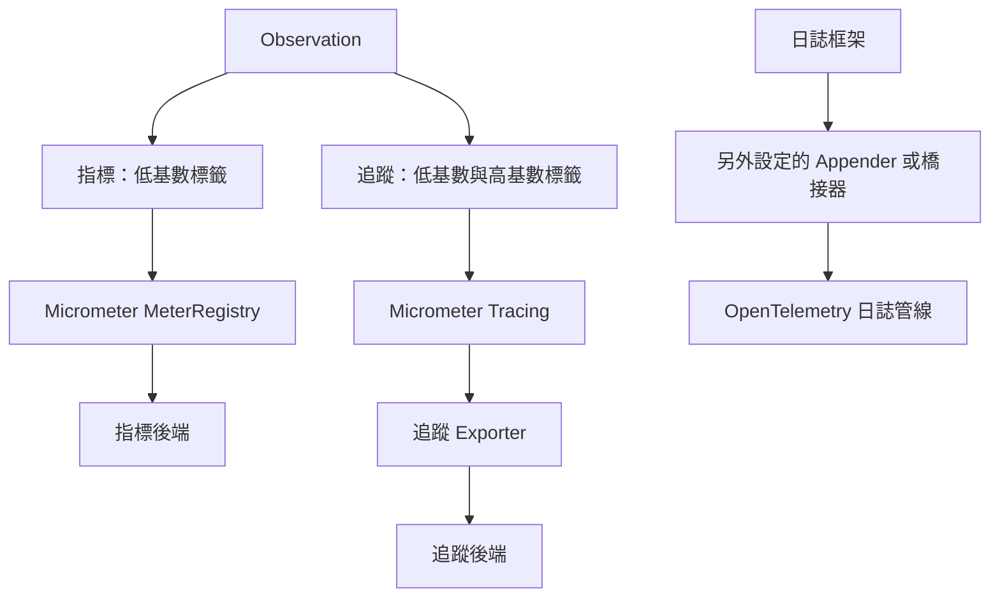

# 可觀測性

<!-- source-attribution -->
> **非官方繁體中文翻譯** · Spring Boot 4.1.1 · 翻譯日期：2026-10-21  
> [官方英文網站](https://docs.spring.io/spring-boot/4.1/reference/actuator/observability.html) · [固定版本英文來源](https://github.com/spring-projects/spring-boot/blob/v4.1.1/documentation/spring-boot-docs/src/docs/antora/modules/reference/pages/actuator/observability.adoc) · [本地原文快照](../sources/spring-boot/documentation/spring-boot-docs/src/docs/antora/modules/reference/pages/actuator/observability.adoc)  
> 原始作者與授權見 [來源聲明](../NOTICE.md)。官方範例及設定鍵保留原文，額外圖解另標示為譯者補充。

<!-- translation-status: translated -->

可觀測性是從外部觀察執行中系統內部狀態的能力。
它由三個支柱組成：日誌、指標與追蹤。

對於指標與追蹤，Spring Boot 使用 [Micrometer Observation][actuator--observability-r1]。
若要建立自己的 observation（進而產生指標與追蹤），可以注入 [`ObservationRegistry`][actuator--observability-r2]。

```kotlin
import io.micrometer.observation.Observation
import io.micrometer.observation.ObservationRegistry;

import org.springframework.stereotype.Component

@Component
class MyCustomObservation(private val observationRegistry: ObservationRegistry) {

	fun doSomething() {
		Observation.createNotStarted("doSomething", observationRegistry)
			.lowCardinalityKeyValue("locale", "en-US")
			.highCardinalityKeyValue("userId", "42")
			.observe {
				// Execute business logic here
			}
	}

}
```

```java
import io.micrometer.observation.Observation;
import io.micrometer.observation.ObservationRegistry;

import org.springframework.stereotype.Component;

@Component
public class MyCustomObservation {

	private final ObservationRegistry observationRegistry;

	public MyCustomObservation(ObservationRegistry observationRegistry) {
		this.observationRegistry = observationRegistry;
	}

	public void doSomething() {
		Observation.createNotStarted("doSomething", this.observationRegistry)
			.lowCardinalityKeyValue("locale", "en-US")
			.highCardinalityKeyValue("userId", "42")
			.observe(() -> {
				// Execute business logic here
			});
	}

}
```

> **注意：**
>
> 低基數標籤會加入指標與追蹤，高基數標籤則只加入追蹤。

[`ObservationPredicate`][actuator--observability-r3]、[`GlobalObservationConvention`][actuator--observability-r4]、[`ObservationFilter`][actuator--observability-r5] 與 [`ObservationHandler`][actuator--observability-r6] 型別的 Bean，會自動註冊到 [`ObservationRegistry`][actuator--observability-r2]。
此外也可以註冊任意數量的 [`ObservationRegistryCustomizer`][actuator--observability-r7] Bean，進一步設定 registry。

> **提示：**
>
> JDBC 可觀測性可透過獨立專案設定。
> [Datasource Micrometer 專案][actuator--observability-r8]提供 Spring Boot starter，在呼叫 JDBC 操作時自動建立 observation。
> 詳情請閱讀其[參考文件][actuator--observability-r9]。

> **提示：**
>
> Spring Boot 內建 R2DBC 可觀測性。
> 若要啟用，請在專案加入 `io.r2dbc:r2dbc-proxy` 依賴。

## 上下文傳遞

可觀測性支援依靠 [Context Propagation 函式庫][actuator--observability-r10]，跨執行緒與反應式管線轉送目前的 observation。
預設不會在反應式運算子中自動還原 [`ThreadLocal`][actuator--observability-r11] 值。
此行為由 `spring.reactor.context-propagation` 屬性控制，可設為 `auto` 以啟用自動傳遞。

如果使用 [`@Async`][actuator--observability-r12] 方法，且 [`AsyncTaskExecutor`][actuator--observability-r13] 是自動設定的，就必須透過 `spring.task.execution.propagate-context` 屬性明確啟用上下文傳遞。

如果自行設定 [`AsyncTaskExecutor`][actuator--observability-r13]，則需要註冊 [`ContextPropagatingTaskDecorator`][actuator--observability-r14] Bean，如下例所示：

```kotlin
import org.springframework.context.annotation.Bean
import org.springframework.context.annotation.Configuration
import org.springframework.core.task.support.ContextPropagatingTaskDecorator

@Configuration(proxyBeanMethods = false)
class ContextPropagationConfiguration {

	@Bean
	fun contextPropagatingTaskDecorator(): ContextPropagatingTaskDecorator {
		return ContextPropagatingTaskDecorator()
	}

}
```

```java
import org.springframework.context.annotation.Bean;
import org.springframework.context.annotation.Configuration;
import org.springframework.core.task.support.ContextPropagatingTaskDecorator;

@Configuration(proxyBeanMethods = false)
class ContextPropagationConfiguration {

	@Bean
	ContextPropagatingTaskDecorator contextPropagatingTaskDecorator() {
		return new ContextPropagatingTaskDecorator();
	}

}
```

關於 observation 的更多資訊，請參閱 [Micrometer Observation 文件][actuator--observability-r1]。

## 共用標籤

共用標籤通常用於依執行環境的維度深入分析，例如 host、instance、region、stack 等。
它們會作為低基數標籤套用到所有 observation，設定方式如下例：

```properties
management.observations.key-values.region=us-east-1
management.observations.key-values.stack=prod
```

```yaml
management:
  observations:
    key-values:
      region: "us-east-1"
      stack: "prod"
```

上例為所有 observation 加入 `region` 與 `stack` 標籤，其值分別為 `us-east-1` 與 `prod`。

## 阻止 Observation 回報

若想阻止部分 observation 回報，可使用 `management.observations.enable` 屬性：

```properties
management.observations.enable.denied.prefix=false
management.observations.enable.another.denied.prefix=false
```

```yaml
management:
  observations:
    enable:
      denied:
        prefix: false
      another:
        denied:
          prefix: false
```

上例會阻止所有名稱以 `denied.prefix` 或 `another.denied.prefix` 開頭的 observation。

> **提示：**
>
> 若要阻止 Spring Security 回報 observation，請將 `management.observations.enable.spring.security` 設為 `false`。

若需要更精細地控制哪些 observation 不回報，可以註冊 [`ObservationPredicate`][actuator--observability-r3] 型別的 Bean。
只有當所有 [`ObservationPredicate`][actuator--observability-r3] Bean 對某個 observation 都回傳 `true` 時，該 observation 才會回報。

```kotlin
import io.micrometer.observation.Observation.Context
import io.micrometer.observation.ObservationPredicate
import org.springframework.stereotype.Component

@Component
class MyObservationPredicate : ObservationPredicate {

	override fun test(name: String, context: Context): Boolean {
		return !name.contains("denied")
	}

}
```

```java
import io.micrometer.observation.Observation.Context;
import io.micrometer.observation.ObservationPredicate;

import org.springframework.stereotype.Component;

@Component
class MyObservationPredicate implements ObservationPredicate {

	@Override
	public boolean test(String name, Context context) {
		return !name.contains("denied");
	}

}
```

上例會阻止所有名稱含有 "denied" 的 observation。

## Micrometer Observation 註解支援

若要啟用 [`@Observed`][actuator--observability-r15]、[`@Timed`][actuator--observability-r16]、[`@Counted`][actuator--observability-r17]、[`@MeterTag`][actuator--observability-r18] 與 [`@NewSpan`][actuator--observability-r19] 等可觀測性註解的掃描，請將 `management.observations.annotations.enabled` 設為 `true`。
此外也需要 `org.aspectj:aspectjweaver` 依賴，它包含在 `spring-boot-starter-aspectj` 中。
此功能由 Micrometer 直接支援。
請參閱 [Micrometer][actuator--observability-r20]、[Micrometer Observation][actuator--observability-r21] 與 [Micrometer Tracing][actuator--observability-r22] 參考文件。

> **注意：**
>
> 若在已具備觀測插樁的方法或類別上加入註解，例如 [Spring Data repository][actuator--observability-r23] 或 [Spring MVC controller][actuator--observability-r24]，會產生重複 observation。
> 此時可以透過[屬性][actuator--observability-r25]或 [`ObservationPredicate`][actuator--observability-r3] 停用自動插樁，改由自己的註解負責；也可以移除自己的註解。

## OpenTelemetry 支援

> **注意：**
>
> 應用程式有數種支援 [OpenTelemetry][actuator--observability-r26] 的方式。
> 你可以使用由 OTel 社群支援的 [OpenTelemetry Java Agent][actuator--observability-r27] 或 [OpenTelemetry Spring Boot Starter][actuator--observability-r28]；其指標與追蹤採用 OTel 函式庫定義的語意慣例。
> 本文件描述 Spring 團隊正式支援的 OpenTelemetry 整合，使用 Micrometer 與 OTLP exporter；指標與追蹤採用 Spring 專案文件（例如 [Spring Framework][actuator--observability-r29]）所描述的語意慣例。

Spring Boot 的 actuator 模組提供 OpenTelemetry 基本支援。

它提供 [`OpenTelemetry`][actuator--observability-r30] 型別的 Bean；若應用程式上下文中有 [`SdkTracerProvider`][actuator--observability-r31]、[`ContextPropagators`][actuator--observability-r32]、[`SdkLoggerProvider`][actuator--observability-r33] 或 [`SdkMeterProvider`][actuator--observability-r34] 型別的 Bean，也會自動註冊。
此外，它還提供 [`Resource`][actuator--observability-r35] Bean。
可透過 `management.opentelemetry.resource-attributes` 設定屬性，設定自動設定之 [`Resource`][actuator--observability-r35] 的屬性。
自動設定的屬性會與 `OTEL_RESOURCE_ATTRIBUTES`、`OTEL_SERVICE_NAME` 環境變數的屬性合併；透過設定屬性指定的值優先於環境變數。

如果自行定義 [`Resource`][actuator--observability-r35] Bean，就不會採用上述行為。

> **注意：**
>
> Spring Boot 不提供自動匯出 OpenTelemetry 指標或日誌的功能。
> 只有搭配 [Micrometer Tracing][actuator--observability-r36] 時，才會自動設定 OpenTelemetry trace 的匯出。

### 停用 OpenTelemetry

將 `management.opentelemetry.enabled` 設為 `false`，即可停用 OpenTelemetry 支援。
它的行為類似 [`OTEL_SDK_DISABLED`][actuator--observability-r37] 環境變數，但布林意義相反：SDK 停用時，指標、追蹤與日誌會使用不執行任何動作的實作。
上下文傳遞器不受影響，仍照常運作。

> **注意：**
>
> 請記得 Spring Boot 並未使用 OpenTelemetry 的指標功能，因此即使停用 OpenTelemetry，指標仍可能啟用。

### 環境變數

Spring Boot 支援部分 [OpenTelemetry SDK 環境變數][actuator--observability-r38]。
這些環境變數會在啟動時自動對應到 Spring Boot 設定屬性。
如果環境變數同時有特定訊號版本，例如 `OTEL_EXPORTER_OTLP_TRACES_ENDPOINT`，以及通用版本 `OTEL_EXPORTER_OTLP_ENDPOINT`，則特定訊號版本優先，並直接使用其原值。
若退回使用通用版本，則會在後面附加對應訊號的路徑：`v1/traces`、`v1/metrics` 或 `v1/logs`。
例如設定 `OTEL_EXPORTER_OTLP_ENDPOINT=http://collector:4318`，trace 會使用 [collector:4318/v1/traces][actuator--observability-r39]。

可將 `management.opentelemetry.map-environment-variables` 設為 `false`，停用此對應。

#### 一般設定

| 環境變數 | Spring Boot 屬性 |
| --- | --- |
| `OTEL_SDK_DISABLED` | `management.opentelemetry.enabled`（布林值反轉） |
| `OTEL_PROPAGATORS` | `management.tracing.propagation.type` 與 `management.tracing.baggage.enabled` |
| `OTEL_TRACES_SAMPLER` | `management.opentelemetry.tracing.sampler` |
| `OTEL_TRACES_SAMPLER_ARG` | `management.tracing.sampling.probability` |
| `OTEL_METRICS_EXEMPLAR_FILTER` | `management.tracing.exemplars.include` |

#### 指標 Exporter

| 環境變數 | Spring Boot 屬性 |
| --- | --- |
| `OTEL_EXPORTER_OTLP_METRICS_ENDPOINT` / `OTEL_EXPORTER_OTLP_ENDPOINT` | `management.otlp.metrics.export.url` |
| `OTEL_EXPORTER_OTLP_METRICS_TEMPORALITY_PREFERENCE` | `management.otlp.metrics.export.aggregation-temporality` |
| `OTEL_EXPORTER_OTLP_METRICS_DEFAULT_HISTOGRAM_AGGREGATION` | `management.otlp.metrics.export.histogram-flavor` |
| `OTEL_EXPORTER_OTLP_METRICS_COMPRESSION` / `OTEL_EXPORTER_OTLP_COMPRESSION` | `management.otlp.metrics.export.compression-mode` |
| `OTEL_EXPORTER_OTLP_METRICS_TIMEOUT` / `OTEL_EXPORTER_OTLP_TIMEOUT` | `management.otlp.metrics.export.read-timeout` |
| `OTEL_EXPORTER_OTLP_METRICS_HEADERS` / `OTEL_EXPORTER_OTLP_HEADERS` | `management.otlp.metrics.export.headers` |
| `OTEL_METRIC_EXPORT_INTERVAL` | `management.otlp.metrics.export.step` |
| `OTEL_METRICS_EXPORTER` | `management.otlp.metrics.export.enabled` （只有 `otlp` 會啟用 OTLP 匯出；其他值會停用它，但不會啟用其他 exporter） |
| `OTEL_EXPORTER_OTLP_METRICS_CERTIFICATE` / `OTEL_EXPORTER_OTLP_CERTIFICATE` | `management.otlp.metrics.export.ssl.bundle` （自動設定的 SSL bundle） |
| `OTEL_EXPORTER_OTLP_METRICS_CLIENT_KEY` / `OTEL_EXPORTER_OTLP_CLIENT_KEY` | `management.otlp.metrics.export.ssl.bundle` （自動設定的 SSL bundle） |
| `OTEL_EXPORTER_OTLP_METRICS_CLIENT_CERTIFICATE` / `OTEL_EXPORTER_OTLP_CLIENT_CERTIFICATE` | `management.otlp.metrics.export.ssl.bundle` （自動設定的 SSL bundle） |

#### Trace Exporter

| 環境變數 | Spring Boot 屬性 |
| --- | --- |
| `OTEL_EXPORTER_OTLP_TRACES_ENDPOINT` / `OTEL_EXPORTER_OTLP_ENDPOINT` | `management.opentelemetry.tracing.export.otlp.endpoint` |
| `OTEL_EXPORTER_OTLP_TRACES_COMPRESSION` / `OTEL_EXPORTER_OTLP_COMPRESSION` | `management.opentelemetry.tracing.export.otlp.compression` |
| `OTEL_EXPORTER_OTLP_TRACES_TIMEOUT` / `OTEL_EXPORTER_OTLP_TIMEOUT` | `management.opentelemetry.tracing.export.otlp.timeout` |
| `OTEL_EXPORTER_OTLP_TRACES_PROTOCOL` / `OTEL_EXPORTER_OTLP_PROTOCOL` | `management.opentelemetry.tracing.export.otlp.transport` |
| `OTEL_EXPORTER_OTLP_TRACES_HEADERS` / `OTEL_EXPORTER_OTLP_HEADERS` | `management.opentelemetry.tracing.export.otlp.headers` |
| `OTEL_BSP_SCHEDULE_DELAY` | `management.opentelemetry.tracing.export.schedule-delay` |
| `OTEL_BSP_EXPORT_TIMEOUT` | `management.opentelemetry.tracing.export.timeout` |
| `OTEL_BSP_MAX_QUEUE_SIZE` | `management.opentelemetry.tracing.export.max-queue-size` |
| `OTEL_BSP_MAX_EXPORT_BATCH_SIZE` | `management.opentelemetry.tracing.export.max-batch-size` |
| `OTEL_TRACES_EXPORTER` | `management.tracing.export.otlp.enabled` （只有 `otlp` 會啟用 OTLP 匯出；其他值會停用它，但不會啟用其他 exporter） |
| `OTEL_SPAN_ATTRIBUTE_VALUE_LENGTH_LIMIT` / `OTEL_ATTRIBUTE_VALUE_LENGTH_LIMIT` | `management.opentelemetry.tracing.limits.max-attribute-value-length` |
| `OTEL_SPAN_ATTRIBUTE_COUNT_LIMIT` / `OTEL_ATTRIBUTE_COUNT_LIMIT` | `management.opentelemetry.tracing.limits.max-attributes` |
| `OTEL_SPAN_EVENT_COUNT_LIMIT` | `management.opentelemetry.tracing.limits.max-events` |
| `OTEL_SPAN_LINK_COUNT_LIMIT` | `management.opentelemetry.tracing.limits.max-links` |
| `OTEL_EVENT_ATTRIBUTE_COUNT_LIMIT` | `management.opentelemetry.tracing.limits.max-attributes-per-event` |
| `OTEL_LINK_ATTRIBUTE_COUNT_LIMIT` | `management.opentelemetry.tracing.limits.max-attributes-per-link` |
| `OTEL_EXPORTER_OTLP_TRACES_CERTIFICATE` / `OTEL_EXPORTER_OTLP_CERTIFICATE` | `management.opentelemetry.tracing.export.otlp.ssl.bundle` （自動設定的 SSL bundle） |
| `OTEL_EXPORTER_OTLP_TRACES_CLIENT_KEY` / `OTEL_EXPORTER_OTLP_CLIENT_KEY` | `management.opentelemetry.tracing.export.otlp.ssl.bundle` （自動設定的 SSL bundle） |
| `OTEL_EXPORTER_OTLP_TRACES_CLIENT_CERTIFICATE` / `OTEL_EXPORTER_OTLP_CLIENT_CERTIFICATE` | `management.opentelemetry.tracing.export.otlp.ssl.bundle` （自動設定的 SSL bundle） |

#### 日誌 Exporter

| 環境變數 | Spring Boot 屬性 |
| --- | --- |
| `OTEL_EXPORTER_OTLP_LOGS_ENDPOINT` / `OTEL_EXPORTER_OTLP_ENDPOINT` | `management.opentelemetry.logging.export.otlp.endpoint` |
| `OTEL_EXPORTER_OTLP_LOGS_COMPRESSION` / `OTEL_EXPORTER_OTLP_COMPRESSION` | `management.opentelemetry.logging.export.otlp.compression` |
| `OTEL_EXPORTER_OTLP_LOGS_TIMEOUT` / `OTEL_EXPORTER_OTLP_TIMEOUT` | `management.opentelemetry.logging.export.otlp.timeout` |
| `OTEL_EXPORTER_OTLP_LOGS_PROTOCOL` / `OTEL_EXPORTER_OTLP_PROTOCOL` | `management.opentelemetry.logging.export.otlp.transport` |
| `OTEL_EXPORTER_OTLP_LOGS_HEADERS` / `OTEL_EXPORTER_OTLP_HEADERS` | `management.opentelemetry.logging.export.otlp.headers` |
| `OTEL_BLRP_SCHEDULE_DELAY` | `management.opentelemetry.logging.export.schedule-delay` |
| `OTEL_BLRP_EXPORT_TIMEOUT` | `management.opentelemetry.logging.export.timeout` |
| `OTEL_BLRP_MAX_QUEUE_SIZE` | `management.opentelemetry.logging.export.max-queue-size` |
| `OTEL_BLRP_MAX_EXPORT_BATCH_SIZE` | `management.opentelemetry.logging.export.max-batch-size` |
| `OTEL_LOGS_EXPORTER` | `management.logging.export.otlp.enabled` （只有 `otlp` 會啟用 OTLP 匯出；其他值會停用它，但不會啟用其他 exporter） |
| `OTEL_LOGRECORD_ATTRIBUTE_VALUE_LENGTH_LIMIT` / `OTEL_ATTRIBUTE_VALUE_LENGTH_LIMIT` | `management.opentelemetry.logging.limits.max-attribute-value-length` |
| `OTEL_LOGRECORD_ATTRIBUTE_COUNT_LIMIT` / `OTEL_ATTRIBUTE_COUNT_LIMIT` | `management.opentelemetry.logging.limits.max-attributes` |
| `OTEL_EXPORTER_OTLP_LOGS_CERTIFICATE` / `OTEL_EXPORTER_OTLP_CERTIFICATE` | `management.opentelemetry.logging.export.otlp.ssl.bundle` （自動設定的 SSL bundle） |
| `OTEL_EXPORTER_OTLP_LOGS_CLIENT_KEY` / `OTEL_EXPORTER_OTLP_CLIENT_KEY` | `management.opentelemetry.logging.export.otlp.ssl.bundle` （自動設定的 SSL bundle） |
| `OTEL_EXPORTER_OTLP_LOGS_CLIENT_CERTIFICATE` / `OTEL_EXPORTER_OTLP_CLIENT_CERTIFICATE` | `management.opentelemetry.logging.export.otlp.ssl.bundle` （自動設定的 SSL bundle） |

#### Resource

以下環境變數設定 OpenTelemetry resource：

- [`OTEL_RESOURCE_ATTRIBUTES`][actuator--observability-r37]
- [`OTEL_SERVICE_NAME`][actuator--observability-r37]

> **注意：**
>
> `OTEL_RESOURCE_ATTRIBUTES` 環境變數由一組鍵值配對組成。
> 例如：`key1=value1,key2=value2,key3=spring%20boot`。
> 所有屬性值皆視為字串，超出 baggage-octet 範圍的字元必須使用**百分比編碼**。

#### 不支援的環境變數

[OpenTelemetry 文件][actuator--observability-r38]描述的其他環境變數不受支援。

若要讓 OpenTelemetry SDK 指定的所有環境變數都生效，必須提供自己的 `OpenTelemetry` Bean。

> **警告：**
>
> 這樣會關閉 Spring Boot 的 OpenTelemetry 自動設定，並可能破壞內建可觀測性功能。

首先加入 `io.opentelemetry:opentelemetry-sdk-extension-autoconfigure` 依賴，取得 [OpenTelemetry 零程式碼 SDK 自動設定模組][actuator--observability-r40]，接著加入以下設定：

```java
import io.opentelemetry.api.OpenTelemetry;
import io.opentelemetry.sdk.autoconfigure.AutoConfiguredOpenTelemetrySdk;

import org.springframework.context.annotation.Bean;
import org.springframework.context.annotation.Configuration;

@Configuration(proxyBeanMethods = false)
class AutoConfiguredOpenTelemetrySdkConfiguration {

	@Bean
	OpenTelemetry autoConfiguredOpenTelemetrySdk() {
		return AutoConfiguredOpenTelemetrySdk.initialize().getOpenTelemetrySdk();
	}

}
```

### 日誌

[`OpenTelemetryLoggingAutoConfiguration`][actuator--observability-r41] 會設定 OpenTelemetry 的 [`SdkLoggerProvider`][actuator--observability-r33]。
透過 [`OtlpLoggingAutoConfiguration`][actuator--observability-r42] 支援以 OTLP 匯出日誌，可經由 HTTP 或 gRPC 匯出。

> **注意：**
>
> 若需要進階自訂 OTLP 日誌記錄 exporter，可考慮註冊 [`OtlpHttpLogRecordExporterBuilderCustomizer`][actuator--observability-r43] 或 [`OtlpGrpcLogRecordExporterBuilderCustomizer`][actuator--observability-r44] Bean。
> 這些 Bean 會在建立 [`OtlpHttpLogRecordExporter`][actuator--observability-r45] 或 [`OtlpGrpcLogRecordExporter`][actuator--observability-r46] 前呼叫。
> customizer 的優先順序高於自動設定套用的任何設定。

不過，雖然存在 `SdkLoggerProvider` Bean，Spring Boot 並未內建將日誌橋接到此 Bean 的支援。
可以透過第三方日誌橋接器完成，詳見[使用 OpenTelemetry 記錄日誌][actuator--observability-r47]章節。

### 指標

Spring 專案群選擇 Micrometer 作為指標方案，這代表指標不會透過 OpenTelemetry 的 [`SdkMeterProvider`][actuator--observability-r34] 收集與匯出。
Spring Boot 不提供 `SdkMeterProvider` Bean。

不過，Micrometer 指標可以透過 [`OtlpMeterRegistry`][actuator--observability-r48]，以 OTLP 匯出到任何支援 OpenTelemetry 的後端，詳見[使用 OTLP 的指標][actuator--observability-r49]章節。

> **注意：**
>
> Micrometer 的 OTLP registry 不使用 `Resource` Bean，但設定 `OTEL_RESOURCE_ATTRIBUTES`、`OTEL_SERVICE_NAME` 或 `management.opentelemetry.resource-attributes` 仍會生效。

#### 透過 OpenTelemetry API 與 SDK 的指標

如果你或所引入的依賴使用 OpenTelemetry 的 [`MeterProvider`][actuator--observability-r50]，這些指標不會匯出。

我們強烈建議使用 Micrometer 回報指標。
若引入的依賴使用 OpenTelemetry 的 `MeterProvider`，可在應用程式加入以下設定，設定 `MeterProvider` Bean，再自行將它接到該依賴：

```java
import java.time.Duration;

import io.opentelemetry.exporter.otlp.http.metrics.OtlpHttpMetricExporter;
import io.opentelemetry.sdk.metrics.SdkMeterProvider;
import io.opentelemetry.sdk.metrics.export.MetricExporter;
import io.opentelemetry.sdk.metrics.export.MetricReader;
import io.opentelemetry.sdk.metrics.export.PeriodicMetricReader;
import io.opentelemetry.sdk.resources.Resource;

import org.springframework.context.annotation.Bean;
import org.springframework.context.annotation.Configuration;

@Configuration(proxyBeanMethods = false)
class OpenTelemetryMetricsConfiguration {

	@Bean
	OtlpHttpMetricExporter metricExporter() {
		String endpoint = "http://localhost:4318/v1/metrics";
		return OtlpHttpMetricExporter.builder().setEndpoint(endpoint).build();
	}

	@Bean
	PeriodicMetricReader metricReader(MetricExporter exporter) {
		Duration interval = Duration.ofMinutes(1);
		return PeriodicMetricReader.builder(exporter).setInterval(interval).build();
	}

	@Bean
	SdkMeterProvider meterProvider(Resource resource, MetricReader metricReader) {
		return SdkMeterProvider.builder().registerMetricReader(metricReader).setResource(resource).build();
	}

}
```

此設定也會啟用透過 HTTP 的 OTLP 指標匯出。

### 追蹤

如果使用 Micrometer tracing，[`OpenTelemetryTracingAutoConfiguration`][actuator--observability-r51] 會設定 OpenTelemetry 的 [`SdkTracerProvider`][actuator--observability-r31]。
[`OtlpTracingAutoConfiguration`][actuator--observability-r52] 會啟用 OTLP trace 匯出，支援透過 HTTP 或 gRPC 傳送。

我們強烈建議使用 Micrometer Observation 或 Tracing API，而不要直接使用 OpenTelemetry API。

## 譯者圖解：同一個 Observation 的不同產出



> 譯者註：原文前段概括說明未自動匯出 OpenTelemetry 日誌，後段則說明 OTLP 日誌 exporter 的自動設定。兩處均完整保留；理解設定時應區分「建立 exporter」與「將應用程式日誌橋接到 SDK」，後者仍須設定 appender。

[actuator--observability-r1]: https://docs.micrometer.io/micrometer/reference/1.17/observation
[actuator--observability-r2]: https://javadoc.io/doc/io.micrometer/micrometer-observation/1.17.1/io/micrometer/observation/ObservationRegistry.html
[actuator--observability-r3]: https://javadoc.io/doc/io.micrometer/micrometer-observation/1.17.1/io/micrometer/observation/ObservationPredicate.html
[actuator--observability-r4]: https://javadoc.io/doc/io.micrometer/micrometer-observation/1.17.1/io/micrometer/observation/GlobalObservationConvention.html
[actuator--observability-r5]: https://javadoc.io/doc/io.micrometer/micrometer-observation/1.17.1/io/micrometer/observation/ObservationFilter.html
[actuator--observability-r6]: https://javadoc.io/doc/io.micrometer/micrometer-observation/1.17.1/io/micrometer/observation/ObservationHandler.html
[actuator--observability-r7]: https://docs.spring.io/spring-boot/4.1.1/api/java/org/springframework/boot/micrometer/observation/autoconfigure/ObservationRegistryCustomizer.html
[actuator--observability-r8]: https://github.com/jdbc-observations/datasource-micrometer
[actuator--observability-r9]: https://jdbc-observations.github.io/datasource-micrometer/docs/current/docs/html/
[actuator--observability-r10]: https://github.com/micrometer-metrics/context-propagation
[actuator--observability-r11]: https://docs.oracle.com/en/java/javase/17/docs/api/java.base/java/lang/ThreadLocal.html
[actuator--observability-r12]: https://docs.spring.io/spring-framework/docs/7.0.x/javadoc-api/org/springframework/scheduling/annotation/Async.html
[actuator--observability-r13]: https://docs.spring.io/spring-framework/docs/7.0.x/javadoc-api/org/springframework/core/task/AsyncTaskExecutor.html
[actuator--observability-r14]: https://docs.spring.io/spring-framework/docs/7.0.x/javadoc-api/org/springframework/core/task/support/ContextPropagatingTaskDecorator.html
[actuator--observability-r15]: https://javadoc.io/doc/io.micrometer/micrometer-observation/1.17.1/io/micrometer/observation/annotation/Observed.html
[actuator--observability-r16]: https://javadoc.io/doc/io.micrometer/micrometer-core/1.17.1/io/micrometer/core/annotation/Timed.html
[actuator--observability-r17]: https://javadoc.io/doc/io.micrometer/micrometer-core/1.17.1/io/micrometer/core/annotation/Counted.html
[actuator--observability-r18]: https://javadoc.io/doc/io.micrometer/micrometer-core/1.17.1/io/micrometer/core/aop/MeterTag.html
[actuator--observability-r19]: https://javadoc.io/doc/io.micrometer/micrometer-tracing/1.7.1/io/micrometer/tracing/annotation/NewSpan.html
[actuator--observability-r20]: https://docs.micrometer.io/micrometer/reference/1.17/concepts/timers.html#_the_timed_annotation
[actuator--observability-r21]: https://docs.micrometer.io/micrometer/reference/1.17/observation/components.html#micrometer-observation-annotations
[actuator--observability-r22]: https://docs.micrometer.io/tracing/reference/1.7/api.html#_aspect_oriented_programming
[actuator--observability-r23]: https://docs.spring.io/spring-boot/4.1/reference/actuator/metrics.html#actuator.metrics.supported.spring-data-repository
[actuator--observability-r24]: https://docs.spring.io/spring-boot/4.1/reference/actuator/metrics.html#actuator.metrics.supported.spring-mvc
[actuator--observability-r25]: https://docs.spring.io/spring-boot/4.1/reference/actuator/observability.html#actuator.observability.preventing-observations
[actuator--observability-r26]: https://opentelemetry.io/
[actuator--observability-r27]: https://opentelemetry.io/docs/zero-code/java/agent/
[actuator--observability-r28]: https://opentelemetry.io/docs/zero-code/java/spring-boot-starter/
[actuator--observability-r29]: https://docs.spring.io/spring-framework/reference/7.0/integration/observability.html
[actuator--observability-r30]: https://javadoc.io/doc/io.opentelemetry/opentelemetry-api/1.62.0/io/opentelemetry/api/OpenTelemetry.html
[actuator--observability-r31]: https://javadoc.io/doc/io.opentelemetry/opentelemetry-sdk-trace/1.62.0/io/opentelemetry/sdk/trace/SdkTracerProvider.html
[actuator--observability-r32]: https://javadoc.io/doc/io.opentelemetry/opentelemetry-context/1.62.0/io/opentelemetry/context/propagation/ContextPropagators.html
[actuator--observability-r33]: https://javadoc.io/doc/io.opentelemetry/opentelemetry-sdk-logs/1.62.0/io/opentelemetry/sdk/logs/SdkLoggerProvider.html
[actuator--observability-r34]: https://javadoc.io/doc/io.opentelemetry/opentelemetry-sdk-metrics/1.62.0/io/opentelemetry/sdk/metrics/SdkMeterProvider.html
[actuator--observability-r35]: https://javadoc.io/doc/io.opentelemetry/opentelemetry-sdk-common/1.62.0/io/opentelemetry/sdk/resources/Resource.html
[actuator--observability-r36]: https://docs.spring.io/spring-boot/4.1/reference/actuator/tracing.html
[actuator--observability-r37]: https://opentelemetry.io/docs/specs/otel/configuration/sdk-environment-variables/#general-sdk-configuration
[actuator--observability-r38]: https://opentelemetry.io/docs/specs/otel/configuration/sdk-environment-variables/
[actuator--observability-r39]: http://collector:4318/v1/traces
[actuator--observability-r40]: https://opentelemetry.io/docs/languages/java/configuration/#zero-code-sdk-autoconfigure
[actuator--observability-r41]: https://docs.spring.io/spring-boot/4.1.1/api/java/org/springframework/boot/opentelemetry/autoconfigure/logging/OpenTelemetryLoggingAutoConfiguration.html
[actuator--observability-r42]: https://docs.spring.io/spring-boot/4.1.1/api/java/org/springframework/boot/opentelemetry/autoconfigure/logging/otlp/OtlpLoggingAutoConfiguration.html
[actuator--observability-r43]: https://docs.spring.io/spring-boot/4.1.1/api/java/org/springframework/boot/opentelemetry/autoconfigure/logging/otlp/OtlpHttpLogRecordExporterBuilderCustomizer.html
[actuator--observability-r44]: https://docs.spring.io/spring-boot/4.1.1/api/java/org/springframework/boot/opentelemetry/autoconfigure/logging/otlp/OtlpGrpcLogRecordExporterBuilderCustomizer.html
[actuator--observability-r45]: https://javadoc.io/doc/io.opentelemetry/opentelemetry-exporter-otlp/1.62.0/io/opentelemetry/exporter/otlp/http/logs/OtlpHttpLogRecordExporter.html
[actuator--observability-r46]: https://javadoc.io/doc/io.opentelemetry/opentelemetry-exporter-otlp/1.62.0/io/opentelemetry/exporter/otlp/logs/OtlpGrpcLogRecordExporter.html
[actuator--observability-r47]: https://docs.spring.io/spring-boot/4.1/reference/actuator/loggers.html#actuator.loggers.opentelemetry
[actuator--observability-r48]: https://javadoc.io/doc/io.micrometer/micrometer-registry-otlp/1.17.1/io/micrometer/registry/otlp/OtlpMeterRegistry.html
[actuator--observability-r49]: https://docs.spring.io/spring-boot/4.1/reference/actuator/metrics.html#actuator.metrics.export.otlp
[actuator--observability-r50]: https://javadoc.io/doc/io.opentelemetry/opentelemetry-api/1.62.0/io/opentelemetry/api/metrics/MeterProvider.html
[actuator--observability-r51]: https://docs.spring.io/spring-boot/4.1.1/api/java/org/springframework/boot/micrometer/tracing/opentelemetry/autoconfigure/OpenTelemetryTracingAutoConfiguration.html
[actuator--observability-r52]: https://docs.spring.io/spring-boot/4.1.1/api/java/org/springframework/boot/micrometer/tracing/opentelemetry/autoconfigure/otlp/OtlpTracingAutoConfiguration.html
