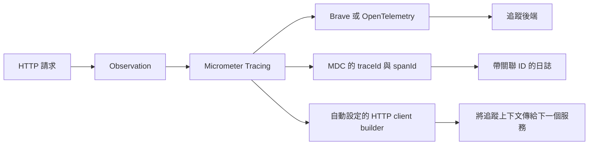

# 追蹤

<!-- source-attribution -->
> **非官方繁體中文翻譯** · Spring Boot 4.1.1 · 翻譯日期：2026-10-21  
> [官方英文網站](https://docs.spring.io/spring-boot/4.1/reference/actuator/tracing.html) · [固定版本英文來源](https://github.com/spring-projects/spring-boot/blob/v4.1.1/documentation/spring-boot-docs/src/docs/antora/modules/reference/pages/actuator/tracing.adoc) · [本地原文快照](../sources/spring-boot/documentation/spring-boot-docs/src/docs/antora/modules/reference/pages/actuator/tracing.adoc)  
> 原始作者與授權見 [來源聲明](../NOTICE.md)。官方範例及設定鍵保留原文，額外圖解另標示為譯者補充。

<!-- translation-status: translated -->

Spring Boot Actuator 為 [Micrometer Tracing][actuator--tracing-r1] 提供依賴管理與自動設定；Micrometer Tracing 是熱門追蹤函式庫的統一門面。

> **提示：**
>
> 若要深入了解 Micrometer Tracing 的能力，請參閱其[參考文件][actuator--tracing-r1]。

## 支援的追蹤器

Spring Boot 提供以下追蹤器的自動設定：

- [OpenTelemetry][actuator--tracing-r2] 搭配 [OTLP][actuator--tracing-r3]。
- [OpenZipkin Brave][actuator--tracing-r4] 搭配 [Zipkin][actuator--tracing-r5]。

## 入門

首先需要一個範例應用程式，作為追蹤入門的示範。
[開發第一個 Spring Boot 應用程式][actuator--tracing-r6]章節中的簡單「Hello World!」Web 應用程式，就足以滿足這裡的需求。
我們會使用 Brave 追蹤器，並以 Zipkin 作為追蹤後端。

回顧一下，主要應用程式的程式碼如下：

```kotlin
import org.apache.commons.logging.Log
import org.apache.commons.logging.LogFactory
import org.springframework.boot.autoconfigure.SpringBootApplication
import org.springframework.boot.runApplication
import org.springframework.web.bind.annotation.RequestMapping
import org.springframework.web.bind.annotation.RestController

@RestController
@SpringBootApplication
class MyApplication {

	private val logger: Log = LogFactory.getLog(MyApplication::class.java)

	@RequestMapping("/")
	fun home(): String {
		logger.info("home() has been called")
		return "Hello, World!"
	}

}

fun main(args: Array<String>) {
	runApplication<MyApplication>(*args)
}
```

```java
import org.apache.commons.logging.Log;
import org.apache.commons.logging.LogFactory;

import org.springframework.boot.SpringApplication;
import org.springframework.boot.autoconfigure.SpringBootApplication;
import org.springframework.web.bind.annotation.RequestMapping;
import org.springframework.web.bind.annotation.RestController;

@RestController
@SpringBootApplication
public class MyApplication {

	private static final Log logger = LogFactory.getLog(MyApplication.class);

	@RequestMapping("/")
	String home() {
		logger.info("home() has been called");
		return "Hello World!";
	}

	public static void main(String[] args) {
		SpringApplication.run(MyApplication.class, args);
	}

}
```

> **注意：**
>
> `home()` 方法增加了一行日誌敘述，稍後會用到。

現在必須加入 `org.springframework.boot:spring-boot-starter-zipkin` 依賴。

接著加入以下應用程式屬性：

```properties
management.tracing.sampling.probability=1
```

```yaml
management:
  tracing:
    sampling:
      probability: 1.0
```

Spring Boot 預設只取樣 10% 的請求，避免追蹤後端負荷過重。
此屬性將取樣比例改為 100%，讓每個請求都傳送到追蹤後端。

若要收集並視覺化追蹤資料，需要一個執行中的追蹤後端。
這裡使用 Zipkin。
[Zipkin 快速入門指南][actuator--tracing-r7]說明如何在本機啟動 Zipkin。

Zipkin 啟動後，就可以啟動應用程式。

以瀏覽器開啟 [localhost:8080][actuator--tracing-r8]，應會看見以下輸出：

```text
Hello World!
```

背後的流程是為 HTTP 請求建立 observation，接著橋接至 Brave，再由 Brave 向 Zipkin 回報一筆新的 trace。

現在開啟位於 [localhost:9411][actuator--tracing-r9] 的 Zipkin UI，按下「Run Query」列出收集到的所有 trace。
你應該會看見一筆 trace。
按下「Show」即可檢視詳細資訊。

## 日誌關聯 ID

關聯 ID 提供實用的方法，將日誌檔案中的各行連結到 span 或 trace。
使用 Micrometer Tracing 時，Spring Boot 預設會在日誌中加入關聯 ID。

預設關聯 ID 由 [MDC][actuator--tracing-r10] 中的 `traceId` 與 `spanId` 值組成。
例如 Micrometer Tracing 加入 MDC `traceId` 值 `803B448A0489F84084905D3093480352`，以及 MDC `spanId` 值 `3425F23BB2432450` 時，日誌輸出會包含關聯 ID `[803B448A0489F84084905D3093480352-3425F23BB2432450]`。

若偏好不同的關聯 ID 格式，可使用 `logging.pattern.correlation` 屬性定義。
例如以下設定會讓 Logback 使用 Spring Cloud Sleuth 先前採用的關聯 ID 格式：

```properties
logging.pattern.correlation=[${spring.application.name:},%X{traceId:-},%X{spanId:-}] 
logging.include-application-name=false
```

```yaml
logging:
  pattern:
    correlation: "[${spring.application.name:},%X{traceId:-},%X{spanId:-}] "
  include-application-name: false
```

> **注意：**
>
> 上例將 `logging.include-application-name` 設為 `false`，避免日誌訊息重複出現應用程式名稱，因為 `logging.pattern.correlation` 已包含它。
> 此外，`logging.pattern.correlation` 尾端包含空白，用來與預設緊接其後的 logger 名稱分隔。

> **提示：**
>
> 關聯 ID 仰賴上下文傳遞。
> 詳情請閱讀[這份文件][actuator--tracing-r11]。

## 傳遞 Trace

若要透過網路自動傳遞 trace，請使用自動設定的 [`RestTemplateBuilder`][actuator--tracing-r12]、[`RestClient.Builder`][actuator--tracing-r13] 或 [`WebClient.Builder`][actuator--tracing-r14] 建立用戶端。

> **警告：**
>
> 如果未透過自動設定的 builder，而自行建立 [`RestTemplate`][actuator--tracing-r15]、[`RestClient`][actuator--tracing-r16] 或 [`WebClient`][actuator--tracing-r17]，自動傳遞 trace 將無法運作！

## 追蹤器實作

由於 Micrometer Tracer 支援多種追蹤器實作，Spring Boot 可搭配多種依賴組合。
OpenTelemetry 搭配 OTLP，以及 Brave 搭配 Zipkin 是常見組合，並有專用 starter。

### OpenTelemetry 搭配 OTLP

使用 OpenTelemetry 追蹤並以 OTLP 回報資料，需要以下依賴：

- `org.springframework.boot:spring-boot-starter-opentelemetry`

使用 `management.opentelemetry.tracing.export.otlp.*` 設定屬性，設定透過 OTLP 回報資料的行為。

> **注意：**
>
> 若需要對 OTLP span exporter 進行進階自訂，可考慮註冊 [`OtlpHttpSpanExporterBuilderCustomizer`][actuator--tracing-r18] 或 [`OtlpGrpcSpanExporterBuilderCustomizer`][actuator--tracing-r19] Bean。
> 它們會在建立 `OtlpHttpSpanExporter` 或 `OtlpGrpcSpanExporter` 前呼叫。
> 這些 customizer 的優先順序高於自動設定套用的任何設定。

### OpenTelemetry 搭配 Zipkin

> **警告：**
>
> OpenTelemetry 已[將 Zipkin 支援標為棄用][actuator--tracing-r20]。
> 對應的自動設定將在 Spring Boot 4.2 移除。
> 請改用 Brave，或考慮使用 [Zipkin OTel 模組][actuator--tracing-r21]直接接收 OTLP。

使用 OpenTelemetry 追蹤並向 Zipkin 回報資料，需要以下依賴：

- `org.springframework.boot:spring-boot-micrometer-tracing-opentelemetry`：Spring Boot 對以 OpenTelemetry 為基礎的 Micrometer Tracing 所提供的支援。
- `io.micrometer:micrometer-tracing-bridge-otel`：將 Micrometer Observation API 橋接至 OpenTelemetry。
- `org.springframework.boot:spring-boot-zipkin`：Spring Boot 的 Zipkin 支援。
- `io.opentelemetry:opentelemetry-exporter-zipkin`：向 Zipkin 回報 trace 的 OpenTelemetry exporter。

使用 `management.tracing.export.zipkin.*` 設定屬性設定向 Zipkin 回報資料的行為。

### OpenZipkin Brave 搭配 Zipkin

使用 OpenZipkin Brave 追蹤並向 Zipkin 回報資料，需要以下依賴：

- `org.springframework.boot:spring-boot-starter-zipkin`

使用 `management.tracing.export.zipkin.*` 設定屬性設定向 Zipkin 回報資料的行為。

## 取樣

Spring Boot 預設只取樣 10% 的請求，避免追蹤後端負荷過重。
可透過 `management.tracing.sampling.probability` 屬性設定比例。

使用 OpenTelemetry 時，還可以透過 `management.opentelemetry.tracing.sampler` 屬性設定取樣器。
支援以下取樣器：

| 取樣器 | 說明 |
| --- | --- |
| `always-on` | 對每筆 trace 取樣。 |
| `always-off` | 捨棄每筆 trace。 |
| `trace-id-ratio` | 依 `management.tracing.sampling.probability` 對部分 trace 取樣。 |
| `parent-based-always-on` | 若父 span 已取樣，就對子 span 取樣。若沒有父 span，對每筆 trace 取樣。 |
| `parent-based-always-off` | 若父 span 已取樣，就對子 span 取樣。若沒有父 span，捨棄每筆 trace。 |
| `parent-based-trace-id-ratio`（預設） | 若父 span 已取樣，就對子 span 取樣。若沒有父 span，依 `management.tracing.sampling.probability` 對部分 trace 取樣。 |

## Span 限制

使用 OpenTelemetry 時，可透過 `management.opentelemetry.tracing.limits.*` 設定屬性設定 span 限制。
這些屬性能控制每個 span 的屬性、事件與連結數量上限，以及字串屬性值的長度上限。

例如將每個 span 的屬性數量限制為 64，屬性值長度上限設為 256 個字元：

```properties
management.opentelemetry.tracing.limits.max-attributes=64
management.opentelemetry.tracing.limits.max-attribute-value-length=256
```

```yaml
management:
  opentelemetry:
    tracing:
      limits:
        max-attributes: 64
        max-attribute-value-length: 256
```

若需要完整控制，可註冊自訂的 [`SpanLimits`][actuator--tracing-r22] Bean。

## 與 Micrometer Observation 整合

[`TracingAwareMeterObservationHandler`][actuator--tracing-r23] 會自動註冊到 [`ObservationRegistry`][actuator--tracing-r24]，為每個已完成的 observation 建立 span。

## 建立自訂 Span

你可以藉由啟動 observation 建立自己的 span。
為此，請將 [`ObservationRegistry`][actuator--tracing-r24] 注入元件：

```kotlin
import io.micrometer.observation.Observation
import io.micrometer.observation.ObservationRegistry
import org.springframework.stereotype.Component

@Component
class CustomObservation(private val observationRegistry: ObservationRegistry) {

	fun someOperation() {
		Observation.createNotStarted("some-operation", observationRegistry)
			.lowCardinalityKeyValue("some-tag", "some-value")
			.observe {
				// Business logic ...
			}
	}

}
```

```java
import io.micrometer.observation.Observation;
import io.micrometer.observation.ObservationRegistry;

import org.springframework.stereotype.Component;

@Component
class CustomObservation {

	private final ObservationRegistry observationRegistry;

	CustomObservation(ObservationRegistry observationRegistry) {
		this.observationRegistry = observationRegistry;
	}

	void someOperation() {
		Observation observation = Observation.createNotStarted("some-operation", this.observationRegistry);
		observation.lowCardinalityKeyValue("some-tag", "some-value");
		observation.observe(() -> {
			// Business logic ...
		});
	}

}
```

這會建立名稱為 "some-operation"，並帶有 "some-tag=some-value" 標籤的 observation。

> **提示：**
>
> 若想建立 span 而不建立指標，必須使用 Micrometer [較底層的 `Tracer` API][actuator--tracing-r25]。

## Baggage

你可以使用 [`Tracer`][actuator--tracing-r26] API 建立 baggage：

```kotlin
import io.micrometer.tracing.Tracer
import org.springframework.stereotype.Component

@Component
class CreatingBaggage(private val tracer: Tracer) {

	fun doSomething() {
		tracer.createBaggageInScope("baggage1", "value1").use {
			// Business logic
		}
	}

}
```

```java
import io.micrometer.tracing.BaggageInScope;
import io.micrometer.tracing.Tracer;

import org.springframework.stereotype.Component;

@Component
class CreatingBaggage {

	private final Tracer tracer;

	CreatingBaggage(Tracer tracer) {
		this.tracer = tracer;
	}

	void doSomething() {
		try (BaggageInScope scope = this.tracer.createBaggageInScope("baggage1", "value1")) {
			// Business logic
		}
	}

}
```

此範例建立名為 `baggage1`、值為 `value1` 的 baggage。
使用 W3C 傳遞格式時，baggage 會自動透過網路傳遞。
使用 B3 傳遞格式時，則不會自動傳遞 baggage。
若要手動指定透過網路傳遞的 baggage，請使用 `management.tracing.baggage.remote-fields` 設定屬性；W3C 也適用。
以上例而言，將此屬性設為 `baggage1`，就會產生 HTTP 標頭 `baggage1: value1`。

若要將 baggage 傳遞到 MDC，請使用 `management.tracing.baggage.correlation.fields` 設定屬性。
以上例而言，設為 `baggage1` 後，會產生名為 `baggage1` 的 MDC 項目。

## 測試

使用 [`@SpringBootTest`][actuator--tracing-r27] 時，會向外回報資料的追蹤元件不會自動設定。
詳情請參閱[使用追蹤][actuator--tracing-r28]。

## 譯者圖解：一次請求如何串起服務與日誌



[actuator--tracing-r1]: https://docs.micrometer.io/tracing/reference/1.7
[actuator--tracing-r2]: https://opentelemetry.io/
[actuator--tracing-r3]: https://opentelemetry.io/docs/reference/specification/protocol/
[actuator--tracing-r4]: https://github.com/openzipkin/brave
[actuator--tracing-r5]: https://zipkin.io/
[actuator--tracing-r6]: https://docs.spring.io/spring-boot/4.1/tutorial/first-application/index.html
[actuator--tracing-r7]: https://zipkin.io/pages/quickstart
[actuator--tracing-r8]: http://localhost:8080
[actuator--tracing-r9]: http://localhost:9411
[actuator--tracing-r10]: https://logback.qos.ch/manual/mdc.html
[actuator--tracing-r11]: https://docs.spring.io/spring-boot/4.1/reference/actuator/observability.html#actuator.observability.context-propagation
[actuator--tracing-r12]: https://docs.spring.io/spring-boot/4.1/reference/io/rest-client.html#io.rest-client.resttemplate
[actuator--tracing-r13]: https://docs.spring.io/spring-boot/4.1/reference/io/rest-client.html#io.rest-client.restclient
[actuator--tracing-r14]: https://docs.spring.io/spring-boot/4.1/reference/io/rest-client.html#io.rest-client.webclient
[actuator--tracing-r15]: https://docs.spring.io/spring-framework/docs/7.0.x/javadoc-api/org/springframework/web/client/RestTemplate.html
[actuator--tracing-r16]: https://docs.spring.io/spring-framework/docs/7.0.x/javadoc-api/org/springframework/web/client/RestClient.html
[actuator--tracing-r17]: https://docs.spring.io/spring-framework/docs/7.0.x/javadoc-api/org/springframework/web/reactive/function/client/WebClient.html
[actuator--tracing-r18]: https://docs.spring.io/spring-boot/4.1.1/api/java/org/springframework/boot/micrometer/tracing/opentelemetry/autoconfigure/otlp/OtlpHttpSpanExporterBuilderCustomizer.html
[actuator--tracing-r19]: https://docs.spring.io/spring-boot/4.1.1/api/java/org/springframework/boot/micrometer/tracing/opentelemetry/autoconfigure/otlp/OtlpGrpcSpanExporterBuilderCustomizer.html
[actuator--tracing-r20]: https://opentelemetry.io/docs/specs/otel/trace/sdk_exporters/zipkin/
[actuator--tracing-r21]: https://github.com/openzipkin-contrib/zipkin-otel
[actuator--tracing-r22]: https://javadoc.io/doc/io.opentelemetry/opentelemetry-sdk-trace/1.62.0/io/opentelemetry/sdk/trace/SpanLimits.html
[actuator--tracing-r23]: https://javadoc.io/doc/io.micrometer/micrometer-tracing/1.7.1/io/micrometer/tracing/handler/TracingAwareMeterObservationHandler.html
[actuator--tracing-r24]: https://javadoc.io/doc/io.micrometer/micrometer-observation/1.17.1/io/micrometer/observation/ObservationRegistry.html
[actuator--tracing-r25]: https://docs.micrometer.io/tracing/reference/1.7/api
[actuator--tracing-r26]: https://javadoc.io/doc/io.micrometer/micrometer-tracing/1.7.1/io/micrometer/tracing/Tracer.html
[actuator--tracing-r27]: https://docs.spring.io/spring-boot/4.1.1/api/java/org/springframework/boot/test/context/SpringBootTest.html
[actuator--tracing-r28]: https://docs.spring.io/spring-boot/4.1/reference/testing/spring-boot-applications.html#testing.spring-boot-applications.tracing
