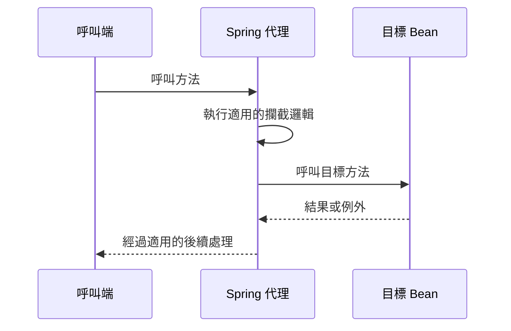

# 剖面導向程式設計（AOP）

<!-- source-attribution -->
> **非官方繁體中文翻譯** · Spring Boot 4.1.1 · 翻譯日期：2026-10-21  
> [官方英文網站](https://docs.spring.io/spring-boot/4.1/reference/features/aop.html) · [固定版本英文來源](https://github.com/spring-projects/spring-boot/blob/v4.1.1/documentation/spring-boot-docs/src/docs/antora/modules/reference/pages/features/aop.adoc) · [本地原文快照](../sources/spring-boot/documentation/spring-boot-docs/src/docs/antora/modules/reference/pages/features/aop.adoc)  
> 原始作者與授權見 [來源聲明](../NOTICE.md)。官方範例及設定鍵保留原文，額外圖解另標示為譯者補充。

<!-- translation-status: translated -->

Spring Boot 提供剖面導向程式設計（Aspect-Oriented Programming，AOP）的自動設定。關於 Spring AOP 的詳細說明，請參閱 [Spring Framework 參考文件][features--aop-r1]。

預設情況下，Spring Boot 的自動設定會讓 Spring AOP 使用 CGLib 代理。如果要改用 JDK 代理，請將 `spring.aop.proxy-target-class` 設為 `false`。

如果 classpath 中存在 AspectJ，Spring Boot 的自動設定會自動啟用 AspectJ 自動代理，因此不需要另外加上 [`@EnableAspectJAutoProxy`][features--aop-r2]。

## 譯者圖解：代理介入的位置

這張圖只示範呼叫經過代理的情況；不代表每個方法呼叫都必然經過代理。代理限制與其他織入方式請對照 Framework 的 AOP 文件。

[features--aop-r1]: https://docs.spring.io/spring-framework/reference/7.0/core/aop-api.html
[features--aop-r2]: https://docs.spring.io/spring-framework/docs/7.0.x/javadoc-api/org/springframework/context/annotation/EnableAspectJAutoProxy.html
