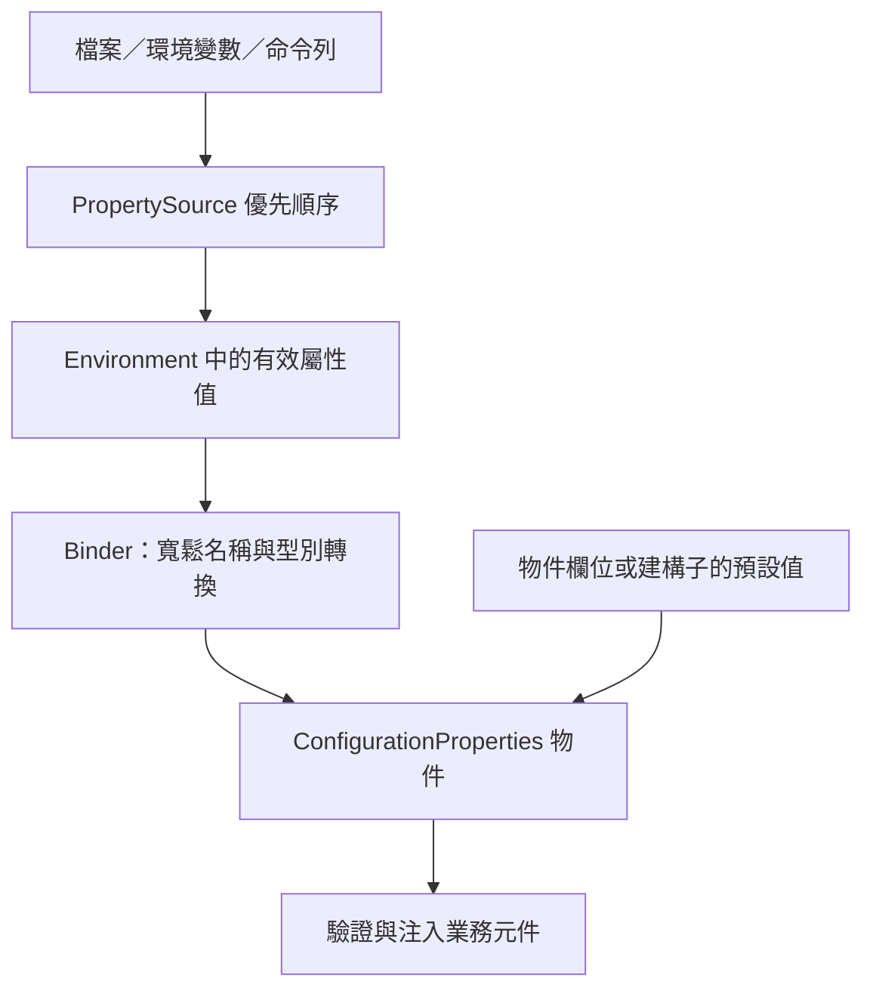
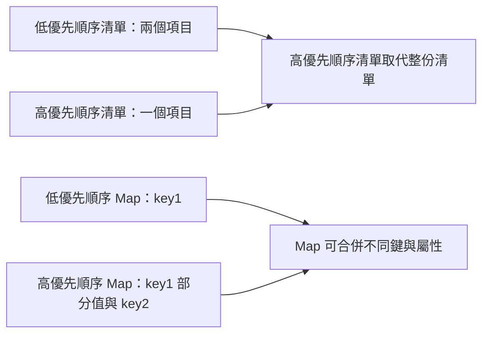

# 外部化設定

<!-- source-attribution -->
> **非官方繁體中文翻譯** · Spring Boot 4.1.1 · 翻譯日期：2026-10-21  
> [官方英文網站](https://docs.spring.io/spring-boot/4.1/reference/features/external-config.html) · [固定版本英文來源](https://github.com/spring-projects/spring-boot/blob/v4.1.1/documentation/spring-boot-docs/src/docs/antora/modules/reference/pages/features/external-config.adoc) · [本地原文快照](../sources/spring-boot/documentation/spring-boot-docs/src/docs/antora/modules/reference/pages/features/external-config.adoc)  
> 原始作者與授權見 [來源聲明](../NOTICE.md)。官方範例及設定鍵保留原文，額外圖解另標示為譯者補充。

<!-- translation-status: translated -->

Spring Boot 讓你將設定外部化，使用相同應用程式程式碼在不同環境工作。可使用多種外部設定來源，包括 Java properties 檔案、YAML 檔案、環境變數及命令列引數。

屬性值可以透過 [`@Value`][features--external-config-r1] 直接注入 Bean、透過 Spring 的 [`Environment`][features--external-config-r2] 抽象存取，或透過 [`@ConfigurationProperties`][features--external-config-r4] [繫結至結構化物件][features--external-config-r3]。

Spring Boot 使用特定的 [`PropertySource`][features--external-config-r5] 順序，讓值能以合理方式覆寫。後面的屬性來源可覆寫前面的值。

來源依以下順序考慮：

1. 預設屬性，透過 [`SpringApplication.setDefaultProperties(Map)`][features--external-config-r6] 指定。
2. [`@Configuration`][features--external-config-r8] 類別上的 [`@PropertySource`][features--external-config-r7]。請注意，這類來源直到 application context 重新整理時才加入 [`Environment`][features--external-config-r2]，對於在重新整理前就讀取的 `logging.*`、`spring.main.*` 等屬性而言，已經太晚。
3. 設定資料，例如 `application.properties`。
4. 只提供 `random.*` 屬性的 [`RandomValuePropertySource`][features--external-config-r9]。
5. 作業系統環境變數。
6. Java 系統屬性，即 `System.getProperties()`。
7. `java:comp/env` 中的 JNDI 屬性。
8. [`ServletContext`][features--external-config-r10] 初始化參數。
9. [`ServletConfig`][features--external-config-r11] 初始化參數。
10. `SPRING_APPLICATION_JSON` 的屬性，即嵌入環境變數或系統屬性的行內 JSON。
11. 命令列引數。
12. 測試的 `properties` 屬性；可用於 [`@SpringBootTest`][features--external-config-r12] 與[測試應用程式特定切片的註解][features--external-config-r13]。
13. 測試中的 [`@DynamicPropertySource`][features--external-config-r14]。
14. 測試上的 [`@TestPropertySource`][features--external-config-r15]。
15. Devtools 啟用時，`$HOME/.config/spring-boot` 目錄中的 [Devtools 全域設定屬性][features--external-config-r16]。

設定資料檔案依以下順序考慮：

1. 封裝在 jar 內的[應用程式屬性][features--external-config-r17]，即 `application.properties` 與 YAML 版本。
2. 封裝在 jar 內的 [Profile 專用應用程式屬性][features--external-config-r18]，即 `application-{profile}.properties` 與 YAML 版本。
3. 封裝 jar 外的[應用程式屬性][features--external-config-r17]，即 `application.properties` 與 YAML 版本。
4. 封裝 jar 外的 [Profile 專用應用程式屬性][features--external-config-r18]，即 `application-{profile}.properties` 與 YAML 版本。

> **注意：**
>
> 建議整個應用程式統一使用一種格式。若同一位置同時有 `.properties` 與 YAML 設定檔，`.properties` 優先。

> **注意：**
>
> 若使用環境變數而非系統屬性，多數作業系統不允許以句點分隔的鍵名稱，但可改用底線，例如使用 `SPRING_CONFIG_NAME` 取代 `spring.config.name`。詳見[從環境變數繫結][features--external-config-r19]。

> **注意：**
>
> 若應用程式在 Servlet 容器或應用程式伺服器中執行，可以使用 `java:comp/env` 中的 JNDI 屬性或 Servlet context 初始化參數，取代或搭配環境變數、系統屬性。

舉個具體例子，假設你開發使用 `name` 屬性的 [`@Component`][features--external-config-r20]，如下所示：

```kotlin
import org.springframework.beans.factory.annotation.Value
import org.springframework.stereotype.Component

@Component
class MyBean {

	@Value("\${name}")
	private val name: String? = null

	// ...

}
```

```java
import org.springframework.beans.factory.annotation.Value;
import org.springframework.stereotype.Component;

@Component
public class MyBean {

	@Value("${name}")
	private String name;

	// ...

}
```

在應用程式 classpath（例如 jar 內）可放置 `application.properties`，提供合理的 `name` 預設值。於新環境執行時，可在 jar 外提供另一份 `application.properties` 覆寫 `name`。進行一次性測試時，可用特定命令列選項啟動，例如 `java -jar app.jar --name="Spring"`。

> **提示：**
>
> `env` 與 `configprops` 端點有助於了解某屬性為何具有特定值，可用來診斷非預期的屬性值。詳見[正式環境功能][features--external-config-r21]。

## 存取命令列屬性

[`SpringApplication`][features--external-config-r22] 預設會將所有命令列選項引數（以 `--` 開頭，例如 `--server.port=9000`）轉為 `property`，加入 Spring [`Environment`][features--external-config-r2]。如前所述，命令列屬性一律優先於檔案型屬性來源。

若不希望將命令列屬性加入 [`Environment`][features--external-config-r2]，可使用 `SpringApplication.setAddCommandLineProperties(false)` 停用。

## JSON 應用程式屬性

環境變數與系統屬性通常有限制，導致部分屬性名稱無法使用。為此，Spring Boot 允許將一組屬性編碼成單一 JSON 結構。

應用程式啟動時，任何 `spring.application.json` 或 `SPRING_APPLICATION_JSON` 屬性都會被解析並加入 [`Environment`][features--external-config-r2]。

例如，可在 UN\*X shell 命令列透過環境變數提供 `SPRING_APPLICATION_JSON`：

```shell
$ SPRING_APPLICATION_JSON='{"my":{"name":"test"}}' java -jar myapp.jar
```

上述範例會在 Spring [`Environment`][features--external-config-r2] 得到 `my.name=test`。

同一份 JSON 也能透過系統屬性提供：

```shell
$ java -Dspring.application.json='{"my":{"name":"test"}}' -jar myapp.jar
```

或透過命令列引數提供：

```shell
$ java -jar myapp.jar --spring.application.json='{"my":{"name":"test"}}'
```

部署到傳統應用程式伺服器時，也可使用名稱為 `java:comp/env/spring.application.json` 的 JNDI 變數。

> **注意：**
>
> JSON 中的 `null` 雖然會加入產生的屬性來源，但 [`PropertySourcesPropertyResolver`][features--external-config-r23] 會將 `null` 屬性視為缺值。因此，JSON 無法用 `null` 覆寫低優先順序來源的屬性。

## 外部應用程式屬性

應用程式啟動時，Spring Boot 會自動從下列位置尋找並載入 `application.properties` 與 `application.yaml`：

1. classpath：
   1. classpath 根目錄。
   2. classpath 的 `/config` 套件。
2. 目前目錄：
   1. 目前目錄本身。
   2. 目前目錄下的 `config/` 子目錄。
   3. `config/` 子目錄的直接子目錄。

此清單依優先順序排列，較下方項目的值覆寫前面的值。載入檔案中的文件會以 [`PropertySource`][features--external-config-r5] 實例加入 Spring [`Environment`][features--external-config-r2]。

若不喜歡 `application` 這個設定檔名，可用 `spring.config.name` 環境屬性改名。例如要尋找 `myproject.properties` 與 `myproject.yaml`，可這樣執行：

```shell
$ java -jar myproject.jar --spring.config.name=myproject
```

也可以透過 `spring.config.location` 環境屬性指定明確位置。此屬性接受以逗號分隔的一或多個待檢查位置。

下例指定兩個不同檔案：

```shell
$ java -jar myproject.jar --spring.config.location=\
	optional:classpath:/default.properties,\
	optional:classpath:/override.properties
```

> **提示：**
>
> 若[位置是選用的][features--external-config-r24]，不存在也無妨，請使用 `optional:` 前綴。

> **警告：**
>
> `spring.config.name`、`spring.config.location` 與 `spring.config.additional-location` 很早就會用來決定要載入哪些檔案，必須定義為環境屬性，通常是作業系統環境變數、系統屬性或命令列引數。

如果 `spring.config.location` 包含目錄而非檔案，應以 `/` 結尾。執行時會先在目錄後附加由 `spring.config.name` 產生的名稱，再載入。明確指定的檔案則直接匯入。

> **注意：**
>
> 目錄與檔案位置都會展開，以檢查 [Profile 專用檔案][features--external-config-r18]。例如 `spring.config.location` 為 `classpath:myconfig.properties` 時，也會載入適用的 `classpath:myconfig-<profile>.properties`。

多數情況下，加入的每個 `spring.config.location` 項目參照單一檔案或目錄。位置按定義順序處理，後者可覆寫前者。

若位置設定複雜，且使用 Profile 專用檔案，可能需提供額外提示，讓 Spring Boot 知道如何分組。位置群組是一組視為同一層級的位置。例如你可能想將所有 classpath 位置分為一組，再將所有外部位置分為一組。群組內項目以 `;` 分隔。詳見 [Profile 專用檔案][features--external-config-r18]一節的範例。

`spring.config.location` 設定的位置會取代預設位置。例如設為 `optional:classpath:/custom-config/,optional:file:./custom-config/` 時，完整搜尋位置為：

1. `optional:classpath:custom-config/`
2. `optional:file:./custom-config/`

若希望增加位置而非取代，可使用 `spring.config.additional-location`。額外位置載入的屬性可覆寫預設位置。例如設為 `optional:classpath:/custom-config/,optional:file:./custom-config/` 時，完整位置為：

1. `optional:classpath:/;optional:classpath:/config/`
2. `optional:file:./;optional:file:./config/;optional:file:./config/*/`
3. `optional:classpath:custom-config/`
4. `optional:file:./custom-config/`

這個搜尋順序讓你在一個設定檔指定預設值，再於另一個檔案選擇性覆寫。可在預設位置的 `application.properties`（或由 `spring.config.name` 選擇的其他基本名稱）提供應用程式預設值，執行時再用自訂位置中的另一個檔案覆寫。

### 選用位置

預設指定的設定資料位置不存在時，Spring Boot 會擲出 [`ConfigDataLocationNotFoundException`][features--external-config-r25]，應用程式無法啟動。

若想指定位置，但允許它有時不存在，可使用 `optional:` 前綴。此前綴可用於 `spring.config.location`、`spring.config.additional-location`，以及 [`spring.config.import`][features--external-config-r26] 宣告。

例如 `spring.config.import` 設為 `optional:file:./myconfig.properties`，允許應用程式即使缺少 `myconfig.properties` 仍能啟動。

若要忽略所有 [`ConfigDataLocationNotFoundException`][features--external-config-r25] 並一律繼續啟動，可透過 `SpringApplication.setDefaultProperties(…)` 或系統／環境變數，將 `spring.config.on-not-found` 設為 `ignore`。

### 萬用字元位置

若設定檔位置的最後一段路徑包含 `*`，即視為萬用字元位置。載入設定時會展開萬用字元，連直接子目錄也一起檢查。在 Kubernetes 等具有多個設定來源的環境中，這特別實用。

例如你有 Redis 與 MySQL 設定，希望分開維護，但兩者都必須存在於 `application.properties`。因此可能有兩份同名檔案，分別掛載於 `/config/redis/application.properties` 與 `/config/mysql/application.properties`。此時，`config/*/` 萬用位置會讓兩者都被處理。

Spring Boot 預設搜尋位置已包含 `config/*/`，因此會搜尋 jar 外 `/config` 目錄的所有子目錄。

也可自行在 `spring.config.location` 與 `spring.config.additional-location` 使用萬用位置。

> **注意：**
>
> 萬用位置只能包含一個 `*`。搜尋目錄時須以 `*/` 結尾；搜尋檔案時須以 `*/<filename>` 結尾。含萬用字元的位置依檔案絕對路徑的字母順序排序。

> **提示：**
>
> 萬用位置只適用於外部目錄，不能用於 `classpath:` 位置。

### Profile 專用檔案

除了 `application` 屬性檔，Spring Boot 也會嘗試依 `application-{profile}` 命名慣例載入 Profile 專用檔案。例如啟用 `prod` 並使用 YAML 時，會同時考慮 `application.yaml` 與 `application-prod.yaml`。

Profile 專用屬性從與一般 `application.properties` 相同的位置載入，而且一律覆寫非專用檔案。指定多個 Profile 時採後者優先。例如 `spring.profiles.active` 設為 `prod,live`，`application-live.properties` 可覆寫 `application-prod.properties` 的值。

> **注意：**
>
> 後者優先策略在[位置群組][features--external-config-r27]層級套用。`spring.config.location=classpath:/cfg/,classpath:/ext/` 與 `classpath:/cfg/;classpath:/ext/` 的覆寫規則不同。
>
> 延續 `prod,live` 範例，假設有下列檔案：
>
> ```text
> /cfg
>   application-live.properties
> /ext
>   application-live.properties
>   application-prod.properties
> ```
>
> 使用 `classpath:/cfg/,classpath:/ext/` 時，先處理所有 `/cfg`，再處理所有 `/ext`：
>
> 1. `/cfg/application-live.properties`
> 2. `/ext/application-prod.properties`
> 3. `/ext/application-live.properties`
>
> 改用 `classpath:/cfg/;classpath:/ext/`，即以 `;` 分隔時，`/cfg` 與 `/ext` 在同一層級處理：
>
> 1. `/ext/application-prod.properties`
> 2. `/cfg/application-live.properties`
> 3. `/ext/application-live.properties`

[`Environment`][features--external-config-r2] 有一組預設 Profile，預設為 `[default]`，在未設定作用中 Profile 時使用。換言之，未明確啟用 Profile 時，會考慮 `application-default` 的屬性。

> **注意：**
>
> 屬性檔只載入一次。若已直接[匯入][features--external-config-r26]某個 Profile 專用屬性檔，就不會再次匯入。

### 匯入其他資料

應用程式屬性可以透過 `spring.config.import`，從其他位置匯入額外設定資料。匯入在發現時即處理，視為緊接著插入宣告匯入的文件之後的額外文件。

例如 classpath 中的 `application.properties` 可能包含：

```properties
spring.application.name=myapp
spring.config.import=optional:file:./dev.properties
```

```yaml
spring:
  application:
    name: "myapp"
  config:
    import: "optional:file:./dev.properties"
```

這會匯入目前目錄的 `dev.properties`（若存在）。匯入檔案的值優先於觸發匯入的檔案。上述例子中，`dev.properties` 可將 `spring.application.name` 改為其他值。

> **注意：**
>
> 不論宣告多少次，每個匯入只會匯入一次。

properties 檔案預設以 ISO-8859-1 字元集匯入，可用 encoding 屬性變更：

```properties
spring.config.import=classpath:import.properties[encoding=utf-8]
```

```yaml
spring:
  config:
    import: "classpath:import.properties[encoding=utf-8]"
```

現在 `import.properties` 會以 UTF-8 讀取。

#### 使用「固定」與「相對匯入」位置

匯入可指定為**固定**或**相對匯入**位置。固定位置不論 `spring.config.import` 宣告在哪裡，都解析為相同底層資源；相對匯入位置則相對於宣告該屬性的檔案解析。

以斜線 `/` 或 URL 風格前綴（`file:`、`classpath:` 等）開頭者視為固定位置，其餘均為相對匯入位置。

> **注意：**
>
> 判定固定或相對匯入位置時，不考慮 `optional:` 前綴。

例如 `/demo` 目錄包含 `application.jar`，我們加入以下 `/demo/application.properties`：

```properties
spring.config.import=optional:core/core.properties
```

這是相對匯入位置，因此若 `/demo/core/core.properties` 存在，就會嘗試載入。

若 `/demo/core/core.properties` 包含：

```properties
spring.config.import=optional:extra/extra.properties
```

便會嘗試載入 `/demo/core/extra/extra.properties`。`optional:extra/extra.properties` 相對於 `/demo/core/core.properties`，因此完整路徑是 `/demo/core/` 加上 `extra/extra.properties`。

#### 屬性順序

匯入宣告在 properties／YAML 檔案單一文件內的位置不影響結果。例如以下兩種寫法相同：

```properties
spring.config.import=my.properties
my.property=value
```

```yaml
spring:
  config:
    import: "my.properties"
my:
  property: "value"
```

```properties
my.property=value
spring.config.import=my.properties
```

```yaml
my:
  property: "value"
spring:
  config:
    import: "my.properties"
```

兩者都是 `my.properties` 的值優先於觸發匯入的檔案。

同一個 `spring.config.import` 鍵可指定多個位置，依宣告順序處理，後面的匯入優先。

> **注意：**
>
> 適用時，也會考慮 [Profile 專用版本][features--external-config-r18]。上述例子會匯入 `my.properties` 以及任何 `my-<profile>.properties`。

> **提示：**
>
> Spring Boot 提供可插拔 API，支援不同位置位址。預設可匯入 Java Properties、YAML 與[設定樹][features--external-config-r28]。
>
> 第三方 jar 可支援其他技術，檔案不必位於本機。例如設定資料可能來自 Consul、Apache ZooKeeper 或 Netflix Archaius 等外部儲存系統。
>
> 若要支援自己的位置，請參閱 `org.springframework.boot.context.config` 套件的 [`ConfigDataLocationResolver`][features--external-config-r29] 與 [`ConfigDataLoader`][features--external-config-r30]。

### 匯入沒有副檔名的檔案

部分雲端平台無法為掛載的檔案加上副檔名。匯入時必須給 Spring Boot 提示，讓它知道如何載入；可在方括號內放入副檔名提示。

例如想把 `/etc/config/myconfig` 當作 YAML 匯入，可在 `application.properties` 使用：

```properties
spring.config.import=file:/etc/config/myconfig[.yaml]
```

```yaml
spring:
  config:
    import: "file:/etc/config/myconfig[.yaml]"
```

這是以下寫法的簡寫：

```properties
spring.config.import=file:/etc/config/myconfig[extension=.yaml]
```

```yaml
spring:
  config:
    import: "file:/etc/config/myconfig[extension=.yaml]"
```

### 檔案屬性

`spring.config.import` 支援檔案屬性，如指定[編碼][features--external-config-r26]或[副檔名][features--external-config-r31]時所示。

若需指定多個屬性，可用以下語法：

```properties
spring.config.import=file:/etc/config/myconfig[extension=.yaml][encoding=utf-8]
```

```yaml
spring:
  config:
    import: "file:/etc/config/myconfig[extension=.yaml][encoding=utf-8]"
```

### 使用環境變數

在 Kubernetes 等雲端平台執行應用程式時，通常需要讀取平台提供的設定值。可使用環境變數，或[設定樹][features--external-config-r28]。

甚至能將完整的 properties 或 YAML 設定存於多行環境變數，再以 `env:` 前綴載入。假設環境變數 `MY_CONFIGURATION` 內容為：

```properties
my.name=Service1
my.cluster=Cluster1
```

可用 `env:` 匯入該變數中的全部屬性：

```properties
spring.config.import=env:MY_CONFIGURATION
```

```yaml
spring:
  config:
    import: "env:MY_CONFIGURATION"
```

> **提示：**
>
> 此功能也支援[指定副檔名][features--external-config-r31]，預設為 `.properties`。

### 使用設定樹

將設定值存於環境變數有其缺點，尤其是應保密的值。

作為替代，許多雲端平台允許將設定映射到掛載的資料磁碟區。例如 Kubernetes 可以掛載 [`ConfigMaps`][features--external-config-r32] 與 [`Secrets`][features--external-config-r33]。

常見的掛載模式有兩種：

1. 單一檔案包含完整屬性集合，通常以 YAML 撰寫。
2. 將多個檔案寫入目錄樹，檔名成為「鍵」，檔案內容成為「值」。

第一種情況可依[前文][features--external-config-r26]使用 `spring.config.import` 直接匯入 YAML 或 Properties。第二種則須使用 `configtree:` 前綴，告知 Spring Boot 將所有檔案公開為屬性。

假設 Kubernetes 掛載以下磁碟區：

```text
etc/
  config/
    myapp/
      username
      password
```

`username` 檔案內容是設定值，`password` 內容則是機密資料。

若要匯入，請在 `application.properties` 或 `application.yaml` 加入：

```properties
spring.config.import=optional:configtree:/etc/config/
```

```yaml
spring:
  config:
    import: "optional:configtree:/etc/config/"
```

接著就能以一般方式從 [`Environment`][features--external-config-r2] 存取或注入 `myapp.username` 與 `myapp.password`。

> **提示：**
>
> 設定樹下的資料夾與檔案名稱共同構成屬性名稱。上述例子若要直接以 `username` 與 `password` 存取，可將 `spring.config.import` 設為 `optional:configtree:/etc/config/myapp`。

> **注意：**
>
> 含句點的檔名也會正確映射。例如 `/etc/config` 中名為 `myapp.username` 的檔案，會在 [`Environment`][features--external-config-r2] 產生 `myapp.username` 屬性。

> **提示：**
>
> 依預期內容，設定樹的值可繫結為 [`String`][features--external-config-r34] 或 `byte[]`。

若從同一父目錄匯入多個設定樹，可使用萬用字元簡寫。任何以 `/*/` 結尾的 `configtree:` 位置，都會將所有直接子目錄作為設定樹匯入。與沒有萬用字元的匯入相同，各設定樹下的資料夾與檔案名稱構成屬性名稱。

例如有以下磁碟區：

```text
etc/
  config/
    dbconfig/
      db/
        username
        password
    mqconfig/
      mq/
        username
        password
```

可將 `configtree:/etc/config/*/` 作為匯入位置：

```properties
spring.config.import=optional:configtree:/etc/config/*/
```

```yaml
spring:
  config:
    import: "optional:configtree:/etc/config/*/"
```

這會加入 `db.username`、`db.password`、`mq.username` 與 `mq.password`。

> **注意：**
>
> 以萬用字元載入的目錄依字母排序。若需其他順序，應將每個位置列為獨立匯入。

設定樹也可用於 Docker secret。Docker Swarm 服務獲授權存取 secret 後，secret 會掛載到容器。例如名為 `db.password` 的 secret 掛載於 `/run/secrets/`，可透過以下方式讓 Spring environment 取得 `db.password`：

```properties
spring.config.import=optional:configtree:/run/secrets/
```

```yaml
spring:
  config:
    import: "optional:configtree:/run/secrets/"
```

### 屬性佔位符

`application.properties` 與 `application.yaml` 的值在使用時會經過現有 [`Environment`][features--external-config-r2] 解析，因此能參照先前定義的值，例如系統屬性或環境變數。標準 `${name}` 佔位符語法可放在值的任何位置。也能以 `:` 分隔屬性名稱與預設值，例如 `${name:default}`。

以下示範有、無預設值的佔位符：

```properties
app.name=MyApp
app.description=${app.name} is a Spring Boot application written by ${username:Unknown}
```

```yaml
app:
  name: "MyApp"
  description: "${app.name} is a Spring Boot application written by ${username:Unknown}"
```

假設其他地方未設定 `username`，`app.description` 的值會是 `MyApp is a Spring Boot application written by Unknown`。

> **注意：**
>
> 佔位符中的屬性名稱應一律採標準形式，即只使用小寫的 kebab-case。這讓 Spring Boot 能使用與 [`@ConfigurationProperties`][features--external-config-r4] [寬鬆繫結][features--external-config-r35]相同的邏輯。
>
> 例如 `${demo.item-price}` 可找到 `application.properties` 的 `demo.item-price` 與 `demo.itemPrice`，以及系統環境的 `DEMO_ITEMPRICE`。若改用 `${demo.itemPrice}`，能找到檔案的 `demo.itemPrice` 與系統環境的 `DEMO_ITEMPRICE`，但不考慮 `demo.item-price`。

> **提示：**
>
> 此技巧也能為既有 Spring Boot 屬性建立「短版」。詳見 How-to Guides 的[使用「短」命令列引數][features--external-config-r36]。

### 使用多文件檔案

Spring Boot 允許將一個實體檔案分成多個邏輯文件，分別加入。文件由上而下依序處理，後面的文件可覆寫前面的屬性。

`application.yaml` 使用標準 YAML 多文件語法。連續三個連字號表示前一文件結束、下一文件開始。

例如以下檔案有兩份邏輯文件：

```yaml
spring:
  application:
    name: "MyApp"
---
spring:
  application:
    name: "MyCloudApp"
  config:
    activate:
      on-cloud-platform: "kubernetes"
```

`application.properties` 則使用特殊的 `#---` 或 `!---` 註解分隔：

```properties
spring.application.name=MyApp
#---
spring.application.name=MyCloudApp
spring.config.activate.on-cloud-platform=kubernetes
```

> **注意：**
>
> properties 檔案的分隔符前不能有空白，且必須恰好有三個連字號。分隔符前後緊鄰的行，不得使用與分隔符相同的註解前綴。

> **提示：**
>
> 多文件屬性檔經常搭配 `spring.config.activate.on-profile` 等啟用屬性使用，詳見[下一節][features--external-config-r37]。

> **警告：**
>
> [`@PropertySource`][features--external-config-r7] 與 [`@TestPropertySource`][features--external-config-r15] 無法載入多文件屬性檔。

### 啟用屬性

有時只想在符合特定條件時啟用一組屬性，例如只與某個作用中 Profile 有關的屬性。

可使用 `spring.config.activate.*` 有條件地啟用屬性文件。

提供以下啟用屬性：

表 1. 啟用屬性

| 屬性 | 說明 |
| --- | --- |
| `on-profile` | 文件啟用所須符合的 Profile 運算式；也可為運算式清單，其中至少一個符合即可啟用。 |
| `on-cloud-platform` | 文件啟用時必須偵測到的 [`CloudPlatform`][features--external-config-r38]。 |

例如下例指定第二份文件只在 Kubernetes 上執行，而且「prod」或「staging」Profile 啟用時生效：

```properties
myprop=always-set
#---
spring.config.activate.on-cloud-platform=kubernetes
spring.config.activate.on-profile=prod | staging
myotherprop=sometimes-set
```

```yaml
myprop:
  "always-set"
---
spring:
  config:
    activate:
      on-cloud-platform: "kubernetes"
      on-profile: "prod | staging"
myotherprop: "sometimes-set"
```

## 加密屬性

Spring Boot 沒有內建屬性值加密支援，但提供修改 Spring [`Environment`][features--external-config-r2] 值所需的擴充接點。[`EnvironmentPostProcessor`][features--external-config-r39] 允許在應用程式啟動前操作 [`Environment`][features--external-config-r2]。詳見[啟動前自訂 Environment 或 ApplicationContext][features--external-config-r40]。

若需要安全儲存憑證與密碼，[Spring Cloud Vault][features--external-config-r41] 支援將外部化設定儲存在 [HashiCorp Vault][features--external-config-r42]。

## 使用 YAML

[YAML][features--external-config-r43] 是 JSON 的超集合，因此很適合表達階層式設定資料。classpath 中只要有 [SnakeYAML][features--external-config-r44]，[`SpringApplication`][features--external-config-r22] 就自動支援以 YAML 取代 properties。

> **注意：**
>
> 使用 starter 時，`spring-boot-starter` 會自動提供 SnakeYAML。

### 將 YAML 映射為屬性

YAML 文件必須從階層式格式轉換為 Spring [`Environment`][features--external-config-r2] 可使用的扁平結構。例如：

```yaml
environments:
  dev:
    url: "https://dev.example.com"
    name: "Developer Setup"
  prod:
    url: "https://another.example.com"
    name: "My Cool App"
```

為了從 [`Environment`][features--external-config-r2] 存取，會攤平成：

```properties
environments.dev.url=https://dev.example.com
environments.dev.name=Developer Setup
environments.prod.url=https://another.example.com
environments.prod.name=My Cool App
```

YAML 清單同樣需要攤平，以帶有 `[index]` 索引的屬性鍵表示。例如：

```yaml
 my:
  servers:
  - "dev.example.com"
  - "another.example.com"
```

會轉為：

```properties
my.servers[0]=dev.example.com
my.servers[1]=another.example.com
```

> **提示：**
>
> 使用 `[index]` 表示法的屬性，可透過 Spring Boot [`Binder`][features--external-config-r47] 繫結為 Java [`List`][features--external-config-r45] 或 [`Set`][features--external-config-r46]。詳見下方[型別安全的設定屬性][features--external-config-r3]。

> **警告：**
>
> [`@PropertySource`][features--external-config-r7] 與 [`@TestPropertySource`][features--external-config-r15] 無法載入 YAML。因此若必須以這些註解載入值，就要使用 properties 檔案。

### 直接載入 YAML

Spring Framework 提供兩個便利類別：[`YamlPropertiesFactoryBean`][features--external-config-r48] 將 YAML 載入為 [`Properties`][features--external-config-r49]；[`YamlMapFactoryBean`][features--external-config-r50] 將 YAML 載入為 [`Map`][features--external-config-r51]。

若要載入為 Spring [`PropertySource`][features--external-config-r5]，也可使用 [`YamlPropertySourceLoader`][features--external-config-r52]。

## 設定隨機值

[`RandomValuePropertySource`][features--external-config-r9] 適合注入隨機值，例如機密值或測試案例。它能產生 integer、long、UUID 或字串，如下所示：

```properties
my.secret=${random.value}
my.number=${random.int}
my.bignumber=${random.long}
my.uuid=${random.uuid}
my.number-less-than-ten=${random.int(10)}
my.number-in-range=${random.int[1024,65536]}
```

```yaml
my:
  secret: "${random.value}"
  number: "${random.int}"
  bignumber: "${random.long}"
  uuid: "${random.uuid}"
  number-less-than-ten: "${random.int(10)}"
  number-in-range: "${random.int[1024,65536]}"
```

`random.int*` 的語法是 `OPEN value (,max) CLOSE`，其中 `OPEN,CLOSE` 代表任意字元，`value,max` 為整數。若提供 `max`，`value` 是最小值，`max` 是最大值且不包含該上限。

## 設定系統環境屬性

Spring Boot 支援為環境屬性設定前綴。當多個設定需求不同的 Spring Boot 應用程式共用系統環境時，這很實用。可在執行前直接對 [`SpringApplication`][features--external-config-r22] 呼叫 `setEnvironmentPrefix(…)`。

例如前綴設為 `input`，`remote.timeout` 會從系統環境解析為 `INPUT_REMOTE_TIMEOUT`。

> **注意：**
>
> 前綴**只**適用於系統環境屬性。上述例子從其他來源讀取時，仍使用 `remote.timeout`。

## 型別安全的設定屬性

使用 `@Value("${property}")` 注入設定有時很繁瑣，尤其需要處理多個屬性，或資料本身具有階層結構。Spring Boot 提供另一種方式，以強型別 Bean 管理並驗證應用程式設定。

> **提示：**
>
> 另見 [`@Value` 與型別安全設定屬性的差異][features--external-config-r53]。

### JavaBean 屬性繫結

可將設定繫結至宣告標準 JavaBean 屬性的 Bean，例如：

```kotlin
import org.springframework.boot.context.properties.ConfigurationProperties
import java.net.InetAddress

@ConfigurationProperties("my.service")
class MyProperties {

	var isEnabled = false

	var remoteAddress: InetAddress? = null

	val security = Security()

	class Security {

		var username: String? = null

		var password: String? = null

		var roles: List<String> = ArrayList(setOf("USER"))

	}

}
```

```java
import java.net.InetAddress;
import java.util.ArrayList;
import java.util.Collections;
import java.util.List;

import org.springframework.boot.context.properties.ConfigurationProperties;

@ConfigurationProperties("my.service")
public class MyProperties {

	private boolean enabled;

	private InetAddress remoteAddress;

	private final Security security = new Security();

	// getters / setters...

	public boolean isEnabled() {
		return this.enabled;
	}

	public void setEnabled(boolean enabled) {
		this.enabled = enabled;
	}

	public InetAddress getRemoteAddress() {
		return this.remoteAddress;
	}

	public void setRemoteAddress(InetAddress remoteAddress) {
		this.remoteAddress = remoteAddress;
	}

	public Security getSecurity() {
		return this.security;
	}

	public static class Security {

		private String username;

		private String password;

		private List<String> roles = new ArrayList<>(Collections.singleton("USER"));

		// getters / setters...

		public String getUsername() {
			return this.username;
		}

		public void setUsername(String username) {
			this.username = username;
		}

		public String getPassword() {
			return this.password;
		}

		public void setPassword(String password) {
			this.password = password;
		}

		public List<String> getRoles() {
			return this.roles;
		}

		public void setRoles(List<String> roles) {
			this.roles = roles;
		}

	}

}
```

上述 POJO 定義：

- `my.service.enabled`：預設值為 `false`。
- `my.service.remote-address`：型別可由 [`String`][features--external-config-r34] 轉換。
- `my.service.security.username`：巢狀「security」物件的名稱取自屬性名稱；此處完全不使用型別名稱，型別也可以是 [`SecurityProperties`][features--external-config-r54]。
- `my.service.security.password`。
- `my.service.security.roles`：[`String`][features--external-config-r34] 集合，預設為 `USER`。

> **提示：**
>
> 若屬性名稱須使用保留字，例如 `my.service.import`，請在欄位標註 [`@Name`][features--external-config-r55]。

> **注意：**
>
> Spring Boot 提供的 [`@ConfigurationProperties`][features--external-config-r4] 類別，透過 properties、YAML、環境變數等方式設定的對應屬性屬於公開 API；但類別本身的 getter／setter 並非供直接使用。

> **注意：**
>
> 這種方式依賴預設無參數建構子，通常也必須有 getter 與 setter，因為繫結和 Spring MVC 一樣使用標準 JavaBean 屬性描述器。以下情況可省略 setter：
>
> - 預先初始化的 Map 與 Collection，只要使用可變實作，例如前例 `roles`。
> - 預先初始化的巢狀 POJO，例如前例 `Security`。若希望 binder 透過其預設建構子即時建立實例，則需要 setter。
>
> 有些人使用 Project Lombok 自動加入 getter／setter。請確保 Lombok 不為此型別產生特定建構子，因為容器會自動使用它建立物件。
>
> 最後，只考慮標準 JavaBean 屬性，不支援靜態屬性繫結。

### 建構子繫結

前節範例可改寫為不可變形式：

```kotlin
import org.springframework.boot.context.properties.ConfigurationProperties
import org.springframework.boot.context.properties.bind.DefaultValue
import java.net.InetAddress

@ConfigurationProperties("my.service")
class MyProperties(val enabled: Boolean, val remoteAddress: InetAddress,
		val security: Security) {

	class Security(val username: String, val password: String,
			@param:DefaultValue("USER") val roles: List<String>)

}
```

```java
import java.net.InetAddress;
import java.util.List;

import org.springframework.boot.context.properties.ConfigurationProperties;
import org.springframework.boot.context.properties.bind.DefaultValue;

@ConfigurationProperties("my.service")
public class MyProperties {

	// fields...

	private final boolean enabled;

	private final InetAddress remoteAddress;

	private final Security security;

	public MyProperties(boolean enabled, InetAddress remoteAddress, Security security) {
		this.enabled = enabled;
		this.remoteAddress = remoteAddress;
		this.security = security;
	}

	// getters...

	public boolean isEnabled() {
		return this.enabled;
	}

	public InetAddress getRemoteAddress() {
		return this.remoteAddress;
	}

	public Security getSecurity() {
		return this.security;
	}

	public static class Security {

		// fields...

		private final String username;

		private final String password;

		private final List<String> roles;

		public Security(String username, String password, @DefaultValue("USER") List<String> roles) {
			this.username = username;
			this.password = password;
			this.roles = roles;
		}

		// getters...

		public String getUsername() {
			return this.username;
		}

		public String getPassword() {
			return this.password;
		}

		public List<String> getRoles() {
			return this.roles;
		}

	}

}
```

此設定中，存在單一有參數建構子就表示應使用建構子繫結。binder 會尋找帶有所需繫結參數的建構子。若類別有多個建構子，可用 [`@ConstructorBinding`][features--external-config-r56] 指定。

若要讓類別不使用建構子繫結，須在有參數建構子標註 [`@Autowired`][features--external-config-r57]，或將它設為 `private`。Kotlin 可使用空的主要建構子停用建構子繫結。

例如：

```kotlin
import org.springframework.boot.context.properties.ConfigurationProperties

@ConfigurationProperties("my")
class MyProperties() {

	constructor(name: String) : this() {
		this.name = name
	}

	// vars...

	var name: String? = null

}
```

```java
import org.springframework.beans.factory.annotation.Autowired;
import org.springframework.boot.context.properties.ConfigurationProperties;

@ConfigurationProperties("my")
public class MyProperties {

	// fields...

	final MyBean myBean;

	private String name;

	@Autowired
	public MyProperties(MyBean myBean) {
		this.myBean = myBean;
	}

	// getters / setters...

	public String getName() {
		return this.name;
	}

	public void setName(String name) {
		this.name = name;
	}

}
```

record 也能使用建構子繫結。除非 record 有多個建構子，否則不必加上 [`@ConstructorBinding`][features--external-config-r56]。

採建構子繫結的類別，其巢狀成員（例如上例的 `Security`）也透過各自建構子繫結。

> **注意：**
>
> 類別必須透過 [`@EnableConfigurationProperties`][features--external-config-r58] 或設定屬性掃描啟用，才能使用建構子繫結。一般 Spring 機制建立的 Bean 無法使用，例如 [`@Component`][features--external-config-r20]、[`@Bean`][features--external-config-r59] 方法建立的 Bean，或 [`@Import`][features--external-config-r60] 載入的 Bean。

> **注意：**
>
> 使用建構子繫結時，類別必須以 `-parameters` 編譯。使用 Spring Boot Gradle 外掛，或 Maven 搭配 `spring-boot-starter-parent` 時，會自動處理。

> **注意：**
>
> 不建議在 [`@ConfigurationProperties`][features--external-config-r4] 使用 [`Optional`][features--external-config-r61]，因為其主要用途是回傳型別，不太適合設定屬性注入。若宣告了建構子繫結的 [`Optional`][features--external-config-r61] 屬性卻沒有值，會繫結為空的 [`Optional`][features--external-config-r61]。

> **提示：**
>
> 若屬性名稱須使用保留字，例如 `my.service.import`，請在建構子參數標註 [`@Name`][features--external-config-r55]。

#### @DefaultValue 與繫結

可在建構子參數與 record 元件使用 [`@DefaultValue`][features--external-config-r62] 指定預設值。當屬性缺值，轉換服務會把註解的 [`String`][features--external-config-r34] 值轉成目標型別。

前述 `MyProperties` 的巢狀 `Security` 類別，在 `roles` 參數使用 `@DefaultValue("USER")`。因此若定義了 `security` 屬性，但沒有 `roles`，便繫結預設值 `"USER"`。

例如以下屬性：

```properties
my.service.enabled=true
my.service.security.username=admin
```

```yaml
my:
  service:
    enabled: true
    security:
      username: admin
```

會繫結為 `new MyProperties(true, null, new Security("admin", null, List.of("USER")))`。

若完全不存在 `security` 屬性，`Security` 實例就會是 `null`。

例如：

```properties
my.service.enabled=true
```

```yaml
my:
  service:
    enabled: true
```

會繫結為 `new MyProperties(true, null, null)`。

> **注意：**
>
> 若希望觸發繫結並建立全部採預設值的 `Security` 實例，可以定義空的 `security` 屬性。
>
> YAML 使用：
>
> ```yaml
> my:
>   service:
>     enabled: true
>     security: {}
> ```
>
> Properties 使用：
>
> ```properties
> my.service.enabled=true
> my.service.security=
> ```
>
> 會繫結為 `new MyProperties(true, null, new Security(null, null, List.of("USER")))`。

若希望即使缺少屬性，也一律繫結非 null 的 `Security`，可使用空的 [`@DefaultValue`][features--external-config-r62]：

```kotlin
class MyProperties(val enabled: Boolean, val remoteAddress: InetAddress,
		@DefaultValue val security: Security) {

	class Security(val username: String?, val password: String?,
			@param:DefaultValue("USER") val roles: List<String>)

}
```

```java
	public MyProperties(boolean enabled, InetAddress remoteAddress, @DefaultValue Security security) {
		this.enabled = enabled;
		this.remoteAddress = remoteAddress;
		this.security = security;
	}
```

> **提示：**
>
> Kotlin 中，`username` 與 `password` 沒有預設值，因此必須宣告為可為 null。

### 預設值

設定屬性中定義的預設值不會反映到 [`Environment`][features--external-config-r2]。前例中，繫結至 `my.service` 的 `MyProperties` 的 `enabled` 屬性預設為 `false`。

但若使用者未設定，`Environment` 並不會出現值為 `false` 的 `my.service.enabled`。因此若未明確提供預設值，無法直接使用 `@Value("${my.service.enabled}")`，或在設定屬性中以 `my.service.enabled` 作為佔位符。若需查詢 [`Environment`][features--external-config-r2]，例如在 [`Condition`][features--external-config-r63] 實作中，也必須自行提供預設值。

### 啟用標註 @ConfigurationProperties 的型別

Spring Boot 提供基礎設施，繫結 [`@ConfigurationProperties`][features--external-config-r4] 型別並註冊為 Bean。可以逐一啟用類別，也可啟用類似元件掃描的設定屬性掃描。

有時這類類別不適合掃描，例如正在開發自己的自動設定，或希望有條件地啟用。此時可用 [`@EnableConfigurationProperties`][features--external-config-r58] 指定要處理的型別清單，放在任何 [`@Configuration`][features--external-config-r8] 類別上：

```kotlin
import org.springframework.boot.context.properties.EnableConfigurationProperties
import org.springframework.context.annotation.Configuration

@Configuration(proxyBeanMethods = false)
@EnableConfigurationProperties(SomeProperties::class)
class MyConfiguration
```

```java
import org.springframework.boot.context.properties.EnableConfigurationProperties;
import org.springframework.context.annotation.Configuration;

@Configuration(proxyBeanMethods = false)
@EnableConfigurationProperties(SomeProperties.class)
public class MyConfiguration {

}
```

```kotlin
import org.springframework.boot.context.properties.ConfigurationProperties

@ConfigurationProperties("some.properties")
class SomeProperties
```

```java
import org.springframework.boot.context.properties.ConfigurationProperties;

@ConfigurationProperties("some.properties")
public class SomeProperties {

}
```

若要使用設定屬性掃描，請加入 [`@ConfigurationPropertiesScan`][features--external-config-r64]。通常放在標註 [`@SpringBootApplication`][features--external-config-r65] 的主應用程式類別，也可放在任何 [`@Configuration`][features--external-config-r8]。預設從宣告註解的類別所在套件開始掃描。若要指定套件，可這樣做：

```kotlin
import org.springframework.boot.autoconfigure.SpringBootApplication
import org.springframework.boot.context.properties.ConfigurationPropertiesScan

@SpringBootApplication
@ConfigurationPropertiesScan("com.example.app", "com.example.another")
class MyApplication
```

```java
import org.springframework.boot.autoconfigure.SpringBootApplication;
import org.springframework.boot.context.properties.ConfigurationPropertiesScan;

@SpringBootApplication
@ConfigurationPropertiesScan({ "com.example.app", "com.example.another" })
public class MyApplication {

}
```

> **注意：**
>
> 透過設定屬性掃描或 [`@EnableConfigurationProperties`][features--external-config-r58] 註冊的 [`@ConfigurationProperties`][features--external-config-r4] Bean，採慣例名稱 `<prefix>-<fqn>`。`<prefix>` 為註解指定的環境鍵前綴，`<fqn>` 為 Bean 的完整限定名稱。未指定前綴時，只使用完整限定名稱。
>
> 假設前述 `SomeProperties` 位於 `com.example.app`，其 Bean 名稱就是 `some.properties-com.example.app.SomeProperties`。

建議 [`@ConfigurationProperties`][features--external-config-r4] 只處理環境資料，尤其不要注入 context 中其他 Bean。特殊情況可用 setter 注入，或框架提供的 `*Aware` 介面，例如需要存取 [`Environment`][features--external-config-r2] 時使用 [`EnvironmentAware`][features--external-config-r66]。若仍想透過建構子注入其他 Bean，設定屬性 Bean 必須標註 [`@Component`][features--external-config-r20]，並使用 JavaBean 屬性繫結。

### 使用標註 @ConfigurationProperties 的型別

這種設定方式特別適合搭配 [`SpringApplication`][features--external-config-r22] 的外部 YAML 設定：

```yaml
my:
  service:
    remote-address: 192.168.1.1
    security:
      username: "admin"
      roles:
      - "USER"
      - "ADMIN"
```

使用 [`@ConfigurationProperties`][features--external-config-r4] Bean 時，可像其他 Bean 一樣注入：

```kotlin
import org.springframework.stereotype.Service

@Service
class MyService(val properties: MyProperties) {

	fun openConnection() {
		val server = Server(properties.remoteAddress)
		server.start()
		// ...
	}

	// ...

}
```

```java
import org.springframework.stereotype.Service;

@Service
public class MyService {

	private final MyProperties properties;

	public MyService(MyProperties properties) {
		this.properties = properties;
	}

	public void openConnection() {
		Server server = new Server(this.properties.getRemoteAddress());
		server.start();
		// ...
	}

	// ...

}
```

> **提示：**
>
> [`@ConfigurationProperties`][features--external-config-r4] 也能產生中繼資料檔案，供 IDE 為你的設定鍵提供自動完成。詳見[附錄][features--external-config-r67]。

### 第三方設定

除了標註類別，也可將 [`@ConfigurationProperties`][features--external-config-r4] 放在 public [`@Bean`][features--external-config-r59] 方法。當你想將屬性繫結到無法控制原始碼的第三方元件時，這尤其實用。

若要透過 [`Environment`][features--external-config-r2] 屬性設定 Bean，請在 Bean 註冊處加入 [`@ConfigurationProperties`][features--external-config-r4]：

```kotlin
import org.springframework.boot.context.properties.ConfigurationProperties
import org.springframework.context.annotation.Bean
import org.springframework.context.annotation.Configuration

@Configuration(proxyBeanMethods = false)
class ThirdPartyConfiguration {

	@Bean
	@ConfigurationProperties("another")
	fun anotherComponent(): AnotherComponent = AnotherComponent()

}
```

```java
import org.springframework.boot.context.properties.ConfigurationProperties;
import org.springframework.context.annotation.Bean;
import org.springframework.context.annotation.Configuration;

@Configuration(proxyBeanMethods = false)
public class ThirdPartyConfiguration {

	@Bean
	@ConfigurationProperties("another")
	public AnotherComponent anotherComponent() {
		return new AnotherComponent();
	}

}
```

所有帶有 `another` 前綴的 JavaBean 屬性，都會以類似前述 `SomeProperties` 的方式映射到 `AnotherComponent` Bean。

### 寬鬆繫結

Spring Boot 將 [`Environment`][features--external-config-r2] 屬性繫結至 [`@ConfigurationProperties`][features--external-config-r4] Bean 時，採用寬鬆規則，因此環境屬性名稱不必與 Bean 屬性名稱完全相同。常見用途包括以連字號分隔的屬性，例如 `context-path` 繫結到 `contextPath`，以及大寫屬性，例如 `PORT` 繫結到 `port`。

考慮以下 [`@ConfigurationProperties`][features--external-config-r4] 類別：

```kotlin
import org.springframework.boot.context.properties.ConfigurationProperties

@ConfigurationProperties("my.main-project.person")
class MyPersonProperties {

	var firstName: String? = null

}
```

```java
import org.springframework.boot.context.properties.ConfigurationProperties;

@ConfigurationProperties("my.main-project.person")
public class MyPersonProperties {

	private String firstName;

	public String getFirstName() {
		return this.firstName;
	}

	public void setFirstName(String firstName) {
		this.firstName = firstName;
	}

}
```

以上程式碼可使用下列所有屬性名稱：

表 2. 寬鬆繫結

| 屬性 | 說明 |
| --- | --- |
| `my.main-project.person.first-name` | kebab-case，建議用於 `.properties` 與 YAML。 |
| `my.main-project.person.firstName` | 標準 camelCase。 |
| `my.main-project.person.first_name` | 底線表示法，可作為 `.properties` 與 YAML 的替代格式。 |
| `MY_MAINPROJECT_PERSON_FIRSTNAME` | 大寫格式，建議用於系統環境變數。 |

> **注意：**
>
> 註解的 `prefix` **必須**採 kebab-case，即小寫並以 `-` 分隔，例如 `my.main-project.person`。

表 3. 各來源的寬鬆繫結規則

| 屬性來源 | 簡單值 | 清單 |
| --- | --- | --- |
| Properties 檔案 | camelCase、kebab-case 或底線表示法 | 使用 `[ ]` 的標準清單語法，或逗號分隔值 |
| YAML 檔案 | camelCase、kebab-case 或底線表示法 | 標準 YAML 清單，或逗號分隔值 |
| 環境變數 | 大寫、以底線分隔，見[從環境變數繫結][features--external-config-r19] | 數字前後以底線包住，見[從環境變數繫結][features--external-config-r19] |
| 系統屬性 | camelCase、kebab-case 或底線表示法 | 使用 `[ ]` 的標準清單語法，或逗號分隔值 |

> **提示：**
>
> 建議盡可能使用小寫 kebab-case 儲存屬性，例如 `my.person.first-name=Rod`。

#### 繫結 Map

繫結 [`Map`][features--external-config-r51] 屬性時，可能需要特殊方括號語法才能保留原始 `key`。若鍵未以 `[]` 包住，非英數字、`-` 或 `.` 的字元都會移除。

例如將以下屬性繫結到 `Map<String,String>`：

```properties
my.map[/key1]=value1
my.map[/key2]=value2
my.map./key3=value3
```

```yaml
my:
  map:
    "[/key1]": "value1"
    "[/key2]": "value2"
    "/key3": "value3"
```

> **注意：**
>
> YAML 的方括號必須放在引號內，鍵才能正確解析。

上述屬性會繫結為鍵包含 `/key1`、`/key2` 與 `key3` 的 [`Map`][features--external-config-r51]。`key3` 未用方括號包住，因此斜線被移除。

繫結到純量值時，含 `.` 的鍵不必以 `[]` 包住。純量包括 enum，以及 `java.lang` 中除 [`Object`][features--external-config-r68] 之外的所有型別。將 `a.b=c` 繫結到 `Map<String, String>`，會保留鍵中的 `.`，得到 `{"a.b"="c"}`。其他型別若鍵包含 `.`，就需方括號。例如將 `a.b=c` 繫結到 `Map<String, Object>` 得到 `{"a"={"b"="c"}}`，而 `[a.b]=c` 得到 `{"a.b"="c"}`。

#### 從環境變數繫結

多數作業系統嚴格限制環境變數名稱。例如 Linux shell 變數只能包含字母 `a` 到 `z` 或 `A` 到 `Z`、數字 `0` 到 `9`，以及底線 `_`。依慣例，Unix shell 變數名稱也採大寫。

Spring Boot 的寬鬆繫結規則盡可能相容於這些限制。

標準形式的屬性名稱可依下列規則轉為環境變數名稱：

- 將句點 `.` 改為底線 `_`。
- 移除連字號 `-`。
- 轉為大寫。

例如 `spring.main.log-startup-info` 對應 `SPRING_MAIN_LOGSTARTUPINFO`。

環境變數也能繫結物件清單。繫結 [`List`][features--external-config-r45] 時，變數名稱中的元素編號應以底線前後包住。

例如 `my.service[0].other` 對應 `MY_SERVICE_0_OTHER`。

環境變數繫結支援套用於 `systemEnvironment` 屬性來源，以及任何名稱以 `-systemEnvironment` 結尾的額外來源。

#### 從環境變數繫結 Map

Spring Boot 將環境變數繫結到屬性類別前，會先將變數名稱轉為小寫。多數情況這不重要，但繫結 [`Map`][features--external-config-r51] 時需注意。

[`Map`][features--external-config-r51] 的鍵永遠是小寫，例如：

```kotlin
import org.springframework.boot.context.properties.ConfigurationProperties

@ConfigurationProperties("my.props")
class MyMapsProperties {

	val values: Map<String, String> = HashMap()

}
```

```java
import java.util.HashMap;
import java.util.Map;

import org.springframework.boot.context.properties.ConfigurationProperties;

@ConfigurationProperties("my.props")
public class MyMapsProperties {

	private final Map<String, String> values = new HashMap<>();

	public Map<String, String> getValues() {
		return this.values;
	}

}
```

設定 `MY_PROPS_VALUES_KEY=value` 時，`values` [`Map`][features--external-config-r51] 包含 `{"key"="value"}`。

只有環境變數**名稱**轉成小寫，值不會變。設定 `MY_PROPS_VALUES_KEY=VALUE` 時，包含的是 `{"key"="VALUE"}`。

#### 快取

寬鬆繫結使用快取改善效能，預設只用於不可變的屬性來源。若要自訂，例如為可變來源啟用快取，請使用 [`ConfigurationPropertyCaching`][features--external-config-r69]。

### 合併複雜型別

清單在多個位置設定時，覆寫會取代整個清單。

例如 `MyPojo` 的 `name` 與 `description` 預設皆為 `null`。下例由 `MyProperties` 公開 `MyPojo` 清單：

```kotlin
import org.springframework.boot.context.properties.ConfigurationProperties

@ConfigurationProperties("my")
class MyProperties {

	val list: List<MyPojo> = ArrayList()

}
```

```java
import java.util.ArrayList;
import java.util.List;

import org.springframework.boot.context.properties.ConfigurationProperties;

@ConfigurationProperties("my")
public class MyProperties {

	private final List<MyPojo> list = new ArrayList<>();

	public List<MyPojo> getList() {
		return this.list;
	}

}
```

考慮以下設定：

```properties
my.list[0].name=my name
my.list[0].description=my description
#---
spring.config.activate.on-profile=dev
my.list[0].name=my another name
```

```yaml
my:
  list:
  - name: "my name"
    description: "my description"
---
spring:
  config:
    activate:
      on-profile: "dev"
my:
  list:
  - name: "my another name"
```

未啟用 `dev` 時，`MyProperties.list` 含前面定義的一個 `MyPojo`。啟用 `dev` 後，`list` **仍然**只有一個項目，名稱為 `my another name`、說明為 `null`。這**不會**將第二個 `MyPojo` 加入清單，也不會合併項目。

多個 Profile 指定 [`List`][features--external-config-r45] 時，只使用優先順序最高的那一個。考慮：

```properties
my.list[0].name=my name
my.list[0].description=my description
my.list[1].name=another name
my.list[1].description=another description
#---
spring.config.activate.on-profile=dev
my.list[0].name=my another name
```

```yaml
my:
  list:
  - name: "my name"
    description: "my description"
  - name: "another name"
    description: "another description"
---
spring:
  config:
    activate:
      on-profile: "dev"
my:
  list:
  - name: "my another name"
```

此例啟用 `dev` 後，`MyProperties.list` 包含**一個** `MyPojo`，名稱為 `my another name`、說明為 `null`。YAML 可使用逗號分隔清單或 YAML 清單，完整覆寫清單內容。

[`Map`][features--external-config-r51] 屬性可從多個來源取得值來繫結，但多個來源的同一屬性，仍使用最高優先順序者。下例由 `MyProperties` 公開 `Map<String, MyPojo>`：

```kotlin
import org.springframework.boot.context.properties.ConfigurationProperties

@ConfigurationProperties("my")
class MyProperties {

	val map: Map<String, MyPojo> = LinkedHashMap()

}
```

```java
import java.util.LinkedHashMap;
import java.util.Map;

import org.springframework.boot.context.properties.ConfigurationProperties;

@ConfigurationProperties("my")
public class MyProperties {

	private final Map<String, MyPojo> map = new LinkedHashMap<>();

	public Map<String, MyPojo> getMap() {
		return this.map;
	}

}
```

考慮以下設定：

```properties
my.map.key1.name=my name 1
my.map.key1.description=my description 1
#---
spring.config.activate.on-profile=dev
my.map.key1.name=dev name 1
my.map.key2.name=dev name 2
my.map.key2.description=dev description 2
```

```yaml
my:
  map:
    key1:
      name: "my name 1"
      description: "my description 1"
---
spring:
  config:
    activate:
      on-profile: "dev"
my:
  map:
    key1:
      name: "dev name 1"
    key2:
      name: "dev name 2"
      description: "dev description 2"
```

未啟用 `dev` 時，`MyProperties.map` 有一個 `key1` 項目，名稱 `my name 1`、說明 `my description 1`。啟用 `dev` 後，`map` 有兩個項目：`key1` 的名稱為 `dev name 1`、說明仍為 `my description 1`；`key2` 的名稱為 `dev name 2`、說明為 `dev description 2`。

> **注意：**
>
> 上述合併規則適用於所有屬性來源，不限於檔案。

### 屬性轉換

Spring Boot 將外部屬性繫結到 [`@ConfigurationProperties`][features--external-config-r4] Bean 時，會嘗試轉成正確型別。若需自訂，可提供名稱為 `conversionService` 的 [`ConversionService`][features--external-config-r70] Bean、透過 [`CustomEditorConfigurer`][features--external-config-r71] 提供自訂 property editor，或定義標註 [`@ConfigurationPropertiesBinding`][features--external-config-r72] 的自訂 converter Bean。

> **注意：**
>
> 屬性轉換 Bean 在應用程式生命週期很早就會被要求，因此務必限制 [`ConversionService`][features--external-config-r70] 的依賴。建立時，它需要的依賴通常可能尚未完整初始化。

> **提示：**
>
> 若自訂 [`ConversionService`][features--external-config-r70] 不用於設定鍵轉換，可考慮改名，只依賴標註 [`@ConfigurationPropertiesBinding`][features--external-config-r72] 的自訂 converter。以 `@ConfigurationPropertiesBinding` 標註 `@Bean` 方法時，方法應為 `static`，避免「bean is not eligible for getting processed by all BeanPostProcessors」警告。

#### 轉換 Duration

Spring Boot 專門支援時間長度。若公開 [`Duration`][features--external-config-r73] 屬性，可使用：

- 一般 `long` 表示法，預設單位為毫秒，除非指定 [`@DurationUnit`][features--external-config-r74]。
- [`Duration` 使用的][features--external-config-r75]標準 ISO-8601 格式。
- 數值與單位組合的易讀格式，例如 `10s` 表示 10 秒。

例如：

```kotlin
import org.springframework.boot.context.properties.ConfigurationProperties
import org.springframework.boot.convert.DurationUnit
import java.time.Duration
import java.time.temporal.ChronoUnit

@ConfigurationProperties("my")
class MyProperties {

	@DurationUnit(ChronoUnit.SECONDS)
	var sessionTimeout = Duration.ofSeconds(30)

	var readTimeout = Duration.ofMillis(1000)

}
```

```java
import java.time.Duration;
import java.time.temporal.ChronoUnit;

import org.springframework.boot.context.properties.ConfigurationProperties;
import org.springframework.boot.convert.DurationUnit;

@ConfigurationProperties("my")
public class MyProperties {

	@DurationUnit(ChronoUnit.SECONDS)
	private Duration sessionTimeout = Duration.ofSeconds(30);

	private Duration readTimeout = Duration.ofMillis(1000);

	// getters / setters...

	public Duration getSessionTimeout() {
		return this.sessionTimeout;
	}

	public void setSessionTimeout(Duration sessionTimeout) {
		this.sessionTimeout = sessionTimeout;
	}

	public Duration getReadTimeout() {
		return this.readTimeout;
	}

	public void setReadTimeout(Duration readTimeout) {
		this.readTimeout = readTimeout;
	}

}
```

要將工作階段逾時設為 30 秒，`30`、`PT30S`、`30s` 等效。讀取逾時 500 毫秒可寫為 `500`、`PT0.5S`、`500ms`。

也可使用任何支援的單位：

- `ns`：奈秒。
- `us`：微秒。
- `ms`：毫秒。
- `s`：秒。
- `m`：分鐘。
- `h`：小時。
- `d`：天。

預設單位為毫秒，可依上例用 [`@DurationUnit`][features--external-config-r74] 覆寫。

若偏好建構子繫結，也能公開相同屬性：

```kotlin
import org.springframework.boot.context.properties.ConfigurationProperties
import org.springframework.boot.context.properties.bind.DefaultValue
import org.springframework.boot.convert.DurationUnit
import java.time.Duration
import java.time.temporal.ChronoUnit

@ConfigurationProperties("my")
class MyProperties(@param:DurationUnit(ChronoUnit.SECONDS) @param:DefaultValue("30s") val sessionTimeout: Duration,
		@param:DefaultValue("1000ms") val readTimeout: Duration)
```

```java
import java.time.Duration;
import java.time.temporal.ChronoUnit;

import org.springframework.boot.context.properties.ConfigurationProperties;
import org.springframework.boot.context.properties.bind.DefaultValue;
import org.springframework.boot.convert.DurationUnit;

@ConfigurationProperties("my")
public class MyProperties {

	// fields...
	private final Duration sessionTimeout;

	private final Duration readTimeout;

	public MyProperties(@DurationUnit(ChronoUnit.SECONDS) @DefaultValue("30s") Duration sessionTimeout,
			@DefaultValue("1000ms") Duration readTimeout) {
		this.sessionTimeout = sessionTimeout;
		this.readTimeout = readTimeout;
	}

	// getters...

	public Duration getSessionTimeout() {
		return this.sessionTimeout;
	}

	public Duration getReadTimeout() {
		return this.readTimeout;
	}

}
```

> **提示：**
>
> 若從 [`Long`][features--external-config-r76] 屬性升級，原單位若不是毫秒，務必使用 [`@DurationUnit`][features--external-config-r74] 定義。這可提供不影響既有設定的升級路徑，同時支援更豐富的格式。

#### 轉換 Period

除時間長度外，Spring Boot 也支援 [`Period`][features--external-config-r77]。可使用：

- 一般 `int` 表示法，預設單位為天，除非指定 [`@PeriodUnit`][features--external-config-r78]。
- [`Period` 使用的][features--external-config-r79]標準 ISO-8601 格式。
- 數值與單位組合的簡單格式，例如 `1y3d` 表示 1 年又 3 天。

簡單格式支援：

- `y`：年。
- `m`：月。
- `w`：週。
- `d`：天。

> **注意：**
>
> [`Period`][features--external-config-r77] 實際上不儲存週數，週只是「7 天」的簡寫。

#### 轉換資料大小

Spring Framework 的 [`DataSize`][features--external-config-r80] 值型別以位元組表示大小。若公開此屬性，可使用：

- 一般 `long` 表示法，預設單位為位元組，除非指定 [`@DataSizeUnit`][features--external-config-r81]。
- 數值與單位組合的易讀格式，例如 `10MB` 表示 10 MB。

例如：

```kotlin
import org.springframework.boot.context.properties.ConfigurationProperties
import org.springframework.boot.convert.DataSizeUnit
import org.springframework.util.unit.DataSize
import org.springframework.util.unit.DataUnit

@ConfigurationProperties("my")
class MyProperties {

	@DataSizeUnit(DataUnit.MEGABYTES)
	var bufferSize = DataSize.ofMegabytes(2)

	var sizeThreshold = DataSize.ofBytes(512)

}
```

```java
import org.springframework.boot.context.properties.ConfigurationProperties;
import org.springframework.boot.convert.DataSizeUnit;
import org.springframework.util.unit.DataSize;
import org.springframework.util.unit.DataUnit;

@ConfigurationProperties("my")
public class MyProperties {

	@DataSizeUnit(DataUnit.MEGABYTES)
	private DataSize bufferSize = DataSize.ofMegabytes(2);

	private DataSize sizeThreshold = DataSize.ofBytes(512);

	// getters/setters...

	public DataSize getBufferSize() {
		return this.bufferSize;
	}

	public void setBufferSize(DataSize bufferSize) {
		this.bufferSize = bufferSize;
	}

	public DataSize getSizeThreshold() {
		return this.sizeThreshold;
	}

	public void setSizeThreshold(DataSize sizeThreshold) {
		this.sizeThreshold = sizeThreshold;
	}

}
```

若要將緩衝區設為 10 MB，`10` 與 `10MB` 等效。256 位元組的大小門檻可寫為 `256` 或 `256B`。

也可使用任何支援單位：

- `B`：位元組。
- `KB`：KB。
- `MB`：MB。
- `GB`：GB。
- `TB`：TB。

預設單位為位元組，可依上例用 [`@DataSizeUnit`][features--external-config-r81] 覆寫。

若偏好建構子繫結，也能公開相同屬性：

```kotlin
import org.springframework.boot.context.properties.ConfigurationProperties
import org.springframework.boot.context.properties.bind.DefaultValue
import org.springframework.boot.convert.DataSizeUnit
import org.springframework.util.unit.DataSize
import org.springframework.util.unit.DataUnit

@ConfigurationProperties("my")
class MyProperties(@param:DataSizeUnit(DataUnit.MEGABYTES) @param:DefaultValue("2MB") val bufferSize: DataSize,
		@param:DefaultValue("512B") val sizeThreshold: DataSize)
```

```java
import org.springframework.boot.context.properties.ConfigurationProperties;
import org.springframework.boot.context.properties.bind.DefaultValue;
import org.springframework.boot.convert.DataSizeUnit;
import org.springframework.util.unit.DataSize;
import org.springframework.util.unit.DataUnit;

@ConfigurationProperties("my")
public class MyProperties {

	// fields...
	private final DataSize bufferSize;

	private final DataSize sizeThreshold;

	public MyProperties(@DataSizeUnit(DataUnit.MEGABYTES) @DefaultValue("2MB") DataSize bufferSize,
			@DefaultValue("512B") DataSize sizeThreshold) {
		this.bufferSize = bufferSize;
		this.sizeThreshold = sizeThreshold;
	}

	// getters...

	public DataSize getBufferSize() {
		return this.bufferSize;
	}

	public DataSize getSizeThreshold() {
		return this.sizeThreshold;
	}

}
```

> **提示：**
>
> 若從 [`Long`][features--external-config-r76] 屬性升級，原單位若不是位元組，務必以 [`@DataSizeUnit`][features--external-config-r81] 定義。這可提供不影響既有設定的升級路徑，同時支援更豐富的格式。

#### 轉換 Base64 資料

Spring Boot 支援解析 Base64 編碼的二進位資料。若公開 `Resource` 屬性，可將帶有 `base64:` 前綴的 Base64 文字作為值：

```properties
my.property=base64:SGVsbG8gV29ybGQ=
```

```yaml
my:
  property: base64:SGVsbG8gV29ybGQ=
```

> **注意：**
>
> `Resource` 屬性也可提供資源路徑，因此更加靈活。

### @ConfigurationProperties 驗證

[`@ConfigurationProperties`][features--external-config-r4] 類別標註 Spring [`@Validated`][features--external-config-r82] 時，Spring Boot 會嘗試驗證。可直接在設定類別使用 JSR-303 `jakarta.validation` 約束註解。確保 classpath 有相容的 JSR-303 實作，接著在欄位加入約束：

```kotlin
import jakarta.validation.constraints.NotNull
import org.springframework.boot.context.properties.ConfigurationProperties
import org.springframework.validation.annotation.Validated
import java.net.InetAddress

@ConfigurationProperties("my.service")
@Validated
class MyProperties {

	var remoteAddress: @NotNull InetAddress? = null

}
```

```java
import java.net.InetAddress;

import jakarta.validation.constraints.NotNull;

import org.springframework.boot.context.properties.ConfigurationProperties;
import org.springframework.validation.annotation.Validated;

@ConfigurationProperties("my.service")
@Validated
public class MyProperties {

	@NotNull
	private InetAddress remoteAddress;

	// getters/setters...

	public InetAddress getRemoteAddress() {
		return this.remoteAddress;
	}

	public void setRemoteAddress(InetAddress remoteAddress) {
		this.remoteAddress = remoteAddress;
	}

}
```

> **提示：**
>
> 也可在建立設定屬性的 [`@Bean`][features--external-config-r59] 方法標註 [`@Validated`][features--external-config-r82]，觸發驗證。

若要將驗證遞迴套用到巢狀屬性，對應欄位必須標註 [`@Valid`][features--external-config-r83]。以下延伸前述 `MyProperties`：

```kotlin
import jakarta.validation.Valid
import jakarta.validation.constraints.NotEmpty
import jakarta.validation.constraints.NotNull
import org.springframework.boot.context.properties.ConfigurationProperties
import org.springframework.validation.annotation.Validated
import java.net.InetAddress

@ConfigurationProperties("my.service")
@Validated
class MyProperties {

	var remoteAddress: @NotNull InetAddress? = null

	@Valid
	val security = Security()

	class Security {

		@NotEmpty
		var username: String? = null

	}

}
```

```java
import java.net.InetAddress;

import jakarta.validation.Valid;
import jakarta.validation.constraints.NotEmpty;
import jakarta.validation.constraints.NotNull;

import org.springframework.boot.context.properties.ConfigurationProperties;
import org.springframework.validation.annotation.Validated;

@ConfigurationProperties("my.service")
@Validated
public class MyProperties {

	@NotNull
	private InetAddress remoteAddress;

	@Valid
	private final Security security = new Security();

	// getters/setters...

	public InetAddress getRemoteAddress() {
		return this.remoteAddress;
	}

	public void setRemoteAddress(InetAddress remoteAddress) {
		this.remoteAddress = remoteAddress;
	}

	public Security getSecurity() {
		return this.security;
	}

	public static class Security {

		@NotEmpty
		private String username;

		// getters/setters...

		public String getUsername() {
			return this.username;
		}

		public void setUsername(String username) {
			this.username = username;
		}

	}

}
```

也可建立名稱為 `configurationPropertiesValidator` 的 Bean，加入自訂 Spring [`Validator`][features--external-config-r84]。[`@Bean`][features--external-config-r59] 方法應宣告為 `static`。設定屬性驗證器在生命週期很早就建立；靜態方法允許不先建立 [`@Configuration`][features--external-config-r8] 類別就建立該 Bean，避免提早實例化造成問題。

> **提示：**
>
> `spring-boot-actuator` 提供公開所有 [`@ConfigurationProperties`][features--external-config-r4] Bean 的端點。瀏覽 `/actuator/configprops`，或使用對等 JMX 端點。詳見[正式環境功能][features--external-config-r21]。

### @ConfigurationProperties 與 @Value 比較

[`@Value`][features--external-config-r1] 是核心容器功能，不提供與型別安全設定屬性完全相同的功能。下表整理兩者：

| 功能 | `@ConfigurationProperties` | `@Value` |
| --- | --- | --- |
| [寬鬆繫結][features--external-config-r35] | 支援 | 有限支援，見[下方說明][features--external-config-r85] |
| [中繼資料支援][features--external-config-r67] | 支援 | 不支援 |
| `SpEL` 評估 | 不支援 | 支援 |

> **注意：**
>
> 若確實想用 [`@Value`][features--external-config-r1]，建議以標準形式參照名稱，即只用小寫的 kebab-case。這讓 Spring Boot 使用與 [`@ConfigurationProperties`][features--external-config-r4] [寬鬆繫結][features--external-config-r35]相同的邏輯。
>
> 例如 `@Value("${demo.item-price}")` 能找到 `application.properties` 的 `demo.item-price`、`demo.itemPrice`，以及系統環境的 `DEMO_ITEMPRICE`。若改用 `@Value("${demo.itemPrice}")`，會找到檔案的 `demo.itemPrice` 與系統環境的 `DEMO_ITEMPRICE`，但不考慮 `demo.item-price`。

若為自己的元件定義一組設定鍵，建議集中到標註 [`@ConfigurationProperties`][features--external-config-r4] 的 POJO，取得可注入其他 Bean 的結構化、型別安全物件。

[應用程式屬性檔][features--external-config-r17]中的 `SpEL` 運算式，不會在解析檔案與填入 environment 時處理。不過可以在 [`@Value`][features--external-config-r1] 撰寫 `SpEL`。若屬性檔中的值是 `SpEL` 運算式，透過 [`@Value`][features--external-config-r1] 使用時才會評估。

## 譯者補充：設定來源與物件繫結分成兩層



物件的預設值不會反向填入 Environment。查詢 Environment 的程式與讀取設定 Bean 的程式，必須分別考慮缺值處理。



清單不採逐項合併，Map 則能從多個來源取得不同屬性。不同環境覆寫設定時，這項差異會直接影響結果。

[features--external-config-r1]: https://docs.spring.io/spring-framework/docs/7.0.x/javadoc-api/org/springframework/beans/factory/annotation/Value.html
[features--external-config-r2]: https://docs.spring.io/spring-framework/docs/7.0.x/javadoc-api/org/springframework/core/env/Environment.html
[features--external-config-r3]: https://docs.spring.io/spring-boot/4.1/reference/features/external-config.html#features.external-config.typesafe-configuration-properties
[features--external-config-r4]: https://docs.spring.io/spring-boot/4.1.1/api/java/org/springframework/boot/context/properties/ConfigurationProperties.html
[features--external-config-r5]: https://docs.spring.io/spring-framework/docs/7.0.x/javadoc-api/org/springframework/core/env/PropertySource.html
[features--external-config-r6]: https://docs.spring.io/spring-boot/4.1.1/api/java/org/springframework/boot/SpringApplication.html#setDefaultProperties(java.util.Map)
[features--external-config-r7]: https://docs.spring.io/spring-framework/docs/7.0.x/javadoc-api/org/springframework/context/annotation/PropertySource.html
[features--external-config-r8]: https://docs.spring.io/spring-framework/docs/7.0.x/javadoc-api/org/springframework/context/annotation/Configuration.html
[features--external-config-r9]: https://docs.spring.io/spring-boot/4.1.1/api/java/org/springframework/boot/env/RandomValuePropertySource.html
[features--external-config-r10]: https://jakarta.ee/specifications/servlet/6.1/apidocs/jakarta.servlet/jakarta/servlet/ServletContext.html
[features--external-config-r11]: https://jakarta.ee/specifications/servlet/6.1/apidocs/jakarta.servlet/jakarta/servlet/ServletConfig.html
[features--external-config-r12]: https://docs.spring.io/spring-boot/4.1.1/api/java/org/springframework/boot/test/context/SpringBootTest.html
[features--external-config-r13]: https://docs.spring.io/spring-boot/4.1/reference/testing/spring-boot-applications.html#testing.spring-boot-applications.autoconfigured-tests
[features--external-config-r14]: https://docs.spring.io/spring-framework/docs/7.0.x/javadoc-api/org/springframework/test/context/DynamicPropertySource.html
[features--external-config-r15]: https://docs.spring.io/spring-framework/docs/7.0.x/javadoc-api/org/springframework/test/context/TestPropertySource.html
[features--external-config-r16]: https://docs.spring.io/spring-boot/4.1/reference/using/devtools.html#using.devtools.globalsettings
[features--external-config-r17]: https://docs.spring.io/spring-boot/4.1/reference/features/external-config.html#features.external-config.files
[features--external-config-r18]: https://docs.spring.io/spring-boot/4.1/reference/features/external-config.html#features.external-config.files.profile-specific
[features--external-config-r19]: https://docs.spring.io/spring-boot/4.1/reference/features/external-config.html#features.external-config.typesafe-configuration-properties.relaxed-binding.environment-variables
[features--external-config-r20]: https://docs.spring.io/spring-framework/docs/7.0.x/javadoc-api/org/springframework/stereotype/Component.html
[features--external-config-r21]: https://docs.spring.io/spring-boot/4.1/reference/actuator/endpoints.html
[features--external-config-r22]: https://docs.spring.io/spring-boot/4.1.1/api/java/org/springframework/boot/SpringApplication.html
[features--external-config-r23]: https://docs.spring.io/spring-framework/docs/7.0.x/javadoc-api/org/springframework/core/env/PropertySourcesPropertyResolver.html
[features--external-config-r24]: https://docs.spring.io/spring-boot/4.1/reference/features/external-config.html#features.external-config.files.optional-prefix
[features--external-config-r25]: https://docs.spring.io/spring-boot/4.1.1/api/java/org/springframework/boot/context/config/ConfigDataLocationNotFoundException.html
[features--external-config-r26]: https://docs.spring.io/spring-boot/4.1/reference/features/external-config.html#features.external-config.files.importing
[features--external-config-r27]: https://docs.spring.io/spring-boot/4.1/reference/features/external-config.html#features.external-config.files.location-groups
[features--external-config-r28]: https://docs.spring.io/spring-boot/4.1/reference/features/external-config.html#features.external-config.files.configtree
[features--external-config-r29]: https://docs.spring.io/spring-boot/4.1.1/api/java/org/springframework/boot/context/config/ConfigDataLocationResolver.html
[features--external-config-r30]: https://docs.spring.io/spring-boot/4.1.1/api/java/org/springframework/boot/context/config/ConfigDataLoader.html
[features--external-config-r31]: https://docs.spring.io/spring-boot/4.1/reference/features/external-config.html#features.external-config.files.importing-extensionless
[features--external-config-r32]: https://kubernetes.io/docs/tasks/configure-pod-container/configure-pod-configmap/#populate-a-volume-with-data-stored-in-a-configmap
[features--external-config-r33]: https://kubernetes.io/docs/concepts/configuration/secret/#using-secrets-as-files-from-a-pod
[features--external-config-r34]: https://docs.oracle.com/en/java/javase/17/docs/api/java.base/java/lang/String.html
[features--external-config-r35]: https://docs.spring.io/spring-boot/4.1/reference/features/external-config.html#features.external-config.typesafe-configuration-properties.relaxed-binding
[features--external-config-r36]: https://docs.spring.io/spring-boot/4.1/how-to/properties-and-configuration.html#howto.properties-and-configuration.short-command-line-arguments
[features--external-config-r37]: https://docs.spring.io/spring-boot/4.1/reference/features/external-config.html#features.external-config.files.activation-properties
[features--external-config-r38]: https://docs.spring.io/spring-boot/4.1.1/api/java/org/springframework/boot/cloud/CloudPlatform.html
[features--external-config-r39]: https://docs.spring.io/spring-boot/4.1.1/api/java/org/springframework/boot/EnvironmentPostProcessor.html
[features--external-config-r40]: https://docs.spring.io/spring-boot/4.1/how-to/application.html#howto.application.customize-the-environment-or-application-context
[features--external-config-r41]: https://cloud.spring.io/spring-cloud-vault/
[features--external-config-r42]: https://www.vaultproject.io/
[features--external-config-r43]: https://yaml.org
[features--external-config-r44]: https://github.com/snakeyaml/snakeyaml
[features--external-config-r45]: https://docs.oracle.com/en/java/javase/17/docs/api/java.base/java/util/List.html
[features--external-config-r46]: https://docs.oracle.com/en/java/javase/17/docs/api/java.base/java/util/Set.html
[features--external-config-r47]: https://docs.spring.io/spring-boot/4.1.1/api/java/org/springframework/boot/context/properties/bind/Binder.html
[features--external-config-r48]: https://docs.spring.io/spring-framework/docs/7.0.x/javadoc-api/org/springframework/beans/factory/config/YamlPropertiesFactoryBean.html
[features--external-config-r49]: https://docs.oracle.com/en/java/javase/17/docs/api/java.base/java/util/Properties.html
[features--external-config-r50]: https://docs.spring.io/spring-framework/docs/7.0.x/javadoc-api/org/springframework/beans/factory/config/YamlMapFactoryBean.html
[features--external-config-r51]: https://docs.oracle.com/en/java/javase/17/docs/api/java.base/java/util/Map.html
[features--external-config-r52]: https://docs.spring.io/spring-boot/4.1.1/api/java/org/springframework/boot/env/YamlPropertySourceLoader.html
[features--external-config-r53]: https://docs.spring.io/spring-boot/4.1/reference/features/external-config.html#features.external-config.typesafe-configuration-properties.vs-value-annotation
[features--external-config-r54]: https://docs.spring.io/spring-boot/4.1.1/api/java/org/springframework/boot/security/autoconfigure/SecurityProperties.html
[features--external-config-r55]: https://docs.spring.io/spring-boot/4.1.1/api/java/org/springframework/boot/context/properties/bind/Name.html
[features--external-config-r56]: https://docs.spring.io/spring-boot/4.1.1/api/java/org/springframework/boot/context/properties/bind/ConstructorBinding.html
[features--external-config-r57]: https://docs.spring.io/spring-framework/docs/7.0.x/javadoc-api/org/springframework/beans/factory/annotation/Autowired.html
[features--external-config-r58]: https://docs.spring.io/spring-boot/4.1.1/api/java/org/springframework/boot/context/properties/EnableConfigurationProperties.html
[features--external-config-r59]: https://docs.spring.io/spring-framework/docs/7.0.x/javadoc-api/org/springframework/context/annotation/Bean.html
[features--external-config-r60]: https://docs.spring.io/spring-framework/docs/7.0.x/javadoc-api/org/springframework/context/annotation/Import.html
[features--external-config-r61]: https://docs.oracle.com/en/java/javase/17/docs/api/java.base/java/util/Optional.html
[features--external-config-r62]: https://docs.spring.io/spring-boot/4.1.1/api/java/org/springframework/boot/context/properties/bind/DefaultValue.html
[features--external-config-r63]: https://docs.spring.io/spring-framework/docs/7.0.x/javadoc-api/org/springframework/context/annotation/Condition.html
[features--external-config-r64]: https://docs.spring.io/spring-boot/4.1.1/api/java/org/springframework/boot/context/properties/ConfigurationPropertiesScan.html
[features--external-config-r65]: https://docs.spring.io/spring-boot/4.1.1/api/java/org/springframework/boot/autoconfigure/SpringBootApplication.html
[features--external-config-r66]: https://docs.spring.io/spring-framework/docs/7.0.x/javadoc-api/org/springframework/context/EnvironmentAware.html
[features--external-config-r67]: https://docs.spring.io/spring-boot/4.1/specification/configuration-metadata/index.html
[features--external-config-r68]: https://docs.oracle.com/en/java/javase/17/docs/api/java.base/java/lang/Object.html
[features--external-config-r69]: https://docs.spring.io/spring-boot/4.1.1/api/java/org/springframework/boot/context/properties/source/ConfigurationPropertyCaching.html
[features--external-config-r70]: https://docs.spring.io/spring-framework/docs/7.0.x/javadoc-api/org/springframework/core/convert/ConversionService.html
[features--external-config-r71]: https://docs.spring.io/spring-framework/docs/7.0.x/javadoc-api/org/springframework/beans/factory/config/CustomEditorConfigurer.html
[features--external-config-r72]: https://docs.spring.io/spring-boot/4.1.1/api/java/org/springframework/boot/context/properties/ConfigurationPropertiesBinding.html
[features--external-config-r73]: https://docs.oracle.com/en/java/javase/17/docs/api/java.base/java/time/Duration.html
[features--external-config-r74]: https://docs.spring.io/spring-boot/4.1.1/api/java/org/springframework/boot/convert/DurationUnit.html
[features--external-config-r75]: https://docs.oracle.com/en/java/javase/17/docs/api/java.base/java/time/Duration.html#parse(java.lang.CharSequence)
[features--external-config-r76]: https://docs.oracle.com/en/java/javase/17/docs/api/java.base/java/lang/Long.html
[features--external-config-r77]: https://docs.oracle.com/en/java/javase/17/docs/api/java.base/java/time/Period.html
[features--external-config-r78]: https://docs.spring.io/spring-boot/4.1.1/api/java/org/springframework/boot/convert/PeriodUnit.html
[features--external-config-r79]: https://docs.oracle.com/en/java/javase/17/docs/api/java.base/java/time/Period.html#parse(java.lang.CharSequence)
[features--external-config-r80]: https://docs.spring.io/spring-framework/docs/7.0.x/javadoc-api/org/springframework/util/unit/DataSize.html
[features--external-config-r81]: https://docs.spring.io/spring-boot/4.1.1/api/java/org/springframework/boot/convert/DataSizeUnit.html
[features--external-config-r82]: https://docs.spring.io/spring-framework/docs/7.0.x/javadoc-api/org/springframework/validation/annotation/Validated.html
[features--external-config-r83]: https://jakarta.ee/specifications/bean-validation/3.1/apidocs/jakarta/validation/Valid.html
[features--external-config-r84]: https://docs.spring.io/spring-framework/docs/7.0.x/javadoc-api/org/springframework/validation/Validator.html
[features--external-config-r85]: https://docs.spring.io/spring-boot/4.1/reference/features/external-config.html#features.external-config.typesafe-configuration-properties.vs-value-annotation.note
