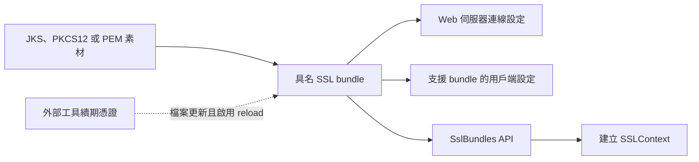

# SSL

<!-- source-attribution -->
> **非官方繁體中文翻譯** · Spring Boot 4.1.1 · 翻譯日期：2026-10-21  
> [官方英文網站](https://docs.spring.io/spring-boot/4.1/reference/features/ssl.html) · [固定版本英文來源](https://github.com/spring-projects/spring-boot/blob/v4.1.1/documentation/spring-boot-docs/src/docs/antora/modules/reference/pages/features/ssl.adoc) · [本地原文快照](../sources/spring-boot/documentation/spring-boot-docs/src/docs/antora/modules/reference/pages/features/ssl.adoc)  
> 原始作者與授權見 [來源聲明](../NOTICE.md)。官方範例及設定鍵保留原文，額外圖解另標示為譯者補充。

<!-- translation-status: translated -->

Spring Boot 可以設定 SSL 信任素材（trust material），並套用至多種類型的連線，以支援安全通訊。使用 `spring.ssl.bundle` 前綴的設定屬性，可為信任素材及相關資訊定義具名集合。

## 使用 Java KeyStore 檔案設定 SSL

`spring.ssl.bundle.jks` 前綴的設定屬性，可以設定由 Java `keytool` 工具建立、以 JKS 或 PKCS12 格式儲存在 Java KeyStore 檔案中的信任素材 bundle。每個 bundle 都有使用者指定的名稱，供其他設定參照。

若用來保護內嵌 Web 伺服器，通常會將 `keystore` 設為包含憑證與私密金鑰的 Java KeyStore：

```properties
spring.ssl.bundle.jks.mybundle.key.alias=application
spring.ssl.bundle.jks.mybundle.keystore.location=classpath:application.p12
spring.ssl.bundle.jks.mybundle.keystore.password=secret
spring.ssl.bundle.jks.mybundle.keystore.type=PKCS12
```

```yaml
spring:
  ssl:
    bundle:
      jks:
        mybundle:
          key:
            alias: "application"
          keystore:
            location: "classpath:application.p12"
            password: "secret"
            type: "PKCS12"
```

若用來保護用戶端連線，通常會將 `truststore` 設為包含伺服器憑證的 Java KeyStore：

```properties
spring.ssl.bundle.jks.mybundle.truststore.location=classpath:server.p12
spring.ssl.bundle.jks.mybundle.truststore.password=secret
```

```yaml
spring:
  ssl:
    bundle:
      jks:
        mybundle:
          truststore:
            location: "classpath:server.p12"
            password: "secret"
```

> **提示：**除了檔案位置，也可以提供檔案內容的 [Base64 編碼][features--ssl-r1]；選擇此方式時，屬性值必須以 `base64:` 開頭。

完整支援的屬性請參閱 [`JksSslBundleProperties`][features--ssl-r2]。

> **注意：**如果使用環境變數設定 bundle，其名稱[一律轉為小寫][features--ssl-r3]。

## 使用 PEM 編碼憑證設定 SSL

`spring.ssl.bundle.pem` 前綴的設定屬性，可以設定 PEM 編碼文字形式的信任素材 bundle。每個 bundle 都有使用者指定的名稱，供其他設定參照。

若用來保護內嵌 Web 伺服器，通常會為 `keystore` 設定憑證與私密金鑰：

```properties
spring.ssl.bundle.pem.mybundle.keystore.certificate=classpath:application.crt
spring.ssl.bundle.pem.mybundle.keystore.private-key=classpath:application.key
```

```yaml
spring:
  ssl:
    bundle:
      pem:
        mybundle:
          keystore:
            certificate: "classpath:application.crt"
            private-key: "classpath:application.key"
```

若用來保護用戶端連線，通常會為 `truststore` 設定伺服器憑證：

```properties
spring.ssl.bundle.pem.mybundle.truststore.certificate=classpath:server.crt
```

```yaml
spring:
  ssl:
    bundle:
      pem:
        mybundle:
          truststore:
            certificate: "classpath:server.crt"
```

> **提示：**除了檔案位置，也可以提供檔案內容的 [Base64 編碼][features--ssl-r1]；選擇此方式時，屬性值必須以 `base64:` 開頭。
>
> `certificate` 與 `private-key` 屬性也能直接填入 PEM 內容。若屬性值包含 `BEGIN` 與 `END` 標記，就會被視為 PEM 內容，而不是資源位置。
>
> 以下示範如何定義 truststore 憑證：

> ```properties
> spring.ssl.bundle.pem.mybundle.truststore.certificate=\
> -----BEGIN CERTIFICATE-----\n\
> MIID1zCCAr+gAwIBAgIUNM5QQv8IzVQsgSmmdPQNaqyzWs4wDQYJKoZIhvcNAQEL\n\
> BQAwezELMAkGA1UEBhMCWFgxEjAQBgNVBAgMCVN0YXRlTmFtZTERMA8GA1UEBwwI\n\
> ...\n\
> V0IJjcmYjEZbTvpjFKznvaFiOUv+8L7jHQ1/Yf+9c3C8gSjdUfv88m17pqYXd+Ds\n\
> HEmfmNNjht130UyjNCITmLVXyy5p35vWmdf95U3uEbJSnNVtXH8qRmN9oK9mUpDb\n\
> ngX6JBJI7fw7tXoqWSLHNiBODM88fUlQSho8\n\
> -----END CERTIFICATE-----
> ```

> ```yaml
> spring:
>   ssl:
>     bundle:
>       pem:
>         mybundle:
>           truststore:
>             certificate: |
>               -----BEGIN CERTIFICATE-----
>               MIID1zCCAr+gAwIBAgIUNM5QQv8IzVQsgSmmdPQNaqyzWs4wDQYJKoZIhvcNAQEL
>               BQAwezELMAkGA1UEBhMCWFgxEjAQBgNVBAgMCVN0YXRlTmFtZTERMA8GA1UEBwwI
>               ...
>               V0IJjcmYjEZbTvpjFKznvaFiOUv+8L7jHQ1/Yf+9c3C8gSjdUfv88m17pqYXd+Ds
>               HEmfmNNjht130UyjNCITmLVXyy5p35vWmdf95U3uEbJSnNVtXH8qRmN9oK9mUpDb
>               ngX6JBJI7fw7tXoqWSLHNiBODM88fUlQSho8
>               -----END CERTIFICATE-----
> ```

完整支援的屬性請參閱 [`PemSslBundleProperties`][features--ssl-r4]。

> **注意：**如果使用環境變數設定 bundle，其名稱[一律轉為小寫][features--ssl-r3]。

## 套用 SSL Bundles

透過屬性完成設定後，可在 Spring Boot 自動設定的各種連線屬性中，以名稱參照 SSL bundle。詳情請參閱[內嵌 Web 伺服器][features--ssl-r5]、[資料技術][features--ssl-r6]及 [REST 用戶端][features--ssl-r7]章節。

## 使用 SSL Bundles

Spring Boot 會自動設定 [`SslBundles`][features--ssl-r8] Bean，讓程式能取得透過 `spring.ssl.bundle` 屬性設定的各個具名 bundle。

可從自動設定的 [`SslBundles`][features--ssl-r8] Bean 取得 [`SslBundle`][features--ssl-r9]，再建立用戶端函式庫設定 SSL 連線所需的物件。[`SslBundle`][features--ssl-r9] 提供分層存取這些 SSL 物件的方式：

- `getStores()`：取得金鑰儲存區與信任儲存區的 [`KeyStore`][features--ssl-r10] 實例，以及所需的金鑰儲存區密碼。
- `getManagers()`：取得 [`KeyManagerFactory`][features--ssl-r11]、[`TrustManagerFactory`][features--ssl-r12] 實例，以及它們建立的 [`KeyManager`][features--ssl-r13] 與 [`TrustManager`][features--ssl-r14] 陣列。
- `createSslContext()`：方便地取得新的 [`SSLContext`][features--ssl-r15] 實例。

此外，[`SslBundle`][features--ssl-r9] 也提供使用中的金鑰、要採用的協定，以及應套用至 SSL engine 的選項等資訊。

下例示範取得 [`SslBundle`][features--ssl-r9]，並用它建立 [`SSLContext`][features--ssl-r15]：

```kotlin
import org.springframework.boot.ssl.SslBundles
import org.springframework.stereotype.Component

@Component
class MyComponent(sslBundles: SslBundles) {

    init {
        val sslBundle = sslBundles.getBundle("mybundle")
        val sslContext = sslBundle.createSslContext()
        // do something with the created sslContext
    }

}
```

```java
import javax.net.ssl.SSLContext;

import org.springframework.boot.ssl.SslBundle;
import org.springframework.boot.ssl.SslBundles;
import org.springframework.stereotype.Component;

@Component
public class MyComponent {

	public MyComponent(SslBundles sslBundles) {
		SslBundle sslBundle = sslBundles.getBundle("mybundle");
		SSLContext sslContext = sslBundle.createSslContext();
		// do something with the created sslContext
	}

}
```

## 重新載入 SSL Bundles

當金鑰素材變更時，可以重新載入 SSL bundle。使用 bundle 的元件也必須支援可重新載入的 SSL bundle。目前相容的元件包括：

- Tomcat Web 伺服器
- Netty Web 伺服器

必須透過設定屬性明確啟用重新載入，如下例：

```properties
spring.ssl.bundle.pem.mybundle.reload-on-update=true
spring.ssl.bundle.pem.mybundle.keystore.certificate=file:/some/directory/application.crt
spring.ssl.bundle.pem.mybundle.keystore.private-key=file:/some/directory/application.key
```

```yaml
spring:
  ssl:
    bundle:
      pem:
        mybundle:
          reload-on-update: true
          keystore:
            certificate: "file:/some/directory/application.crt"
            private-key: "file:/some/directory/application.key"
```

接著，檔案監看器會監看這些檔案；如果檔案變更，就會重新載入 SSL bundle，並觸發使用端元件的重新載入。例如，Tomcat 會輪替已啟用 SSL 的 connector 中的憑證。

可以使用 `spring.ssl.bundle.watch.file.quiet-period`，設定檔案監看器的靜默期間，確認檔案不再持續變更後再處理。

### 搭配 Let's Encrypt 重新載入 SSL Bundles

如果使用 [Let's Encrypt][features--ssl-r16] 簽發、由 [Certbot][features--ssl-r17] 等外部工具續期的憑證，可以讓 PEM bundle 使用產生的檔案，並啟用重新載入。Certbot 通常將檔案放在 `/etc/letsencrypt/live/` 下、以網域命名的目錄。以下示範為 `example.com` 設定 PEM bundle：

```properties
spring.ssl.bundle.pem.webserver.reload-on-update=true
spring.ssl.bundle.pem.webserver.keystore.certificate=file:/etc/letsencrypt/live/example.com/fullchain.pem
spring.ssl.bundle.pem.webserver.keystore.private-key=file:/etc/letsencrypt/live/example.com/privkey.pem
server.ssl.bundle=webserver
```

```yaml
spring:
  ssl:
    bundle:
      pem:
        webserver:
          reload-on-update: true
          keystore:
            certificate: "file:/etc/letsencrypt/live/example.com/fullchain.pem"
            private-key: "file:/etc/letsencrypt/live/example.com/privkey.pem"
server:
  ssl:
    bundle: "webserver"
```

Spring Boot 不會申請或續期 Let's Encrypt 憑證。當 Certbot 或其他 ACME 用戶端更新設定中的檔案時，SSL bundle 就會重新載入。Tomcat、Netty Web 伺服器等相容的使用端，接著就能採用更新的憑證，不必重新啟動應用程式。

`/etc/letsencrypt/live` 內的檔案通常是指向 `/etc/letsencrypt/archive` 的符號連結。檔案監看器會追蹤符號連結，因此目標檔案的更新也能觸發重新載入。

## 譯者圖解：設定素材與套用連線分成兩步



bundle 集中描述素材；建立 bundle 不代表所有連線都會自動改用它，仍要由對應的連線設定或程式使用。

[features--ssl-r1]: https://docs.spring.io/spring-boot/4.1/reference/features/external-config.html#features.external-config.typesafe-configuration-properties.conversion.base64
[features--ssl-r2]: https://docs.spring.io/spring-boot/4.1.1/api/java/org/springframework/boot/autoconfigure/ssl/JksSslBundleProperties.html
[features--ssl-r3]: https://docs.spring.io/spring-boot/4.1/reference/features/external-config.html#features.external-config.typesafe-configuration-properties.relaxed-binding.maps-from-environment-variables
[features--ssl-r4]: https://docs.spring.io/spring-boot/4.1.1/api/java/org/springframework/boot/autoconfigure/ssl/PemSslBundleProperties.html
[features--ssl-r5]: https://docs.spring.io/spring-boot/4.1/how-to/webserver.html#howto.webserver.configure-ssl
[features--ssl-r6]: https://docs.spring.io/spring-boot/4.1/reference/data/index.html
[features--ssl-r7]: https://docs.spring.io/spring-boot/4.1/reference/io/rest-client.html
[features--ssl-r8]: https://docs.spring.io/spring-boot/4.1.1/api/java/org/springframework/boot/ssl/SslBundles.html
[features--ssl-r9]: https://docs.spring.io/spring-boot/4.1.1/api/java/org/springframework/boot/ssl/SslBundle.html
[features--ssl-r10]: https://docs.oracle.com/en/java/javase/17/docs/api/java.base/java/security/KeyStore.html
[features--ssl-r11]: https://docs.oracle.com/en/java/javase/17/docs/api/java.base/javax/net/ssl/KeyManagerFactory.html
[features--ssl-r12]: https://docs.oracle.com/en/java/javase/17/docs/api/java.base/javax/net/ssl/TrustManagerFactory.html
[features--ssl-r13]: https://docs.oracle.com/en/java/javase/17/docs/api/java.base/javax/net/ssl/KeyManager.html
[features--ssl-r14]: https://docs.oracle.com/en/java/javase/17/docs/api/java.base/javax/net/ssl/TrustManager.html
[features--ssl-r15]: https://docs.oracle.com/en/java/javase/17/docs/api/java.base/javax/net/ssl/SSLContext.html
[features--ssl-r16]: https://letsencrypt.org/
[features--ssl-r17]: https://certbot.eff.org/
