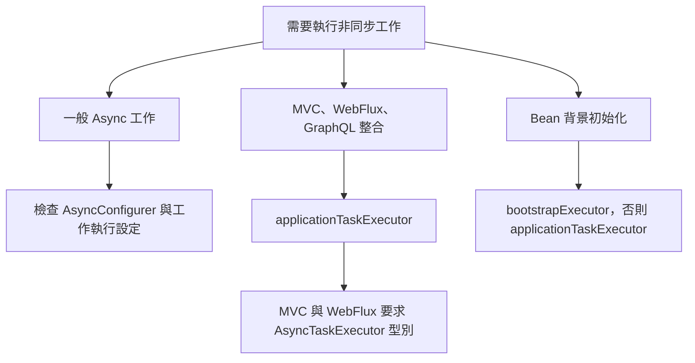

# 工作執行與排程

<!-- source-attribution -->
> **非官方繁體中文翻譯** · Spring Boot 4.1.1 · 翻譯日期：2026-10-21  
> [官方英文網站](https://docs.spring.io/spring-boot/4.1/reference/features/task-execution-and-scheduling.html) · [固定版本英文來源](https://github.com/spring-projects/spring-boot/blob/v4.1.1/documentation/spring-boot-docs/src/docs/antora/modules/reference/pages/features/task-execution-and-scheduling.adoc) · [本地原文快照](../sources/spring-boot/documentation/spring-boot-docs/src/docs/antora/modules/reference/pages/features/task-execution-and-scheduling.adoc)  
> 原始作者與授權見 [來源聲明](../NOTICE.md)。官方範例及設定鍵保留原文，額外圖解另標示為譯者補充。

<!-- translation-status: translated -->

當應用程式內容中沒有 [`Executor`][features--task-execution-and-scheduling-r1] Bean 時，Spring Boot 會自動設定 [`AsyncTaskExecutor`][features--task-execution-and-scheduling-r2]。若已啟用虛擬執行緒（使用 Java 21 以上，並將 `spring.threads.virtual.enabled` 設為 `true`），它會是使用虛擬執行緒的 [`SimpleAsyncTaskExecutor`][features--task-execution-and-scheduling-r3]；否則，會是具有合理預設值的 [`ThreadPoolTaskExecutor`][features--task-execution-and-scheduling-r4]。

除非定義自訂 [`Executor`][features--task-execution-and-scheduling-r1] Bean，否則下列整合會使用自動設定的 [`AsyncTaskExecutor`][features--task-execution-and-scheduling-r2]：

- 透過 [`@EnableAsync`][features--task-execution-and-scheduling-r5] 執行非同步工作；若有 [`AsyncConfigurer`][features--task-execution-and-scheduling-r6] Bean，則以其設定為準。
- Spring for GraphQL 對 Controller 方法回傳的 [`Callable`][features--task-execution-and-scheduling-r7] 進行非同步處理。
- Spring MVC 的非同步請求處理。
- Spring WebFlux 的阻塞式執行支援。
- Spring WebSocket 的輸入與輸出訊息通道。
- JPA 的啟動 executor，依 JPA Repository 的啟動模式而定。
- `ApplicationContext` 中 Bean 的[背景初始化][features--task-execution-and-scheduling-r8] executor。

雖然這種方式適用於大多數情況，Spring Boot 也允許覆寫自動設定的 [`AsyncTaskExecutor`][features--task-execution-and-scheduling-r2]。預設情況下，只要註冊自訂 [`Executor`][features--task-execution-and-scheduling-r1] Bean，自動設定的 [`AsyncTaskExecutor`][features--task-execution-and-scheduling-r2] 就會退讓，而一般工作執行（透過 [`@EnableAsync`][features--task-execution-and-scheduling-r5]）會改用自訂的 [`Executor`][features--task-execution-and-scheduling-r1]。

不過，Spring MVC、Spring WebFlux 與 Spring GraphQL 都要求名為 `applicationTaskExecutor` 的 Bean。對 MVC 與 WebFlux 而言，型別還必須是 [`AsyncTaskExecutor`][features--task-execution-and-scheduling-r2]；GraphQL 則沒有強制這項型別要求。

如果只有一個 [`AsyncTaskExecutor`][features--task-execution-and-scheduling-r2] Bean，或有名為 `applicationTaskExecutor` 的 Bean，Spring WebSocket 與 JPA 就會使用它。

最後，`ApplicationContext` 的啟動 executor 會使用名為 `applicationTaskExecutor` 的 Bean，除非另有名為 `bootstrapExecutor` 的 Bean。

下例示範如何註冊自訂 [`AsyncTaskExecutor`][features--task-execution-and-scheduling-r2]，供 Spring MVC、Spring WebFlux、Spring GraphQL、Spring WebSocket、JPA 與 Bean 背景初始化使用：

```kotlin
import org.springframework.context.annotation.Bean
import org.springframework.context.annotation.Configuration
import org.springframework.core.task.SimpleAsyncTaskExecutor

@Configuration(proxyBeanMethods = false)
class MyTaskExecutorConfiguration {

	@Bean("applicationTaskExecutor")
	fun applicationTaskExecutor(): SimpleAsyncTaskExecutor {
		return SimpleAsyncTaskExecutor("app-")
	}

}
```

```java
import org.springframework.context.annotation.Bean;
import org.springframework.context.annotation.Configuration;
import org.springframework.core.task.SimpleAsyncTaskExecutor;

@Configuration(proxyBeanMethods = false)
public class MyTaskExecutorConfiguration {

	@Bean("applicationTaskExecutor")
	SimpleAsyncTaskExecutor applicationTaskExecutor() {
		return new SimpleAsyncTaskExecutor("app-");
	}

}
```

> **注意：**如果應用程式內容中沒有 [`@Primary`][features--task-execution-and-scheduling-r9] 的 `Executor` Bean、名為 `taskExecutor` 的 [`Executor`][features--task-execution-and-scheduling-r1] Bean，也沒有 [`AsyncConfigurer`][features--task-execution-and-scheduling-r6]，一般工作執行也會使用 `applicationTaskExecutor`。

> **警告：**若既沒有自動設定的 `AsyncTaskExecutor`，也沒有 `applicationTaskExecutor`，應用程式會遵循 Spring Framework 的行為，預設使用名為 `taskExecutor` 的 Bean 執行一般工作（[`@EnableAsync`][features--task-execution-and-scheduling-r5]）。但是 Spring MVC、Spring WebFlux、Spring GraphQL 不會使用這個 Bean。如果其型別是 [`AsyncTaskExecutor`][features--task-execution-and-scheduling-r2]，Spring WebSocket 或 JPA 則可能使用它。

如果不同整合需要多個 `Executor` Bean，例如一個供 [`@EnableAsync`][features--task-execution-and-scheduling-r5] 一般工作執行使用，另一個供 MVC、WebFlux、WebSocket 與 JPA 使用，可以如下設定：

```kotlin
import org.springframework.context.annotation.Bean
import org.springframework.context.annotation.Configuration
import org.springframework.core.task.SimpleAsyncTaskExecutor
import org.springframework.scheduling.concurrent.ThreadPoolTaskExecutor

@Configuration(proxyBeanMethods = false)
class MyTaskExecutorConfiguration {

	@Bean("applicationTaskExecutor")
	fun applicationTaskExecutor(): SimpleAsyncTaskExecutor {
		return SimpleAsyncTaskExecutor("app-")
	}

	@Bean("taskExecutor")
	fun taskExecutor(): ThreadPoolTaskExecutor {
		val threadPoolTaskExecutor = ThreadPoolTaskExecutor()
		threadPoolTaskExecutor.setThreadNamePrefix("async-")
		return threadPoolTaskExecutor
	}

}
```

```java
import org.springframework.context.annotation.Bean;
import org.springframework.context.annotation.Configuration;
import org.springframework.core.task.SimpleAsyncTaskExecutor;
import org.springframework.scheduling.concurrent.ThreadPoolTaskExecutor;

@Configuration(proxyBeanMethods = false)
public class MyTaskExecutorConfiguration {

	@Bean("applicationTaskExecutor")
	SimpleAsyncTaskExecutor applicationTaskExecutor() {
		return new SimpleAsyncTaskExecutor("app-");
	}

	@Bean("taskExecutor")
	ThreadPoolTaskExecutor taskExecutor() {
		ThreadPoolTaskExecutor threadPoolTaskExecutor = new ThreadPoolTaskExecutor();
		threadPoolTaskExecutor.setThreadNamePrefix("async-");
		return threadPoolTaskExecutor;
	}

}
```

> **提示：**自動設定的 [`ThreadPoolTaskExecutorBuilder`][features--task-execution-and-scheduling-r10] 或 [`SimpleAsyncTaskExecutorBuilder`][features--task-execution-and-scheduling-r11]，能方便地建立與自動設定預設行為相同的 [`AsyncTaskExecutor`][features--task-execution-and-scheduling-r2] 實例。

> ```kotlin
> import org.springframework.boot.task.SimpleAsyncTaskExecutorBuilder
> import org.springframework.context.annotation.Bean
> import org.springframework.context.annotation.Configuration
> import org.springframework.core.task.SimpleAsyncTaskExecutor
>
> @Configuration(proxyBeanMethods = false)
> class MyTaskExecutorConfiguration {
>
> 	@Bean
> 	fun taskExecutor(builder: SimpleAsyncTaskExecutorBuilder): SimpleAsyncTaskExecutor {
> 		return builder.build()
> 	}
>
> }
> ```

> ```java
> import org.springframework.boot.task.SimpleAsyncTaskExecutorBuilder;
> import org.springframework.context.annotation.Bean;
> import org.springframework.context.annotation.Configuration;
> import org.springframework.core.task.SimpleAsyncTaskExecutor;
>
> @Configuration(proxyBeanMethods = false)
> public class MyTaskExecutorConfiguration {
>
> 	@Bean
> 	SimpleAsyncTaskExecutor taskExecutor(SimpleAsyncTaskExecutorBuilder builder) {
> 		return builder.build();
> 	}
>
> }
> ```

如果無法使用 `taskExecutor` 這個 Bean 名稱，可以將 Bean 標記為 [`@Primary`][features--task-execution-and-scheduling-r9]，或定義 [`AsyncConfigurer`][features--task-execution-and-scheduling-r6] Bean，指定由哪個 `Executor` 負責 [`@EnableAsync`][features--task-execution-and-scheduling-r5] 的一般工作執行。以下示範此作法：

```kotlin
import org.springframework.context.annotation.Bean
import org.springframework.context.annotation.Configuration
import org.springframework.scheduling.annotation.AsyncConfigurer
import java.util.concurrent.Executor
import java.util.concurrent.ExecutorService
import java.util.concurrent.Executors

@Configuration(proxyBeanMethods = false)
class MyTaskExecutorConfiguration {

	@Bean
	fun asyncConfigurer(executorService: ExecutorService): AsyncConfigurer {
		return object : AsyncConfigurer {
			override fun getAsyncExecutor(): Executor {
				return executorService
			}
		}
	}

	@Bean
	fun executorService(): ExecutorService {
		return Executors.newCachedThreadPool()
	}

}
```

```java
import java.util.concurrent.Executor;
import java.util.concurrent.ExecutorService;
import java.util.concurrent.Executors;

import org.springframework.context.annotation.Bean;
import org.springframework.context.annotation.Configuration;
import org.springframework.scheduling.annotation.AsyncConfigurer;

@Configuration(proxyBeanMethods = false)
public class MyTaskExecutorConfiguration {

	@Bean
	AsyncConfigurer asyncConfigurer(ExecutorService executorService) {
		return new AsyncConfigurer() {

			@Override
			public Executor getAsyncExecutor() {
				return executorService;
			}

		};
	}

	@Bean
	ExecutorService executorService() {
		return Executors.newCachedThreadPool();
	}

}
```

若要註冊自訂 [`Executor`][features--task-execution-and-scheduling-r1]，同時保留自動設定的 [`AsyncTaskExecutor`][features--task-execution-and-scheduling-r2]，可以在自訂 Bean 的 [`@Bean`][features--task-execution-and-scheduling-r12] 上設定 `defaultCandidate=false`：

```kotlin
import org.springframework.beans.factory.annotation.Qualifier
import org.springframework.context.annotation.Bean
import org.springframework.context.annotation.Configuration
import java.util.concurrent.Executors
import java.util.concurrent.ScheduledExecutorService

@Configuration(proxyBeanMethods = false)
class MyTaskExecutorConfiguration {

	@Bean(defaultCandidate = false)
	@Qualifier("scheduledExecutorService")
	fun scheduledExecutorService(): ScheduledExecutorService {
		return Executors.newSingleThreadScheduledExecutor()
	}

}
```

```java
import java.util.concurrent.Executors;
import java.util.concurrent.ScheduledExecutorService;

import org.springframework.beans.factory.annotation.Qualifier;
import org.springframework.context.annotation.Bean;
import org.springframework.context.annotation.Configuration;

@Configuration(proxyBeanMethods = false)
public class MyTaskExecutorConfiguration {

	@Bean(defaultCandidate = false)
	@Qualifier("scheduledExecutorService")
	ScheduledExecutorService scheduledExecutorService() {
		return Executors.newSingleThreadScheduledExecutor();
	}

}
```

如此就能把自訂 [`Executor`][features--task-execution-and-scheduling-r1] 自動注入其他元件，同時保留自動設定的 [`AsyncTaskExecutor`][features--task-execution-and-scheduling-r2]。不過，請記得搭配 [`@Autowired`][features--task-execution-and-scheduling-r14] 使用 [`@Qualifier`][features--task-execution-and-scheduling-r13]。

如果無法採用這種方式，也可以要求 Spring Boot 無論如何都自動設定 [`AsyncTaskExecutor`][features--task-execution-and-scheduling-r2]：

```properties
spring.task.execution.mode=force
```

```yaml
spring:
  task:
    execution:
      mode: force
```

這時，即使已註冊自訂 [`Executor`][features--task-execution-and-scheduling-r1] Bean，包括標記為 [`@Primary`][features--task-execution-and-scheduling-r9] 的 Bean，所有下列整合仍會自動使用自動設定的 [`AsyncTaskExecutor`][features--task-execution-and-scheduling-r2]：

- 非同步工作執行（[`@EnableAsync`][features--task-execution-and-scheduling-r5]），除非存在 [`AsyncConfigurer`][features--task-execution-and-scheduling-r6] Bean。
- Spring for GraphQL 對 Controller 方法回傳的 [`Callable`][features--task-execution-and-scheduling-r7] 進行非同步處理。
- Spring MVC 的非同步請求處理。
- Spring WebFlux 的阻塞式執行支援。
- Spring WebSocket 的輸入與輸出訊息通道。
- JPA 的啟動 executor，依 JPA Repository 的啟動模式而定。
- `ApplicationContext` 內 Bean 的[背景初始化][features--task-execution-and-scheduling-r8] executor，除非定義名為 `bootstrapExecutor` 的 Bean。

> **提示：**依希望採用的配置，可將 `spring.task.execution.mode` 設為 `force`，自動設定 `applicationTaskExecutor`；也可以把自己的 [`Executor`][features--task-execution-and-scheduling-r1] 改成 [`AsyncTaskExecutor`][features--task-execution-and-scheduling-r2]，或同時定義 [`AsyncTaskExecutor`][features--task-execution-and-scheduling-r2] 與包裝自訂 [`Executor`][features--task-execution-and-scheduling-r1] 的 [`AsyncConfigurer`][features--task-execution-and-scheduling-r6]。

> **警告：**啟用 `force` 模式後，即使存在 [`@Primary`][features--task-execution-and-scheduling-r9] 的 `Executor` Bean，或名為 `taskExecutor` 的 [`Executor`][features--task-execution-and-scheduling-r1] Bean，`applicationTaskExecutor` 仍會用於 [`@EnableAsync`][features--task-execution-and-scheduling-r5] 的一般工作執行。此時要覆寫一般工作的 `Executor`，唯一方式是註冊 [`AsyncConfigurer`][features--task-execution-and-scheduling-r6] Bean。

自動設定 [`ThreadPoolTaskExecutor`][features--task-execution-and-scheduling-r4] 時，執行緒集區預設具有 8 個核心執行緒，並可依負載增減。可透過 `spring.task.execution` 命名空間微調：

```properties
spring.task.execution.pool.max-size=16
spring.task.execution.pool.queue-capacity=100
spring.task.execution.pool.keep-alive=10s
```

```yaml
spring:
  task:
    execution:
      pool:
        max-size: 16
        queue-capacity: 100
        keep-alive: "10s"
```

這個範例會改用有界佇列；當佇列填滿 100 個工作時，執行緒集區會增加執行緒，上限為 16。縮減策略也更積極：執行緒閒置 10 秒就會回收，而非預設的 60 秒。

如果需要排程工作執行，例如使用 [`@EnableScheduling`][features--task-execution-and-scheduling-r15]，也可以自動設定 scheduler。

若已啟用虛擬執行緒（Java 21 以上，`spring.threads.virtual.enabled=true`），會使用基於虛擬執行緒的 [`SimpleAsyncTaskScheduler`][features--task-execution-and-scheduling-r16]，並忽略所有與執行緒集區相關的屬性。

若未啟用虛擬執行緒，則使用具合理預設值的 [`ThreadPoolTaskScheduler`][features--task-execution-and-scheduling-r17]。它預設使用一個執行緒，可透過 `spring.task.scheduling` 命名空間微調：

```properties
spring.task.scheduling.thread-name-prefix=scheduling-
spring.task.scheduling.pool.size=2
```

```yaml
spring:
  task:
    scheduling:
      thread-name-prefix: "scheduling-"
      pool:
        size: 2
```

若需要建立自訂 executor 或 scheduler，應用程式內容中也會提供 [`ThreadPoolTaskExecutorBuilder`][features--task-execution-and-scheduling-r10]、[`SimpleAsyncTaskExecutorBuilder`][features--task-execution-and-scheduling-r11]、[`ThreadPoolTaskSchedulerBuilder`][features--task-execution-and-scheduling-r18] 與 [`SimpleAsyncTaskSchedulerBuilder`][features--task-execution-and-scheduling-r19] Bean。啟用虛擬執行緒時（Java 21 以上，`spring.threads.virtual.enabled=true`），後兩個名稱中含 `SimpleAsync` 的 builder 會自動設定為使用虛擬執行緒。

## 譯者圖解：同樣是執行工作，Bean 名稱與型別也會影響選擇



這是選擇條件的閱讀索引；`force`、`@Primary` 與多 Bean 的細節仍以正文規則為準。

[features--task-execution-and-scheduling-r1]: https://docs.oracle.com/en/java/javase/17/docs/api/java.base/java/util/concurrent/Executor.html
[features--task-execution-and-scheduling-r2]: https://docs.spring.io/spring-framework/docs/7.0.x/javadoc-api/org/springframework/core/task/AsyncTaskExecutor.html
[features--task-execution-and-scheduling-r3]: https://docs.spring.io/spring-framework/docs/7.0.x/javadoc-api/org/springframework/core/task/SimpleAsyncTaskExecutor.html
[features--task-execution-and-scheduling-r4]: https://docs.spring.io/spring-framework/docs/7.0.x/javadoc-api/org/springframework/scheduling/concurrent/ThreadPoolTaskExecutor.html
[features--task-execution-and-scheduling-r5]: https://docs.spring.io/spring-framework/docs/7.0.x/javadoc-api/org/springframework/scheduling/annotation/EnableAsync.html
[features--task-execution-and-scheduling-r6]: https://docs.spring.io/spring-framework/docs/7.0.x/javadoc-api/org/springframework/scheduling/annotation/AsyncConfigurer.html
[features--task-execution-and-scheduling-r7]: https://docs.oracle.com/en/java/javase/17/docs/api/java.base/java/util/concurrent/Callable.html
[features--task-execution-and-scheduling-r8]: https://docs.spring.io/spring-framework/reference/7.0/core/beans/java/composing-configuration-classes.html#beans-java-startup-background
[features--task-execution-and-scheduling-r9]: https://docs.spring.io/spring-framework/docs/7.0.x/javadoc-api/org/springframework/context/annotation/Primary.html
[features--task-execution-and-scheduling-r10]: https://docs.spring.io/spring-boot/4.1.1/api/java/org/springframework/boot/task/ThreadPoolTaskExecutorBuilder.html
[features--task-execution-and-scheduling-r11]: https://docs.spring.io/spring-boot/4.1.1/api/java/org/springframework/boot/task/SimpleAsyncTaskExecutorBuilder.html
[features--task-execution-and-scheduling-r12]: https://docs.spring.io/spring-framework/docs/7.0.x/javadoc-api/org/springframework/context/annotation/Bean.html
[features--task-execution-and-scheduling-r13]: https://docs.spring.io/spring-framework/docs/7.0.x/javadoc-api/org/springframework/beans/factory/annotation/Qualifier.html
[features--task-execution-and-scheduling-r14]: https://docs.spring.io/spring-framework/docs/7.0.x/javadoc-api/org/springframework/beans/factory/annotation/Autowired.html
[features--task-execution-and-scheduling-r15]: https://docs.spring.io/spring-framework/docs/7.0.x/javadoc-api/org/springframework/scheduling/annotation/EnableScheduling.html
[features--task-execution-and-scheduling-r16]: https://docs.spring.io/spring-framework/docs/7.0.x/javadoc-api/org/springframework/scheduling/concurrent/SimpleAsyncTaskScheduler.html
[features--task-execution-and-scheduling-r17]: https://docs.spring.io/spring-framework/docs/7.0.x/javadoc-api/org/springframework/scheduling/concurrent/ThreadPoolTaskScheduler.html
[features--task-execution-and-scheduling-r18]: https://docs.spring.io/spring-boot/4.1.1/api/java/org/springframework/boot/task/ThreadPoolTaskSchedulerBuilder.html
[features--task-execution-and-scheduling-r19]: https://docs.spring.io/spring-boot/4.1.1/api/java/org/springframework/boot/task/SimpleAsyncTaskSchedulerBuilder.html
