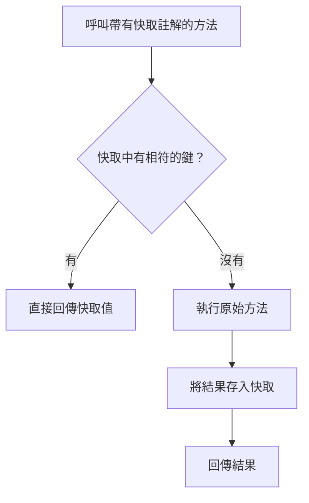

# 快取

<!-- source-attribution -->
> **非官方繁體中文翻譯** · Spring Boot 4.1.1 · 翻譯日期：2026-10-21  
> [官方英文網站](https://docs.spring.io/spring-boot/4.1/reference/io/caching.html) · [固定版本英文來源](https://github.com/spring-projects/spring-boot/blob/v4.1.1/documentation/spring-boot-docs/src/docs/antora/modules/reference/pages/io/caching.adoc) · [本地原文快照](../sources/spring-boot/documentation/spring-boot-docs/src/docs/antora/modules/reference/pages/io/caching.adoc)  
> 原始作者與授權見 [來源聲明](../NOTICE.md)。官方範例及設定鍵保留原文，額外圖解另標示為譯者補充。

<!-- translation-status: translated -->

Spring Framework 支援以透明方式為應用程式加入快取。
這項抽象的核心，是將快取套用到方法上，依據快取內已有的資訊減少執行次數。
快取邏輯會透明地套用，不會干擾呼叫端。
詳情請參閱 Spring Framework 參考文件的[相關章節][io--caching-r1]。

只要使用 [`@EnableCaching`][io--caching-r2] 註解啟用快取支援，Spring Boot 就會自動設定快取基礎設施。

> **提示：**
>
> 避免在包含 main 方法的應用程式類別上加入 [`@EnableCaching`][io--caching-r2]。
> 這樣會讓快取成為必要功能，[執行測試套件時][io--caching-r3]也不例外。

若要為服務中的某項操作加入快取，請在其方法上加入相關註解，如下例所示：

```kotlin
import org.springframework.cache.annotation.Cacheable
import org.springframework.stereotype.Component

@Component
class MyMathService {

	@Cacheable("piDecimals")
	fun computePiDecimal(precision: Int): Int {
		...
	}

}
```

```java
import org.springframework.cache.annotation.Cacheable;
import org.springframework.stereotype.Component;

@Component
public class MyMathService {

	@Cacheable("piDecimals")
	public int computePiDecimal(int precision) {
		...
	}

}
```

此範例示範對可能耗費大量資源的操作使用快取。
在呼叫 `computePiDecimal` 前，快取抽象會在 `piDecimals` 快取中，尋找符合 `precision` 引數的項目。
若找到項目，就立即將快取內容回傳給呼叫端，而不呼叫該方法。
否則會呼叫方法，並在回傳值之前更新快取。

> **警示：**
>
> 你也可以透明地使用標準 JSR-107（JCache）註解，例如 [`@CacheResult`][io--caching-r4]。
> 不過，我們強烈建議不要混用 Spring Cache 與 JCache 註解。

如果沒有加入特定快取程式庫，Spring Boot 會自動設定使用記憶體內並行 Map 的[簡易提供者][io--caching-r5]。
需要某個快取時（例如前例的 `piDecimals`），此提供者會為你建立它。
簡易提供者不太建議用於正式環境，但很適合入門，以及確認你理解這些功能。
決定要使用哪種快取提供者後，請務必閱讀其文件，了解如何設定應用程式所使用的快取。
幾乎所有提供者都要求你明確設定應用程式中的每個快取。
有些提供者允許自訂 `spring.cache.cache-names` 屬性所定義的預設快取。

> **提示：**
>
> 也可以透明地[更新][io--caching-r6]或[移除][io--caching-r7]快取中的資料。

## 支援的快取提供者

快取抽象不提供實際儲存，而是依賴 [`Cache`][io--caching-r8] 與 [`CacheManager`][io--caching-r9] 介面所具體化的抽象。

如果尚未定義 [`CacheManager`][io--caching-r9] 型別的 Bean，或名為 `cacheResolver` 的 [`CacheResolver`][io--caching-r10]（請參閱 [`CachingConfigurer`][io--caching-r11]），Spring Boot 就會依照下列順序嘗試偵測提供者：

1. [通用][io--caching-r12]
2. [JCache（JSR-107）][io--caching-r13]（EhCache 3、Hazelcast、Infinispan 等）
3. [Hazelcast][io--caching-r14]
4. [Infinispan][io--caching-r15]
5. [Couchbase][io--caching-r16]
6. [Redis][io--caching-r17]
7. [Caffeine][io--caching-r18]
8. [Cache2k][io--caching-r19]
9. [簡易][io--caching-r5]

> **提示：**
>
> 如果 [`CacheManager`][io--caching-r9] 是由 Spring Boot 自動設定，就可以設定 `spring.cache.type` 屬性，*強制*使用特定快取提供者。

> **提示：**
>
> 使用 `spring-boot-starter-cache` starter，可快速加入基本快取相依項。
> 此 starter 會帶入 `spring-context-support`。
> 若手動加入相依項，必須包含 `spring-context-support`，才能使用 JCache 或 Caffeine 支援。

如果 [`CacheManager`][io--caching-r9] 是由 Spring Boot 自動設定，你可以公開實作 [`CacheManagerCustomizer`][io--caching-r20] 介面的 Bean，在它完全初始化之前進一步調整設定。
下例設定一個旗標，表示不應將 `null` 值傳遞到下層 Map：

```kotlin
import org.springframework.boot.cache.autoconfigure.CacheManagerCustomizer
import org.springframework.cache.concurrent.ConcurrentMapCacheManager
import org.springframework.context.annotation.Bean
import org.springframework.context.annotation.Configuration

@Configuration(proxyBeanMethods = false)
class MyCacheManagerConfiguration {

	@Bean
	fun cacheManagerCustomizer(): CacheManagerCustomizer<ConcurrentMapCacheManager> {
		return CacheManagerCustomizer { cacheManager ->
			cacheManager.isAllowNullValues = false
		}
	}

}
```

```java
import org.springframework.boot.cache.autoconfigure.CacheManagerCustomizer;
import org.springframework.cache.concurrent.ConcurrentMapCacheManager;
import org.springframework.context.annotation.Bean;
import org.springframework.context.annotation.Configuration;

@Configuration(proxyBeanMethods = false)
public class MyCacheManagerConfiguration {

	@Bean
	public CacheManagerCustomizer<ConcurrentMapCacheManager> cacheManagerCustomizer() {
		return (cacheManager) -> cacheManager.setAllowNullValues(false);
	}

}
```

> **注意：**
>
> 上例預期存在自動設定的 [`ConcurrentMapCacheManager`][io--caching-r21]。
> 如果不是這種情況（你提供了自己的設定，或自動設定了另一種快取提供者），就完全不會呼叫該自訂器。
> 自訂器數量不限，也可以使用 [`@Order`][io--caching-r22] 或 [`Ordered`][io--caching-r23] 排序。

### 通用

如果上下文定義了*至少*一個 [`Cache`][io--caching-r8] Bean，就會使用通用快取。
系統會建立一個 [`CacheManager`][io--caching-r9]，包裝所有這個型別的 Bean。

### JCache（JSR-107）

當 classpath 上存在 [`CachingProvider`][io--caching-r25] 時，就會啟動 [JCache][io--caching-r24]（也就是 classpath 上有符合 JSR-107 的快取程式庫）；[`JCacheCacheManager`][io--caching-r26] 則由 `spring-boot-starter-cache` starter 提供。
符合標準的程式庫有多種，Spring Boot 為 Ehcache 3、Hazelcast 與 Infinispan 提供相依性管理。
也可以加入其他符合標準的程式庫。

可能同時存在多個提供者，此時必須明確指定要使用哪個。
雖然 JSR-107 標準沒有強制規定設定檔位置的統一指定方式，Spring Boot 仍盡可能配合各實作細節來設定快取，如下例所示：

```properties
spring.cache.jcache.provider=com.example.MyCachingProvider
spring.cache.jcache.config=classpath:example.xml
```

```yaml
# Only necessary if more than one provider is present
spring:
  cache:
    jcache:
      provider: "com.example.MyCachingProvider"
      config: "classpath:example.xml"
```

> **注意：**
>
> 若快取程式庫同時提供原生實作與 JSR-107 支援，Spring Boot 會優先使用 JSR-107 支援，讓你在切換至另一種 JSR-107 實作時，仍能使用相同功能。

> **提示：**
>
> Spring Boot 提供 [Hazelcast 的一般支援][io--caching-r27]。
> 如果只有一個可用的 [`HazelcastInstance`][io--caching-r28]，也會自動將它重用於 [`CacheManager`][io--caching-r29]，除非指定了 `spring.cache.jcache.config` 屬性。

自訂下層 [`CacheManager`][io--caching-r29] 有兩種方式：

- 設定 `spring.cache.cache-names` 屬性，可以在啟動時建立快取。
  如果定義了自訂 [`Configuration`][io--caching-r30] Bean，會用它自訂這些快取。
- 呼叫 [`CacheManagerCustomizer`][io--caching-r20] Bean 時會傳入 [`CacheManager`][io--caching-r29] 參考，以進行完整自訂。

> **提示：**
>
> 如果定義了標準 [`CacheManager`][io--caching-r29] Bean，它會自動包裝成快取抽象所預期的 [`CacheManager`][io--caching-r9] 實作。
> 不會再對它套用其他自訂。

### Hazelcast

Spring Boot 提供 [Hazelcast 的一般支援][io--caching-r27]。
如果已自動設定 [`HazelcastInstance`][io--caching-r28]，且 classpath 上有 `com.hazelcast:hazelcast-spring`，它就會自動包裝在 [`CacheManager`][io--caching-r9] 中。

> **注意：**
>
> Hazelcast 可作為符合 JCache 的快取，也可作為符合 Spring [`CacheManager`][io--caching-r9] 的快取。
> 將 `spring.cache.type` 設為 `hazelcast` 時，Spring Boot 會使用以 [`CacheManager`][io--caching-r9] 為基礎的實作。
> 若想讓 Hazelcast 作為符合 JCache 的快取，請將 `spring.cache.type` 設為 `jcache`。
> 如果有多個符合 JCache 的快取提供者，而且想強制使用 Hazelcast，就必須[明確設定 JCache 提供者][io--caching-r13]。

### Infinispan

[Infinispan][io--caching-r31] 沒有預設設定檔位置，因此必須明確指定。
否則會使用預設啟動方式。

```properties
spring.cache.infinispan.config=infinispan.xml
```

```yaml
spring:
  cache:
    infinispan:
      config: "infinispan.xml"
```

設定 `spring.cache.cache-names` 屬性，可以在啟動時建立快取。
若定義了自訂 [`ConfigurationBuilder`][io--caching-r32] Bean，就會用它自訂快取。

詳情請參閱[文件][io--caching-r33]。

### Couchbase

如果有 Spring Data Couchbase，而且已[設定 Couchbase][io--caching-r34]，就會自動設定 [`CouchbaseCacheManager`][io--caching-r35]。
設定 `spring.cache.cache-names` 屬性，可在啟動時建立其他快取；使用 `spring.cache.couchbase.*` 屬性則可設定快取預設值。
例如，下列設定會建立 `cache1` 與 `cache2` 快取，項目的*到期時間*為 10 分鐘：

```properties
spring.cache.cache-names=cache1,cache2
spring.cache.couchbase.expiration=10m
```

```yaml
spring:
  cache:
    cache-names: "cache1,cache2"
    couchbase:
      expiration: "10m"
```

若需要進一步掌控設定，可考慮註冊 [`CouchbaseCacheManagerBuilderCustomizer`][io--caching-r36] Bean。
下例的自訂器為 `cache1` 與 `cache2` 設定各自的項目到期時間：

```kotlin
import org.springframework.boot.cache.autoconfigure.CouchbaseCacheManagerBuilderCustomizer
import org.springframework.context.annotation.Bean
import org.springframework.context.annotation.Configuration
import org.springframework.data.couchbase.cache.CouchbaseCacheConfiguration
import java.time.Duration

@Configuration(proxyBeanMethods = false)
class MyCouchbaseCacheManagerConfiguration {

	@Bean
	fun myCouchbaseCacheManagerBuilderCustomizer(): CouchbaseCacheManagerBuilderCustomizer {
		return CouchbaseCacheManagerBuilderCustomizer { builder ->
			builder
				.withCacheConfiguration(
					"cache1", CouchbaseCacheConfiguration
						.defaultCacheConfig().entryExpiry(Duration.ofSeconds(10))
				)
				.withCacheConfiguration(
					"cache2", CouchbaseCacheConfiguration
						.defaultCacheConfig().entryExpiry(Duration.ofMinutes(1))
				)
		}
	}

}
```

```java
import java.time.Duration;

import org.springframework.boot.cache.autoconfigure.CouchbaseCacheManagerBuilderCustomizer;
import org.springframework.context.annotation.Bean;
import org.springframework.context.annotation.Configuration;
import org.springframework.data.couchbase.cache.CouchbaseCacheConfiguration;

@Configuration(proxyBeanMethods = false)
public class MyCouchbaseCacheManagerConfiguration {

	@Bean
	public CouchbaseCacheManagerBuilderCustomizer myCouchbaseCacheManagerBuilderCustomizer() {
		return (builder) -> builder
				.withCacheConfiguration("cache1", CouchbaseCacheConfiguration
						.defaultCacheConfig().entryExpiry(Duration.ofSeconds(10)))
				.withCacheConfiguration("cache2", CouchbaseCacheConfiguration
						.defaultCacheConfig().entryExpiry(Duration.ofMinutes(1)));

	}

}
```

### Redis

若有 [Redis][io--caching-r37] 且已完成設定，就會自動設定 [`RedisCacheManager`][io--caching-r38]。
設定 `spring.cache.cache-names` 屬性，可在啟動時建立其他快取；使用 `spring.cache.redis.*` 屬性則可設定快取預設值。
例如，下列設定會建立 `cache1` 與 `cache2` 快取，*存活時間*為 10 分鐘：

```properties
spring.cache.cache-names=cache1,cache2
spring.cache.redis.time-to-live=10m
```

```yaml
spring:
  cache:
    cache-names: "cache1,cache2"
    redis:
      time-to-live: "10m"
```

> **注意：**
>
> 預設會加入鍵前綴，因此即使兩個不同快取使用相同鍵，Redis 中的鍵也不會重疊，不會回傳錯誤的值。
> 如果你自行建立 [`RedisCacheManager`][io--caching-r38]，我們強烈建議保留此設定。

> **提示：**
>
> 加入你自己的 [`RedisCacheConfiguration`][io--caching-r39] [`@Bean`][io--caching-r40]，即可完全掌控預設設定。
> 需要自訂預設序列化策略時，這會很有用。

若需要進一步掌控設定，可考慮註冊 [`RedisCacheManagerBuilderCustomizer`][io--caching-r41] Bean。
下例的自訂器為 `cache1` 與 `cache2` 設定各自的存活時間：

```kotlin
import org.springframework.boot.cache.autoconfigure.RedisCacheManagerBuilderCustomizer
import org.springframework.context.annotation.Bean
import org.springframework.context.annotation.Configuration
import org.springframework.data.redis.cache.RedisCacheConfiguration
import java.time.Duration

@Configuration(proxyBeanMethods = false)
class MyRedisCacheManagerConfiguration {

	@Bean
	fun myRedisCacheManagerBuilderCustomizer(): RedisCacheManagerBuilderCustomizer {
		return RedisCacheManagerBuilderCustomizer { builder ->
			builder
				.withCacheConfiguration(
					"cache1", RedisCacheConfiguration
						.defaultCacheConfig().entryTtl(Duration.ofSeconds(10))
				)
				.withCacheConfiguration(
					"cache2", RedisCacheConfiguration
						.defaultCacheConfig().entryTtl(Duration.ofMinutes(1))
				)
		}
	}

}
```

```java
import java.time.Duration;

import org.springframework.boot.cache.autoconfigure.RedisCacheManagerBuilderCustomizer;
import org.springframework.context.annotation.Bean;
import org.springframework.context.annotation.Configuration;
import org.springframework.data.redis.cache.RedisCacheConfiguration;

@Configuration(proxyBeanMethods = false)
public class MyRedisCacheManagerConfiguration {

	@Bean
	public RedisCacheManagerBuilderCustomizer myRedisCacheManagerBuilderCustomizer() {
		return (builder) -> builder
				.withCacheConfiguration("cache1", RedisCacheConfiguration
						.defaultCacheConfig().entryTtl(Duration.ofSeconds(10)))
				.withCacheConfiguration("cache2", RedisCacheConfiguration
						.defaultCacheConfig().entryTtl(Duration.ofMinutes(1)));

	}

}
```

### Caffeine

[Caffeine][io--caching-r42] 是以 Java 8 改寫的 Guava 快取，取代了 Guava 支援。
若有 Caffeine，就會自動設定 [`CaffeineCacheManager`][io--caching-r43]（由 `spring-boot-starter-cache` starter 提供）。
設定 `spring.cache.cache-names` 屬性，可以在啟動時建立快取，並依下列順序透過其中一項自訂：

1. `spring.cache.caffeine.spec` 定義的快取規格。
2. 已定義的 [`CaffeineSpec`][io--caching-r44] Bean。
3. 已定義的 [`Caffeine`][io--caching-r45] Bean。

例如，下列設定會建立 `cache1` 與 `cache2` 快取，大小上限為 500，*存活時間*為 10 分鐘：

```properties
spring.cache.cache-names=cache1,cache2
spring.cache.caffeine.spec=maximumSize=500,expireAfterAccess=600s
```

```yaml
spring:
  cache:
    cache-names: "cache1,cache2"
    caffeine:
      spec: "maximumSize=500,expireAfterAccess=600s"
```

如果定義了 [`CacheLoader`][io--caching-r46] Bean，會自動將它與 [`CaffeineCacheManager`][io--caching-r43] 關聯。
由於 [`CacheLoader`][io--caching-r46] 會與該快取管理器管理的*所有*快取關聯，必須將它定義為 `CacheLoader<Object, Object>`。
自動設定會忽略其他泛型型別。

### Cache2k

[Cache2k][io--caching-r47] 是記憶體內快取。
若有 Cache2k 的 Spring 整合，就會自動設定 `SpringCache2kCacheManager`。

設定 `spring.cache.cache-names` 屬性，可以在啟動時建立快取。
快取預設值可透過 [`Cache2kBuilderCustomizer`][io--caching-r48] Bean 自訂。
下例的自訂器將快取容量設為 200 個項目，到期時間為 5 分鐘：

```kotlin
import org.springframework.boot.cache.autoconfigure.Cache2kBuilderCustomizer
import org.springframework.context.annotation.Bean
import org.springframework.context.annotation.Configuration
import java.util.concurrent.TimeUnit

@Configuration(proxyBeanMethods = false)
class MyCache2kDefaultsConfiguration {

	@Bean
	fun myCache2kDefaultsCustomizer(): Cache2kBuilderCustomizer {
		return Cache2kBuilderCustomizer { builder ->
			builder.entryCapacity(200)
				.expireAfterWrite(5, TimeUnit.MINUTES)
		}
	}
}
```

```java
import java.util.concurrent.TimeUnit;

import org.springframework.boot.cache.autoconfigure.Cache2kBuilderCustomizer;
import org.springframework.context.annotation.Bean;
import org.springframework.context.annotation.Configuration;

@Configuration(proxyBeanMethods = false)
public class MyCache2kDefaultsConfiguration {

	@Bean
	public Cache2kBuilderCustomizer myCache2kDefaultsCustomizer() {
		return (builder) -> builder.entryCapacity(200)
				.expireAfterWrite(5, TimeUnit.MINUTES);
	}

}
```

### 簡易

如果找不到其他提供者，就會設定使用 [`ConcurrentHashMap`][io--caching-r49] 作為快取儲存的簡易實作。
應用程式中沒有快取程式庫時，這就是預設選項。
預設會依需要建立快取，但你可以設定 `cache-names` 屬性，限制可用快取清單。
例如，若只想要 `cache1` 與 `cache2`，可如下設定 `cache-names`：

```properties
spring.cache.cache-names=cache1,cache2
```

```yaml
spring:
  cache:
    cache-names: "cache1,cache2"
```

如此設定後，如果應用程式使用未列出的快取，會在執行期間實際需要該快取時失敗，而非在啟動時失敗。
這類似「真正的」快取提供者在使用未宣告快取時的行為。

### 無快取

如果某個環境需要使用不執行任何快取操作的實作，而不是自動設定的快取管理器，請將快取型別設為 `none`，如下例所示：

```properties
spring.cache.type=none
```

```yaml
spring:
  cache:
    type: "none"
```

## 測試

執行測試套件時，使用不執行任何操作的快取實作通常很有幫助。
本節列出幾種適合測試的策略。

若定義了自訂 [`CacheManager`][io--caching-r9]，最佳做法是確保快取設定定義在獨立的 [`@Configuration`][io--caching-r50] 類別中。
這可確保切片測試不會要求快取。
對 [`@SpringBootTest`][io--caching-r51] 等啟用完整上下文的測試，則需要明確提供覆寫一般設定的設定。

若快取是自動設定的，就有更多選項。
測試可標註 [`@AutoConfigureCache`][io--caching-r52]，將自動設定的 [`CacheManager`][io--caching-r9] 替換為不執行任何操作的實作。

```kotlin
import org.springframework.boot.cache.test.autoconfigure.AutoConfigureCache
import org.springframework.boot.test.context.SpringBootTest

@SpringBootTest
@AutoConfigureCache
class MyIntegrationTests {

	// Tests use a no-op cache manager

}
```

```java
import org.springframework.boot.cache.test.autoconfigure.AutoConfigureCache;
import org.springframework.boot.test.context.SpringBootTest;

@SpringBootTest
@AutoConfigureCache
public class MyIntegrationTests {

	// Tests use a no-op cache manager

}
```

另一種方式，是強制讓自動設定的 [`CacheManager`][io--caching-r9] 使用不執行任何操作的實作：

```properties
spring.cache.type=none
```

```yaml
spring:
  cache:
    type: "none"
```

## 譯者補充：快取命中如何省掉手作邏輯



[io--caching-r1]: https://docs.spring.io/spring-framework/reference/7.0/integration/cache.html
[io--caching-r2]: https://docs.spring.io/spring-framework/docs/7.0.x/javadoc-api/org/springframework/cache/annotation/EnableCaching.html
[io--caching-r3]: https://docs.spring.io/spring-boot/4.1/reference/io/caching.html#io.caching.testing
[io--caching-r4]: https://javadoc.io/doc/javax.cache/cache-api/1.1.1/javax/cache/annotation/CacheResult.html
[io--caching-r5]: https://docs.spring.io/spring-boot/4.1/reference/io/caching.html#io.caching.provider.simple
[io--caching-r6]: https://docs.spring.io/spring-framework/reference/7.0/integration/cache/annotations.html#cache-annotations-put
[io--caching-r7]: https://docs.spring.io/spring-framework/reference/7.0/integration/cache/annotations.html#cache-annotations-evict
[io--caching-r8]: https://docs.spring.io/spring-framework/docs/7.0.x/javadoc-api/org/springframework/cache/Cache.html
[io--caching-r9]: https://docs.spring.io/spring-framework/docs/7.0.x/javadoc-api/org/springframework/cache/CacheManager.html
[io--caching-r10]: https://docs.spring.io/spring-framework/docs/7.0.x/javadoc-api/org/springframework/cache/interceptor/CacheResolver.html
[io--caching-r11]: https://docs.spring.io/spring-framework/docs/7.0.x/javadoc-api/org/springframework/cache/annotation/CachingConfigurer.html
[io--caching-r12]: https://docs.spring.io/spring-boot/4.1/reference/io/caching.html#io.caching.provider.generic
[io--caching-r13]: https://docs.spring.io/spring-boot/4.1/reference/io/caching.html#io.caching.provider.jcache
[io--caching-r14]: https://docs.spring.io/spring-boot/4.1/reference/io/caching.html#io.caching.provider.hazelcast
[io--caching-r15]: https://docs.spring.io/spring-boot/4.1/reference/io/caching.html#io.caching.provider.infinispan
[io--caching-r16]: https://docs.spring.io/spring-boot/4.1/reference/io/caching.html#io.caching.provider.couchbase
[io--caching-r17]: https://docs.spring.io/spring-boot/4.1/reference/io/caching.html#io.caching.provider.redis
[io--caching-r18]: https://docs.spring.io/spring-boot/4.1/reference/io/caching.html#io.caching.provider.caffeine
[io--caching-r19]: https://docs.spring.io/spring-boot/4.1/reference/io/caching.html#io.caching.provider.cache2k
[io--caching-r20]: https://docs.spring.io/spring-boot/4.1.1/api/java/org/springframework/boot/cache/autoconfigure/CacheManagerCustomizer.html
[io--caching-r21]: https://docs.spring.io/spring-framework/docs/7.0.x/javadoc-api/org/springframework/cache/concurrent/ConcurrentMapCacheManager.html
[io--caching-r22]: https://docs.spring.io/spring-framework/docs/7.0.x/javadoc-api/org/springframework/core/annotation/Order.html
[io--caching-r23]: https://docs.spring.io/spring-framework/docs/7.0.x/javadoc-api/org/springframework/core/Ordered.html
[io--caching-r24]: https://jcp.org/en/jsr/detail?id=107
[io--caching-r25]: https://javadoc.io/doc/javax.cache/cache-api/1.1.1/javax/cache/spi/CachingProvider.html
[io--caching-r26]: https://docs.spring.io/spring-framework/docs/7.0.x/javadoc-api/org/springframework/cache/jcache/JCacheCacheManager.html
[io--caching-r27]: https://docs.spring.io/spring-boot/4.1/reference/io/hazelcast.html
[io--caching-r28]: https://docs.hazelcast.org/docs/5.5.0/javadoc/com/hazelcast/core/HazelcastInstance.html
[io--caching-r29]: https://javadoc.io/doc/javax.cache/cache-api/1.1.1/javax/cache/CacheManager.html
[io--caching-r30]: https://javadoc.io/doc/javax.cache/cache-api/1.1.1/javax/cache/configuration/Configuration.html
[io--caching-r31]: https://infinispan.org/
[io--caching-r32]: https://docs.jboss.org/infinispan/16.1/apidocs/org/infinispan/configuration/cache/ConfigurationBuilder.html
[io--caching-r33]: https://infinispan.org/docs/stable/titles/spring/spring.html
[io--caching-r34]: https://docs.spring.io/spring-boot/4.1/reference/data/nosql.html#data.nosql.couchbase
[io--caching-r35]: https://docs.spring.io/spring-data/couchbase/docs/6.1.x/api/org/springframework/data/couchbase/cache/CouchbaseCacheManager.html
[io--caching-r36]: https://docs.spring.io/spring-boot/4.1.1/api/java/org/springframework/boot/cache/autoconfigure/CouchbaseCacheManagerBuilderCustomizer.html
[io--caching-r37]: https://redis.io/
[io--caching-r38]: https://docs.spring.io/spring-data/redis/docs/4.1.x/api/org/springframework/data/redis/cache/RedisCacheManager.html
[io--caching-r39]: https://docs.spring.io/spring-data/redis/docs/4.1.x/api/org/springframework/data/redis/cache/RedisCacheConfiguration.html
[io--caching-r40]: https://docs.spring.io/spring-framework/docs/7.0.x/javadoc-api/org/springframework/context/annotation/Bean.html
[io--caching-r41]: https://docs.spring.io/spring-boot/4.1.1/api/java/org/springframework/boot/cache/autoconfigure/RedisCacheManagerBuilderCustomizer.html
[io--caching-r42]: https://github.com/ben-manes/caffeine
[io--caching-r43]: https://docs.spring.io/spring-framework/docs/7.0.x/javadoc-api/org/springframework/cache/caffeine/CaffeineCacheManager.html
[io--caching-r44]: https://javadoc.io/doc/com.github.ben-manes.caffeine/caffeine/3.2.4/com/github/benmanes/caffeine/cache/CaffeineSpec.html
[io--caching-r45]: https://javadoc.io/doc/com.github.ben-manes.caffeine/caffeine/3.2.4/com/github/benmanes/caffeine/cache/Caffeine.html
[io--caching-r46]: https://javadoc.io/doc/com.github.ben-manes.caffeine/caffeine/3.2.4/com/github/benmanes/caffeine/cache/CacheLoader.html
[io--caching-r47]: https://cache2k.org/
[io--caching-r48]: https://docs.spring.io/spring-boot/4.1.1/api/java/org/springframework/boot/cache/autoconfigure/Cache2kBuilderCustomizer.html
[io--caching-r49]: https://docs.oracle.com/en/java/javase/17/docs/api/java.base/java/util/concurrent/ConcurrentHashMap.html
[io--caching-r50]: https://docs.spring.io/spring-framework/docs/7.0.x/javadoc-api/org/springframework/context/annotation/Configuration.html
[io--caching-r51]: https://docs.spring.io/spring-boot/4.1.1/api/java/org/springframework/boot/test/context/SpringBootTest.html
[io--caching-r52]: https://docs.spring.io/spring-boot/4.1.1/api/java/org/springframework/boot/cache/test/autoconfigure/AutoConfigureCache.html
