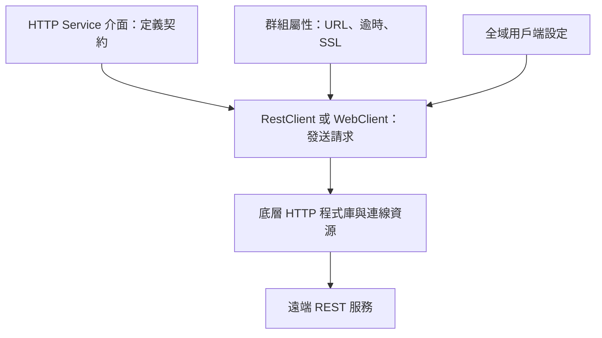

# 呼叫 REST 服務

<!-- source-attribution -->
> **非官方繁體中文翻譯** · Spring Boot 4.1.1 · 翻譯日期：2026-10-21  
> [官方英文網站](https://docs.spring.io/spring-boot/4.1/reference/io/rest-client.html) · [固定版本英文來源](https://github.com/spring-projects/spring-boot/blob/v4.1.1/documentation/spring-boot-docs/src/docs/antora/modules/reference/pages/io/rest-client.adoc) · [本地原文快照](../sources/spring-boot/documentation/spring-boot-docs/src/docs/antora/modules/reference/pages/io/rest-client.adoc)  
> 原始作者與授權見 [來源聲明](../NOTICE.md)。官方範例及設定鍵保留原文，額外圖解另標示為譯者補充。

<!-- translation-status: translated -->

Spring Boot 提供多種便利方式呼叫遠端 REST 服務。
如果你開發非阻塞的反應式應用程式，且使用 Spring WebFlux，可以使用 [`WebClient`][io--rest-client-r1]。
若偏好命令式 API，可以使用 [`RestClient`][io--rest-client-r2] 或 [`RestTemplate`][io--rest-client-r3]。

## WebClient

如果 classpath 上有 Spring WebFlux，我們建議使用 [`WebClient`][io--rest-client-r1] 呼叫遠端 REST 服務。
[`WebClient`][io--rest-client-r1] 介面提供函數式風格 API，而且完全反應式。
更多 [`WebClient`][io--rest-client-r1] 資訊，請參閱 [Spring Framework 文件的專門章節][io--rest-client-r4]。

> **提示：**
>
> 若你不是在撰寫反應式 Spring WebFlux 應用程式，可以使用 [`RestClient`][io--rest-client-r5] 代替 [`WebClient`][io--rest-client-r1]。
> 它提供類似的函數式 API，但採命令式而非反應式。

Spring Boot 會為你建立並預先設定一個 prototype 範圍的 [`WebClient.Builder`][io--rest-client-r6] Bean。
強烈建議將它注入元件，並用它建立 [`WebClient`][io--rest-client-r1] 實例。
Spring Boot 會設定此建構器，以共用 HTTP 資源、反映與伺服器端一致的編解碼器設定（請參閱 [WebFlux HTTP 編解碼器自動設定][io--rest-client-r7]），以及其他功能。

下列程式碼展示典型範例：

```kotlin
import org.springframework.stereotype.Service
import org.springframework.web.reactive.function.client.WebClient
import reactor.core.publisher.Mono

@Service
class MyService(webClientBuilder: WebClient.Builder) {

	private val webClient: WebClient

	init {
		webClient = webClientBuilder.baseUrl("https://example.org").build()
	}

	fun someRestCall(name: String): Mono<Details> {
		return webClient.get().uri("/{name}/details", name)
				.retrieve().bodyToMono(Details::class.java)
	}

}
```

```java
import reactor.core.publisher.Mono;

import org.springframework.stereotype.Service;
import org.springframework.web.reactive.function.client.WebClient;

@Service
public class MyService {

	private final WebClient webClient;

	public MyService(WebClient.Builder webClientBuilder) {
		this.webClient = webClientBuilder.baseUrl("https://example.org").build();
	}

	public Mono<Details> someRestCall(String name) {
		return this.webClient.get().uri("/{name}/details", name).retrieve().bodyToMono(Details.class);
	}

}
```

### WebClient 執行環境

Spring Boot 會依據應用程式 classpath 上可用的程式庫，自動偵測用來驅動 [`WebClient`][io--rest-client-r1] 的 [`ClientHttpConnector`][io--rest-client-r8]。
支援的用戶端依優先順序如下：

1. Reactor Netty
2. Jetty RS client
3. Apache HttpClient
4. JDK HttpClient

若 classpath 上有多個用戶端，會使用優先順序最高的一個。

`spring-boot-starter-webflux` starter 預設依賴 `io.projectreactor.netty:reactor-netty`，同時帶入伺服器與用戶端實作。
若改用 Jetty 作為反應式伺服器，應加入 Jetty Reactive HTTP 用戶端程式庫 `org.eclipse.jetty:jetty-reactive-httpclient` 的相依項。
伺服器與用戶端採用相同技術的優點，是兩者會自動共用 HTTP 資源。

開發人員可以提供自訂 [`ReactorResourceFactory`][io--rest-client-r9] 或 [`JettyResourceFactory`][io--rest-client-r10] Bean，覆寫 Jetty 與 Reactor Netty 的資源設定；這會同時套用到用戶端與伺服器。

若想覆寫用戶端的選擇，可以自行定義 [`ClientHttpConnector`][io--rest-client-r8] Bean，完全掌控用戶端設定。

更多 [`WebClient` 設定選項，請參閱 Spring Framework 參考文件][io--rest-client-r11]。

### 全域 HTTP Connector 設定

如果自動偵測的 [`ClientHttpConnector`][io--rest-client-r8] 不符合需求，可用 `spring.http.clients.reactive.connector` 屬性選擇特定 Connector。
例如，若 classpath 上有 Reactor Netty，但你偏好 Jetty 的 [`HttpClient`][io--rest-client-r12]，可加入下列設定：

```properties
spring.http.clients.reactive.connector=jetty
```

```yaml
spring:
  http:
    clients:
      reactive:
        connector: jetty
```

> **提示：**
>
> 你也可以使用套用至所有 HTTP 用戶端的[全域設定屬性][io--rest-client-r13]。

若需要更複雜的自訂，可使用 [`ClientHttpConnectorBuilderCustomizer`][io--rest-client-r14]，或宣告自己的 [`ClientHttpConnectorBuilder`][io--rest-client-r15] Bean，讓自動設定退讓。
需要自訂下層 HTTP 程式庫的內部設定時，這會很有用。

例如，下例使用設定了特定 [`ProxySelector`][io--rest-client-r16] 的 JDK 用戶端：

```kotlin
import org.springframework.boot.http.client.reactive.ClientHttpConnectorBuilder
import org.springframework.context.annotation.Bean
import org.springframework.context.annotation.Configuration
import java.net.ProxySelector

@Configuration(proxyBeanMethods = false)
class MyConnectorHttpConfiguration {

	@Bean
	fun clientHttpConnectorBuilder(proxySelector: ProxySelector): ClientHttpConnectorBuilder<*> {
		return ClientHttpConnectorBuilder.jdk().withHttpClientCustomizer { builder -> builder.proxy(proxySelector) }
	}

}
```

```java
import java.net.ProxySelector;

import org.springframework.boot.http.client.reactive.ClientHttpConnectorBuilder;
import org.springframework.context.annotation.Bean;
import org.springframework.context.annotation.Configuration;

@Configuration(proxyBeanMethods = false)
public class MyConnectorHttpConfiguration {

	@Bean
	ClientHttpConnectorBuilder<?> clientHttpConnectorBuilder(ProxySelector proxySelector) {
		return ClientHttpConnectorBuilder.jdk().withHttpClientCustomizer((builder) -> builder.proxy(proxySelector));
	}

}
```

### 自訂 WebClient

自訂 [`WebClient`][io--rest-client-r1] 主要有三種方式，取決於希望自訂套用的範圍。

若要盡可能縮小自訂範圍，請注入自動設定的 [`WebClient.Builder`][io--rest-client-r6]，再依需要呼叫其方法。
[`WebClient.Builder`][io--rest-client-r6] 實例有狀態：建構器的任何變更，都會反映在之後用它建立的所有用戶端。
若想使用同一個建構器建立多個用戶端，也可以考慮透過 `WebClient.Builder other = builder.clone();` 複製建構器。

若要對整個應用程式中所有 [`WebClient.Builder`][io--rest-client-r6] 實例進行累加式自訂，可以宣告 [`WebClientCustomizer`][io--rest-client-r17] Bean，並在注入位置局部修改 [`WebClient.Builder`][io--rest-client-r6]。

最後，也可以回到原始 API，使用 `WebClient.create()`。
此時不會套用任何自動設定或 [`WebClientCustomizer`][io--rest-client-r17]。

### WebClient SSL 支援

若需要為 [`WebClient`][io--rest-client-r1] 使用的 [`ClientHttpConnector`][io--rest-client-r8] 自訂 SSL 設定，可以注入 [`WebClientSsl`][io--rest-client-r18] 實例，搭配建構器的 `apply` 方法使用。

[`WebClientSsl`][io--rest-client-r18] 介面提供存取能力，讓你使用在 `application.properties` 或 `application.yaml` 檔中定義的任何 [SSL bundle][io--rest-client-r19]。

下列程式碼展示典型範例：

```kotlin
import org.springframework.boot.webclient.autoconfigure.WebClientSsl
import org.springframework.stereotype.Service
import org.springframework.web.reactive.function.client.WebClient
import reactor.core.publisher.Mono

@Service
class MyService(webClientBuilder: WebClient.Builder, ssl: WebClientSsl) {

	private val webClient: WebClient

	init {
		webClient = webClientBuilder.baseUrl("https://example.org")
				.apply(ssl.fromBundle("mybundle")).build()
	}

	fun someRestCall(name: String): Mono<Details> {
		return webClient.get().uri("/{name}/details", name)
				.retrieve().bodyToMono(Details::class.java)
	}

}
```

```java
import reactor.core.publisher.Mono;

import org.springframework.boot.webclient.autoconfigure.WebClientSsl;
import org.springframework.stereotype.Service;
import org.springframework.web.reactive.function.client.WebClient;

@Service
public class MyService {

	private final WebClient webClient;

	public MyService(WebClient.Builder webClientBuilder, WebClientSsl ssl) {
		this.webClient = webClientBuilder.baseUrl("https://example.org").apply(ssl.fromBundle("mybundle")).build();
	}

	public Mono<Details> someRestCall(String name) {
		return this.webClient.get().uri("/{name}/details", name).retrieve().bodyToMono(Details.class);
	}

}
```

## RestClient

如果應用程式沒有使用 Spring WebFlux 或 Project Reactor，我們建議使用 [`RestClient`][io--rest-client-r2] 呼叫遠端 REST 服務。

[`RestClient`][io--rest-client-r2] 介面提供函數式風格的命令式 API。

Spring Boot 會為你建立並預先設定 prototype 範圍的 [`RestClient.Builder`][io--rest-client-r20] Bean。
強烈建議將它注入元件，並用它建立 [`RestClient`][io--rest-client-r2] 實例。
Spring Boot 會為此建構器設定 [`HttpMessageConverters`][io--rest-client-r21] 與適當的 [`ClientHttpRequestFactory`][io--rest-client-r22]。

下列程式碼展示典型範例：

```kotlin
import org.springframework.boot.docs.io.restclient.restclient.ssl.Details
import org.springframework.stereotype.Service
import org.springframework.web.client.RestClient

@Service
class MyService(restClientBuilder: RestClient.Builder) {

	private val restClient: RestClient

	init {
		restClient = restClientBuilder.baseUrl("https://example.org").build()
	}

	fun someRestCall(name: String): Details {
		return restClient.get().uri("/{name}/details", name)
				.retrieve().body(Details::class.java)!!
	}

}
```

```java
import org.springframework.stereotype.Service;
import org.springframework.web.client.RestClient;

@Service
public class MyService {

	private final RestClient restClient;

	public MyService(RestClient.Builder restClientBuilder) {
		this.restClient = restClientBuilder.baseUrl("https://example.org").build();
	}

	public Details someRestCall(String name) {
		return this.restClient.get().uri("/{name}/details", name).retrieve().body(Details.class);
	}

}
```

### 自訂 RestClient

自訂 [`RestClient`][io--rest-client-r2] 主要有三種方式，取決於希望自訂套用的範圍。

若要盡可能縮小自訂範圍，請注入自動設定的 [`RestClient.Builder`][io--rest-client-r20]，再依需要呼叫其方法。
[`RestClient.Builder`][io--rest-client-r20] 實例有狀態：建構器的任何變更，都會反映在之後用它建立的所有用戶端。
若想使用同一個建構器建立多個用戶端，也可以考慮透過 `RestClient.Builder other = builder.clone();` 複製建構器。

若要對整個應用程式中所有 [`RestClient.Builder`][io--rest-client-r20] 實例進行累加式自訂，可以宣告 [`RestClientCustomizer`][io--rest-client-r23] Bean，並在注入位置局部修改 [`RestClient.Builder`][io--rest-client-r20]。

最後，也可以回到原始 API，使用 `RestClient.create()`。
此時不會套用任何自動設定或 [`RestClientCustomizer`][io--rest-client-r23]。

> **提示：**
>
> 你也可以修改[全域 HTTP 用戶端設定][io--rest-client-r24]。

### RestClient SSL 支援

若需要為 [`RestClient`][io--rest-client-r2] 使用的 [`ClientHttpRequestFactory`][io--rest-client-r22] 自訂 SSL 設定，可以注入 [`RestClientSsl`][io--rest-client-r25] 實例，搭配建構器的 `apply` 方法使用。

[`RestClientSsl`][io--rest-client-r25] 介面提供存取能力，讓你使用在 `application.properties` 或 `application.yaml` 檔中定義的任何 [SSL bundle][io--rest-client-r19]。

下列程式碼展示典型範例：

```kotlin
import org.springframework.boot.docs.io.restclient.restclient.ssl.settings.Details
import org.springframework.boot.restclient.autoconfigure.RestClientSsl
import org.springframework.stereotype.Service
import org.springframework.web.client.RestClient

@Service
class MyService(restClientBuilder: RestClient.Builder, ssl: RestClientSsl) {

	private val restClient: RestClient

	init {
		restClient = restClientBuilder.baseUrl("https://example.org")
				.apply(ssl.fromBundle("mybundle")).build()
	}

	fun someRestCall(name: String): Details {
		return restClient.get().uri("/{name}/details", name)
				.retrieve().body(Details::class.java)!!
	}

}
```

```java
import org.springframework.boot.restclient.autoconfigure.RestClientSsl;
import org.springframework.stereotype.Service;
import org.springframework.web.client.RestClient;

@Service
public class MyService {

	private final RestClient restClient;

	public MyService(RestClient.Builder restClientBuilder, RestClientSsl ssl) {
		this.restClient = restClientBuilder.baseUrl("https://example.org").apply(ssl.fromBundle("mybundle")).build();
	}

	public Details someRestCall(String name) {
		return this.restClient.get().uri("/{name}/details", name).retrieve().body(Details.class);
	}

}
```

如果除了 SSL bundle 之外，還需要套用其他自訂，可搭配 [`ClientHttpRequestFactoryBuilder`][io--rest-client-r27] 使用 [`HttpClientSettings`][io--rest-client-r26] 類別：

```kotlin
import org.springframework.boot.http.client.ClientHttpRequestFactoryBuilder;
import org.springframework.boot.http.client.HttpClientSettings
import org.springframework.boot.ssl.SslBundles
import org.springframework.stereotype.Service
import org.springframework.web.client.RestClient
import java.time.Duration

@Service
class MyService(restClientBuilder: RestClient.Builder, sslBundles: SslBundles) {

	private val restClient: RestClient

	init {
		val settings = HttpClientSettings.defaults()
				.withReadTimeout(Duration.ofMinutes(2))
				.withSslBundle(sslBundles.getBundle("mybundle"))
		val requestFactory = ClientHttpRequestFactoryBuilder.detect().build(settings);
		restClient = restClientBuilder
				.baseUrl("https://example.org")
				.requestFactory(requestFactory).build()
	}

	fun someRestCall(name: String): Details {
		return restClient.get().uri("/{name}/details", name).retrieve().body(Details::class.java)!!
	}

}
```

```java
import java.time.Duration;

import org.springframework.boot.http.client.ClientHttpRequestFactoryBuilder;
import org.springframework.boot.http.client.HttpClientSettings;
import org.springframework.boot.ssl.SslBundles;
import org.springframework.http.client.ClientHttpRequestFactory;
import org.springframework.stereotype.Service;
import org.springframework.web.client.RestClient;

@Service
public class MyService {

	private final RestClient restClient;

	public MyService(RestClient.Builder restClientBuilder, SslBundles sslBundles) {
		HttpClientSettings settings = HttpClientSettings.ofSslBundle(sslBundles.getBundle("mybundle"))
			.withReadTimeout(Duration.ofMinutes(2));
		ClientHttpRequestFactory requestFactory = ClientHttpRequestFactoryBuilder.detect().build(settings);
		this.restClient = restClientBuilder.baseUrl("https://example.org").requestFactory(requestFactory).build();
	}

	public Details someRestCall(String name) {
		return this.restClient.get().uri("/{name}/details", name).retrieve().body(Details.class);
	}

}
```

## RestTemplate

Spring Framework 的 [`RestTemplate`][io--rest-client-r3] 類別比 [`RestClient`][io--rest-client-r2] 更早出現，是許多應用程式呼叫遠端 REST 服務的傳統方式。
若有既有程式碼而不想遷移到 [`RestClient`][io--rest-client-r2]，或已熟悉 [`RestTemplate`][io--rest-client-r3] API，你可能會選擇使用它。

由於 [`RestTemplate`][io--rest-client-r3] 實例通常需要自訂後才能使用，Spring Boot 不會提供單一、自動設定的 [`RestTemplate`][io--rest-client-r3] Bean。
不過，它會自動設定 [`RestTemplateBuilder`][io--rest-client-r28]，在需要時用來建立 [`RestTemplate`][io--rest-client-r3] 實例。
自動設定的 [`RestTemplateBuilder`][io--rest-client-r28] 會確保將合理的 [`HttpMessageConverters`][io--rest-client-r29] 與適當的 [`ClientHttpRequestFactory`][io--rest-client-r22] 套用到 [`RestTemplate`][io--rest-client-r3] 實例。

下列程式碼展示典型範例：

```kotlin
import org.springframework.boot.restclient.RestTemplateBuilder
import org.springframework.stereotype.Service
import org.springframework.web.client.RestTemplate

@Service
class MyService(restTemplateBuilder: RestTemplateBuilder) {

	private val restTemplate: RestTemplate

	init {
		restTemplate = restTemplateBuilder.build()
	}

	fun someRestCall(name: String): Details {
		return restTemplate.getForObject("/{name}/details", Details::class.java, name)!!
	}

}
```

```java
import org.springframework.boot.restclient.RestTemplateBuilder;
import org.springframework.stereotype.Service;
import org.springframework.web.client.RestTemplate;

@Service
public class MyService {

	private final RestTemplate restTemplate;

	public MyService(RestTemplateBuilder restTemplateBuilder) {
		this.restTemplate = restTemplateBuilder.build();
	}

	public Details someRestCall(String name) {
		return this.restTemplate.getForObject("/{name}/details", Details.class, name);
	}

}
```

[`RestTemplateBuilder`][io--rest-client-r28] 包含多個實用方法，能快速設定 [`RestTemplate`][io--rest-client-r3]。
例如，若要加入 BASIC 身分驗證支援，可以使用 `builder.basicAuthentication("user", "password").build()`。

### 自訂 RestTemplate

自訂 [`RestTemplate`][io--rest-client-r3] 主要有三種方式，取決於希望自訂套用的範圍。

若要盡可能縮小自訂範圍，請注入自動設定的 [`RestTemplateBuilder`][io--rest-client-r28]，再依需要呼叫其方法。
每次方法呼叫都會回傳新的 [`RestTemplateBuilder`][io--rest-client-r28] 實例，因此自訂只會影響這次建構器的使用。

若要進行整個應用程式範圍的累加式自訂，請使用 [`RestTemplateCustomizer`][io--rest-client-r30] Bean。
所有這類 Bean 都會自動註冊到自動設定的 [`RestTemplateBuilder`][io--rest-client-r28]，並套用到透過它建立的所有範本。

下例的自訂器為 `192.168.0.5` 以外的所有主機設定代理伺服器：

```kotlin
import org.apache.hc.client5.http.classic.HttpClient
import org.apache.hc.client5.http.impl.classic.HttpClientBuilder
import org.apache.hc.client5.http.impl.routing.DefaultProxyRoutePlanner
import org.apache.hc.client5.http.routing.HttpRoutePlanner
import org.apache.hc.core5.http.HttpException
import org.apache.hc.core5.http.HttpHost
import org.apache.hc.core5.http.protocol.HttpContext
import org.springframework.boot.restclient.RestTemplateCustomizer
import org.springframework.http.client.HttpComponentsClientHttpRequestFactory
import org.springframework.web.client.RestTemplate

class MyRestTemplateCustomizer : RestTemplateCustomizer {

	override fun customize(restTemplate: RestTemplate) {
		val routePlanner: HttpRoutePlanner = CustomRoutePlanner(HttpHost("proxy.example.com"))
		val httpClient: HttpClient = HttpClientBuilder.create().setRoutePlanner(routePlanner).build()
		restTemplate.requestFactory = HttpComponentsClientHttpRequestFactory(httpClient)
	}

	internal class CustomRoutePlanner(proxy: HttpHost?) : DefaultProxyRoutePlanner(proxy) {

		@Throws(HttpException::class)
		public override fun determineProxy(target: HttpHost, context: HttpContext): HttpHost? {
			if (target.hostName == "192.168.0.5") {
				return null
			}
			return  super.determineProxy(target, context)
		}

	}

}
```

```java
import org.apache.hc.client5.http.classic.HttpClient;
import org.apache.hc.client5.http.impl.classic.HttpClientBuilder;
import org.apache.hc.client5.http.impl.routing.DefaultProxyRoutePlanner;
import org.apache.hc.client5.http.routing.HttpRoutePlanner;
import org.apache.hc.core5.http.HttpException;
import org.apache.hc.core5.http.HttpHost;
import org.apache.hc.core5.http.protocol.HttpContext;

import org.springframework.boot.restclient.RestTemplateCustomizer;
import org.springframework.http.client.HttpComponentsClientHttpRequestFactory;
import org.springframework.web.client.RestTemplate;

public class MyRestTemplateCustomizer implements RestTemplateCustomizer {

	@Override
	public void customize(RestTemplate restTemplate) {
		HttpRoutePlanner routePlanner = new CustomRoutePlanner(new HttpHost("proxy.example.com"));
		HttpClient httpClient = HttpClientBuilder.create().setRoutePlanner(routePlanner).build();
		restTemplate.setRequestFactory(new HttpComponentsClientHttpRequestFactory(httpClient));
	}

	static class CustomRoutePlanner extends DefaultProxyRoutePlanner {

		CustomRoutePlanner(HttpHost proxy) {
			super(proxy);
		}

		@Override
		protected HttpHost determineProxy(HttpHost target, HttpContext context) throws HttpException {
			if (target.getHostName().equals("192.168.0.5")) {
				return null;
			}
			return super.determineProxy(target, context);
		}

	}

}
```

最後，你可以定義自己的 [`RestTemplateBuilder`][io--rest-client-r28] Bean。
這會替換自動設定的建構器。
若希望像自動設定一樣，將 [`RestTemplateCustomizer`][io--rest-client-r30] Bean 套用到自訂建構器，請使用 [`RestTemplateBuilderConfigurer`][io--rest-client-r31] 設定它。
下例公開的 [`RestTemplateBuilder`][io--rest-client-r28] 與 Spring Boot 自動設定的結果一致，只是另外指定了自訂連線與讀取逾時：

```kotlin
import org.springframework.boot.restclient.autoconfigure.RestTemplateBuilderConfigurer
import org.springframework.boot.restclient.RestTemplateBuilder
import org.springframework.context.annotation.Bean
import org.springframework.context.annotation.Configuration
import java.time.Duration

@Configuration(proxyBeanMethods = false)
class MyRestTemplateBuilderConfiguration {

	@Bean
	fun restTemplateBuilder(configurer: RestTemplateBuilderConfigurer): RestTemplateBuilder {
		return configurer.configure(RestTemplateBuilder()).connectTimeout(Duration.ofSeconds(5))
			.readTimeout(Duration.ofSeconds(2))
	}

}
```

```java
import java.time.Duration;

import org.springframework.boot.restclient.RestTemplateBuilder;
import org.springframework.boot.restclient.autoconfigure.RestTemplateBuilderConfigurer;
import org.springframework.context.annotation.Bean;
import org.springframework.context.annotation.Configuration;

@Configuration(proxyBeanMethods = false)
public class MyRestTemplateBuilderConfiguration {

	@Bean
	public RestTemplateBuilder restTemplateBuilder(RestTemplateBuilderConfigurer configurer) {
		return configurer.configure(new RestTemplateBuilder())
			.connectTimeout(Duration.ofSeconds(5))
			.readTimeout(Duration.ofSeconds(2));
	}

}
```

最徹底（也很少使用）的選項，是不使用 configurer，直接建立自己的 [`RestTemplateBuilder`][io--rest-client-r28] Bean。
這除了替換自動設定建構器，也會阻止所有 [`RestTemplateCustomizer`][io--rest-client-r30] Bean 被使用。

> **提示：**
>
> 你也可以修改[全域 HTTP 用戶端設定][io--rest-client-r24]。

### RestTemplate SSL 支援

若需要為 [`RestTemplate`][io--rest-client-r3] 自訂 SSL 設定，可以將 [SSL bundle][io--rest-client-r19] 套用到 [`RestTemplateBuilder`][io--rest-client-r28]，如下例所示：

```kotlin
import org.springframework.boot.docs.io.restclient.resttemplate.Details
import org.springframework.boot.ssl.SslBundles
import org.springframework.boot.restclient.RestTemplateBuilder
import org.springframework.stereotype.Service
import org.springframework.web.client.RestTemplate

@Service
class MyService(restTemplateBuilder: RestTemplateBuilder, sslBundles: SslBundles) {

    private val restTemplate: RestTemplate

    init {
        restTemplate = restTemplateBuilder.sslBundle(sslBundles.getBundle("mybundle")).build()
    }

    fun someRestCall(name: String): Details {
        return restTemplate.getForObject("/{name}/details", Details::class.java, name)!!
    }

}
```

```java
import org.springframework.boot.docs.io.restclient.resttemplate.Details;
import org.springframework.boot.restclient.RestTemplateBuilder;
import org.springframework.boot.ssl.SslBundles;
import org.springframework.stereotype.Service;
import org.springframework.web.client.RestTemplate;

@Service
public class MyService {

	private final RestTemplate restTemplate;

	public MyService(RestTemplateBuilder restTemplateBuilder, SslBundles sslBundles) {
		this.restTemplate = restTemplateBuilder.sslBundle(sslBundles.getBundle("mybundle")).build();
	}

	public Details someRestCall(String name) {
		return this.restTemplate.getForObject("/{name}/details", Details.class, name);
	}

}
```

## RestClient 與 RestTemplate 的 HTTP 用戶端偵測

Spring Boot 會依據應用程式 classpath 上可用的程式庫，自動偵測 [`RestClient`][io--rest-client-r2] 與 [`RestTemplate`][io--rest-client-r3] 要使用的 HTTP 用戶端。
支援的用戶端依優先順序如下：

1. Apache HttpClient
2. Jetty HttpClient
3. Reactor Netty HttpClient
4. JDK client（`java.net.http.HttpClient`）
5. Simple JDK client（`java.net.HttpURLConnection`）

如果 classpath 上有多個用戶端，且沒有提供全域設定，就會使用優先順序最高的一個。

### 全域 HTTP 用戶端設定

若自動偵測的 HTTP 用戶端不符合需求，可使用 `spring.http.clients.imperative.factory` 屬性選擇特定工廠。
例如，若 classpath 上有 Apache HttpClient，但偏好 Jetty 的 [`HttpClient`][io--rest-client-r12]，可加入下列設定：

```properties
spring.http.clients.imperative.factory=jetty
```

```yaml
spring:
  http:
    clients:
      imperative:
        factory: jetty
```

> **提示：**
>
> 你也可以使用套用至所有 HTTP 用戶端的[全域設定屬性][io--rest-client-r13]。

若需要更複雜的自訂，可使用 [`ClientHttpRequestFactoryBuilderCustomizer`][io--rest-client-r32]，或宣告自己的 [`ClientHttpRequestFactoryBuilder`][io--rest-client-r27] Bean，讓自動設定退讓。
需要自訂下層 HTTP 程式庫的內部設定時，這會很有用。

例如，下例使用設定了特定 [`ProxySelector`][io--rest-client-r16] 的 JDK 用戶端：

```kotlin
import org.springframework.boot.http.client.ClientHttpRequestFactoryBuilder
import org.springframework.context.annotation.Bean
import org.springframework.context.annotation.Configuration
import java.net.ProxySelector

@Configuration(proxyBeanMethods = false)
class MyClientHttpConfiguration {

	@Bean
	fun clientHttpRequestFactoryBuilder(proxySelector: ProxySelector): ClientHttpRequestFactoryBuilder<*> {
		return ClientHttpRequestFactoryBuilder.jdk()
				.withHttpClientCustomizer { builder -> builder.proxy(proxySelector) }
	}

}
```

```java
import java.net.ProxySelector;

import org.springframework.boot.http.client.ClientHttpRequestFactoryBuilder;
import org.springframework.context.annotation.Bean;
import org.springframework.context.annotation.Configuration;

@Configuration(proxyBeanMethods = false)
public class MyClientHttpConfiguration {

	@Bean
	ClientHttpRequestFactoryBuilder<?> clientHttpRequestFactoryBuilder(ProxySelector proxySelector) {
		return ClientHttpRequestFactoryBuilder.jdk()
			.withHttpClientCustomizer((builder) -> builder.proxy(proxySelector));
	}

}
```

## API 版本管理

`WebClient` 與 `RestClient` 都支援帶有版本的遠端 HTTP 呼叫，讓 API 能隨時間演進。
通常是透過 HTTP 標頭、查詢參數或 URL 路徑區段，指定要使用的 API 版本。

你可以使用 `WebClient.Builder` 或 `RestClient.Builder` 上的方法設定 API 版本管理。

> **提示：**
>
> 伺服器端也支援 API 版本管理。
> 詳情請參閱 [Spring MVC][io--rest-client-r33] 與 [Spring WebFlux][io--rest-client-r34] 章節。

> **注意：**
>
> 用戶端自動設定不會採用伺服器端的 API 版本設定。
> 需要使用 API 版本策略的用戶端（通常用於測試）必須明確設定。

## HTTP Service 介面用戶端

除了直接使用 [`RestClient`][io--rest-client-r2] 或 [`WebClient`][io--rest-client-r1] 呼叫 HTTP 服務，也可以透過有註解的 Java 介面呼叫。

HTTP Service 介面使用標註 [`@HttpExchange`][io--rest-client-r35] 的方法定義服務契約，更常見的是 HTTP 方法專用變體（[`@GetExchange`][io--rest-client-r36]、[`@PostExchange`][io--rest-client-r37]、[`@DeleteExchange`][io--rest-client-r38] 等）。

例如，下列程式碼為「echo」API 定義 HTTP Service；它會回傳 JSON 物件，內容是請求的回顯。

```kotlin
import org.springframework.web.bind.annotation.RequestBody
import org.springframework.web.service.annotation.HttpExchange
import org.springframework.web.service.annotation.PostExchange

@HttpExchange(url = "https://echo.zuplo.io")
interface EchoService {

	@PostExchange
	fun echo(@RequestBody message: Map<String, String>): Map<*, *>

}
```

```java
import java.util.Map;

import org.springframework.web.bind.annotation.RequestBody;
import org.springframework.web.service.annotation.HttpExchange;
import org.springframework.web.service.annotation.PostExchange;

@HttpExchange(url = "https://echo.zuplo.io")
public interface EchoService {

	@PostExchange
	Map<?, ?> echo(@RequestBody Map<String, String> message);

}
```

開發 HTTP Service 介面用戶端的更多資訊，請參閱 [Spring Framework 參考文件][io--rest-client-r39]。

### 匯入 HTTP Service

若要將 HTTP Service 介面作為用戶端，必須先匯入它。
其中一種方式是使用 [`@ImportHttpServices`][io--rest-client-r40] 註解，通常加在主要應用程式類別上。
可透過此註解匯入指定類別，或從指定套件掃描要匯入的類別。

例如，下列設定會掃描 `com.example.myclients` 套件中的 HTTP Service 介面：

```kotlin
import org.springframework.boot.autoconfigure.SpringBootApplication
import org.springframework.boot.runApplication
import org.springframework.web.service.registry.ImportHttpServices

@SpringBootApplication
@ImportHttpServices(basePackages = ["com.example.myclients"])
class MyApplication

fun main(args: Array<String>) {
	runApplication<MyApplication>(*args)
}
```

```java
import org.springframework.boot.SpringApplication;
import org.springframework.boot.autoconfigure.SpringBootApplication;
import org.springframework.web.service.registry.ImportHttpServices;

@SpringBootApplication
@ImportHttpServices(basePackages = "com.example.myclients")
public class MyApplication {

	public static void main(String[] args) {
		SpringApplication.run(MyApplication.class, args);
	}

}
```

### 服務用戶端群組

在正式應用程式中，將絕對 URL 寫死在 [`@HttpExchange`][io--rest-client-r35] 註解裡通常不理想。
你通常會希望在程式碼中為 HTTP Service 用戶端指定邏輯名稱，再依名稱從屬性查找 URL。

HTTP Service 用戶端可藉由註冊到具名群組來達成這件事。
HTTP Service 群組是一組共用相同特性的 HTTP Service 介面。

例如，我們可能想定義「echo」群組，供呼叫 `https://echo.zuplo.io` 的 HTTP Service 用戶端使用。

> **注意：**
>
> HTTP Service 群組能定義的不只是 URL。
> 例如，群組可以定義連線逾時與 SSL 設定。
> 也可以將用戶端自訂邏輯關聯到群組，例如加入插入必要授權標頭的程式碼。

使用 [`@ImportHttpServices`][io--rest-client-r40] 時，可以透過 `group` 屬性將 HTTP Service 介面與群組關聯。

例如，假設前述範例的結構安排為：`com.example.myclients` 套件中的所有 HTTP Service 介面都屬於 `echo` 群組。
首先從服務介面移除寫死的 URL：

```kotlin
import org.springframework.web.bind.annotation.RequestBody
import org.springframework.web.service.annotation.HttpExchange
import org.springframework.web.service.annotation.PostExchange

interface EchoService {

	@PostExchange
	fun echo(@RequestBody message: Map<String, String>): Map<*, *>

}
```

```java
import java.util.Map;

import org.springframework.web.bind.annotation.RequestBody;
import org.springframework.web.service.annotation.PostExchange;

public interface EchoService {

	@PostExchange
	Map<?, ?> echo(@RequestBody Map<String, String> message);

}
```

接著可以這樣寫：

```kotlin
import org.springframework.boot.autoconfigure.SpringBootApplication
import org.springframework.boot.runApplication
import org.springframework.web.service.registry.ImportHttpServices

@SpringBootApplication
@ImportHttpServices(group = "echo", basePackages = ["com.example.myclients"])
class MyApplication

fun main(args: Array<String>) {
	runApplication<MyApplication>(*args)
}
```

```java
import org.springframework.boot.SpringApplication;
import org.springframework.boot.autoconfigure.SpringBootApplication;
import org.springframework.web.service.registry.ImportHttpServices;

@SpringBootApplication
@ImportHttpServices(group = "echo", basePackages = "com.example.myclients")
public class MyApplication {

	public static void main(String[] args) {
		SpringApplication.run(MyApplication.class, args);
	}

}
```

最後使用 `base-url` 屬性，將 `echo` 群組連結到實際 URL：

```properties
spring.http.serviceclient.echo.base-url=https://echo.zuplo.io
```

```yaml
spring:
  http:
    serviceclient:
      echo:
        base-url: "https://echo.zuplo.io"
```

> **提示：**
>
> 若未指定群組，HTTP Service 用戶端會與名為「default」的群組關聯。

> **注意：**
>
> 如果同一套件中有多個 HTTP Service 介面，卻需要分別關聯到不同群組，可以逐一列出。
> [`@ImportHttpServices`][io--rest-client-r40] 可以重複使用，`types` 屬性則允許匯入個別類別。
>
> 例如：
>
> ```kotlin
> import org.springframework.boot.autoconfigure.SpringBootApplication
> import org.springframework.boot.runApplication
> import org.springframework.web.service.registry.ImportHttpServices
>
> @SpringBootApplication
> @ImportHttpServices(group = "echo", types = [EchoService::class])
> @ImportHttpServices(group = "other", types = [OtherService::class])
> class MyApplication
>
> fun main(args: Array<String>) {
> 	runApplication<MyApplication>(*args)
> }
> ```
>
> ```java
> import org.springframework.boot.SpringApplication;
> import org.springframework.boot.autoconfigure.SpringBootApplication;
> import org.springframework.web.service.registry.ImportHttpServices;
>
> @SpringBootApplication
> @ImportHttpServices(group = "echo", types = EchoService.class)
> @ImportHttpServices(group = "other", types = OtherService.class)
> public class MyApplication {
>
> 	public static void main(String[] args) {
> 		SpringApplication.run(MyApplication.class, args);
> 	}
>
> }
> ```

### 設定屬性

HTTP Service 的設定屬性可放在 `spring.http.serviceclient.<group-name>` 下：

你可以使用屬性設定下列項目：

- 基底 URL。
- 要傳送的預設標頭。
- API 版本設定。
- 重新導向設定。
- 連線與讀取逾時。
- 要使用的 SSL bundle。

> **提示：**
>
> 你也可以使用套用至所有 HTTP 用戶端的[全域設定屬性][io--rest-client-r13]。

例如，下列屬性會：

- 將所有 HTTP 用戶端的連線逾時設為一秒（除非另外覆寫）。
- 將「echo」群組中的 HTTP Service 用戶端設定為：

  - 使用特定基底 URL。
  - 連線逾時為一秒。
  - 讀取逾時為兩秒。

```properties
spring.http.clients.connect-timeout=1s
spring.http.serviceclient.echo.base-url=https://echo.zuplo.io
spring.http.serviceclient.echo.connect-timeout=2s
spring.http.serviceclient.echo.read-timeout=2s
```

```yaml
spring:
  http:
    clients:
      connect-timeout: 1s
    serviceclient:
      echo:
        base-url: "https://echo.zuplo.io"
        connect-timeout: 2s
        read-timeout: 2s
```

### 自訂

如果需要超出基本屬性的 HTTP Service 用戶端自訂，可以使用 HTTP Service 群組設定器。
以 `RestClient` 為底層的 HTTP Service 用戶端，可以宣告實作 [`RestClientHttpServiceGroupConfigurer`][io--rest-client-r41] 的 Bean。
以 `WebClient` 為底層的 HTTP Service 用戶端，則可宣告實作 [`WebClientHttpServiceGroupConfigurer`][io--rest-client-r42] 的 Bean。

兩者運作方式相同，都會由 Spring Boot 自動設定自動套用。

例如，下列設定會加入群組自訂器，為每個送出請求加上包含群組名稱的 HTTP 標頭：

```kotlin
import org.springframework.context.annotation.Bean
import org.springframework.context.annotation.Configuration
import org.springframework.web.client.support.RestClientHttpServiceGroupConfigurer

@Configuration(proxyBeanMethods = false)
class MyHttpServiceGroupConfiguration {

	@Bean
	fun myHttpServiceGroupConfigurer(): RestClientHttpServiceGroupConfigurer {
		return RestClientHttpServiceGroupConfigurer { groups ->
			groups.forEachClient { group, clientBuilder ->
				val groupName = group.name()
				clientBuilder.defaultHeader("service-group", groupName)
			}
		}
	}

}
```

```java
import org.springframework.context.annotation.Bean;
import org.springframework.context.annotation.Configuration;
import org.springframework.web.client.support.RestClientHttpServiceGroupConfigurer;

@Configuration(proxyBeanMethods = false)
public class MyHttpServiceGroupConfiguration {

	@Bean
	RestClientHttpServiceGroupConfigurer myHttpServiceGroupConfigurer() {
		return (groups) -> groups.forEachClient((group, clientBuilder) -> {
			String groupName = group.name();
			clientBuilder.defaultHeader("service-group", groupName);
		});
	}

}
```

### 進階設定

除了 [`@ImportHttpServices`][io--rest-client-r40] 註解，Spring Framework 也提供 [`AbstractHttpServiceRegistrar`][io--rest-client-r43] 類別。
你可以 [`@Import`][io--rest-client-r44] 自行繼承此類別的實作，以程式進行設定。
詳情請參閱 [Spring Framework 參考文件][io--rest-client-r45]。

無論採用哪種方式註冊 HTTP Service 用戶端，Spring Boot 的支援都相同。

## 將全域設定套用到所有 HTTP 用戶端

不論使用哪種底層技術，所有 HTTP 用戶端都有一些可設定的共通選項。

包括：

- 連線逾時。
- 讀取逾時。
- HTTP 重新導向的處理方式。
- 連線時使用哪個 SSL bundle。

這些共通設定由 [`HttpClientSettings`][io--rest-client-r26] 類別表示，可傳入 [`ClientHttpConnectorBuilder`][io--rest-client-r15] 與 [`ClientHttpRequestFactoryBuilder`][io--rest-client-r27] 的 `build(…)` 方法。

若要將相同設定套用到所有自動設定的用戶端，可以使用 `spring.http.clients` 屬性：

```properties
spring.http.clients.connect-timeout=2s
spring.http.clients.read-timeout=1s
spring.http.clients.redirects=dont-follow
```

```yaml
spring:
  http:
    clients:
      connect-timeout: 2s
      read-timeout: 1s
      redirects: dont-follow
```

### InetAddress 過濾與 SSRF 防護

有時限制 HTTP 用戶端可以呼叫的遠端位址會很有用。
加強應用程式抵禦伺服器端請求偽造（SSRF）攻擊時，這項技術尤其有幫助。

若要限制用戶端可呼叫的位址，可以使用 [`InetAddressFilter`][io--rest-client-r46]，只允許呼叫符合過濾器條件的位址。
這個過濾器是函數式介面，你可以自行建立實作，或使用便利的工廠方法。

可以將過濾器套用到建立用戶端時使用的 [`HttpClientSettings`][io--rest-client-r26]：

```kotlin
import org.springframework.boot.http.client.ClientHttpRequestFactoryBuilder
import org.springframework.boot.http.client.HttpClientSettings
import org.springframework.boot.http.client.InetAddressFilter
import org.springframework.http.client.ClientHttpRequestFactory
import org.springframework.stereotype.Service
import org.springframework.web.client.RestClient

@Service
class MyService {

	private val restClient: RestClient

	init {
		val onlyExternalAddresses = InetAddressFilter.externalAddresses()
		val settings = HttpClientSettings.defaults().withInetAddressFilter(onlyExternalAddresses)
		val requestFactory: ClientHttpRequestFactory = ClientHttpRequestFactoryBuilder.jdk().build(settings)
		restClient = RestClient.builder().requestFactory(requestFactory).baseUrl("https://example.org").build()
	}

	fun someRestCall(name: String?): Details {
		return restClient.get().uri("/{name}/details", name)
			.retrieve().body(Details::class.java)!!
	}

}
```

```java
import org.springframework.boot.http.client.ClientHttpRequestFactoryBuilder;
import org.springframework.boot.http.client.HttpClientSettings;
import org.springframework.boot.http.client.InetAddressFilter;
import org.springframework.http.client.ClientHttpRequestFactory;
import org.springframework.stereotype.Service;
import org.springframework.web.client.RestClient;

@Service
public class MyService {

	private final RestClient restClient;

	public MyService() {
		InetAddressFilter onlyExternalAddresses = InetAddressFilter.externalAddresses();
		HttpClientSettings settings = HttpClientSettings.defaults().withInetAddressFilter(onlyExternalAddresses);
		ClientHttpRequestFactory requestFactory = ClientHttpRequestFactoryBuilder.jdk().build(settings);
		this.restClient = RestClient.builder().requestFactory(requestFactory).baseUrl("https://example.org").build();
	}

	public Details someRestCall(String name) {
		return this.restClient.get().uri("/{name}/details", name).retrieve().body(Details.class);
	}

}
```

如果想將它套用到所有自動設定的 HTTP 用戶端建構器，也可以將它定義為 [`@Bean`][io--rest-client-r47]：

```kotlin
import org.springframework.boot.http.client.InetAddressFilter
import org.springframework.context.annotation.Bean
import org.springframework.context.annotation.Configuration

@Configuration(proxyBeanMethods = false)
class MyHttpClientConfiguration {

	@Bean
	fun httpClientInetAddressFilter(): InetAddressFilter {
		return InetAddressFilter.of("192.168.1.0/24").andNot("192.168.1.1", "192.168.1.10")
	}

}
```

```java
import org.springframework.boot.http.client.InetAddressFilter;
import org.springframework.context.annotation.Bean;
import org.springframework.context.annotation.Configuration;

@Configuration(proxyBeanMethods = false)
public class MyHttpClientConfiguration {

	@Bean
	public InetAddressFilter httpClientInetAddressFilter() {
		return InetAddressFilter.of("192.168.1.0/24").andNot("192.168.1.1", "192.168.1.10");
	}

}
```

## 譯者補充：宣告介面與底層連線的分工



[io--rest-client-r1]: https://docs.spring.io/spring-framework/docs/7.0.x/javadoc-api/org/springframework/web/reactive/function/client/WebClient.html
[io--rest-client-r2]: https://docs.spring.io/spring-framework/docs/7.0.x/javadoc-api/org/springframework/web/client/RestClient.html
[io--rest-client-r3]: https://docs.spring.io/spring-framework/docs/7.0.x/javadoc-api/org/springframework/web/client/RestTemplate.html
[io--rest-client-r4]: https://docs.spring.io/spring-framework/reference/7.0/web/webflux-webclient.html
[io--rest-client-r5]: https://docs.spring.io/spring-boot/4.1/reference/io/rest-client.html#io.rest-client.restclient
[io--rest-client-r6]: https://docs.spring.io/spring-framework/docs/7.0.x/javadoc-api/org/springframework/web/reactive/function/client/WebClient.Builder.html
[io--rest-client-r7]: https://docs.spring.io/spring-boot/4.1/reference/web/reactive.html#web.reactive.webflux.httpcodecs
[io--rest-client-r8]: https://docs.spring.io/spring-framework/docs/7.0.x/javadoc-api/org/springframework/http/client/reactive/ClientHttpConnector.html
[io--rest-client-r9]: https://docs.spring.io/spring-framework/docs/7.0.x/javadoc-api/org/springframework/http/client/ReactorResourceFactory.html
[io--rest-client-r10]: https://docs.spring.io/spring-framework/docs/7.0.x/javadoc-api/org/springframework/http/client/reactive/JettyResourceFactory.html
[io--rest-client-r11]: https://docs.spring.io/spring-framework/reference/7.0/web/webflux-webclient/client-builder.html
[io--rest-client-r12]: https://javadoc.jetty.org/jetty-12/org/eclipse/jetty/client/HttpClient.html
[io--rest-client-r13]: https://docs.spring.io/spring-boot/4.1/reference/io/rest-client.html#io.rest-client.global-configuration
[io--rest-client-r14]: https://docs.spring.io/spring-boot/4.1.1/api/java/org/springframework/boot/http/client/autoconfigure/reactive/ClientHttpConnectorBuilderCustomizer.html
[io--rest-client-r15]: https://docs.spring.io/spring-boot/4.1.1/api/java/org/springframework/boot/http/client/reactive/ClientHttpConnectorBuilder.html
[io--rest-client-r16]: https://docs.oracle.com/en/java/javase/17/docs/api/java.base/java/net/ProxySelector.html
[io--rest-client-r17]: https://docs.spring.io/spring-boot/4.1.1/api/java/org/springframework/boot/webclient/WebClientCustomizer.html
[io--rest-client-r18]: https://docs.spring.io/spring-boot/4.1.1/api/java/org/springframework/boot/webclient/autoconfigure/WebClientSsl.html
[io--rest-client-r19]: https://docs.spring.io/spring-boot/4.1/reference/features/ssl.html#features.ssl.bundles
[io--rest-client-r20]: https://docs.spring.io/spring-framework/docs/7.0.x/javadoc-api/org/springframework/web/client/RestClient.Builder.html
[io--rest-client-r21]: https://docs.spring.io/spring-framework/docs/7.0.x/javadoc-api/org/springframework/http/converter/HttpMessageConverters.html
[io--rest-client-r22]: https://docs.spring.io/spring-framework/docs/7.0.x/javadoc-api/org/springframework/http/client/ClientHttpRequestFactory.html
[io--rest-client-r23]: https://docs.spring.io/spring-boot/4.1.1/api/java/org/springframework/boot/restclient/RestClientCustomizer.html
[io--rest-client-r24]: https://docs.spring.io/spring-boot/4.1/reference/io/rest-client.html#io.rest-client.clienthttprequestfactory.configuration
[io--rest-client-r25]: https://docs.spring.io/spring-boot/4.1.1/api/java/org/springframework/boot/restclient/autoconfigure/RestClientSsl.html
[io--rest-client-r26]: https://docs.spring.io/spring-boot/4.1.1/api/java/org/springframework/boot/http/client/HttpClientSettings.html
[io--rest-client-r27]: https://docs.spring.io/spring-boot/4.1.1/api/java/org/springframework/boot/http/client/ClientHttpRequestFactoryBuilder.html
[io--rest-client-r28]: https://docs.spring.io/spring-boot/4.1.1/api/java/org/springframework/boot/restclient/RestTemplateBuilder.html
[io--rest-client-r29]: https://docs.spring.io/spring-boot/4.1.1/api/java/org/springframework/boot/http/converter/autoconfigure/HttpMessageConverters.html
[io--rest-client-r30]: https://docs.spring.io/spring-boot/4.1.1/api/java/org/springframework/boot/restclient/RestTemplateCustomizer.html
[io--rest-client-r31]: https://docs.spring.io/spring-boot/4.1.1/api/java/org/springframework/boot/restclient/autoconfigure/RestTemplateBuilderConfigurer.html
[io--rest-client-r32]: https://docs.spring.io/spring-boot/4.1.1/api/java/org/springframework/boot/http/client/autoconfigure/ClientHttpRequestFactoryBuilderCustomizer.html
[io--rest-client-r33]: https://docs.spring.io/spring-boot/4.1/reference/web/servlet.html#web.servlet.spring-mvc.api-versioning
[io--rest-client-r34]: https://docs.spring.io/spring-boot/4.1/reference/web/reactive.html#web.reactive.webflux.api-versioning
[io--rest-client-r35]: https://docs.spring.io/spring-framework/docs/7.0.x/javadoc-api/org/springframework/web/service/annotation/HttpExchange.html
[io--rest-client-r36]: https://docs.spring.io/spring-framework/docs/7.0.x/javadoc-api/org/springframework/web/service/annotation/GetExchange.html
[io--rest-client-r37]: https://docs.spring.io/spring-framework/docs/7.0.x/javadoc-api/org/springframework/web/service/annotation/PostExchange.html
[io--rest-client-r38]: https://docs.spring.io/spring-framework/docs/7.0.x/javadoc-api/org/springframework/web/service/annotation/DeleteExchange.html
[io--rest-client-r39]: https://docs.spring.io/spring-framework/reference/7.0/integration/rest-clients.html#rest-http-service-client
[io--rest-client-r40]: https://docs.spring.io/spring-framework/docs/7.0.x/javadoc-api/org/springframework/web/service/registry/ImportHttpServices.html
[io--rest-client-r41]: https://docs.spring.io/spring-framework/docs/7.0.x/javadoc-api/org/springframework/web/client/support/RestClientHttpServiceGroupConfigurer.html
[io--rest-client-r42]: https://docs.spring.io/spring-framework/docs/7.0.x/javadoc-api/org/springframework/web/reactive/function/client/support/WebClientHttpServiceGroupConfigurer.html
[io--rest-client-r43]: https://docs.spring.io/spring-framework/docs/7.0.x/javadoc-api/org/springframework/web/service/registry/AbstractHttpServiceRegistrar.html
[io--rest-client-r44]: https://docs.spring.io/spring-framework/docs/7.0.x/javadoc-api/org/springframework/context/annotation/Import.html
[io--rest-client-r45]: https://docs.spring.io/spring-framework/reference/7.0/integration/rest-clients.html#rest-http-service-client-group-config
[io--rest-client-r46]: https://docs.spring.io/spring-boot/4.1.1/api/java/org/springframework/boot/http/client/InetAddressFilter.html
[io--rest-client-r47]: https://docs.spring.io/spring-framework/docs/7.0.x/javadoc-api/org/springframework/context/annotation/Bean.html
