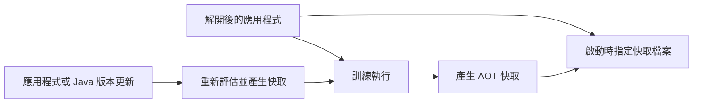

# AOT 快取

<!-- source-attribution -->
> **非官方繁體中文翻譯** · Spring Boot 4.1.1 · 翻譯日期：2026-10-21  
> [官方英文網站](https://docs.spring.io/spring-boot/4.1/reference/packaging/aot-cache.html) · [固定版本英文來源](https://github.com/spring-projects/spring-boot/blob/v4.1.1/documentation/spring-boot-docs/src/docs/antora/modules/reference/pages/packaging/aot-cache.adoc) · [本地原文快照](../sources/spring-boot/documentation/spring-boot-docs/src/docs/antora/modules/reference/pages/packaging/aot-cache.adoc)  
> 原始作者與授權見 [來源聲明](../NOTICE.md)。官方範例及設定鍵保留原文，額外圖解另標示為譯者補充。

<!-- translation-status: translated -->

AOT 快取是 [JVM 功能][packaging--aot-cache-r1]，有助於縮短 Java 應用程式的啟動時間，並減少記憶體用量。

如果尚未使用 Java 25 以上版本，請閱讀 CDS 相關章節。CDS 是 AOT 快取的前身，運作方式相近。

> **注意：**Spring Boot 同時支援 CDS 與 AOT 快取，但建議在可行情況下使用 AOT 快取。

## AOT 快取

> **注意：**Spring Boot 對 AOT 快取的支援適用於 Java 25 以上版本；更早的 Java 版本必須改用 CDS。

使用 AOT 快取前，先對已解開的應用程式進行一次訓練執行：

```shell
$ java -Djarmode=tools -jar my-app.jar extract --destination application
$ cd application
$ java -XX:AOTCacheOutput=app.aot -Dspring.context.exit=onRefresh -jar my-app.jar
```

這會建立 `app.aot` 快取檔案。只要應用程式沒有更新，而且仍使用相同 Java 版本，就能重複使用。

若要使用快取檔案，啟動應用程式時需要增加一個參數：

```shell
$ java -XX:AOTCache=app.aot -jar my-app.jar
```

> **注意：**快取檔案必須搭配已解開形式的應用程式使用，否則不會生效。

若要了解如何搭配 Buildpacks 使用 AOT 快取，請參閱 [AOT Cache How-to 指南][packaging--aot-cache-r2]。

## CDS

> **注意：**若使用 Java 25 以上版本，請以 AOT 快取取代 CDS。

使用 CDS 前，先對已解開的應用程式進行一次訓練執行：

```shell
$ java -Djarmode=tools -jar my-app.jar extract --destination application
$ cd application
$ java -XX:ArchiveClassesAtExit=application.jsa -Dspring.context.exit=onRefresh -jar my-app.jar
```

這會建立 `application.jsa` 封存檔。只要應用程式未更新，就能重複使用。

若要使用封存檔，啟動應用程式時需要增加一個參數：

```shell
$ java -XX:SharedArchiveFile=application.jsa -jar my-app.jar
```

> **注意：**快取檔案必須搭配已解開形式的應用程式使用，否則不會生效。

> **注意：**CDS 的詳細資訊，請參閱 [JDK 的 Class Data Sharing 文件][packaging--aot-cache-r3]。

## 譯者圖解：先訓練，再使用快取啟動



[packaging--aot-cache-r1]: https://openjdk.org/jeps/483
[packaging--aot-cache-r2]: https://docs.spring.io/spring-boot/4.1/how-to/aot-cache.html
[packaging--aot-cache-r3]: https://docs.oracle.com/en/java/javase/17/vm/class-data-sharing.html
