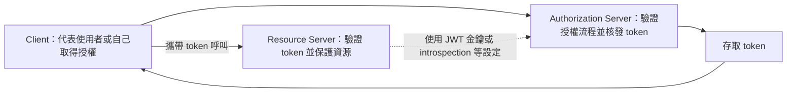

# OAuth2

<!-- source-attribution -->
> **非官方繁體中文翻譯** · Spring Boot 4.1.1 · 翻譯日期：2026-10-21  
> [官方英文網站](https://docs.spring.io/spring-boot/4.1/reference/security/oauth2.html) · [固定版本英文來源](https://github.com/spring-projects/spring-boot/blob/v4.1.1/documentation/spring-boot-docs/src/docs/antora/modules/reference/pages/security/oauth2.adoc) · [本地原文快照](../sources/spring-boot/documentation/spring-boot-docs/src/docs/antora/modules/reference/pages/security/oauth2.adoc)  
> 原始作者與授權見 [來源聲明](../NOTICE.md)。官方範例及設定鍵保留原文，額外圖解另標示為譯者補充。

<!-- translation-status: translated -->

[OAuth2][security--oauth2-r1] 是廣泛使用的授權框架。

## 用戶端

當 classpath 中有 `spring-security-oauth2-client`，即可透過自動設定建立 OAuth2／OpenID Connect 用戶端。設定使用 [`OAuth2ClientProperties`][security--oauth2-r2] 中的屬性；同一套屬性適用於 Servlet 與 Reactive Web 應用程式。

每個 registration 都必須指定 OAuth 2 provider。如果設定 `spring.security.oauth2.client.registration.<registration-id>.provider`，就使用其值指定提供者；若未設定，則以 registration ID 作為 provider ID。以下同時展示這兩種方式：

```properties
spring.security.oauth2.client.registration.my-client.client-id=abcd
spring.security.oauth2.client.registration.my-client.client-secret=password
spring.security.oauth2.client.registration.my-client.provider=example
spring.security.oauth2.client.registration.example.client-id=abcd
spring.security.oauth2.client.registration.example.client-secret=password
```

```yaml
spring:
  security:
    oauth2:
      client:
        registration:
          my-client:
            client-id: "abcd"
            client-secret: "password"
            provider: "example"
          example:
            client-id: "abcd"
            client-secret: "password"
```

`my-client` 與 `example` 兩個 registration 都使用 ID 為 `example` 的 provider。前者依 `spring.security.oauth2.client.registration.my-client.provider` 的值選擇；後者因自己的 ID 是 `example`，且未設定 `provider`，因此採用相同提供者。

指定的 provider 可以參照由 `spring.security.oauth2.client.provider.<provider-id>.*` 設定的提供者，也可以是[已知的常見提供者][security--oauth2-r3]。

可以在 `spring.security.oauth2.client` 前綴下註冊多個 OAuth2 用戶端與 provider：

```properties
spring.security.oauth2.client.registration.my-login-client.client-id=abcd
spring.security.oauth2.client.registration.my-login-client.client-secret=password
spring.security.oauth2.client.registration.my-login-client.client-name=Client for OpenID Connect
spring.security.oauth2.client.registration.my-login-client.provider=my-oauth-provider
spring.security.oauth2.client.registration.my-login-client.scope=openid,profile,email,phone,address
spring.security.oauth2.client.registration.my-login-client.redirect-uri={baseUrl}/login/oauth2/code/{registrationId}
spring.security.oauth2.client.registration.my-login-client.client-authentication-method=client_secret_basic
spring.security.oauth2.client.registration.my-login-client.authorization-grant-type=authorization_code
spring.security.oauth2.client.registration.my-client-1.client-id=abcd
spring.security.oauth2.client.registration.my-client-1.client-secret=password
spring.security.oauth2.client.registration.my-client-1.client-name=Client for user scope
spring.security.oauth2.client.registration.my-client-1.provider=my-oauth-provider
spring.security.oauth2.client.registration.my-client-1.scope=user
spring.security.oauth2.client.registration.my-client-1.redirect-uri={baseUrl}/authorized/user
spring.security.oauth2.client.registration.my-client-1.client-authentication-method=client_secret_basic
spring.security.oauth2.client.registration.my-client-1.authorization-grant-type=authorization_code
spring.security.oauth2.client.registration.my-client-2.client-id=abcd
spring.security.oauth2.client.registration.my-client-2.client-secret=password
spring.security.oauth2.client.registration.my-client-2.client-name=Client for email scope
spring.security.oauth2.client.registration.my-client-2.provider=my-oauth-provider
spring.security.oauth2.client.registration.my-client-2.scope=email
spring.security.oauth2.client.registration.my-client-2.redirect-uri={baseUrl}/authorized/email
spring.security.oauth2.client.registration.my-client-2.client-authentication-method=client_secret_basic
spring.security.oauth2.client.registration.my-client-2.authorization-grant-type=authorization_code
spring.security.oauth2.client.provider.my-oauth-provider.authorization-uri=https://my-auth-server.com/oauth2/authorize
spring.security.oauth2.client.provider.my-oauth-provider.token-uri=https://my-auth-server.com/oauth2/token
spring.security.oauth2.client.provider.my-oauth-provider.user-info-uri=https://my-auth-server.com/userinfo
spring.security.oauth2.client.provider.my-oauth-provider.user-info-authentication-method=header
spring.security.oauth2.client.provider.my-oauth-provider.jwk-set-uri=https://my-auth-server.com/oauth2/jwks
spring.security.oauth2.client.provider.my-oauth-provider.user-name-attribute=name
```

```yaml
spring:
  security:
    oauth2:
      client:
        registration:
          my-login-client:
            client-id: "abcd"
            client-secret: "password"
            client-name: "Client for OpenID Connect"
            provider: "my-oauth-provider"
            scope: "openid,profile,email,phone,address"
            redirect-uri: "{baseUrl}/login/oauth2/code/{registrationId}"
            client-authentication-method: "client_secret_basic"
            authorization-grant-type: "authorization_code"

          my-client-1:
            client-id: "abcd"
            client-secret: "password"
            client-name: "Client for user scope"
            provider: "my-oauth-provider"
            scope: "user"
            redirect-uri: "{baseUrl}/authorized/user"
            client-authentication-method: "client_secret_basic"
            authorization-grant-type: "authorization_code"

          my-client-2:
            client-id: "abcd"
            client-secret: "password"
            client-name: "Client for email scope"
            provider: "my-oauth-provider"
            scope: "email"
            redirect-uri: "{baseUrl}/authorized/email"
            client-authentication-method: "client_secret_basic"
            authorization-grant-type: "authorization_code"

        provider:
          my-oauth-provider:
            authorization-uri: "https://my-auth-server.com/oauth2/authorize"
            token-uri: "https://my-auth-server.com/oauth2/token"
            user-info-uri: "https://my-auth-server.com/userinfo"
            user-info-authentication-method: "header"
            jwk-set-uri: "https://my-auth-server.com/oauth2/jwks"
            user-name-attribute: "name"
```

此例有三個 registration，依宣告順序，其 ID 為 `my-login-client`、`my-client-1`、`my-client-2`；另外有一個 ID 為 `my-oauth-provider` 的 provider。

若 OpenID Connect provider 支援 [OpenID Connect discovery][security--oauth2-r4]，設定可再簡化。必須為 provider 設定 `issuer-uri`，其值是提供者宣告作為 Issuer Identifier 的 URI。例如，若設為 `https://example.com`，就會向 `https://example.com/.well-known/openid-configuration` 發出 OpenID Provider Configuration Request，預期取得 OpenID Provider Configuration Response。以下展示使用 `issuer-uri` 設定提供者：

```properties
spring.security.oauth2.client.provider.oidc-provider.issuer-uri=https://dev-123456.oktapreview.com/oauth2/default/
```

```yaml
spring:
  security:
    oauth2:
      client:
        provider:
          oidc-provider:
            issuer-uri: "https://dev-123456.oktapreview.com/oauth2/default/"
```

預設情況下，Spring Security 的 [`OAuth2LoginAuthenticationFilter`][security--oauth2-r5] 只處理符合 `/login/oauth2/code/*` 的 URL。如果自訂 `redirect-uri` 使用不同模式，也必須提供能處理該模式的設定。例如，Servlet 應用程式可加入類似以下的 [`SecurityFilterChain`][security--oauth2-r6]：

```kotlin
import org.springframework.context.annotation.Bean
import org.springframework.context.annotation.Configuration
import org.springframework.security.config.annotation.web.builders.HttpSecurity
import org.springframework.security.config.annotation.web.configuration.EnableWebSecurity
import org.springframework.security.config.annotation.web.invoke
import org.springframework.security.web.SecurityFilterChain

@Configuration(proxyBeanMethods = false)
@EnableWebSecurity
open class MyOAuthClientConfiguration {

	@Bean
	open fun securityFilterChain(http: HttpSecurity): SecurityFilterChain {
		http {
			authorizeHttpRequests {
				authorize(anyRequest, authenticated)
			}
			oauth2Login {
				redirectionEndpoint {
					baseUri = "/login/oauth2/callback/*"
				}
			}
		}
		return http.build()
	}

}
```

```java
import org.springframework.context.annotation.Bean;
import org.springframework.context.annotation.Configuration;
import org.springframework.security.config.annotation.web.builders.HttpSecurity;
import org.springframework.security.config.annotation.web.configuration.EnableWebSecurity;
import org.springframework.security.web.SecurityFilterChain;

@Configuration(proxyBeanMethods = false)
@EnableWebSecurity
public class MyOAuthClientConfiguration {

	@Bean
	public SecurityFilterChain securityFilterChain(HttpSecurity http) {
		http.authorizeHttpRequests((requests) ->
			requests.anyRequest().authenticated()
		);
		http.oauth2Login((login) ->
			login.redirectionEndpoint((endpoint) ->
				endpoint.baseUri("/login/oauth2/callback/*")
			)
		);
		return http.build();
	}

}
```

> **提示：**Spring Boot 會自動設定 [`InMemoryOAuth2AuthorizedClientService`][security--oauth2-r7]，供 Spring Security 管理用戶端註冊。其能力有限，原文建議只用於開發環境；正式環境可考慮 [`JdbcOAuth2AuthorizedClientService`][security--oauth2-r8]，或自行實作 [`OAuth2AuthorizedClientService`][security--oauth2-r9]。

> **譯者校對註：**上述原文使用「管理用戶端註冊」的說法；`OAuth2AuthorizedClientService` 實際負責 authorized client 的管理，閱讀 API 時請與 client registration 的描述區分。

### 常見提供者的 OAuth2 用戶端註冊

對常見的 OAuth2 與 OpenID provider——Google、GitHub、Facebook、X、Okta——Spring Boot 提供一組預設設定，其 ID 分別為 `google`、`github`、`facebook`、`x` 與 `okta`。

若不需客製提供者，可將 registration 的 `provider` 設為其中一個 ID；也可以[讓 registration ID 與 provider ID 相同][security--oauth2-r10]。下例兩種設定都使用常見的 `google` provider：

```properties
spring.security.oauth2.client.registration.my-client.client-id=abcd
spring.security.oauth2.client.registration.my-client.client-secret=password
spring.security.oauth2.client.registration.my-client.provider=google
spring.security.oauth2.client.registration.google.client-id=abcd
spring.security.oauth2.client.registration.google.client-secret=password
```

```yaml
spring:
  security:
    oauth2:
      client:
        registration:
          my-client:
            client-id: "abcd"
            client-secret: "password"
            provider: "google"
          google:
            client-id: "abcd"
            client-secret: "password"
```

## 資源伺服器

當 classpath 中有 `spring-security-oauth2-resource-server`，Spring Boot 可以設定 OAuth2 Resource Server。JWT 設定必須指定 JWK Set URI 或 OIDC Issuer URI，例如：

```properties
spring.security.oauth2.resourceserver.jwt.jwk-set-uri=https://example.com/oauth2/default/v1/keys
```

```yaml
spring:
  security:
    oauth2:
      resourceserver:
        jwt:
          jwk-set-uri: "https://example.com/oauth2/default/v1/keys"
```

```properties
spring.security.oauth2.resourceserver.jwt.issuer-uri=https://dev-123456.oktapreview.com/oauth2/default/
```

```yaml
spring:
  security:
    oauth2:
      resourceserver:
        jwt:
          issuer-uri: "https://dev-123456.oktapreview.com/oauth2/default/"
```

> **注意：**如果授權伺服器不支援 JWK Set URI，可以為資源伺服器設定用於驗證 JWT 簽章的公開金鑰。使用 `spring.security.oauth2.resourceserver.jwt.public-key-location`，其值必須指向包含 PEM 編碼 X.509 格式公開金鑰的檔案。

`spring.security.oauth2.resourceserver.jwt.audiences` 可指定預期的 JWT `aud` claim 值。例如，要求 JWT 包含值為 `my-audience` 的 `aud` claim：

```properties
spring.security.oauth2.resourceserver.jwt.audiences[0]=my-audience
```

```yaml
spring:
  security:
    oauth2:
      resourceserver:
        jwt:
          audiences:
            - "my-audience"
```

同一套屬性適用於 Servlet 與 Reactive 應用程式。也可以在 Servlet 應用程式自行定義 [`JwtDecoder`][security--oauth2-r11]，或在 Reactive 應用程式定義 [`ReactiveJwtDecoder`][security--oauth2-r12]。

若使用 opaque token，而非 JWT，可以設定以下屬性，透過 introspection 驗證 token：

```properties
spring.security.oauth2.resourceserver.opaquetoken.introspection-uri=https://example.com/check-token
spring.security.oauth2.resourceserver.opaquetoken.client-id=my-client-id
spring.security.oauth2.resourceserver.opaquetoken.client-secret=my-client-secret
```

```yaml
spring:
  security:
    oauth2:
      resourceserver:
        opaquetoken:
          introspection-uri: "https://example.com/check-token"
          client-id: "my-client-id"
          client-secret: "my-client-secret"
```

同樣地，這套屬性適用於 Servlet 與 Reactive 應用程式。

結果會自動設定 introspector：一般應用程式使用 [`SpringOpaqueTokenIntrospector`][security--oauth2-r13]，Reactive 應用程式使用 [`SpringReactiveOpaqueTokenIntrospector`][security--oauth2-r14]。可分別透過 [`SpringOpaqueTokenIntrospectorBuilderCustomizer`][security--oauth2-r15] 與 [`SpringReactiveOpaqueTokenIntrospectorBuilderCustomizer`][security--oauth2-r16] Bean 客製。

若要完整掌控 introspection，請自行定義 [`OpaqueTokenIntrospector`][security--oauth2-r17] 或 [`ReactiveOpaqueTokenIntrospector`][security--oauth2-r18] Bean。

## 授權伺服器

當 classpath 中有 `spring-security-oauth2-authorization-server`，即可透過自動設定建立以 Servlet 為基礎的 OAuth2 Authorization Server。

可以在 `spring.security.oauth2.authorizationserver.client` 前綴下註冊多個 OAuth2 用戶端：

```properties
spring.security.oauth2.authorizationserver.client.my-client-1.registration.client-id=abcd
spring.security.oauth2.authorizationserver.client.my-client-1.registration.client-secret={noop}secret1
spring.security.oauth2.authorizationserver.client.my-client-1.registration.client-authentication-methods[0]=client_secret_basic
spring.security.oauth2.authorizationserver.client.my-client-1.registration.authorization-grant-types[0]=authorization_code
spring.security.oauth2.authorizationserver.client.my-client-1.registration.authorization-grant-types[1]=refresh_token
spring.security.oauth2.authorizationserver.client.my-client-1.registration.redirect-uris[0]=https://my-client-1.com/login/oauth2/code/abcd
spring.security.oauth2.authorizationserver.client.my-client-1.registration.redirect-uris[1]=https://my-client-1.com/authorized
spring.security.oauth2.authorizationserver.client.my-client-1.registration.scopes[0]=openid
spring.security.oauth2.authorizationserver.client.my-client-1.registration.scopes[1]=profile
spring.security.oauth2.authorizationserver.client.my-client-1.registration.scopes[2]=email
spring.security.oauth2.authorizationserver.client.my-client-1.registration.scopes[3]=phone
spring.security.oauth2.authorizationserver.client.my-client-1.registration.scopes[4]=address
spring.security.oauth2.authorizationserver.client.my-client-1.require-authorization-consent=true
spring.security.oauth2.authorizationserver.client.my-client-1.token.authorization-code-time-to-live=5m
spring.security.oauth2.authorizationserver.client.my-client-1.token.access-token-time-to-live=10m
spring.security.oauth2.authorizationserver.client.my-client-1.token.access-token-format=reference
spring.security.oauth2.authorizationserver.client.my-client-1.token.reuse-refresh-tokens=false
spring.security.oauth2.authorizationserver.client.my-client-1.token.refresh-token-time-to-live=30m
spring.security.oauth2.authorizationserver.client.my-client-2.registration.client-id=efgh
spring.security.oauth2.authorizationserver.client.my-client-2.registration.client-secret={noop}secret2
spring.security.oauth2.authorizationserver.client.my-client-2.registration.client-authentication-methods[0]=client_secret_jwt
spring.security.oauth2.authorizationserver.client.my-client-2.registration.authorization-grant-types[0]=client_credentials
spring.security.oauth2.authorizationserver.client.my-client-2.registration.scopes[0]=user.read
spring.security.oauth2.authorizationserver.client.my-client-2.registration.scopes[1]=user.write
spring.security.oauth2.authorizationserver.client.my-client-2.jwk-set-uri=https://my-client-2.com/jwks
spring.security.oauth2.authorizationserver.client.my-client-2.token-endpoint-authentication-signing-algorithm=RS256
```

```yaml
spring:
  security:
    oauth2:
      authorizationserver:
        client:
          my-client-1:
            registration:
              client-id: "abcd"
              client-secret: "{noop}secret1"
              client-authentication-methods:
                - "client_secret_basic"
              authorization-grant-types:
                - "authorization_code"
                - "refresh_token"
              redirect-uris:
                - "https://my-client-1.com/login/oauth2/code/abcd"
                - "https://my-client-1.com/authorized"
              scopes:
                - "openid"
                - "profile"
                - "email"
                - "phone"
                - "address"
            require-authorization-consent: true
            token:
              authorization-code-time-to-live: 5m
              access-token-time-to-live: 10m
              access-token-format: "reference"
              reuse-refresh-tokens: false
              refresh-token-time-to-live: 30m
          my-client-2:
            registration:
              client-id: "efgh"
              client-secret: "{noop}secret2"
              client-authentication-methods:
                - "client_secret_jwt"
              authorization-grant-types:
                - "client_credentials"
              scopes:
                - "user.read"
                - "user.write"
            jwk-set-uri: "https://my-client-2.com/jwks"
            token-endpoint-authentication-signing-algorithm: "RS256"
```

> **注意：**`client-secret` 格式必須能由設定的 [`PasswordEncoder`][security--oauth2-r19] 比對。預設 `PasswordEncoder` 是透過 `PasswordEncoderFactories.createDelegatingPasswordEncoder()` 建立。

Spring Boot 提供的 Spring Authorization Server 自動設定，目的是協助快速入門。大多數應用程式仍需要客製，通常會定義數個 Bean 來覆寫自動設定。

可以定義下列元件 Bean，覆寫授權伺服器特有的自動設定：

- [`RegisteredClientRepository`][security--oauth2-r20]
- [`AuthorizationServerSettings`][security--oauth2-r21]
- [`SecurityFilterChain`][security--oauth2-r6]
- `com.nimbusds.jose.jwk.source.JWKSource<com.nimbusds.jose.proc.SecurityContext>`
- [`JwtDecoder`][security--oauth2-r11]

> **提示：**Spring Boot 會自動設定 [`InMemoryRegisteredClientRepository`][security--oauth2-r22]，供 Spring Authorization Server 管理註冊用戶端。其能力有限，建議只用於開發環境；正式環境可考慮 [`JdbcRegisteredClientRepository`][security--oauth2-r23]，或自行實作 [`RegisteredClientRepository`][security--oauth2-r20]。

其他資訊請參閱 Spring Security 參考文件的 [Getting Started][security--oauth2-r24] 章節。

## 譯者圖解：先分清三種角色



圖示是角色概念，不表示所有 OAuth2 grant 都有相同互動步驟；JWT 驗證也不一定每次請求都連回授權伺服器。

[security--oauth2-r1]: https://oauth.net/2/
[security--oauth2-r2]: https://docs.spring.io/spring-boot/4.1.1/api/java/org/springframework/boot/security/oauth2/client/autoconfigure/OAuth2ClientProperties.html
[security--oauth2-r3]: https://docs.spring.io/spring-boot/4.1/reference/security/oauth2.html#security.oauth2.client.common-providers
[security--oauth2-r4]: https://openid.net/specs/openid-connect-discovery-1_0.html
[security--oauth2-r5]: https://docs.spring.io/spring-security/reference/7.1/api/java/org/springframework/security/oauth2/client/web/OAuth2LoginAuthenticationFilter.html
[security--oauth2-r6]: https://docs.spring.io/spring-security/reference/7.1/api/java/org/springframework/security/web/SecurityFilterChain.html
[security--oauth2-r7]: https://docs.spring.io/spring-security/reference/7.1/api/java/org/springframework/security/oauth2/client/InMemoryOAuth2AuthorizedClientService.html
[security--oauth2-r8]: https://docs.spring.io/spring-security/reference/7.1/api/java/org/springframework/security/oauth2/client/JdbcOAuth2AuthorizedClientService.html
[security--oauth2-r9]: https://docs.spring.io/spring-security/reference/7.1/api/java/org/springframework/security/oauth2/client/OAuth2AuthorizedClientService.html
[security--oauth2-r10]: https://docs.spring.io/spring-boot/4.1/reference/security/oauth2.html#security.oauth2.client
[security--oauth2-r11]: https://docs.spring.io/spring-security/reference/7.1/api/java/org/springframework/security/oauth2/jwt/JwtDecoder.html
[security--oauth2-r12]: https://docs.spring.io/spring-security/reference/7.1/api/java/org/springframework/security/oauth2/jwt/ReactiveJwtDecoder.html
[security--oauth2-r13]: https://docs.spring.io/spring-security/reference/7.1/api/java/org/springframework/security/oauth2/server/resource/introspection/SpringOpaqueTokenIntrospector.html
[security--oauth2-r14]: https://docs.spring.io/spring-security/reference/7.1/api/java/org/springframework/security/oauth2/server/resource/introspection/SpringReactiveOpaqueTokenIntrospector.html
[security--oauth2-r15]: https://docs.spring.io/spring-boot/4.1.1/api/java/org/springframework/boot/security/oauth2/server/resource/autoconfigure/SpringOpaqueTokenIntrospectorBuilderCustomizer.html
[security--oauth2-r16]: https://docs.spring.io/spring-boot/4.1.1/api/java/org/springframework/boot/security/oauth2/server/resource/autoconfigure/reactive/SpringReactiveOpaqueTokenIntrospectorBuilderCustomizer.html
[security--oauth2-r17]: https://docs.spring.io/spring-security/reference/7.1/api/java/org/springframework/security/oauth2/server/resource/introspection/OpaqueTokenIntrospector.html
[security--oauth2-r18]: https://docs.spring.io/spring-security/reference/7.1/api/java/org/springframework/security/oauth2/server/resource/introspection/ReactiveOpaqueTokenIntrospector.html
[security--oauth2-r19]: https://docs.spring.io/spring-security/reference/7.1/api/java/org/springframework/security/crypto/password/PasswordEncoder.html
[security--oauth2-r20]: https://docs.spring.io/spring-security/reference/7.1/api/java/org/springframework/security/oauth2/server/authorization/client/RegisteredClientRepository.html
[security--oauth2-r21]: https://docs.spring.io/spring-security/reference/7.1/api/java/org/springframework/security/oauth2/server/authorization/settings/AuthorizationServerSettings.html
[security--oauth2-r22]: https://docs.spring.io/spring-security/reference/7.1/api/java/org/springframework/security/oauth2/server/authorization/client/InMemoryRegisteredClientRepository.html
[security--oauth2-r23]: https://docs.spring.io/spring-security/reference/7.1/api/java/org/springframework/security/oauth2/server/authorization/client/JdbcRegisteredClientRepository.html
[security--oauth2-r24]: https://docs.spring.io/spring-security/reference/7.1/servlet/oauth2/authorization-server/getting-started.html
