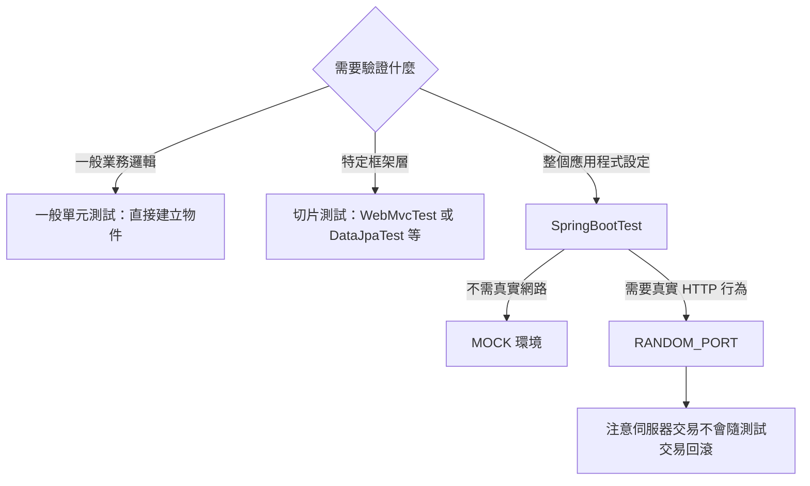

# 測試 Spring Boot 應用程式

<!-- source-attribution -->
> **非官方繁體中文翻譯** · Spring Boot 4.1.1 · 翻譯日期：2026-10-21  
> [官方英文網站](https://docs.spring.io/spring-boot/4.1/reference/testing/spring-boot-applications.html) · [固定版本英文來源](https://github.com/spring-projects/spring-boot/blob/v4.1.1/documentation/spring-boot-docs/src/docs/antora/modules/reference/pages/testing/spring-boot-applications.adoc) · [本地原文快照](../sources/spring-boot/documentation/spring-boot-docs/src/docs/antora/modules/reference/pages/testing/spring-boot-applications.adoc)  
> 原始作者與授權見 [來源聲明](../NOTICE.md)。官方範例及設定鍵保留原文，額外圖解另標示為譯者補充。

<!-- translation-status: translated -->

Spring Boot 應用程式本身就是 Spring [`ApplicationContext`][testing--spring-boot-applications-r1]，因此除了平常測試一般 Spring 上下文的作法，不必進行特別的處理。

> **注意：**
>
> 預設只有透過 [`SpringApplication`][testing--spring-boot-applications-r2] 建立上下文時，才會安裝外部屬性、日誌與其他 Spring Boot 功能。

Spring Boot 提供 [`@SpringBootTest`][testing--spring-boot-applications-r3] 註解；需要 Spring Boot 功能時，可用它取代標準 `spring-test` 的 [`@ContextConfiguration`][testing--spring-boot-applications-r4]。
此註解會[透過 `SpringApplication` 建立測試所使用的 `ApplicationContext`][testing--spring-boot-applications-r5]。
除了 [`@SpringBootTest`][testing--spring-boot-applications-r3]，也提供多種其他註解，用來[測試應用程式中特定的切片][testing--spring-boot-applications-r6]。

> **提示：**
>
> 如果使用 JUnit 4，別忘記在測試加入 `@RunWith(SpringRunner.class)`，否則註解會被忽略。
> 如果使用 JUnit 6，則不必加入對應的 `@ExtendWith(SpringExtension.class)`，因為 [`@SpringBootTest`][testing--spring-boot-applications-r3] 與其他 `@…​Test` 註解已標註它。

[`@SpringBootTest`][testing--spring-boot-applications-r3] 預設不會啟動伺服器。
可使用其 `webEnvironment` 屬性，進一步調整測試執行方式：

- `MOCK`（預設）：載入 Web [`ApplicationContext`][testing--spring-boot-applications-r1]，提供模擬 Web 環境，不會啟動嵌入式伺服器。如果 classpath 沒有 Web 環境，會透明地退回建立一般非 Web 的 [`ApplicationContext`][testing--spring-boot-applications-r1]。可以搭配 [`@AutoConfigureMockMvc`][testing--spring-boot-applications-r7] 或 [`@AutoConfigureWebTestClient`][testing--spring-boot-applications-r8]，以模擬方式測試 Web 應用程式。
- `RANDOM_PORT`：載入 [`WebServerApplicationContext`][testing--spring-boot-applications-r9]，提供真實 Web 環境，啟動嵌入式伺服器並監聽隨機連接埠。
- `DEFINED_PORT`：載入 [`WebServerApplicationContext`][testing--spring-boot-applications-r9]，提供真實 Web 環境，啟動嵌入式伺服器並監聽指定連接埠（來自 `application.properties`），或預設的 `8080`。
- `NONE`：透過 [`SpringApplication`][testing--spring-boot-applications-r2] 載入 [`ApplicationContext`][testing--spring-boot-applications-r1]，但不提供任何 Web 環境，無論模擬或其他形式。

> **注意：**
>
> 若測試標註 [`@Transactional`][testing--spring-boot-applications-r10]，預設會在每個測試方法結束時回滾交易。
> 然而搭配 `RANDOM_PORT` 或 `DEFINED_PORT` 時，會隱含提供真實 Servlet 環境，HTTP 用戶端與伺服器在不同執行緒執行，因此交易也不同。
> 在這種情況下，伺服器端發起的交易不會回滾。

> **注意：**
>
> 若應用程式的管理伺服器使用不同連接埠，`webEnvironment = WebEnvironment.RANDOM_PORT` 的 [`@SpringBootTest`][testing--spring-boot-applications-r3] 也會讓管理伺服器在另一個隨機連接埠啟動。

## 偵測 Web 應用程式類型

如果 Spring MVC 可用，會設定一般以 MVC 為基礎的應用程式上下文。
如果只有 Spring WebFlux，則會偵測並改為設定 WebFlux 上下文。

兩者都存在時，Spring MVC 優先。
若要在此情況測試反應式 Web 應用程式，必須設定 `spring.main.web-application-type` 屬性：

```kotlin
import org.springframework.boot.test.context.SpringBootTest

@SpringBootTest(properties = ["spring.main.web-application-type=reactive"])
class MyWebFluxTests {

	// ...

}
```

```java
import org.springframework.boot.test.context.SpringBootTest;

@SpringBootTest(properties = "spring.main.web-application-type=reactive")
class MyWebFluxTests {

	// ...

}
```

## 偵測測試設定

若熟悉 Spring Test Framework，你可能習慣透過 `@ContextConfiguration(classes=…​)` 指定要載入的 Spring [`@Configuration`][testing--spring-boot-applications-r11]。
也可能經常在測試中使用巢狀 [`@Configuration`][testing--spring-boot-applications-r11] 類別。

測試 Spring Boot 應用程式時，通常不需要這麼做。
只要沒有明確定義主要設定，Spring Boot 的 `@*Test` 註解就會自動尋找。

搜尋演算法從測試所在套件往上尋找，直到找到標註 [`@SpringBootApplication`][testing--spring-boot-applications-r12] 或 [`@SpringBootConfiguration`][testing--spring-boot-applications-r13] 的類別。
只要合理地[組織程式碼][testing--spring-boot-applications-r14]，通常就能找到主要設定。

> **注意：**
>
> 如果使用[測試註解測試應用程式特定切片][testing--spring-boot-applications-r6]，應避免在[包含 main 方法的應用程式類別][testing--spring-boot-applications-r15]上加入只屬於特定領域的設定。
>
> [`@SpringBootApplication`][testing--spring-boot-applications-r12] 底層的元件掃描設定定義了排除篩選器，確保切片如預期運作。
> 若在標註 [`@SpringBootApplication`][testing--spring-boot-applications-r12] 的類別上明確宣告 [`@ComponentScan`][testing--spring-boot-applications-r16]，請注意這些篩選器會被停用。
> 如果使用切片，就應重新定義它們。

若要自訂主要設定，可以使用巢狀 [`@TestConfiguration`][testing--spring-boot-applications-r17] 類別。
巢狀 [`@Configuration`][testing--spring-boot-applications-r11] 會取代應用程式主要設定；巢狀 [`@TestConfiguration`][testing--spring-boot-applications-r17] 則是在主要設定之外額外使用。

> **注意：**
>
> Spring 測試框架會在測試之間快取應用程式上下文。
> 因此只要測試共用相同設定，不論如何找到設定，可能相當耗時的上下文載入程序都只會執行一次。

## 使用測試設定的 Main 方法

[`@SpringBootTest`][testing--spring-boot-applications-r3] 找到的測試設定，通常是主要的 [`@SpringBootApplication`][testing--spring-boot-applications-r12]。
在多數結構良好的應用程式中，此設定類別也包含啟動應用程式的 `main` 方法。

例如以下是典型 Spring Boot 應用程式很常見的程式碼模式：

```kotlin
import org.springframework.boot.autoconfigure.SpringBootApplication
import org.springframework.boot.docs.using.structuringyourcode.locatingthemainclass.MyApplication
import org.springframework.boot.runApplication

@SpringBootApplication
class MyApplication

fun main(args: Array<String>) {
	runApplication<MyApplication>(*args)
}
```

```java
import org.springframework.boot.SpringApplication;
import org.springframework.boot.autoconfigure.SpringBootApplication;

@SpringBootApplication
public class MyApplication {

	public static void main(String[] args) {
		SpringApplication.run(MyApplication.class, args);
	}

}
```

上例的 `main` 方法除了委派給 [`SpringApplication.run(Class, String...)`][testing--spring-boot-applications-r18]，不做其他事。
不過，`main` 也可能更複雜，在呼叫 [`SpringApplication.run(Class, String...)`][testing--spring-boot-applications-r18] 前先進行自訂。

例如以下應用程式修改 banner 模式，並設定額外的 Profile：

```kotlin
import org.springframework.boot.Banner
import org.springframework.boot.runApplication
import org.springframework.boot.autoconfigure.SpringBootApplication

@SpringBootApplication
class MyApplication

fun main(args: Array<String>) {
	runApplication<MyApplication>(*args) {
		setBannerMode(Banner.Mode.OFF)
		setAdditionalProfiles("myprofile")
	}
}
```

```java
import org.springframework.boot.Banner;
import org.springframework.boot.SpringApplication;
import org.springframework.boot.autoconfigure.SpringBootApplication;

@SpringBootApplication
public class MyApplication {

	public static void main(String[] args) {
		SpringApplication application = new SpringApplication(MyApplication.class);
		application.setBannerMode(Banner.Mode.OFF);
		application.setAdditionalProfiles("myprofile");
		application.run(args);
	}

}
```

由於 `main` 中的自訂設定可能影響建立出的 [`ApplicationContext`][testing--spring-boot-applications-r1]，你可能希望測試也使用 `main` 方法建立 [`ApplicationContext`][testing--spring-boot-applications-r1]。
預設 [`@SpringBootTest`][testing--spring-boot-applications-r3] 不會呼叫 `main`，而是直接使用類別本身建立 [`ApplicationContext`][testing--spring-boot-applications-r1]。

若要修改此行為，可以將 [`@SpringBootTest`][testing--spring-boot-applications-r3] 的 `useMainMethod` 設為 [`SpringBootTest.UseMainMethod.ALWAYS`][testing--spring-boot-applications-r19] 或 [`SpringBootTest.UseMainMethod.WHEN_AVAILABLE`][testing--spring-boot-applications-r20]。
設為 `ALWAYS` 時，找不到 `main` 方法就會讓測試失敗。
設為 `WHEN_AVAILABLE` 時，有 `main` 就使用，否則使用標準載入機制。

例如以下測試會呼叫 `MyApplication` 的 `main` 來建立 [`ApplicationContext`][testing--spring-boot-applications-r1]。
如果 main 設定額外的 Profile，這些 Profile 就會在 [`ApplicationContext`][testing--spring-boot-applications-r1] 啟動時啟用。

```kotlin
import org.junit.jupiter.api.Test
import org.springframework.boot.test.context.SpringBootTest
import org.springframework.boot.test.context.SpringBootTest.UseMainMethod

@SpringBootTest(useMainMethod = UseMainMethod.ALWAYS)
class MyApplicationTests {

	@Test
	fun exampleTest() {
		// ...
	}

}
```

```java
import org.junit.jupiter.api.Test;

import org.springframework.boot.test.context.SpringBootTest;
import org.springframework.boot.test.context.SpringBootTest.UseMainMethod;

@SpringBootTest(useMainMethod = UseMainMethod.ALWAYS)
class MyApplicationTests {

	@Test
	void exampleTest() {
		// ...
	}

}
```

## 排除測試設定

若應用程式使用元件掃描，例如 [`@SpringBootApplication`][testing--spring-boot-applications-r12] 或 [`@ComponentScan`][testing--spring-boot-applications-r16]，你可能發現原本只為特定測試建立的頂層設定類別，意外在所有地方都被掃描到。

如[前文所述][testing--spring-boot-applications-r5]，[`@TestConfiguration`][testing--spring-boot-applications-r17] 可以放在測試內部類別上，自訂主要設定。
它也可放在頂層類別，表示該類別不應被掃描納入。
接著可在需要的地方明確匯入，如下例：

```kotlin
import org.junit.jupiter.api.Test
import org.springframework.boot.test.context.SpringBootTest
import org.springframework.context.annotation.Import

@SpringBootTest
@Import(MyTestsConfiguration::class)
class MyTests {

	@Test
	fun exampleTest() {
		// ...
	}

}
```

```java
import org.junit.jupiter.api.Test;

import org.springframework.boot.test.context.SpringBootTest;
import org.springframework.context.annotation.Import;

@SpringBootTest
@Import(MyTestsConfiguration.class)
class MyTests {

	@Test
	void exampleTest() {
		// ...
	}

}
```

> **注意：**
>
> 若直接使用 [`@ComponentScan`][testing--spring-boot-applications-r16]，而不是透過 [`@SpringBootApplication`][testing--spring-boot-applications-r12]，就需要向它註冊 [`TypeExcludeFilter`][testing--spring-boot-applications-r21]。
> 詳情請參閱 [`TypeExcludeFilter`][testing--spring-boot-applications-r21] API 文件。

> **注意：**
>
> 匯入的 [`@TestConfiguration`][testing--spring-boot-applications-r17] 會比內部類別的 [`@TestConfiguration`][testing--spring-boot-applications-r17] 更早處理，也會先於任何透過元件掃描找到的設定。
> 一般而言，這個順序差異沒有明顯影響；但如果依賴 Bean 覆寫，就應留意。

## 使用應用程式引數

若應用程式需要[引數][testing--spring-boot-applications-r22]，可以透過 [`@SpringBootTest`][testing--spring-boot-applications-r3] 的 `args` 屬性注入。

```kotlin
import org.assertj.core.api.Assertions.assertThat
import org.junit.jupiter.api.Test
import org.springframework.beans.factory.annotation.Autowired
import org.springframework.boot.ApplicationArguments
import org.springframework.boot.test.context.SpringBootTest

@SpringBootTest(args = ["--app.test=one"])
class MyApplicationArgumentTests {

	@Test
	fun applicationArgumentsPopulated(@Autowired args: ApplicationArguments) {
		assertThat(args.optionNames).containsOnly("app.test")
		assertThat(args.getOptionValues("app.test")).containsOnly("one")
	}

}
```

```java
import org.junit.jupiter.api.Test;

import org.springframework.beans.factory.annotation.Autowired;
import org.springframework.boot.ApplicationArguments;
import org.springframework.boot.test.context.SpringBootTest;

import static org.assertj.core.api.Assertions.assertThat;

@SpringBootTest(args = "--app.test=one")
class MyApplicationArgumentTests {

	@Test
	void applicationArgumentsPopulated(@Autowired ApplicationArguments args) {
		assertThat(args.getOptionNames()).containsOnly("app.test");
		assertThat(args.getOptionValues("app.test")).containsOnly("one");
	}

}
```

## 使用模擬環境測試

[`@SpringBootTest`][testing--spring-boot-applications-r3] 預設不啟動伺服器，而是建立模擬環境，測試 Web 端點。

對 Spring MVC，可以使用 [`MockMvc`][testing--spring-boot-applications-r23] 查詢 Web 端點。
提供以下整合：

- 使用 Hamcrest 的一般 [`MockMvc`][testing--spring-boot-applications-r24]。
- 包裝 [`MockMvc`][testing--spring-boot-applications-r26] 並使用 AssertJ 的 [`MockMvcTester`][testing--spring-boot-applications-r25]。
- 將 [`MockMvc`][testing--spring-boot-applications-r26] 接為處理請求之伺服器的 [`RestTestClient`][testing--spring-boot-applications-r27]。
- 將 [`MockMvc`][testing--spring-boot-applications-r26] 接為處理請求之伺服器的 [`WebTestClient`][testing--spring-boot-applications-r28]。

以下範例示範這些整合：

```kotlin
import org.assertj.core.api.Assertions.assertThat
import org.junit.jupiter.api.Test
import org.springframework.beans.factory.annotation.Autowired
import org.springframework.boot.resttestclient.autoconfigure.AutoConfigureRestTestClient
import org.springframework.boot.test.context.SpringBootTest
import org.springframework.boot.webmvc.test.autoconfigure.AutoConfigureMockMvc
import org.springframework.boot.webtestclient.autoconfigure.AutoConfigureWebTestClient
import org.springframework.test.web.reactive.server.WebTestClient
import org.springframework.test.web.reactive.server.expectBody
import org.springframework.test.web.servlet.MockMvc
import org.springframework.test.web.servlet.assertj.MockMvcTester
import org.springframework.test.web.servlet.client.RestTestClient
import org.springframework.test.web.servlet.client.assertj.RestTestClientResponse
import org.springframework.test.web.servlet.client.expectBody
import org.springframework.test.web.servlet.request.MockMvcRequestBuilders.get
import org.springframework.test.web.servlet.result.MockMvcResultMatchers.content
import org.springframework.test.web.servlet.result.MockMvcResultMatchers.status

@SpringBootTest
@AutoConfigureMockMvc
@AutoConfigureRestTestClient
@AutoConfigureWebTestClient
class MyMockMvcTests {

	@Test
	fun testWithMockMvc(@Autowired mvc: MockMvc) {
		mvc.perform(get("/"))
			.andExpect(status().isOk())
			.andExpect(content().string("Hello World"))
	}

	@Test // If AssertJ is on the classpath, you can use MockMvcTester
	fun testWithMockMvcTester(@Autowired mvc: MockMvcTester) {
		assertThat(mvc.get().uri("/")).hasStatusOk()
			.hasBodyTextEqualTo("Hello World")
	}

	@Test
	fun testWithRestTestClient(@Autowired webClient: RestTestClient) {
		webClient
			.get().uri("/")
			.exchange()
			.expectStatus().isOk
			.expectBody<String>().isEqualTo("Hello World")
	}

	@Test // If you prefer AssertJ, dedicated assertions are available
	fun testWithRestTestClientAssertJ(@Autowired webClient: RestTestClient) {
		val spec = webClient.get().uri("/").exchange()
		val response = RestTestClientResponse.from(spec)
		assertThat(response).hasStatusOk().bodyText().isEqualTo("Hello World")
	}

	@Test // If Spring WebFlux is on the classpath
	fun testWithWebTestClient(@Autowired webClient: WebTestClient) {
		webClient
			.get().uri("/")
			.exchange()
			.expectStatus().isOk
			.expectBody<String>().isEqualTo("Hello World")
	}

}
```

```java
import org.junit.jupiter.api.Test;

import org.springframework.beans.factory.annotation.Autowired;
import org.springframework.boot.resttestclient.autoconfigure.AutoConfigureRestTestClient;
import org.springframework.boot.test.context.SpringBootTest;
import org.springframework.boot.webmvc.test.autoconfigure.AutoConfigureMockMvc;
import org.springframework.boot.webtestclient.autoconfigure.AutoConfigureWebTestClient;
import org.springframework.test.web.reactive.server.WebTestClient;
import org.springframework.test.web.servlet.MockMvc;
import org.springframework.test.web.servlet.assertj.MockMvcTester;
import org.springframework.test.web.servlet.client.RestTestClient;
import org.springframework.test.web.servlet.client.RestTestClient.ResponseSpec;
import org.springframework.test.web.servlet.client.assertj.RestTestClientResponse;

import static org.assertj.core.api.Assertions.assertThat;
import static org.springframework.test.web.servlet.request.MockMvcRequestBuilders.get;
import static org.springframework.test.web.servlet.result.MockMvcResultMatchers.content;
import static org.springframework.test.web.servlet.result.MockMvcResultMatchers.status;

@SpringBootTest
@AutoConfigureMockMvc
@AutoConfigureRestTestClient
@AutoConfigureWebTestClient
class MyMockMvcTests {

	@Test
	void testWithMockMvc(@Autowired MockMvc mvc) throws Exception {
		mvc.perform(get("/"))
				.andExpect(status().isOk())
				.andExpect(content().string("Hello World"));
	}

	@Test // If AssertJ is on the classpath, you can use MockMvcTester
	void testWithMockMvcTester(@Autowired MockMvcTester mvc) {
		assertThat(mvc.get().uri("/"))
				.hasStatusOk()
				.hasBodyTextEqualTo("Hello World");
	}

	@Test
	void testWithRestTestClient(@Autowired RestTestClient restClient) {
		restClient
				.get().uri("/")
				.exchange()
				.expectStatus().isOk()
				.expectBody(String.class).isEqualTo("Hello World");
	}

	@Test // If you prefer AssertJ, dedicated assertions are available
	void testWithRestTestClientAssertJ(@Autowired RestTestClient restClient) {
		ResponseSpec spec = restClient.get().uri("/").exchange();
		RestTestClientResponse response = RestTestClientResponse.from(spec);
		assertThat(response).hasStatusOk()
				.bodyText().isEqualTo("Hello World");
	}

	@Test // If Spring WebFlux is on the classpath
	void testWithWebTestClient(@Autowired WebTestClient webClient) {
		webClient
				.get().uri("/")
				.exchange()
				.expectStatus().isOk()
				.expectBody(String.class).isEqualTo("Hello World");
	}

}
```

> **提示：**
>
> 若只想專注 Web 層，不啟動完整的 [`ApplicationContext`][testing--spring-boot-applications-r1]，可考慮[改用 `@WebMvcTest`][testing--spring-boot-applications-r30]。

Spring WebFlux 端點可以使用 [`WebTestClient`][testing--spring-boot-applications-r28]，如下例：

```kotlin
import org.junit.jupiter.api.Test
import org.springframework.beans.factory.annotation.Autowired
import org.springframework.boot.test.context.SpringBootTest
import org.springframework.boot.webtestclient.autoconfigure.AutoConfigureWebTestClient
import org.springframework.test.web.reactive.server.WebTestClient
import org.springframework.test.web.reactive.server.expectBody

@SpringBootTest
@AutoConfigureWebTestClient
class MyMockWebTestClientTests {

	@Test
	fun exampleTest(@Autowired webClient: WebTestClient) {
		webClient
			.get().uri("/")
			.exchange()
			.expectStatus().isOk
			.expectBody<String>().isEqualTo("Hello World")
	}

}
```

```java
import org.junit.jupiter.api.Test;

import org.springframework.beans.factory.annotation.Autowired;
import org.springframework.boot.test.context.SpringBootTest;
import org.springframework.boot.webtestclient.autoconfigure.AutoConfigureWebTestClient;
import org.springframework.test.web.reactive.server.WebTestClient;

@SpringBootTest
@AutoConfigureWebTestClient
class MyMockWebTestClientTests {

	@Test
	void exampleTest(@Autowired WebTestClient webClient) {
		webClient
			.get().uri("/")
			.exchange()
			.expectStatus().isOk()
			.expectBody(String.class).isEqualTo("Hello World");
	}

}
```

> **提示：**
>
> 在模擬環境中測試，通常比執行完整 Servlet 容器更快。
> 不過模擬發生在 Spring MVC 層，因此依賴更底層 Servlet 容器行為的程式碼，無法直接透過 MockMvc 測試。
>
> 例如 Spring Boot 的錯誤處理依賴 Servlet 容器提供的「錯誤頁面」支援。
> 這表示雖然可以測試 MVC 層是否如預期擲出及處理例外，但無法直接測試特定[自訂錯誤頁面][testing--spring-boot-applications-r31]是否呈現。
> 若需要測試這些底層行為，可以依下一節說明啟動完整伺服器。

## 使用執行中的伺服器測試

若需要啟動完整運作的伺服器，建議使用隨機連接埠。
使用 `@SpringBootTest(webEnvironment=WebEnvironment.RANDOM_PORT)` 時，每次測試都會隨機選擇可用連接埠。

可使用 [`@LocalServerPort`][testing--spring-boot-applications-r32] 將[實際使用的連接埠注入][testing--spring-boot-applications-r33]測試。

若測試需要對已啟動的伺服器發出 REST 呼叫，可在測試類別標註 [`@AutoConfigureRestTestClient`][testing--spring-boot-applications-r34]，自動注入 [`RestTestClient`][testing--spring-boot-applications-r27]。

設定完成的用戶端會將相對連結解析至執行中的伺服器，並提供驗證回應的專用 API，如下例：

```kotlin
import org.junit.jupiter.api.Test
import org.springframework.beans.factory.annotation.Autowired
import org.springframework.boot.resttestclient.autoconfigure.AutoConfigureRestTestClient
import org.springframework.boot.test.context.SpringBootTest
import org.springframework.boot.test.context.SpringBootTest.WebEnvironment
import org.springframework.test.web.servlet.client.RestTestClient
import org.springframework.test.web.servlet.client.expectBody

@SpringBootTest(webEnvironment = WebEnvironment.RANDOM_PORT)
@AutoConfigureRestTestClient
class MyRandomPortRestTestClientTests {

	@Test
	fun exampleTest(@Autowired webClient: RestTestClient) {
		webClient
			.get().uri("/")
			.exchange()
			.expectStatus().isOk
			.expectBody<String>().isEqualTo("Hello World")
	}

}
```

```java
import org.junit.jupiter.api.Test;

import org.springframework.beans.factory.annotation.Autowired;
import org.springframework.boot.resttestclient.autoconfigure.AutoConfigureRestTestClient;
import org.springframework.boot.test.context.SpringBootTest;
import org.springframework.boot.test.context.SpringBootTest.WebEnvironment;
import org.springframework.test.web.servlet.client.RestTestClient;

@SpringBootTest(webEnvironment = WebEnvironment.RANDOM_PORT)
@AutoConfigureRestTestClient
class MyRandomPortRestTestClientTests {

	@Test
	void exampleTest(@Autowired RestTestClient restClient) {
		restClient
			.get().uri("/")
			.exchange()
			.expectStatus().isOk()
			.expectBody(String.class).isEqualTo("Hello World");
	}

}
```

若偏好 AssertJ，可使用 [`RestTestClientResponse`][testing--spring-boot-applications-r35] 的專用斷言，如下例：

```kotlin
import org.assertj.core.api.Assertions.assertThat
import org.junit.jupiter.api.Test
import org.springframework.beans.factory.annotation.Autowired
import org.springframework.boot.resttestclient.autoconfigure.AutoConfigureRestTestClient
import org.springframework.boot.test.context.SpringBootTest
import org.springframework.boot.test.context.SpringBootTest.WebEnvironment
import org.springframework.test.web.servlet.client.RestTestClient
import org.springframework.test.web.servlet.client.assertj.RestTestClientResponse

@SpringBootTest(webEnvironment = WebEnvironment.RANDOM_PORT)
@AutoConfigureRestTestClient
class MyRandomPortRestTestClientAssertJTests {

	@Test
	fun exampleTest(@Autowired webClient: RestTestClient) {
		val exchange = webClient.get().uri("/").exchange()
		val response = RestTestClientResponse.from(exchange)
		assertThat(response).hasStatusOk()
			.bodyText().isEqualTo("Hello World")
	}

}
```

```java
import org.junit.jupiter.api.Test;

import org.springframework.beans.factory.annotation.Autowired;
import org.springframework.boot.resttestclient.autoconfigure.AutoConfigureRestTestClient;
import org.springframework.boot.test.context.SpringBootTest;
import org.springframework.boot.test.context.SpringBootTest.WebEnvironment;
import org.springframework.test.web.servlet.client.RestTestClient;
import org.springframework.test.web.servlet.client.RestTestClient.ResponseSpec;
import org.springframework.test.web.servlet.client.assertj.RestTestClientResponse;

import static org.assertj.core.api.Assertions.assertThat;

@SpringBootTest(webEnvironment = WebEnvironment.RANDOM_PORT)
@AutoConfigureRestTestClient
class MyRandomPortRestTestClientAssertJTests {

	@Test
	void exampleTest(@Autowired RestTestClient restClient) {
		ResponseSpec spec = restClient.get().uri("/").exchange();
		RestTestClientResponse response = RestTestClientResponse.from(spec);
		assertThat(response).hasStatusOk().bodyText().isEqualTo("Hello World");
	}

}
```

若 classpath 包含 `spring-webflux`，也能在測試類別標註 [`@AutoConfigureWebTestClient`][testing--spring-boot-applications-r8]，自動注入 [`WebTestClient`][testing--spring-boot-applications-r28]。

`WebTestClient` 提供類似 API，如下例：

```kotlin
import org.junit.jupiter.api.Test
import org.springframework.beans.factory.annotation.Autowired
import org.springframework.boot.test.context.SpringBootTest
import org.springframework.boot.test.context.SpringBootTest.WebEnvironment
import org.springframework.boot.webtestclient.autoconfigure.AutoConfigureWebTestClient
import org.springframework.test.web.reactive.server.WebTestClient
import org.springframework.test.web.reactive.server.expectBody

@SpringBootTest(webEnvironment = WebEnvironment.RANDOM_PORT)
@AutoConfigureWebTestClient
class MyRandomPortWebTestClientTests {

	@Test
	fun exampleTest(@Autowired webClient: WebTestClient) {
		webClient
			.get().uri("/")
			.exchange()
			.expectStatus().isOk
			.expectBody<String>().isEqualTo("Hello World")
	}

}
```

```java
import org.junit.jupiter.api.Test;

import org.springframework.beans.factory.annotation.Autowired;
import org.springframework.boot.test.context.SpringBootTest;
import org.springframework.boot.test.context.SpringBootTest.WebEnvironment;
import org.springframework.boot.webtestclient.autoconfigure.AutoConfigureWebTestClient;
import org.springframework.test.web.reactive.server.WebTestClient;

@SpringBootTest(webEnvironment = WebEnvironment.RANDOM_PORT)
@AutoConfigureWebTestClient
class MyRandomPortWebTestClientTests {

	@Test
	void exampleTest(@Autowired WebTestClient webClient) {
		webClient
			.get().uri("/")
			.exchange()
			.expectStatus().isOk()
			.expectBody(String.class).isEqualTo("Hello World");
	}

}
```

> **提示：**
>
> [`WebTestClient`][testing--spring-boot-applications-r36] 也能搭配[模擬環境][testing--spring-boot-applications-r7]，免去啟動伺服器：在測試類別標註 `spring-boot-webflux-test` 的 [`@AutoConfigureWebTestClient`][testing--spring-boot-applications-r8] 即可。

> **注意：**
>
> 某些[切片測試][testing--spring-boot-applications-r6]可能需要 [`@AutoConfigureWebServer`][testing--spring-boot-applications-r37]，以自動設定嵌入式 Web 伺服器。

`spring-boot-resttestclient` 模組也提供 [`TestRestTemplate`][testing--spring-boot-applications-r38] 工具：

```kotlin
import org.assertj.core.api.Assertions.assertThat
import org.junit.jupiter.api.Test
import org.springframework.beans.factory.annotation.Autowired
import org.springframework.boot.test.context.SpringBootTest
import org.springframework.boot.test.context.SpringBootTest.WebEnvironment
import org.springframework.boot.resttestclient.TestRestTemplate
import org.springframework.boot.resttestclient.autoconfigure.AutoConfigureTestRestTemplate

@SpringBootTest(webEnvironment = WebEnvironment.RANDOM_PORT)
@AutoConfigureTestRestTemplate
class MyRandomPortTestRestTemplateTests {

	@Test
	fun exampleTest(@Autowired restTemplate: TestRestTemplate) {
		val body = restTemplate.getForObject("/", String::class.java)
		assertThat(body).isEqualTo("Hello World")
	}

}
```

```java
import org.junit.jupiter.api.Test;

import org.springframework.beans.factory.annotation.Autowired;
import org.springframework.boot.resttestclient.TestRestTemplate;
import org.springframework.boot.resttestclient.autoconfigure.AutoConfigureTestRestTemplate;
import org.springframework.boot.test.context.SpringBootTest;
import org.springframework.boot.test.context.SpringBootTest.WebEnvironment;

import static org.assertj.core.api.Assertions.assertThat;

@SpringBootTest(webEnvironment = WebEnvironment.RANDOM_PORT)
@AutoConfigureTestRestTemplate
class MyRandomPortTestRestTemplateTests {

	@Test
	void exampleTest(@Autowired TestRestTemplate restTemplate) {
		String body = restTemplate.getForObject("/", String.class);
		assertThat(body).isEqualTo("Hello World");
	}

}
```

使用 `TestRestTemplate` 還需要 `spring-boot-restclient` 依賴。
加入時請留意，它會啟用 `RestClient.Builder` 自動設定。
若主要程式碼使用 `RestClient.Builder`，請將 `spring-boot-restclient` 放在應用程式主要 classpath，而不只是測試 classpath。

## 自訂 RestTestClient

若要自訂 [`RestTestClient`][testing--spring-boot-applications-r39] Bean，請設定 [`RestTestClientBuilderCustomizer`][testing--spring-boot-applications-r40] Bean。
每個這類 Bean 都會收到用來建立 [`RestTestClient`][testing--spring-boot-applications-r39] 的 [`RestTestClient.Builder`][testing--spring-boot-applications-r41]。

## 自訂 WebTestClient

若要自訂 [`WebTestClient`][testing--spring-boot-applications-r36] Bean，請設定 [`WebTestClientBuilderCustomizer`][testing--spring-boot-applications-r42] Bean。
每個這類 Bean 都會收到用來建立 [`WebTestClient`][testing--spring-boot-applications-r36] 的 [`WebTestClient.Builder`][testing--spring-boot-applications-r43]。

## 使用 JMX

由於測試上下文框架會快取上下文，JMX 預設停用，以免相同元件註冊到同一 domain。
若測試需要存取 [`MBeanServer`][testing--spring-boot-applications-r44]，也應考慮將上下文標為 dirty：

```kotlin
import javax.management.MBeanServer

import org.assertj.core.api.Assertions.assertThat
import org.junit.jupiter.api.Test
import org.springframework.beans.factory.annotation.Autowired
import org.springframework.boot.test.context.SpringBootTest
import org.springframework.test.annotation.DirtiesContext

@SpringBootTest(properties = ["spring.jmx.enabled=true"])
@DirtiesContext
class MyJmxTests(@Autowired val mBeanServer: MBeanServer) {

	@Test
	fun exampleTest() {
		assertThat(mBeanServer.domains).contains("java.lang")
		// ...
	}

}
```

```java
import javax.management.MBeanServer;

import org.junit.jupiter.api.Test;

import org.springframework.beans.factory.annotation.Autowired;
import org.springframework.boot.test.context.SpringBootTest;
import org.springframework.test.annotation.DirtiesContext;

import static org.assertj.core.api.Assertions.assertThat;

@SpringBootTest(properties = "spring.jmx.enabled=true")
@DirtiesContext
class MyJmxTests {

	@Autowired
	private MBeanServer mBeanServer;

	@Test
	void exampleTest() {
		assertThat(this.mBeanServer.getDomains()).contains("java.lang");
		// ...
	}

}
```

## 使用 Observation

若在[切片測試][testing--spring-boot-applications-r6]標註 `spring-boot-micrometer-tracing-test` 的 [`@AutoConfigureTracing`][testing--spring-boot-applications-r45]，或 `spring-boot-micrometer-metrics-test` 的 [`@AutoConfigureMetrics`][testing--spring-boot-applications-r46]，就會自動設定 [`ObservationRegistry`][testing--spring-boot-applications-r47]。

## 使用指標

不論 classpath 為何，使用 [`@SpringBootTest`][testing--spring-boot-applications-r3] 時，除了記憶體實作以外的 meter registry 都不會自動設定。

若整合測試需要將指標匯出到其他後端，請標註 [`@AutoConfigureMetrics`][testing--spring-boot-applications-r46]。

在[切片測試][testing--spring-boot-applications-r6]標註 [`@AutoConfigureMetrics`][testing--spring-boot-applications-r46]，會自動設定記憶體中的 [`MeterRegistry`][testing--spring-boot-applications-r48]。
此註解不支援在切片測試中匯出資料。

## 使用追蹤

不論 classpath 為何，使用 [`@SpringBootTest`][testing--spring-boot-applications-r3] 時，會向外回報資料的追蹤元件都不會自動設定。

若整合測試需要這些元件，請標註 [`@AutoConfigureTracing`][testing--spring-boot-applications-r45]。

若自行建立回報元件，例如自訂 [`SpanExporter`][testing--spring-boot-applications-r49] 或 `brave.handler.SpanHandler`，但不想讓它們在測試中啟用，可使用 [`@ConditionalOnEnabledTracingExport`][testing--spring-boot-applications-r50] 停用。

在[切片測試][testing--spring-boot-applications-r6]標註 [`@AutoConfigureTracing`][testing--spring-boot-applications-r45]，會自動設定不執行實際動作的 [`Tracer`][testing--spring-boot-applications-r51]。
此註解不支援在切片測試中匯出資料。

## 模擬與監看 Bean

測試時有時必須模擬應用程式上下文中的某些元件。
例如某個遠端服務的門面，在開發期間無法連到該服務。
模擬也適合用來重現真實環境難以觸發的失敗。

Spring Framework 包含 [`@MockitoBean`][testing--spring-boot-applications-r52]，可以為 [`ApplicationContext`][testing--spring-boot-applications-r1] 中的 Bean 定義 Mockito mock。
另可使用 [`@MockitoSpyBean`][testing--spring-boot-applications-r53] 定義 Mockito spy。
詳情請閱讀 [Spring Framework 文件][testing--spring-boot-applications-r54]。

## 自動設定的測試

Spring Boot 自動設定系統很適合應用程式，但對測試有時稍嫌過多。
只載入測試某個「切片」所需的設定，通常更有幫助。
例如只想測試 Spring MVC controller 是否正確對應 URL，不希望涉及資料庫呼叫；或只想測試 JPA 實體，不關心 Web 層。

搭配 `spring-boot-test-autoconfigure` 時，Spring Boot [測試模組][testing--spring-boot-applications-r55]包含多個可自動設定這些「切片」的註解。
它們的運作方式相似：提供載入 [`ApplicationContext`][testing--spring-boot-applications-r1] 的 `@…​Test`，以及一或多個可自訂自動設定的 `@AutoConfigure…​`。

> **注意：**
>
> 每個切片都將元件掃描限制在適合的元件，並只載入非常有限的自動設定類別。
> 若要排除其中某個，多數 `@…​Test` 提供 `excludeAutoConfiguration` 屬性。
> 也可以使用 `@ImportAutoConfiguration#exclude`。

> **注意：**
>
> 不支援在同一測試使用多個 `@…​Test` 註解加入多個切片。
> 若需要多個切片，請選擇其中一個 `@…​Test`，再手動加入其他切片的 `@AutoConfigure…​` 註解。

> **提示：**
>
> `@AutoConfigure…​` 也可搭配標準 [`@SpringBootTest`][testing--spring-boot-applications-r3]。
> 如果不想將應用程式切片，但需要部分自動設定的測試 Bean，可使用此組合。

## 自動設定 JSON 測試

若要測試物件的 JSON 序列化與反序列化是否如預期運作，可使用 `spring-boot-test-autoconfigure` 的 [`@JsonTest`][testing--spring-boot-applications-r56]。
它會自動設定可用且受支援的 JSON mapper，可能是以下函式庫之一：

- Jackson [`JsonMapper`][testing--spring-boot-applications-r57]、任何 [`@JacksonComponent`][testing--spring-boot-applications-r58] Bean 與 Jackson [`JacksonModule`][testing--spring-boot-applications-r59]。
- Jackson 2（已棄用）的 [`ObjectMapper`][testing--spring-boot-applications-r60]、任何 [`@JsonComponent`][testing--spring-boot-applications-r61] Bean 與 Jackson [`Module`][testing--spring-boot-applications-r62]。
- `Gson`
- `Jsonb`

> **提示：**
>
> [`@JsonTest`][testing--spring-boot-applications-r56] 啟用的自動設定清單可在[附錄][testing--spring-boot-applications-r63]找到。

若要調整自動設定中的項目，可使用 [`@AutoConfigureJsonTesters`][testing--spring-boot-applications-r64]。

Spring Boot 包含以 AssertJ 為基礎的輔助工具，搭配 JSONAssert 與 JsonPath 檢查 JSON 是否符合預期。
[`JacksonTester`][testing--spring-boot-applications-r65]、[`GsonTester`][testing--spring-boot-applications-r66]、[`JsonbTester`][testing--spring-boot-applications-r67] 與 [`BasicJsonTester`][testing--spring-boot-applications-r68] 分別適用於 Jackson、Gson、Jsonb 與字串。
使用 [`@JsonTest`][testing--spring-boot-applications-r56] 時，測試類別上的這些輔助欄位都能以 [`@Autowired`][testing--spring-boot-applications-r69] 注入。
以下是 Jackson 測試類別範例：

```kotlin
import org.assertj.core.api.Assertions.assertThat
import org.junit.jupiter.api.Test
import org.springframework.beans.factory.annotation.Autowired
import org.springframework.boot.test.autoconfigure.json.JsonTest
import org.springframework.boot.test.json.JacksonTester

@JsonTest
class MyJsonTests(@Autowired val json: JacksonTester<VehicleDetails>) {

	@Test
	fun serialize() {
		val details = VehicleDetails("Honda", "Civic")
		// Assert against a `.json` file in the same package as the test
		assertThat(json.write(details)).isEqualToJson("expected.json")
		// Or use JSON path based assertions
		assertThat(json.write(details)).hasJsonPathStringValue("@.make")
		assertThat(json.write(details)).extractingJsonPathStringValue("@.make").isEqualTo("Honda")
	}

	@Test
	fun deserialize() {
		val content = "{\"make\":\"Ford\",\"model\":\"Focus\"}"
		assertThat(json.parse(content)).isEqualTo(VehicleDetails("Ford", "Focus"))
		assertThat(json.parseObject(content).make).isEqualTo("Ford")
	}

}
```

```java
import org.junit.jupiter.api.Test;

import org.springframework.beans.factory.annotation.Autowired;
import org.springframework.boot.test.autoconfigure.json.JsonTest;
import org.springframework.boot.test.json.JacksonTester;

import static org.assertj.core.api.Assertions.assertThat;

@JsonTest
class MyJsonTests {

	@Autowired
	private JacksonTester<VehicleDetails> json;

	@Test
	void serialize() throws Exception {
		VehicleDetails details = new VehicleDetails("Honda", "Civic");
		// Assert against a `.json` file in the same package as the test
		assertThat(this.json.write(details)).isEqualToJson("expected.json");
		// Or use JSON path based assertions
		assertThat(this.json.write(details)).hasJsonPathStringValue("@.make");
		assertThat(this.json.write(details)).extractingJsonPathStringValue("@.make").isEqualTo("Honda");
	}

	@Test
	void deserialize() throws Exception {
		String content = "{\"make\":\"Ford\",\"model\":\"Focus\"}";
		assertThat(this.json.parse(content)).isEqualTo(new VehicleDetails("Ford", "Focus"));
		assertThat(this.json.parseObject(content).getMake()).isEqualTo("Ford");
	}

}
```

> **注意：**
>
> JSON 輔助類別也能直接用在一般單元測試。
> 若未使用 [`@JsonTest`][testing--spring-boot-applications-r56]，請在 [`@BeforeEach`][testing--spring-boot-applications-r70] 方法呼叫輔助類別的 `initFields`。

若使用 Spring Boot 的 AssertJ 輔助工具，對指定 JSON path 的數值進行斷言，依型別而定，可能無法使用 `isEqualTo`。
可改用 AssertJ 的 `satisfies`，斷言值符合指定條件。
例如以下範例斷言實際數字是接近 `0.15` 的浮點值，容許誤差 `0.01`。

```kotlin
	@Test
	fun someTest() {
		val value = SomeObject(0.152f)
		assertThat(json.write(value)).extractingJsonPathNumberValue("@.test.numberValue")
			.satisfies(ThrowingConsumer { number ->
				assertThat(number.toFloat()).isCloseTo(0.15f, within(0.01f))
			})
	}
```

```java
	@Test
	void someTest() throws Exception {
		SomeObject value = new SomeObject(0.152f);
		assertThat(this.json.write(value)).extractingJsonPathNumberValue("@.test.numberValue")
			.satisfies((number) -> assertThat(number.floatValue()).isCloseTo(0.15f, within(0.01f)));
	}
```

## 自動設定 Spring MVC 測試

若要測試 Spring MVC controller 是否如預期運作，請使用 `spring-boot-webmvc-test` 的 [`@WebMvcTest`][testing--spring-boot-applications-r29]。
它會自動設定 Spring MVC 基礎設施，並將掃描的 Bean 限制為 [`@Controller`][testing--spring-boot-applications-r71]、[`@ControllerAdvice`][testing--spring-boot-applications-r72]、[`@JacksonComponent`][testing--spring-boot-applications-r58]、[`@JsonComponent`][testing--spring-boot-applications-r61]（已棄用）、[`Converter`][testing--spring-boot-applications-r73]、[`GenericConverter`][testing--spring-boot-applications-r74]、[`Filter`][testing--spring-boot-applications-r75]、[`HandlerInterceptor`][testing--spring-boot-applications-r76]、[`WebMvcConfigurer`][testing--spring-boot-applications-r77]、[`WebMvcRegistrations`][testing--spring-boot-applications-r78] 與 [`HandlerMethodArgumentResolver`][testing--spring-boot-applications-r79]。
使用 [`@WebMvcTest`][testing--spring-boot-applications-r29] 時，不會掃描一般 [`@Component`][testing--spring-boot-applications-r80] 與 [`@ConfigurationProperties`][testing--spring-boot-applications-r81] Bean。
可使用 [`@EnableConfigurationProperties`][testing--spring-boot-applications-r82] 納入 [`@ConfigurationProperties`][testing--spring-boot-applications-r81] Bean。

> **提示：**
>
> [`@WebMvcTest`][testing--spring-boot-applications-r29] 啟用的自動設定清單可在[附錄][testing--spring-boot-applications-r63]找到。

> **提示：**
>
> 若需註冊額外元件，例如 [`JacksonModule`][testing--spring-boot-applications-r59]，可在測試上使用 [`@Import`][testing--spring-boot-applications-r83] 匯入其他設定類別。

通常會將 [`@WebMvcTest`][testing--spring-boot-applications-r29] 限制在單一 controller，並搭配 [`@MockitoBean`][testing--spring-boot-applications-r52]，為所需協作物件提供模擬實作。

[`@WebMvcTest`][testing--spring-boot-applications-r29] 也會自動設定 [`MockMvc`][testing--spring-boot-applications-r26]。
Mock MVC 提供強大的快速測試方式，不必啟動完整 HTTP 伺服器即可測試 MVC controller。
如果 AssertJ 可用，也會自動設定 [`MockMvcTester`][testing--spring-boot-applications-r84] 提供的 AssertJ 支援。
若想在測試使用 [`RestTestClient`][testing--spring-boot-applications-r39]，請在測試類別標註 [`@AutoConfigureRestTestClient`][testing--spring-boot-applications-r34]。
這會自動設定以 Mock MVC 基礎設施運作的 `RestTestClient`。

> **提示：**
>
> 在非 `@WebMvcTest` 的測試，例如 [`@SpringBootTest`][testing--spring-boot-applications-r3]，也能透過 [`@AutoConfigureMockMvc`][testing--spring-boot-applications-r85] 自動設定 [`MockMvc`][testing--spring-boot-applications-r26] 與 [`MockMvcTester`][testing--spring-boot-applications-r84]。
> 下例使用 [`MockMvcTester`][testing--spring-boot-applications-r84]：

```kotlin
import org.assertj.core.api.Assertions.assertThat
import org.junit.jupiter.api.Test
import org.mockito.BDDMockito.given
import org.springframework.beans.factory.annotation.Autowired
import org.springframework.boot.webmvc.test.autoconfigure.WebMvcTest
import org.springframework.http.MediaType
import org.springframework.test.context.bean.override.mockito.MockitoBean
import org.springframework.test.web.servlet.assertj.MockMvcTester

@WebMvcTest(UserVehicleController::class)
class MyControllerTests(@Autowired val mvc: MockMvcTester) {

	@MockitoBean
	lateinit var userVehicleService: UserVehicleService

	@Test
	fun testExample() {
		given(userVehicleService.getVehicleDetails("sboot"))
				.willReturn(VehicleDetails("Honda", "Civic"))
		assertThat(mvc.get().uri("/sboot/vehicle").accept(MediaType.TEXT_PLAIN))
				.hasStatusOk().hasBodyTextEqualTo("Honda Civic")
	}

}
```

```java
import org.junit.jupiter.api.Test;

import org.springframework.beans.factory.annotation.Autowired;
import org.springframework.boot.webmvc.test.autoconfigure.WebMvcTest;
import org.springframework.http.MediaType;
import org.springframework.test.context.bean.override.mockito.MockitoBean;
import org.springframework.test.web.servlet.assertj.MockMvcTester;

import static org.assertj.core.api.Assertions.assertThat;
import static org.mockito.BDDMockito.given;

@WebMvcTest(UserVehicleController.class)
class MyControllerTests {

	@Autowired
	private MockMvcTester mvc;

	@MockitoBean
	private UserVehicleService userVehicleService;

	@Test
	void testExample() {
		given(this.userVehicleService.getVehicleDetails("sboot"))
			.willReturn(new VehicleDetails("Honda", "Civic"));
		assertThat(this.mvc.get().uri("/sboot/vehicle").accept(MediaType.TEXT_PLAIN))
			.hasStatusOk()
			.hasBodyTextEqualTo("Honda Civic");
	}

}
```

> **提示：**
>
> 若需設定自動設定的細節，例如何時套用 Servlet filter，可使用 [`@AutoConfigureMockMvc`][testing--spring-boot-applications-r85] 的屬性。

若使用 HtmlUnit 與 Selenium，自動設定也提供 HtmlUnit [`WebClient`][testing--spring-boot-applications-r86] Bean 及／或 Selenium [`WebDriver`][testing--spring-boot-applications-r87] Bean。
下例使用 HtmlUnit：

```kotlin
import org.assertj.core.api.Assertions.assertThat
import org.htmlunit.WebClient
import org.htmlunit.html.HtmlPage
import org.junit.jupiter.api.Test
import org.mockito.BDDMockito.given
import org.springframework.beans.factory.annotation.Autowired
import org.springframework.boot.webmvc.test.autoconfigure.WebMvcTest
import org.springframework.test.context.bean.override.mockito.MockitoBean

@WebMvcTest(UserVehicleController::class)
class MyHtmlUnitTests(@Autowired val webClient: WebClient) {

	@MockitoBean
	lateinit var userVehicleService: UserVehicleService

	@Test
	fun testExample() {
		given(userVehicleService.getVehicleDetails("sboot")).willReturn(VehicleDetails("Honda", "Civic"))
		val page = webClient.getPage<HtmlPage>("/sboot/vehicle.html")
		assertThat(page.body.textContent).isEqualTo("Honda Civic")
	}

}
```

```java
import org.htmlunit.WebClient;
import org.htmlunit.html.HtmlPage;
import org.junit.jupiter.api.Test;

import org.springframework.beans.factory.annotation.Autowired;
import org.springframework.boot.webmvc.test.autoconfigure.WebMvcTest;
import org.springframework.test.context.bean.override.mockito.MockitoBean;

import static org.assertj.core.api.Assertions.assertThat;
import static org.mockito.BDDMockito.given;

@WebMvcTest(UserVehicleController.class)
class MyHtmlUnitTests {

	@Autowired
	private WebClient webClient;

	@MockitoBean
	private UserVehicleService userVehicleService;

	@Test
	void testExample() throws Exception {
		given(this.userVehicleService.getVehicleDetails("sboot")).willReturn(new VehicleDetails("Honda", "Civic"));
		HtmlPage page = this.webClient.getPage("/sboot/vehicle.html");
		assertThat(page.getBody().getTextContent()).isEqualTo("Honda Civic");
	}

}
```

> **注意：**
>
> Spring Boot 預設將 [`WebDriver`][testing--spring-boot-applications-r87] Bean 放在特殊 scope，確保每次測試後驅動程式都會結束，並注入新實例。
> 若不需要此行為，可在 [`WebDriver`][testing--spring-boot-applications-r87] 的 [`@Bean`][testing--spring-boot-applications-r88] 定義加入 `@Scope(ConfigurableBeanFactory.SCOPE_SINGLETON)`。

> **警告：**
>
> Spring Boot 建立的 `webDriver` scope 會取代任何使用者定義的同名 scope。
> 若自行定義 `webDriver` scope，使用 [`@WebMvcTest`][testing--spring-boot-applications-r29] 時可能會發現它不再運作。

如果 classpath 含 Spring Security，[`@WebMvcTest`][testing--spring-boot-applications-r29] 也會掃描 [`WebSecurityConfigurer`][testing--spring-boot-applications-r89] Bean。
不必為這些測試完全停用安全性，可使用 Spring Security 測試支援。
關於 Spring Security 的 [`MockMvc`][testing--spring-boot-applications-r26] 支援，詳見操作指南的[使用 Spring Security 測試][testing--spring-boot-applications-r90]章節。

> **提示：**
>
> 有時只寫 Spring MVC 測試還不夠；Spring Boot 可協助執行[使用實際伺服器的完整端對端測試][testing--spring-boot-applications-r91]。

## 自動設定 Spring WebFlux 測試

若要測試 [Spring WebFlux][testing--spring-boot-applications-r92] controller 是否如預期運作，可使用 `spring-boot-webflux-test` 的 [`@WebFluxTest`][testing--spring-boot-applications-r93]。
它會自動設定 Spring WebFlux 基礎設施，並將掃描的 Bean 限制為 [`@Controller`][testing--spring-boot-applications-r71]、[`@ControllerAdvice`][testing--spring-boot-applications-r72]、[`@JacksonComponent`][testing--spring-boot-applications-r58]、[`@JsonComponent`][testing--spring-boot-applications-r61]（已棄用）、[`Converter`][testing--spring-boot-applications-r73]、[`GenericConverter`][testing--spring-boot-applications-r74] 與 [`WebFluxConfigurer`][testing--spring-boot-applications-r94]。
使用 [`@WebFluxTest`][testing--spring-boot-applications-r93] 時，不會掃描一般 [`@Component`][testing--spring-boot-applications-r80] 與 [`@ConfigurationProperties`][testing--spring-boot-applications-r81] Bean。
可使用 [`@EnableConfigurationProperties`][testing--spring-boot-applications-r82] 納入 [`@ConfigurationProperties`][testing--spring-boot-applications-r81] Bean。

> **提示：**
>
> [`@WebFluxTest`][testing--spring-boot-applications-r93] 啟用的自動設定清單可在[附錄][testing--spring-boot-applications-r63]找到。

> **提示：**
>
> 若需註冊額外元件，例如 [`JacksonModule`][testing--spring-boot-applications-r59]，可在測試上使用 [`@Import`][testing--spring-boot-applications-r83] 匯入其他設定類別。

通常會將 [`@WebFluxTest`][testing--spring-boot-applications-r93] 限制在單一 controller，並搭配 [`@MockitoBean`][testing--spring-boot-applications-r52]，為所需協作物件提供模擬實作。

它也會自動設定 [`WebTestClient`][testing--spring-boot-applications-r28]，提供強大的快速測試方式，不必啟動完整 HTTP 伺服器即可測試 WebFlux controller。

> **提示：**
>
> 在非 `@WebFluxTest` 的測試，例如 [`@SpringBootTest`][testing--spring-boot-applications-r3]，也能透過 [`@AutoConfigureWebTestClient`][testing--spring-boot-applications-r8] 自動設定 [`WebTestClient`][testing--spring-boot-applications-r36]。

下例同時使用 [`@WebFluxTest`][testing--spring-boot-applications-r93] 與 [`WebTestClient`][testing--spring-boot-applications-r36]：

```kotlin
import org.junit.jupiter.api.Test
import org.mockito.BDDMockito.given
import org.springframework.beans.factory.annotation.Autowired
import org.springframework.boot.webflux.test.autoconfigure.WebFluxTest
import org.springframework.http.MediaType
import org.springframework.test.context.bean.override.mockito.MockitoBean
import org.springframework.test.web.reactive.server.WebTestClient
import org.springframework.test.web.reactive.server.expectBody

@WebFluxTest(UserVehicleController::class)
class MyControllerTests(@Autowired val webClient: WebTestClient) {

	@MockitoBean
	lateinit var userVehicleService: UserVehicleService

	@Test
	fun testExample() {
		given(userVehicleService.getVehicleDetails("sboot"))
			.willReturn(VehicleDetails("Honda", "Civic"))
		webClient.get().uri("/sboot/vehicle").accept(MediaType.TEXT_PLAIN).exchange()
			.expectStatus().isOk
			.expectBody<String>().isEqualTo("Honda Civic")
	}

}
```

```java
import org.junit.jupiter.api.Test;

import org.springframework.beans.factory.annotation.Autowired;
import org.springframework.boot.webflux.test.autoconfigure.WebFluxTest;
import org.springframework.http.MediaType;
import org.springframework.test.context.bean.override.mockito.MockitoBean;
import org.springframework.test.web.reactive.server.WebTestClient;

import static org.mockito.BDDMockito.given;

@WebFluxTest(UserVehicleController.class)
class MyControllerTests {

	@Autowired
	private WebTestClient webClient;

	@MockitoBean
	private UserVehicleService userVehicleService;

	@Test
	void testExample() {
		given(this.userVehicleService.getVehicleDetails("sboot"))
			.willReturn(new VehicleDetails("Honda", "Civic"));
		this.webClient.get().uri("/sboot/vehicle").accept(MediaType.TEXT_PLAIN).exchange()
			.expectStatus().isOk()
			.expectBody(String.class).isEqualTo("Honda Civic");
	}

}
```

> **提示：**
>
> 此設定只支援 WebFlux 應用程式，因為在模擬 Web 應用程式中使用 [`WebTestClient`][testing--spring-boot-applications-r36]，目前僅能與 WebFlux 搭配。

> **注意：**
>
> [`@WebFluxTest`][testing--spring-boot-applications-r93] 無法偵測透過函數式 Web 框架註冊的路由。
> 若要測試上下文中的 [`RouterFunction`][testing--spring-boot-applications-r95] Bean，可考慮透過 [`@Import`][testing--spring-boot-applications-r83] 自行匯入 [`RouterFunction`][testing--spring-boot-applications-r95]，或使用 [`@SpringBootTest`][testing--spring-boot-applications-r3]。

> **注意：**
>
> [`@WebFluxTest`][testing--spring-boot-applications-r93] 無法偵測以 [`SecurityWebFilterChain`][testing--spring-boot-applications-r96] 型別 [`@Bean`][testing--spring-boot-applications-r88] 註冊的自訂安全性設定。
> 若要納入測試，必須使用 [`@Import`][testing--spring-boot-applications-r83] 匯入註冊該 Bean 的設定，或使用 [`@SpringBootTest`][testing--spring-boot-applications-r3]。

> **提示：**
>
> 有時只寫 Spring WebFlux 測試還不夠；Spring Boot 可協助執行[使用實際伺服器的完整端對端測試][testing--spring-boot-applications-r91]。

## 自動設定 Spring GraphQL 測試

Spring GraphQL 提供專用測試支援模組，必須加入專案：

Maven

```xml
<dependencies>
	<dependency>
		<groupId>org.springframework.graphql</groupId>
		<artifactId>spring-graphql-test</artifactId>
		<scope>test</scope>
	</dependency>
	<!-- Unless already present in the compile scope -->
	<dependency>
		<groupId>org.springframework.boot</groupId>
		<artifactId>spring-boot-starter-webflux</artifactId>
		<scope>test</scope>
	</dependency>
</dependencies>
```

Gradle

```gradle
dependencies {
	testImplementation("org.springframework.graphql:spring-graphql-test")
	// Unless already present in the implementation configuration
	testImplementation("org.springframework.boot:spring-boot-starter-webflux")
}
```

此模組提供 [GraphQlTester][testing--spring-boot-applications-r97]。
測試中會大量使用它，因此請務必熟悉操作方式。
[`GraphQlTester`][testing--spring-boot-applications-r98] 有不同變體，Spring Boot 會依測試類型自動設定：

- [`ExecutionGraphQlServiceTester`][testing--spring-boot-applications-r99] 在伺服器端測試，不涉及用戶端或傳輸層。
- [`HttpGraphQlTester`][testing--spring-boot-applications-r100] 使用連接伺服器的用戶端進行測試，可有或沒有實際運作的伺服器。

Spring Boot 透過 `spring-boot-graphql-test` 的 [`@GraphQlTest`][testing--spring-boot-applications-r102]，協助測試 [Spring GraphQL controller][testing--spring-boot-applications-r101]。
它會自動設定 Spring GraphQL 基礎設施，不涉及傳輸層或伺服器。
掃描的 Bean 限制為 [`@Controller`][testing--spring-boot-applications-r71]、[`@ControllerAdvice`][testing--spring-boot-applications-r72]、[`RuntimeWiringConfigurer`][testing--spring-boot-applications-r103]、[`JacksonComponent`][testing--spring-boot-applications-r58]、[`@JsonComponent`][testing--spring-boot-applications-r61]（已棄用）、[`Converter`][testing--spring-boot-applications-r73]、[`GenericConverter`][testing--spring-boot-applications-r74]、[`DataFetcherExceptionResolver`][testing--spring-boot-applications-r104]、[`Instrumentation`][testing--spring-boot-applications-r105] 與 [`GraphQlSourceBuilderCustomizer`][testing--spring-boot-applications-r106]。
使用 [`@GraphQlTest`][testing--spring-boot-applications-r102] 時，不掃描一般 [`@Component`][testing--spring-boot-applications-r80] 與 [`@ConfigurationProperties`][testing--spring-boot-applications-r81] Bean。
可使用 [`@EnableConfigurationProperties`][testing--spring-boot-applications-r82] 納入 [`@ConfigurationProperties`][testing--spring-boot-applications-r81] Bean。

> **提示：**
>
> [`@GraphQlTest`][testing--spring-boot-applications-r102] 啟用的自動設定清單可在[附錄][testing--spring-boot-applications-r63]找到。

通常會將 [`@GraphQlTest`][testing--spring-boot-applications-r102] 限制在一組 controller，並搭配 [`@MockitoBean`][testing--spring-boot-applications-r52]，為所需協作物件提供模擬實作。

```kotlin
import org.junit.jupiter.api.Test
import org.springframework.beans.factory.annotation.Autowired
import org.springframework.boot.docs.web.graphql.runtimewiring.GreetingController
import org.springframework.boot.graphql.test.autoconfigure.GraphQlTest
import org.springframework.graphql.test.tester.GraphQlTester

@GraphQlTest(GreetingController::class)
internal class GreetingControllerTests {

	@Autowired
	lateinit var graphQlTester: GraphQlTester

	@Test
	fun shouldGreetWithSpecificName() {
		graphQlTester.document("{ greeting(name: \"Alice\") } ").execute().path("greeting").entity(String::class.java)
				.isEqualTo("Hello, Alice!")
	}

	@Test
	fun shouldGreetWithDefaultName() {
		graphQlTester.document("{ greeting } ").execute().path("greeting").entity(String::class.java)
				.isEqualTo("Hello, Spring!")
	}

}
```

```java
import org.junit.jupiter.api.Test;

import org.springframework.beans.factory.annotation.Autowired;
import org.springframework.boot.docs.web.graphql.runtimewiring.GreetingController;
import org.springframework.boot.graphql.test.autoconfigure.GraphQlTest;
import org.springframework.graphql.test.tester.GraphQlTester;

@GraphQlTest(GreetingController.class)
class GreetingControllerTests {

	@Autowired
	private GraphQlTester graphQlTester;

	@Test
	void shouldGreetWithSpecificName() {
		this.graphQlTester.document("{ greeting(name: \"Alice\") } ")
			.execute()
			.path("greeting")
			.entity(String.class)
			.isEqualTo("Hello, Alice!");
	}

	@Test
	void shouldGreetWithDefaultName() {
		this.graphQlTester.document("{ greeting } ")
			.execute()
			.path("greeting")
			.entity(String.class)
			.isEqualTo("Hello, Spring!");
	}

}
```

[`@SpringBootTest`][testing--spring-boot-applications-r3] 是完整整合測試，涉及整個應用程式。
在測試類別標註 `spring-boot-graphql-test` 的 [`@AutoConfigureHttpGraphQlTester`][testing--spring-boot-applications-r107]，即可加入 [`HttpGraphQlTester`][testing--spring-boot-applications-r100] Bean：

```kotlin
import org.junit.jupiter.api.Test
import org.springframework.beans.factory.annotation.Autowired
import org.springframework.boot.graphql.test.autoconfigure.tester.AutoConfigureHttpGraphQlTester
import org.springframework.boot.test.context.SpringBootTest
import org.springframework.boot.test.context.SpringBootTest.WebEnvironment
import org.springframework.graphql.test.tester.HttpGraphQlTester
import org.springframework.http.HttpHeaders
import org.springframework.test.web.reactive.server.WebTestClient

@SpringBootTest(webEnvironment = WebEnvironment.RANDOM_PORT)
@AutoConfigureHttpGraphQlTester
class GraphQlIntegrationTests {

	@Test
	fun shouldGreetWithSpecificName(@Autowired graphQlTester: HttpGraphQlTester) {
		val authenticatedTester = graphQlTester.mutate()
			.webTestClient { client: WebTestClient.Builder ->
				client.defaultHeaders { headers: HttpHeaders ->
					headers.setBasicAuth("admin", "ilovespring")
				}
			}.build()
		authenticatedTester.document("{ greeting(name: \"Alice\") } ").execute()
			.path("greeting").entity(String::class.java).isEqualTo("Hello, Alice!")
	}
}
```

```java
import org.junit.jupiter.api.Test;

import org.springframework.beans.factory.annotation.Autowired;
import org.springframework.boot.graphql.test.autoconfigure.tester.AutoConfigureHttpGraphQlTester;
import org.springframework.boot.test.context.SpringBootTest;
import org.springframework.boot.test.context.SpringBootTest.WebEnvironment;
import org.springframework.graphql.test.tester.HttpGraphQlTester;

@SpringBootTest(webEnvironment = WebEnvironment.RANDOM_PORT)
@AutoConfigureHttpGraphQlTester
class GraphQlIntegrationTests {

	@Test
	void shouldGreetWithSpecificName(@Autowired HttpGraphQlTester graphQlTester) {
		HttpGraphQlTester authenticatedTester = graphQlTester.mutate()
			.webTestClient((client) -> client.defaultHeaders((headers) -> headers.setBasicAuth("admin", "ilovespring")))
			.build();
		authenticatedTester.document("{ greeting(name: \"Alice\") } ")
			.execute()
			.path("greeting")
			.entity(String.class)
			.isEqualTo("Hello, Alice!");
	}

}
```

[`HttpGraphQlTester`][testing--spring-boot-applications-r100] Bean 使用整合測試對應的傳輸方式。
使用隨機或指定連接埠時，tester 會對準實際伺服器。
若要將 tester 繫結至 `MockMvc`，請確保測試類別標註 [`@AutoConfigureMockMvc`][testing--spring-boot-applications-r85]。

## 自動設定 Data Cassandra 測試

可以使用 `spring-boot-data-cassandra-test` 的 [`@DataCassandraTest`][testing--spring-boot-applications-r108] 測試 Data Cassandra 應用程式。
預設會設定 [`CassandraTemplate`][testing--spring-boot-applications-r109]、掃描 [`@Table`][testing--spring-boot-applications-r110] 類別，並設定 Spring Data Cassandra repository。
使用此註解時，不掃描一般 [`@Component`][testing--spring-boot-applications-r80] 與 [`@ConfigurationProperties`][testing--spring-boot-applications-r81] Bean。
可使用 [`@EnableConfigurationProperties`][testing--spring-boot-applications-r82] 納入 [`@ConfigurationProperties`][testing--spring-boot-applications-r81] Bean。
關於 Spring Boot 與 Cassandra 的整合，請參閱 [Cassandra][testing--spring-boot-applications-r111]。

> **提示：**
>
> [`@DataCassandraTest`][testing--spring-boot-applications-r108] 啟用的自動設定清單可在[附錄][testing--spring-boot-applications-r63]找到。

以下是 Spring Boot Cassandra 測試的典型設定：

```kotlin
import org.springframework.beans.factory.annotation.Autowired
import org.springframework.boot.data.cassandra.test.autoconfigure.DataCassandraTest

@DataCassandraTest
class MyDataCassandraTests(@Autowired val repository: SomeRepository)
```

```java
import org.springframework.beans.factory.annotation.Autowired;
import org.springframework.boot.data.cassandra.test.autoconfigure.DataCassandraTest;

@DataCassandraTest
class MyDataCassandraTests {

	@Autowired
	private SomeRepository repository;

}
```

## 自動設定 Data Couchbase 測試

可以使用 `spring-boot-data-couchbase-test` 的 [`@DataCouchbaseTest`][testing--spring-boot-applications-r112] 測試 Data Couchbase 應用程式。
預設會設定 [`CouchbaseTemplate`][testing--spring-boot-applications-r113] 或 [`ReactiveCouchbaseTemplate`][testing--spring-boot-applications-r114]、掃描 [`@Document`][testing--spring-boot-applications-r115] 類別，並設定 Spring Data Couchbase repository。
使用此註解時，不掃描一般 [`@Component`][testing--spring-boot-applications-r80] 與 [`@ConfigurationProperties`][testing--spring-boot-applications-r81] Bean。
可使用 [`@EnableConfigurationProperties`][testing--spring-boot-applications-r82] 納入 [`@ConfigurationProperties`][testing--spring-boot-applications-r81] Bean。
關於 Spring Boot 與 Couchbase 的整合，請參閱本章前述的 [Couchbase][testing--spring-boot-applications-r116]。

> **提示：**
>
> [`@DataCouchbaseTest`][testing--spring-boot-applications-r112] 啟用的自動設定清單可在[附錄][testing--spring-boot-applications-r63]找到。

以下是 Spring Boot Couchbase 測試的典型設定：

```kotlin
import org.springframework.beans.factory.annotation.Autowired
import org.springframework.boot.data.couchbase.test.autoconfigure.DataCouchbaseTest

@DataCouchbaseTest
class MyDataCouchbaseTests(@Autowired val repository: SomeRepository) {

	// ...

}
```

```java
import org.springframework.beans.factory.annotation.Autowired;
import org.springframework.boot.data.couchbase.test.autoconfigure.DataCouchbaseTest;

@DataCouchbaseTest
class MyDataCouchbaseTests {

	@Autowired
	private SomeRepository repository;

	// ...

}
```

## 自動設定 Data Elasticsearch 測試

可以使用 `spring-boot-data-elasticsearch-test` 的 [`@DataElasticsearchTest`][testing--spring-boot-applications-r117] 測試 Data Elasticsearch 應用程式。
預設會設定 [`ElasticsearchTemplate`][testing--spring-boot-applications-r118]、掃描 [`@Document`][testing--spring-boot-applications-r119] 類別，並設定 Spring Data Elasticsearch repository。
使用此註解時，不掃描一般 [`@Component`][testing--spring-boot-applications-r80] 與 [`@ConfigurationProperties`][testing--spring-boot-applications-r81] Bean。
可使用 [`@EnableConfigurationProperties`][testing--spring-boot-applications-r82] 納入 [`@ConfigurationProperties`][testing--spring-boot-applications-r81] Bean。
關於 Spring Boot 與 Elasticsearch 的整合，請參閱本章前述的 [Elasticsearch][testing--spring-boot-applications-r120]。

> **提示：**
>
> [`@DataElasticsearchTest`][testing--spring-boot-applications-r117] 啟用的自動設定清單可在[附錄][testing--spring-boot-applications-r63]找到。

以下是 Spring Boot Elasticsearch 測試的典型設定：

```kotlin
import org.springframework.beans.factory.annotation.Autowired
import org.springframework.boot.data.elasticsearch.test.autoconfigure.DataElasticsearchTest

@DataElasticsearchTest
class MyDataElasticsearchTests(@Autowired val repository: SomeRepository) {

	// ...

}
```

```java
import org.springframework.beans.factory.annotation.Autowired;
import org.springframework.boot.data.elasticsearch.test.autoconfigure.DataElasticsearchTest;

@DataElasticsearchTest
class MyDataElasticsearchTests {

	@Autowired
	private SomeRepository repository;

	// ...

}
```

## 自動設定 Data JPA 測試

可以使用 `spring-boot-data-jpa-test` 的 [`@DataJpaTest`][testing--spring-boot-applications-r121] 測試 Data JPA 應用程式。
預設會掃描 [`@Entity`][testing--spring-boot-applications-r122] 類別，並設定 Spring Data JPA repository。
若 classpath 有可用的嵌入式資料庫，也會一併設定。
預設透過將 `spring.jpa.show-sql` 設為 `true`，記錄 SQL 查詢。
可透過註解的 `showSql` 屬性停用。

使用 [`@DataJpaTest`][testing--spring-boot-applications-r121] 時，不掃描一般 [`@Component`][testing--spring-boot-applications-r80] 與 [`@ConfigurationProperties`][testing--spring-boot-applications-r81] Bean。
可使用 [`@EnableConfigurationProperties`][testing--spring-boot-applications-r82] 納入 [`@ConfigurationProperties`][testing--spring-boot-applications-r81] Bean。

> **提示：**
>
> [`@DataJpaTest`][testing--spring-boot-applications-r121] 啟用的自動設定清單可在[附錄][testing--spring-boot-applications-r63]找到。

Data JPA 測試預設具有交易性，每個測試結束時回滾。
詳情請參閱 Spring Framework 參考文件的[相關章節][testing--spring-boot-applications-r123]。
若不希望如此，可為個別測試或整個類別停用交易管理：

```kotlin
import org.springframework.boot.data.jpa.test.autoconfigure.DataJpaTest
import org.springframework.transaction.annotation.Propagation
import org.springframework.transaction.annotation.Transactional

@DataJpaTest
@Transactional(propagation = Propagation.NOT_SUPPORTED)
class MyNonTransactionalTests {

	// ...

}
```

```java
import org.springframework.boot.data.jpa.test.autoconfigure.DataJpaTest;
import org.springframework.transaction.annotation.Propagation;
import org.springframework.transaction.annotation.Transactional;

@DataJpaTest
@Transactional(propagation = Propagation.NOT_SUPPORTED)
class MyNonTransactionalTests {

	// ...

}
```

Data JPA 測試也可注入 [`TestEntityManager`][testing--spring-boot-applications-r124] Bean，它是專為測試設計、可取代標準 JPA [`EntityManager`][testing--spring-boot-applications-r125] 的工具。

> **提示：**
>
> 在任何以 Spring 為基礎的測試類別加入 [`@AutoConfigureTestEntityManager`][testing--spring-boot-applications-r126]，也能自動設定 [`TestEntityManager`][testing--spring-boot-applications-r124]。
> 這時請確保測試在交易內執行，例如在測試類別或方法加入 [`@Transactional`][testing--spring-boot-applications-r10]。

需要時也可使用 [`JdbcTemplate`][testing--spring-boot-applications-r127]。
下例示範 [`@DataJpaTest`][testing--spring-boot-applications-r121]：

```kotlin
import org.assertj.core.api.Assertions.assertThat
import org.junit.jupiter.api.Test
import org.springframework.beans.factory.annotation.Autowired
import org.springframework.boot.data.jpa.test.autoconfigure.DataJpaTest
import org.springframework.boot.jpa.test.autoconfigure.TestEntityManager

@DataJpaTest
class MyRepositoryTests(@Autowired val entityManager: TestEntityManager, @Autowired val repository: UserRepository) {

	@Test
	fun testExample() {
		entityManager.persist(User("sboot", "1234"))
		val user = repository.findByUsername("sboot")
		assertThat(user?.username).isEqualTo("sboot")
		assertThat(user?.employeeNumber).isEqualTo("1234")
	}

}
```

```java
import org.junit.jupiter.api.Test;

import org.springframework.beans.factory.annotation.Autowired;
import org.springframework.boot.data.jpa.test.autoconfigure.DataJpaTest;
import org.springframework.boot.jpa.test.autoconfigure.TestEntityManager;

import static org.assertj.core.api.Assertions.assertThat;

@DataJpaTest
class MyRepositoryTests {

	@Autowired
	private TestEntityManager entityManager;

	@Autowired
	private UserRepository repository;

	@Test
	void testExample() {
		this.entityManager.persist(new User("sboot", "1234"));
		User user = this.repository.findByUsername("sboot");
		assertThat(user.getUsername()).isEqualTo("sboot");
		assertThat(user.getEmployeeNumber()).isEqualTo("1234");
	}

}
```

記憶體內嵌入式資料庫通常很適合測試，因為速度快、不需安裝。
但若偏好對真實資料庫執行測試，可使用 [`@AutoConfigureTestDatabase`][testing--spring-boot-applications-r128]，如下例：

```kotlin
import org.springframework.boot.jdbc.test.autoconfigure.AutoConfigureTestDatabase
import org.springframework.boot.data.jpa.test.autoconfigure.DataJpaTest

@DataJpaTest
@AutoConfigureTestDatabase(replace = AutoConfigureTestDatabase.Replace.NONE)
class MyRepositoryTests {

	// ...

}
```

```java
import org.springframework.boot.data.jpa.test.autoconfigure.DataJpaTest;
import org.springframework.boot.jdbc.test.autoconfigure.AutoConfigureTestDatabase;
import org.springframework.boot.jdbc.test.autoconfigure.AutoConfigureTestDatabase.Replace;

@DataJpaTest
@AutoConfigureTestDatabase(replace = Replace.NONE)
class MyRepositoryTests {

	// ...

}
```

## 自動設定 JDBC 測試

`spring-boot-jdbc-test` 的 [`@JdbcTest`][testing--spring-boot-applications-r129] 類似 [`@DataJdbcTest`][testing--spring-boot-applications-r130]，但適用於只需要 [`DataSource`][testing--spring-boot-applications-r131]、不使用 Spring Data JDBC 的測試。
預設會設定記憶體內嵌入式資料庫與 [`JdbcTemplate`][testing--spring-boot-applications-r127]。
使用 [`@JdbcTest`][testing--spring-boot-applications-r129] 時，不掃描一般 [`@Component`][testing--spring-boot-applications-r80] 與 [`@ConfigurationProperties`][testing--spring-boot-applications-r81] Bean。
可使用 [`@EnableConfigurationProperties`][testing--spring-boot-applications-r82] 納入 [`@ConfigurationProperties`][testing--spring-boot-applications-r81] Bean。

> **提示：**
>
> [`@JdbcTest`][testing--spring-boot-applications-r129] 啟用的自動設定清單可在[附錄][testing--spring-boot-applications-r63]找到。

JDBC 測試預設具有交易性，每個測試結束時回滾。
詳情請參閱 Spring Framework 參考文件的[相關章節][testing--spring-boot-applications-r123]。
若不希望如此，可為個別測試或整個類別停用交易管理：

```kotlin
import org.springframework.boot.jdbc.test.autoconfigure.JdbcTest
import org.springframework.transaction.annotation.Propagation
import org.springframework.transaction.annotation.Transactional

@JdbcTest
@Transactional(propagation = Propagation.NOT_SUPPORTED)
class MyTransactionalTests
```

```java
import org.springframework.boot.jdbc.test.autoconfigure.JdbcTest;
import org.springframework.transaction.annotation.Propagation;
import org.springframework.transaction.annotation.Transactional;

@JdbcTest
@Transactional(propagation = Propagation.NOT_SUPPORTED)
class MyTransactionalTests {

}
```

若偏好對真實資料庫執行測試，可比照 [`@DataJpaTest`][testing--spring-boot-applications-r121] 使用 [`@AutoConfigureTestDatabase`][testing--spring-boot-applications-r128]。
請參閱[自動設定 Data JPA 測試][testing--spring-boot-applications-r132]。

## 自動設定 Data JDBC 測試

`spring-boot-data-jdbc-test` 的 [`@DataJdbcTest`][testing--spring-boot-applications-r130] 類似 [`@JdbcTest`][testing--spring-boot-applications-r129]，但適用於使用 Spring Data JDBC repository 的測試。
預設會設定記憶體內嵌入式資料庫、[`JdbcTemplate`][testing--spring-boot-applications-r127] 與 Spring Data JDBC repository。
使用 [`@DataJdbcTest`][testing--spring-boot-applications-r130] 時，只會掃描 [`AbstractJdbcConfiguration`][testing--spring-boot-applications-r133] 的子類別，不掃描一般 [`@Component`][testing--spring-boot-applications-r80] 與 [`@ConfigurationProperties`][testing--spring-boot-applications-r81] Bean。
可使用 [`@EnableConfigurationProperties`][testing--spring-boot-applications-r82] 納入 [`@ConfigurationProperties`][testing--spring-boot-applications-r81] Bean。

> **提示：**
>
> [`@DataJdbcTest`][testing--spring-boot-applications-r130] 啟用的自動設定清單可在[附錄][testing--spring-boot-applications-r63]找到。

Data JDBC 測試預設具有交易性，每個測試結束時回滾。
詳情請參閱 Spring Framework 參考文件的[相關章節][testing--spring-boot-applications-r123]。
若不希望如此，可依 [JDBC 範例][testing--spring-boot-applications-r134]，為個別測試或整個測試類別停用交易管理。

若偏好對真實資料庫執行測試，可比照 [`@DataJpaTest`][testing--spring-boot-applications-r121] 使用 [`@AutoConfigureTestDatabase`][testing--spring-boot-applications-r128]。
請參閱[自動設定 Data JPA 測試][testing--spring-boot-applications-r132]。

## 自動設定 Data R2DBC 測試

`spring-boot-data-r2dbc-test` 的 [`@DataR2dbcTest`][testing--spring-boot-applications-r135] 類似 [`@DataJdbcTest`][testing--spring-boot-applications-r130]，但適用於使用 Spring Data R2DBC repository 的測試。
預設會設定記憶體內嵌入式資料庫、[`R2dbcEntityTemplate`][testing--spring-boot-applications-r136] 與 Spring Data R2DBC repository。
使用 [`@DataR2dbcTest`][testing--spring-boot-applications-r135] 時，不掃描一般 [`@Component`][testing--spring-boot-applications-r80] 與 [`@ConfigurationProperties`][testing--spring-boot-applications-r81] Bean。
可使用 [`@EnableConfigurationProperties`][testing--spring-boot-applications-r82] 納入 [`@ConfigurationProperties`][testing--spring-boot-applications-r81] Bean。

> **提示：**
>
> [`@DataR2dbcTest`][testing--spring-boot-applications-r135] 啟用的自動設定清單可在[附錄][testing--spring-boot-applications-r63]找到。

Data R2DBC 測試預設不具有交易性。

若偏好對真實資料庫執行測試，可比照 [`@DataJpaTest`][testing--spring-boot-applications-r121] 使用 [`@AutoConfigureTestDatabase`][testing--spring-boot-applications-r128]。
請參閱[自動設定 Data JPA 測試][testing--spring-boot-applications-r132]。

## 自動設定 jOOQ 測試

可以類似 [`@JdbcTest`][testing--spring-boot-applications-r129] 的方式，使用 `spring-boot-jooq-test` 的 [`@JooqTest`][testing--spring-boot-applications-r137] 進行 jOOQ 相關測試。
由於 jOOQ 高度依賴對應資料庫 schema 的 Java schema，因此會使用現有 [`DataSource`][testing--spring-boot-applications-r131]。
若要以記憶體資料庫取代，可使用 [`@AutoConfigureTestDatabase`][testing--spring-boot-applications-r128] 覆寫設定。
關於 Spring Boot 與 jOOQ 的整合，請參閱[使用 jOOQ][testing--spring-boot-applications-r138]。
使用 [`@JooqTest`][testing--spring-boot-applications-r137] 時，不掃描一般 [`@Component`][testing--spring-boot-applications-r80] 與 [`@ConfigurationProperties`][testing--spring-boot-applications-r81] Bean。
可使用 [`@EnableConfigurationProperties`][testing--spring-boot-applications-r82] 納入 [`@ConfigurationProperties`][testing--spring-boot-applications-r81] Bean。

> **提示：**
>
> [`@JooqTest`][testing--spring-boot-applications-r137] 啟用的自動設定清單可在[附錄][testing--spring-boot-applications-r63]找到。

[`@JooqTest`][testing--spring-boot-applications-r137] 會設定 [`DSLContext`][testing--spring-boot-applications-r139]。
以下示範此註解：

```kotlin
import org.jooq.DSLContext
import org.springframework.beans.factory.annotation.Autowired
import org.springframework.boot.jooq.test.autoconfigure.JooqTest

@JooqTest
class MyJooqTests(@Autowired val dslContext: DSLContext) {

	// ...

}
```

```java
import org.jooq.DSLContext;

import org.springframework.beans.factory.annotation.Autowired;
import org.springframework.boot.jooq.test.autoconfigure.JooqTest;

@JooqTest
class MyJooqTests {

	@Autowired
	private DSLContext dslContext;

	// ...

}
```

JOOQ 測試預設具有交易性，每個測試結束時回滾。
若不希望如此，可依 [JDBC 範例][testing--spring-boot-applications-r134]，為個別測試或整個測試類別停用交易管理。

## 自動設定 Data MongoDB 測試

可以使用 `spring-boot-data-mongodb-test` 的 [`@DataMongoTest`][testing--spring-boot-applications-r140] 測試 MongoDB 應用程式。
預設會設定 [`MongoTemplate`][testing--spring-boot-applications-r141]、掃描 [`@Document`][testing--spring-boot-applications-r142] 類別，並設定 Spring Data MongoDB repository。
使用此註解時，不掃描一般 [`@Component`][testing--spring-boot-applications-r80] 與 [`@ConfigurationProperties`][testing--spring-boot-applications-r81] Bean。
可使用 [`@EnableConfigurationProperties`][testing--spring-boot-applications-r82] 納入 [`@ConfigurationProperties`][testing--spring-boot-applications-r81] Bean。
關於 Spring Boot 與 MongoDB 的整合，請參閱 [MongoDB][testing--spring-boot-applications-r143]。

> **提示：**
>
> [`@DataMongoTest`][testing--spring-boot-applications-r140] 啟用的自動設定清單可在[附錄][testing--spring-boot-applications-r63]找到。

以下類別示範 [`@DataMongoTest`][testing--spring-boot-applications-r140]：

```kotlin
import org.springframework.beans.factory.annotation.Autowired
import org.springframework.boot.data.mongodb.test.autoconfigure.DataMongoTest
import org.springframework.data.mongodb.core.MongoTemplate

@DataMongoTest
class MyDataMongoDbTests(@Autowired val mongoTemplate: MongoTemplate) {

	// ...

}
```

```java
import org.springframework.beans.factory.annotation.Autowired;
import org.springframework.boot.data.mongodb.test.autoconfigure.DataMongoTest;
import org.springframework.data.mongodb.core.MongoTemplate;

@DataMongoTest
class MyDataMongoDbTests {

	@Autowired
	private MongoTemplate mongoTemplate;

	// ...

}
```

## 自動設定 Data Neo4j 測試

可以使用 `spring-boot-data-neo4j-test` 的 [`@DataNeo4jTest`][testing--spring-boot-applications-r144] 測試 Neo4j 應用程式。
預設會掃描 [`@Node`][testing--spring-boot-applications-r145] 類別，並設定 Spring Data Neo4j repository。
使用此註解時，不掃描一般 [`@Component`][testing--spring-boot-applications-r80] 與 [`@ConfigurationProperties`][testing--spring-boot-applications-r81] Bean。
可使用 [`@EnableConfigurationProperties`][testing--spring-boot-applications-r82] 納入 [`@ConfigurationProperties`][testing--spring-boot-applications-r81] Bean。
關於 Spring Boot 與 Neo4j 的整合，請參閱 [Neo4j][testing--spring-boot-applications-r146]。

> **提示：**
>
> [`@DataNeo4jTest`][testing--spring-boot-applications-r144] 啟用的自動設定清單可在[附錄][testing--spring-boot-applications-r63]找到。

以下是 Spring Boot Neo4j 測試的典型設定：

```kotlin
import org.springframework.beans.factory.annotation.Autowired
import org.springframework.boot.data.neo4j.test.autoconfigure.DataNeo4jTest

@DataNeo4jTest
class MyDataNeo4jTests(@Autowired val repository: SomeRepository) {

	// ...

}
```

```java
import org.springframework.beans.factory.annotation.Autowired;
import org.springframework.boot.data.neo4j.test.autoconfigure.DataNeo4jTest;

@DataNeo4jTest
class MyDataNeo4jTests {

	@Autowired
	private SomeRepository repository;

	// ...

}
```

Data Neo4j 測試預設具有交易性，每個測試結束時回滾。
詳情請參閱 Spring Framework 參考文件的[相關章節][testing--spring-boot-applications-r123]。
若不希望如此，可為個別測試或整個類別停用交易管理：

```kotlin
import org.springframework.boot.data.neo4j.test.autoconfigure.DataNeo4jTest
import org.springframework.transaction.annotation.Propagation
import org.springframework.transaction.annotation.Transactional

@DataNeo4jTest
@Transactional(propagation = Propagation.NOT_SUPPORTED)
class MyDataNeo4jTests
```

```java
import org.springframework.boot.data.neo4j.test.autoconfigure.DataNeo4jTest;
import org.springframework.transaction.annotation.Propagation;
import org.springframework.transaction.annotation.Transactional;

@DataNeo4jTest
@Transactional(propagation = Propagation.NOT_SUPPORTED)
class MyDataNeo4jTests {

}
```

> **注意：**
>
> 反應式存取不支援交易式測試。
> 若採用這種存取方式，必須依上述方式設定 [`@DataNeo4jTest`][testing--spring-boot-applications-r144] 測試。

## 自動設定 Data Redis 測試

可以使用 `spring-boot-data-redis-test` 的 [`@DataRedisTest`][testing--spring-boot-applications-r147] 測試 Data Redis 應用程式。
預設會掃描 [`@RedisHash`][testing--spring-boot-applications-r148] 類別，並設定 Spring Data Redis repository。
使用此註解時，不掃描一般 [`@Component`][testing--spring-boot-applications-r80] 與 [`@ConfigurationProperties`][testing--spring-boot-applications-r81] Bean。
可使用 [`@EnableConfigurationProperties`][testing--spring-boot-applications-r82] 納入 [`@ConfigurationProperties`][testing--spring-boot-applications-r81] Bean。
關於 Spring Boot 與 Redis 的整合，請參閱 [Redis][testing--spring-boot-applications-r149]。

> **提示：**
>
> [`@DataRedisTest`][testing--spring-boot-applications-r147] 啟用的自動設定清單可在[附錄][testing--spring-boot-applications-r63]找到。

下例示範 [`@DataRedisTest`][testing--spring-boot-applications-r147]：

```kotlin
import org.springframework.beans.factory.annotation.Autowired
import org.springframework.boot.data.redis.test.autoconfigure.DataRedisTest

@DataRedisTest
class MyDataRedisTests(@Autowired val repository: SomeRepository) {

	// ...

}
```

```java
import org.springframework.beans.factory.annotation.Autowired;
import org.springframework.boot.data.redis.test.autoconfigure.DataRedisTest;

@DataRedisTest
class MyDataRedisTests {

	@Autowired
	private SomeRepository repository;

	// ...

}
```

## 自動設定 Data LDAP 測試

可以使用 [`@DataLdapTest`][testing--spring-boot-applications-r150] 測試 Data LDAP 應用程式。
預設會設定可用的記憶體內嵌入式 LDAP、設定 [`LdapTemplate`][testing--spring-boot-applications-r151]、掃描 [`@Entry`][testing--spring-boot-applications-r152] 類別，並設定 Spring Data LDAP repository。
使用此註解時，不掃描一般 [`@Component`][testing--spring-boot-applications-r80] 與 [`@ConfigurationProperties`][testing--spring-boot-applications-r81] Bean。
可使用 [`@EnableConfigurationProperties`][testing--spring-boot-applications-r82] 納入 [`@ConfigurationProperties`][testing--spring-boot-applications-r81] Bean。
關於 Spring Boot 與 LDAP 的整合，請參閱 [LDAP][testing--spring-boot-applications-r153]。

> **提示：**
>
> [`@DataLdapTest`][testing--spring-boot-applications-r150] 啟用的自動設定清單可在[附錄][testing--spring-boot-applications-r63]找到。

下例示範 [`@DataLdapTest`][testing--spring-boot-applications-r150]：

```kotlin
import org.springframework.beans.factory.annotation.Autowired
import org.springframework.boot.data.ldap.test.autoconfigure.DataLdapTest
import org.springframework.ldap.core.LdapTemplate

@DataLdapTest
class MyDataLdapTests(@Autowired val ldapTemplate: LdapTemplate) {

	// ...

}
```

```java
import org.springframework.beans.factory.annotation.Autowired;
import org.springframework.boot.data.ldap.test.autoconfigure.DataLdapTest;
import org.springframework.ldap.core.LdapTemplate;

@DataLdapTest
class MyDataLdapTests {

	@Autowired
	private LdapTemplate ldapTemplate;

	// ...

}
```

記憶體內嵌入式 LDAP 通常適合測試，因為速度快，也不需開發者安裝。
若偏好對真實 LDAP 伺服器執行測試，應排除嵌入式 LDAP 自動設定，如下例：

```kotlin
import org.springframework.boot.ldap.autoconfigure.embedded.EmbeddedLdapAutoConfiguration
import org.springframework.boot.data.ldap.test.autoconfigure.DataLdapTest

@DataLdapTest(excludeAutoConfiguration = [EmbeddedLdapAutoConfiguration::class])
class MyDataLdapTests {

	// ...

}
```

```java
import org.springframework.boot.data.ldap.test.autoconfigure.DataLdapTest;
import org.springframework.boot.ldap.autoconfigure.embedded.EmbeddedLdapAutoConfiguration;

@DataLdapTest(excludeAutoConfiguration = EmbeddedLdapAutoConfiguration.class)
class MyDataLdapTests {

	// ...

}
```

## 自動設定 REST 用戶端

可以使用 `spring-boot-restclient-test` 的 [`@RestClientTest`][testing--spring-boot-applications-r154] 測試 REST 用戶端。
預設會自動設定 Jackson、GSON 與 Jsonb 支援，設定 [`RestTemplateBuilder`][testing--spring-boot-applications-r155] 與 [`RestClient.Builder`][testing--spring-boot-applications-r156]，並加入 [`MockRestServiceServer`][testing--spring-boot-applications-r157] 支援。
使用此註解時，不掃描一般 [`@Component`][testing--spring-boot-applications-r80] 與 [`@ConfigurationProperties`][testing--spring-boot-applications-r81] Bean。
可使用 [`@EnableConfigurationProperties`][testing--spring-boot-applications-r82] 納入 [`@ConfigurationProperties`][testing--spring-boot-applications-r81] Bean。

> **提示：**
>
> [`@RestClientTest`][testing--spring-boot-applications-r154] 啟用的自動設定清單可在[附錄][testing--spring-boot-applications-r63]找到。

應透過 [`@RestClientTest`][testing--spring-boot-applications-r154] 的 `value` 或 `components` 屬性，指定要測試的 Bean。

若受測 Bean 使用 [`RestTemplateBuilder`][testing--spring-boot-applications-r155]，而建立 [`RestTemplate`][testing--spring-boot-applications-r158] 時呼叫過 `RestTemplateBuilder.baseUri(String baseUri)`，則 [`MockRestServiceServer`][testing--spring-boot-applications-r157] 的預期條件應省略 base URI，如下例：

```kotlin
import org.assertj.core.api.Assertions.assertThat
import org.junit.jupiter.api.Test
import org.springframework.beans.factory.annotation.Autowired
import org.springframework.boot.restclient.test.autoconfigure.RestClientTest
import org.springframework.http.MediaType
import org.springframework.test.web.client.MockRestServiceServer
import org.springframework.test.web.client.match.MockRestRequestMatchers
import org.springframework.test.web.client.response.MockRestResponseCreators

@RestClientTest(RemoteVehicleDetailsService::class)
class MyRestTemplateServiceTests(
	@Autowired val service: RemoteVehicleDetailsService,
	@Autowired val server: MockRestServiceServer) {

	@Test
	fun getVehicleDetailsWhenResultIsSuccessShouldReturnDetails() {
		server.expect(MockRestRequestMatchers.requestTo("/greet/details"))
			.andRespond(MockRestResponseCreators.withSuccess("hello", MediaType.TEXT_PLAIN))
		val greeting = service.callRestService()
		assertThat(greeting).isEqualTo("hello")
	}

}
```

```java
import org.junit.jupiter.api.Test;

import org.springframework.beans.factory.annotation.Autowired;
import org.springframework.boot.restclient.test.autoconfigure.RestClientTest;
import org.springframework.http.MediaType;
import org.springframework.test.web.client.MockRestServiceServer;

import static org.assertj.core.api.Assertions.assertThat;
import static org.springframework.test.web.client.match.MockRestRequestMatchers.requestTo;
import static org.springframework.test.web.client.response.MockRestResponseCreators.withSuccess;

@RestClientTest(org.springframework.boot.docs.testing.springbootapplications.autoconfiguredrestclient.RemoteVehicleDetailsService.class)
class MyRestTemplateServiceTests {

	@Autowired
	private RemoteVehicleDetailsService service;

	@Autowired
	private MockRestServiceServer server;

	@Test
	void getVehicleDetailsWhenResultIsSuccessShouldReturnDetails() {
		this.server.expect(requestTo("/greet/details")).andRespond(withSuccess("hello", MediaType.TEXT_PLAIN));
		String greeting = this.service.callRestService();
		assertThat(greeting).isEqualTo("hello");
	}

}
```

若受測 Bean 使用 [`RestClient.Builder`][testing--spring-boot-applications-r156]，或使用 [`RestTemplateBuilder`][testing--spring-boot-applications-r155] 但未呼叫 `baseUri(String baseUri)`，則 [`MockRestServiceServer`][testing--spring-boot-applications-r157] 的預期條件必須使用完整 URI，如下例：

```kotlin
import org.assertj.core.api.Assertions.assertThat
import org.junit.jupiter.api.Test
import org.springframework.beans.factory.annotation.Autowired
import org.springframework.boot.restclient.test.autoconfigure.RestClientTest
import org.springframework.http.MediaType
import org.springframework.test.web.client.MockRestServiceServer
import org.springframework.test.web.client.match.MockRestRequestMatchers
import org.springframework.test.web.client.response.MockRestResponseCreators

@RestClientTest(RemoteVehicleDetailsService::class)
class MyRestClientServiceTests(
	@Autowired val service: RemoteVehicleDetailsService,
	@Autowired val server: MockRestServiceServer) {

	@Test
	fun getVehicleDetailsWhenResultIsSuccessShouldReturnDetails() {
		server.expect(MockRestRequestMatchers.requestTo("https://example.com/greet/details"))
			.andRespond(MockRestResponseCreators.withSuccess("hello", MediaType.TEXT_PLAIN))
		val greeting = service.callRestService()
		assertThat(greeting).isEqualTo("hello")
	}

}
```

```java
import org.junit.jupiter.api.Test;

import org.springframework.beans.factory.annotation.Autowired;
import org.springframework.boot.restclient.test.autoconfigure.RestClientTest;
import org.springframework.http.MediaType;
import org.springframework.test.web.client.MockRestServiceServer;

import static org.assertj.core.api.Assertions.assertThat;
import static org.springframework.test.web.client.match.MockRestRequestMatchers.requestTo;
import static org.springframework.test.web.client.response.MockRestResponseCreators.withSuccess;

@RestClientTest(RemoteVehicleDetailsService.class)
class MyRestClientServiceTests {

	@Autowired
	private RemoteVehicleDetailsService service;

	@Autowired
	private MockRestServiceServer server;

	@Test
	void getVehicleDetailsWhenResultIsSuccessShouldReturnDetails() {
		this.server.expect(requestTo("https://example.com/greet/details"))
			.andRespond(withSuccess("hello", MediaType.TEXT_PLAIN));
		String greeting = this.service.callRestService();
		assertThat(greeting).isEqualTo("hello");
	}

}
```

## 自動設定 Web 用戶端

可以使用 `spring-boot-webclient-test` 的 [`@WebClientTest`][testing--spring-boot-applications-r159]，測試使用 `WebClient` 的程式碼。
預設會自動設定 Jackson、GSON 與 Jsonb 支援，以及 [`WebClient.Builder`][testing--spring-boot-applications-r160]。
使用此註解時，不掃描一般 [`@Component`][testing--spring-boot-applications-r80] 與 [`@ConfigurationProperties`][testing--spring-boot-applications-r81] Bean。
可使用 [`@EnableConfigurationProperties`][testing--spring-boot-applications-r82] 納入 [`@ConfigurationProperties`][testing--spring-boot-applications-r81] Bean。

> **提示：**
>
> [`@WebClientTest`][testing--spring-boot-applications-r159] 啟用的自動設定清單可在[附錄][testing--spring-boot-applications-r63]找到。

應透過 [`@WebClientTest`][testing--spring-boot-applications-r159] 的 `value` 或 `components` 屬性，指定要測試的 Bean。

## 自動設定 Spring REST Docs 測試

可以透過 `spring-boot-restdocs-` 模組的 [`@AutoConfigureRestDocs`][testing--spring-boot-applications-r161]，在使用 Mock MVC 或 WebTestClient 的測試中使用 [Spring REST Docs][testing--spring-boot-applications-r162]。
這樣就不再需要 Spring REST Docs 的 JUnit 擴充。

[`@AutoConfigureRestDocs`][testing--spring-boot-applications-r161] 可覆寫預設輸出目錄：Maven 為 `target/generated-snippets`，Gradle 為 `build/generated-snippets`。
也可設定文件中 URI 所呈現的主機、scheme 與連接埠。

### 搭配 Mock MVC 的自動設定 Spring REST Docs 測試

[`@AutoConfigureRestDocs`][testing--spring-boot-applications-r161] 會自訂 [`MockMvc`][testing--spring-boot-applications-r26] Bean，讓以 Servlet 為基礎的 Web 應用程式測試使用 Spring REST Docs。
可透過 [`@Autowired`][testing--spring-boot-applications-r69] 注入，並按照平常使用 Mock MVC 與 Spring REST Docs 的方式測試，如下例：

```java
import org.junit.jupiter.api.Test;

import org.springframework.beans.factory.annotation.Autowired;
import org.springframework.boot.restdocs.test.autoconfigure.AutoConfigureRestDocs;
import org.springframework.boot.webmvc.test.autoconfigure.WebMvcTest;
import org.springframework.http.MediaType;
import org.springframework.test.web.servlet.assertj.MockMvcTester;

import static org.assertj.core.api.Assertions.assertThat;
import static org.springframework.restdocs.mockmvc.MockMvcRestDocumentation.document;

@WebMvcTest(UserController.class)
@AutoConfigureRestDocs
class MyUserDocumentationTests {

	@Autowired
	private MockMvcTester mvc;

	@Test
	void listUsers() {
		assertThat(this.mvc.get().uri("/users").accept(MediaType.TEXT_PLAIN)).hasStatusOk()
			.apply(document("list-users"));
	}

}
```

若偏好 AssertJ 整合，也可使用 [`MockMvcTester`][testing--spring-boot-applications-r84]，如下例：

```java
import org.junit.jupiter.api.Test;

import org.springframework.beans.factory.annotation.Autowired;
import org.springframework.boot.restdocs.test.autoconfigure.AutoConfigureRestDocs;
import org.springframework.boot.webmvc.test.autoconfigure.WebMvcTest;
import org.springframework.http.MediaType;
import org.springframework.test.web.servlet.assertj.MockMvcTester;

import static org.assertj.core.api.Assertions.assertThat;
import static org.springframework.restdocs.mockmvc.MockMvcRestDocumentation.document;

@WebMvcTest(UserController.class)
@AutoConfigureRestDocs
class MyUserDocumentationTests {

	@Autowired
	private MockMvcTester mvc;

	@Test
	void listUsers() {
		assertThat(this.mvc.get().uri("/users").accept(MediaType.TEXT_PLAIN)).hasStatusOk()
			.apply(document("list-users"));
	}

}
```

兩者底層重複使用同一個 [`MockMvc`][testing--spring-boot-applications-r26] 實例，因此對它的任何設定都會同時套用。

若 [`@AutoConfigureRestDocs`][testing--spring-boot-applications-r161] 的屬性不足以滿足設定需求，可使用 [`RestDocsMockMvcConfigurationCustomizer`][testing--spring-boot-applications-r163] Bean，如下例：

```kotlin
import org.springframework.boot.restdocs.test.autoconfigure.RestDocsMockMvcConfigurationCustomizer
import org.springframework.boot.test.context.TestConfiguration
import org.springframework.restdocs.mockmvc.MockMvcRestDocumentationConfigurer
import org.springframework.restdocs.templates.TemplateFormats

@TestConfiguration(proxyBeanMethods = false)
class MyRestDocsConfiguration : RestDocsMockMvcConfigurationCustomizer {

	override fun customize(configurer: MockMvcRestDocumentationConfigurer) {
		configurer.snippets().withTemplateFormat(TemplateFormats.markdown())
	}

}
```

```java
import org.springframework.boot.restdocs.test.autoconfigure.RestDocsMockMvcConfigurationCustomizer;
import org.springframework.boot.test.context.TestConfiguration;
import org.springframework.restdocs.mockmvc.MockMvcRestDocumentationConfigurer;
import org.springframework.restdocs.templates.TemplateFormats;

@TestConfiguration(proxyBeanMethods = false)
public class MyRestDocsConfiguration implements RestDocsMockMvcConfigurationCustomizer {

	@Override
	public void customize(MockMvcRestDocumentationConfigurer configurer) {
		configurer.snippets().withTemplateFormat(TemplateFormats.markdown());
	}

}
```

若要使用 Spring REST Docs 的參數化輸出目錄支援，可建立 [`RestDocumentationResultHandler`][testing--spring-boot-applications-r164] Bean。
自動設定會以此結果處理器呼叫 `alwaysDo`，使每次 [`MockMvc`][testing--spring-boot-applications-r26] 呼叫自動產生預設片段。
下例定義 [`RestDocumentationResultHandler`][testing--spring-boot-applications-r164]：

```kotlin
import org.springframework.boot.test.context.TestConfiguration
import org.springframework.context.annotation.Bean
import org.springframework.restdocs.mockmvc.MockMvcRestDocumentation
import org.springframework.restdocs.mockmvc.RestDocumentationResultHandler

@TestConfiguration(proxyBeanMethods = false)
class MyResultHandlerConfiguration {

	@Bean
	fun restDocumentation(): RestDocumentationResultHandler {
		return MockMvcRestDocumentation.document("{method-name}")
	}

}
```

```java
import org.springframework.boot.test.context.TestConfiguration;
import org.springframework.context.annotation.Bean;
import org.springframework.restdocs.mockmvc.MockMvcRestDocumentation;
import org.springframework.restdocs.mockmvc.RestDocumentationResultHandler;

@TestConfiguration(proxyBeanMethods = false)
public class MyResultHandlerConfiguration {

	@Bean
	public RestDocumentationResultHandler restDocumentation() {
		return MockMvcRestDocumentation.document("{method-name}");
	}

}
```

### 搭配 WebTestClient 的自動設定 Spring REST Docs 測試

測試反應式 Web 應用程式時，[`@AutoConfigureRestDocs`][testing--spring-boot-applications-r161] 也可搭配 [`WebTestClient`][testing--spring-boot-applications-r36]。
可透過 [`@Autowired`][testing--spring-boot-applications-r69] 注入，並按照平常使用 [`@WebFluxTest`][testing--spring-boot-applications-r93] 與 Spring REST Docs 的方式測試，如下例：

```kotlin
import org.junit.jupiter.api.Test
import org.springframework.beans.factory.annotation.Autowired
import org.springframework.boot.restdocs.test.autoconfigure.AutoConfigureRestDocs
import org.springframework.boot.webflux.test.autoconfigure.WebFluxTest
import org.springframework.restdocs.webtestclient.WebTestClientRestDocumentation
import org.springframework.test.web.reactive.server.WebTestClient

@WebFluxTest
@AutoConfigureRestDocs
class MyUsersDocumentationTests(@Autowired val webTestClient: WebTestClient) {

	@Test
	fun listUsers() {
		webTestClient
			.get().uri("/")
			.exchange()
			.expectStatus()
			.isOk
			.expectBody()
			.consumeWith(WebTestClientRestDocumentation.document("list-users"))
	}

}
```

```java
import org.junit.jupiter.api.Test;

import org.springframework.beans.factory.annotation.Autowired;
import org.springframework.boot.restdocs.test.autoconfigure.AutoConfigureRestDocs;
import org.springframework.boot.webflux.test.autoconfigure.WebFluxTest;
import org.springframework.test.web.reactive.server.WebTestClient;

import static org.springframework.restdocs.webtestclient.WebTestClientRestDocumentation.document;

@WebFluxTest
@AutoConfigureRestDocs
class MyUsersDocumentationTests {

	@Autowired
	private WebTestClient webTestClient;

	@Test
	void listUsers() {
		this.webTestClient
			.get().uri("/")
		.exchange()
		.expectStatus()
			.isOk()
		.expectBody()
			.consumeWith(document("list-users"));
	}

}
```

若 [`@AutoConfigureRestDocs`][testing--spring-boot-applications-r161] 的屬性不足以滿足設定需求，可使用 [`RestDocsWebTestClientConfigurationCustomizer`][testing--spring-boot-applications-r165] Bean，如下例：

```kotlin
import org.springframework.boot.restdocs.test.autoconfigure.RestDocsWebTestClientConfigurationCustomizer
import org.springframework.boot.test.context.TestConfiguration
import org.springframework.restdocs.webtestclient.WebTestClientRestDocumentationConfigurer

@TestConfiguration(proxyBeanMethods = false)
class MyRestDocsConfiguration : RestDocsWebTestClientConfigurationCustomizer {

	override fun customize(configurer: WebTestClientRestDocumentationConfigurer) {
		configurer.snippets().withEncoding("UTF-8")
	}

}
```

```java
import org.springframework.boot.restdocs.test.autoconfigure.RestDocsWebTestClientConfigurationCustomizer;
import org.springframework.boot.test.context.TestConfiguration;
import org.springframework.restdocs.webtestclient.WebTestClientRestDocumentationConfigurer;

@TestConfiguration(proxyBeanMethods = false)
public class MyRestDocsConfiguration implements RestDocsWebTestClientConfigurationCustomizer {

	@Override
	public void customize(WebTestClientRestDocumentationConfigurer configurer) {
		configurer.snippets().withEncoding("UTF-8");
	}

}
```

若要使用 Spring REST Docs 的參數化輸出目錄支援，可透過 [`WebTestClientBuilderCustomizer`][testing--spring-boot-applications-r42]，為每個實體交換結果設定 consumer。
下例定義這樣的 [`WebTestClientBuilderCustomizer`][testing--spring-boot-applications-r42]：

```kotlin
import org.springframework.boot.test.context.TestConfiguration
import org.springframework.boot.webtestclient.autoconfigure.WebTestClientBuilderCustomizer
import org.springframework.context.annotation.Bean
import org.springframework.restdocs.webtestclient.WebTestClientRestDocumentation
import org.springframework.test.web.reactive.server.WebTestClient

@TestConfiguration(proxyBeanMethods = false)
class MyWebTestClientBuilderCustomizerConfiguration {

	@Bean
	fun restDocumentation(): WebTestClientBuilderCustomizer {
		return WebTestClientBuilderCustomizer { builder: WebTestClient.Builder ->
			builder.entityExchangeResultConsumer(
				WebTestClientRestDocumentation.document("{method-name}")
			)
		}
	}

}
```

```java
import org.springframework.boot.test.context.TestConfiguration;
import org.springframework.boot.webtestclient.autoconfigure.WebTestClientBuilderCustomizer;
import org.springframework.context.annotation.Bean;

import static org.springframework.restdocs.webtestclient.WebTestClientRestDocumentation.document;

@TestConfiguration(proxyBeanMethods = false)
public class MyWebTestClientBuilderCustomizerConfiguration {

	@Bean
	public WebTestClientBuilderCustomizer restDocumentation() {
		return (builder) -> builder.entityExchangeResultConsumer(document("{method-name}"));
	}

}
```

## 自動設定 Spring Web Services 測試

### 自動設定 Spring Web Services 用戶端測試

可以使用 `spring-boot-webservices-test` 的 [`@WebServiceClientTest`][testing--spring-boot-applications-r166]，測試透過 Spring Web Services 專案呼叫 Web 服務的應用程式。
預設會設定 [`MockWebServiceServer`][testing--spring-boot-applications-r167] Bean，並自動自訂 [`WebServiceTemplateBuilder`][testing--spring-boot-applications-r168]。
關於 Spring Boot 與 Web Services 的整合，請參閱 [Web Services][testing--spring-boot-applications-r169]。

> **提示：**
>
> [`@WebServiceClientTest`][testing--spring-boot-applications-r166] 啟用的自動設定清單可在[附錄][testing--spring-boot-applications-r63]找到。

下例示範 [`@WebServiceClientTest`][testing--spring-boot-applications-r166]：

```kotlin
import org.assertj.core.api.Assertions.assertThat
import org.junit.jupiter.api.Test
import org.springframework.beans.factory.annotation.Autowired
import org.springframework.boot.webservices.test.autoconfigure.client.WebServiceClientTest
import org.springframework.ws.test.client.MockWebServiceServer
import org.springframework.ws.test.client.RequestMatchers
import org.springframework.ws.test.client.ResponseCreators
import org.springframework.xml.transform.StringSource

@WebServiceClientTest(SomeWebService::class)
class MyWebServiceClientTests(
		@Autowired val server: MockWebServiceServer, @Autowired val someWebService: SomeWebService) {

	@Test
	fun mockServerCall() {
		server
			.expect(RequestMatchers.payload(StringSource("<request/>")))
			.andRespond(ResponseCreators.withPayload(StringSource("<response><status>200</status></response>")))
		assertThat(this.someWebService.test()).extracting(Response::status).isEqualTo(200)
	}

}
```

```java
import org.junit.jupiter.api.Test;

import org.springframework.beans.factory.annotation.Autowired;
import org.springframework.boot.webservices.test.autoconfigure.client.WebServiceClientTest;
import org.springframework.ws.test.client.MockWebServiceServer;
import org.springframework.xml.transform.StringSource;

import static org.assertj.core.api.Assertions.assertThat;
import static org.springframework.ws.test.client.RequestMatchers.payload;
import static org.springframework.ws.test.client.ResponseCreators.withPayload;

@WebServiceClientTest(SomeWebService.class)
class MyWebServiceClientTests {

	@Autowired
	private MockWebServiceServer server;

	@Autowired
	private SomeWebService someWebService;

	@Test
	void mockServerCall() {
		this.server
			.expect(payload(new StringSource("<request/>")))
			.andRespond(withPayload(new StringSource("<response><status>200</status></response>")));
		assertThat(this.someWebService.test())
			.extracting(Response::getStatus)
			.isEqualTo(200);
	}

}
```

### 自動設定 Spring Web Services 伺服器測試

可以使用 `spring-boot-webservices-test` 的 [`@WebServiceServerTest`][testing--spring-boot-applications-r170]，測試透過 Spring Web Services 專案實作 Web 服務的應用程式。
預設會設定 [`MockWebServiceClient`][testing--spring-boot-applications-r171] Bean，供你呼叫 Web 服務端點。
關於 Spring Boot 與 Web Services 的整合，請參閱 [Web Services][testing--spring-boot-applications-r169]。

> **提示：**
>
> [`@WebServiceServerTest`][testing--spring-boot-applications-r170] 啟用的自動設定清單可在[附錄][testing--spring-boot-applications-r63]找到。

下例示範 [`@WebServiceServerTest`][testing--spring-boot-applications-r170]：

```kotlin
import org.junit.jupiter.api.Test
import org.springframework.beans.factory.annotation.Autowired
import org.springframework.boot.webservices.test.autoconfigure.server.WebServiceServerTest
import org.springframework.ws.test.server.MockWebServiceClient
import org.springframework.ws.test.server.RequestCreators
import org.springframework.ws.test.server.ResponseMatchers
import org.springframework.xml.transform.StringSource

@WebServiceServerTest(ExampleEndpoint::class)
class MyWebServiceServerTests(@Autowired val client: MockWebServiceClient) {

	@Test
	fun mockServerCall() {
		client
			.sendRequest(RequestCreators.withPayload(StringSource("<ExampleRequest/>")))
			.andExpect(ResponseMatchers.payload(StringSource("<ExampleResponse>42</ExampleResponse>")))
	}

}
```

```java
import org.junit.jupiter.api.Test;

import org.springframework.beans.factory.annotation.Autowired;
import org.springframework.boot.webservices.test.autoconfigure.server.WebServiceServerTest;
import org.springframework.ws.test.server.MockWebServiceClient;
import org.springframework.ws.test.server.RequestCreators;
import org.springframework.ws.test.server.ResponseMatchers;
import org.springframework.xml.transform.StringSource;

@WebServiceServerTest(ExampleEndpoint.class)
class MyWebServiceServerTests {

	@Autowired
	private MockWebServiceClient client;

	@Test
	void mockServerCall() {
		this.client
			.sendRequest(RequestCreators.withPayload(new StringSource("<ExampleRequest/>")))
			.andExpect(ResponseMatchers.payload(new StringSource("<ExampleResponse>42</ExampleResponse>")));
	}

}
```

## 額外自動設定與切片

每個切片提供一或多個 `@AutoConfigure…​` 註解，明確定義切片應納入的自動設定。
可以建立自訂 `@AutoConfigure…​`，或在測試加入 [`@ImportAutoConfiguration`][testing--spring-boot-applications-r172]，為各個測試增加自動設定，如下例：

```kotlin
import org.springframework.boot.autoconfigure.ImportAutoConfiguration
import org.springframework.boot.integration.autoconfigure.IntegrationAutoConfiguration
import org.springframework.boot.jdbc.test.autoconfigure.JdbcTest

@JdbcTest
@ImportAutoConfiguration(IntegrationAutoConfiguration::class)
class MyJdbcTests
```

```java
import org.springframework.boot.autoconfigure.ImportAutoConfiguration;
import org.springframework.boot.integration.autoconfigure.IntegrationAutoConfiguration;
import org.springframework.boot.jdbc.test.autoconfigure.JdbcTest;

@JdbcTest
@ImportAutoConfiguration(IntegrationAutoConfiguration.class)
class MyJdbcTests {

}
```

> **注意：**
>
> 請勿使用一般 [`@Import`][testing--spring-boot-applications-r83] 匯入自動設定，因為 Spring Boot 會以特定方式處理它們。

另一種方式是在 `META-INF/spring` 的檔案中註冊額外自動設定，讓每次使用該切片註解時都生效，如下例：

`META-INF/spring/org.springframework.boot.jdbc.test.autoconfigure.JdbcTest.imports`

```text
com.example.IntegrationAutoConfiguration
```

此例會為每個標註 [`@JdbcTest`][testing--spring-boot-applications-r129] 的測試啟用 `com.example.IntegrationAutoConfiguration`。

> **提示：**
>
> 這個檔案可使用 `#` 撰寫註解。

> **提示：**
>
> 只要切片或 `@AutoConfigure…​` 註解以 [`@ImportAutoConfiguration`][testing--spring-boot-applications-r172] 作為中繼註解，就能用此方式自訂。

## 使用者設定與切片

若合理地[組織程式碼][testing--spring-boot-applications-r14]，[`@SpringBootApplication`][testing--spring-boot-applications-r12] 類別會[預設作為][testing--spring-boot-applications-r5]測試設定。

因此，應避免在應用程式主類別堆放只屬於特定功能領域的設定。

假設你使用 Spring Data MongoDB、依賴其自動設定，並啟用了稽核。
你可能這樣定義 [`@SpringBootApplication`][testing--spring-boot-applications-r12]：

```kotlin
import org.springframework.boot.autoconfigure.SpringBootApplication
import org.springframework.data.mongodb.config.EnableMongoAuditing

@SpringBootApplication
@EnableMongoAuditing
class MyApplication {

	// ...

}
```

```java
import org.springframework.boot.autoconfigure.SpringBootApplication;
import org.springframework.data.mongodb.config.EnableMongoAuditing;

@SpringBootApplication
@EnableMongoAuditing
public class MyApplication {

	// ...

}
```

因為此類別是測試設定來源，每個切片測試都會嘗試啟用 Mongo 稽核，這顯然不是你要的行為。
建議將特定領域設定移到與應用程式同層級的獨立 [`@Configuration`][testing--spring-boot-applications-r11] 類別，如下例：

```kotlin
import org.springframework.context.annotation.Configuration
import org.springframework.data.mongodb.config.EnableMongoAuditing

@Configuration(proxyBeanMethods = false)
@EnableMongoAuditing
class MyMongoConfiguration {

	// ...

}
```

```java
import org.springframework.context.annotation.Configuration;
import org.springframework.data.mongodb.config.EnableMongoAuditing;

@Configuration(proxyBeanMethods = false)
@EnableMongoAuditing
public class MyMongoConfiguration {

	// ...

}
```

> **注意：**
>
> 依應用程式複雜度，可將自訂設定集中在單一 [`@Configuration`][testing--spring-boot-applications-r11] 類別，也可每個領域各有一個類別。
> 後者讓你能在有需要的測試中，透過 [`@Import`][testing--spring-boot-applications-r83] 啟用該領域設定。
> 關於何時應為切片測試啟用特定 [`@Configuration`][testing--spring-boot-applications-r11] 類別，詳見[此操作指南][testing--spring-boot-applications-r173]。

測試切片會從掃描中排除 [`@Configuration`][testing--spring-boot-applications-r11] 類別。
例如對 [`@WebMvcTest`][testing--spring-boot-applications-r29]，以下設定不會讓給定的 [`WebMvcConfigurer`][testing--spring-boot-applications-r77] Bean 進入切片測試載入的應用程式上下文：

```kotlin
import org.springframework.context.annotation.Bean
import org.springframework.context.annotation.Configuration
import org.springframework.web.servlet.config.annotation.WebMvcConfigurer

@Configuration(proxyBeanMethods = false)
class MyWebConfiguration {

	@Bean
	fun testConfigurer(): WebMvcConfigurer {
		return object : WebMvcConfigurer {
			// ...
		}
	}

}
```

```java
import org.springframework.context.annotation.Bean;
import org.springframework.context.annotation.Configuration;
import org.springframework.web.servlet.config.annotation.WebMvcConfigurer;

@Configuration(proxyBeanMethods = false)
public class MyWebConfiguration {

	@Bean
	public WebMvcConfigurer testConfigurer() {
		return new WebMvcConfigurer() {
			// ...
		};
	}

}
```

不過，以下設定會讓切片測試載入自訂 [`WebMvcConfigurer`][testing--spring-boot-applications-r77]：

```kotlin
import org.springframework.stereotype.Component
import org.springframework.web.servlet.config.annotation.WebMvcConfigurer

@Component
class MyWebMvcConfigurer : WebMvcConfigurer {

	// ...

}
```

```java
import org.springframework.stereotype.Component;
import org.springframework.web.servlet.config.annotation.WebMvcConfigurer;

@Component
public class MyWebMvcConfigurer implements WebMvcConfigurer {

	// ...

}
```

另一個容易混淆的來源是 classpath 掃描。
假設程式碼結構合理，但仍需掃描另一個套件。
應用程式可能類似以下程式碼：

```kotlin
import org.springframework.boot.autoconfigure.SpringBootApplication
import org.springframework.context.annotation.ComponentScan

@SpringBootApplication
@ComponentScan("com.example.app", "com.example.another")
class MyApplication {

	// ...

}
```

```java
import org.springframework.boot.autoconfigure.SpringBootApplication;
import org.springframework.context.annotation.ComponentScan;

@SpringBootApplication
@ComponentScan({ "com.example.app", "com.example.another" })
public class MyApplication {

	// ...

}
```

這實際上覆寫了預設元件掃描指令，副作用是不論選擇哪個切片，都會掃描這兩個套件。
例如 [`@DataJpaTest`][testing--spring-boot-applications-r121] 看起來突然開始掃描應用程式的元件與使用者設定。
同樣地，將自訂掃描指令移到獨立類別，是修正此問題的好方法。

> **提示：**
>
> 如果無法這樣做，可在測試的階層中建立 [`@SpringBootConfiguration`][testing--spring-boot-applications-r13]，讓測試改用它。
> 也可以直接指定測試的設定來源，停用尋找預設來源的行為。

## 使用 Spock 測試 Spring Boot 應用程式

可使用 Spock 2.4 或更新版本測試 Spring Boot 應用程式。
請在應用程式建置加入 Spock `spock-spring` 模組的 `-groovy-5.0` 版本依賴。
`spock-spring` 會將 Spring 測試框架整合進 Spock。
詳情請參閱 [Spock Spring 模組文件][testing--spring-boot-applications-r174]。

## 譯者補充：選擇測試範圍



> 譯者註：原文 REST Docs 模組名稱截斷為 `spring-boot-restdocs-`，此處保留並提醒核對依賴。原文也在 WebFlux 段落稱模擬環境的 WebTestClient 僅支援 WebFlux，但同頁前文已描述 MockMvc 整合；這是原文件內部表述不一致，實際整合請以對應 API 與範例為準。

[testing--spring-boot-applications-r1]: https://docs.spring.io/spring-framework/docs/7.0.x/javadoc-api/org/springframework/context/ApplicationContext.html
[testing--spring-boot-applications-r2]: https://docs.spring.io/spring-boot/4.1.1/api/java/org/springframework/boot/SpringApplication.html
[testing--spring-boot-applications-r3]: https://docs.spring.io/spring-boot/4.1.1/api/java/org/springframework/boot/test/context/SpringBootTest.html
[testing--spring-boot-applications-r4]: https://docs.spring.io/spring-framework/docs/7.0.x/javadoc-api/org/springframework/test/context/ContextConfiguration.html
[testing--spring-boot-applications-r5]: https://docs.spring.io/spring-boot/4.1/reference/testing/spring-boot-applications.html#testing.spring-boot-applications.detecting-configuration
[testing--spring-boot-applications-r6]: https://docs.spring.io/spring-boot/4.1/reference/testing/spring-boot-applications.html#testing.spring-boot-applications.autoconfigured-tests
[testing--spring-boot-applications-r7]: https://docs.spring.io/spring-boot/4.1/reference/testing/spring-boot-applications.html#testing.spring-boot-applications.with-mock-environment
[testing--spring-boot-applications-r8]: https://docs.spring.io/spring-boot/4.1.1/api/java/org/springframework/boot/webtestclient/autoconfigure/AutoConfigureWebTestClient.html
[testing--spring-boot-applications-r9]: https://docs.spring.io/spring-boot/4.1.1/api/java/org/springframework/boot/web/server/context/WebServerApplicationContext.html
[testing--spring-boot-applications-r10]: https://docs.spring.io/spring-framework/docs/7.0.x/javadoc-api/org/springframework/transaction/annotation/Transactional.html
[testing--spring-boot-applications-r11]: https://docs.spring.io/spring-framework/docs/7.0.x/javadoc-api/org/springframework/context/annotation/Configuration.html
[testing--spring-boot-applications-r12]: https://docs.spring.io/spring-boot/4.1.1/api/java/org/springframework/boot/autoconfigure/SpringBootApplication.html
[testing--spring-boot-applications-r13]: https://docs.spring.io/spring-boot/4.1.1/api/java/org/springframework/boot/SpringBootConfiguration.html
[testing--spring-boot-applications-r14]: https://docs.spring.io/spring-boot/4.1/reference/using/structuring-your-code.html
[testing--spring-boot-applications-r15]: https://docs.spring.io/spring-boot/4.1/reference/testing/spring-boot-applications.html#testing.spring-boot-applications.user-configuration-and-slicing
[testing--spring-boot-applications-r16]: https://docs.spring.io/spring-framework/docs/7.0.x/javadoc-api/org/springframework/context/annotation/ComponentScan.html
[testing--spring-boot-applications-r17]: https://docs.spring.io/spring-boot/4.1.1/api/java/org/springframework/boot/test/context/TestConfiguration.html
[testing--spring-boot-applications-r18]: https://docs.spring.io/spring-boot/4.1.1/api/java/org/springframework/boot/SpringApplication.html#run(java.lang.Class,java.lang.String...)
[testing--spring-boot-applications-r19]: https://docs.spring.io/spring-boot/4.1.1/api/java/org/springframework/boot/test/context/SpringBootTest.UseMainMethod.html#ALWAYS
[testing--spring-boot-applications-r20]: https://docs.spring.io/spring-boot/4.1.1/api/java/org/springframework/boot/test/context/SpringBootTest.UseMainMethod.html#WHEN_AVAILABLE
[testing--spring-boot-applications-r21]: https://docs.spring.io/spring-boot/4.1.1/api/java/org/springframework/boot/context/TypeExcludeFilter.html
[testing--spring-boot-applications-r22]: https://docs.spring.io/spring-boot/4.1/reference/features/spring-application.html#features.spring-application.application-arguments
[testing--spring-boot-applications-r23]: https://docs.spring.io/spring-framework/reference/7.0/testing/mockmvc.html
[testing--spring-boot-applications-r24]: https://docs.spring.io/spring-framework/reference/7.0/testing/mockmvc/hamcrest.html
[testing--spring-boot-applications-r25]: https://docs.spring.io/spring-framework/reference/7.0/testing/mockmvc/assertj.html
[testing--spring-boot-applications-r26]: https://docs.spring.io/spring-framework/docs/7.0.x/javadoc-api/org/springframework/test/web/servlet/MockMvc.html
[testing--spring-boot-applications-r27]: https://docs.spring.io/spring-framework/reference/7.0/testing/resttestclient.html
[testing--spring-boot-applications-r28]: https://docs.spring.io/spring-framework/reference/7.0/testing/webtestclient.html
[testing--spring-boot-applications-r29]: https://docs.spring.io/spring-boot/4.1.1/api/java/org/springframework/boot/webmvc/test/autoconfigure/WebMvcTest.html
[testing--spring-boot-applications-r30]: https://docs.spring.io/spring-boot/4.1/reference/testing/spring-boot-applications.html#testing.spring-boot-applications.spring-mvc-tests
[testing--spring-boot-applications-r31]: https://docs.spring.io/spring-boot/4.1/reference/web/servlet.html#web.servlet.spring-mvc.error-handling.error-pages
[testing--spring-boot-applications-r32]: https://docs.spring.io/spring-boot/4.1.1/api/java/org/springframework/boot/test/web/server/LocalServerPort.html
[testing--spring-boot-applications-r33]: https://docs.spring.io/spring-boot/4.1/how-to/webserver.html#howto.webserver.discover-port
[testing--spring-boot-applications-r34]: https://docs.spring.io/spring-boot/4.1.1/api/java/org/springframework/boot/resttestclient/autoconfigure/AutoConfigureRestTestClient.html
[testing--spring-boot-applications-r35]: https://docs.spring.io/spring-framework/docs/7.0.x/javadoc-api/org/springframework/test/web/servlet/client/assertj/RestTestClientResponse.html
[testing--spring-boot-applications-r36]: https://docs.spring.io/spring-framework/docs/7.0.x/javadoc-api/org/springframework/test/web/reactive/server/WebTestClient.html
[testing--spring-boot-applications-r37]: https://docs.spring.io/spring-boot/4.1.1/api/java/org/springframework/boot/web/server/test/AutoConfigureWebServer.html
[testing--spring-boot-applications-r38]: https://docs.spring.io/spring-boot/4.1.1/api/java/org/springframework/boot/resttestclient/TestRestTemplate.html
[testing--spring-boot-applications-r39]: https://docs.spring.io/spring-framework/docs/7.0.x/javadoc-api/org/springframework/test/web/servlet/client/RestTestClient.html
[testing--spring-boot-applications-r40]: https://docs.spring.io/spring-boot/4.1.1/api/java/org/springframework/boot/resttestclient/autoconfigure/RestTestClientBuilderCustomizer.html
[testing--spring-boot-applications-r41]: https://docs.spring.io/spring-framework/docs/7.0.x/javadoc-api/org/springframework/test/web/servlet/client/RestTestClient.Builder.html
[testing--spring-boot-applications-r42]: https://docs.spring.io/spring-boot/4.1.1/api/java/org/springframework/boot/webtestclient/autoconfigure/WebTestClientBuilderCustomizer.html
[testing--spring-boot-applications-r43]: https://docs.spring.io/spring-framework/docs/7.0.x/javadoc-api/org/springframework/test/web/reactive/server/WebTestClient.Builder.html
[testing--spring-boot-applications-r44]: https://docs.oracle.com/en/java/javase/17/docs/api/java.management/javax/management/MBeanServer.html
[testing--spring-boot-applications-r45]: https://docs.spring.io/spring-boot/4.1.1/api/java/org/springframework/boot/micrometer/tracing/test/autoconfigure/AutoConfigureTracing.html
[testing--spring-boot-applications-r46]: https://docs.spring.io/spring-boot/4.1.1/api/java/org/springframework/boot/micrometer/metrics/test/autoconfigure/AutoConfigureMetrics.html
[testing--spring-boot-applications-r47]: https://javadoc.io/doc/io.micrometer/micrometer-observation/1.17.1/io/micrometer/observation/ObservationRegistry.html
[testing--spring-boot-applications-r48]: https://javadoc.io/doc/io.micrometer/micrometer-core/1.17.1/io/micrometer/core/instrument/MeterRegistry.html
[testing--spring-boot-applications-r49]: https://javadoc.io/doc/io.opentelemetry/opentelemetry-sdk-trace/1.62.0/io/opentelemetry/sdk/trace/export/SpanExporter.html
[testing--spring-boot-applications-r50]: https://docs.spring.io/spring-boot/4.1.1/api/java/org/springframework/boot/micrometer/tracing/autoconfigure/ConditionalOnEnabledTracingExport.html
[testing--spring-boot-applications-r51]: https://javadoc.io/doc/io.micrometer/micrometer-tracing/1.7.1/io/micrometer/tracing/Tracer.html
[testing--spring-boot-applications-r52]: https://docs.spring.io/spring-framework/docs/7.0.x/javadoc-api/org/springframework/test/context/bean/override/mockito/MockitoBean.html
[testing--spring-boot-applications-r53]: https://docs.spring.io/spring-framework/docs/7.0.x/javadoc-api/org/springframework/test/context/bean/override/mockito/MockitoSpyBean.html
[testing--spring-boot-applications-r54]: https://docs.spring.io/spring-framework/reference/7.0/testing/annotations/integration-spring/annotation-mockitobean.html
[testing--spring-boot-applications-r55]: https://docs.spring.io/spring-boot/4.1/reference/testing/test-modules.html
[testing--spring-boot-applications-r56]: https://docs.spring.io/spring-boot/4.1.1/api/java/org/springframework/boot/test/autoconfigure/json/JsonTest.html
[testing--spring-boot-applications-r57]: https://javadoc.io/doc/tools.jackson.core/jackson-databind/3.1.5/tools/jackson/databind/json/JsonMapper.html
[testing--spring-boot-applications-r58]: https://docs.spring.io/spring-boot/4.1.1/api/java/org/springframework/boot/jackson/JacksonComponent.html
[testing--spring-boot-applications-r59]: https://javadoc.io/doc/tools.jackson.core/jackson-databind/3.1.5/tools/jackson/databind/JacksonModule.html
[testing--spring-boot-applications-r60]: https://javadoc.io/doc/com.fasterxml.jackson.core/jackson-databind/2.21.5/com/fasterxml/jackson/databind/ObjectMapper.html
[testing--spring-boot-applications-r61]: https://docs.spring.io/spring-boot/4.1.1/api/java/org/springframework/boot/jackson2/JsonComponent.html
[testing--spring-boot-applications-r62]: https://javadoc.io/doc/com.fasterxml.jackson.core/jackson-databind/2.21.5/com/fasterxml/jackson/databind/Module.html
[testing--spring-boot-applications-r63]: https://docs.spring.io/spring-boot/4.1/appendix/test-auto-configuration/index.html
[testing--spring-boot-applications-r64]: https://docs.spring.io/spring-boot/4.1.1/api/java/org/springframework/boot/test/autoconfigure/json/AutoConfigureJsonTesters.html
[testing--spring-boot-applications-r65]: https://docs.spring.io/spring-boot/4.1.1/api/java/org/springframework/boot/test/json/JacksonTester.html
[testing--spring-boot-applications-r66]: https://docs.spring.io/spring-boot/4.1.1/api/java/org/springframework/boot/test/json/GsonTester.html
[testing--spring-boot-applications-r67]: https://docs.spring.io/spring-boot/4.1.1/api/java/org/springframework/boot/test/json/JsonbTester.html
[testing--spring-boot-applications-r68]: https://docs.spring.io/spring-boot/4.1.1/api/java/org/springframework/boot/test/json/BasicJsonTester.html
[testing--spring-boot-applications-r69]: https://docs.spring.io/spring-framework/docs/7.0.x/javadoc-api/org/springframework/beans/factory/annotation/Autowired.html
[testing--spring-boot-applications-r70]: https://junit.org/junit5/docs/6.0.3/api/org.junit.jupiter.api/org/junit/jupiter/api/BeforeEach.html
[testing--spring-boot-applications-r71]: https://docs.spring.io/spring-framework/docs/7.0.x/javadoc-api/org/springframework/stereotype/Controller.html
[testing--spring-boot-applications-r72]: https://docs.spring.io/spring-framework/docs/7.0.x/javadoc-api/org/springframework/web/bind/annotation/ControllerAdvice.html
[testing--spring-boot-applications-r73]: https://docs.spring.io/spring-framework/docs/7.0.x/javadoc-api/org/springframework/core/convert/converter/Converter.html
[testing--spring-boot-applications-r74]: https://docs.spring.io/spring-framework/docs/7.0.x/javadoc-api/org/springframework/core/convert/converter/GenericConverter.html
[testing--spring-boot-applications-r75]: https://jakarta.ee/specifications/servlet/6.1/apidocs/jakarta.servlet/jakarta/servlet/Filter.html
[testing--spring-boot-applications-r76]: https://docs.spring.io/spring-framework/docs/7.0.x/javadoc-api/org/springframework/web/servlet/HandlerInterceptor.html
[testing--spring-boot-applications-r77]: https://docs.spring.io/spring-framework/docs/7.0.x/javadoc-api/org/springframework/web/servlet/config/annotation/WebMvcConfigurer.html
[testing--spring-boot-applications-r78]: https://docs.spring.io/spring-boot/4.1.1/api/java/org/springframework/boot/webmvc/autoconfigure/WebMvcRegistrations.html
[testing--spring-boot-applications-r79]: https://docs.spring.io/spring-framework/docs/7.0.x/javadoc-api/org/springframework/web/method/support/HandlerMethodArgumentResolver.html
[testing--spring-boot-applications-r80]: https://docs.spring.io/spring-framework/docs/7.0.x/javadoc-api/org/springframework/stereotype/Component.html
[testing--spring-boot-applications-r81]: https://docs.spring.io/spring-boot/4.1.1/api/java/org/springframework/boot/context/properties/ConfigurationProperties.html
[testing--spring-boot-applications-r82]: https://docs.spring.io/spring-boot/4.1.1/api/java/org/springframework/boot/context/properties/EnableConfigurationProperties.html
[testing--spring-boot-applications-r83]: https://docs.spring.io/spring-framework/docs/7.0.x/javadoc-api/org/springframework/context/annotation/Import.html
[testing--spring-boot-applications-r84]: https://docs.spring.io/spring-framework/docs/7.0.x/javadoc-api/org/springframework/test/web/servlet/assertj/MockMvcTester.html
[testing--spring-boot-applications-r85]: https://docs.spring.io/spring-boot/4.1.1/api/java/org/springframework/boot/webmvc/test/autoconfigure/AutoConfigureMockMvc.html
[testing--spring-boot-applications-r86]: https://docs.spring.io/spring-framework/docs/7.0.x/javadoc-api/org/springframework/web/reactive/function/client/WebClient.html
[testing--spring-boot-applications-r87]: https://www.selenium.dev/selenium/docs/api/java/org/openqa/selenium/WebDriver.html
[testing--spring-boot-applications-r88]: https://docs.spring.io/spring-framework/docs/7.0.x/javadoc-api/org/springframework/context/annotation/Bean.html
[testing--spring-boot-applications-r89]: https://docs.spring.io/spring-security/reference/7.1/api/java/org/springframework/security/config/annotation/web/WebSecurityConfigurer.html
[testing--spring-boot-applications-r90]: https://docs.spring.io/spring-boot/4.1/how-to/testing.html#howto.testing.with-spring-security
[testing--spring-boot-applications-r91]: https://docs.spring.io/spring-boot/4.1/reference/testing/spring-boot-applications.html#testing.spring-boot-applications.with-running-server
[testing--spring-boot-applications-r92]: https://docs.spring.io/spring-framework/reference/7.0/web-reactive.html
[testing--spring-boot-applications-r93]: https://docs.spring.io/spring-boot/4.1.1/api/java/org/springframework/boot/webflux/test/autoconfigure/WebFluxTest.html
[testing--spring-boot-applications-r94]: https://docs.spring.io/spring-framework/docs/7.0.x/javadoc-api/org/springframework/web/reactive/config/WebFluxConfigurer.html
[testing--spring-boot-applications-r95]: https://docs.spring.io/spring-framework/docs/7.0.x/javadoc-api/org/springframework/web/reactive/function/server/RouterFunction.html
[testing--spring-boot-applications-r96]: https://docs.spring.io/spring-security/reference/7.1/api/java/org/springframework/security/web/server/SecurityWebFilterChain.html
[testing--spring-boot-applications-r97]: https://docs.spring.io/spring-graphql/reference/2.0/testing.html#testing.graphqltester
[testing--spring-boot-applications-r98]: https://docs.spring.io/spring-graphql/docs/2.0.x/api/org/springframework/graphql/test/tester/GraphQlTester.html
[testing--spring-boot-applications-r99]: https://docs.spring.io/spring-graphql/docs/2.0.x/api/org/springframework/graphql/test/tester/ExecutionGraphQlServiceTester.html
[testing--spring-boot-applications-r100]: https://docs.spring.io/spring-graphql/docs/2.0.x/api/org/springframework/graphql/test/tester/HttpGraphQlTester.html
[testing--spring-boot-applications-r101]: https://docs.spring.io/spring-graphql/reference/2.0/controllers.html
[testing--spring-boot-applications-r102]: https://docs.spring.io/spring-boot/4.1.1/api/java/org/springframework/boot/graphql/test/autoconfigure/GraphQlTest.html
[testing--spring-boot-applications-r103]: https://docs.spring.io/spring-graphql/docs/2.0.x/api/org/springframework/graphql/execution/RuntimeWiringConfigurer.html
[testing--spring-boot-applications-r104]: https://docs.spring.io/spring-graphql/docs/2.0.x/api/org/springframework/graphql/execution/DataFetcherExceptionResolver.html
[testing--spring-boot-applications-r105]: https://javadoc.io/doc/com.graphql-java/graphql-java/25.0/graphql/execution/instrumentation/Instrumentation.html
[testing--spring-boot-applications-r106]: https://docs.spring.io/spring-boot/4.1.1/api/java/org/springframework/boot/graphql/autoconfigure/GraphQlSourceBuilderCustomizer.html
[testing--spring-boot-applications-r107]: https://docs.spring.io/spring-boot/4.1.1/api/java/org/springframework/boot/graphql/test/autoconfigure/tester/AutoConfigureHttpGraphQlTester.html
[testing--spring-boot-applications-r108]: https://docs.spring.io/spring-boot/4.1.1/api/java/org/springframework/boot/data/cassandra/test/autoconfigure/DataCassandraTest.html
[testing--spring-boot-applications-r109]: https://docs.spring.io/spring-data/cassandra/docs/5.1.x/api/org/springframework/data/cassandra/core/CassandraTemplate.html
[testing--spring-boot-applications-r110]: https://docs.spring.io/spring-data/cassandra/docs/5.1.x/api/org/springframework/data/cassandra/core/mapping/Table.html
[testing--spring-boot-applications-r111]: https://docs.spring.io/spring-boot/4.1/reference/data/nosql.html#data.nosql.cassandra
[testing--spring-boot-applications-r112]: https://docs.spring.io/spring-boot/4.1.1/api/java/org/springframework/boot/data/couchbase/test/autoconfigure/DataCouchbaseTest.html
[testing--spring-boot-applications-r113]: https://docs.spring.io/spring-data/couchbase/docs/6.1.x/api/org/springframework/data/couchbase/core/CouchbaseTemplate.html
[testing--spring-boot-applications-r114]: https://docs.spring.io/spring-data/couchbase/docs/6.1.x/api/org/springframework/data/couchbase/core/ReactiveCouchbaseTemplate.html
[testing--spring-boot-applications-r115]: https://docs.spring.io/spring-data/couchbase/docs/6.1.x/api/org/springframework/data/couchbase/core/mapping/Document.html
[testing--spring-boot-applications-r116]: https://docs.spring.io/spring-boot/4.1/reference/data/nosql.html#data.nosql.couchbase
[testing--spring-boot-applications-r117]: https://docs.spring.io/spring-boot/4.1.1/api/java/org/springframework/boot/data/elasticsearch/test/autoconfigure/DataElasticsearchTest.html
[testing--spring-boot-applications-r118]: https://docs.spring.io/spring-data/elasticsearch/docs/6.1.x/api/org/springframework/data/elasticsearch/client/elc/ElasticsearchTemplate.html
[testing--spring-boot-applications-r119]: https://docs.spring.io/spring-data/elasticsearch/docs/6.1.x/api/org/springframework/data/elasticsearch/annotations/Document.html
[testing--spring-boot-applications-r120]: https://docs.spring.io/spring-boot/4.1/reference/data/nosql.html#data.nosql.elasticsearch
[testing--spring-boot-applications-r121]: https://docs.spring.io/spring-boot/4.1.1/api/java/org/springframework/boot/data/jpa/test/autoconfigure/DataJpaTest.html
[testing--spring-boot-applications-r122]: https://jakarta.ee/specifications/persistence/3.2/apidocs/jakarta.persistence/jakarta/persistence/Entity.html
[testing--spring-boot-applications-r123]: https://docs.spring.io/spring-framework/reference/7.0/testing/testcontext-framework/tx.html#testcontext-tx-enabling-transactions
[testing--spring-boot-applications-r124]: https://docs.spring.io/spring-boot/4.1.1/api/java/org/springframework/boot/jpa/test/autoconfigure/TestEntityManager.html
[testing--spring-boot-applications-r125]: https://jakarta.ee/specifications/persistence/3.2/apidocs/jakarta.persistence/jakarta/persistence/EntityManager.html
[testing--spring-boot-applications-r126]: https://docs.spring.io/spring-boot/4.1.1/api/java/org/springframework/boot/jpa/test/autoconfigure/AutoConfigureTestEntityManager.html
[testing--spring-boot-applications-r127]: https://docs.spring.io/spring-framework/docs/7.0.x/javadoc-api/org/springframework/jdbc/core/JdbcTemplate.html
[testing--spring-boot-applications-r128]: https://docs.spring.io/spring-boot/4.1.1/api/java/org/springframework/boot/jdbc/test/autoconfigure/AutoConfigureTestDatabase.html
[testing--spring-boot-applications-r129]: https://docs.spring.io/spring-boot/4.1.1/api/java/org/springframework/boot/jdbc/test/autoconfigure/JdbcTest.html
[testing--spring-boot-applications-r130]: https://docs.spring.io/spring-boot/4.1.1/api/java/org/springframework/boot/data/jdbc/test/autoconfigure/DataJdbcTest.html
[testing--spring-boot-applications-r131]: https://docs.oracle.com/en/java/javase/17/docs/api/java.sql/javax/sql/DataSource.html
[testing--spring-boot-applications-r132]: https://docs.spring.io/spring-boot/4.1/reference/testing/spring-boot-applications.html#testing.spring-boot-applications.autoconfigured-spring-data-jpa
[testing--spring-boot-applications-r133]: https://docs.spring.io/spring-data/jdbc/docs/4.1.x/api/org/springframework/data/jdbc/repository/config/AbstractJdbcConfiguration.html
[testing--spring-boot-applications-r134]: https://docs.spring.io/spring-boot/4.1/reference/testing/spring-boot-applications.html#testing.spring-boot-applications.autoconfigured-jdbc
[testing--spring-boot-applications-r135]: https://docs.spring.io/spring-boot/4.1.1/api/java/org/springframework/boot/data/r2dbc/test/autoconfigure/DataR2dbcTest.html
[testing--spring-boot-applications-r136]: https://docs.spring.io/spring-data/r2dbc/docs/4.1.x/api/org/springframework/data/r2dbc/core/R2dbcEntityTemplate.html
[testing--spring-boot-applications-r137]: https://docs.spring.io/spring-boot/4.1.1/api/java/org/springframework/boot/jooq/test/autoconfigure/JooqTest.html
[testing--spring-boot-applications-r138]: https://docs.spring.io/spring-boot/4.1/reference/data/sql.html#data.sql.jooq
[testing--spring-boot-applications-r139]: https://www.jooq.org/javadoc/3.21.7/org/jooq/DSLContext.html
[testing--spring-boot-applications-r140]: https://docs.spring.io/spring-boot/4.1.1/api/java/org/springframework/boot/data/mongodb/test/autoconfigure/DataMongoTest.html
[testing--spring-boot-applications-r141]: https://docs.spring.io/spring-data/mongodb/docs/5.1.x/api/org/springframework/data/mongodb/core/MongoTemplate.html
[testing--spring-boot-applications-r142]: https://docs.spring.io/spring-data/mongodb/docs/5.1.x/api/org/springframework/data/mongodb/core/mapping/Document.html
[testing--spring-boot-applications-r143]: https://docs.spring.io/spring-boot/4.1/reference/data/nosql.html#data.nosql.mongodb
[testing--spring-boot-applications-r144]: https://docs.spring.io/spring-boot/4.1.1/api/java/org/springframework/boot/data/neo4j/test/autoconfigure/DataNeo4jTest.html
[testing--spring-boot-applications-r145]: https://docs.spring.io/spring-data/neo4j/docs/8.1.x/api/org/springframework/data/neo4j/core/schema/Node.html
[testing--spring-boot-applications-r146]: https://docs.spring.io/spring-boot/4.1/reference/data/nosql.html#data.nosql.neo4j
[testing--spring-boot-applications-r147]: https://docs.spring.io/spring-boot/4.1.1/api/java/org/springframework/boot/data/redis/test/autoconfigure/DataRedisTest.html
[testing--spring-boot-applications-r148]: https://docs.spring.io/spring-data/redis/docs/4.1.x/api/org/springframework/data/redis/core/RedisHash.html
[testing--spring-boot-applications-r149]: https://docs.spring.io/spring-boot/4.1/reference/data/nosql.html#data.nosql.redis
[testing--spring-boot-applications-r150]: https://docs.spring.io/spring-boot/4.1.1/api/java/org/springframework/boot/data/ldap/test/autoconfigure/DataLdapTest.html
[testing--spring-boot-applications-r151]: https://docs.spring.io/spring-ldap/docs/4.1.x/api/org/springframework/ldap/core/LdapTemplate.html
[testing--spring-boot-applications-r152]: https://docs.spring.io/spring-ldap/docs/4.1.x/api/org/springframework/ldap/odm/annotations/Entry.html
[testing--spring-boot-applications-r153]: https://docs.spring.io/spring-boot/4.1/reference/data/nosql.html#data.nosql.ldap
[testing--spring-boot-applications-r154]: https://docs.spring.io/spring-boot/4.1.1/api/java/org/springframework/boot/restclient/test/autoconfigure/RestClientTest.html
[testing--spring-boot-applications-r155]: https://docs.spring.io/spring-boot/4.1.1/api/java/org/springframework/boot/restclient/RestTemplateBuilder.html
[testing--spring-boot-applications-r156]: https://docs.spring.io/spring-framework/docs/7.0.x/javadoc-api/org/springframework/web/client/RestClient.Builder.html
[testing--spring-boot-applications-r157]: https://docs.spring.io/spring-framework/docs/7.0.x/javadoc-api/org/springframework/test/web/client/MockRestServiceServer.html
[testing--spring-boot-applications-r158]: https://docs.spring.io/spring-framework/docs/7.0.x/javadoc-api/org/springframework/web/client/RestTemplate.html
[testing--spring-boot-applications-r159]: https://docs.spring.io/spring-boot/4.1.1/api/java/org/springframework/boot/webclient/test/autoconfigure/WebClientTest.html
[testing--spring-boot-applications-r160]: https://docs.spring.io/spring-framework/docs/7.0.x/javadoc-api/org/springframework/web/reactive/function/client/WebClient.Builder.html
[testing--spring-boot-applications-r161]: https://docs.spring.io/spring-boot/4.1.1/api/java/org/springframework/boot/restdocs/test/autoconfigure/AutoConfigureRestDocs.html
[testing--spring-boot-applications-r162]: https://spring.io/projects/spring-restdocs
[testing--spring-boot-applications-r163]: https://docs.spring.io/spring-boot/4.1.1/api/java/org/springframework/boot/restdocs/test/autoconfigure/RestDocsMockMvcConfigurationCustomizer.html
[testing--spring-boot-applications-r164]: https://docs.spring.io/spring-restdocs/docs/4.0.x/api/org/springframework/restdocs/mockmvc/RestDocumentationResultHandler.html
[testing--spring-boot-applications-r165]: https://docs.spring.io/spring-boot/4.1.1/api/java/org/springframework/boot/restdocs/test/autoconfigure/RestDocsWebTestClientConfigurationCustomizer.html
[testing--spring-boot-applications-r166]: https://docs.spring.io/spring-boot/4.1.1/api/java/org/springframework/boot/webservices/test/autoconfigure/client/WebServiceClientTest.html
[testing--spring-boot-applications-r167]: https://docs.spring.io/spring-ws/docs/5.0.x/api/org/springframework/ws/test/client/MockWebServiceServer.html
[testing--spring-boot-applications-r168]: https://docs.spring.io/spring-boot/4.1.1/api/java/org/springframework/boot/webservices/client/WebServiceTemplateBuilder.html
[testing--spring-boot-applications-r169]: https://docs.spring.io/spring-boot/4.1/reference/io/webservices.html
[testing--spring-boot-applications-r170]: https://docs.spring.io/spring-boot/4.1.1/api/java/org/springframework/boot/webservices/test/autoconfigure/server/WebServiceServerTest.html
[testing--spring-boot-applications-r171]: https://docs.spring.io/spring-ws/docs/5.0.x/api/org/springframework/ws/test/server/MockWebServiceClient.html
[testing--spring-boot-applications-r172]: https://docs.spring.io/spring-boot/4.1.1/api/java/org/springframework/boot/autoconfigure/ImportAutoConfiguration.html
[testing--spring-boot-applications-r173]: https://docs.spring.io/spring-boot/4.1/how-to/testing.html#howto.testing.slice-tests
[testing--spring-boot-applications-r174]: https://spockframework.org/spock/docs/2.4/modules.html#spring-module
