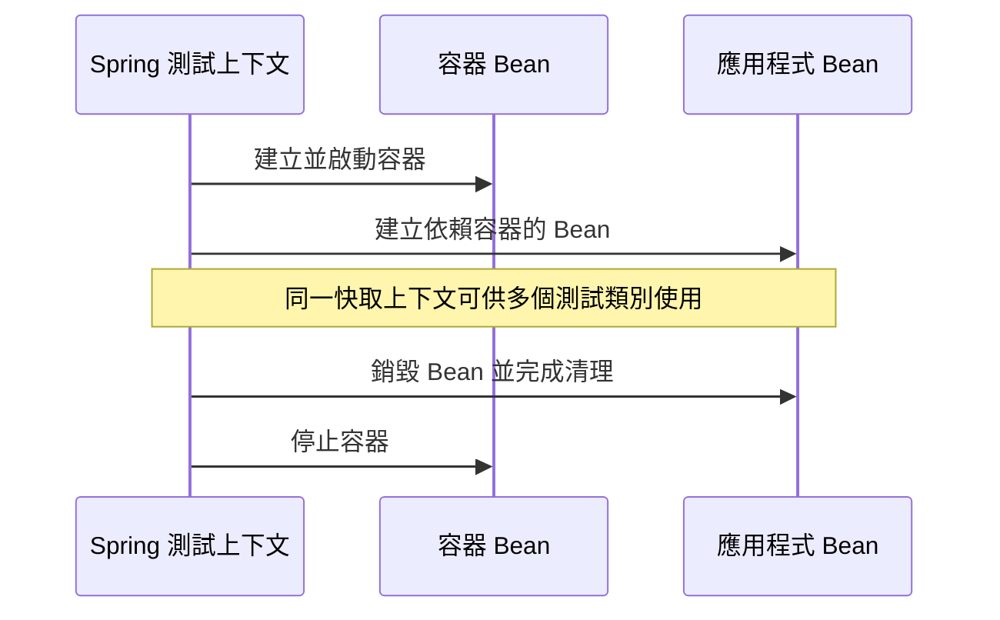

# Testcontainers

<!-- source-attribution -->
> **非官方繁體中文翻譯** · Spring Boot 4.1.1 · 翻譯日期：2026-10-21  
> [官方英文網站](https://docs.spring.io/spring-boot/4.1/reference/testing/testcontainers.html) · [固定版本英文來源](https://github.com/spring-projects/spring-boot/blob/v4.1.1/documentation/spring-boot-docs/src/docs/antora/modules/reference/pages/testing/testcontainers.adoc) · [本地原文快照](../sources/spring-boot/documentation/spring-boot-docs/src/docs/antora/modules/reference/pages/testing/testcontainers.adoc)  
> 原始作者與授權見 [來源聲明](../NOTICE.md)。官方範例及設定鍵保留原文，額外圖解另標示為譯者補充。

<!-- translation-status: translated -->

[Testcontainers][testing--testcontainers-r1] 函式庫提供管理 Docker 容器內執行服務的方法。
它與 JUnit 整合，讓你撰寫能在任何測試執行前啟動容器的測試類別。
對於需要與 MySQL、MongoDB、Cassandra 等真實後端服務通訊的整合測試，Testcontainers 特別實用。

以下章節介紹幾種將 Testcontainers 整合到測試的方法。

## 使用 Spring Bean

Spring Boot 可以將 Testcontainers 提供的容器作為 Bean 管理。

若要將容器宣告為 Bean，請在測試設定中加入 [`@Bean`][testing--testcontainers-r2] 方法：

```kotlin
import org.springframework.boot.test.context.TestConfiguration
import org.springframework.context.annotation.Bean
import org.testcontainers.mongodb.MongoDBContainer
import org.testcontainers.utility.DockerImageName

@TestConfiguration(proxyBeanMethods = false)
class MyTestConfiguration {

	@Bean
	fun mongoDbContainer(): MongoDBContainer {
		return MongoDBContainer(DockerImageName.parse("mongo:5.0"))
	}

}
```

```java
import org.testcontainers.mongodb.MongoDBContainer;
import org.testcontainers.utility.DockerImageName;

import org.springframework.boot.test.context.TestConfiguration;
import org.springframework.context.annotation.Bean;

@TestConfiguration(proxyBeanMethods = false)
class MyTestConfiguration {

	@Bean
	MongoDBContainer mongoDbContainer() {
		return new MongoDBContainer(DockerImageName.parse("mongo:5.0"));
	}

}
```

接著在測試類別匯入該設定類別，即可注入並使用容器：

```kotlin
import org.junit.jupiter.api.Test
import org.springframework.beans.factory.annotation.Autowired
import org.springframework.boot.test.context.SpringBootTest
import org.springframework.context.annotation.Import
import org.testcontainers.mongodb.MongoDBContainer

@SpringBootTest
@Import(MyTestConfiguration::class)
class MyIntegrationTests {

	@Autowired
	private val mongo: MongoDBContainer? = null

	@Test
	fun myTest() {
		...
	}

}
```

```java
import org.junit.jupiter.api.Test;
import org.testcontainers.mongodb.MongoDBContainer;

import org.springframework.beans.factory.annotation.Autowired;
import org.springframework.boot.test.context.SpringBootTest;
import org.springframework.context.annotation.Import;

@SpringBootTest
@Import(MyTestConfiguration.class)
class MyIntegrationTests {

	@Autowired
	private MongoDBContainer mongo;

	@Test
	void myTest() {
		...
	}

}
```

> **提示：**
>
> 這種容器管理方式常與[服務連線註解][testing--testcontainers-r3]搭配使用。

## 使用 JUnit 擴充

Testcontainers 提供 JUnit 擴充，可管理測試中的容器。
在測試類別套用 Testcontainers 的 [`@Testcontainers`][testing--testcontainers-r4] 註解，即可啟用此擴充。

接著可以在靜態容器欄位使用 [`@Container`][testing--testcontainers-r5] 註解。

[`@Testcontainers`][testing--testcontainers-r4] 可用於一般 JUnit 測試，也能與 [`@SpringBootTest`][testing--testcontainers-r6] 搭配：

```kotlin
import org.junit.jupiter.api.Test;
import org.testcontainers.junit.jupiter.Container;
import org.testcontainers.junit.jupiter.Testcontainers;
import org.testcontainers.neo4j.Neo4jContainer;

import org.springframework.boot.test.context.SpringBootTest;

@Testcontainers
@SpringBootTest
class MyIntegrationTests {

	@Test
	fun myTest() {
		...
	}

	companion object {

		@Container
		@JvmStatic
		val neo4j = Neo4jContainer("neo4j:5");

	}
}
```

```java
import org.junit.jupiter.api.Test;
import org.testcontainers.junit.jupiter.Container;
import org.testcontainers.junit.jupiter.Testcontainers;
import org.testcontainers.neo4j.Neo4jContainer;

import org.springframework.boot.test.context.SpringBootTest;

@Testcontainers
@SpringBootTest
class MyIntegrationTests {

	@Container
	static Neo4jContainer neo4j = new Neo4jContainer("neo4j:5");

	@Test
	void myTest() {
		...
	}

}
```

上例會在任何測試執行前啟動 Neo4j 容器。
容器實例的生命週期由 Testcontainers 管理，詳見其[官方文件][testing--testcontainers-r7]。

使用 JUnit 擴充時，靜態欄位的容器實例會在測試類別執行完畢後停止；非靜態欄位則在每個測試方法結束後停止。
這在 Spring Boot 測試中可能造成問題，因為 Spring 的 TestContext Framework 可能將 [`ApplicationContext`][testing--testcontainers-r8] 快取到該時間點之後，並讓設定相同的另一個測試類別或方法重複使用。
如果快取的應用程式上下文含有依賴已停止容器的 Bean，後續測試或 Bean 銷毀回呼就可能失敗。
因此，若應用程式上下文應在被快取期間持續可用，應優先[將容器作為 Spring Bean 管理][testing--testcontainers-r9]，或[匯入容器宣告][testing--testcontainers-r10]。

> **注意：**
>
> 多數情況下，你還需要設定應用程式，使其連接容器內執行的服務。

## 匯入容器設定介面

Testcontainers 的常見模式，是將容器實例宣告為介面中的靜態欄位。

例如以下介面宣告兩個容器：名為 `mongo`、型別為 [`MongoDBContainer`][testing--testcontainers-r11] 的容器，以及名為 `neo4j`、型別為 [`Neo4jContainer`][testing--testcontainers-r12] 的容器：

```kotlin
import org.testcontainers.junit.jupiter.Container
import org.testcontainers.mongodb.MongoDBContainer
import org.testcontainers.neo4j.Neo4jContainer

interface MyContainers {

	companion object {

		@Container
		val mongoContainer: MongoDBContainer = MongoDBContainer("mongo:5.0")

		@Container
		val neo4jContainer: Neo4jContainer = Neo4jContainer("neo4j:5")

	}

}
```

```java
import org.testcontainers.junit.jupiter.Container;
import org.testcontainers.mongodb.MongoDBContainer;
import org.testcontainers.neo4j.Neo4jContainer;

interface MyContainers {

	@Container
	MongoDBContainer mongoContainer = new MongoDBContainer("mongo:5.0");

	@Container
	Neo4jContainer neo4jContainer = new Neo4jContainer("neo4j:5");

}
```

採取這種宣告方式後，只要讓測試類別實作該介面，就能在多個測試中重複使用設定。

Spring Boot 測試也可以使用同一份介面設定。
請在測試設定類別加入 [`@ImportTestcontainers`][testing--testcontainers-r13]：

```kotlin
import org.springframework.boot.test.context.TestConfiguration
import org.springframework.boot.testcontainers.context.ImportTestcontainers

@TestConfiguration(proxyBeanMethods = false)
@ImportTestcontainers(MyContainers::class)
class MyTestConfiguration {

}
```

```java
import org.springframework.boot.test.context.TestConfiguration;
import org.springframework.boot.testcontainers.context.ImportTestcontainers;

@TestConfiguration(proxyBeanMethods = false)
@ImportTestcontainers(MyContainers.class)
class MyTestConfiguration {

}
```

## 受管理容器的生命週期

如果你使用 Testcontainers 提供的註解與擴充，容器實例的生命週期就完全由 Testcontainers 管理。
相關資訊請參閱 [Testcontainers 官方文件][testing--testcontainers-r14]。

當容器作為 Bean 交由 Spring 管理時，其生命週期也由 Spring 管理：

- 容器 Bean 會在所有其他 Bean 之前建立並啟動。
- 容器 Bean 會在所有其他 Bean 銷毀之後停止。

這個流程確保依賴容器功能的 Bean 能使用那些功能，也確保這些 Bean 在容器仍可用時完成清理。

> **提示：**
>
> 當應用程式 Bean 依賴容器功能時，應優先將容器設定為 Spring Bean，以確保正確的生命週期行為。

> **注意：**
>
> 讓 Testcontainers 管理容器，而不是將其作為 Spring Bean 管理，無法保證 Bean 與容器的關閉順序。
> 容器可能在依賴其功能的 Bean 完成清理前就關閉。
> 這可能導致用戶端 Bean 因連線中斷等原因擲出例外。
> 若應用程式上下文應在快取期間持續可用，應優先將容器作為 Spring Bean 管理，或使用 [`@ImportTestcontainers`][testing--testcontainers-r13] 匯入容器宣告。

對於 Spring TestContext Framework 管理的每個應用程式上下文，容器 Bean 只會建立並啟動一次。
關於 TestContext Framework 如何管理底層應用程式上下文及其中的 Bean，請參閱 [Spring Framework 文件][testing--testcontainers-r15]。

容器 Bean 會在 TestContext Framework 的標準應用程式上下文關閉流程中停止。
當應用程式上下文關閉時，容器也會關閉。
通常是在所有使用該特定快取上下文的測試執行完畢後發生。
依 TestContext Framework 設定的快取行為，也可能更早發生。

> **注意：**
>
> 單一測試容器實例可以，而且經常會，跨多個測試類別的測試執行期間保留。

## 服務連線

服務連線是連到任意遠端服務的連線。
Spring Boot 的自動設定可使用服務連線的詳細資訊，建立與遠端服務的連線。
此時，連線詳細資訊的優先順序高於任何與連線相關的設定屬性。

使用 Testcontainers 時，只要在測試類別的容器欄位加上註解，就能自動為容器內的服務建立連線詳細資訊。

```kotlin
import org.junit.jupiter.api.Test;
import org.testcontainers.junit.jupiter.Container;
import org.testcontainers.junit.jupiter.Testcontainers;
import org.testcontainers.neo4j.Neo4jContainer;

import org.springframework.boot.test.context.SpringBootTest;
import org.springframework.boot.testcontainers.service.connection.ServiceConnection;

@Testcontainers
@SpringBootTest
class MyIntegrationTests {

	@Test
	fun myTest() {
		...
	}

	companion object {

		@Container
		@ServiceConnection
		@JvmStatic
		val neo4j = Neo4jContainer("neo4j:5");

	}

}
```

```java
import org.junit.jupiter.api.Test;
import org.testcontainers.junit.jupiter.Container;
import org.testcontainers.junit.jupiter.Testcontainers;
import org.testcontainers.neo4j.Neo4jContainer;

import org.springframework.boot.test.context.SpringBootTest;
import org.springframework.boot.testcontainers.service.connection.ServiceConnection;

@Testcontainers
@SpringBootTest
class MyIntegrationTests {

	@Container
	@ServiceConnection
	static Neo4jContainer neo4j = new Neo4jContainer("neo4j:5");

	@Test
	void myTest() {
		...
	}

}
```

透過 [`@ServiceConnection`][testing--testcontainers-r16]，上述設定讓應用程式中與 Neo4j 相關的 Bean，能與 Testcontainers 管理的 Docker 容器內執行的 Neo4j 通訊。
它會自動定義 [`Neo4jConnectionDetails`][testing--testcontainers-r17] Bean，交由 Neo4j 自動設定使用，覆寫任何與連線相關的設定屬性。

> **注意：**
>
> 若要搭配 Testcontainers 使用服務連線，必須將 `spring-boot-testcontainers` 模組加入測試依賴。

服務連線註解由透過 `spring.factories` 註冊的 [`ContainerConnectionDetailsFactory`][testing--testcontainers-r18] 類別處理。
[`ContainerConnectionDetailsFactory`][testing--testcontainers-r18] 可以根據特定 [`Container`][testing--testcontainers-r20] 子類別或 Docker 映像名稱，建立 [`ConnectionDetails`][testing--testcontainers-r19] Bean。

`spring-boot-testcontainers` jar 提供以下服務連線工廠：

| 連線詳細資訊 | 比對條件 |
| --- | --- |
| [`ActiveMQConnectionDetails`][testing--testcontainers-r21] | 名為 "symptoma/activemq" 的容器，或 [`ActiveMQContainer`][testing--testcontainers-r22] |
| [`ArtemisConnectionDetails`][testing--testcontainers-r23] | 型別為 [`ArtemisContainer`][testing--testcontainers-r24] 的容器 |
| [`CassandraConnectionDetails`][testing--testcontainers-r25] | 型別為 [`CassandraContainer`][testing--testcontainers-r26] 的容器 |
| [`CouchbaseConnectionDetails`][testing--testcontainers-r27] | 型別為 [`CouchbaseContainer`][testing--testcontainers-r28] 的容器 |
| [`ElasticsearchConnectionDetails`][testing--testcontainers-r29] | 型別為 [`ElasticsearchContainer`][testing--testcontainers-r30] 的容器 |
| [`FlywayConnectionDetails`][testing--testcontainers-r31] | 型別為 [`JdbcDatabaseContainer`][testing--testcontainers-r32] 的容器 |
| [`JdbcConnectionDetails`][testing--testcontainers-r33] | 型別為 [`JdbcDatabaseContainer`][testing--testcontainers-r32] 的容器 |
| [`KafkaConnectionDetails`][testing--testcontainers-r34] | 型別為 [`KafkaContainer`][testing--testcontainers-r35]、[`ConfluentKafkaContainer`][testing--testcontainers-r36] 或 [`RedpandaContainer`][testing--testcontainers-r37] 的容器 |
| [`LdapConnectionDetails`][testing--testcontainers-r38] | 名為 "osixia/openldap" 或型別為 [`LLdapContainer`][testing--testcontainers-r39] 的容器 |
| [`LiquibaseConnectionDetails`][testing--testcontainers-r40] | 型別為 [`JdbcDatabaseContainer`][testing--testcontainers-r32] 的容器 |
| [`MongoConnectionDetails`][testing--testcontainers-r41] | 型別為 [`MongoDBContainer`][testing--testcontainers-r11] 或 [`MongoDBAtlasLocalContainer`][testing--testcontainers-r42] 的容器 |
| [`Neo4jConnectionDetails`][testing--testcontainers-r17] | 型別為 [`Neo4jContainer`][testing--testcontainers-r12] 的容器 |
| [`OtlpLoggingConnectionDetails`][testing--testcontainers-r43] | 名為 "otel/opentelemetry-collector-contrib" 或型別為 [`LgtmStackContainer`][testing--testcontainers-r44] 的容器 |
| [`OtlpMetricsConnectionDetails`][testing--testcontainers-r45] | 名為 "otel/opentelemetry-collector-contrib" 或型別為 [`LgtmStackContainer`][testing--testcontainers-r44] 的容器 |
| [`OtlpTracingConnectionDetails`][testing--testcontainers-r46] | 名為 "otel/opentelemetry-collector-contrib" 或型別為 [`LgtmStackContainer`][testing--testcontainers-r44] 的容器 |
| [`PulsarConnectionDetails`][testing--testcontainers-r47] | 型別為 [`PulsarContainer`][testing--testcontainers-r48] 的容器 |
| [`R2dbcConnectionDetails`][testing--testcontainers-r49] | 型別為 [`ClickHouseContainer`][testing--testcontainers-r50]、[`MariaDBContainer`][testing--testcontainers-r51]、[`MSSQLServerContainer`][testing--testcontainers-r52]、[`MySQLContainer`][testing--testcontainers-r53]、[OracleContainer (free)][testing--testcontainers-r54]、[OracleContainer (XE)][testing--testcontainers-r55] 或 [`PostgreSQLContainer`][testing--testcontainers-r56] 的容器 |
| [`RabbitConnectionDetails`][testing--testcontainers-r57] | 型別為 [`RabbitMQContainer`][testing--testcontainers-r58] 的容器 |
| [`RabbitStreamConnectionDetails`][testing--testcontainers-r59] | 型別為 [`RabbitMQContainer`][testing--testcontainers-r58]，且 `@ServiceConnection` 的 `type` 屬性包含 [`RabbitStreamConnectionDetails`][testing--testcontainers-r59] 的容器 |
| [`DataRedisConnectionDetails`][testing--testcontainers-r60] | 型別為 [`RedisContainer`][testing--testcontainers-r61] 或 [`RedisStackContainer`][testing--testcontainers-r62] 的容器，或名為 "redis"、"redis/redis-stack"、"redis/redis-stack-server" 的容器 |
| [`ZipkinConnectionDetails`][testing--testcontainers-r63] | 名為 "openzipkin/zipkin" 的容器 |

> **提示：**
>
> 預設情況下，除了 [`RabbitStreamConnectionDetails`][testing--testcontainers-r59]，會為指定的 [`Container`][testing--testcontainers-r20] 建立所有適用的連線詳細資訊 Bean。
> 例如 [`PostgreSQLContainer`][testing--testcontainers-r56] 會同時建立 [`JdbcConnectionDetails`][testing--testcontainers-r33] 與 [`R2dbcConnectionDetails`][testing--testcontainers-r49]。
>
> 如果只想建立部分適用型別，可使用 [`@ServiceConnection`][testing--testcontainers-r16] 的 `type` 屬性。
>
> 若要從 [`RabbitMQContainer`][testing--testcontainers-r58] 建立 [`RabbitStreamConnectionDetails`][testing--testcontainers-r59] Bean，必須透過 [`@ServiceConnection`][testing--testcontainers-r16] 的 `type` 屬性明確啟用。
> 容器還必須為 RabbitMQ Streams 開放連接埠 5552，或在設定 SSL 時開放 5551。

預設使用 `Container.getDockerImageName().getRepository()` 取得尋找連線詳細資訊所需的名稱。
Docker 映像名稱的 repository 部分不包含 registry 與版本。
只要 Spring Boot 能取得 [`Container`][testing--testcontainers-r20] 實例，這個方式就可運作，例如上例使用 `static` 欄位的情況。

如果使用 [`@Bean`][testing--testcontainers-r2] 方法，Spring Boot 不會為取得 Docker 映像名稱而呼叫 Bean 方法，因為這會造成提前初始化的問題。
它會改用 Bean 方法的回傳型別判斷應採用哪種連線詳細資訊。
只要使用 [`Neo4jContainer`][testing--testcontainers-r12] 或 [`RabbitMQContainer`][testing--testcontainers-r58] 之類具體型別的容器，這個方式即可運作。
若使用 [`GenericContainer`][testing--testcontainers-r64]，則無法運作，例如下例的 Redis：

```kotlin
import org.springframework.boot.test.context.TestConfiguration
import org.springframework.boot.testcontainers.service.connection.ServiceConnection
import org.springframework.context.annotation.Bean
import org.testcontainers.containers.GenericContainer

@TestConfiguration(proxyBeanMethods = false)
class MyRedisConfiguration {

	@Bean
	@ServiceConnection(name = "redis")
	fun redisContainer(): GenericContainer<*> {
		return GenericContainer("redis:7")
	}

}
```

```java
import org.testcontainers.containers.GenericContainer;

import org.springframework.boot.test.context.TestConfiguration;
import org.springframework.boot.testcontainers.service.connection.ServiceConnection;
import org.springframework.context.annotation.Bean;

@TestConfiguration(proxyBeanMethods = false)
public class MyRedisConfiguration {

	@Bean
	@ServiceConnection(name = "redis")
	public GenericContainer<?> redisContainer() {
		return new GenericContainer<>("redis:7");
	}

}
```

Spring Boot 無法從 [`GenericContainer`][testing--testcontainers-r64] 判斷所用的容器映像，因此必須使用 [`@ServiceConnection`][testing--testcontainers-r16] 的 `name` 屬性提供提示。

你也可以使用 [`@ServiceConnection`][testing--testcontainers-r16] 的 `name` 屬性，覆寫要使用的連線詳細資訊，例如使用自訂映像時。
若 Docker 映像是 `registry.mycompany.com/mirror/myredis`，可以使用 `@ServiceConnection(name="redis")`，確保建立 [`DataRedisConnectionDetails`][testing--testcontainers-r60]。

### 服務連線的 SSL

你可以在支援的容器使用 [`@Ssl`][testing--testcontainers-r65]、[`@JksKeyStore`][testing--testcontainers-r66]、[`@JksTrustStore`][testing--testcontainers-r67]、[`@PemKeyStore`][testing--testcontainers-r68] 與 [`@PemTrustStore`][testing--testcontainers-r69] 註解，啟用該服務連線的 SSL 支援。
請注意，你仍必須自行啟用 Testcontainer 內服務的 SSL；這些註解只會設定應用程式用戶端的 SSL。

```java
import com.redis.testcontainers.RedisContainer;
import org.junit.jupiter.api.Test;
import org.testcontainers.junit.jupiter.Container;
import org.testcontainers.junit.jupiter.Testcontainers;

import org.springframework.beans.factory.annotation.Autowired;
import org.springframework.boot.test.context.SpringBootTest;
import org.springframework.boot.testcontainers.service.connection.PemKeyStore;
import org.springframework.boot.testcontainers.service.connection.PemTrustStore;
import org.springframework.boot.testcontainers.service.connection.ServiceConnection;
import org.springframework.data.redis.core.RedisOperations;

@Testcontainers
@SpringBootTest
class MyRedisWithSslIntegrationTests {

	@Container
	@ServiceConnection
	@PemKeyStore(certificate = "classpath:client.crt", privateKey = "classpath:client.key")
	@PemTrustStore("classpath:ca.crt")
	static RedisContainer redis = new SecureRedisContainer("redis:latest");

	@Autowired
	private RedisOperations<Object, Object> operations;

	@Test
	void testRedis() {
		// ...
	}

}
```

上述程式碼使用 [`@PemKeyStore`][testing--testcontainers-r68] 將用戶端憑證與金鑰載入 keystore，並使用 [`@PemTrustStore`][testing--testcontainers-r69] 將 CA 憑證載入 truststore。
這會讓用戶端向伺服器驗證身分，而 truststore 中的 CA 憑證則確保伺服器憑證有效且受信任。

此例的 `SecureRedisContainer` 是自訂的 `RedisContainer` 子類別，會將憑證複製到正確位置，並以啟用 SSL 的命令列參數呼叫 `redis-server`。

以下服務連線支援 SSL 註解：

- Cassandra
- Couchbase
- Elasticsearch
- Kafka
- MongoDB
- OpenTelemetry（OTLP 日誌、指標與追蹤）
- RabbitMQ
- RabbitMQ Streams
- Redis

`ElasticsearchContainer` 還支援自動偵測伺服器端 SSL。
若要使用此功能，請如下例在容器標註 [`@Ssl`][testing--testcontainers-r65]，Spring Boot 就會替你處理用戶端 SSL 設定：

```java
import org.junit.jupiter.api.Test;
import org.testcontainers.elasticsearch.ElasticsearchContainer;
import org.testcontainers.junit.jupiter.Container;
import org.testcontainers.junit.jupiter.Testcontainers;

import org.springframework.beans.factory.annotation.Autowired;
import org.springframework.boot.data.elasticsearch.test.autoconfigure.DataElasticsearchTest;
import org.springframework.boot.testcontainers.service.connection.ServiceConnection;
import org.springframework.boot.testcontainers.service.connection.Ssl;
import org.springframework.data.elasticsearch.client.elc.ElasticsearchTemplate;

@Testcontainers
@DataElasticsearchTest
class MyElasticsearchWithSslIntegrationTests {

	@Ssl
	@Container
	@ServiceConnection
	static ElasticsearchContainer elasticsearch = new ElasticsearchContainer(
			"docker.elastic.co/elasticsearch/elasticsearch:8.17.2");

	@Autowired
	private ElasticsearchTemplate elasticsearchTemplate;

	@Test
	void testElasticsearch() {
		// ...
	}

}
```

## 動態屬性

[`@DynamicPropertySource`][testing--testcontainers-r70] 是服務連線的替代方案，寫法稍微冗長，但更有彈性。
靜態的 [`@DynamicPropertySource`][testing--testcontainers-r70] 方法可以將動態屬性值加入 Spring Environment。

```kotlin
import org.junit.jupiter.api.Test
import org.springframework.boot.test.context.SpringBootTest
import org.springframework.test.context.DynamicPropertyRegistry
import org.springframework.test.context.DynamicPropertySource
import org.testcontainers.junit.jupiter.Container
import org.testcontainers.junit.jupiter.Testcontainers
import org.testcontainers.neo4j.Neo4jContainer

@Testcontainers
@SpringBootTest
class MyIntegrationTests {

	@Test
	fun myTest() {
		...
	}

	companion object {
		@Container
		@JvmStatic
		val neo4j = Neo4jContainer("neo4j:5");

		@DynamicPropertySource
		@JvmStatic
		fun neo4jProperties(registry: DynamicPropertyRegistry) {
			registry.add("spring.neo4j.uri") { neo4j.boltUrl }
		}
	}
}
```

```java
import org.junit.jupiter.api.Test;
import org.testcontainers.junit.jupiter.Container;
import org.testcontainers.junit.jupiter.Testcontainers;
import org.testcontainers.neo4j.Neo4jContainer;

import org.springframework.boot.test.context.SpringBootTest;
import org.springframework.test.context.DynamicPropertyRegistry;
import org.springframework.test.context.DynamicPropertySource;

@Testcontainers
@SpringBootTest
class MyIntegrationTests {

	@Container
	static Neo4jContainer neo4j = new Neo4jContainer("neo4j:5");

	@Test
	void myTest() {
		// ...
	}

	@DynamicPropertySource
	static void neo4jProperties(DynamicPropertyRegistry registry) {
		registry.add("spring.neo4j.uri", neo4j::getBoltUrl);
	}

}
```

上述設定讓應用程式中與 Neo4j 相關的 Bean，能與 Testcontainers 管理的 Docker 容器內執行的 Neo4j 通訊。

## 譯者圖解：容器與應用程式的關閉順序



[testing--testcontainers-r1]: https://www.testcontainers.org/
[testing--testcontainers-r2]: https://docs.spring.io/spring-framework/docs/7.0.x/javadoc-api/org/springframework/context/annotation/Bean.html
[testing--testcontainers-r3]: https://docs.spring.io/spring-boot/4.1/reference/testing/testcontainers.html#testing.testcontainers.service-connections
[testing--testcontainers-r4]: https://javadoc.io/doc/org.testcontainers/junit-jupiter/2.0.5/org/testcontainers/junit/jupiter/Testcontainers.html
[testing--testcontainers-r5]: https://javadoc.io/doc/org.testcontainers/junit-jupiter/2.0.5/org/testcontainers/junit/jupiter/Container.html
[testing--testcontainers-r6]: https://docs.spring.io/spring-boot/4.1.1/api/java/org/springframework/boot/test/context/SpringBootTest.html
[testing--testcontainers-r7]: https://java.testcontainers.org/test_framework_integration/junit_5/#extension
[testing--testcontainers-r8]: https://docs.spring.io/spring-framework/docs/7.0.x/javadoc-api/org/springframework/context/ApplicationContext.html
[testing--testcontainers-r9]: https://docs.spring.io/spring-boot/4.1/reference/testing/testcontainers.html#testing.testcontainers.spring-beans
[testing--testcontainers-r10]: https://docs.spring.io/spring-boot/4.1/reference/testing/testcontainers.html#testing.testcontainers.importing-configuration-interfaces
[testing--testcontainers-r11]: https://javadoc.io/doc/org.testcontainers/mongodb/2.0.5/org/testcontainers/mongodb/MongoDBContainer.html
[testing--testcontainers-r12]: https://javadoc.io/doc/org.testcontainers/neo4j/2.0.5/org/testcontainers/neo4j/Neo4jContainer.html
[testing--testcontainers-r13]: https://docs.spring.io/spring-boot/4.1.1/api/java/org/springframework/boot/testcontainers/context/ImportTestcontainers.html
[testing--testcontainers-r14]: https://java.testcontainers.org
[testing--testcontainers-r15]: https://docs.spring.io/spring-framework/reference/7.0
[testing--testcontainers-r16]: https://docs.spring.io/spring-boot/4.1.1/api/java/org/springframework/boot/testcontainers/service/connection/ServiceConnection.html
[testing--testcontainers-r17]: https://docs.spring.io/spring-boot/4.1.1/api/java/org/springframework/boot/neo4j/autoconfigure/Neo4jConnectionDetails.html
[testing--testcontainers-r18]: https://docs.spring.io/spring-boot/4.1.1/api/java/org/springframework/boot/testcontainers/service/connection/ContainerConnectionDetailsFactory.html
[testing--testcontainers-r19]: https://docs.spring.io/spring-boot/4.1.1/api/java/org/springframework/boot/autoconfigure/service/connection/ConnectionDetails.html
[testing--testcontainers-r20]: https://javadoc.io/doc/org.testcontainers/testcontainers/2.0.5/org/testcontainers/containers/Container.html
[testing--testcontainers-r21]: https://docs.spring.io/spring-boot/4.1.1/api/java/org/springframework/boot/activemq/autoconfigure/ActiveMQConnectionDetails.html
[testing--testcontainers-r22]: https://javadoc.io/doc/org.testcontainers/activemq/2.0.5/org/testcontainers/activemq/ActiveMQContainer.html
[testing--testcontainers-r23]: https://docs.spring.io/spring-boot/4.1.1/api/java/org/springframework/boot/artemis/autoconfigure/ArtemisConnectionDetails.html
[testing--testcontainers-r24]: https://javadoc.io/doc/org.testcontainers/activemq/2.0.5/org/testcontainers/activemq/ArtemisContainer.html
[testing--testcontainers-r25]: https://docs.spring.io/spring-boot/4.1.1/api/java/org/springframework/boot/cassandra/autoconfigure/CassandraConnectionDetails.html
[testing--testcontainers-r26]: https://javadoc.io/doc/org.testcontainers/testcontainers/2.0.5/org/testcontainers/cassandra/CassandraContainer.html
[testing--testcontainers-r27]: https://docs.spring.io/spring-boot/4.1.1/api/java/org/springframework/boot/couchbase/autoconfigure/CouchbaseConnectionDetails.html
[testing--testcontainers-r28]: https://javadoc.io/doc/org.testcontainers/couchbase/2.0.5/org/testcontainers/couchbase/CouchbaseContainer.html
[testing--testcontainers-r29]: https://docs.spring.io/spring-boot/4.1.1/api/java/org/springframework/boot/elasticsearch/autoconfigure/ElasticsearchConnectionDetails.html
[testing--testcontainers-r30]: https://javadoc.io/doc/org.testcontainers/elasticsearch/2.0.5/org/testcontainers/elasticsearch/ElasticsearchContainer.html
[testing--testcontainers-r31]: https://docs.spring.io/spring-boot/4.1.1/api/java/org/springframework/boot/flyway/autoconfigure/FlywayConnectionDetails.html
[testing--testcontainers-r32]: https://javadoc.io/doc/org.testcontainers/jdbc/2.0.5/org/testcontainers/containers/JdbcDatabaseContainer.html
[testing--testcontainers-r33]: https://docs.spring.io/spring-boot/4.1.1/api/java/org/springframework/boot/jdbc/autoconfigure/JdbcConnectionDetails.html
[testing--testcontainers-r34]: https://docs.spring.io/spring-boot/4.1.1/api/java/org/springframework/boot/kafka/autoconfigure/KafkaConnectionDetails.html
[testing--testcontainers-r35]: https://javadoc.io/doc/org.testcontainers/kafka/2.0.5/org/testcontainers/kafka/KafkaContainer.html
[testing--testcontainers-r36]: https://javadoc.io/doc/org.testcontainers/kafka/2.0.5/org/testcontainers/kafka/ConfluentKafkaContainer.html
[testing--testcontainers-r37]: https://javadoc.io/doc/org.testcontainers/redpanda/2.0.5/org/testcontainers/redpanda/RedpandaContainer.html
[testing--testcontainers-r38]: https://docs.spring.io/spring-boot/4.1.1/api/java/org/springframework/boot/ldap/autoconfigure/LdapConnectionDetails.html
[testing--testcontainers-r39]: https://javadoc.io/doc/org.testcontainers/testcontainers/2.0.5/org/testcontainers/ldap/LLdapContainer.html
[testing--testcontainers-r40]: https://docs.spring.io/spring-boot/4.1.1/api/java/org/springframework/boot/liquibase/autoconfigure/LiquibaseConnectionDetails.html
[testing--testcontainers-r41]: https://docs.spring.io/spring-boot/4.1.1/api/java/org/springframework/boot/mongodb/autoconfigure/MongoConnectionDetails.html
[testing--testcontainers-r42]: https://javadoc.io/doc/org.testcontainers/mongodb/2.0.5/org/testcontainers/mongodb/MongoDBAtlasLocalContainer.html
[testing--testcontainers-r43]: https://docs.spring.io/spring-boot/4.1.1/api/java/org/springframework/boot/opentelemetry/autoconfigure/logging/otlp/OtlpLoggingConnectionDetails.html
[testing--testcontainers-r44]: https://javadoc.io/doc/org.testcontainers/grafana/2.0.5/org/testcontainers/grafana/LgtmStackContainer.html
[testing--testcontainers-r45]: https://docs.spring.io/spring-boot/4.1.1/api/java/org/springframework/boot/micrometer/metrics/autoconfigure/export/otlp/OtlpMetricsConnectionDetails.html
[testing--testcontainers-r46]: https://docs.spring.io/spring-boot/4.1.1/api/java/org/springframework/boot/micrometer/tracing/opentelemetry/autoconfigure/otlp/OtlpTracingConnectionDetails.html
[testing--testcontainers-r47]: https://docs.spring.io/spring-boot/4.1.1/api/java/org/springframework/boot/pulsar/autoconfigure/PulsarConnectionDetails.html
[testing--testcontainers-r48]: https://javadoc.io/doc/org.testcontainers/pulsar/2.0.5/org/testcontainers/pulsar/PulsarContainer.html
[testing--testcontainers-r49]: https://docs.spring.io/spring-boot/4.1.1/api/java/org/springframework/boot/r2dbc/autoconfigure/R2dbcConnectionDetails.html
[testing--testcontainers-r50]: https://javadoc.io/doc/org.testcontainers/clickhouse/2.0.5/org/testcontainers/clickhouse/ClickHouseContainer.html
[testing--testcontainers-r51]: https://javadoc.io/doc/org.testcontainers/mariadb/2.0.5/org/testcontainers/mariadb/MariaDBContainer.html
[testing--testcontainers-r52]: https://javadoc.io/doc/org.testcontainers/mssqlserver/2.0.5/org/testcontainers/mssqlserver/MSSQLServerContainer.html
[testing--testcontainers-r53]: https://javadoc.io/doc/org.testcontainers/mysql/2.0.5/org/testcontainers/mysql/MySQLContainer.html
[testing--testcontainers-r54]: https://javadoc.io/doc/org.testcontainers/oracle-free/2.0.5/org/testcontainers/oracle/OracleContainer.html
[testing--testcontainers-r55]: https://javadoc.io/doc/org.testcontainers/oracle-xe/2.0.5/org/testcontainers/containers/OracleContainer.html
[testing--testcontainers-r56]: https://javadoc.io/doc/org.testcontainers/postgresql/2.0.5/org/testcontainers/postgresql/PostgreSQLContainer.html
[testing--testcontainers-r57]: https://docs.spring.io/spring-boot/4.1.1/api/java/org/springframework/boot/amqp/autoconfigure/RabbitConnectionDetails.html
[testing--testcontainers-r58]: https://javadoc.io/doc/org.testcontainers/rabbitmq/2.0.5/org/testcontainers/rabbitmq/RabbitMQContainer.html
[testing--testcontainers-r59]: https://docs.spring.io/spring-boot/4.1.1/api/java/org/springframework/boot/amqp/autoconfigure/RabbitStreamConnectionDetails.html
[testing--testcontainers-r60]: https://docs.spring.io/spring-boot/4.1.1/api/java/org/springframework/boot/data/redis/autoconfigure/DataRedisConnectionDetails.html
[testing--testcontainers-r61]: https://javadoc.io/doc/com.redis/testcontainers-redis/2.2.4/com/redis/testcontainers/RedisContainer.html
[testing--testcontainers-r62]: https://javadoc.io/doc/com.redis/testcontainers-redis/2.2.4/com/redis/testcontainers/RedisStackContainer.html
[testing--testcontainers-r63]: https://docs.spring.io/spring-boot/4.1.1/api/java/org/springframework/boot/zipkin/autoconfigure/ZipkinConnectionDetails.html
[testing--testcontainers-r64]: https://javadoc.io/doc/org.testcontainers/testcontainers/2.0.5/org/testcontainers/containers/GenericContainer.html
[testing--testcontainers-r65]: https://docs.spring.io/spring-boot/4.1.1/api/java/org/springframework/boot/testcontainers/service/connection/Ssl.html
[testing--testcontainers-r66]: https://docs.spring.io/spring-boot/4.1.1/api/java/org/springframework/boot/testcontainers/service/connection/JksKeyStore.html
[testing--testcontainers-r67]: https://docs.spring.io/spring-boot/4.1.1/api/java/org/springframework/boot/testcontainers/service/connection/JksTrustStore.html
[testing--testcontainers-r68]: https://docs.spring.io/spring-boot/4.1.1/api/java/org/springframework/boot/testcontainers/service/connection/PemKeyStore.html
[testing--testcontainers-r69]: https://docs.spring.io/spring-boot/4.1.1/api/java/org/springframework/boot/testcontainers/service/connection/PemTrustStore.html
[testing--testcontainers-r70]: https://docs.spring.io/spring-framework/docs/7.0.x/javadoc-api/org/springframework/test/context/DynamicPropertySource.html
