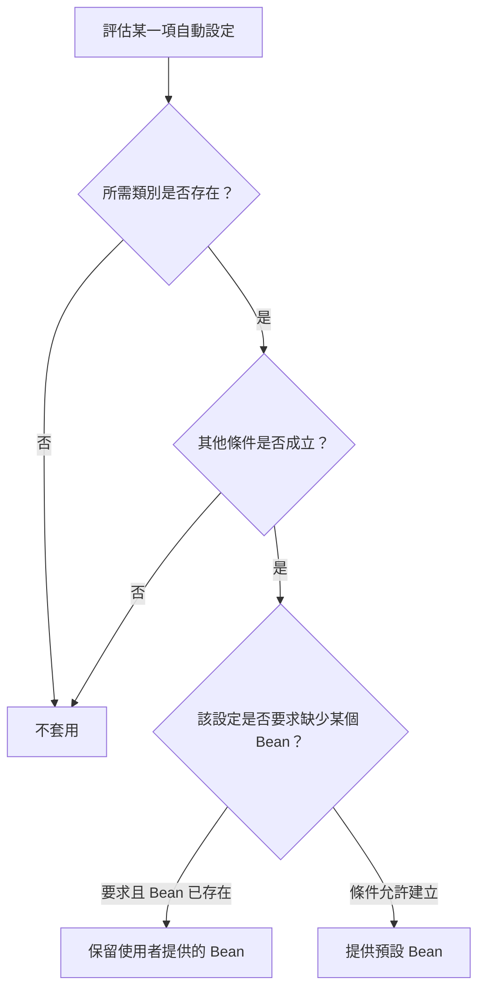

# 自動設定

<!-- source-attribution -->
> **非官方繁體中文翻譯** · boot 4.1.1 · 翻譯日期：2026-10-20  
> [官方英文網站](https://docs.spring.io/spring-boot/reference/using/auto-configuration.html) · [固定版本英文來源](https://github.com/spring-projects/spring-boot/blob/v4.1.1/documentation/spring-boot-docs/src/docs/antora/modules/reference/pages/using/auto-configuration.adoc) · [本地原文快照](../sources/spring-boot/documentation/spring-boot-docs/src/docs/antora/modules/reference/pages/using/auto-configuration.adoc)  
> 原始作者與授權見 [來源聲明](../NOTICE.md)。本文已由英文翻譯為中文；額外圖解與說明均標示為譯者補充。

<!-- translation-status: translated -->

Spring Boot 的自動設定會嘗試根據你加入的 JAR 依賴，自動設定 Spring 應用程式。例如，classpath 上有 `HSQLDB`，而且你沒有手動設定任何資料庫連線 Bean 時，Spring Boot 會自動設定一個記憶體內資料庫。

必須在某個 `@Configuration` 類別上加上 `@EnableAutoConfiguration` 或 `@SpringBootApplication`，才能選擇啟用自動設定。

> **提示：**只應加入一個 `@SpringBootApplication` 或 `@EnableAutoConfiguration`。官方一般建議，只在主要 `@Configuration` 類別上使用其中一個。

## 逐步替換自動設定

自動設定是非侵入式的。你可以隨時開始定義自己的設定，替換其中特定部分。例如，加入自己的 `DataSource` Bean 後，預設的內嵌資料庫支援就會退讓。

如果想知道目前套用了哪些自動設定，以及原因，可以使用 `--debug` 啟動應用程式。這會對部分核心 logger 啟用 debug 記錄，並將條件判斷報告輸出到主控台。

## 停用特定自動設定類別

如果發現套用了不需要的自動設定，可以使用 `@SpringBootApplication` 的 `exclude` 屬性停用它：

```kotlin
import org.springframework.boot.autoconfigure.SpringBootApplication
import org.springframework.boot.jdbc.autoconfigure.DataSourceAutoConfiguration

@SpringBootApplication(exclude = [DataSourceAutoConfiguration::class])
class MyApplication
```

如果該類別不在 classpath 上，可以使用 `excludeName`，改以完整限定類別名稱指定。如果偏好 `@EnableAutoConfiguration` 而非 `@SpringBootApplication`，也可以使用 `exclude` 和 `excludeName`。

最後，也能透過 `spring.autoconfigure.exclude` 屬性控制要排除的自動設定類別清單。

> **提示：**排除項目可以在 annotation 層級，也可以透過設定屬性指定。

> **注意：**即使自動設定類別是 `public`，被視為公開 API 的部分也只有類別名稱，供你停用該自動設定。類別內的實際內容，例如巢狀設定類別或 Bean 方法，都是內部用途，官方不建議直接使用。

## 自動設定套件

自動設定套件是各種自動設定功能預設搜尋的套件，例如掃描 entity 或 Spring Data Repository 時的搜尋範圍。

`@EnableAutoConfiguration` 會決定預設的自動設定套件，不論是直接使用它，還是透過 `@SpringBootApplication` 間接使用。可以使用 `@AutoConfigurationPackage` 設定其他套件。

## 譯者補充：條件式提供預設值



這是一般條件式設定的概念圖，不是每個自動設定都完全相同的判斷流程。核心是「依條件提供」，不是無條件覆蓋你的設定。

<!-- original-example-appendix -->

## 官方其他語言範例對照

主文優先呈現 Kotlin；以下保留官方 Java／XML 對照。程式識別字及程式內註解保留原文；來源檔案連結也包含原始授權聲明。

<details>
<summary>autoconfiguration/disablingspecific/MyApplication.java</summary>

[官方快照中的範例檔](../sources/spring-boot/documentation/spring-boot-docs/src/main/java/org/springframework/boot/docs/using/autoconfiguration/disablingspecific/MyApplication.java)

```java
package org.springframework.boot.docs.using.autoconfiguration.disablingspecific;

import org.springframework.boot.autoconfigure.SpringBootApplication;
import org.springframework.boot.jdbc.autoconfigure.DataSourceAutoConfiguration;

@SpringBootApplication(exclude = { DataSourceAutoConfiguration.class })
public class MyApplication {

}
```

</details>
