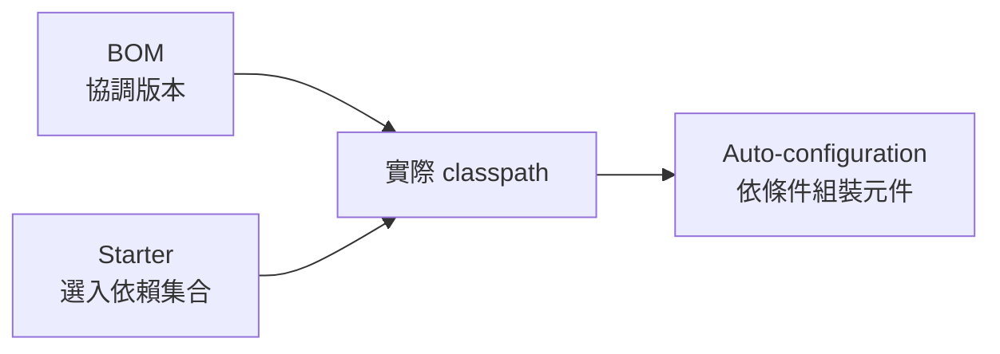

# 建置系統

<!-- source-attribution -->
> **非官方繁體中文翻譯** · boot 4.1.1 · 翻譯日期：2026-10-20  
> [官方英文網站](https://docs.spring.io/spring-boot/reference/using/build-systems.html) · [固定版本英文來源](https://github.com/spring-projects/spring-boot/blob/v4.1.1/documentation/spring-boot-docs/src/docs/antora/modules/reference/pages/using/build-systems.adoc) · [本地原文快照](../sources/spring-boot/documentation/spring-boot-docs/src/docs/antora/modules/reference/pages/using/build-systems.adoc)  
> 原始作者與授權見 [來源聲明](../NOTICE.md)。本文已由英文翻譯為中文；額外圖解與說明均標示為譯者補充。

<!-- translation-status: translated -->

強烈建議選擇支援依賴管理、能使用 Maven Central 儲存庫所發布成品的建置系統。官方推薦 Maven 或 Gradle。雖然也能讓 Spring Boot 搭配其他建置系統，例如 Ant，但這些方式得到的支援並不完善。

## 依賴管理

每個 Spring Boot 版本都提供一份經過整理的支援依賴清單。實際使用時，通常不必在建置設定中為清單內的依賴指定版本，因為 Spring Boot 會替你管理。升級 Spring Boot 時，這些依賴也會以一致的方式一起升級。

> **注意：**如果有需要，仍然可以明確指定版本，覆寫 Spring Boot 的建議。

這份清單涵蓋能與 Spring Boot 搭配的 Spring 模組，以及經過挑選的第三方函式庫。它以標準 BOM（Bill of Materials）`spring-boot-dependencies` 提供，Maven 與 Gradle 都能使用。

> **警告：**每個 Spring Boot 版本都對應 Spring Framework 的基準版本。官方強烈建議不要自行指定 Framework 版本。

## Maven

使用 Spring Boot 搭配 Maven 的方式，請參閱 Spring Boot Maven plugin：

- [參考文件](https://docs.spring.io/spring-boot/maven-plugin/index.html)
- [API](https://docs.spring.io/spring-boot/maven-plugin/api/java/index.html)

## Gradle

使用 Spring Boot 搭配 Gradle 的方式，請參閱 Spring Boot Gradle plugin：

- [參考文件](https://docs.spring.io/spring-boot/gradle-plugin/index.html)
- [API](https://docs.spring.io/spring-boot/gradle-plugin/api/java/index.html)

## Ant

可以透過 Apache Ant＋Ivy 建置 Spring Boot 專案。`spring-boot-antlib` 這個 AntLib 模組，也能協助 Ant 建立可執行 JAR。

典型的 `ivy.xml` 依賴宣告如下：

```xml
<ivy-module version="2.0">
    <info organisation="org.springframework.boot" module="spring-boot-sample-ant" />
    <configurations>
        <conf name="compile" description="everything needed to compile this module" />
        <conf name="runtime" extends="compile" description="everything needed to run this module" />
    </configurations>
    <dependencies>
        <dependency org="org.springframework.boot" name="spring-boot-starter"
            rev="${spring-boot.version}" conf="compile" />
    </dependencies>
</ivy-module>
```

典型的 `build.xml` 如下。版本 placeholder 已依本書固定版本展開為 `4.1.1`：

```xml
<project
    xmlns:ivy="antlib:org.apache.ivy.ant"
    xmlns:spring-boot="antlib:org.springframework.boot.ant"
    name="myapp" default="build">

    <property name="spring-boot.version" value="4.1.1" />

    <target name="resolve" description="--> retrieve dependencies with ivy">
        <ivy:retrieve pattern="lib/[conf]/[artifact]-[type]-[revision].[ext]" />
    </target>

    <target name="classpaths" depends="resolve">
        <path id="compile.classpath">
            <fileset dir="lib/compile" includes="*.jar" />
        </path>
    </target>

    <target name="init" depends="classpaths">
        <mkdir dir="build/classes" />
    </target>

    <target name="compile" depends="init" description="compile">
        <javac srcdir="src/main/java" destdir="build/classes" classpathref="compile.classpath" />
    </target>

    <target name="build" depends="compile">
        <spring-boot:exejar destfile="build/myapp.jar" classes="build/classes">
            <spring-boot:lib>
                <fileset dir="lib/runtime" />
            </spring-boot:lib>
        </spring-boot:exejar>
    </target>
</project>
```

> **提示：**如果不想使用 `spring-boot-antlib`，請參閱 How-to Guides 中[不使用 spring-boot-antlib，以 Ant 建立可執行封裝](https://docs.spring.io/spring-boot/how-to/build.html#howto.build.build-an-executable-archive-with-ant-without-using-spring-boot-antlib)的章節。

## Starter

Starter 是方便加入應用程式的依賴描述集合。它一次提供所需的 Spring 與相關技術，不必到處翻找範例程式，再複製貼上大量依賴描述。例如，想使用 Spring 和 JPA 存取資料庫，可加入 `spring-boot-starter-data-jpa`。

Starter 包含快速啟動專案所需的許多依賴，並搭配一致、受支援且受到管理的傳遞依賴集合。

### 名稱的意義

所有官方 Starter 都遵循類似的命名模式：`spring-boot-starter-*`，其中 `*` 代表某類應用。這種結構方便尋找 Starter。許多 IDE 的 Maven 整合可依名稱搜尋依賴。例如，安裝適當 Eclipse 或 Spring Tools plugin 後，可以在 POM 編輯器按 `ctrl-space`，輸入 `spring-boot-starter` 取得完整清單。

如[建立自己的 Starter](https://docs.spring.io/spring-boot/reference/features/developing-auto-configuration.html#features.developing-auto-configuration.custom-starter)一節所述，第三方 Starter 不應以 `spring-boot` 開頭，因為這是官方 Spring Boot 成品保留的前綴。第三方 Starter 通常以專案名稱開頭，例如 `thirdpartyproject-spring-boot-starter`。

以下是 Spring Boot 在 `org.springframework.boot` 群組下提供的應用程式 Starter。

### Spring Boot 應用程式 Starter

| 名稱 | 說明 |
| --- | --- |
| `spring-boot-starter` | 核心 Starter，包含自動設定支援、記錄功能與 YAML |
| `spring-boot-starter-activemq` | 使用 Apache ActiveMQ 與 JMS 的 Starter |
| `spring-boot-starter-activemq-test` | 測試 Apache ActiveMQ 與 JMS 的 Starter |
| `spring-boot-starter-actuator-test` | 測試 Spring Boot Actuator；它提供正式環境功能，協助監控及管理應用程式 的 Starter |
| `spring-boot-starter-amqp` | 使用 Spring AMQP 與 Rabbit MQ 的 Starter |
| `spring-boot-starter-amqp-test` | 測試 Spring AMQP 與 Rabbit MQ 的 Starter |
| `spring-boot-starter-artemis` | 使用 Apache Artemis 與 JMS 的 Starter |
| `spring-boot-starter-artemis-test` | 測試 Apache Artemis 與 JMS 的 Starter |
| `spring-boot-starter-aspectj` | 使用 以 AspectJ 進行剖面導向程式設計 的 Starter |
| `spring-boot-starter-aspectj-test` | 測試 以 AspectJ 進行剖面導向程式設計 的 Starter |
| `spring-boot-starter-batch` | 使用 Spring Batch 的 Starter |
| `spring-boot-starter-batch-data-mongodb` | 使用 Spring Batch，搭配 Data MongoDB 的 Starter |
| `spring-boot-starter-batch-data-mongodb-test` | 測試 Spring Batch，搭配 Data MongoDB 的 Starter |
| `spring-boot-starter-batch-jdbc` | 使用 Spring Batch，搭配 JDBC 的 Starter |
| `spring-boot-starter-batch-jdbc-test` | 測試 Spring Batch，搭配 JDBC 的 Starter |
| `spring-boot-starter-batch-test` | 測試 Spring Batch 的 Starter |
| `spring-boot-starter-cache` | 使用 Spring 快取支援 的 Starter |
| `spring-boot-starter-cache-test` | 測試 Spring 快取支援 的 Starter |
| `spring-boot-starter-cassandra` | 使用 Cassandra 分散式資料庫 的 Starter |
| `spring-boot-starter-cassandra-test` | 測試 Cassandra 分散式資料庫 的 Starter |
| `spring-boot-starter-classic` | 傳統核心 Starter，包含完整自動設定支援、記錄功能與 YAML |
| `spring-boot-starter-cloudfoundry` | 使用 Cloud Foundry 的 Starter |
| `spring-boot-starter-cloudfoundry-test` | 測試 Cloud Foundry 的 Starter |
| `spring-boot-starter-couchbase` | 使用 Couchbase 文件型資料庫 的 Starter |
| `spring-boot-starter-couchbase-test` | 測試 Couchbase 文件型資料庫 的 Starter |
| `spring-boot-starter-data-cassandra` | 使用 Cassandra 分散式資料庫 與 Spring Data Cassandra 的 Starter |
| `spring-boot-starter-data-cassandra-reactive` | 使用 Cassandra 分散式資料庫 與 Spring Data Cassandra Reactive 的 Starter |
| `spring-boot-starter-data-cassandra-reactive-test` | 測試 Cassandra 分散式資料庫 與 Spring Data Cassandra Reactive 的 Starter |
| `spring-boot-starter-data-cassandra-test` | 測試 Cassandra 分散式資料庫 與 Spring Data Cassandra 的 Starter |
| `spring-boot-starter-data-couchbase` | 使用 Couchbase 文件型資料庫 與 Spring Data Couchbase 的 Starter |
| `spring-boot-starter-data-couchbase-reactive` | 使用 Couchbase 文件型資料庫 與 Spring Data Couchbase Reactive 的 Starter |
| `spring-boot-starter-data-couchbase-reactive-test` | 測試 Couchbase 文件型資料庫 與 Spring Data Couchbase Reactive 的 Starter |
| `spring-boot-starter-data-couchbase-test` | 測試 Couchbase 文件型資料庫 與 Spring Data Couchbase 的 Starter |
| `spring-boot-starter-data-elasticsearch` | 使用 Elasticsearch 搜尋與分析引擎 與 Spring Data Elasticsearch 的 Starter |
| `spring-boot-starter-data-elasticsearch-test` | 測試 Elasticsearch 搜尋與分析引擎 與 Spring Data Elasticsearch 的 Starter |
| `spring-boot-starter-data-jdbc` | 使用 Spring Data JDBC 的 Starter |
| `spring-boot-starter-data-jdbc-test` | 測試 Spring Data JDBC 的 Starter |
| `spring-boot-starter-data-jpa` | 使用 Spring Data JPA，搭配 Hibernate 的 Starter |
| `spring-boot-starter-data-jpa-test` | 測試 Spring Data JPA，搭配 Hibernate 的 Starter |
| `spring-boot-starter-data-ldap` | 使用 Spring Data LDAP 的 Starter |
| `spring-boot-starter-data-ldap-test` | 測試 Spring Data LDAP 的 Starter |
| `spring-boot-starter-data-mongodb` | 使用 MongoDB 文件型資料庫 與 Spring Data MongoDB 的 Starter |
| `spring-boot-starter-data-mongodb-reactive` | 使用 MongoDB 文件型資料庫 與 Spring Data MongoDB Reactive 的 Starter |
| `spring-boot-starter-data-mongodb-reactive-test` | 使用 MongoDB 文件型資料庫 與 Spring Data MongoDB Reactive 的 Starter |
| `spring-boot-starter-data-mongodb-test` | 測試 MongoDB 文件型資料庫 與 Spring Data MongoDB 的 Starter |
| `spring-boot-starter-data-neo4j` | 使用 Neo4j 圖形資料庫 與 Spring Data Neo4j 的 Starter |
| `spring-boot-starter-data-neo4j-test` | 測試 Neo4j 圖形資料庫 與 Spring Data Neo4j 的 Starter |
| `spring-boot-starter-data-r2dbc` | 使用 Spring Data R2DBC 的 Starter |
| `spring-boot-starter-data-r2dbc-test` | 測試 Spring Data R2DBC 的 Starter |
| `spring-boot-starter-data-redis` | 使用 Redis 鍵值儲存，搭配 Spring Data Redis 與 Lettuce 用戶端 的 Starter |
| `spring-boot-starter-data-redis-reactive` | 使用 Redis 鍵值儲存，搭配 Spring Data Redis reactive 與 Lettuce 用戶端 的 Starter |
| `spring-boot-starter-data-redis-reactive-test` | 測試 Redis 鍵值儲存，搭配 Spring Data Redis reactive 與 Lettuce 用戶端 的 Starter |
| `spring-boot-starter-data-redis-test` | 測試 Redis 鍵值儲存，搭配 Spring Data Redis 與 Lettuce 用戶端 的 Starter |
| `spring-boot-starter-data-rest` | 使用 透過 Spring Data REST 與 Spring MVC，以 REST 暴露 Spring Data Repository 的 Starter |
| `spring-boot-starter-data-rest-test` | 測試 透過 Spring Data REST 與 Spring MVC，以 REST 暴露 Spring Data Repository 的 Starter |
| `spring-boot-starter-elasticsearch` | 使用 Elasticsearch 搜尋與分析引擎 的 Starter |
| `spring-boot-starter-elasticsearch-test` | 測試 Elasticsearch 搜尋與分析引擎 的 Starter |
| `spring-boot-starter-flyway` | 使用 Flyway 資料庫遷移 的 Starter |
| `spring-boot-starter-flyway-test` | 測試 Flyway 資料庫遷移 的 Starter |
| `spring-boot-starter-freemarker` | 使用 FreeMarker 的 Starter |
| `spring-boot-starter-freemarker-test` | 測試 FreeMarker 的 Starter |
| `spring-boot-starter-graphql` | 使用 Spring GraphQL 的 Starter |
| `spring-boot-starter-graphql-test` | 測試 Spring GraphQL 的 Starter |
| `spring-boot-starter-groovy-templates` | 使用 Groovy Templates 的 Starter |
| `spring-boot-starter-groovy-templates-test` | 測試 Groovy Templates 的 Starter |
| `spring-boot-starter-grpc-client` | 使用 Spring gRPC 用戶端 的 Starter |
| `spring-boot-starter-grpc-client-test` | 測試 gRPC 用戶端 的 Starter |
| `spring-boot-starter-grpc-server` | 使用 Spring gRPC 伺服器 的 Starter |
| `spring-boot-starter-grpc-server-test` | 測試 gRPC 伺服器 的 Starter |
| `spring-boot-starter-gson` | 使用 GSON 的 Starter |
| `spring-boot-starter-gson-test` | 測試 GSON 的 Starter |
| `spring-boot-starter-hateoas` | 使用 Spring HATEOS，以建立超媒體式 RESTful Spring MVC Web 應用程式 的 Starter |
| `spring-boot-starter-hateoas-test` | 測試 Spring HATEOS，以建立超媒體式 RESTful Spring MVC Web 應用程式 的 Starter |
| `spring-boot-starter-hazelcast` | 使用 Hazelcast 的 Starter |
| `spring-boot-starter-hazelcast-test` | 測試 Hazelcast 的 Starter |
| `spring-boot-starter-integration` | 使用 Spring Integration 的 Starter |
| `spring-boot-starter-integration-test` | 測試 Spring Integration 的 Starter |
| `spring-boot-starter-jackson` | 使用 Jackson 的 Starter |
| `spring-boot-starter-jackson-test` | 測試 Jackson 的 Starter |
| `spring-boot-starter-jdbc` | 使用 JDBC，搭配 HikariCP 連線池 的 Starter |
| `spring-boot-starter-jdbc-test` | 測試 JDBC，搭配 HikariCP 連線池 的 Starter |
| `spring-boot-starter-jersey` | 使用 JAX-RS 與 Jersey 的 Starter |
| `spring-boot-starter-jersey-test` | 測試 JAX-RS 與 Jersey 的 Starter |
| `spring-boot-starter-jetty` | 使用 Jetty 作為內嵌 Servlet 容器 的 Starter |
| `spring-boot-starter-jms` | 使用 JMS 的 Starter |
| `spring-boot-starter-jms-test` | 測試 JMS 的 Starter |
| `spring-boot-starter-jooq` | 使用 jOOQ，透過 JDBC 存取 SQL 資料庫 的 Starter |
| `spring-boot-starter-jooq-test` | 測試 jOOQ，透過 JDBC 存取 SQL 資料庫 的 Starter |
| `spring-boot-starter-json` | 讀寫 JSON 的 Starter |
| `spring-boot-starter-jsonb` | 使用 JSON-B 的 Starter |
| `spring-boot-starter-jsonb-test` | 測試 JSON-B 的 Starter |
| `spring-boot-starter-kafka` | 使用 Apache Kafka 的 Starter |
| `spring-boot-starter-kafka-test` | 測試 Apache Kafka 的 Starter |
| `spring-boot-starter-kotlinx-serialization-json` | 使用 Kotlinx Serialization JSON 的 Starter |
| `spring-boot-starter-kotlinx-serialization-json-test` | 測試 Kotlinx Serialization JSON 的 Starter |
| `spring-boot-starter-ldap` | 使用 LDAP 的 Starter |
| `spring-boot-starter-ldap-test` | 測試 LDAP 的 Starter |
| `spring-boot-starter-liquibase` | 使用 Liquibase 資料庫遷移 的 Starter |
| `spring-boot-starter-liquibase-test` | 測試 Liquibase 資料庫遷移 的 Starter |
| `spring-boot-starter-mail` | 使用 Java Mail 與 Spring Framework 的電子郵件寄送支援 的 Starter |
| `spring-boot-starter-mail-test` | 測試 Java Mail 與 Spring Framework 的電子郵件寄送支援 的 Starter |
| `spring-boot-starter-micrometer-metrics` | 使用 Micrometer Metrics 的 Starter |
| `spring-boot-starter-micrometer-metrics-test` | 測試 Micrometer Metrics 的 Starter |
| `spring-boot-starter-mongodb` | 使用 MongoDB 文件型資料庫 的 Starter |
| `spring-boot-starter-mongodb-test` | 測試 MongoDB 文件型資料庫 的 Starter |
| `spring-boot-starter-mustache` | 使用 Mustache 的 Starter |
| `spring-boot-starter-mustache-test` | 測試 Mustache 的 Starter |
| `spring-boot-starter-neo4j` | 使用 Neo4j 圖形資料庫 的 Starter |
| `spring-boot-starter-neo4j-test` | 測試 Neo4j 圖形資料庫 的 Starter |
| `spring-boot-starter-oauth2-authorization-server` | 使用 Spring Authorization Server 功能 的 Starter（已棄用，改用 `spring-boot-starter-security-oauth2-authorization-server`） |
| `spring-boot-starter-oauth2-client` | 使用 Spring Security 的 OAuth2／OpenID Connect 用戶端功能 的 Starter（已棄用，改用 `spring-boot-starter-security-oauth2-client`） |
| `spring-boot-starter-oauth2-resource-server` | 使用 Spring Security 的 OAuth2 資源伺服器功能 的 Starter（已棄用，改用 `spring-boot-starter-security-oauth2-resource-server`） |
| `spring-boot-starter-opentelemetry` | 使用 OpenTelemetry 的 Starter |
| `spring-boot-starter-opentelemetry-test` | 測試 OpenTelemetry 的 Starter |
| `spring-boot-starter-pulsar` | 使用 Spring for Apache Pulsar 的 Starter |
| `spring-boot-starter-pulsar-test` | 測試 Spring for Apache Pulsar 的 Starter |
| `spring-boot-starter-quartz` | 使用 Quartz 排程器 的 Starter |
| `spring-boot-starter-quartz-test` | 測試 Quartz 排程器 的 Starter |
| `spring-boot-starter-r2dbc` | 使用 R2DBC 的 Starter |
| `spring-boot-starter-r2dbc-test` | 測試 R2DBC 的 Starter |
| `spring-boot-starter-reactor-netty` | 使用 Reactor Netty 的 Starter |
| `spring-boot-starter-restclient` | 使用 Spring 阻塞式 HTTP 用戶端（RestClient、RestTemplate 與 HTTP Service Clients） 的 Starter |
| `spring-boot-starter-restclient-test` | 測試 Spring 阻塞式 HTTP 用戶端（RestClient、RestTemplate 與 HTTP Service Clients） 的 Starter |
| `spring-boot-starter-rsocket` | 使用 RSocket 的 Starter |
| `spring-boot-starter-rsocket-test` | 測試 RSocket 的 Starter |
| `spring-boot-starter-security` | 使用 Spring Security 的 Starter |
| `spring-boot-starter-security-oauth2-authorization-server` | 使用 Spring Authorization Server 功能 的 Starter |
| `spring-boot-starter-security-oauth2-authorization-server-test` | 測試 Spring Authorization Server 功能 的 Starter |
| `spring-boot-starter-security-oauth2-client` | 使用 Spring Security 的 OAuth2／OpenID Connect 用戶端功能 的 Starter |
| `spring-boot-starter-security-oauth2-client-test` | 測試 Spring Security 的 OAuth2／OpenID Connect 用戶端功能 的 Starter |
| `spring-boot-starter-security-oauth2-resource-server` | 使用 Spring Security 的 OAuth2 資源伺服器功能 的 Starter |
| `spring-boot-starter-security-oauth2-resource-server-test` | 測試 Spring Security 的 OAuth2 資源伺服器功能 的 Starter |
| `spring-boot-starter-security-saml2` | 使用 Spring Security，搭配 SAML2 的 Starter |
| `spring-boot-starter-security-saml2-test` | 測試 Spring Security，搭配 SAML2 的 Starter |
| `spring-boot-starter-security-test` | 測試 Spring Security 的 Starter |
| `spring-boot-starter-sendgrid` | 使用 Spring Session，搭配 Sendgrid 的 Starter |
| `spring-boot-starter-sendgrid-test` | 測試 Spring Session，搭配 Sendgrid 的 Starter |
| `spring-boot-starter-session-data-redis` | 使用 Spring Session，搭配 Spring Data Redis 的 Starter |
| `spring-boot-starter-session-data-redis-test` | 測試 Spring Session，搭配 Spring Data Redis 的 Starter |
| `spring-boot-starter-session-jdbc` | 使用 Spring Session，搭配 JDBC 的 Starter |
| `spring-boot-starter-session-jdbc-test` | 測試 Spring Session，搭配 JDBC 的 Starter |
| `spring-boot-starter-test` | 測試 Spring Boot 應用程式的 Starter，包含 JUnit Jupiter、Hamcrest、Mockito 等函式庫 |
| `spring-boot-starter-test-classic` | 測試 Spring Boot 應用程式的傳統 Starter，包含 JUnit Jupiter、Hamcrest、Mockito 等函式庫 |
| `spring-boot-starter-thymeleaf` | 使用 Thymeleaf 的 Starter |
| `spring-boot-starter-thymeleaf-test` | 測試 Thymeleaf 的 Starter |
| `spring-boot-starter-tomcat` | 使用 Tomcat 作為內嵌 Servlet 容器 的 Starter |
| `spring-boot-starter-validation` | 使用 Java Bean Validation，搭配 Hibernate Validator 的 Starter |
| `spring-boot-starter-validation-test` | 測試 Java Bean Validation，搭配 Hibernate Validator 的 Starter |
| `spring-boot-starter-web` | 使用 Spring MVC 建立 Web（含 RESTful）應用程式的 Starter；預設使用 Tomcat 內嵌容器（已棄用，改用 `spring-boot-starter-webmvc`） |
| `spring-boot-starter-web-server-test` | 測試 Spring Web Server 的 Starter |
| `spring-boot-starter-web-services` | 使用 Spring Web Services 的 Starter（已棄用，改用 `spring-boot-starter-webservices`） |
| `spring-boot-starter-webclient` | 使用 Spring 反應式 HTTP 用戶端（WebClient 與 HTTP Service Clients） 的 Starter |
| `spring-boot-starter-webclient-test` | 測試 Spring 反應式 HTTP 用戶端（WebClient 與 HTTP Service Clients） 的 Starter |
| `spring-boot-starter-webflux` | 使用 WebFlux 與 Reactor Netty 的 Starter |
| `spring-boot-starter-webflux-test` | 測試 WebFlux 與 Reactor Netty 的 Starter |
| `spring-boot-starter-webmvc` | 使用 Spring MVC 與 Tomcat 的 Starter |
| `spring-boot-starter-webmvc-test` | 測試 Spring MVC 與 Tomcat 的 Starter |
| `spring-boot-starter-webservices` | 使用 Spring Web Services 的 Starter |
| `spring-boot-starter-webservices-test` | 測試 Spring Web Services 的 Starter |
| `spring-boot-starter-websocket` | 使用 Spring MVC WebSocket 支援 的 Starter |
| `spring-boot-starter-websocket-test` | 測試 Spring MVC WebSocket 支援 的 Starter |
| `spring-boot-starter-zipkin` | 使用 Zipkin 的 Starter |
| `spring-boot-starter-zipkin-test` | 測試 Zipkin 的 Starter |

除了應用程式 Starter，也有以下 Starter 可加入適用於正式環境的功能。

### Spring Boot 正式環境 Starter

| 名稱 | 說明 |
| --- | --- |
| `spring-boot-starter-actuator` | 使用 Spring Boot Actuator；它提供正式環境功能，協助監控及管理應用程式 的 Starter |

最後，Spring Boot 也提供以下 Starter，讓你排除或替換特定技術面向。

### Spring Boot 技術 Starter

| 名稱 | 說明 |
| --- | --- |
| `spring-boot-starter-jetty-runtime` | Jetty 執行環境的 Starter |
| `spring-boot-starter-log4j2` | 使用 Log4j2 的 Starter |
| `spring-boot-starter-logback` | 使用 Logback 記錄日誌的 Starter |
| `spring-boot-starter-logging` | 提供預設日誌記錄的 Starter |
| `spring-boot-starter-restdocs` | 使用 Spring REST Docs 的 Starter |
| `spring-boot-starter-tomcat-runtime` | Tomcat 執行環境的 Starter |

如何替換技術元件，請參閱[更換 Web 伺服器](https://docs.spring.io/spring-boot/how-to/webserver.html#howto.webserver.use-another)與[使用 Log4j 作為記錄系統](https://docs.spring.io/spring-boot/how-to/logging.html#howto.logging.log4j)。

> **提示：**更多社群貢獻的 Starter，可查閱 GitHub 上 `spring-boot-starters` 模組的 [README](https://github.com/spring-projects/spring-boot/blob/v4.1.1/starter/README.adoc)。

## 譯者補充：三件不同的事



管理版本不等於自動加入所有依賴；加入依賴也不等於無條件啟用所有設定。上圖是譯者補充。

> **譯者校對註：**官方表格的 `spring-boot-starter-sendgrid` 描述寫成 Spring Session 搭配 Sendgrid，`HATEOS` 也沿用原表拼字；這些文字保留來源意思，不能據此推導專案實際功能。正式使用請查對應模組文件。表格取自顯示 4.1.1 的官方網頁快照，補足原始 AsciiDoc 中建置時才產生的表格。
