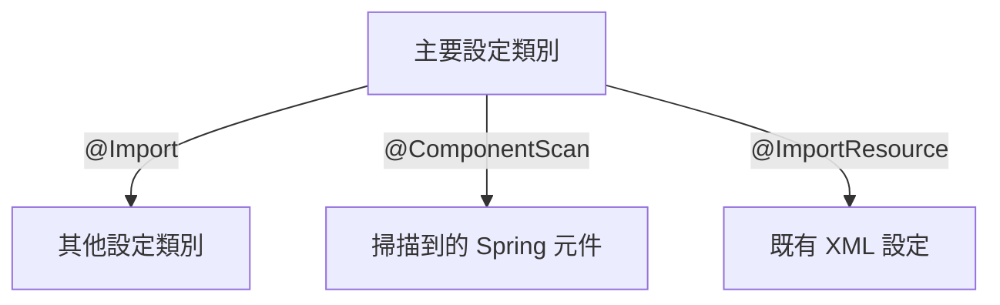

# 設定類別

<!-- source-attribution -->
> **非官方繁體中文翻譯** · boot 4.1.1 · 翻譯日期：2026-10-20  
> [官方英文網站](https://docs.spring.io/spring-boot/reference/using/configuration-classes.html) · [固定版本英文來源](https://github.com/spring-projects/spring-boot/blob/v4.1.1/documentation/spring-boot-docs/src/docs/antora/modules/reference/pages/using/configuration-classes.adoc) · [本地原文快照](../sources/spring-boot/documentation/spring-boot-docs/src/docs/antora/modules/reference/pages/using/configuration-classes.adoc)  
> 原始作者與授權見 [來源聲明](../NOTICE.md)。本文已由英文翻譯為中文；額外圖解與說明均標示為譯者補充。

<!-- translation-status: translated -->

Spring Boot 偏好以 Java 為基礎的設定。雖然可以讓 `SpringApplication` 使用 XML 來源，但一般建議以單一 `@Configuration` 類別作為主要來源。通常宣告 `main` 方法的類別，是主要設定類別的適合選擇。

> **提示：**網路上有許多以 XML 撰寫的 Spring 設定範例。可能的話，盡量使用等效的 Java 設定方式。搜尋 `Enable*` 類型的 annotation，是不錯的起點。

## 匯入其他設定類別

不必把所有 `@Configuration` 設定放在單一類別中。可以透過 `@Import` 匯入其他設定類別；也可以使用 `@ComponentScan`，自動找出所有 Spring 元件，包括 `@Configuration` 類別。

## 匯入 XML 設定

如果確實必須使用 XML 設定，仍建議從 `@Configuration` 類別開始，再以 `@ImportResource` 載入 XML 設定檔。

## 譯者補充：設定可以逐步整合

原文「Java-based configuration」指相對於 XML 的設定模型，Kotlin 同樣可以使用 `@Configuration` 與 `@Bean`。不必為了這個名稱把 Kotlin 業務程式改寫成 Java。
