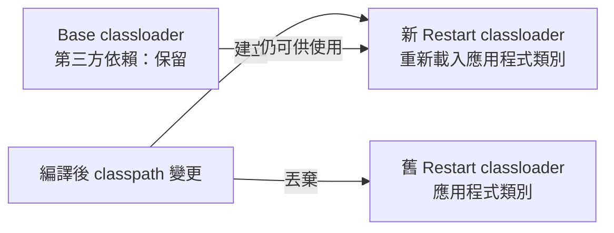
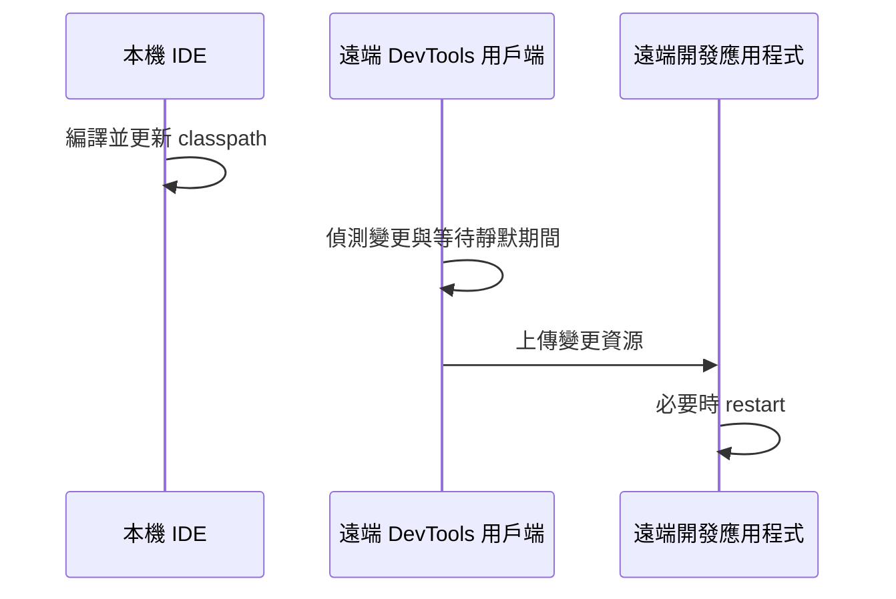

# 開發工具

<!-- source-attribution -->
> **非官方繁體中文翻譯** · boot 4.1.1 · 翻譯日期：2026-10-20  
> [官方英文網站](https://docs.spring.io/spring-boot/reference/using/devtools.html) · [固定版本英文來源](https://github.com/spring-projects/spring-boot/blob/v4.1.1/documentation/spring-boot-docs/src/docs/antora/modules/reference/pages/using/devtools.adoc) · [本地原文快照](../sources/spring-boot/documentation/spring-boot-docs/src/docs/antora/modules/reference/pages/using/devtools.adoc)  
> 原始作者與授權見 [來源聲明](../NOTICE.md)。本文已由英文翻譯為中文；額外圖解與說明均標示為譯者補充。

<!-- translation-status: translated -->

Spring Boot 包含一組額外工具，讓應用程式的開發體驗更順暢。任何專案都能加入 `spring-boot-devtools`，取得額外的開發期功能。若要使用，請在建置中加入模組依賴：

Maven：

```xml
<dependencies>
    <dependency>
        <groupId>org.springframework.boot</groupId>
        <artifactId>spring-boot-devtools</artifactId>
        <optional>true</optional>
    </dependency>
</dependencies>
```

Gradle：

```kotlin
dependencies {
    developmentOnly("org.springframework.boot:spring-boot-devtools")
}
```

> **警示：**Devtools 可能造成類別載入問題，尤其在多模組專案中。下節說明如何診斷與解決。

> **注意：**執行完整封裝的應用程式時，開發工具會自動停用。若透過 `java -jar` 啟動，或由特殊 classloader 啟動，會被視為「正式環境應用程式」。可以使用 `spring.devtools.restart.enabled` 系統屬性控制此行為。設定 `-Dspring.devtools.restart.enabled=true`，可不論啟動使用哪種 classloader 都啟用 devtools，但不可在正式環境這麼做，因為執行 devtools 有安全風險。停用方式是排除該依賴，或設定 `-Dspring.devtools.restart.enabled=false`。

> **提示：**Maven 以 optional 標記，或 Gradle 使用 `developmentOnly`，可避免 devtools 透過傳遞依賴套用到其他使用此專案的模組。

> **提示：**重新封裝的成品預設不含 devtools。若要使用特定遠端功能，需要將它包含進去。Maven plugin 需將 `includeOptional` 設為 `true`，並將 `excludeDevtools` 設為 `false`。Gradle 則需要[讓封裝工作的 classpath 包含 developmentOnly](https://docs.spring.io/spring-boot/gradle-plugin/packaging.html#packaging-executable.configuring.including-development-only-dependencies)。

## 診斷類別載入問題

如後面的「重新啟動與重新載入」所述，重新啟動功能以兩個 classloader 實作。這對大多數應用程式有效，但有時會造成類別載入問題，尤其是在多模組專案中。

要確認問題是否來自 devtools 與它的兩個 classloader，可先嘗試停用 restart。如果問題消失，再調整 restart classloader，讓它包含整個專案。

## 屬性預設值

Spring Boot 支援的多種函式庫會使用快取提高效能。例如，範本引擎快取編譯後的範本，避免重複解析；Spring MVC 提供靜態資源時，也能加入 HTTP 快取標頭。

快取對正式環境很有幫助，但在開發時可能妨礙你看見剛做的變更。因此 `spring-boot-devtools` 預設會停用相關快取選項。

快取通常透過 `application.properties` 設定，例如 Thymeleaf 的 `spring.thymeleaf.cache`。Trace 的取樣機率也會調整為 100%，因為一般預設值可能不會記錄測試使用的全部 trace。

你不必手動設定這些值；`spring-boot-devtools` 會自動套用適合開發期的設定。完整屬性如下：

| 名稱 | 預設值 |
| --- | --- |
| `management.tracing.sampling.probability` | `1.0` |
| `server.servlet.jsp.init-parameters.development` | `true` |
| `server.servlet.session.persistent` | `true` |
| `spring.docker.compose.readiness.wait` | `only-if-started` |
| `spring.freemarker.cache` | `false` |
| `spring.graphql.graphiql.enabled` | `true` |
| `spring.groovy.template.cache` | `false` |
| `spring.h2.console.enabled` | `true` |
| `spring.mustache.servlet.cache` | `false` |
| `spring.mvc.log-resolved-exception` | `true` |
| `spring.reactor.netty.shutdown-quiet-period` | `0s` |
| `spring.template.provider.cache` | `false` |
| `spring.thymeleaf.cache` | `false` |
| `spring.web.error.include-binding-errors` | `always` |
| `spring.web.error.include-message` | `always` |
| `spring.web.error.include-stacktrace` | `always` |
| `spring.web.resources.cache.period` | `0` |
| `spring.web.resources.chain.cache` | `false` |

> **注意：**若不想套用這些屬性預設值，可在 `application.properties` 將 `spring.devtools.add-properties` 設為 `false`。

開發 Spring MVC 與 Spring WebFlux 時，需要更多 Web 請求資訊，開發工具建議對 `web` logging group 啟用 `DEBUG`。如此能看見進來的請求、負責處理的 handler、回應結果等細節。若希望記錄所有請求細節，包括可能敏感的資訊，可啟用 `spring.mvc.log-request-details` 或 `spring.http.codecs.log-request-details`。

## 自動重新啟動

使用 `spring-boot-devtools` 的應用程式，會在 classpath 上的檔案變更時自動重新啟動。這對 IDE 開發很有用，能快速看到程式修改後的結果。預設監看 classpath 上所有指向目錄的項目。某些資源，例如靜態檔案與畫面範本，不一定需要重啟整個應用程式。

### 觸發重新啟動

DevTools 監看的是 classpath 資源，因此必須更新 classpath 才會觸發 restart。不論使用 IDE 還是建置 plugin，修改後的檔案都必須重新編譯。更新 classpath 的方式依工具而異：

- Eclipse：儲存修改過的檔案會更新 classpath 並觸發 restart。
- IntelliJ IDEA：執行 `Build` → `Build Project` 有相同效果。
- 建置 plugin：Maven 執行 `mvn compile`，或 Gradle 執行 `gradle build`，會觸發 restart。

> **注意：**透過 Maven 或 Gradle plugin restart 時，必須保持 forking 啟用。停用後，devtools 需要的隔離 application classloader 不會建立，restart 無法正確運作。

> **提示：**使用 JRebel 時，會停用自動 restart，改用動態類別重新載入。其他 devtools 功能，例如覆寫屬性，仍可使用。

> **注意：**DevTools 依賴 application context 的 shutdown hook，在 restart 時關閉 context。如果以 `SpringApplication.setRegisterShutdownHook(false)` 停用，將無法正確運作。

> **注意：**DevTools 需要客製 `ApplicationContext` 使用的 `ResourceLoader`。若應用程式已有自己的實作，devtools 會包裝它。不支援直接覆寫 `ApplicationContext` 的 `getResource` 方法。

> **警示：**使用 AspectJ weaving 時，不支援自動 restart。

### 重新啟動與重新載入

Spring Boot 的 restart 技術使用兩個 classloader。不變動的類別，例如第三方 JAR 中的類別，由 base classloader 載入；正在開發的類別則由 restart classloader 載入。

重新啟動時，restart classloader 會被丟棄，並建立新的一個。由於 base classloader 已存在且載入完成，這通常比冷啟動快得多。

若 restart 還不夠快，或遇到類別載入問題，可考慮 ZeroTurnaround 的 [JRebel](https://jrebel.com/software/jrebel/) 等重新載入技術。這些技術在載入類別時改寫類別，使其更適合重新載入。

### 記錄條件判斷的變化

預設每次 restart 都會記錄條件判斷差異報告。當你新增／移除 Bean，或修改設定屬性時，報告會顯示應用程式自動設定的變化。

可透過以下設定停用：

```yaml
spring:
  devtools:
    restart:
      log-condition-evaluation-delta: false
```

### 排除資源

有些資源改變時不一定需要 restart，例如 Thymeleaf 範本可以直接編輯。預設修改 `/META-INF/maven`、`/META-INF/resources`、`/resources`、`/static`、`/public` 或 `/templates` 內的資源，不會觸發 restart，但會觸發 LiveReload。

可使用 `spring.devtools.restart.exclude` 客製排除清單。例如只排除 `/static` 與 `/public`：

```yaml
spring:
  devtools:
    restart:
      exclude: "static/**,public/**"
```

> **提示：**若要保留預設排除清單並額外新增項目，請改用 `spring.devtools.restart.additional-exclude`。

### 監看額外路徑

若希望 classpath 之外的檔案改變時也觸發 restart 或 reload，可使用 `spring.devtools.restart.additional-paths` 設定監看路徑。前述 `spring.devtools.restart.exclude` 可控制這些路徑中的變更，是觸發完整 restart，還是 LiveReload。

### 停用 restart

可用 `spring.devtools.restart.enabled` 停用重新啟動功能。多數情況可在 `application.properties` 設定；這仍會初始化 restart classloader，但不監看檔案變更。

若要完全停用 restart 支援，例如它與某個函式庫不相容，必須在 `SpringApplication.run(...)` 之前，將 `spring.devtools.restart.enabled` 的系統屬性設為 `false`：

```kotlin
import org.springframework.boot.autoconfigure.SpringBootApplication
import org.springframework.boot.runApplication

@SpringBootApplication
class MyApplication

fun main(args: Array<String>) {
    System.setProperty("spring.devtools.restart.enabled", "false")
    runApplication<MyApplication>(*args)
}
```

### 使用觸發檔案

如果 IDE 會持續編譯修改過的檔案，你可能希望只在特定時間 restart。可以使用「觸發檔案」：當你希望檢查是否需要重新啟動時，修改這個特殊檔案即可。

> **注意：**任何對觸發檔案的更新都會引發檢查，但只有 DevTools 偵測到實際需要處理的變更時，才會 restart。

將 `spring.devtools.restart.trigger-file` 設為觸發檔案的名稱，不含路徑。該檔案必須出現在 classpath 的某個位置。

例如：

```text
src
+- main
   +- resources
      +- .reloadtrigger
```

設定如下：

```yaml
spring:
  devtools:
    restart:
      trigger-file: ".reloadtrigger"
```

之後只有更新 `src/main/resources/.reloadtrigger` 時，才會觸發重新啟動流程。

> **提示：**可以把 `spring.devtools.restart.trigger-file` 設為全域設定，讓各個專案採用相同行為。

有些 IDE 提供功能，不必手動修改觸發檔案。[Spring Tools for Eclipse](https://spring.io/tools) 與 IntelliJ IDEA Ultimate 都有支援。Spring Tools 可使用主控台視圖的 reload 按鈕，但檔案必須叫 `.reloadtrigger`；IntelliJ IDEA 請參閱[官方說明](https://www.jetbrains.com/help/idea/spring-boot.html#application-update-policies)。

### 客製 restart classloader

如前所述，restart 使用兩個 classloader。若造成問題，可以透過 `spring.devtools.restart.enabled` 系統屬性診斷。若停用 restart 後應用程式正常，就可能需要調整各個 classloader 載入的內容。

預設 IDE 中開啟的專案由 restart classloader 載入，一般 `.jar` 檔由 base classloader 載入。使用 `mvn spring-boot:run` 或 `gradle bootRun` 也相同：包含 `@SpringBootApplication` 的專案由 restart classloader 載入，其餘由 base classloader 載入。

啟動時主控台會列印 classpath，可協助找出有問題的項目。透過反射使用的類別，尤其是 annotation，可能在使用它們的應用類別載入之前，就先進入固定的父 classloader，造成 Spring 在應用程式中無法偵測它們。

可以建立 `META-INF/spring-devtools.properties`，指示 Spring Boot 使用不同 classloader 載入專案部分內容。該檔案可包含以 `restart.exclude`、`restart.include` 開頭的屬性：

- `include`：移入 restart classloader 的項目。
- `exclude`：移入 base classloader 的項目。

值是正規表示式，套用於啟動 JVM 時傳入的 classpath。以下排除部分本機 class 檔案，並把額外函式庫納入 restart classloader：

```properties
restart.exclude.companycommonlibs="/mycorp-common-[\\w\\d-\\.]/(build|bin|out|target)/"
restart.include.projectcommon="/mycorp-myproj-[\\w\\d-\\.]+\\.jar"
```

> **注意：**所有屬性鍵必須唯一。只要以 `restart.include.` 或 `restart.exclude.` 開頭，都會納入判斷。

> **提示：**Classpath 中所有 `META-INF/spring-devtools.properties` 都會載入。可將檔案放在專案或所使用的函式庫中。此處只能用屬性檔，不能用系統屬性。

### 已知限制

Restart 與標準 `ObjectInputStream` 反序列化的物件無法良好配合。若需要反序列化，可能要使用 Spring 的 `ConfigurableObjectInputStream`，搭配 `Thread.currentThread().getContextClassLoader()`。

部分第三方函式庫在反序列化時不考慮 context classloader。若遇到這種問題，需要向原作者提出修正要求。

## LiveReload

> **警告：**由於使用程度與支援下降，自 Spring Boot 4.1.0 起，LiveReload 已棄用，且沒有替代功能。

`spring-boot-devtools` 包含內嵌 LiveReload 伺服器，可在資源改變時觸發瀏覽器重新整理。Chrome、Firefox、Safari 可取得免費的 LiveReload 擴充套件；在所使用瀏覽器的擴充套件商店搜尋 LiveReload 即可。

若希望隨應用程式啟動 LiveReload 伺服器，可將已棄用的 `spring.devtools.livereload.enabled` 設為 `true`。

> **注意：**同一時間只能執行一個 LiveReload 伺服器。啟動應用程式前，請確認沒有其他 LiveReload 伺服器。若從 IDE 啟動多個應用程式，只有第一個具備 LiveReload 支援。

> **警告：**要在檔案改變時觸發 LiveReload，必須啟用自動 restart。

## 全域設定

可將以下任一檔案加入 `$HOME/.config/spring-boot`，設定全域 devtools 行為：

1. `spring-boot-devtools.properties`
2. `spring-boot-devtools.yaml`
3. `spring-boot-devtools.yml`

其中設定會套用到這台機器上所有使用 devtools 的 Spring Boot 應用程式。例如，希望一律透過觸發檔案 restart，可加入：

```yaml
spring:
  devtools:
    restart:
      trigger-file: ".reloadtrigger"
```

`$HOME` 預設是使用者家目錄。若要更換位置，可設定 `SPRING_DEVTOOLS_HOME` 環境變數或 `spring.devtools.home` 系統屬性。

> **注意：**若 `$HOME/.config/spring-boot` 沒有 devtools 設定檔，會再搜尋 `$HOME` 根目錄下的 `.spring-boot-devtools.properties`，以便與不支援新目錄位置的舊版 Spring Boot 共用設定。

> **注意：**Devtools properties／YAML 不支援 Profiles。在 `.spring-boot-devtools.properties` 啟用的 profile，不會影響特定 profile 設定檔的載入。也不支援 `spring-boot-devtools-<profile>.properties` 這類檔名，或 YAML／Properties 中的 `spring.config.activate.on-profile` 文件。

### 設定檔案系統監看器

`FileSystemWatcher` 以固定時間間隔輪詢類別變更，再等待預先定義的靜默期間，確認沒有後續變更。Spring Boot 完全依靠 IDE 編譯並將檔案複製到可讀取位置，因此 devtools restart 時，有時可能尚未反映部分變更。

若經常遇到這種問題，可增加 `spring.devtools.restart.poll-interval` 與 `spring.devtools.restart.quiet-period`，調整成適合開發環境的值：

```yaml
spring:
  devtools:
    restart:
      poll-interval: "2s"
      quiet-period: "1s"
```

此時每 2 秒輪詢監看的 classpath 目錄，並維持 1 秒靜默期間，以確認沒有更多 class 變更。

## 遠端應用程式

Spring Boot 開發工具不僅限於本機，也能對遠端應用程式使用部分功能。遠端支援必須明確啟用，因為可能帶來安全風險。只有在受信任網路中，或使用 SSL 保護時才應啟用。若兩者都無法做到，就不應使用遠端 DevTools；也絕不可在正式環境部署中啟用。

啟用前，需確保 devtools 包含在重新封裝的成品中：

```xml
<build>
    <plugins>
        <plugin>
            <groupId>org.springframework.boot</groupId>
            <artifactId>spring-boot-maven-plugin</artifactId>
            <configuration>
                <includeOptional>true</includeOptional>
                <excludeDevtools>false</excludeDevtools>
            </configuration>
        </plugin>
    </plugins>
</build>
```

> **注意：**可選依賴預設不會包含，因此這裡同時設定 `includeOptional`。

接著設定 `spring.devtools.remote.secret`。和其他重要密碼或秘密值一樣，應使用獨特且足夠強的值，避免被猜中或暴力破解。

遠端支援分為兩部分：接受連線的伺服器端端點，以及在 IDE 中執行的用戶端。設定 `spring.devtools.remote.secret` 後，伺服器元件會自動啟用；用戶端必須手動啟動。

> **注意：**遠端 devtools 不支援 Spring WebFlux 應用程式。

### 執行遠端用戶端

遠端用戶端設計為從 IDE 中執行。需要使用與遠端專案相同的 classpath，執行 `RemoteSpringApplication`。唯一必要的程式參數是要連線的遠端 URL。

例如在 Eclipse 或 Spring Tools 中，有一個已部署到 Cloud Foundry 的 `my-app` 專案：

1. 從 `Run` 選單選擇 `Run Configurations...`。
2. 建立新的 `Java Application` 啟動設定。
3. 選擇 `my-app` 專案。
4. 將 `org.springframework.boot.devtools.RemoteSpringApplication` 設為主要類別。
5. 在 `Program arguments` 加入 `https://myapp.cfapps.io`，或實際的遠端 URL。

執行中的遠端用戶端可能顯示如下內容：

```text
.   ____          _                                              __ _ _
 /\\ / ___'_ __ _ _(_)_ __  __ _          ___               _      \ \ \ \
( ( )\___ | '_ | '_| | '_ \/ _` |        | _ \___ _ __  ___| |_ ___ \ \ \ \
 \\/  ___)| |_)| | | | | || (_| []::::::[]   / -_) '  \/ _ \  _/ -_) ) ) ) )
  '  |____| .__|_| |_|_| |_\__, |        |_|_\___|_|_|_\___/\__\___|/ / / /
 =========|_|==============|___/===================================/_/_/_/
 :: Spring Boot Remote ::  (v4.1.1)

2026-08-17T10:51:38.751Z  INFO 11457 --- [           main] o.s.b.devtools.RemoteSpringApplication   : Starting RemoteSpringApplication v4.1.1 using Java 25.0.4 with PID 11457 (/Users/myuser/.m2/repository/org/springframework/boot/spring-boot-devtools/4.1.1/spring-boot-devtools-4.1.1.jar started by myuser in /opt/apps/)
2026-08-17T10:51:38.769Z  INFO 11457 --- [           main] o.s.b.devtools.RemoteSpringApplication   : No active profile set, falling back to 1 default profile: "default"
2026-08-17T10:51:40.221Z  INFO 11457 --- [           main] o.s.b.d.a.OptionalLiveReloadServer       : LiveReload server is running on port 35729
2026-08-17T10:51:40.337Z  INFO 11457 --- [           main] o.s.b.devtools.RemoteSpringApplication   : Started RemoteSpringApplication in 3.297 seconds (process running for 4.891)
```

> **注意：**遠端用戶端使用與實際應用程式相同的 classpath，因此能直接讀取應用程式屬性。它就是以此方式讀取 `spring.devtools.remote.secret`，再傳給伺服器做身分驗證。

> **提示：**建議使用 `https://`，讓流量加密，避免密碼遭攔截。

> **提示：**若必須透過代理伺服器連線，可設定 `spring.devtools.remote.proxy.host` 與 `spring.devtools.remote.proxy.port`。

### 遠端更新

遠端用戶端與本機 restart 一樣監看 application classpath。更新的資源會推送至遠端應用程式，並在必要時觸發 restart。若開發中的功能依賴本機沒有的雲端服務，這很有幫助。一般而言，遠端更新及 restart 比完整重新建置與部署快得多。

在較慢的開發環境中，靜默期間可能不夠長，導致 class 變更分成多批。第一批上傳後，伺服器已開始 restart，下一批便無法傳送。

通常會在 `RemoteSpringApplication` 記錄中看到部分 class 上傳失敗的警告，之後重試。但這也可能造成程式碼不一致，讓第一批上傳後的 restart 失敗。若常發生，可依開發環境增加 `spring.devtools.restart.poll-interval` 與 `spring.devtools.restart.quiet-period`；設定方式參考前面的檔案系統監看器。

> **注意：**只有遠端用戶端執行時才監看檔案。啟動用戶端之前已修改的檔案，不會被推送到遠端。

## 譯者補充：為什麼 restart 可以較快





兩張圖都是譯者補充，不代表正式環境部署流程。

<!-- original-example-appendix -->

## 官方其他語言範例對照

主文優先呈現 Kotlin；以下保留官方 Java／XML 對照。程式識別字及程式內註解保留原文；來源檔案連結也包含原始授權聲明。

<details>
<summary>devtools/restart/disable/MyApplication.java</summary>

[官方快照中的範例檔](../sources/spring-boot/documentation/spring-boot-docs/src/main/java/org/springframework/boot/docs/using/devtools/restart/disable/MyApplication.java)

```java
package org.springframework.boot.docs.using.devtools.restart.disable;

import org.springframework.boot.SpringApplication;
import org.springframework.boot.autoconfigure.SpringBootApplication;

@SpringBootApplication
public class MyApplication {

	public static void main(String[] args) {
		System.setProperty("spring.devtools.restart.enabled", "false");
		SpringApplication.run(MyApplication.class, args);
	}

}
```

</details>
