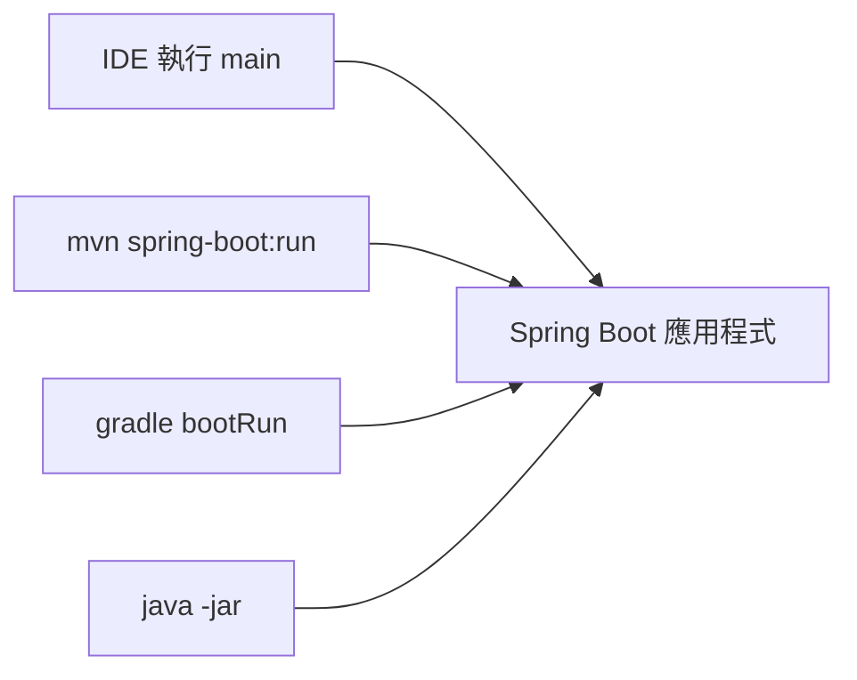

# 執行應用程式

<!-- source-attribution -->
> **非官方繁體中文翻譯** · boot 4.1.1 · 翻譯日期：2026-10-20  
> [官方英文網站](https://docs.spring.io/spring-boot/reference/using/running-your-application.html) · [固定版本英文來源](https://github.com/spring-projects/spring-boot/blob/v4.1.1/documentation/spring-boot-docs/src/docs/antora/modules/reference/pages/using/running-your-application.adoc) · [本地原文快照](../sources/spring-boot/documentation/spring-boot-docs/src/docs/antora/modules/reference/pages/using/running-your-application.adoc)  
> 原始作者與授權見 [來源聲明](../NOTICE.md)。本文已由英文翻譯為中文；額外圖解與說明均標示為譯者補充。

<!-- translation-status: translated -->

將應用程式封裝成 JAR 並使用內嵌 HTTP 伺服器，最大的優點之一，是可以像執行其他應用程式一樣執行它。Spring Boot 應用程式的除錯也相同，不需要特別的 IDE plugin 或擴充套件。

> **注意：**以下選項最適合在本機開發時使用。正式環境部署請參閱[為正式環境封裝應用程式](using--packaging-for-production.md)。

> **注意：**本節只涵蓋 JAR 封裝方式。如果選擇 WAR，請參閱伺服器與 IDE 文件。

## 從 IDE 執行

可以在 IDE 中把 Spring Boot 應用程式當成 Java 應用程式執行，但必須先匯入專案。步驟會依 IDE 與建置系統而不同。多數 IDE 能直接匯入 Maven 專案；例如 Eclipse 可從 `File` 選單選擇 `Import...` → `Existing Maven Projects`。

如果無法直接匯入，可以嘗試用建置 plugin 產生 IDE 中繼資料。Maven 有 [Eclipse](https://maven.apache.org/plugins/maven-eclipse-plugin/) 與 [IntelliJ IDEA](https://maven.apache.org/plugins/maven-idea-plugin/) plugin；Gradle 也提供[各種 IDE 的整合](https://docs.gradle.org/current/userguide/userguide.html)。

> **提示：**若不小心啟動兩次 Web 應用程式，會出現 `Port already in use`。Spring Tools 使用者可以使用 `Relaunch`，而非 `Run`，確保既有實例先關閉。

## 執行已封裝的應用程式

使用 Spring Boot Maven 或 Gradle plugin 建立可執行 JAR 後，可以透過 `java -jar` 執行：

```shell
$ java -jar target/myapplication-0.0.1-SNAPSHOT.jar
```

也能啟用遠端除錯，讓 debugger 連接已封裝的應用程式：

```shell
$ java -agentlib:jdwp=server=y,transport=dt_socket,address=8000,suspend=n \
       -jar target/myapplication-0.0.1-SNAPSHOT.jar
```

## 使用 Maven plugin

Spring Boot Maven plugin 包含 `run` goal，可快速編譯並執行應用程式。應用程式會以未封裝、展開的形式執行，就像在 IDE 中一樣：

```shell
$ mvn spring-boot:run
```

也可能需要使用作業系統環境變數 `MAVEN_OPTS`：

```shell
$ export MAVEN_OPTS=-Xmx1024m
```

## 使用 Gradle plugin

Spring Boot Gradle plugin 同樣包含 `bootRun` task，以展開形式執行應用程式。套用 `org.springframework.boot` 與 `java` plugin 後，會加入這項工作：

```shell
$ gradle bootRun
```

也可能需要使用作業系統環境變數 `JAVA_OPTS`：

```shell
$ export JAVA_OPTS=-Xmx1024m
```

## 熱置換

Spring Boot 應用程式是一般 Java 應用程式，因此 JVM 熱置換應可直接使用。不過 JVM 能替換的位元組碼有一些限制。需要更完整的方案時，可以使用 [JRebel](https://www.jrebel.com/products/jrebel)。

`spring-boot-devtools` 也包含快速重新啟動的支援，詳見 How-to Guides 的[熱置換章節](https://docs.spring.io/spring-boot/how-to/hotswapping.html)。

## 譯者補充：執行方式不同，應用程式核心相同



原文環境變數範例予以保留；要調整 fork 出來的應用程式 JVM 參數時，仍需核對對應建置 plugin 的設定，不應只從環境變數名稱推斷作用範圍。
