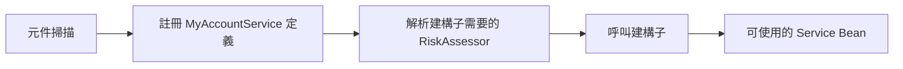

# Spring Bean 與依賴注入

<!-- source-attribution -->
> **非官方繁體中文翻譯** · boot 4.1.1 · 翻譯日期：2026-10-20  
> [官方英文網站](https://docs.spring.io/spring-boot/reference/using/spring-beans-and-dependency-injection.html) · [固定版本英文來源](https://github.com/spring-projects/spring-boot/blob/v4.1.1/documentation/spring-boot-docs/src/docs/antora/modules/reference/pages/using/spring-beans-and-dependency-injection.adoc) · [本地原文快照](../sources/spring-boot/documentation/spring-boot-docs/src/docs/antora/modules/reference/pages/using/spring-beans-and-dependency-injection.adoc)  
> 原始作者與授權見 [來源聲明](../NOTICE.md)。本文已由英文翻譯為中文；額外圖解與說明均標示為譯者補充。

<!-- translation-status: translated -->

你可以自由使用 Spring Framework 的各種標準方式，定義 Bean 與要注入的依賴。官方一般建議以建構子注入組裝依賴，並使用 `@ComponentScan` 尋找 Bean。

如果依照前述建議組織程式碼，將應用程式類別放在頂層套件，就可以不帶參數地加入 `@ComponentScan`，或使用隱含包含它的 `@SpringBootApplication`。應用程式中的 `@Component`、`@Service`、`@Repository`、`@Controller` 等元件，就會自動註冊為 Spring Bean。

以下官方 Kotlin 範例是一個 `@Service` Bean，透過建構子注入取得必要的 `RiskAssessor` Bean：

```kotlin
import org.springframework.stereotype.Service

@Service
class MyAccountService(private val riskAssessor: RiskAssessor) : AccountService
```

如果 Bean 有多個建構子，需要以 `@Autowired` 標示希望 Spring 使用的那一個：

```kotlin
import org.springframework.beans.factory.annotation.Autowired
import org.springframework.stereotype.Service
import java.io.PrintStream

@Service
class MyAccountService : AccountService {
    private val riskAssessor: RiskAssessor
    private val out: PrintStream

    @Autowired
    constructor(riskAssessor: RiskAssessor) {
        this.riskAssessor = riskAssessor
        out = System.out
    }

    constructor(riskAssessor: RiskAssessor, out: PrintStream) {
        this.riskAssessor = riskAssessor
        this.out = out
    }

    // ...
}
```

> **提示：**建構子注入讓 `riskAssessor` 欄位可以標記為 `final`，表示之後不能重新指定。上面的 Kotlin 版本使用 `val`。

## 譯者補充：Bean 發現與注入是兩個步驟



掃描到類別，不代表它需要的所有合作物件都一定存在；缺少必要依賴仍會造成建立失敗。這張圖簡化了生命週期與代理處理。

<!-- original-example-appendix -->

## 官方其他語言範例對照

主文優先呈現 Kotlin；以下保留官方 Java／XML 對照。程式識別字及程式內註解保留原文；來源檔案連結也包含原始授權聲明。

<details>
<summary>springbeansanddependencyinjection/singleconstructor/MyAccountService.java</summary>

[官方快照中的範例檔](../sources/spring-boot/documentation/spring-boot-docs/src/main/java/org/springframework/boot/docs/using/springbeansanddependencyinjection/singleconstructor/MyAccountService.java)

```java
package org.springframework.boot.docs.using.springbeansanddependencyinjection.singleconstructor;

import org.springframework.stereotype.Service;

@Service
public class MyAccountService implements AccountService {

	@SuppressWarnings("unused")
	private final RiskAssessor riskAssessor;

	public MyAccountService(RiskAssessor riskAssessor) {
		this.riskAssessor = riskAssessor;
	}

	// ...

}
```

</details>

<details>
<summary>springbeansanddependencyinjection/multipleconstructors/MyAccountService.java</summary>

[官方快照中的範例檔](../sources/spring-boot/documentation/spring-boot-docs/src/main/java/org/springframework/boot/docs/using/springbeansanddependencyinjection/multipleconstructors/MyAccountService.java)

```java
package org.springframework.boot.docs.using.springbeansanddependencyinjection.multipleconstructors;

import java.io.PrintStream;

import org.springframework.beans.factory.annotation.Autowired;
import org.springframework.stereotype.Service;

@Service
public class MyAccountService implements AccountService {

	@SuppressWarnings("unused")
	private final RiskAssessor riskAssessor;

	@SuppressWarnings("unused")
	private final PrintStream out;

	@Autowired
	public MyAccountService(RiskAssessor riskAssessor) {
		this.riskAssessor = riskAssessor;
		this.out = System.out;
	}

	public MyAccountService(RiskAssessor riskAssessor, PrintStream out) {
		this.riskAssessor = riskAssessor;
		this.out = out;
	}

	// ...

}
```

</details>
