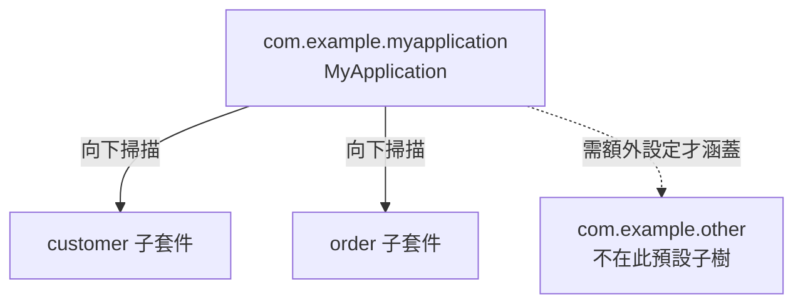

# 組織程式碼結構

<!-- source-attribution -->
> **非官方繁體中文翻譯** · boot 4.1.1 · 翻譯日期：2026-10-20  
> [官方英文網站](https://docs.spring.io/spring-boot/reference/using/structuring-your-code.html) · [固定版本英文來源](https://github.com/spring-projects/spring-boot/blob/v4.1.1/documentation/spring-boot-docs/src/docs/antora/modules/reference/pages/using/structuring-your-code.adoc) · [本地原文快照](../sources/spring-boot/documentation/spring-boot-docs/src/docs/antora/modules/reference/pages/using/structuring-your-code.adoc)  
> 原始作者與授權見 [來源聲明](../NOTICE.md)。本文已由英文翻譯為中文；額外圖解與說明均標示為譯者補充。

<!-- translation-status: translated -->

Spring Boot 不要求特定的程式碼配置方式。不過，仍有一些實務建議可以提供幫助。

> **提示：**如果希望強制採用依領域劃分的結構，可以看看 [Spring Modulith](https://spring.io/projects/spring-modulith#overview)。

## 使用「預設套件」

類別沒有 `package` 宣告時，會被視為位於「預設套件」（default package）。一般不建議使用，應予以避免。

對使用 `@ComponentScan`、`@ConfigurationPropertiesScan`、`@EntityScan` 或 `@SpringBootApplication` 的 Spring Boot 應用程式，這尤其容易造成問題，因為每個 JAR 中的每個類別都會被讀取。

> **提示：**官方建議遵循 Java 套件命名慣例，使用反向網域名稱，例如 `com.example.project`。

## 放置主要應用程式類別

一般建議將主要應用程式類別放在其他類別上層的根套件中。`@SpringBootApplication` 常放在主要類別上，並隱含地為某些項目定義基本「搜尋套件」。

例如，使用 JPA 時，標記了 `@SpringBootApplication` 的類別所在套件，會用來搜尋 `@Entity`。將主要類別放在適當根套件中，也能讓元件掃描限定於你的專案。

> **提示：**如果不想使用 `@SpringBootApplication`，也可以直接使用它匯入的 `@EnableAutoConfiguration` 與 `@ComponentScan`，由它們定義相關行為。

以下是原文的典型目錄配置：

```text
com
 +- example
     +- myapplication
         +- MyApplication.java
         |
         +- customer
         |   +- Customer.java
         |   +- CustomerController.java
         |   +- CustomerService.java
         |   +- CustomerRepository.java
         |
         +- order
             +- Order.java
             +- OrderController.java
             +- OrderService.java
             +- OrderRepository.java
```

`MyApplication.java` 宣告 `main` 方法及基本的 `@SpringBootApplication`。官方 Kotlin 對照如下：

```kotlin
import org.springframework.boot.autoconfigure.SpringBootApplication
import org.springframework.boot.runApplication

@SpringBootApplication
class MyApplication

fun main(args: Array<String>) {
    runApplication<MyApplication>(*args)
}
```

## 譯者補充：掃描範圍



圖解呈現常見預設安排；實際掃描範圍仍可能由明確設定調整。原文 Java 目錄名稱予以保留，Kotlin 專案通常對應 `.kt`。

<!-- original-example-appendix -->

## 官方其他語言範例對照

主文優先呈現 Kotlin；以下保留官方 Java／XML 對照。程式識別字及程式內註解保留原文；來源檔案連結也包含原始授權聲明。

<details>
<summary>structuringyourcode/locatingthemainclass/MyApplication.java</summary>

[官方快照中的範例檔](../sources/spring-boot/documentation/spring-boot-docs/src/main/java/org/springframework/boot/docs/using/structuringyourcode/locatingthemainclass/MyApplication.java)

```java
package org.springframework.boot.docs.using.structuringyourcode.locatingthemainclass;

import org.springframework.boot.SpringApplication;
import org.springframework.boot.autoconfigure.SpringBootApplication;

@SpringBootApplication
public class MyApplication {

	public static void main(String[] args) {
		SpringApplication.run(MyApplication.class, args);
	}

}
```

</details>
