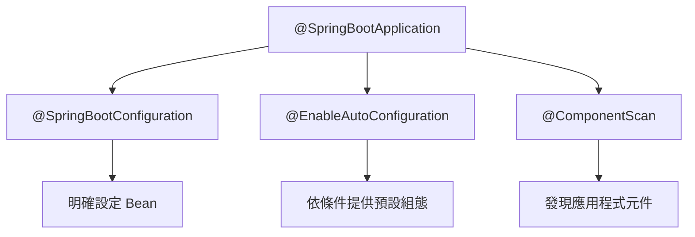

# 使用 `@SpringBootApplication`

<!-- source-attribution -->
> **非官方繁體中文翻譯** · boot 4.1.1 · 翻譯日期：2026-10-20  
> [官方英文網站](https://docs.spring.io/spring-boot/reference/using/using-the-springbootapplication-annotation.html) · [固定版本英文來源](https://github.com/spring-projects/spring-boot/blob/v4.1.1/documentation/spring-boot-docs/src/docs/antora/modules/reference/pages/using/using-the-springbootapplication-annotation.adoc) · [本地原文快照](../sources/spring-boot/documentation/spring-boot-docs/src/docs/antora/modules/reference/pages/using/using-the-springbootapplication-annotation.adoc)  
> 原始作者與授權見 [來源聲明](../NOTICE.md)。本文已由英文翻譯為中文；額外圖解與說明均標示為譯者補充。

<!-- translation-status: translated -->

許多 Spring Boot 開發者希望應用程式使用自動設定、元件掃描，並能在「應用程式類別」上定義額外設定。單一 `@SpringBootApplication` 就能啟用這三項功能：

- `@EnableAutoConfiguration`：啟用 [Spring Boot 自動設定機制](using--auto-configuration.md)。
- `@ComponentScan`：啟用應用程式所在套件中的 `@Component` 掃描，詳見[程式碼結構建議](using--structuring-your-code.md)。
- `@SpringBootConfiguration`：允許在 context 註冊額外 Bean，或匯入其他設定類別。它是 Spring 標準 `@Configuration` 的替代方案，有助於整合測試中的[設定偵測](https://docs.spring.io/spring-boot/reference/testing/spring-boot-applications.html#testing.spring-boot-applications.detecting-configuration)。

官方 Kotlin 範例：

```kotlin
import org.springframework.boot.autoconfigure.SpringBootApplication
import org.springframework.boot.runApplication

// Same as @SpringBootConfiguration @EnableAutoConfiguration @ComponentScan
@SpringBootApplication
class MyApplication

fun main(args: Array<String>) {
    runApplication<MyApplication>(*args)
}
```

> **注意：**`@SpringBootApplication` 也提供別名屬性，用於客製 `@EnableAutoConfiguration` 與 `@ComponentScan` 的屬性。

> **注意：**這些功能都不是強制要求。你可以用它啟用的個別功能，取代這個單一 annotation。例如，你可能不想使用元件掃描或設定屬性掃描：

```kotlin
@SpringBootConfiguration(proxyBeanMethods = false)
@EnableAutoConfiguration
@Import(SomeConfiguration::class, AnotherConfiguration::class)
class MyApplication

fun main(args: Array<String>) {
    runApplication<MyApplication>(*args)
}
```

> 上例的 `MyApplication` 與其他 Spring Boot 應用程式相同，差別是：帶有 `@Component` 與 `@ConfigurationProperties` 的類別不會被自動偵測；使用者定義的 Bean 透過 `@Import` 明確匯入。

## 譯者補充：便利入口與細部組合



`@SpringBootApplication` 不等於 `@ConfigurationPropertiesScan`；若要掃描你自己定義的 `@ConfigurationProperties` 類別，仍應依官方設定屬性文件完成註冊。這是補充澄清，不修改原文上述說明。

<!-- original-example-appendix -->

## 官方其他語言範例對照

主文優先呈現 Kotlin；以下保留官方 Java／XML 對照。程式識別字及程式內註解保留原文；來源檔案連結也包含原始授權聲明。

<details>
<summary>usingthespringbootapplicationannotation/springapplication/MyApplication.java</summary>

[官方快照中的範例檔](../sources/spring-boot/documentation/spring-boot-docs/src/main/java/org/springframework/boot/docs/using/usingthespringbootapplicationannotation/springapplication/MyApplication.java)

```java
package org.springframework.boot.docs.using.usingthespringbootapplicationannotation.springapplication;

import org.springframework.boot.SpringApplication;
import org.springframework.boot.autoconfigure.SpringBootApplication;

// Same as @SpringBootConfiguration @EnableAutoConfiguration @ComponentScan
@SpringBootApplication
public class MyApplication {

	public static void main(String[] args) {
		SpringApplication.run(MyApplication.class, args);
	}

}
```

</details>

<details>
<summary>usingthespringbootapplicationannotation/individualannotations/MyApplication.java</summary>

[官方快照中的範例檔](../sources/spring-boot/documentation/spring-boot-docs/src/main/java/org/springframework/boot/docs/using/usingthespringbootapplicationannotation/individualannotations/MyApplication.java)

```java
package org.springframework.boot.docs.using.usingthespringbootapplicationannotation.individualannotations;

import org.springframework.boot.SpringApplication;
import org.springframework.boot.SpringBootConfiguration;
import org.springframework.boot.autoconfigure.EnableAutoConfiguration;
import org.springframework.context.annotation.Import;

@SpringBootConfiguration(proxyBeanMethods = false)
@EnableAutoConfiguration
@Import({ SomeConfiguration.class, AnotherConfiguration.class })
public class MyApplication {

	public static void main(String[] args) {
		SpringApplication.run(MyApplication.class, args);
	}

}
```

</details>
