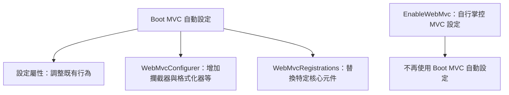

# Servlet Web 應用程式

<!-- source-attribution -->
> **非官方繁體中文翻譯** · Spring Boot 4.1.1 · 翻譯日期：2026-10-21  
> [官方英文網站](https://docs.spring.io/spring-boot/4.1/reference/web/servlet.html) · [固定版本英文來源](https://github.com/spring-projects/spring-boot/blob/v4.1.1/documentation/spring-boot-docs/src/docs/antora/modules/reference/pages/web/servlet.adoc) · [本地原文快照](../sources/spring-boot/documentation/spring-boot-docs/src/docs/antora/modules/reference/pages/web/servlet.adoc)  
> 原始作者與授權見 [來源聲明](../NOTICE.md)。官方範例及設定鍵保留原文，額外圖解另標示為譯者補充。

<!-- translation-status: translated -->

若想建置以 Servlet 為基礎的 Web 應用程式，可以使用 Spring Boot 為 Spring MVC 或 Jersey 提供的自動設定。

## 「Spring Web MVC 框架」

[Spring Web MVC 框架][web--servlet-r1]（通常稱為「Spring MVC」）是功能豐富的「模型、檢視、控制器」Web 框架。
Spring MVC 讓你建立特殊的 [`@Controller`][web--servlet-r2] 或 [`@RestController`][web--servlet-r3] Bean，處理傳入的 HTTP 請求。
控制器方法透過 [`@RequestMapping`][web--servlet-r4] 註解對映到 HTTP。

下列程式碼展示提供 JSON 資料的典型 [`@RestController`][web--servlet-r3]：

```kotlin
import org.springframework.web.bind.annotation.DeleteMapping
import org.springframework.web.bind.annotation.GetMapping
import org.springframework.web.bind.annotation.PathVariable
import org.springframework.web.bind.annotation.RequestMapping
import org.springframework.web.bind.annotation.RestController

@RestController
@RequestMapping("/users")
class MyRestController(private val userRepository: UserRepository, private val customerRepository: CustomerRepository) {

	@GetMapping("/{userId}")
	fun getUser(@PathVariable userId: Long): User {
		return userRepository.findById(userId).get()
	}

	@GetMapping("/{userId}/customers")
	fun getUserCustomers(@PathVariable userId: Long): List<Customer> {
		return userRepository.findById(userId).map(customerRepository::findByUser).get()
	}

	@DeleteMapping("/{userId}")
	fun deleteUser(@PathVariable userId: Long) {
		userRepository.deleteById(userId)
	}

}
```

```java
import java.util.List;

import org.springframework.web.bind.annotation.DeleteMapping;
import org.springframework.web.bind.annotation.GetMapping;
import org.springframework.web.bind.annotation.PathVariable;
import org.springframework.web.bind.annotation.RequestMapping;
import org.springframework.web.bind.annotation.RestController;

@RestController
@RequestMapping("/users")
public class MyRestController {

	private final UserRepository userRepository;

	private final CustomerRepository customerRepository;

	public MyRestController(UserRepository userRepository, CustomerRepository customerRepository) {
		this.userRepository = userRepository;
		this.customerRepository = customerRepository;
	}

	@GetMapping("/{userId}")
	public User getUser(@PathVariable Long userId) {
		return this.userRepository.findById(userId).get();
	}

	@GetMapping("/{userId}/customers")
	public List<Customer> getUserCustomers(@PathVariable Long userId) {
		return this.userRepository.findById(userId).map(this.customerRepository::findByUser).get();
	}

	@DeleteMapping("/{userId}")
	public void deleteUser(@PathVariable Long userId) {
		this.userRepository.deleteById(userId);
	}

}
```

函數式變體「WebMvc.fn」將路由設定與實際請求處理分開，如下例所示：

```kotlin
import org.springframework.context.annotation.Bean
import org.springframework.context.annotation.Configuration
import org.springframework.http.MediaType
import org.springframework.web.servlet.function.RequestPredicates.accept
import org.springframework.web.servlet.function.RouterFunction
import org.springframework.web.servlet.function.RouterFunctions
import org.springframework.web.servlet.function.ServerResponse

@Configuration(proxyBeanMethods = false)
class MyRoutingConfiguration {

	@Bean
	fun routerFunction(userHandler: MyUserHandler): RouterFunction<ServerResponse> {
		return RouterFunctions.route()
			.GET("/{user}", ACCEPT_JSON, userHandler::getUser)
			.GET("/{user}/customers", ACCEPT_JSON, userHandler::getUserCustomers)
			.DELETE("/{user}", ACCEPT_JSON, userHandler::deleteUser)
			.build()
	}

	companion object {
		private val ACCEPT_JSON = accept(MediaType.APPLICATION_JSON)
	}

}
```

```java
import org.springframework.context.annotation.Bean;
import org.springframework.context.annotation.Configuration;
import org.springframework.http.MediaType;
import org.springframework.web.servlet.function.RequestPredicate;
import org.springframework.web.servlet.function.RouterFunction;
import org.springframework.web.servlet.function.ServerResponse;

import static org.springframework.web.servlet.function.RequestPredicates.accept;
import static org.springframework.web.servlet.function.RouterFunctions.route;

@Configuration(proxyBeanMethods = false)
public class MyRoutingConfiguration {

	private static final RequestPredicate ACCEPT_JSON = accept(MediaType.APPLICATION_JSON);

	@Bean
	public RouterFunction<ServerResponse> routerFunction(MyUserHandler userHandler) {
		return route()
				.GET("/{user}", ACCEPT_JSON, userHandler::getUser)
				.GET("/{user}/customers", ACCEPT_JSON, userHandler::getUserCustomers)
				.DELETE("/{user}", ACCEPT_JSON, userHandler::deleteUser)
				.build();
	}

}
```

```kotlin
import org.springframework.stereotype.Component
import org.springframework.web.servlet.function.ServerRequest
import org.springframework.web.servlet.function.ServerResponse

@Component
class MyUserHandler {

	fun getUser(request: ServerRequest?): ServerResponse {
		...
	}

	fun getUserCustomers(request: ServerRequest?): ServerResponse {
		...
	}

	fun deleteUser(request: ServerRequest?): ServerResponse {
		...
	}

}
```

```java
import org.springframework.stereotype.Component;
import org.springframework.web.servlet.function.ServerRequest;
import org.springframework.web.servlet.function.ServerResponse;

@Component
public class MyUserHandler {

	public ServerResponse getUser(ServerRequest request) {
		...
	}

	public ServerResponse getUserCustomers(ServerRequest request) {
		...
	}

	public ServerResponse deleteUser(ServerRequest request) {
		...
	}

}
```

Spring MVC 是核心 Spring Framework 的一部分，詳細資訊可參閱[參考文件][web--servlet-r1]。
[spring.io/guides][web--servlet-r5] 也有多份涵蓋 Spring MVC 的指南。

> **提示：**
>
> 你可以定義任意數量的 [`RouterFunction`][web--servlet-r6] Bean，將路由定義模組化。
> 若需要套用優先順序，也可以為 Bean 排序。

### Spring MVC 自動設定

Spring Boot 為 Spring MVC 提供適合大多數應用程式的自動設定。
它取代了 [`@EnableWebMvc`][web--servlet-r7] 的需求，兩者不能一起使用。
除了 Spring MVC 預設值，自動設定還提供下列功能：

- 加入 [`ContentNegotiatingViewResolver`][web--servlet-r8] 與 [`BeanNameViewResolver`][web--servlet-r9] Bean。
- 支援提供靜態資源，包括 WebJars（詳見[本文後續說明][web--servlet-r10]）。
- 自動註冊 [`Converter`][web--servlet-r11]、[`GenericConverter`][web--servlet-r12] 與 [`Formatter`][web--servlet-r13] Bean。
- 支援 [`HttpMessageConverters`][web--servlet-r14]（詳見[本文後續說明][web--servlet-r15]）。
- 自動註冊 [`MessageCodesResolver`][web--servlet-r16]（詳見[本文後續說明][web--servlet-r17]）。
- 支援靜態 `index.html`。
- 自動使用 [`ConfigurableWebBindingInitializer`][web--servlet-r18] Bean（詳見[本文後續說明][web--servlet-r19]）。

若想保留這些 Spring Boot MVC 自訂，同時加入更多 [MVC 自訂][web--servlet-r1]（攔截器、格式化器、檢視控制器等），可以加入自己的 [`@Configuration`][web--servlet-r20] 類別，型別為 [`WebMvcConfigurer`][web--servlet-r21]，但**不要**加上 [`@EnableWebMvc`][web--servlet-r7]。

若想提供自訂的 [`RequestMappingHandlerMapping`][web--servlet-r22]、[`RequestMappingHandlerAdapter`][web--servlet-r23] 或 [`ExceptionHandlerExceptionResolver`][web--servlet-r24] 實例，同時保留 Spring Boot MVC 自訂，可以宣告 [`WebMvcRegistrations`][web--servlet-r25] 型別的 Bean，透過它提供這些元件的自訂實例。
Spring MVC 會繼續對自訂實例進行初始化與設定。
若要參與，或視需要覆寫這些後續處理，應使用 [`WebMvcConfigurer`][web--servlet-r21]。

若不想使用自動設定，而要完全掌控 Spring MVC，請加入自己的 [`@Configuration`][web--servlet-r20]，並標註 [`@EnableWebMvc`][web--servlet-r7]。
也可依 [`@EnableWebMvc`][web--servlet-r7] API 文件說明，加入自行定義、標註 [`@Configuration`][web--servlet-r20] 的 [`DelegatingWebMvcConfiguration`][web--servlet-r26]。

### Spring MVC 轉換服務

Spring MVC 使用的 [`ConversionService`][web--servlet-r27]，與轉換 `application.properties` 或 `application.yaml` 值的服務不同。
這表示 [`Period`][web--servlet-r28]、[`Duration`][web--servlet-r29] 與 [`DataSize`][web--servlet-r30] 轉換器不可用，而且 [`@DurationUnit`][web--servlet-r31] 與 [`@DataSizeUnit`][web--servlet-r32] 註解會被忽略。

若要自訂 Spring MVC 使用的 [`ConversionService`][web--servlet-r27]，可以提供具有 `addFormatters` 方法的 [`WebMvcConfigurer`][web--servlet-r21] Bean。
在此方法中，可註冊任意轉換器，或委派給 [`ApplicationConversionService`][web--servlet-r33] 提供的靜態方法。

也可使用 `spring.mvc.format.*` 設定屬性自訂轉換。
未設定時，使用下列預設值：

| 屬性 | `DateTimeFormatter` | 格式化的型別 |
| --- | --- | --- |
| `spring.mvc.format.date` | `ofLocalizedDate(FormatStyle.SHORT)` | `java.util.Date` 與 [`LocalDate`][web--servlet-r34] |
| `spring.mvc.format.time` | `ofLocalizedTime(FormatStyle.SHORT)` | java.time 的 [`LocalTime`][web--servlet-r35] 與 [`OffsetTime`][web--servlet-r36] |
| `spring.mvc.format.date-time` | `ofLocalizedDateTime(FormatStyle.SHORT)` | java.time 的 [`LocalDateTime`][web--servlet-r37]、[`OffsetDateTime`][web--servlet-r38] 與 [`ZonedDateTime`][web--servlet-r39] |

### HttpMessageConverters

Spring MVC 使用 [`HttpMessageConverter`][web--servlet-r40] 介面轉換 HTTP 請求與回應。
它內建合理預設值。
例如，物件可自動轉為 JSON（透過 Jackson 程式庫）或 XML（若有 Jackson XML 擴充就使用它，否則使用 JAXB）。
字串預設編碼為 `UTF-8`。

上下文中任何 [`HttpMessageConverter`][web--servlet-r40] Bean 都會加入轉換器清單。
也可以用相同方式覆寫預設轉換器。

若需要加入或自訂轉換器，可以宣告一個或多個 [`ClientHttpMessageConvertersCustomizer`][web--servlet-r41] 或 [`ServerHttpMessageConvertersCustomizer`][web--servlet-r42] Bean。
在其中可以選擇將轉換器實例放在預設轉換器之前（`addCustomConverter`），或覆寫特定預設轉換器（例如 `withJsonConverter`）。

範例如下：

```kotlin
import org.springframework.boot.http.converter.autoconfigure.ClientHttpMessageConvertersCustomizer
import org.springframework.boot.http.converter.autoconfigure.ServerHttpMessageConvertersCustomizer
import org.springframework.context.annotation.Bean
import org.springframework.context.annotation.Configuration
import org.springframework.http.converter.HttpMessageConverters
import org.springframework.http.converter.json.JacksonJsonHttpMessageConverter
import tools.jackson.databind.json.JsonMapper
import java.text.SimpleDateFormat

@Configuration(proxyBeanMethods = false)
class MyHttpMessageConvertersConfiguration {

	@Bean
	fun myClientConvertersCustomizer(): ClientHttpMessageConvertersCustomizer {
		return ClientHttpMessageConvertersCustomizer { clientBuilder: HttpMessageConverters.ClientBuilder ->
			clientBuilder
				.addCustomConverter(AdditionalHttpMessageConverter())
				.addCustomConverter(AnotherHttpMessageConverter())
		}
	}

	@Bean
	fun jacksonConverterCustomizer(): JacksonConverterCustomizer {
		val jsonMapper = JsonMapper.builder()
			.defaultDateFormat(SimpleDateFormat("yyyy-MM"))
			.build()
		return JacksonConverterCustomizer(jsonMapper)
	}

	// contribute a custom JSON converter to both client and server
	class JacksonConverterCustomizer(private val jsonMapper: JsonMapper) :
		ClientHttpMessageConvertersCustomizer, ServerHttpMessageConvertersCustomizer {

		override fun customize(builder: HttpMessageConverters.ClientBuilder) {
			builder.withJsonConverter(JacksonJsonHttpMessageConverter(this.jsonMapper))
		}

		override fun customize(builder: HttpMessageConverters.ServerBuilder) {
			builder.withJsonConverter(JacksonJsonHttpMessageConverter(this.jsonMapper))
		}
	}

}
```

```java
import java.text.SimpleDateFormat;

import tools.jackson.databind.json.JsonMapper;

import org.springframework.boot.http.converter.autoconfigure.ClientHttpMessageConvertersCustomizer;
import org.springframework.boot.http.converter.autoconfigure.ServerHttpMessageConvertersCustomizer;
import org.springframework.context.annotation.Bean;
import org.springframework.context.annotation.Configuration;
import org.springframework.http.converter.HttpMessageConverters.ClientBuilder;
import org.springframework.http.converter.HttpMessageConverters.ServerBuilder;
import org.springframework.http.converter.json.JacksonJsonHttpMessageConverter;

@Configuration(proxyBeanMethods = false)
public class MyHttpMessageConvertersConfiguration {

	@Bean
	public ClientHttpMessageConvertersCustomizer myClientConvertersCustomizer() {
		return (clientBuilder) -> clientBuilder.addCustomConverter(new AdditionalHttpMessageConverter())
			.addCustomConverter(new AnotherHttpMessageConverter());
	}

	@Bean
	public JacksonConverterCustomizer jacksonConverterCustomizer() {
		JsonMapper jsonMapper = JsonMapper.builder().defaultDateFormat(new SimpleDateFormat("yyyy-MM")).build();
		return new JacksonConverterCustomizer(jsonMapper);
	}

	// contribute a custom JSON converter to both client and server
	static class JacksonConverterCustomizer
			implements ClientHttpMessageConvertersCustomizer, ServerHttpMessageConvertersCustomizer {

		private final JsonMapper jsonMapper;

		JacksonConverterCustomizer(JsonMapper jsonMapper) {
			this.jsonMapper = jsonMapper;
		}

		@Override
		public void customize(ClientBuilder builder) {
			builder.withJsonConverter(new JacksonJsonHttpMessageConverter(this.jsonMapper));
		}

		@Override
		public void customize(ServerBuilder builder) {
			builder.withJsonConverter(new JacksonJsonHttpMessageConverter(this.jsonMapper));
		}

	}

}
```

### MessageCodesResolver

Spring MVC 提供 [`MessageCodesResolver`][web--servlet-r16] 策略，從繫結錯誤產生錯誤碼，用於呈現錯誤訊息。
如果將 `spring.mvc.message-codes-resolver-format` 屬性設為 `PREFIX_ERROR_CODE` 或 `POSTFIX_ERROR_CODE`，Spring Boot 就會替你建立解析器（請參閱 [`DefaultMessageCodesResolver.Format`][web--servlet-r43] 列舉）。

### 靜態內容

預設情況下，Spring Boot 從 classpath 中的 `/static`（或 `/public`、`/resources`、`/META-INF/resources`）目錄，或 [`ServletContext`][web--servlet-r44] 根目錄提供靜態內容。
它使用 Spring MVC 的 [`ResourceHttpRequestHandler`][web--servlet-r45]，因此你可以加入自己的 [`WebMvcConfigurer`][web--servlet-r21] 並覆寫 `addResourceHandlers` 方法，修改此行為。

獨立執行的 Web 應用程式不會啟用容器的預設 Servlet。
可以透過 `server.servlet.register-default-servlet` 屬性啟用。

預設 Servlet 作為後備處理：當 Spring 決定不處理時，從 [`ServletContext`][web--servlet-r44] 根目錄提供內容。
大多數情況下不會發生這件事（除非修改預設 MVC 設定），因為 Spring 始終能透過 [`DispatcherServlet`][web--servlet-r46] 處理請求。

預設資源對映到 `/**`，但可使用 `spring.mvc.static-path-pattern` 屬性調整。
例如，可如下將所有資源移到 `/resources/**`：

```properties
spring.mvc.static-path-pattern=/resources/**
```

```yaml
spring:
  mvc:
    static-path-pattern: "/resources/**"
```

也可使用 `spring.web.resources.static-locations` 屬性自訂靜態資源位置，以指定目錄清單取代預設值。
根 Servlet 上下文路徑 `"/"` 也會自動加入位置清單。

除了前述「標準」靜態資源位置，還會特別處理 [Webjars 內容][web--servlet-r47]。
預設情況下，路徑在 `/webjars/**` 的資源，只要以 Webjars 格式封裝，就會從 jar 檔提供。
可使用 `spring.mvc.webjars-path-pattern` 屬性自訂路徑。

> **提示：**
>
> 若應用程式封裝為 jar，請不要使用 `src/main/webapp` 目錄。
> 雖然此目錄是常見標準，但它**只**適用於 war 封裝；產生 jar 時，大多數建置工具會直接忽略它而不提出警告。

Spring Boot 也支援 Spring MVC 的進階資源處理功能，例如讓靜態資源避開舊快取，或為 Webjars 使用不含版本的 URL。

若要為 Webjars 使用不含版本的 URL，請加入 `org.webjars:webjars-locator-lite` 相依項。
接著宣告 Webjar。
以 jQuery 為例，加入 `"/webjars/jquery/jquery.min.js"` 會解析為 `"/webjars/jquery/x.y.z/jquery.min.js"`，其中 `x.y.z` 是 Webjar 版本。

若要避開舊快取，下列設定會為所有靜態資源設定 cache busting，在 URL 加入內容雜湊，例如 `<link href="/css/spring-2a2d595e6ed9a0b24f027f2b63b134d6.css"/>`：

```properties
spring.web.resources.chain.strategy.content.enabled=true
spring.web.resources.chain.strategy.content.paths=/**
```

```yaml
spring:
  web:
    resources:
      chain:
        strategy:
          content:
            enabled: true
            paths: "/**"
```

> **注意：**
>
> 由於系統會為 Thymeleaf 與 FreeMarker 自動設定 [`ResourceUrlEncodingFilter`][web--servlet-r48]，範本中的資源連結會在執行時改寫。
> 使用 JSP 時，應手動宣告此過濾器。
> 其他範本引擎目前沒有自動支援，但可搭配自訂範本巨集／輔助工具與 [`ResourceUrlProvider`][web--servlet-r49] 達成。

例如使用 JavaScript 模組載入器動態載入資源時，無法採用重新命名檔案的方式。
因此也支援其他策略，而且可以組合使用。
「fixed」策略會在 URL 加入固定版本字串，而不改變檔名，如下例所示：

```properties
spring.web.resources.chain.strategy.content.enabled=true
spring.web.resources.chain.strategy.content.paths=/**
spring.web.resources.chain.strategy.fixed.enabled=true
spring.web.resources.chain.strategy.fixed.paths=/js/lib/
spring.web.resources.chain.strategy.fixed.version=v12
```

```yaml
spring:
  web:
    resources:
      chain:
        strategy:
          content:
            enabled: true
            paths: "/**"
          fixed:
            enabled: true
            paths: "/js/lib/"
            version: "v12"
```

在此設定下，`"/js/lib/"` 中的 JavaScript 模組採固定版本策略（`"/v12/js/lib/mymodule.js"`），其他資源仍採內容策略（`<link href="/css/spring-2a2d595e6ed9a0b24f027f2b63b134d6.css"/>`）。

更多支援選項，請參閱 [`WebProperties.Resources`][web--servlet-r50]。

> **提示：**
>
> 此功能在專門的[部落格文章][web--servlet-r51]與 Spring Framework [參考文件][web--servlet-r52]中有完整說明。

### 歡迎頁

Spring Boot 支援靜態與範本式歡迎頁。
它先在設定的靜態內容位置尋找 `index.html`。
若找不到，就接著尋找 `index` 範本。
找到其中之一時，就會自動用作應用程式歡迎頁。

這只是應用程式實際定義之首頁路由的後備選項。
順序由 [`HandlerMapping`][web--servlet-r53] Bean 的順序決定，預設如下：

| 對映 | 用途 |
| --- | --- |
| `RouterFunctionMapping` | 透過 [`RouterFunction`][web--servlet-r6] Bean 宣告的端點 |
| `RequestMappingHandlerMapping` | 在 [`@Controller`][web--servlet-r2] Bean 中宣告的端點 |
| `WelcomePageHandlerMapping` | 歡迎頁支援 |

### 自訂 Favicon

如同其他靜態資源，Spring Boot 會在設定的靜態內容位置尋找 `favicon.ico`。
若有此檔案，就會自動用作應用程式 favicon。

### 路徑比對與內容協商

Spring MVC 會查看請求路徑，將它與應用程式定義的對映比對（例如 Controller 方法上的 [`@GetMapping`][web--servlet-r54]），將傳入 HTTP 請求對映到處理器。

Spring Boot 預設停用副檔名樣式比對，因此 `"GET /projects/spring-boot.json"` 這類請求，不會符合 `@GetMapping("/projects/spring-boot")` 對映。
這被視為 [Spring MVC 應用程式的最佳實務][web--servlet-r55]。
過去此功能主要用於不會傳送正確「Accept」請求標頭的 HTTP 用戶端，因為需要確保向用戶端傳送正確的 Content Type。
現在內容協商已可靠許多。

還有其他方式能處理不一定傳送正確「Accept」標頭的 HTTP 用戶端。
除了副檔名比對，可以使用查詢參數，確保 `"GET /projects/spring-boot?format=json"` 這類請求會對映到 `@GetMapping("/projects/spring-boot")`：

```properties
spring.mvc.contentnegotiation.favor-parameter=true
```

```yaml
spring:
  mvc:
    contentnegotiation:
      favor-parameter: true
```

若偏好其他參數名稱：

```properties
spring.mvc.contentnegotiation.favor-parameter=true
spring.mvc.contentnegotiation.parameter-name=myparam
```

```yaml
spring:
  mvc:
    contentnegotiation:
      favor-parameter: true
      parameter-name: "myparam"
```

大多數標準媒體型別都有內建支援，也可以定義新的型別：

```properties
spring.mvc.contentnegotiation.media-types.markdown=text/markdown
```

```yaml
spring:
  mvc:
    contentnegotiation:
      media-types:
        markdown: "text/markdown"
```

從 Spring Framework 5.3 起，Spring MVC 支援兩種策略，將請求路徑比對到控制器。
Spring Boot 預設使用 [`PathPatternParser`][web--servlet-r56] 策略。
[`PathPatternParser`][web--servlet-r56] 是[最佳化的實作][web--servlet-r57]，但相較於 [`AntPathMatcher`][web--servlet-r58] 策略有一些限制。
它限制了[部分路徑樣式變體][web--servlet-r59]的使用。
它也不相容於為 [`DispatcherServlet`][web--servlet-r46] 設定路徑前綴（`spring.mvc.servlet.path`）。

可使用 `spring.mvc.pathmatch.matching-strategy` 設定屬性指定策略，如下例所示：

```properties
spring.mvc.pathmatch.matching-strategy=ant-path-matcher
```

```yaml
spring:
  mvc:
    pathmatch:
      matching-strategy: "ant-path-matcher"
```

Spring MVC 若找不到請求對應的處理器，會拋出 [`NoHandlerFoundException`][web--servlet-r60]。
請注意，預設[靜態內容服務][web--servlet-r10]對映到 `/**`，因此會為所有請求提供處理器。
若沒有對應靜態內容，[`ResourceHttpRequestHandler`][web--servlet-r45] 會拋出 [`NoResourceFoundException`][web--servlet-r61]。
若要讓 [`NoHandlerFoundException`][web--servlet-r60] 被拋出，請將 `spring.mvc.static-path-pattern` 設為較具體的值，例如 `/resources/**`，或將 `spring.web.resources.add-mappings` 設為 `false`，完全停用靜態內容服務。

### ConfigurableWebBindingInitializer

Spring MVC 使用 [`WebBindingInitializer`][web--servlet-r62]，為特定請求初始化 [`WebDataBinder`][web--servlet-r63]。
若建立自己的 [`ConfigurableWebBindingInitializer`][web--servlet-r18] [`@Bean`][web--servlet-r64]，Spring Boot 就會自動設定 Spring MVC 使用它。

### 範本引擎

除了 REST Web 服務，也可使用 Spring MVC 提供動態 HTML 內容。
Spring MVC 支援多種範本技術，包括 Thymeleaf、FreeMarker 與 JSP。
此外，許多其他範本引擎也有自己的 Spring MVC 整合。

Spring Boot 包含下列範本引擎的自動設定支援：

- [FreeMarker][web--servlet-r65]
- [Groovy][web--servlet-r66]
- [Thymeleaf][web--servlet-r67]
- [Mustache][web--servlet-r68]

> **提示：**
>
> 可以的話，應避免使用 JSP。
> 搭配內嵌 Servlet 容器時，有一些[已知限制][web--servlet-r69]。

使用這些範本引擎的預設設定時，會自動從 `src/main/resources/templates` 讀取範本。

> **提示：**
>
> 依應用程式執行方式不同，IDE 可能以不同順序排列 classpath。
> 在 IDE 中從 main 方法執行應用程式，與透過 Maven、Gradle 或封裝後的 jar 執行，順序可能不同。
> 這可能使 Spring Boot 無法找到預期範本。
> 若遇到此問題，可以在 IDE 重新排列 classpath，將該模組的類別與資源放在前面。

### 錯誤處理

預設情況下，Spring Boot 提供 `/error` 對映，以合理方式處理所有錯誤，並在 Servlet 容器中註冊為「全域」錯誤頁。
對機器用戶端，它產生 JSON 回應，包含錯誤詳細資訊、HTTP 狀態與例外訊息。
對瀏覽器用戶端，則提供「whitelabel」錯誤檢視，以 HTML 呈現相同資料（若要自訂，請加入解析為 `error` 的 [`View`][web--servlet-r70]）。

有多個 `spring.web.error` 屬性可設定，用來自訂預設錯誤處理行為。
請參閱附錄的 [Web 屬性][web--servlet-r71]章節。

若要完全替換預設行為，可以實作 [`ErrorController`][web--servlet-r72] 並註冊該型別的 Bean 定義；或加入 [`ErrorAttributes`][web--servlet-r73] 型別的 Bean，沿用既有機制但替換內容。

> **提示：**
>
> [`BasicErrorController`][web--servlet-r74] 可作為自訂 [`ErrorController`][web--servlet-r72] 的基底類別。
> 想加入新內容型別的處理器時，這尤其有用；預設會專門處理 `text/html`，並對其他型別提供後備處理。
> 若要這麼做，請繼承 [`BasicErrorController`][web--servlet-r74]，加入帶有 [`@RequestMapping`][web--servlet-r4] 及 `produces` 屬性的公開方法，再建立新型別的 Bean。

從 Spring Framework 6.0 起，支援 [RFC 9457 Problem Details][web--servlet-r75]。
Spring MVC 可以使用 `application/problem+json` 媒體型別產生自訂錯誤訊息，例如：

```json
{
	"type": "https://example.org/problems/unknown-project",
	"title": "Unknown project",
	"status": 404,
	"detail": "No project found for id 'spring-unknown'",
	"instance": "/projects/spring-unknown"
}
```

將 `spring.mvc.problemdetails.enabled` 設為 `true` 即可啟用。

也可以定義標註 [`@ControllerAdvice`][web--servlet-r76] 的類別，自訂特定控制器及／或例外型別所回傳的 JSON 文件，如下例所示：

```kotlin
import jakarta.servlet.RequestDispatcher
import jakarta.servlet.http.HttpServletRequest
import org.springframework.http.HttpStatus
import org.springframework.http.ResponseEntity
import org.springframework.web.bind.annotation.ControllerAdvice
import org.springframework.web.bind.annotation.ExceptionHandler
import org.springframework.web.bind.annotation.ResponseBody
import org.springframework.web.servlet.mvc.method.annotation.ResponseEntityExceptionHandler

@ControllerAdvice(basePackageClasses = [SomeController::class])
class MyControllerAdvice : ResponseEntityExceptionHandler() {

	@ResponseBody
	@ExceptionHandler(MyException::class)
	fun handleControllerException(request: HttpServletRequest, ex: Throwable): ResponseEntity<*> {
		val status = getStatus(request)
		return ResponseEntity(MyErrorBody(status.value(), ex.message), status)
	}

	private fun getStatus(request: HttpServletRequest): HttpStatus {
		val code = request.getAttribute(RequestDispatcher.ERROR_STATUS_CODE) as Int
		val status = HttpStatus.resolve(code)
		return status ?: HttpStatus.INTERNAL_SERVER_ERROR
	}

}
```

```java
import jakarta.servlet.RequestDispatcher;
import jakarta.servlet.http.HttpServletRequest;

import org.springframework.http.HttpStatus;
import org.springframework.http.ResponseEntity;
import org.springframework.web.bind.annotation.ControllerAdvice;
import org.springframework.web.bind.annotation.ExceptionHandler;
import org.springframework.web.bind.annotation.ResponseBody;
import org.springframework.web.servlet.mvc.method.annotation.ResponseEntityExceptionHandler;

@ControllerAdvice(basePackageClasses = SomeController.class)
public class MyControllerAdvice extends ResponseEntityExceptionHandler {

	@ResponseBody
	@ExceptionHandler(MyException.class)
	public ResponseEntity<?> handleControllerException(HttpServletRequest request, Throwable ex) {
		HttpStatus status = getStatus(request);
		return new ResponseEntity<>(new MyErrorBody(status.value(), ex.getMessage()), status);
	}

	private HttpStatus getStatus(HttpServletRequest request) {
		Integer code = (Integer) request.getAttribute(RequestDispatcher.ERROR_STATUS_CODE);
		HttpStatus status = HttpStatus.resolve(code);
		return (status != null) ? status : HttpStatus.INTERNAL_SERVER_ERROR;
	}

}
```

上例中，若與 `SomeController` 定義於相同套件的控制器拋出 `MyException`，就會使用 `MyErrorBody` POJO 的 JSON 表示，而不是 [`ErrorAttributes`][web--servlet-r73] 的表示。

某些情況下，在控制器層處理的錯誤不會被 Web 觀測或[指標基礎設施][web--servlet-r77]記錄。
應用程式可[將已處理的例外設定到觀測上下文][web--servlet-r78]，確保這些例外被觀測記錄。

#### 自訂錯誤頁

若要為特定狀態碼顯示自訂 HTML 錯誤頁，可以在 `/error` 目錄加入檔案。
錯誤頁可以是靜態 HTML（放在任一靜態資源目錄下），也可以使用範本建立。
檔名應為確切狀態碼或系列遮罩。

例如，若要將 `404` 對映到靜態 HTML 檔，目錄結構如下：

```text
src/
 +- main/
     +- java/
     |   + <source code>
     +- resources/
         +- public/
             +- error/
             |   +- 404.html
             +- <other public assets>
```

若要使用 FreeMarker 範本對映所有 `5xx` 錯誤，目錄結構如下：

```text
src/
 +- main/
     +- java/
     |   + <source code>
     +- resources/
         +- templates/
             +- error/
             |   +- 5xx.ftlh
             +- <other templates>
```

對於更複雜的對映，也可以加入實作 [`ErrorViewResolver`][web--servlet-r79] 介面的 Bean，如下例所示：

```kotlin
import jakarta.servlet.http.HttpServletRequest
import org.springframework.boot.webmvc.autoconfigure.error.ErrorViewResolver
import org.springframework.http.HttpStatus
import org.springframework.web.servlet.ModelAndView

class MyErrorViewResolver : ErrorViewResolver {

	override fun resolveErrorView(request: HttpServletRequest, status: HttpStatus,
			model: Map<String, Any>): ModelAndView? {
		// Use the request or status to optionally return a ModelAndView
		if (status == HttpStatus.INSUFFICIENT_STORAGE) {
			// We could add custom model values here
			return ModelAndView("myview")
		}
		return null
	}

}
```

```java
import java.util.Map;

import jakarta.servlet.http.HttpServletRequest;

import org.springframework.boot.webmvc.autoconfigure.error.ErrorViewResolver;
import org.springframework.http.HttpStatus;
import org.springframework.web.servlet.ModelAndView;

public class MyErrorViewResolver implements ErrorViewResolver {

	@Override
	public ModelAndView resolveErrorView(HttpServletRequest request, HttpStatus status, Map<String, Object> model) {
		// Use the request or status to optionally return a ModelAndView
		if (status == HttpStatus.INSUFFICIENT_STORAGE) {
			// We could add custom model values here
			return new ModelAndView("myview");
		}
		return null;
	}

}
```

也可以使用一般 Spring MVC 功能，例如 [`@ExceptionHandler` 方法][web--servlet-r80]與 [`@ControllerAdvice`][web--servlet-r81]。
剩餘未處理例外會由 [`ErrorController`][web--servlet-r72] 接手。

#### 在 Spring MVC 之外對映錯誤頁

對未使用 Spring MVC 的應用程式，可以使用 [`ErrorPageRegistrar`][web--servlet-r82] 介面，直接註冊 [`ErrorPage`][web--servlet-r83] 實例。
此抽象直接與底層內嵌 Servlet 容器合作，即使沒有 Spring MVC [`DispatcherServlet`][web--servlet-r46] 也能運作。

```kotlin
import org.springframework.boot.web.error.ErrorPage
import org.springframework.boot.web.error.ErrorPageRegistrar
import org.springframework.boot.web.error.ErrorPageRegistry
import org.springframework.context.annotation.Bean
import org.springframework.context.annotation.Configuration
import org.springframework.http.HttpStatus

@Configuration(proxyBeanMethods = false)
class MyErrorPagesConfiguration {

	@Bean
	fun errorPageRegistrar(): ErrorPageRegistrar {
		return ErrorPageRegistrar { registry: ErrorPageRegistry -> registerErrorPages(registry) }
	}

	private fun registerErrorPages(registry: ErrorPageRegistry) {
		registry.addErrorPages(ErrorPage(HttpStatus.BAD_REQUEST, "/400"))
	}

}
```

```java
import org.springframework.boot.web.error.ErrorPage;
import org.springframework.boot.web.error.ErrorPageRegistrar;
import org.springframework.boot.web.error.ErrorPageRegistry;
import org.springframework.context.annotation.Bean;
import org.springframework.context.annotation.Configuration;
import org.springframework.http.HttpStatus;

@Configuration(proxyBeanMethods = false)
public class MyErrorPagesConfiguration {

	@Bean
	public ErrorPageRegistrar errorPageRegistrar() {
		return this::registerErrorPages;
	}

	private void registerErrorPages(ErrorPageRegistry registry) {
		registry.addErrorPages(new ErrorPage(HttpStatus.BAD_REQUEST, "/400"));
	}

}
```

> **注意：**
>
> 若註冊的 [`ErrorPage`][web--servlet-r83] 路徑最後由 [`Filter`][web--servlet-r84] 處理（Jersey、Wicket 等非 Spring Web 框架常見），則必須明確將 [`Filter`][web--servlet-r84] 註冊為 `ERROR` 分派類型，如下例所示：

```kotlin
import jakarta.servlet.DispatcherType
import org.springframework.boot.web.servlet.FilterRegistrationBean
import org.springframework.context.annotation.Bean
import org.springframework.context.annotation.Configuration
import java.util.EnumSet

@Configuration(proxyBeanMethods = false)
class MyFilterConfiguration {

	@Bean
	fun myFilter(): FilterRegistrationBean<MyFilter> {
		val registration = FilterRegistrationBean(MyFilter())
		// ...
		registration.setDispatcherTypes(EnumSet.allOf(DispatcherType::class.java))
		return registration
	}

}
```

```java
import java.util.EnumSet;

import jakarta.servlet.DispatcherType;

import org.springframework.boot.web.servlet.FilterRegistrationBean;
import org.springframework.context.annotation.Bean;
import org.springframework.context.annotation.Configuration;

@Configuration(proxyBeanMethods = false)
public class MyFilterConfiguration {

	@Bean
	public FilterRegistrationBean<MyFilter> myFilter() {
		FilterRegistrationBean<MyFilter> registration = new FilterRegistrationBean<>(new MyFilter());
		// ...
		registration.setDispatcherTypes(EnumSet.allOf(DispatcherType.class));
		return registration;
	}

}
```

請注意，預設 [`FilterRegistrationBean`][web--servlet-r85] 不包含 `ERROR` 分派類型。

#### WAR 部署的錯誤處理

部署到 Servlet 容器時，Spring Boot 使用錯誤頁過濾器，將帶有錯誤狀態的請求轉送到適當錯誤頁。
這是必要的，因為 Servlet 規範沒有提供註冊錯誤頁的 API。
依 war 檔部署的容器，以及應用程式使用的技術而定，可能需要額外設定。

只有回應尚未提交時，錯誤頁過濾器才能將請求轉送到正確錯誤頁。
WebSphere Application Server 8.0 及更新版本，預設會在 Servlet 的 service 方法成功完成時提交回應。
應將 `com.ibm.ws.webcontainer.invokeFlushAfterService` 設為 `false`，停用此行為。

### CORS 支援

[跨來源資源共用][web--servlet-r86]（CORS）是[大多數瀏覽器][web--servlet-r88]實作的 [W3C 規範][web--servlet-r87]，讓你彈性指定允許的跨網域請求類型，不必使用 IFRAME、JSONP 等安全性與能力較弱的方法。

從 4.2 版起，Spring MVC [支援 CORS][web--servlet-r89]。
在 Spring Boot 應用程式中，使用 [`@CrossOrigin`][web--servlet-r91] 註解進行[控制器方法的 CORS 設定][web--servlet-r90]，不需要其他特定設定。
若要定義[全域 CORS 設定][web--servlet-r92]，可以註冊 [`WebMvcConfigurer`][web--servlet-r21] Bean，並自訂 `addCorsMappings(CorsRegistry)` 方法，如下例所示：

```kotlin
import org.springframework.context.annotation.Bean
import org.springframework.context.annotation.Configuration
import org.springframework.web.servlet.config.annotation.CorsRegistry
import org.springframework.web.servlet.config.annotation.WebMvcConfigurer

@Configuration(proxyBeanMethods = false)
class MyCorsConfiguration {

	@Bean
	fun corsConfigurer(): WebMvcConfigurer {
		return object : WebMvcConfigurer {
			override fun addCorsMappings(registry: CorsRegistry) {
				registry.addMapping("/api/**")
			}
		}
	}

}
```

```java
import org.springframework.context.annotation.Bean;
import org.springframework.context.annotation.Configuration;
import org.springframework.web.servlet.config.annotation.CorsRegistry;
import org.springframework.web.servlet.config.annotation.WebMvcConfigurer;

@Configuration(proxyBeanMethods = false)
public class MyCorsConfiguration {

	@Bean
	public WebMvcConfigurer corsConfigurer() {
		return new WebMvcConfigurer() {

			@Override
			public void addCorsMappings(CorsRegistry registry) {
				registry.addMapping("/api/**");
			}

		};
	}

}
```

### API 版本管理

Spring MVC 支援 API 版本管理，讓 HTTP API 能隨時間演進。
相同的 `@Controller` 路徑可多次對映，以支援不同 API 版本。

詳情請參閱 [Spring Framework 參考文件][web--servlet-r93]。

加入對映後，還需要設定 Spring MVC，使其能使用請求傳送的版本資訊。
版本通常透過 HTTP 標頭、查詢參數、媒體型別參數或路徑的一部分傳送。

若要設定 Spring MVC，可使用 [`WebMvcConfigurer`][web--servlet-r21] Bean 並覆寫 `configureApiVersioning(…)` 方法，或使用屬性。

例如，下列設定會從 `X-Version` HTTP 標頭取得版本資訊；未傳送標頭時，預設使用 `1.0.0`。

```properties
spring.mvc.apiversion.default=1.0.0
spring.mvc.apiversion.use.header=X-Version
```

```yaml
spring:
  mvc:
    apiversion:
      default: 1.0.0
      use:
        header: X-Version
```

> **注意：**
>
> 若設定需要多種策略，例如標頭與查詢參數，可考慮覆寫 `configureApiVersioning` 方法，以程式宣告順序。

若要更完整掌控，也可以定義 [`ApiVersionResolver`][web--servlet-r94]、[`ApiVersionParser`][web--servlet-r95] 與 [`ApiVersionDeprecationHandler`][web--servlet-r96] Bean；它們會被注入自動設定的 Spring MVC 設定。

> **提示：**
>
> `WebClient` 與 `RestClient` 也支援 API 版本管理。
> 詳情請參閱 [API 版本管理][web--servlet-r97]。

## JAX-RS 與 Jersey

如果偏好以 JAX-RS 程式設計模型實作 REST 端點，可以使用其中一種實作，取代 Spring MVC。
[Jersey][web--servlet-r98] 與 [Apache CXF][web--servlet-r99] 都能直接良好運作。
CXF 要求在應用程式上下文中，將其 [`Servlet`][web--servlet-r100] 或 [`Filter`][web--servlet-r84] 註冊為 [`@Bean`][web--servlet-r64]。
Jersey 有部分原生 Spring 支援，因此 Spring Boot 也為它提供自動設定與 starter。

若要開始使用 Jersey，請加入 `spring-boot-starter-jersey` 相依項，接著需要一個 [`ResourceConfig`][web--servlet-r101] 型別的 [`@Bean`][web--servlet-r64]，在其中註冊所有端點，如下例所示：

```kotlin
import org.glassfish.jersey.server.ResourceConfig
import org.springframework.stereotype.Component

@Component
class MyJerseyConfig : ResourceConfig() {

	init {
		register(MyEndpoint::class.java)
	}

}
```

```java
import org.glassfish.jersey.server.ResourceConfig;

import org.springframework.stereotype.Component;

@Component
public class MyJerseyConfig extends ResourceConfig {

	public MyJerseyConfig() {
		register(MyEndpoint.class);
	}

}
```

> **警告：**
>
> Jersey 對掃描可執行封存檔的支援相當有限。
> 例如，它無法掃描[完全可執行 jar 檔][web--servlet-r102]中某套件的端點，也無法在執行可執行 war 檔時掃描 `WEB-INF/classes`。
> 為避免此限制，不應使用 `packages` 方法，而應如前例，透過 `register` 方法逐一註冊端點。

若要進階自訂，也可以註冊任意數量、實作 [`ResourceConfigCustomizer`][web--servlet-r103] 的 Bean。

所有已註冊端點都應是帶有 HTTP 資源註解（`@GET` 等）的 [`@Component`][web--servlet-r104]，如下例所示：

```kotlin
import jakarta.ws.rs.GET
import jakarta.ws.rs.Path
import org.springframework.stereotype.Component

@Component
@Path("/hello")
class MyEndpoint {

	@GET
	fun message(): String {
		return "Hello"
	}

}
```

```java
import jakarta.ws.rs.GET;
import jakarta.ws.rs.Path;

import org.springframework.stereotype.Component;

@Component
@Path("/hello")
public class MyEndpoint {

	@GET
	public String message() {
		return "Hello";
	}

}
```

由於 [`@Endpoint`][web--servlet-r105] 是 Spring [`@Component`][web--servlet-r104]，其生命週期由 Spring 管理，因此可使用 [`@Autowired`][web--servlet-r106] 注解注入相依項，並使用 [`@Value`][web--servlet-r107] 註解注入外部設定。
Jersey Servlet 預設會註冊並對映到 `/*`。
可在 [`ResourceConfig`][web--servlet-r101] 上加入 [`@ApplicationPath`][web--servlet-r108]，修改對映。

預設 Jersey 會作為 Servlet，設定在名為 `jerseyServletRegistration`、型別為 [`ServletRegistrationBean`][web--servlet-r109] 的 [`@Bean`][web--servlet-r64] 中。
此 Servlet 預設延遲初始化，但可設定 `spring.jersey.servlet.load-on-startup` 修改此行為。
建立同名 Bean，就可以停用或覆寫它。
也可以設定 `spring.jersey.type=filter`，使用 Filter 取代 Servlet（此時要替換或覆寫的 [`@Bean`][web--servlet-r64] 是 `jerseyFilterRegistration`）。
Filter 具有 [`@Order`][web--servlet-r110]，可以透過 `spring.jersey.filter.order` 設定。
將 Jersey 作為 Filter 使用時，必須存在一個 Servlet，處理未被 Jersey 攔截的請求。
若應用程式沒有這樣的 Servlet，可以將 `server.servlet.register-default-servlet` 設為 `true`，啟用預設 Servlet。
Servlet 與 Filter 註冊都可使用 `spring.jersey.init.*` 指定屬性 Map，提供初始化參數。

## 內嵌 Servlet 容器支援

對於 Servlet 應用程式，Spring Boot 支援內嵌 [Tomcat][web--servlet-r111] 與 [Jetty][web--servlet-r112] 伺服器。
大多數開發人員使用對應 starter，取得完整設定的實例。
預設內嵌伺服器會在連接埠 `8080` 監聽 HTTP 請求。

### Servlet、Filter 與 Listener

使用內嵌 Servlet 容器時，可以透過 Spring Bean 或掃描 Servlet 元件，註冊 Servlet、Filter，以及 Servlet 規範的所有 Listener（例如 [`HttpSessionListener`][web--servlet-r113]）。

#### 將 Servlet、Filter 與 Listener 註冊為 Spring Bean

任何作為 Spring Bean 的 [`Servlet`][web--servlet-r100]、[`Filter`][web--servlet-r84] 或 Servlet `*Listener` 實例，都會註冊到內嵌容器。
如果設定時想引用 `application.properties` 的值，這尤其方便。

預設情況下，若上下文只有一個 Servlet，就會對映到 `/`。
若有多個 Servlet Bean，則使用 Bean 名稱作為路徑前綴。
Filter 對映到 `/*`。

若以慣例為基礎的對映不夠彈性，可以使用 [`ServletRegistrationBean`][web--servlet-r109]、[`FilterRegistrationBean`][web--servlet-r85] 與 [`ServletListenerRegistrationBean`][web--servlet-r114] 類別，完全掌控註冊。
如果比起 [`ServletRegistrationBean`][web--servlet-r109] 與 [`FilterRegistrationBean`][web--servlet-r85] 更偏好註解，也可以改用 [`@ServletRegistration`][web--servlet-r115] 與 [`@FilterRegistration`][web--servlet-r116]。

通常不指定 Filter Bean 順序是安全的。
若需要特定順序，應在 [`Filter`][web--servlet-r84] 上標註 [`@Order`][web--servlet-r110]，或讓它實作 [`Ordered`][web--servlet-r117]。
在 Bean 方法上標註 [`@Order`][web--servlet-r110]，無法設定 [`Filter`][web--servlet-r84] 的順序。
若無法修改 [`Filter`][web--servlet-r84] 類別來加入 [`@Order`][web--servlet-r110] 或實作 [`Ordered`][web--servlet-r117]，必須為該 [`Filter`][web--servlet-r84] 定義 [`FilterRegistrationBean`][web--servlet-r85]，並透過 `setOrder(int)` 設定註冊 Bean 的順序。
若偏好註解，也可以使用 [`@FilterRegistration`][web--servlet-r116] 並設定 `order` 屬性。
避免將讀取請求本文的 Filter 設為 `Ordered.HIGHEST_PRECEDENCE`，因為可能違背應用程式的字元編碼設定。
若 Servlet Filter 會包裝請求，其順序應設定為小於或等於 `OrderedFilter.REQUEST_WRAPPER_FILTER_MAX_ORDER`。

> **提示：**
>
> 若要查看應用程式中每個 [`Filter`][web--servlet-r84] 的順序，請為 `web` [日誌群組][web--servlet-r118]啟用 debug 層級（`logging.level.web=debug`）。
> 啟動時就會記錄已註冊 Filter 的詳細資訊，包括順序與 URL 樣式。

> **警告：**
>
> 註冊 [`Filter`][web--servlet-r84] Bean 時要注意，它們會在應用程式生命週期非常早的階段初始化。
> 若需註冊與其他 Bean 互動的 [`Filter`][web--servlet-r84]，可考慮改用 [`DelegatingFilterProxyRegistrationBean`][web--servlet-r119]。

### Servlet 上下文初始化

內嵌 Servlet 容器不會直接執行 [`ServletContainerInitializer`][web--servlet-r120] 介面或 Spring 的 [`WebApplicationInitializer`][web--servlet-r121] 介面。
這是刻意的設計決策，目的是降低原本為 war 內執行而設計的第三方程式庫破壞 Spring Boot 應用程式的風險。

若需要在 Spring Boot 應用程式進行 Servlet 上下文初始化，應註冊實作 [`ServletContextInitializer`][web--servlet-r122] 介面的 Bean。
它唯一的 `onStartup` 方法提供 [`ServletContext`][web--servlet-r44] 存取能力；必要時，也能方便地作為既有 [`WebApplicationInitializer`][web--servlet-r121] 的轉接器。

#### 初始化參數

可使用 `server.servlet.context-parameters.*` 屬性，為 [`ServletContext`][web--servlet-r44] 設定初始化參數。
例如，`server.servlet.context-parameters.com.example.parameter=example` 會設定名為 `com.example.parameter`、值為 `example` 的 `ServletContext` 初始化參數。

#### 掃描 Servlet、Filter 與 Listener

使用內嵌容器時，可使用 [`@ServletComponentScan`][web--servlet-r126]，啟用標註 [`@WebServlet`][web--servlet-r123]、[`@WebFilter`][web--servlet-r124] 與 [`@WebListener`][web--servlet-r125] 類別的自動註冊。

> **提示：**
>
> [`@ServletComponentScan`][web--servlet-r126] 在獨立容器中沒有作用，該情境使用容器內建探索機制。

### ServletWebServerApplicationContext

在底層，Spring Boot 使用不同型別的 [`ApplicationContext`][web--servlet-r127] 支援內嵌 Servlet 容器。
[`ServletWebServerApplicationContext`][web--servlet-r128] 是特殊的 [`WebApplicationContext`][web--servlet-r129]，會搜尋唯一的 [`ServletWebServerFactory`][web--servlet-r130] Bean 來啟動自身。
通常已自動設定 [`TomcatServletWebServerFactory`][web--servlet-r131] 或 [`JettyServletWebServerFactory`][web--servlet-r132]。

> **注意：**
>
> 通常不需要了解這些實作類別。
> 大多數應用程式會自動設定，適當的 [`ApplicationContext`][web--servlet-r127] 與 [`ServletWebServerFactory`][web--servlet-r130] 都會替你建立。

在內嵌容器設定中，[`ServletContext`][web--servlet-r44] 是在伺服器啟動過程中設定，而伺服器啟動發生於應用程式上下文初始化期間。
因此，無法保證 [`ApplicationContext`][web--servlet-r127] 中的 Bean 初始化時一定能取得 [`ServletContext`][web--servlet-r44]。
一種解法是將 [`ApplicationContext`][web--servlet-r127] 注入為 Bean 相依項，只有需要時才存取 [`ServletContext`][web--servlet-r44]。
另一種方式是在伺服器啟動後使用回呼。
可使用監聽 [`ApplicationStartedEvent`][web--servlet-r134] 的 [`ApplicationListener`][web--servlet-r133]，如下所示：

```kotlin
import jakarta.servlet.ServletContext
import org.springframework.boot.context.event.ApplicationStartedEvent
import org.springframework.context.ApplicationContext
import org.springframework.context.ApplicationListener
import org.springframework.web.context.WebApplicationContext

class MyDemoBean : ApplicationListener<ApplicationStartedEvent> {

	private var servletContext: ServletContext? = null

	override fun onApplicationEvent(event: ApplicationStartedEvent) {
		val applicationContext: ApplicationContext = event.applicationContext
		this.servletContext = (applicationContext as WebApplicationContext).servletContext
	}

}
```

```java
import jakarta.servlet.ServletContext;

import org.springframework.boot.context.event.ApplicationStartedEvent;
import org.springframework.context.ApplicationContext;
import org.springframework.context.ApplicationListener;
import org.springframework.web.context.WebApplicationContext;

public class MyDemoBean implements ApplicationListener<ApplicationStartedEvent> {

	private ServletContext servletContext;

	@Override
	public void onApplicationEvent(ApplicationStartedEvent event) {
		ApplicationContext applicationContext = event.getApplicationContext();
		this.servletContext = ((WebApplicationContext) applicationContext).getServletContext();
	}

}
```

### 自訂內嵌 Servlet 容器

常見 Servlet 容器設定可以透過 Spring [`Environment`][web--servlet-r135] 屬性設定。
通常會在 `application.properties` 或 `application.yaml` 檔定義這些屬性。

常見伺服器設定包括：

- 網路設定：傳入 HTTP 請求的監聽連接埠（`server.port`）、要繫結的介面位址（`server.address`）等。
- 工作階段設定：是否持久化（`server.servlet.session.persistent`）、逾時（`server.servlet.session.timeout`）、資料位置（`server.servlet.session.store-dir`），以及工作階段 Cookie 設定（`server.servlet.session.cookie.*`）。
- 錯誤管理：錯誤頁位置（`spring.web.error.path`）等。
- [SSL][web--servlet-r136]
- [HTTP 壓縮][web--servlet-r137]

Spring Boot 盡可能公開常用設定，但無法涵蓋所有情況。
對於這些情況，專用命名空間會提供伺服器專屬自訂（請參閱 `server.tomcat`）。
例如，可使用內嵌 Servlet 容器的特定功能設定[存取日誌][web--servlet-r138]。

> **提示：**
>
> 完整清單請參閱 [`ServerProperties`][web--servlet-r139] 類別。

#### SameSite Cookie

Web 瀏覽器可使用 `SameSite` Cookie 屬性，控制跨站請求是否提交 Cookie，以及如何提交。
此屬性對現代瀏覽器尤其重要，因為瀏覽器已開始改變屬性缺省時採用的預設值。

若要修改工作階段 Cookie 的 `SameSite` 屬性，可以使用 `server.servlet.session.cookie.same-site`。
自動設定的 Tomcat 與 Jetty 伺服器都支援此屬性。
它也用來設定 Spring Session 的 Servlet 型 [`SessionRepository`][web--servlet-r140] Bean。

例如，若希望工作階段 Cookie 的 `SameSite` 為 `None`，可以在 `application.properties` 或 `application.yaml` 加入下列設定：

```properties
server.servlet.session.cookie.same-site=none
```

```yaml
server:
  servlet:
    session:
      cookie:
        same-site: "none"
```

若要修改加入 [`HttpServletResponse`][web--servlet-r141] 的其他 Cookie 之 `SameSite` 屬性，可以使用 [`CookieSameSiteSupplier`][web--servlet-r142]。
[`CookieSameSiteSupplier`][web--servlet-r142] 會收到 [`Cookie`][web--servlet-r143]，並可回傳 `SameSite` 值或 `null`。

有多個便利工廠方法與過濾方法，可快速比對特定 Cookie。
例如，加入下列 Bean，就會為名稱符合正規表示式 `myapp.*` 的所有 Cookie 自動套用 `SameSite=Lax`。

```kotlin
import org.springframework.boot.web.server.servlet.CookieSameSiteSupplier
import org.springframework.context.annotation.Bean
import org.springframework.context.annotation.Configuration

@Configuration(proxyBeanMethods = false)
class MySameSiteConfiguration {

	@Bean
	fun applicationCookieSameSiteSupplier(): CookieSameSiteSupplier {
		return CookieSameSiteSupplier.ofLax().whenHasNameMatching("myapp.*")
	}

}
```

```java
import org.springframework.boot.web.server.servlet.CookieSameSiteSupplier;
import org.springframework.context.annotation.Bean;
import org.springframework.context.annotation.Configuration;

@Configuration(proxyBeanMethods = false)
public class MySameSiteConfiguration {

	@Bean
	public CookieSameSiteSupplier applicationCookieSameSiteSupplier() {
		return CookieSameSiteSupplier.ofLax().whenHasNameMatching("myapp.*");
	}

}
```

#### 字元編碼

內嵌 Servlet 容器處理請求與回應的字元編碼行為，可透過 `server.servlet.encoding.*` 設定屬性設定。

當請求的 `Accept-Language` 標頭指出地區設定時，Servlet 容器會自動將它對映到字元集。
各容器提供預設的地區設定與字元集對映，你應確認它們符合應用程式需求。
若不符合，可使用 `server.servlet.encoding.mapping` 設定屬性自訂對映，如下例所示：

```properties
server.servlet.encoding.mapping.ko=UTF-8
```

```yaml
server:
  servlet:
    encoding:
      mapping:
        ko: "UTF-8"
```

上例將 `ko`（韓文）地區設定對映到 `UTF-8`。
這相當於傳統 war 部署的 `web.xml` 中，一個 `<locale-encoding-mapping-list>` 項目。

#### 以程式自訂

若需要以程式設定內嵌 Servlet 容器，可以註冊實作 [`WebServerFactoryCustomizer`][web--servlet-r144] 介面的 Spring Bean。
[`WebServerFactoryCustomizer`][web--servlet-r144] 讓你存取 [`ConfigurableServletWebServerFactory`][web--servlet-r145]，其中包含許多自訂用的 setter 方法。
下例展示以程式設定連接埠：

```kotlin
import org.springframework.boot.web.server.servlet.ConfigurableServletWebServerFactory
import org.springframework.boot.web.server.WebServerFactoryCustomizer
import org.springframework.stereotype.Component

@Component
class MyWebServerFactoryCustomizer : WebServerFactoryCustomizer<ConfigurableServletWebServerFactory> {

	override fun customize(server: ConfigurableServletWebServerFactory) {
		server.setPort(9000)
	}

}
```

```java
import org.springframework.boot.web.server.WebServerFactoryCustomizer;
import org.springframework.boot.web.server.servlet.ConfigurableServletWebServerFactory;
import org.springframework.stereotype.Component;

@Component
public class MyWebServerFactoryCustomizer implements WebServerFactoryCustomizer<ConfigurableServletWebServerFactory> {

	@Override
	public void customize(ConfigurableServletWebServerFactory server) {
		server.setPort(9000);
	}

}
```

[`TomcatServletWebServerFactory`][web--servlet-r131] 與 [`JettyServletWebServerFactory`][web--servlet-r132] 是 [`ConfigurableServletWebServerFactory`][web--servlet-r145] 的專用變體，分別提供 Tomcat 與 Jetty 的額外自訂 setter 方法。
下例展示如何自訂 [`TomcatServletWebServerFactory`][web--servlet-r131]，以存取 Tomcat 專屬設定選項：

```kotlin
import org.springframework.boot.web.server.WebServerFactoryCustomizer
import org.springframework.boot.tomcat.servlet.TomcatServletWebServerFactory
import org.springframework.stereotype.Component
import java.time.Duration

@Component
class MyTomcatWebServerFactoryCustomizer : WebServerFactoryCustomizer<TomcatServletWebServerFactory> {

	override fun customize(server: TomcatServletWebServerFactory) {
		server.addConnectorCustomizers({ connector -> connector.asyncTimeout = Duration.ofSeconds(20).toMillis() })
	}

}
```

```java
import java.time.Duration;

import org.springframework.boot.tomcat.servlet.TomcatServletWebServerFactory;
import org.springframework.boot.web.server.WebServerFactoryCustomizer;
import org.springframework.stereotype.Component;

@Component
public class MyTomcatWebServerFactoryCustomizer implements WebServerFactoryCustomizer<TomcatServletWebServerFactory> {

	@Override
	public void customize(TomcatServletWebServerFactory server) {
		server.addConnectorCustomizers((connector) -> connector.setAsyncTimeout(Duration.ofSeconds(20).toMillis()));
	}

}
```

#### 直接自訂 ConfigurableServletWebServerFactory

更進階的使用情境若需要繼承 [`ServletWebServerFactory`][web--servlet-r130]，可以自行公開該型別的 Bean。

許多設定選項都有對應 setter。
若需要更特殊的處理，也提供數個受保護方法「掛鉤」。
詳情請參閱 [`ConfigurableServletWebServerFactory`][web--servlet-r145] API 文件。

> **注意：**
>
> 自動設定的自訂器仍會套用到你的自訂工廠，因此請謹慎使用此選項。

### JSP 限制

執行使用內嵌 Servlet 容器、且封裝為可執行封存檔的 Spring Boot 應用程式時，JSP 支援有一些限制。

- 使用 Jetty 或 Tomcat 時，若採 war 封裝應可運作。
  可執行 war 能透過 `java -jar` 啟動，也可部署到任何標準容器。
  可執行 jar 不支援 JSP。
- 建立自訂 `error.jsp` 頁面，不會覆寫[錯誤處理][web--servlet-r146]的預設檢視。
  應改用[自訂錯誤頁][web--servlet-r147]。
- 若透過 `mvn spring-boot:run` 或 `gradle bootRun` 執行應用程式，且偏離標準 `src/main/webapp` 目錄結構，可能需要設定 `WAR_SOURCE_DIRECTORY` 環境變數，讓 Spring Boot 找到 JSP。

## 譯者補充：由預設到接管的擴充層次



`WebMvcConfigurer` 是保留 Boot 預設再擴充的常用入口；`@EnableWebMvc` 則切換為自行掌控 MVC 設定。兩者的用途不同。

[web--servlet-r1]: https://docs.spring.io/spring-framework/reference/7.0/web/webmvc.html
[web--servlet-r2]: https://docs.spring.io/spring-framework/docs/7.0.x/javadoc-api/org/springframework/stereotype/Controller.html
[web--servlet-r3]: https://docs.spring.io/spring-framework/docs/7.0.x/javadoc-api/org/springframework/web/bind/annotation/RestController.html
[web--servlet-r4]: https://docs.spring.io/spring-framework/docs/7.0.x/javadoc-api/org/springframework/web/bind/annotation/RequestMapping.html
[web--servlet-r5]: https://spring.io/guides
[web--servlet-r6]: https://docs.spring.io/spring-framework/docs/7.0.x/javadoc-api/org/springframework/web/servlet/function/RouterFunction.html
[web--servlet-r7]: https://docs.spring.io/spring-framework/docs/7.0.x/javadoc-api/org/springframework/web/servlet/config/annotation/EnableWebMvc.html
[web--servlet-r8]: https://docs.spring.io/spring-framework/docs/7.0.x/javadoc-api/org/springframework/web/servlet/view/ContentNegotiatingViewResolver.html
[web--servlet-r9]: https://docs.spring.io/spring-framework/docs/7.0.x/javadoc-api/org/springframework/web/servlet/view/BeanNameViewResolver.html
[web--servlet-r10]: https://docs.spring.io/spring-boot/4.1/reference/web/servlet.html#web.servlet.spring-mvc.static-content
[web--servlet-r11]: https://docs.spring.io/spring-framework/docs/7.0.x/javadoc-api/org/springframework/core/convert/converter/Converter.html
[web--servlet-r12]: https://docs.spring.io/spring-framework/docs/7.0.x/javadoc-api/org/springframework/core/convert/converter/GenericConverter.html
[web--servlet-r13]: https://docs.spring.io/spring-framework/docs/7.0.x/javadoc-api/org/springframework/format/Formatter.html
[web--servlet-r14]: https://docs.spring.io/spring-framework/docs/7.0.x/javadoc-api/org/springframework/http/converter/HttpMessageConverters.html
[web--servlet-r15]: https://docs.spring.io/spring-boot/4.1/reference/web/servlet.html#web.servlet.spring-mvc.message-converters
[web--servlet-r16]: https://docs.spring.io/spring-framework/docs/7.0.x/javadoc-api/org/springframework/validation/MessageCodesResolver.html
[web--servlet-r17]: https://docs.spring.io/spring-boot/4.1/reference/web/servlet.html#web.servlet.spring-mvc.message-codes
[web--servlet-r18]: https://docs.spring.io/spring-framework/docs/7.0.x/javadoc-api/org/springframework/web/bind/support/ConfigurableWebBindingInitializer.html
[web--servlet-r19]: https://docs.spring.io/spring-boot/4.1/reference/web/servlet.html#web.servlet.spring-mvc.binding-initializer
[web--servlet-r20]: https://docs.spring.io/spring-framework/docs/7.0.x/javadoc-api/org/springframework/context/annotation/Configuration.html
[web--servlet-r21]: https://docs.spring.io/spring-framework/docs/7.0.x/javadoc-api/org/springframework/web/servlet/config/annotation/WebMvcConfigurer.html
[web--servlet-r22]: https://docs.spring.io/spring-framework/docs/7.0.x/javadoc-api/org/springframework/web/servlet/mvc/method/annotation/RequestMappingHandlerMapping.html
[web--servlet-r23]: https://docs.spring.io/spring-framework/docs/7.0.x/javadoc-api/org/springframework/web/servlet/mvc/method/annotation/RequestMappingHandlerAdapter.html
[web--servlet-r24]: https://docs.spring.io/spring-framework/docs/7.0.x/javadoc-api/org/springframework/web/servlet/mvc/method/annotation/ExceptionHandlerExceptionResolver.html
[web--servlet-r25]: https://docs.spring.io/spring-boot/4.1.1/api/java/org/springframework/boot/webmvc/autoconfigure/WebMvcRegistrations.html
[web--servlet-r26]: https://docs.spring.io/spring-framework/docs/7.0.x/javadoc-api/org/springframework/web/servlet/config/annotation/DelegatingWebMvcConfiguration.html
[web--servlet-r27]: https://docs.spring.io/spring-framework/docs/7.0.x/javadoc-api/org/springframework/core/convert/ConversionService.html
[web--servlet-r28]: https://docs.oracle.com/en/java/javase/17/docs/api/java.base/java/time/Period.html
[web--servlet-r29]: https://docs.oracle.com/en/java/javase/17/docs/api/java.base/java/time/Duration.html
[web--servlet-r30]: https://docs.spring.io/spring-framework/docs/7.0.x/javadoc-api/org/springframework/util/unit/DataSize.html
[web--servlet-r31]: https://docs.spring.io/spring-boot/4.1.1/api/java/org/springframework/boot/convert/DurationUnit.html
[web--servlet-r32]: https://docs.spring.io/spring-boot/4.1.1/api/java/org/springframework/boot/convert/DataSizeUnit.html
[web--servlet-r33]: https://docs.spring.io/spring-boot/4.1.1/api/java/org/springframework/boot/convert/ApplicationConversionService.html
[web--servlet-r34]: https://docs.oracle.com/en/java/javase/17/docs/api/java.base/java/time/LocalDate.html
[web--servlet-r35]: https://docs.oracle.com/en/java/javase/17/docs/api/java.base/java/time/LocalTime.html
[web--servlet-r36]: https://docs.oracle.com/en/java/javase/17/docs/api/java.base/java/time/OffsetTime.html
[web--servlet-r37]: https://docs.oracle.com/en/java/javase/17/docs/api/java.base/java/time/LocalDateTime.html
[web--servlet-r38]: https://docs.oracle.com/en/java/javase/17/docs/api/java.base/java/time/OffsetDateTime.html
[web--servlet-r39]: https://docs.oracle.com/en/java/javase/17/docs/api/java.base/java/time/ZonedDateTime.html
[web--servlet-r40]: https://docs.spring.io/spring-framework/docs/7.0.x/javadoc-api/org/springframework/http/converter/HttpMessageConverter.html
[web--servlet-r41]: https://docs.spring.io/spring-boot/4.1.1/api/java/org/springframework/boot/http/converter/autoconfigure/ClientHttpMessageConvertersCustomizer.html
[web--servlet-r42]: https://docs.spring.io/spring-boot/4.1.1/api/java/org/springframework/boot/http/converter/autoconfigure/ServerHttpMessageConvertersCustomizer.html
[web--servlet-r43]: https://docs.spring.io/spring-framework/docs/7.0.x/javadoc-api/org/springframework/validation/DefaultMessageCodesResolver.Format.html
[web--servlet-r44]: https://jakarta.ee/specifications/servlet/6.1/apidocs/jakarta.servlet/jakarta/servlet/ServletContext.html
[web--servlet-r45]: https://docs.spring.io/spring-framework/docs/7.0.x/javadoc-api/org/springframework/web/servlet/resource/ResourceHttpRequestHandler.html
[web--servlet-r46]: https://docs.spring.io/spring-framework/docs/7.0.x/javadoc-api/org/springframework/web/servlet/DispatcherServlet.html
[web--servlet-r47]: https://www.webjars.org/
[web--servlet-r48]: https://docs.spring.io/spring-framework/docs/7.0.x/javadoc-api/org/springframework/web/servlet/resource/ResourceUrlEncodingFilter.html
[web--servlet-r49]: https://docs.spring.io/spring-framework/docs/7.0.x/javadoc-api/org/springframework/web/servlet/resource/ResourceUrlProvider.html
[web--servlet-r50]: https://docs.spring.io/spring-boot/4.1.1/api/java/org/springframework/boot/autoconfigure/web/WebProperties.Resources.html
[web--servlet-r51]: https://spring.io/blog/2014/07/24/spring-framework-4-1-handling-static-web-resources
[web--servlet-r52]: https://docs.spring.io/spring-framework/reference/7.0/web/webmvc/mvc-config/static-resources.html
[web--servlet-r53]: https://docs.spring.io/spring-framework/docs/7.0.x/javadoc-api/org/springframework/web/servlet/HandlerMapping.html
[web--servlet-r54]: https://docs.spring.io/spring-framework/docs/7.0.x/javadoc-api/org/springframework/web/bind/annotation/GetMapping.html
[web--servlet-r55]: https://docs.spring.io/spring-framework/reference/7.0/web/webmvc/mvc-controller/ann-requestmapping.html#mvc-ann-requestmapping-suffix-pattern-match
[web--servlet-r56]: https://docs.spring.io/spring-framework/docs/7.0.x/javadoc-api/org/springframework/web/util/pattern/PathPatternParser.html
[web--servlet-r57]: https://spring.io/blog/2020/06/30/url-matching-with-pathpattern-in-spring-mvc
[web--servlet-r58]: https://docs.spring.io/spring-framework/docs/7.0.x/javadoc-api/org/springframework/util/AntPathMatcher.html
[web--servlet-r59]: https://docs.spring.io/spring-framework/reference/7.0/web/webmvc/mvc-controller/ann-requestmapping.html#mvc-ann-requestmapping-uri-templates
[web--servlet-r60]: https://docs.spring.io/spring-framework/docs/7.0.x/javadoc-api/org/springframework/web/servlet/NoHandlerFoundException.html
[web--servlet-r61]: https://docs.spring.io/spring-framework/docs/7.0.x/javadoc-api/org/springframework/web/servlet/resource/NoResourceFoundException.html
[web--servlet-r62]: https://docs.spring.io/spring-framework/docs/7.0.x/javadoc-api/org/springframework/web/bind/support/WebBindingInitializer.html
[web--servlet-r63]: https://docs.spring.io/spring-framework/docs/7.0.x/javadoc-api/org/springframework/web/bind/WebDataBinder.html
[web--servlet-r64]: https://docs.spring.io/spring-framework/docs/7.0.x/javadoc-api/org/springframework/context/annotation/Bean.html
[web--servlet-r65]: https://freemarker.apache.org/docs/
[web--servlet-r66]: https://docs.groovy-lang.org/docs/next/html/documentation/template-engines.html#_the_markuptemplateengine
[web--servlet-r67]: https://www.thymeleaf.org
[web--servlet-r68]: https://mustache.github.io/
[web--servlet-r69]: https://docs.spring.io/spring-boot/4.1/reference/web/servlet.html#web.servlet.embedded-container.jsp-limitations
[web--servlet-r70]: https://docs.spring.io/spring-framework/docs/7.0.x/javadoc-api/org/springframework/web/servlet/View.html
[web--servlet-r71]: https://docs.spring.io/spring-boot/4.1/appendix/application-properties/index.html#appendix.application-properties.web
[web--servlet-r72]: https://docs.spring.io/spring-boot/4.1.1/api/java/org/springframework/boot/webmvc/error/ErrorController.html
[web--servlet-r73]: https://docs.spring.io/spring-boot/4.1.1/api/java/org/springframework/boot/webmvc/error/ErrorAttributes.html
[web--servlet-r74]: https://docs.spring.io/spring-boot/4.1.1/api/java/org/springframework/boot/webmvc/autoconfigure/error/BasicErrorController.html
[web--servlet-r75]: https://docs.spring.io/spring-framework/reference/7.0/web/webmvc/mvc-ann-rest-exceptions.html
[web--servlet-r76]: https://docs.spring.io/spring-framework/docs/7.0.x/javadoc-api/org/springframework/web/bind/annotation/ControllerAdvice.html
[web--servlet-r77]: https://docs.spring.io/spring-boot/4.1/reference/actuator/metrics.html#actuator.metrics.supported.spring-mvc
[web--servlet-r78]: https://docs.spring.io/spring-framework/reference/7.0/integration/observability.html#observability.http-server.servlet
[web--servlet-r79]: https://docs.spring.io/spring-boot/4.1.1/api/java/org/springframework/boot/webmvc/autoconfigure/error/ErrorViewResolver.html
[web--servlet-r80]: https://docs.spring.io/spring-framework/reference/7.0/web/webmvc/mvc-servlet/exceptionhandlers.html
[web--servlet-r81]: https://docs.spring.io/spring-framework/reference/7.0/web/webmvc/mvc-controller/ann-advice.html
[web--servlet-r82]: https://docs.spring.io/spring-boot/4.1.1/api/java/org/springframework/boot/web/error/ErrorPageRegistrar.html
[web--servlet-r83]: https://docs.spring.io/spring-boot/4.1.1/api/java/org/springframework/boot/web/error/ErrorPage.html
[web--servlet-r84]: https://jakarta.ee/specifications/servlet/6.1/apidocs/jakarta.servlet/jakarta/servlet/Filter.html
[web--servlet-r85]: https://docs.spring.io/spring-boot/4.1.1/api/java/org/springframework/boot/web/servlet/FilterRegistrationBean.html
[web--servlet-r86]: https://en.wikipedia.org/wiki/Cross-origin_resource_sharing
[web--servlet-r87]: https://www.w3.org/TR/cors/
[web--servlet-r88]: https://caniuse.com/#feat=cors
[web--servlet-r89]: https://docs.spring.io/spring-framework/reference/7.0/web/webmvc-cors.html
[web--servlet-r90]: https://docs.spring.io/spring-framework/reference/7.0/web/webmvc-cors.html#mvc-cors-controller
[web--servlet-r91]: https://docs.spring.io/spring-framework/docs/7.0.x/javadoc-api/org/springframework/web/bind/annotation/CrossOrigin.html
[web--servlet-r92]: https://docs.spring.io/spring-framework/reference/7.0/web/webmvc-cors.html#mvc-cors-global
[web--servlet-r93]: https://docs.spring.io/spring-framework/reference/7.0/web/webmvc/mvc-controller/ann-requestmapping.html#mvc-ann-requestmapping-version
[web--servlet-r94]: https://docs.spring.io/spring-framework/docs/7.0.x/javadoc-api/org/springframework/web/accept/ApiVersionResolver.html
[web--servlet-r95]: https://docs.spring.io/spring-framework/docs/7.0.x/javadoc-api/org/springframework/web/accept/ApiVersionParser.html
[web--servlet-r96]: https://docs.spring.io/spring-framework/docs/7.0.x/javadoc-api/org/springframework/web/accept/ApiVersionDeprecationHandler.html
[web--servlet-r97]: https://docs.spring.io/spring-boot/4.1/reference/io/rest-client.html#io.rest-client.apiversioning
[web--servlet-r98]: https://jersey.github.io/
[web--servlet-r99]: https://cxf.apache.org/
[web--servlet-r100]: https://jakarta.ee/specifications/servlet/6.1/apidocs/jakarta.servlet/jakarta/servlet/Servlet.html
[web--servlet-r101]: https://javadoc.io/doc/org.glassfish.jersey.core/jersey-server/4.0.2/org/glassfish/jersey/server/ResourceConfig.html
[web--servlet-r102]: https://docs.spring.io/spring-boot/4.1/how-to/deployment/installing.html
[web--servlet-r103]: https://docs.spring.io/spring-boot/4.1.1/api/java/org/springframework/boot/jersey/autoconfigure/ResourceConfigCustomizer.html
[web--servlet-r104]: https://docs.spring.io/spring-framework/docs/7.0.x/javadoc-api/org/springframework/stereotype/Component.html
[web--servlet-r105]: https://docs.spring.io/spring-boot/4.1.1/api/java/org/springframework/boot/actuate/endpoint/annotation/Endpoint.html
[web--servlet-r106]: https://docs.spring.io/spring-framework/docs/7.0.x/javadoc-api/org/springframework/beans/factory/annotation/Autowired.html
[web--servlet-r107]: https://docs.spring.io/spring-framework/docs/7.0.x/javadoc-api/org/springframework/beans/factory/annotation/Value.html
[web--servlet-r108]: https://jakarta.ee/specifications/restful-ws/4.0/apidocs/jakarta/ws/rs/ApplicationPath.html
[web--servlet-r109]: https://docs.spring.io/spring-boot/4.1.1/api/java/org/springframework/boot/web/servlet/ServletRegistrationBean.html
[web--servlet-r110]: https://docs.spring.io/spring-framework/docs/7.0.x/javadoc-api/org/springframework/core/annotation/Order.html
[web--servlet-r111]: https://tomcat.apache.org/
[web--servlet-r112]: https://www.eclipse.org/jetty/
[web--servlet-r113]: https://jakarta.ee/specifications/servlet/6.1/apidocs/jakarta.servlet/jakarta/servlet/http/HttpSessionListener.html
[web--servlet-r114]: https://docs.spring.io/spring-boot/4.1.1/api/java/org/springframework/boot/web/servlet/ServletListenerRegistrationBean.html
[web--servlet-r115]: https://docs.spring.io/spring-boot/4.1.1/api/java/org/springframework/boot/web/servlet/ServletRegistration.html
[web--servlet-r116]: https://docs.spring.io/spring-boot/4.1.1/api/java/org/springframework/boot/web/servlet/FilterRegistration.html
[web--servlet-r117]: https://docs.spring.io/spring-framework/docs/7.0.x/javadoc-api/org/springframework/core/Ordered.html
[web--servlet-r118]: https://docs.spring.io/spring-boot/4.1/reference/features/logging.html#features.logging.log-groups
[web--servlet-r119]: https://docs.spring.io/spring-boot/4.1.1/api/java/org/springframework/boot/web/servlet/DelegatingFilterProxyRegistrationBean.html
[web--servlet-r120]: https://jakarta.ee/specifications/servlet/6.1/apidocs/jakarta.servlet/jakarta/servlet/ServletContainerInitializer.html
[web--servlet-r121]: https://docs.spring.io/spring-framework/docs/7.0.x/javadoc-api/org/springframework/web/WebApplicationInitializer.html
[web--servlet-r122]: https://docs.spring.io/spring-boot/4.1.1/api/java/org/springframework/boot/web/servlet/ServletContextInitializer.html
[web--servlet-r123]: https://jakarta.ee/specifications/servlet/6.1/apidocs/jakarta.servlet/jakarta/servlet/annotation/WebServlet.html
[web--servlet-r124]: https://jakarta.ee/specifications/servlet/6.1/apidocs/jakarta.servlet/jakarta/servlet/annotation/WebFilter.html
[web--servlet-r125]: https://jakarta.ee/specifications/servlet/6.1/apidocs/jakarta.servlet/jakarta/servlet/annotation/WebListener.html
[web--servlet-r126]: https://docs.spring.io/spring-boot/4.1.1/api/java/org/springframework/boot/web/server/servlet/context/ServletComponentScan.html
[web--servlet-r127]: https://docs.spring.io/spring-framework/docs/7.0.x/javadoc-api/org/springframework/context/ApplicationContext.html
[web--servlet-r128]: https://docs.spring.io/spring-boot/4.1.1/api/java/org/springframework/boot/web/server/servlet/context/ServletWebServerApplicationContext.html
[web--servlet-r129]: https://docs.spring.io/spring-framework/docs/7.0.x/javadoc-api/org/springframework/web/context/WebApplicationContext.html
[web--servlet-r130]: https://docs.spring.io/spring-boot/4.1.1/api/java/org/springframework/boot/web/server/servlet/ServletWebServerFactory.html
[web--servlet-r131]: https://docs.spring.io/spring-boot/4.1.1/api/java/org/springframework/boot/tomcat/servlet/TomcatServletWebServerFactory.html
[web--servlet-r132]: https://docs.spring.io/spring-boot/4.1.1/api/java/org/springframework/boot/jetty/servlet/JettyServletWebServerFactory.html
[web--servlet-r133]: https://docs.spring.io/spring-framework/docs/7.0.x/javadoc-api/org/springframework/context/ApplicationListener.html
[web--servlet-r134]: https://docs.spring.io/spring-boot/4.1.1/api/java/org/springframework/boot/context/event/ApplicationStartedEvent.html
[web--servlet-r135]: https://docs.spring.io/spring-framework/docs/7.0.x/javadoc-api/org/springframework/core/env/Environment.html
[web--servlet-r136]: https://docs.spring.io/spring-boot/4.1/how-to/webserver.html#howto.webserver.configure-ssl
[web--servlet-r137]: https://docs.spring.io/spring-boot/4.1/how-to/webserver.html#howto.webserver.enable-response-compression
[web--servlet-r138]: https://docs.spring.io/spring-boot/4.1/how-to/webserver.html#howto.webserver.configure-access-logs
[web--servlet-r139]: https://docs.spring.io/spring-boot/4.1.1/api/java/org/springframework/boot/web/server/autoconfigure/ServerProperties.html
[web--servlet-r140]: https://docs.spring.io/spring-session/docs/4.1.x/api/org/springframework/session/SessionRepository.html
[web--servlet-r141]: https://jakarta.ee/specifications/servlet/6.1/apidocs/jakarta.servlet/jakarta/servlet/http/HttpServletResponse.html
[web--servlet-r142]: https://docs.spring.io/spring-boot/4.1.1/api/java/org/springframework/boot/web/server/servlet/CookieSameSiteSupplier.html
[web--servlet-r143]: https://jakarta.ee/specifications/servlet/6.1/apidocs/jakarta.servlet/jakarta/servlet/http/Cookie.html
[web--servlet-r144]: https://docs.spring.io/spring-boot/4.1.1/api/java/org/springframework/boot/web/server/WebServerFactoryCustomizer.html
[web--servlet-r145]: https://docs.spring.io/spring-boot/4.1.1/api/java/org/springframework/boot/web/server/servlet/ConfigurableServletWebServerFactory.html
[web--servlet-r146]: https://docs.spring.io/spring-boot/4.1/reference/web/servlet.html#web.servlet.spring-mvc.error-handling
[web--servlet-r147]: https://docs.spring.io/spring-boot/4.1/reference/web/servlet.html#web.servlet.spring-mvc.error-handling.error-pages
