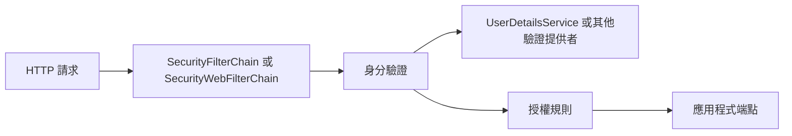

# Spring Security

<!-- source-attribution -->
> **非官方繁體中文翻譯** · Spring Boot 4.1.1 · 翻譯日期：2026-10-21  
> [官方英文網站](https://docs.spring.io/spring-boot/4.1/reference/web/spring-security.html) · [固定版本英文來源](https://github.com/spring-projects/spring-boot/blob/v4.1.1/documentation/spring-boot-docs/src/docs/antora/modules/reference/pages/web/spring-security.adoc) · [本地原文快照](../sources/spring-boot/documentation/spring-boot-docs/src/docs/antora/modules/reference/pages/web/spring-security.adoc)  
> 原始作者與授權見 [來源聲明](../NOTICE.md)。官方範例及設定鍵保留原文，額外圖解另標示為譯者補充。

<!-- translation-status: translated -->

如果 classpath 上有 [Spring Security][web--spring-security-r1]，Web 應用程式預設就會受到安全保護。
這也包括保護 Spring Boot 的 `/error` 端點。
Spring Boot 依賴 Spring Security 的內容協商策略，決定要使用 `httpBasic` 還是 `formLogin`。
若要為 Web 應用程式加入方法層級的安全性，也可以加入 [`@EnableMethodSecurity`][web--spring-security-r2]，並指定所需設定。
更多資訊請參閱 [Spring Security 參考指南][web--spring-security-r3]。

預設的 [`UserDetailsService`][web--spring-security-r4] 只有一個使用者。
使用者名稱為 `user`，密碼則隨機產生，並在應用程式啟動時以 WARN 層級輸出，如下例所示：

```text
Using generated security password: 78fa095d-3f4c-48b1-ad50-e24c31d5cf35

This generated password is for development use only. Your security configuration must be updated before running your application in production.
```

> **注意：**
>
> 如果你調整了日誌設定，請確保 `org.springframework.boot.security.autoconfigure` 類別設定為記錄 `WARN` 層級訊息。
> 否則不會輸出預設密碼。

你可以提供 `spring.security.user.name` 與 `spring.security.user.password`，變更使用者名稱與密碼。

Web 應用程式預設提供的基本功能如下：

- 一個使用記憶體內儲存的 [`UserDetailsService`][web--spring-security-r4] Bean（WebFlux 應用程式則為 [`ReactiveUserDetailsService`][web--spring-security-r5]），其中有一名使用者及產生的密碼（使用者屬性請參閱 [`SecurityProperties.User`][web--spring-security-r6]）。
- 整個應用程式的表單登入或 HTTP Basic 安全性（取決於請求中的 `Accept` 標頭）；如果 classpath 上有 Actuator，也包括 Actuator 端點。
- 用來發布身分驗證事件的 [`DefaultAuthenticationEventPublisher`][web--spring-security-r7]。

你可以加入對應的 Bean，提供不同的 [`AuthenticationEventPublisher`][web--spring-security-r8]。

## MVC 安全性

預設安全性設定實作在 [`SecurityAutoConfiguration`][web--spring-security-r9] 與 [`UserDetailsServiceAutoConfiguration`][web--spring-security-r10] 中。
[`SecurityAutoConfiguration`][web--spring-security-r9] 匯入 `SpringBootWebSecurityConfiguration` 提供 Web 安全性，並匯入 [`UserDetailsServiceAutoConfiguration`][web--spring-security-r10] 提供身分驗證。

若要完全關閉預設 Web 應用程式安全性設定（包括 Actuator 安全性），或組合 OAuth2 Client 與 Resource Server 等多個 Spring Security 元件，請加入 [`SecurityFilterChain`][web--spring-security-r11] 型別的 Bean（這不會停用 [`UserDetailsService`][web--spring-security-r4] 設定）。
若也要關閉 [`UserDetailsService`][web--spring-security-r4] 設定，請加入 [`UserDetailsService`][web--spring-security-r4]、[`AuthenticationProvider`][web--spring-security-r12] 或 [`AuthenticationManager`][web--spring-security-r13] 型別的 Bean。

當 classpath 上有下列任一 Spring Security 模組時，[`UserDetailsService`][web--spring-security-r4] 的自動設定也會退讓：

- `spring-security-oauth2-client`
- `spring-security-oauth2-resource-server`
- `spring-security-saml2-service-provider`

若要在使用這些相依項中的一個或多個時，同時使用 [`UserDetailsService`][web--spring-security-r4]，請自行定義 [`InMemoryUserDetailsManager`][web--spring-security-r14] Bean。

你可以加入自訂的 [`SecurityFilterChain`][web--spring-security-r11] Bean，覆寫存取規則。
Spring Boot 提供便利方法，可用來覆寫 Actuator 端點與靜態資源的存取規則。
[`EndpointRequest`][web--spring-security-r15] 可建立依據 `management.endpoints.web.base-path` 屬性的 [`RequestMatcher`][web--spring-security-r16]。
[`PathRequest`][web--spring-security-r17] 則可為常用位置中的資源建立 [`RequestMatcher`][web--spring-security-r16]。

## WebFlux 安全性

與 Spring MVC 應用程式類似，加入 `spring-boot-starter-security` 相依項即可保護 WebFlux 應用程式。
預設安全性設定實作在 [`ReactiveWebSecurityAutoConfiguration`][web--spring-security-r18] 與 [`ReactiveUserDetailsServiceAutoConfiguration`][web--spring-security-r19] 中。
除了反應式 Web 應用程式，使用 RSocket 時也會自動設定後者。
[`ReactiveWebSecurityAutoConfiguration`][web--spring-security-r18] 匯入 `WebFluxSecurityConfiguration` 提供 Web 安全性。
[`ReactiveUserDetailsServiceAutoConfiguration`][web--spring-security-r19] 則自動設定身分驗證。

若要完全關閉預設 Web 應用程式安全性設定（包括 Actuator 安全性），請加入 [`WebFilterChainProxy`][web--spring-security-r20] 型別的 Bean（這不會停用 [`ReactiveUserDetailsService`][web--spring-security-r5] 設定）。
若也要關閉 [`ReactiveUserDetailsService`][web--spring-security-r5] 設定，請加入 [`ReactiveUserDetailsService`][web--spring-security-r5] 或 [`ReactiveAuthenticationManager`][web--spring-security-r21] 型別的 Bean。

當 classpath 上有下列任一 Spring Security 模組時，自動設定也會退讓：

- `spring-security-oauth2-client`
- `spring-security-oauth2-resource-server`

若要在使用這些相依項中的一個或多個時，同時使用 [`ReactiveUserDetailsService`][web--spring-security-r5]，請自行定義 [`MapReactiveUserDetailsService`][web--spring-security-r22] Bean。

你可以加入自訂的 [`SecurityWebFilterChain`][web--spring-security-r23] Bean，設定存取規則，以及 OAuth 2 Client 與 Resource Server 等多個 Spring Security 元件的使用方式。
Spring Boot 提供便利方法，可用來覆寫 Actuator 端點與靜態資源的存取規則。
[`EndpointRequest`][web--spring-security-r24] 可建立依據 `management.endpoints.web.base-path` 屬性的 [`ServerWebExchangeMatcher`][web--spring-security-r25]。

[`PathRequest`][web--spring-security-r26] 可為常用位置中的資源建立 [`ServerWebExchangeMatcher`][web--spring-security-r25]。

例如，你可以加入類似下列的設定，自訂安全性：

```java
import org.springframework.boot.security.autoconfigure.web.reactive.PathRequest;
import org.springframework.context.annotation.Bean;
import org.springframework.context.annotation.Configuration;
import org.springframework.security.config.web.server.ServerHttpSecurity;
import org.springframework.security.web.server.SecurityWebFilterChain;

import static org.springframework.security.config.Customizer.withDefaults;

@Configuration(proxyBeanMethods = false)
public class MyWebFluxSecurityConfiguration {

	@Bean
	public SecurityWebFilterChain springSecurityFilterChain(ServerHttpSecurity http) {
		http.authorizeExchange((exchange) -> {
			exchange.matchers(PathRequest.toStaticResources().atCommonLocations()).permitAll();
			exchange.pathMatchers("/foo", "/bar").authenticated();
		});
		http.formLogin(withDefaults());
		return http.build();
	}

}
```

## OAuth2

[OAuth2][web--spring-security-r27] 是廣泛使用的授權框架。
如何在 Web 應用程式中設定及使用 OAuth2，請參閱「Security」下的 [OAuth2 章節][web--spring-security-r28]。

## SAML 2.0

[SAML v2.0][web--spring-security-r29] 是廣泛採用的框架，可讓線上商業夥伴交換安全性資訊。
如何在 Web 應用程式中設定及使用 SAML 2.0，請參閱「Security」下的 [SAML 2.0 章節][web--spring-security-r30]。

## 譯者補充：Web 規則與使用者來源是兩個擴充點



提供自己的 Filter Chain 不等於同時替換預設的使用者資料來源；正文分別說明這兩層自動設定退讓的條件。

[web--spring-security-r1]: https://spring.io/projects/spring-security
[web--spring-security-r2]: https://docs.spring.io/spring-security/reference/7.1/api/java/org/springframework/security/config/annotation/method/configuration/EnableMethodSecurity.html
[web--spring-security-r3]: https://docs.spring.io/spring-security/reference/7.1/servlet/authorization/method-security.html
[web--spring-security-r4]: https://docs.spring.io/spring-security/reference/7.1/api/java/org/springframework/security/core/userdetails/UserDetailsService.html
[web--spring-security-r5]: https://docs.spring.io/spring-security/reference/7.1/api/java/org/springframework/security/core/userdetails/ReactiveUserDetailsService.html
[web--spring-security-r6]: https://docs.spring.io/spring-boot/4.1.1/api/java/org/springframework/boot/security/autoconfigure/SecurityProperties.User.html
[web--spring-security-r7]: https://docs.spring.io/spring-security/reference/7.1/api/java/org/springframework/security/authentication/DefaultAuthenticationEventPublisher.html
[web--spring-security-r8]: https://docs.spring.io/spring-security/reference/7.1/api/java/org/springframework/security/authentication/AuthenticationEventPublisher.html
[web--spring-security-r9]: https://docs.spring.io/spring-boot/4.1.1/api/java/org/springframework/boot/security/autoconfigure/SecurityAutoConfiguration.html
[web--spring-security-r10]: https://docs.spring.io/spring-boot/4.1.1/api/java/org/springframework/boot/security/autoconfigure/UserDetailsServiceAutoConfiguration.html
[web--spring-security-r11]: https://docs.spring.io/spring-security/reference/7.1/api/java/org/springframework/security/web/SecurityFilterChain.html
[web--spring-security-r12]: https://docs.spring.io/spring-security/reference/7.1/api/java/org/springframework/security/authentication/AuthenticationProvider.html
[web--spring-security-r13]: https://docs.spring.io/spring-security/reference/7.1/api/java/org/springframework/security/authentication/AuthenticationManager.html
[web--spring-security-r14]: https://docs.spring.io/spring-security/reference/7.1/api/java/org/springframework/security/provisioning/InMemoryUserDetailsManager.html
[web--spring-security-r15]: https://docs.spring.io/spring-boot/4.1.1/api/java/org/springframework/boot/security/autoconfigure/actuate/web/servlet/EndpointRequest.html
[web--spring-security-r16]: https://docs.spring.io/spring-security/reference/7.1/api/java/org/springframework/security/web/util/matcher/RequestMatcher.html
[web--spring-security-r17]: https://docs.spring.io/spring-boot/4.1.1/api/java/org/springframework/boot/security/autoconfigure/web/servlet/PathRequest.html
[web--spring-security-r18]: https://docs.spring.io/spring-boot/4.1.1/api/java/org/springframework/boot/security/autoconfigure/web/reactive/ReactiveWebSecurityAutoConfiguration.html
[web--spring-security-r19]: https://docs.spring.io/spring-boot/4.1.1/api/java/org/springframework/boot/security/autoconfigure/ReactiveUserDetailsServiceAutoConfiguration.html
[web--spring-security-r20]: https://docs.spring.io/spring-security/reference/7.1/api/java/org/springframework/security/web/server/WebFilterChainProxy.html
[web--spring-security-r21]: https://docs.spring.io/spring-security/reference/7.1/api/java/org/springframework/security/authentication/ReactiveAuthenticationManager.html
[web--spring-security-r22]: https://docs.spring.io/spring-security/reference/7.1/api/java/org/springframework/security/core/userdetails/MapReactiveUserDetailsService.html
[web--spring-security-r23]: https://docs.spring.io/spring-security/reference/7.1/api/java/org/springframework/security/web/server/SecurityWebFilterChain.html
[web--spring-security-r24]: https://docs.spring.io/spring-boot/4.1.1/api/java/org/springframework/boot/security/autoconfigure/actuate/web/reactive/EndpointRequest.html
[web--spring-security-r25]: https://docs.spring.io/spring-security/reference/7.1/api/java/org/springframework/security/web/server/util/matcher/ServerWebExchangeMatcher.html
[web--spring-security-r26]: https://docs.spring.io/spring-boot/4.1.1/api/java/org/springframework/boot/security/autoconfigure/web/reactive/PathRequest.html
[web--spring-security-r27]: https://oauth.net/2/
[web--spring-security-r28]: https://docs.spring.io/spring-boot/4.1/reference/security/oauth2.html#security.oauth2
[web--spring-security-r29]: https://docs.oasis-open.org/security/saml/Post2.0/sstc-saml-tech-overview-2.0.html
[web--spring-security-r30]: https://docs.spring.io/spring-boot/4.1/reference/security/saml2.html#security.saml2
