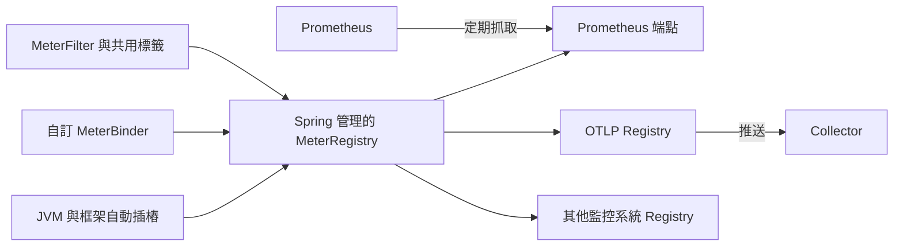

# 指標

Spring Boot Actuator 為 [Micrometer][r1] 提供依賴管理與自動設定。Micrometer 是應用程式指標的統一門面，支援[多種監控系統][r2]，包括：

- [AppOptics][r3]
- [Atlas][r4]
- [Datadog][r5]
- [Dynatrace][r6]
- [Elastic][r7]
- [Ganglia][r8]
- [Graphite][r9]
- [Humio][r10]
- [Influx][r11]
- [JMX][r12]
- [KairosDB][r13]
- [New Relic][r14]
- [OTLP][r15]
- [Prometheus][r16]
- [Simple][r17]（記憶體內）
- [Stackdriver][r18]
- [StatsD][r19]

> [TIP]
>
> 若要深入了解 Micrometer 的能力，請參閱其[參考文件][r2]，尤其是[概念章節][r20]。

## 入門

Spring Boot 會自動設定組合式 [`MeterRegistry`][r21]，並為 classpath 中每個受支援實作，將對應 registry 加入此組合。
只要執行期 classpath 包含 `micrometer-registry-{system}` 依賴，Spring Boot 就會設定該 registry。

大多數 registry 具有共通功能。
例如即使 Micrometer registry 實作位於 classpath，也能停用某個特定 registry。
下例停用 Datadog：

{{CODE_0}}

{{CODE_1}}

也能預設停用所有 registry，除非個別 registry 的專用屬性另有指定，如下例：

{{CODE_2}}

{{CODE_3}}

Spring Boot 也會將自動設定的 registry 加入 [`Metrics`][r22] 類別上的全域靜態組合 registry，除非明確設定不要這麼做：

{{CODE_4}}

{{CODE_5}}

在任何 meter 註冊前，你可以註冊任意數量的 [`MeterRegistryCustomizer`][r23] Bean，進一步設定 registry，例如套用共用標籤：

{{CODE_6}}

{{CODE_7}}

透過更具體的泛型型別，可以只針對特定 registry 實作進行自訂：

{{CODE_8}}

{{CODE_9}}

Spring Boot 也會[設定內建觀測插樁][r24]，你可透過設定或專用註解標記控制。

## 支援的監控系統

本節簡介各個受支援的監控系統。

### AppOptics

AppOptics registry 預設定期將指標推送至 [api.appoptics.com/v1/measurements][r25]。
若要匯出指標到 SaaS [AppOptics][r26]，必須提供 API token：

{{CODE_10}}

{{CODE_11}}

### Atlas

預設將指標匯出到本機執行的 [Atlas][r27]。
你可以提供 [Atlas 伺服器][r28]位置：

{{CODE_12}}

{{CODE_13}}

### Datadog

Datadog registry 定期將指標推送至 [datadoghq][r29]。
若要匯出到 [Datadog][r30]，必須提供 API key：

{{CODE_14}}

{{CODE_15}}

若額外提供選用的 application key，也會匯出 meter 說明、型別與基本單位等中繼資料：

{{CODE_16}}

{{CODE_17}}

預設將指標傳送到 Datadog 美國[站點][r31]（[api.datadoghq.com][r32]）。
若 Datadog 專案位於其他站點，或需要經由 proxy 傳送指標，請相應設定 URI：

{{CODE_18}}

{{CODE_19}}

也可以修改傳送指標到 Datadog 的間隔：

{{CODE_20}}

{{CODE_21}}

### Dynatrace

Dynatrace 提供兩種指標接收 API，[Micrometer][r33] 都有實作。
關於 Micrometer 指標接收的 Dynatrace 文件，可在[這裡][r34]找到。

`v1` 命名空間的設定屬性只在匯出到 [Timeseries v1 API][r35] 時適用。
V1 API 支援已棄用。

`v2` 命名空間的設定屬性只在匯出到 [Metrics v2 API][r36] 時適用。

請注意此整合一次只能匯出到 `v1` 或 `v2` 其中一種 API；由於 v1 已棄用，強烈建議使用 `v2`。
如果 `v1` 命名空間設定了 `device-id`（v1 必填，v2 不使用），指標會匯出到 `v1` 端點。
否則視為使用 `v2`。

#### v2 API

v2 API 可用以下兩種方式使用。

##### 自動設定

受 OneAgent 或 Dynatrace Operator for Kubernetes 監控的主機，可使用 Dynatrace 自動設定。

**本機 OneAgent：**若主機執行 OneAgent，指標會自動匯出至[本機 OneAgent 接收端點][r37]，再由該端點轉送到 Dynatrace 後端。

**Dynatrace Kubernetes Operator：**在安裝 Dynatrace Operator 的 Kubernetes 環境執行時，registry 會改為自動從 operator 取得端點 URI 與 API token。

這是預設行為，除了 `io.micrometer:micrometer-registry-dynatrace` 依賴，不需要特別設定。

##### 手動設定

如果無法使用自動設定，就需要 [Metrics v2 API][r36] 端點與 API token。
[API token][r38] 必須具備「Ingest metrics」（`metrics.ingest`）權限。
建議將 token 的權限範圍限制為這一項。
請確保端點 URI 包含路徑，例如 `/api/v2/metrics/ingest`。

Metrics API v2 接收端點的 URL 依部署方式不同：

- SaaS：`https://{your-environment-id}.live.dynatrace.com/api/v2/metrics/ingest`
- 自行管理的部署：`https://{your-domain}/e/{your-environment-id}/api/v2/metrics/ingest`

下例使用環境 ID `example` 設定指標匯出：

{{CODE_22}}

{{CODE_23}}

使用 Dynatrace v2 API 時，有以下選用功能，詳情見 [Dynatrace 文件][r39]：

- 指標 key 前綴：在所有匯出的指標 key 前加入指定前綴。
- 補充 Dynatrace 中繼資料：若 OneAgent 或 Dynatrace operator 正在執行，為指標補充主機、程序或 pod 等中繼資料。
- 預設維度：指定加入所有匯出指標的鍵值配對。若 Micrometer 已指定同名 key 的標籤，會覆寫預設維度。
- 使用 Dynatrace Summary instruments：某些情況下，Micrometer Dynatrace registry 產生的指標會遭拒絕。Micrometer 1.9.x 引入 Dynatrace 專用 summary instruments 修正此問題。將此開關設為 `false`，會強制退回 1.9.x 之前的預設行為；只應在從 Micrometer 1.8.x 移轉至 1.9.x 遇到問題時使用。
- 匯出 meter 中繼資料：從 Micrometer 1.12.0 起，Dynatrace exporter 預設也會匯出單位與說明等 meter 中繼資料。可透過 `export-meter-metadata` 開關停用。

可以不指定 URI 與 API token，如下例。
此時使用自動設定的端點：

{{CODE_24}}

{{CODE_25}}

#### v1 API（已棄用）

Dynatrace v1 API 指標 registry 使用 [Timeseries v1 API][r35]，定期將指標推送到設定的 URI。
為了與既有設定向後相容，只要設定 `device-id`（v1 必填，v2 不使用），就會匯出至 Timeseries v1 端點。
若要匯出到 [Dynatrace][r33]，必須提供 API token、裝置 ID 與 URI：

{{CODE_26}}

{{CODE_27}}

v1 API 必須指定不含路徑的環境基底 URI，因為 v1 端點路徑會自動加入。

#### 與版本無關的設定

除了 API 端點與 token，也可以修改指標傳送到 Dynatrace 的間隔。
預設匯出間隔為 `60s`。
下例改為 30 秒：

{{CODE_28}}

{{CODE_29}}

設定 Micrometer Dynatrace exporter 的更多資訊，請參閱 [Micrometer 文件][r33]與 [Dynatrace 文件][r34]。

### Elastic

預設將指標匯出到本機執行的 [Elastic][r40]。
可以透過以下屬性提供要使用的 Elastic 伺服器位置：

{{CODE_30}}

{{CODE_31}}

### Ganglia

預設將指標匯出到本機執行的 [Ganglia][r41]。
可以提供 [Ganglia 伺服器][r42]的主機與連接埠，如下例：

{{CODE_32}}

{{CODE_33}}

### Graphite

預設將指標匯出到本機執行的 [Graphite][r43]。
可以提供 [Graphite 伺服器][r44]的主機與連接埠，如下例：

{{CODE_34}}

{{CODE_35}}

Micrometer 提供預設 [`HierarchicalNameMapper`][r45]，控制如何將具維度的 meter ID [對應成平面階層名稱][r46]。

> [TIP]
>
> 若要控制此行為，請定義自己的 [`GraphiteMeterRegistry`][r47]，並提供自己的 [`HierarchicalNameMapper`][r45]。
> 除非自行定義，否則會提供自動設定的 [`GraphiteConfig`][r48] 與 [`Clock`][r49] Bean：

{{CODE_36}}

{{CODE_37}}

### Humio

Humio registry 預設定期將指標推送到 [cloud.humio.com][r50]。
若要匯出到 SaaS [Humio][r51]，必須提供 API token：

{{CODE_38}}

{{CODE_39}}

也應設定一個或多個標籤，識別指標要推送到的資料來源：

{{CODE_40}}

{{CODE_41}}

### Influx

預設會以預設設定，將指標匯出到本機執行的 [Influx][r52] v1 實例。
若要匯出到 InfluxDB v2，請設定寫入指標所需的 `org`、`bucket` 與身分驗證 `token`。
可透過以下設定提供 [Influx 伺服器][r53]位置：

{{CODE_42}}

{{CODE_43}}

### JMX

Micrometer 提供至 [JMX][r54] 的階層對應，主要作為低成本、可攜的本機指標檢視方式。
預設匯出到 `metrics` JMX domain。
可如下指定 domain：

{{CODE_44}}

{{CODE_45}}

Micrometer 提供預設 [`HierarchicalNameMapper`][r45]，控制如何將具維度的 meter ID [對應成平面階層名稱][r55]。

> [TIP]
>
> 若要控制此行為，請定義自己的 [`JmxMeterRegistry`][r56]，並提供自己的 [`HierarchicalNameMapper`][r45]。
> 除非自行定義，否則會提供自動設定的 [`JmxConfig`][r57] 與 [`Clock`][r49] Bean：

{{CODE_46}}

{{CODE_47}}

### KairosDB

預設將指標匯出到本機執行的 [KairosDB][r58]。
可以如下提供 [KairosDB 伺服器][r59]位置：

{{CODE_48}}

{{CODE_49}}

### New Relic

New Relic registry 定期將指標推送至 [New Relic][r60]。
若要匯出至 [New Relic][r61]，必須提供 API key 與帳號 ID：

{{CODE_50}}

{{CODE_51}}

也可以修改傳送間隔：

{{CODE_52}}

{{CODE_53}}

預設透過 REST 呼叫發布指標，但如果 classpath 有 Java Agent API，也可以使用它：

{{CODE_54}}

{{CODE_55}}

最後，你可以自行定義 [`NewRelicClientProvider`][r62] Bean，取得完整控制。

### OTLP

預設透過 [OpenTelemetry protocol（OTLP）][r63]，將指標匯出到本機執行的接收端。
若要匯出至其他位置，請以 `management.otlp.metrics.export.url` 提供 [OTLP 指標端點][r64]位置：

{{CODE_56}}

{{CODE_57}}

也可以透過 `management.otlp.metrics.export.headers.*` 提供自訂標頭，例如身分驗證用途。

若有可用的 `OtlpMetricsSender` Bean，它會被設定到 Spring Boot 自動設定的 `OtlpMeterRegistry`。

也支援 [OTLP Exemplars][r65]。
要啟用此功能，必須有 [`ExemplarContextProvider`][r66] Bean。
若使用 [Micrometer Tracing][r67]，會自動替你設定。
預設只將已取樣的 trace 納入 exemplar。
可使用 `management.tracing.exemplars.include` 控制此行為。

### Prometheus

[Prometheus][r68] 預期透過抓取或輪詢個別應用程式實例取得指標。
Spring Boot 在 `/actuator/prometheus` 提供 actuator 端點，以適當格式呈現 [Prometheus 抓取資料][r69]。

> [TIP]
>
> 此端點預設不可用，必須先公開。詳見[公開端點][r70]。

以下 `scrape_config` 範例加入 `prometheus.yml`：

{{CODE_58}}

也支援 [Prometheus Exemplars][r71]。
要啟用此功能，必須有 [`SpanContext`][r72] Bean。
若使用已棄用的 Prometheus simpleclient 支援，則需要 [`SpanContextSupplier`][r73] Bean。
使用 [Micrometer Tracing][r74] 時會自動設定，但你仍可自行建立。
預設只將已取樣的 trace 納入 exemplar。
可使用 `management.tracing.exemplars.include` 控制此行為。
Prometheus 不支援 `all` 值。
請查閱 [Prometheus 文件][r71]，因為此功能還必須在 Prometheus 端明確啟用，且只支援 [OpenMetrics][r75] 格式。

對於存活時間可能短到無法被抓取的短暫工作或批次工作，可以使用 [Prometheus Pushgateway][r76] 支援，將指標提供給 Prometheus。

若要啟用 Prometheus Pushgateway 支援，請在專案加入以下依賴：

{{CODE_59}}

當 classpath 包含 Prometheus Pushgateway 依賴，且 `management.prometheus.metrics.export.pushgateway.enabled` 為 `true` 時，會自動設定 [`PrometheusPushGatewayManager`][r77] Bean，管理推送至 Prometheus Pushgateway 的指標。

可使用 `management.prometheus.metrics.export.pushgateway` 下的屬性調整 [`PrometheusPushGatewayManager`][r77]。
若需要進階設定，也可以提供自己的 [`PrometheusPushGatewayManager`][r77] Bean。

### Simple

Micrometer 內附簡單的記憶體內後端，沒有設定其他 registry 時，會自動作為備援方案使用。
這讓你能在 [metrics 端點][r78]檢視收集到的指標。

只要使用其他可用後端，記憶體後端就會自行停用。
也可以明確停用：

{{CODE_60}}

{{CODE_61}}

### Stackdriver

Stackdriver registry 定期將指標推送到 [Stackdriver][r79]。
若要匯出至 SaaS [Stackdriver][r80]，必須提供 Google Cloud 專案 ID：

{{CODE_62}}

{{CODE_63}}

也可以修改傳送間隔：

{{CODE_64}}

{{CODE_65}}

### StatsD

StatsD registry 會主動透過 UDP 將指標推送到 StatsD agent。
預設匯出至本機執行的 [StatsD][r81] agent。
可如下指定 agent 的主機、連接埠與協定：

{{CODE_66}}

{{CODE_67}}

也可以修改 StatsD 行協定，預設為 Datadog：

{{CODE_68}}

{{CODE_69}}

## 支援的指標與 Meter

Spring Boot 為多種技術自動註冊 meter。
多數情況下，預設設定即可提供合理的指標，發布到任何受支援的監控系統。

### JVM 指標

自動設定使用 Micrometer 核心類別啟用 JVM 指標。
JVM 指標以 `jvm.` meter 名稱前綴發布。

提供以下 JVM 指標：

- 各種記憶體與緩衝區集區詳細資訊。
- 與垃圾回收相關的統計。
- 執行緒使用狀況。
- [虛擬執行緒統計][r82]；classpath 必須包含 `io.micrometer:micrometer-java21`。
- 已載入與已卸載的類別數量。
- JVM 版本資訊。
- JIT 編譯時間。

### 系統指標

自動設定使用 Micrometer 核心類別啟用系統指標。
系統指標以 `system.`、`process.` 與 `disk.` meter 名稱前綴發布。

提供以下系統指標：

- CPU 指標。
- 檔案描述符指標。
- 運作時間指標，包含應用程式已執行多久，以及絕對啟動時間的固定 gauge。
- 可用磁碟空間。

### 應用程式啟動指標

自動設定公開以下應用程式啟動時間指標：

- `application.started.time`：啟動應用程式所花時間。
- `application.ready.time`：應用程式準備好處理請求所花時間。

指標以應用程式類別的完整限定名稱作為標籤。

### Logger 指標

自動設定啟用 Logback 與 Log4J2 的事件指標。
詳細資料以 `log4j2.events.` 或 `logback.events.` meter 名稱前綴發布。

### 工作執行與排程指標

只要底層 [`ThreadPoolExecutor`][r85] 可用，自動設定就會為所有可用的 [`ThreadPoolTaskExecutor`][r83] 與 [`ThreadPoolTaskScheduler`][r84] Bean 啟用插樁。
指標帶有 executor 名稱標籤，其名稱取自 Bean 名稱。

### JMS 指標

自動設定為所有可用的 [`JmsTemplate`][r86] Bean，以及標註 [`@JmsListener`][r87] 的方法啟用插樁。
分別產生 `"jms.message.publish"` 與 `"jms.message.process"` 指標。
關於產生的 observation，詳見 [Spring Framework 參考文件][r88]。

> [NOTE]
>
> 使用 [`JmsTemplate`][r86] Bean 的 [`JmsClient`][r89] 與 [`JmsMessagingTemplate`][r90] 也會被插樁。

### Spring MVC 指標

自動設定為 Spring MVC controller 與函數式處理器處理的所有請求啟用插樁。
預設產生名稱為 `http.server.requests` 的指標。
可設定 `management.observations.http.server.requests.name` 自訂名稱。

關於產生的 observation，詳見 [Spring Framework 參考文件][r91]。

若要在預設標籤之外新增標籤，請提供繼承 `org.springframework.http.server.observation` 套件之 [`DefaultServerRequestObservationConvention`][r93] 的 [`@Bean`][r92]。
若要取代預設標籤，請提供實作 [`ServerRequestObservationConvention`][r94] 的 [`@Bean`][r92]。

> [TIP]
>
> 某些情況下，Web controller 處理過的例外不會記錄為請求指標標籤。
> 應用程式可透過[將已處理例外設為請求屬性][r95]，明確選擇記錄例外。

預設會處理所有請求。
若要自訂 filter，請提供實作 `FilterRegistrationBean<ServerHttpObservationFilter>` 的 [`@Bean`][r92]。

### Spring WebFlux 指標

自動設定為 Spring WebFlux controller 與函數式處理器處理的所有請求啟用插樁。
預設產生名稱為 `http.server.requests` 的指標。
可設定 `management.observations.http.server.requests.name` 自訂名稱。

關於產生的 observation，詳見 [Spring Framework 參考文件][r96]。

若要在預設標籤之外新增標籤，請提供繼承 `org.springframework.http.server.reactive.observation` 套件之 [`DefaultServerRequestObservationConvention`][r97] 的 [`@Bean`][r92]。
若要取代預設標籤，請提供實作 [`ServerRequestObservationConvention`][r98] 的 [`@Bean`][r92]。

> [TIP]
>
> 某些情況下，controller 與處理函數已處理的例外不會記錄為請求指標標籤。
> 應用程式可透過[將已處理例外設為請求屬性][r99]，明確選擇記錄例外。

### Jersey 伺服器指標

自動設定為 Jersey JAX-RS 實作處理的所有請求啟用插樁。
預設產生名稱為 `http.server.requests` 的指標。
可設定 `management.observations.http.server.requests.name` 自訂名稱。

Jersey 伺服器指標預設帶有以下標籤：

| 標籤 | 說明 |
| --- | --- |
| `exception` | 處理請求時擲出之例外的簡短類別名稱。 |
| `method` | 請求方法，例如 `GET` 或 `POST`。 |
| `outcome` | 根據回應狀態碼判斷的請求結果：1xx 為 `INFORMATIONAL`、2xx 為 `SUCCESS`、3xx 為 `REDIRECTION`、4xx 為 `CLIENT_ERROR`、5xx 為 `SERVER_ERROR`。 |
| `status` | 回應的 HTTP 狀態碼，例如 `200` 或 `500`。 |
| `uri` | 若能取得，則為變數替換前的請求 URI 範本，例如 `/api/person/{id}`。 |

若要自訂標籤，請提供實作 [`JerseyObservationConvention`][r100] 的 [`@Bean`][r92]。

### SSL Bundle 指標

Spring Boot Actuator 發布 SSL bundle 的到期指標。
`ssl.chain.expiry` 以秒為單位，測量 keystore 與 truststore 中各憑證鏈的到期情況。
若憑證鏈已到期，數值為負。
此指標具有以下標籤：

| 標籤 | 說明 |
| --- | --- |
| `bundle` | 包含該憑證鏈的 bundle 名稱。 |
| `certificate` | 憑證鏈中最早到期憑證的序號，以十六進位表示。 |
| `chain` | 憑證鏈名稱。 |
| `source` | 憑證鏈來自金鑰儲存區（`keystore`）還是信任儲存區（`truststore`）。 |

### HTTP 用戶端指標

Spring Boot Actuator 管理 [`RestTemplate`][r101]、[`WebClient`][r102] 與 [`RestClient`][r103] 的插樁。
為此，必須注入自動設定的 builder，並用它建立實例：

- [`RestTemplate`][r101] 使用 [`RestTemplateBuilder`][r104]。
- [`WebClient`][r102] 使用 [`WebClient.Builder`][r105]。
- [`RestClient`][r103] 使用 [`RestClient.Builder`][r106]。

也可以手動套用負責插樁的 customizer：[`ObservationRestTemplateCustomizer`][r107]、[`ObservationWebClientCustomizer`][r108] 與 [`ObservationRestClientCustomizer`][r109]。

預設產生名稱為 `http.client.requests` 的指標。
可設定 `management.observations.http.client.requests.name` 自訂名稱。

關於產生的 observation，詳見 [Spring Framework 參考文件][r110]。

若要自訂 [`RestTemplate`][r101] 或 [`RestClient`][r103] 的標籤，請提供實作 `org.springframework.http.client.observation` 套件中 [`ClientRequestObservationConvention`][r111] 的 [`@Bean`][r92]。
若要自訂 [`WebClient`][r102] 的標籤，請提供實作 `org.springframework.web.reactive.function.client` 套件中 [`ClientRequestObservationConvention`][r112] 的 [`@Bean`][r92]。

### Tomcat 指標

只有啟用 MBean [`Registry`][r113] 時，自動設定才會為 Tomcat 啟用插樁。
MBean registry 預設停用，可將 `server.tomcat.mbeanregistry.enabled` 設為 `true` 啟用。

Tomcat 指標以 `tomcat.` meter 名稱前綴發布。

### 快取指標

自動設定會在啟動時為所有可用 [`Cache`][r114] 實例啟用插樁，指標前綴為 `cache`。
快取插樁針對基本指標集合進行標準化。
此外也提供快取特有的額外指標。

支援以下快取函式庫：

- Cache2k
- Caffeine
- Hazelcast
- 任何符合 JCache（JSR-107）的實作
- Redis

> [WARNING]
>
> 必須啟用指標，自動設定才能取得它們。
> 詳情請參閱所使用快取函式庫的文件。

指標帶有快取名稱，以及取自 Bean 名稱的 [`CacheManager`][r115] 名稱標籤。

> [NOTE]
>
> 只有啟動時已設定的快取會繫結至 registry。
> 對未在快取設定中定義的快取，例如啟動後動態或以程式建立的快取，必須明確註冊。
> 系統提供 [`CacheMetricsRegistrar`][r116] Bean，讓此流程更容易。

### Spring Batch 指標

請參閱 [Spring Batch 參考文件][r117]。

### Spring GraphQL 指標

請參閱 [Spring GraphQL 參考文件][r118]。

### DataSource 指標

自動設定為所有可用 [`DataSource`][r119] 物件啟用插樁，指標前綴為 `jdbc.connections`。
資料來源插樁會建立 gauge，代表集區中目前使用中、閒置、允許上限與允許下限的連線數。

指標也帶有依 Bean 名稱計算出的 [`DataSource`][r119] 名稱標籤。

> [TIP]
>
> Spring Boot 預設為所有支援的資料來源提供中繼資料。
> 若偏好的資料來源不受支援，可加入額外 [`DataSourcePoolMetadataProvider`][r120] Bean。
> 範例請參閱 [`DataSourcePoolMetadataProvidersConfiguration`][r121]。

此外也會以 `hikaricp` 前綴公開 Hikari 專用指標。
每個指標都帶有集區名稱標籤，可透過 `spring.datasource.name` 控制。

### Hibernate 指標

若 classpath 包含 `org.hibernate.orm:hibernate-micrometer`，所有已啟用統計的 Hibernate [`EntityManagerFactory`][r122] 實例，都會以 `hibernate` 名稱插樁。

指標也帶有取自 Bean 名稱的 [`EntityManagerFactory`][r122] 名稱標籤。

若要啟用統計，必須將標準 JPA 屬性 `hibernate.generate_statistics` 設為 `true`。
可在自動設定的 [`EntityManagerFactory`][r122] 上如下啟用：

{{CODE_70}}

{{CODE_71}}

### Spring Data Repository 指標

自動設定為所有 Spring Data [`Repository`][r123] 方法呼叫啟用插樁。
預設產生 `spring.data.repository.invocations` 指標。
可設定 `management.metrics.data.repository.metric-name` 自訂名稱。

[`Repository`][r123] 介面與方法支援 `io.micrometer.core.annotation` 套件的 [`@Timed`][r124]。
若不想記錄所有 [`Repository`][r123] 呼叫的指標，可將 `management.metrics.data.repository.autotime.enabled` 設為 `false`，只使用 [`@Timed`][r124]。

> [NOTE]
>
> 設定 `longTask = true` 的 [`@Timed`][r124]，會為該方法啟用長時間工作計時器。
> 長時間工作計時器需要獨立指標名稱，也能與短時間工作計時器同時使用。

repository 呼叫相關指標預設帶有以下標籤：

| 標籤 | 說明 |
| --- | --- |
| `repository` | 來源 [`Repository`][r123] 的簡短類別名稱。 |
| `method` | 被呼叫的 [`Repository`][r123] 方法名稱。 |
| `state` | 結果狀態：`SUCCESS`、`ERROR`、`CANCELED` 或 `RUNNING`。 |
| `exception` | 呼叫中擲出之例外的簡短類別名稱。 |

若要取代預設標籤，請提供實作 [`RepositoryTagsProvider`][r125] 的 [`@Bean`][r92]。

### RabbitMQ 指標

自動設定為所有可用 RabbitMQ 連線工廠啟用插樁，指標名稱為 `rabbitmq`。

### Spring Integration 指標

只要有 [`MeterRegistry`][r21] Bean，Spring Integration 就自動提供 [Micrometer 支援][r126]。
指標以 `spring.integration.` meter 名稱前綴發布。

### Kafka 指標

自動設定分別為自動設定的 consumer factory 與 producer factory 註冊 [`MicrometerConsumerListener`][r127] 與 [`MicrometerProducerListener`][r128]。
也會為 [`StreamsBuilderFactoryBean`][r130] 註冊 [`KafkaStreamsMicrometerListener`][r129]。
詳情請參閱 Spring Kafka 文件的 [Micrometer Native Metrics][r131] 章節。

### MongoDB 指標

本節簡介 MongoDB 可用的指標。

#### MongoDB 命令指標

自動設定向自動設定的 [`MongoClient`][r133] 註冊 [`MongoMetricsCommandListener`][r132]。

對每個發送給底層 MongoDB 驅動程式的命令，建立名為 `mongodb.driver.commands` 的 timer 指標。
每個指標預設帶有以下標籤：

| 標籤 | 說明 |
| --- | --- |
| `command` | 發送的命令名稱。 |
| `cluster.id` | 命令目的叢集的識別碼。 |
| `server.address` | 命令目的伺服器的位址。 |
| `status` | 命令結果：`SUCCESS` 或 `FAILED`。 |

若要取代預設指標標籤，請定義 [`MongoCommandTagsProvider`][r134] Bean，如下例：

{{CODE_72}}

{{CODE_73}}

若要停用自動設定的命令指標，請設定：

{{CODE_74}}

{{CODE_75}}

#### MongoDB 連線集區指標

自動設定向自動設定的 [`MongoClient`][r133] 註冊 [`MongoMetricsConnectionPoolListener`][r135]。

為連線集區建立以下 gauge 指標：

- `mongodb.driver.pool.size` 回報目前集區大小，包含閒置與使用中的連線。
- `mongodb.driver.pool.checkedout` 回報目前使用中的連線數。
- `mongodb.driver.pool.waitqueuesize` 回報目前等待從集區取得連線的佇列大小。

每個指標預設帶有以下標籤：

| 標籤 | 說明 |
| --- | --- |
| `cluster.id` | 連線集區所對應叢集的識別碼。 |
| `server.address` | 連線集區所對應伺服器的位址。 |

若要取代預設指標標籤，請定義 [`MongoConnectionPoolTagsProvider`][r136] Bean：

{{CODE_76}}

{{CODE_77}}

若要停用自動設定的連線集區指標，請設定：

{{CODE_78}}

{{CODE_79}}

### Neo4j 指標

自動設定為自動設定的 [`Driver`][r138] 註冊 [`MicrometerObservationProvider`][r137]。

若要覆寫此行為，可註冊 order 大於零的 [`ConfigBuilderCustomizer`][r139] Bean。

### Jetty 指標

自動設定使用 Micrometer 的 [`JettyServerThreadPoolMetrics`][r141]，繫結 Jetty [`ThreadPool`][r140] 的指標。
Jetty [`Connector`][r142] 實例的指標透過 [`JettyConnectionMetrics`][r143] 繫結；當 `server.ssl.enabled` 為 `true`，也會使用 [`JettySslHandshakeMetrics`][r144]。

### Redis 指標

自動設定為自動設定的 [`LettuceConnectionFactory`][r146] 註冊 [`MicrometerTracing`][r145]。
詳情請參閱 Lettuce 文件的[可觀測性章節][r147]。

## 註冊自訂指標

若要註冊自訂指標，請將 [`MeterRegistry`][r21] 注入元件：

{{CODE_80}}

{{CODE_81}}

若指標依賴其他 Bean，建議透過 [`MeterBinder`][r148] 註冊：

{{CODE_82}}

{{CODE_83}}

使用 [`MeterBinder`][r148] 可確保正確建立依賴關係，並在讀取指標值時，所需 Bean 已經可用。
若經常在多個元件或應用程式中，重複為一組指標進行插樁，實作 [`MeterBinder`][r148] 也很實用。

> [NOTE]
>
> 預設所有 [`MeterBinder`][r148] Bean 的指標，都會自動繫結到 Spring 管理的 [`MeterRegistry`][r21]。

## 自訂個別指標

若要自訂特定 [`Meter`][r149] 實例，可使用 [`MeterFilter`][r150] 介面。

例如，若想將所有以 `com.example` 開頭的 meter ID 中的 `mytag.region` 標籤，重新命名為 `mytag.area`，可這樣做：

{{CODE_84}}

{{CODE_85}}

> [NOTE]
>
> 預設所有 [`MeterFilter`][r150] Bean 都會自動繫結到 Spring 管理的 [`MeterRegistry`][r21]。
> 請務必使用 Spring 管理的 [`MeterRegistry`][r21] 註冊指標，不要使用 [`Metrics`][r22] 的靜態方法。
> 靜態方法使用的是不受 Spring 管理的全域 registry。

### 共用標籤

共用標籤通常用來依執行環境維度深入分析，例如 host、instance、region、stack 等。
共用標籤會套用到所有 meter，可如下設定：

{{CODE_86}}

{{CODE_87}}

上例為所有 meter 加入 `region` 與 `stack` 標籤，值分別為 `us-east-1` 與 `prod`。

> [NOTE]
>
> 使用 Graphite 時，共用標籤的順序很重要。
> 此方式無法保證標籤順序，因此建議 Graphite 使用者改定義自訂 [`MeterFilter`][r150]。

### 個別 Meter 屬性

除了 [`MeterFilter`][r150] Bean，也能透過屬性，對每個 meter 套用有限種類的自訂設定。
Spring Boot 的 [`PropertiesMeterFilter`][r151] 會將設定套用到 ID 以指定名稱開頭的所有 meter。
下例濾除 ID 以 `example.remote` 開頭的 meter：

{{CODE_88}}

{{CODE_89}}

以下屬性支援個別 meter 自訂：

表 1：個別 meter 自訂

| 屬性 | 說明 |
| --- | --- |
| `management.metrics.enable` | 是否接受特定 ID 的 meter。不被接受的 meter 會從 [`MeterRegistry`][r21] 濾除。 |
| `management.metrics.distribution.percentiles-histogram` | 是否發布適合計算可跨維度彙總之近似百分位數的直方圖。 |
| `management.metrics.distribution.minimum-expected-value`, `management.metrics.distribution.maximum-expected-value` | 限縮預期值範圍，以減少發布的直方圖 bucket 數量。 |
| `management.metrics.distribution.percentiles` | 發布在應用程式中計算的百分位數。 |
| `management.metrics.distribution.expiry`, `management.metrics.distribution.buffer-length` | 將樣本累積於環形緩衝區，在可設定的到期時間後輪替，並使用可設定的緩衝區長度，使近期樣本具有更高權重。 |
| `management.metrics.distribution.slo` | 發布累積直方圖，其 bucket 依服務等級目標定義。 |

關於 `percentiles-histogram`、`percentiles` 與 `slo` 的概念，詳見 Micrometer 文件的[直方圖與百分位數][r152]章節。

## Metrics 端點

Spring Boot 提供 `metrics` 端點，可用於診斷，檢查應用程式收集到的指標。
端點預設不可用，必須先公開。
詳見[公開端點][r70]。

前往 `/actuator/metrics` 會顯示可用 meter 名稱清單。
可將名稱作為選擇器，深入檢視個別 meter，例如 `/actuator/metrics/jvm.memory.max`。

> [TIP]
>
> 此處名稱應與程式碼中的名稱一致，而不是傳送至監控系統、經命名慣例正規化後的名稱。
> 換句話說，即使 Prometheus 的 snake case 慣例將 `jvm.memory.max` 變成 `jvm_memory_max`，在 `metrics` 端點檢查時仍應使用 `jvm.memory.max`。

也可在 URL 尾端加入任意數量的 `tag=KEY:VALUE` 查詢參數，依維度深入查看，例如 `/actuator/metrics/jvm.memory.max?tag=area:nonheap`。

> [TIP]
>
> 回報的測量值，是所有符合 meter 名稱與指定標籤之 meter 統計的**總和**。
> 上例回傳的 `Value` 統計，是「Code Cache」、「Compressed Class Space」與「Metaspace」區域之最大記憶體用量的總和。
> 若只想看「Metaspace」的最大大小，可再加上 `tag=id:Metaspace`，即 `/actuator/metrics/jvm.memory.max?tag=area:nonheap&tag=id:Metaspace`。

## 與 Micrometer Observation 整合

[`DefaultMeterObservationHandler`][r153] 會自動註冊至 [`ObservationRegistry`][r154]，為每個完成的 observation 建立指標。

## 譯者圖解：從指標來源到不同監控後端

> 譯者註：原文將非 heap 查詢結果中的 Code Cache、Compressed Class Space、Metaspace 稱為「areas of the heap」；上文保留其列舉與數值解釋，但這些實際屬於該範例指定的 nonheap 範圍。
