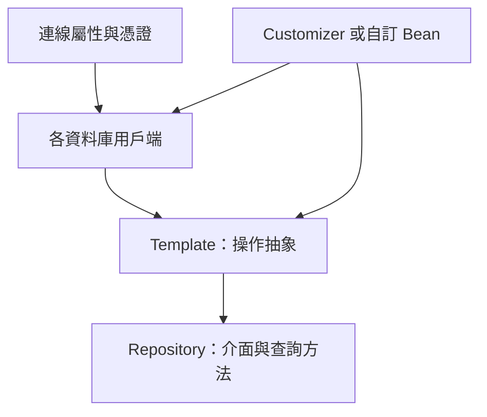

# 使用 NoSQL 技術

Spring Data 提供額外專案，協助你存取多種 NoSQL 技術，包括：

- [Cassandra][r1]
- [Couchbase][r2]
- [Elasticsearch][r3]
- [Geode][r4]
- [LDAP][r5]
- [MongoDB][r6]
- [Neo4J][r7]
- [Redis][r8]

其中，Spring Boot 為 Cassandra、Couchbase、Elasticsearch、LDAP、MongoDB、Neo4J 與 Redis 提供自動設定。
此外，[Spring Boot for Apache Geode][r9] 提供 [Apache Geode 自動設定][r10]。
其他專案也可以使用，但必須自行設定。
請在 [spring.io/projects/spring-data][r11] 參閱對應參考文件。

## Redis

[Redis][r12] 是快取、訊息代理與功能豐富的鍵值儲存。
Spring Boot 為 [Lettuce][r13] 和 [Jedis][r14] 用戶端程式庫，以及 [Spring Data Redis][r15] 建立在其上的抽象，提供基本自動設定。

`spring-boot-starter-data-redis` starter 讓你方便地取得所需相依項。
它預設使用 [Lettuce][r13]。
這個 starter 同時支援傳統與反應式應用程式。

> [TIP]
>
> 為了與其他支援反應式的儲存保持一致，我們也提供 `spring-boot-starter-data-redis-reactive` starter。

### 連線至 Redis

你可以像使用其他 Spring Bean 一樣，注入自動設定的 [`RedisConnectionFactory`][r16]、[`StringRedisTemplate`][r17] 或一般 [`RedisTemplate`][r18] 實例。
下列清單展示這類 Bean 的範例：

{{CODE_0}}

{{CODE_1}}

預設實例會嘗試連線到 `localhost:6379` 的 Redis 伺服器。
你可以使用 `spring.data.redis.*` 屬性指定自訂連線詳細資料，如下例所示：

{{CODE_2}}

{{CODE_3}}

也可以直接指定 Redis 伺服器 URL。
設定 URL 時，會忽略 host、port、username 與 password 屬性。
如下例所示：

{{CODE_4}}

{{CODE_5}}

> [TIP]
>
> 也可以註冊任意數量、實作 [`LettuceClientConfigurationBuilderCustomizer`][r19] 的 Bean，進行更進階自訂。
> [`ClientResources`][r20] 也可透過 [`ClientResourcesBuilderCustomizer`][r21] 自訂。
> 若使用 Jedis，也有 [`JedisClientConfigurationBuilderCustomizer`][r22] 可用。

另一種方式是註冊 [`RedisStandaloneConfiguration`][r23]、[`RedisSentinelConfiguration`][r24]、[`RedisClusterConfiguration`][r25] 或 [`RedisStaticMasterReplicaConfiguration`][r26] 型別的 Bean，完全掌控設定。

> [NOTE]
>
> Jedis 不支援 master/replica。

如果加入自己的 [`@Bean`][r27]，型別為任何自動設定型別，就會替換預設值（[`RedisTemplate`][r18] 例外：它依據 Bean 名稱 `redisTemplate` 排除，而不是型別）。

預設情況下，若 classpath 上有 `commons-pool2`，就會自動設定使用連線池的連線工廠。

可以透過下例屬性，將自動設定的 [`RedisConnectionFactory`][r16] 設為使用 SSL 與伺服器通訊：

{{CODE_6}}

{{CODE_7}}

可以在 [SSL bundle][r28] 中設定自訂 SSL 信任資料，再如下套用到 [`RedisConnectionFactory`][r16]：

{{CODE_8}}

{{CODE_9}}

### 接收訊息

Redis 基礎設施存在時，可以在任何 Bean 上使用 [`@RedisListener`][r29] 註解，建立監聽端點。
若尚未定義 [`RedisMessageListenerContainer`][r30]，就會自動設定預設實例。

下列元件在 `someChannel` 通道上建立監聽端點：

{{CODE_10}}

{{CODE_11}}

> [TIP]
>
> 詳情請參閱 [`@EnableRedisListeners`][r31] API 文件。

若需要建立更多 [`RedisMessageListenerContainer`][r30] 實例，或覆寫預設實例，Spring Boot 提供 [`RedisMessageListenerContainerConfigurer`][r32]，讓你以與自動設定容器相同的設定，初始化 [`RedisMessageListenerContainer`][r30]。

例如，下例公開另一個使用特定 [`RedisConnectionFactory`][r16] 的容器：

{{CODE_12}}

{{CODE_13}}

接著可在任何標註 [`@RedisListener`][r29] 的方法中使用此容器：

{{CODE_14}}

{{CODE_15}}

## MongoDB

[MongoDB][r33] 是開源 NoSQL 文件資料庫，使用類似 JSON 的綱要，而不是傳統以資料表為基礎的關聯式資料。
Spring Boot 提供多項便利功能，協助使用 MongoDB，包括 `spring-boot-starter-data-mongodb` 與 `spring-boot-starter-data-mongodb-reactive` starter。

### 連線至 MongoDB 資料庫

若要存取 MongoDB 資料庫，可以注入自動設定的 [`MongoDatabaseFactory`][r34]。
預設實例會嘗試連線到 `mongodb://localhost/test` 的 MongoDB 伺服器。
下例展示如何連線至 MongoDB 資料庫：

{{CODE_16}}

{{CODE_17}}

若已定義自己的 [`MongoClient`][r35]，它會用來自動設定適當的 [`MongoDatabaseFactory`][r34]。

自動設定的 [`MongoClient`][r35] 使用 [`MongoClientSettings`][r36] Bean 建立。
若自行定義了 [`MongoClientSettings`][r36]，就會直接使用而不修改，並忽略 `spring.data.mongodb` 屬性。
否則會自動設定 [`MongoClientSettings`][r36]，並套用 `spring.data.mongodb` 屬性。
無論哪種情況，都可以宣告一個或多個 [`MongoClientSettingsBuilderCustomizer`][r37] Bean，微調 [`MongoClientSettings`][r36]。
它們會依序被呼叫，並取得用來建置 [`MongoClientSettings`][r36] 的 [`MongoClientSettings.Builder`][r38]。

可以設定 `spring.mongodb.uri` 屬性，修改 URL 並設定*副本集*等額外選項，如下例所示：

{{CODE_18}}

{{CODE_19}}

也可以透過個別屬性指定連線詳細資料。
例如，在 `application.properties` 宣告下列設定：

{{CODE_20}}

{{CODE_21}}

可以透過下例屬性，將自動設定的 [`MongoClient`][r35] 設為使用 SSL 與伺服器通訊：

{{CODE_22}}

{{CODE_23}}

可以在 [SSL bundle][r28] 中設定自訂 SSL 信任資料，再如下套用到 [`MongoClient`][r35]：

{{CODE_24}}

{{CODE_25}}

> [TIP]
>
> 若未指定 `spring.mongodb.port`，就使用預設值 `27017`。
> 你可以刪除前例中的這一行。
>
> 也可以使用 `host:port` 語法，將連接埠包含在主機位址中。
> 若要修改 `additional-hosts` 項目的連接埠，應使用此格式。

> [TIP]
>
> 若不使用 Spring Data MongoDB，可以注入 [`MongoClient`][r35] Bean，而不使用 [`MongoDatabaseFactory`][r34]。
> 若要完全掌控 MongoDB 連線的建立，也可以自行宣告 [`MongoDatabaseFactory`][r34] 或 [`MongoClient`][r35] Bean。

> [NOTE]
>
> 若使用反應式驅動程式，SSL 需要 Netty。
> 當 Netty 可用，且要使用的工廠尚未被自訂時，自動設定會自動設定此工廠。

### MongoTemplate

[Spring Data MongoDB][r6] 提供 [`MongoTemplate`][r40] 類別，設計與 Spring 的 [`JdbcTemplate`][r41] 非常相似。
如同 [`JdbcTemplate`][r41]，Spring Boot 會自動設定 Bean，供你注入範本，如下所示：

{{CODE_26}}

{{CODE_27}}

完整細節請參閱 [`MongoOperations`][r42] API 文件。

### Spring Data MongoDB 儲存庫

Spring Data 包含 MongoDB 儲存庫支援。
如同前述 JPA 儲存庫，基本原理是依方法名稱自動建構查詢。

事實上，Spring Data JPA 與 Spring Data MongoDB 共用相同的基礎設施。
你可以沿用前面的 JPA 範例，假設 `City` 現在是 MongoDB 資料類別，而不是 JPA [`@Entity`][r43]，就能以相同方式運作，如下例所示：

{{CODE_28}}

{{CODE_29}}

儲存庫與文件會透過掃描找到。
預設掃描[自動設定套件][r44]。
可以分別使用 [`@EnableMongoRepositories`][r45] 與 [`@EntityScan`][r46]，自訂儲存庫與文件的搜尋位置。

> [TIP]
>
> Spring Data MongoDB 的完整細節，包括豐富的物件對映技術，請參閱其[參考文件][r47]。

## Neo4j

[Neo4j][r48] 是開源 NoSQL 圖形資料庫，採用豐富的資料模型，以具備一級地位的關係連結節點；相較於傳統 RDBMS 方法，更適合高度連結的大數據。
Spring Boot 提供多項便利功能，協助使用 Neo4j，包括 `spring-boot-starter-data-neo4j` starter。

### 連線至 Neo4j 資料庫

若要存取 Neo4j 伺服器，可以注入自動設定的 [`Driver`][r49]。
預設實例會透過 Bolt 協定，嘗試連線到 `localhost:7687` 的 Neo4j 伺服器。
下例展示如何注入 Neo4j [`Driver`][r49]，讓你存取 [`Session`][r50] 等功能：

{{CODE_30}}

{{CODE_31}}

可以使用 `spring.neo4j.*` 屬性設定驅動程式的各個面向。
下例展示如何設定要使用的 URI 與憑證：

{{CODE_32}}

{{CODE_33}}

自動設定的 [`Driver`][r49] 透過 `org.neo4j.driver.Config$ConfigBuilder` 建立。
若要微調設定，可宣告一個或多個 [`ConfigBuilderCustomizer`][r51] Bean。
它們會依序被呼叫，並取得用來建置 [`Driver`][r49] 的 `org.neo4j.driver.Config$ConfigBuilder`。

### Spring Data Neo4j 儲存庫

Spring Data 包含 Neo4j 儲存庫支援。
Spring Data Neo4j 的完整細節，請參閱[參考文件][r52]。

如同許多其他 Spring Data 模組，Spring Data Neo4j 與 Spring Data JPA 共用基礎設施。
你可以沿用前面的 JPA 範例，將 `City` 定義為 Spring Data Neo4j [`@Node`][r53]，而不是 JPA [`@Entity`][r43]，儲存庫抽象就會以相同方式運作，如下例所示：

{{CODE_34}}

{{CODE_35}}

`spring-boot-starter-data-neo4j` starter 會啟用儲存庫支援與交易管理。
Spring Boot 透過 [`Neo4jTemplate`][r54] 或 [`ReactiveNeo4jTemplate`][r55] Bean，同時支援傳統與反應式 Neo4j 儲存庫。
當 classpath 上有 Project Reactor，也會自動設定反應式風格。

儲存庫與實體會透過掃描找到。
預設掃描[自動設定套件][r44]。
可以分別使用 [`@EnableNeo4jRepositories`][r56] 與 [`@EntityScan`][r46]，自訂儲存庫與實體的搜尋位置。

> [NOTE]
>
> 使用反應式風格的應用程式，不會自動設定 [`ReactiveTransactionManager`][r57]。
> 若要啟用交易管理，必須在設定中定義下列 Bean：
>
{{CODE_36}}
>
{{CODE_37}}

## Elasticsearch

[Elasticsearch][r58] 是開源、分散式、RESTful 搜尋與分析引擎。
Spring Boot 為 Elasticsearch 用戶端提供基本自動設定。

Spring Boot 支援多種用戶端：

- 官方低階 REST 用戶端。
- 官方 Java API 用戶端。
- Spring Data Elasticsearch 提供的 [`ReactiveElasticsearchClient`][r59]。

Spring Boot 提供專用 starter：`spring-boot-starter-data-elasticsearch`。

### 使用 REST 用戶端連線至 Elasticsearch

Elasticsearch 提供兩種 REST 用戶端，供你查詢叢集：[低階用戶端][r60]與 [Java API 用戶端][r61]。
Java API 用戶端由 `co.elastic.clients:elasticsearch-java` 模組提供，低階用戶端由 `co.elastic.clients:elasticsearch-rest5-client` 模組提供。
此外，Spring Boot 支援 `org.springframework.data:spring-data-elasticsearch` 模組提供的反應式用戶端。
預設用戶端以 [localhost:9200][r62] 為目標。
可以使用 `spring.elasticsearch.*` 屬性進一步調整用戶端設定，如下例所示：

{{CODE_38}}

{{CODE_39}}

#### 使用 Rest5Client 連線至 Elasticsearch

若 classpath 上有 `co.elastic.clients:elasticsearch-rest5-client`，Spring Boot 就會自動設定並註冊 [`Rest5Client`][r63] Bean。
除了前述屬性，若要微調 [`Rest5Client`][r63]，也可以註冊任意數量、實作 [`Rest5ClientBuilderCustomizer`][r64] 的 Bean，進行進階自訂。
若要完全掌控用戶端設定，請定義 [`Rest5ClientBuilder`][r65] Bean。

此外，也可以自動設定 [`Sniffer`][r66]，從執行中的 Elasticsearch 叢集自動探索節點，並設定到 [`Rest5Client`][r63] Bean。
可以如下進一步調整 [`Sniffer`][r66] 設定：

{{CODE_40}}

{{CODE_41}}

#### 使用 ElasticsearchClient 連線至 Elasticsearch

若使用 `spring-boot-starter-elasticsearch`，或在 classpath 加入 `co.elastic.clients:elasticsearch-java`，Spring Boot 就會自動設定並註冊 [`ElasticsearchClient`][r67] Bean。

[`ElasticsearchClient`][r67] 所使用的傳輸依賴前述 [`Rest5Client`][r63]。
因此，可使用前述屬性設定 [`ElasticsearchClient`][r67]。
此外，可以定義 [`Rest5ClientOptions`][r68] Bean，進一步掌控傳輸行為。

#### 使用 ReactiveElasticsearchClient 連線至 Elasticsearch

[Spring Data Elasticsearch][r3] 提供 [`ReactiveElasticsearchClient`][r59]，以反應式方式查詢 Elasticsearch 實例。
若 classpath 上有 Spring Data Elasticsearch 與 Reactor，Spring Boot 就會自動設定並註冊 [`ReactiveElasticsearchClient`][r59]。

[`ReactiveElasticsearchClient`][r59] 所使用的傳輸依賴前述 [`Rest5Client`][r63]。
因此，可使用前述屬性設定 [`ReactiveElasticsearchClient`][r59]。
此外，可以定義 [`Rest5ClientOptions`][r68] Bean，進一步掌控傳輸行為。

### 使用 Spring Data 連線至 Elasticsearch

若要連線至 Elasticsearch，必須定義 [`ElasticsearchClient`][r67] Bean，可以由 Spring Boot 自動設定，或由應用程式手動提供（請參閱前面各節）。
完成這些設定後，就可以像其他 Spring Bean 一樣注入 [`ElasticsearchTemplate`][r69]，如下例所示：

{{CODE_42}}

{{CODE_43}}

當存在 `spring-data-elasticsearch` 與 Reactor 時，Spring Boot 也可以將 [`ReactiveElasticsearchClient`][r70] 與 [`ReactiveElasticsearchTemplate`][r71] 自動設定為 Bean。
它們是其他 REST 用戶端的反應式對應版本。

### Spring Data Elasticsearch 儲存庫

Spring Data 包含 Elasticsearch 儲存庫支援。
如同前述 JPA 儲存庫，基本原理是依方法名稱自動為你建構查詢。

事實上，Spring Data JPA 與 Spring Data Elasticsearch 共用相同基礎設施。
你可以沿用前面的 JPA 範例，假設 `City` 現在是 Elasticsearch [`@Document`][r72] 類別，而不是 JPA [`@Entity`][r43]，就能以相同方式運作。

儲存庫與文件會透過掃描找到。
預設掃描[自動設定套件][r44]。
可以分別使用 [`@EnableElasticsearchRepositories`][r73] 與 [`@EntityScan`][r46]，自訂儲存庫與文件的搜尋位置。

> [TIP]
>
> Spring Data Elasticsearch 的完整細節，請參閱[參考文件][r74]。

Spring Boot 透過 [`ElasticsearchTemplate`][r69] 或 [`ReactiveElasticsearchTemplate`][r71] Bean，同時支援傳統與反應式 Elasticsearch 儲存庫。
只要有所需相依項，這些 Bean 通常就會由 Spring Boot 自動設定。

如果想用自己的範本支援 Elasticsearch 儲存庫，可以加入自己的 [`ElasticsearchTemplate`][r69] 或 [`ElasticsearchOperations`][r75] [`@Bean`][r27]，名稱必須為 `"elasticsearchTemplate"`。
[`ReactiveElasticsearchTemplate`][r71] 與 [`ReactiveElasticsearchOperations`][r76] 也同理，Bean 名稱為 `"reactiveElasticsearchTemplate"`。

你可以透過下列屬性停用儲存庫支援：

{{CODE_44}}

{{CODE_45}}

## Cassandra

[Cassandra][r77] 是開源分散式資料庫管理系統，設計用來跨多部一般商用伺服器處理大量資料。
Spring Boot 為 Cassandra，以及 [Spring Data Cassandra][r1] 建立在其上的抽象，提供自動設定。
`spring-boot-starter-data-cassandra` starter 讓你方便地取得所需相依項。

### 連線至 Cassandra

你可以像其他 Spring Bean 一樣，注入自動設定的 [`CqlTemplate`][r78]、[`CassandraTemplate`][r79] 或 Cassandra `CqlSession` 實例。
可使用 `spring.cassandra.*` 屬性自訂連線。
通常會提供 `keyspace-name`、`contact-points` 與本地資料中心名稱，如下例所示：

{{CODE_46}}

{{CODE_47}}

若所有聯絡節點的連接埠相同，可以使用簡寫，只指定主機名稱，如下例所示：

{{CODE_48}}

{{CODE_49}}

> [TIP]
>
> 這兩個範例相同，因為預設連接埠為 `9042`。
> 若需要設定連接埠，請使用 `spring.cassandra.port`。

可以透過下例屬性，將自動設定的 `CqlSession` 設為使用 SSL 與伺服器通訊：

{{CODE_50}}

{{CODE_51}}

可以在 [SSL bundle][r28] 中設定自訂 SSL 信任資料，再如下套用到 `CqlSession`：

{{CODE_52}}

{{CODE_53}}

> [NOTE]
>
> Cassandra 驅動程式有自己的設定基礎設施，會載入 classpath 根目錄的 `application.conf`。
>
> Spring Boot 預設不會尋找這種檔案，但可使用 `spring.cassandra.config` 載入。
> 若屬性同時出現在 `spring.cassandra.*` 與設定檔，`spring.cassandra.*` 的值優先。
>
> 若要更進階地自訂驅動程式，可以註冊任意數量、實作 [`DriverConfigLoaderBuilderCustomizer`][r80] 的 Bean。
> `CqlSession` 可以透過 [`CqlSessionBuilderCustomizer`][r81] 型別的 Bean 自訂。

> [NOTE]
>
> 若使用 `CqlSessionBuilder` 建立多個 `CqlSession` Bean，請記住建構器可變，因此務必為每個 session 注入新的副本。

下列程式碼展示如何注入 Cassandra Bean：

{{CODE_54}}

{{CODE_55}}

如果加入自己的 [`CassandraTemplate`][r79] 型別 [`@Bean`][r27]，就會替換預設實例。

### Spring Data Cassandra 儲存庫

Spring Data 包含 Cassandra 的基本儲存庫支援。
目前它比前述 JPA 儲存庫更受限制，需要使用 [`@Query`][r82] 標註查找方法。

儲存庫與實體會透過掃描找到。
預設掃描[自動設定套件][r44]。
可以分別使用 [`@EnableCassandraRepositories`][r83] 與 [`@EntityScan`][r46]，自訂儲存庫與實體的搜尋位置。

> [TIP]
>
> Spring Data Cassandra 的完整細節，請參閱[參考文件][r84]。

## Couchbase

[Couchbase][r85] 是開源、分散式、多模型、文件導向的 NoSQL 資料庫，針對互動式應用程式最佳化。
Spring Boot 為 Couchbase，以及 [Spring Data Couchbase][r86] 建立在其上的抽象，提供自動設定。
`spring-boot-starter-data-couchbase` 與 `spring-boot-starter-data-couchbase-reactive` starter 讓你方便地取得所需相依項。

### 連線至 Couchbase

加入 Couchbase SDK 與一些設定，即可取得 [`Cluster`][r87]。
可使用 `spring.couchbase.*` 屬性自訂連線。
通常需要提供[連線字串][r88]與身分驗證憑證。使用使用者名稱與密碼的基本驗證，可如下設定：

{{CODE_56}}

{{CODE_57}}

也可使用[用戶端憑證][r89]進行身分驗證，取代使用者名稱與密碼。
包含用戶端憑證的 Java KeyStore 位置與密碼，可如下設定：

{{CODE_58}}

{{CODE_59}}

PEM 編碼憑證與私密金鑰，可如下設定：

{{CODE_60}}

{{CODE_61}}

也可以自訂部分 [`ClusterEnvironment`][r90] 設定。
例如，下列設定會修改開啟新 [`Bucket`][r91] 的逾時，並引用已設定的 [SSL bundle][r28] 啟用 SSL 支援：

{{CODE_62}}

{{CODE_63}}

> [TIP]
>
> 詳情請查看 `spring.couchbase.env.*` 屬性。
> 若要更完整掌控，可使用一個或多個 [`ClusterEnvironmentBuilderCustomizer`][r92] Bean。

### Spring Data Couchbase 儲存庫

Spring Data 包含 Couchbase 儲存庫支援。

儲存庫與文件會透過掃描找到。
預設掃描[自動設定套件][r44]。
可以分別使用 [`@EnableCouchbaseRepositories`][r93] 與 [`@EntityScan`][r46]，自訂儲存庫與文件的搜尋位置。

Spring Data Couchbase 的完整細節，請參閱[參考文件][r94]。

只要存在 [`CouchbaseClientFactory`][r96] Bean，你就可以像其他 Spring Bean 一樣，注入自動設定的 [`CouchbaseTemplate`][r95] 實例。
當存在前述 [`Cluster`][r87]，且已指定 bucket 名稱時，就會發生這種情況：

{{CODE_64}}

{{CODE_65}}

下例展示如何注入 [`CouchbaseTemplate`][r95] Bean：

{{CODE_66}}

{{CODE_67}}

你可以在自己的設定中定義下列幾種 Bean，覆寫自動設定提供的 Bean：

- 名為 `couchbaseMappingContext` 的 [`CouchbaseMappingContext`][r97] [`@Bean`][r27]。
- 名為 `couchbaseCustomConversions` 的 [`CustomConversions`][r98] [`@Bean`][r27]。
- 名為 `couchbaseTemplate` 的 [`CouchbaseTemplate`][r95] [`@Bean`][r27]。

為避免在設定中寫死這些名稱，可以重用 Spring Data Couchbase 提供的 [`BeanNames`][r99]。
例如，可如下自訂要使用的轉換器：

{{CODE_68}}

{{CODE_69}}

## LDAP

[LDAP][r100]（Lightweight Directory Access Protocol，輕量型目錄存取協定）是開放、供應商中立的業界標準應用層協定，用於透過 IP 網路存取及維護分散式目錄資訊服務。
Spring Boot 為任何符合標準的 LDAP 伺服器提供自動設定，也支援 [UnboundID][r101] 的記憶體內嵌 LDAP 伺服器。

LDAP 抽象由 [Spring Data LDAP][r102] 提供。
`spring-boot-starter-data-ldap` starter 讓你方便地取得所需相依項。

### 連線至 LDAP 伺服器

若要連線至 LDAP 伺服器，請先宣告對 `spring-boot-starter-data-ldap` starter 或 `spring-ldap-core` 的相依性，再於 `application.properties` 宣告伺服器 URL，如下例所示：

{{CODE_70}}

{{CODE_71}}

若需要自訂連線設定，可以使用 `spring.ldap.base` 與 `spring.ldap.base-environment` 屬性。

系統會依據這些設定，自動設定 [`LdapContextSource`][r103]。
若有 [`DirContextAuthenticationStrategy`][r104] Bean，會將它與自動設定的 [`LdapContextSource`][r103] 關聯。
若需要自訂，例如使用 [`PooledContextSource`][r105]，你仍可以注入自動設定的 [`LdapContextSource`][r103]。
務必將自訂 [`ContextSource`][r106] 標為 [`@Primary`][r107]，讓自動設定的 [`LdapTemplate`][r108] 使用它。

### Spring Data LDAP 儲存庫

Spring Data 包含 LDAP 儲存庫支援。

儲存庫與文件會透過掃描找到。
預設掃描[自動設定套件][r44]。
可以分別使用 [`@EnableLdapRepositories`][r109] 與 [`@EntityScan`][r46]，自訂儲存庫與文件的搜尋位置。

> [TIP]
>
> Spring Data LDAP 的完整細節，請參閱[參考文件][r110]。

你也可以像其他 Spring Bean 一樣，注入自動設定的 [`LdapTemplate`][r108] 實例，如下例所示：

{{CODE_72}}

{{CODE_73}}

### 記憶體內嵌 LDAP 伺服器

為了測試，Spring Boot 支援自動設定 [UnboundID][r101] 的記憶體內 LDAP 伺服器。
若要設定伺服器，請加入 `com.unboundid:unboundid-ldapsdk` 相依項，並宣告 `spring.ldap.embedded.base-dn` 屬性，如下所示：

{{CODE_74}}

{{CODE_75}}

> [NOTE]
>
> 可以定義多個 base-dn 值；但由於識別名稱通常含有逗號，必須使用正確表示法。
>
> YAML 檔可使用 YAML 清單表示法。Properties 檔則必須將索引包含在屬性名稱中：
>
{{CODE_76}}
>
{{CODE_77}}

預設伺服器會在隨機連接埠啟動，並觸發一般 LDAP 支援。
不需要指定 `spring.ldap.urls` 屬性。

若 classpath 上有 `schema.ldif`，會使用它初始化伺服器。
若想從其他資源載入初始化指令碼，也可以使用 `spring.ldap.embedded.ldif` 屬性。

預設使用標準綱要驗證 `LDIF` 檔。
可以設定 `spring.ldap.embedded.validation.enabled` 屬性，完全關閉驗證。
若有自訂屬性，可以使用 `spring.ldap.embedded.validation.schema` 定義自訂屬性型別或物件類別。

#### SSL

記憶體內 LDAP 伺服器支援 SSL（LDAPS）。
若要啟用 SSL，請設定 `spring.ldap.embedded.ssl.bundle` 屬性，指定要使用的 [SSL bundle][r28]，如下例所示：

{{CODE_78}}

{{CODE_79}}

## 譯者註：MongoDB 設定前綴

原文的 `MongoClientSettings` 說明仍使用 `spring.data.mongodb`，但本頁連線範例使用 `spring.mongodb.*`。此處保留兩者以利對照；實際設定請以本版本的屬性清單與範例為準。

## 譯者補充：共同模式與資料庫差異

這些產品共用相似的 Spring 整合層次，但查詢語言、交易能力與資料模型仍由個別資料庫決定。
