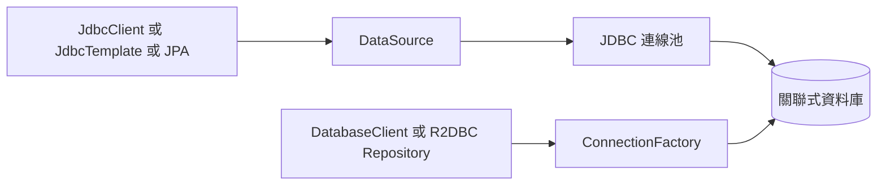

# SQL 資料庫

[Spring Framework][r1] 為 SQL 資料庫提供廣泛支援，從使用 [`JdbcClient`][r2] 或 [`JdbcTemplate`][r3] 直接進行 JDBC 存取，到 Hibernate 等完整的「物件關聯對映」技術。
[Spring Data][r4] 提供更高一層的功能：直接從介面建立 [`Repository`][r5] 實作，並依慣例從方法名稱產生查詢。

## 設定 DataSource

Java 的 [`DataSource`][r6] 介面提供操作資料庫連線的標準方式。
傳統上，[`DataSource`][r6] 使用 `URL` 與一些憑證建立資料庫連線。

> [TIP]
>
> 更多進階範例，尤其是完全掌控 DataSource 設定的方式，請參閱「How-to Guides」的[設定自訂 DataSource][r7] 章節。

### 內嵌資料庫支援

開發應用程式時，使用記憶體內的內嵌資料庫通常很方便。
顯然，記憶體內資料庫不提供持久化儲存。
你需要在應用程式啟動時填入資料，並做好應用程式結束時資料會被捨棄的準備。

> [TIP]
>
> 「How-to Guides」包含[如何初始化資料庫][r8]的章節。

Spring Boot 可以自動設定內嵌 [H2][r9]、[HSQL][r10] 與 [Derby][r11]（已棄用）資料庫。
不需要提供任何連線 URL。
只需要在建置相依項中加入要使用的內嵌資料庫。
若 classpath 上有多個內嵌資料庫，可設定 `spring.datasource.embedded-database-connection` 屬性，控制使用哪個。
將此屬性設為 `none`，會停用內嵌資料庫自動設定。

> [NOTE]
>
> 若在測試中使用此功能，可能會發現無論使用多少個應用程式上下文，整個測試套件都重用同一個資料庫。
> 若要確保每個上下文都有獨立的內嵌資料庫，請將 `spring.datasource.generate-unique-name` 設為 `true`。

例如，典型 POM 相依項如下：

{{CODE_0}}

> [NOTE]
>
> 必須依賴 `spring-jdbc`，才能自動設定內嵌資料庫。
> 此範例透過 `spring-boot-starter-data-jpa` 的遞移相依性帶入它。

> [TIP]
>
> 如果因任何理由自行設定內嵌資料庫的連線 URL，請務必停用資料庫的自動關閉。
> 使用 H2 時，應設定 `DB_CLOSE_ON_EXIT=FALSE`。
> 使用 HSQLDB 時，應確保沒有使用 `shutdown=true`。
> 停用資料庫自動關閉，能讓 Spring Boot 控制關閉時機，確保在不再需要存取資料庫後才關閉。

### 連線至正式環境資料庫

正式環境資料庫連線，也可以透過使用連線池的 [`DataSource`][r6] 自動設定。

### DataSource 設定

DataSource 設定由 `spring.datasource.*` 下的外部設定屬性控制。
例如，可以在 `application.properties` 宣告下列內容：

{{CODE_1}}

{{CODE_2}}

> [NOTE]
>
> 至少應透過 `spring.datasource.url` 屬性指定 URL。
> 否則 Spring Boot 會嘗試自動設定內嵌資料庫。

> [TIP]
>
> Spring Boot 能從 URL 推斷大多數資料庫的 JDBC 驅動程式類別。
> 若需要指定特定類別，可以使用 `spring.datasource.driver-class-name` 屬性。

> [NOTE]
>
> 建立使用連線池的 [`DataSource`][r6] 前，必須能確認有效的 [`Driver`][r12] 類別存在，因此會先進行此檢查。
> 換句話說，如果設定 `spring.datasource.driver-class-name=com.mysql.jdbc.Driver`，該類別就必須能夠載入。

其他支援選項請參閱 [`DataSourceProperties`][r13] API 文件。
這些標準選項不受[實際實作][r14]影響。
也可以使用各自的前綴（`spring.datasource.hikari.*`、`spring.datasource.tomcat.*`、`spring.datasource.dbcp2.*` 與 `spring.datasource.oracleucp.*`），微調實作專屬設定。
詳情請參閱所使用連線池實作的文件。

例如，若使用 [Tomcat 連線池][r15]，可以自訂許多額外設定，如下例所示：

{{CODE_3}}

{{CODE_4}}

這會讓連線池在沒有可用連線時等待 10000 毫秒才拋出例外，將連線數上限設為 50，並在從池中借出連線前驗證它。

### 支援的連線池

Spring Boot 使用下列演算法選擇特定實作：

1. 我們因效能與並行能力而優先選擇 [HikariCP][r16]。
   只要 HikariCP 可用，就一定選它。
2. 否則，如果 Tomcat 的連線池 [`DataSource`][r6] 可用，就使用它。
3. 否則，如果 [Commons DBCP2][r17] 可用，就使用它。
4. 若 HikariCP、Tomcat 與 DBCP2 都不可用，但 Oracle UCP 可用，就使用 Oracle UCP。

> [NOTE]
>
> 若使用 `spring-boot-starter-jdbc` 或 `spring-boot-starter-data-jpa` starter，就會自動取得 HikariCP 相依項。

你可以設定 `spring.datasource.type` 屬性，完全略過此演算法，直接指定連線池。
如果應用程式在 Tomcat 容器中執行，這點尤其重要，因為預設就會提供 `tomcat-jdbc`。

其他連線池隨時都可以使用 [`DataSourceBuilder`][r18] 手動設定。
若自行定義 [`DataSource`][r6] Bean，就不會進行自動設定。
[`DataSourceBuilder`][r18] 支援下列連線池／資料來源：

- HikariCP
- Tomcat 連線池 [`DataSource`][r6]
- Commons DBCP2
- Oracle UCP 與 `OracleDataSource`
- Spring Framework 的 [`SimpleDriverDataSource`][r19]
- H2 [`JdbcDataSource`][r20]
- PostgreSQL [`PGSimpleDataSource`][r21]
- C3P0
- Vibur

### 連線至 JNDI DataSource

如果將 Spring Boot 應用程式部署到應用程式伺服器，可能會希望使用伺服器內建功能設定與管理 DataSource，並透過 JNDI 存取。

`spring.datasource.jndi-name` 屬性可替代 `spring.datasource.url`、`spring.datasource.username` 與 `spring.datasource.password`，從特定 JNDI 位置存取 [`DataSource`][r6]。
例如，下列 `application.properties` 內容展示如何存取 JBoss AS 定義的 [`DataSource`][r6]：

{{CODE_5}}

{{CODE_6}}

### 延遲連線代理

當自動設定使用連線池的 `DataSource` 時，可將 `spring.datasource.connection-fetch` 設為 `lazy`，以代理包裝它，盡可能延後取得 JDBC 連線，如下例所示：

{{CODE_7}}

{{CODE_8}}

啟用此功能後，只有真正需要時才會從池中取得 JDBC Connection。
JDBC 交易控制可以在尚未從池中取得 Connection，也尚未與資料庫通訊時進行；這些動作會延遲到第一次建立 JDBC Statement 時才執行。
若要存取目標自動設定 `DataSource`，請使用 `DataSource.unwrap`。

> [TIP]
>
> 如果使用 `TransactionAwareDataSourceProxy` 包裝目標 `DataSource`，請確保透過順序值為正數的 `BeanPostProcessor` 執行。

詳情請參閱 [`LazyConnectionDataSourceProxy`][r22]。

## 使用 JdbcTemplate

Spring 的 [`JdbcTemplate`][r3] 與 [`NamedParameterJdbcTemplate`][r23] 類別會自動設定，你可以直接將它們自動注入自己的 Bean，如下例所示：

{{CODE_9}}

{{CODE_10}}

你可以使用 `spring.jdbc.template.*` 屬性自訂範本的部分屬性，如下例所示：

{{CODE_11}}

{{CODE_12}}

若需要調整 SQL 例外轉換，可以定義自己的 `SQLExceptionTranslator` Bean，使其與自動設定的 `JdbcTemplate` 關聯。

> [NOTE]
>
> [`NamedParameterJdbcTemplate`][r23] 在底層重用相同的 [`JdbcTemplate`][r3] 實例。
> 如果定義了多個 [`JdbcTemplate`][r3]，又沒有主要候選，就不會自動設定 [`NamedParameterJdbcTemplate`][r23]。

## 使用 JdbcClient

Spring 的 [`JdbcClient`][r2] 會依據 [`NamedParameterJdbcTemplate`][r23] 的存在而自動設定。
你也可以直接將它注入自己的 Bean，如下例所示：

{{CODE_13}}

{{CODE_14}}

若依賴自動設定建立下層 [`JdbcTemplate`][r3]，透過 `spring.jdbc.template.*` 屬性做的任何自訂，也會反映在用戶端。

## JPA 與 Spring Data JPA

Java Persistence API 是將物件「對映」到關聯式資料庫的標準技術。
`spring-boot-starter-data-jpa` POM 提供快速入門方式。
它提供下列主要相依項：

- Hibernate：最受歡迎的 JPA 實作之一。
- Spring Data JPA：協助實作以 JPA 為基礎的儲存庫。
- Spring ORM：Spring Framework 的核心 ORM 支援。

> [TIP]
>
> 此處不深入說明 JPA 或 [Spring Data][r4]。
> 你可以跟著 [spring.io][r25] 的[使用 JPA 存取資料][r24]指南操作，並閱讀 [Spring Data JPA][r26] 與 [Hibernate][r27] 參考文件。

### 實體類別

傳統上，JPA「實體」類別指定於 `persistence.xml` 檔。
使用 Spring Boot 時不需要此檔，而改用「實體掃描」。
預設會掃描[自動設定套件][r28]。

任何標註 [`@Entity`][r29]、[`@Embeddable`][r30] 或 [`@MappedSuperclass`][r31] 的類別都會納入考量。
典型實體類別如下例：

{{CODE_15}}

{{CODE_16}}

> [TIP]
>
> 你可以使用 [`@EntityScan`][r32] 註解自訂實體掃描位置。
> 請參閱「How-to Guides」的[將 @Entity 定義與 Spring 設定分開][r33]章節。

### Spring Data JPA 儲存庫

[Spring Data JPA][r26] 儲存庫是你可以定義來存取資料的介面。
JPA 查詢會從方法名稱自動建立。
例如，`CityRepository` 介面可以宣告 `findAllByState(String state)`，尋找特定州的所有城市。

對於較複雜的查詢，可以在方法上標註 Spring Data 的 [`Query`][r34] 註解。

Spring Data 儲存庫通常繼承 [`Repository`][r5] 或 [`CrudRepository`][r35] 介面。
若使用自動設定，會在[自動設定套件][r28]中搜尋儲存庫。

> [TIP]
>
> 可以使用 [`@EnableJpaRepositories`][r36] 自訂儲存庫搜尋位置。

下例展示典型的 Spring Data 儲存庫介面定義：

{{CODE_17}}

{{CODE_18}}

Spring Data JPA 儲存庫支援三種啟動模式：default、deferred 與 lazy。
若要啟用延後或延遲啟動，請分別將 `spring.data.jpa.repositories.bootstrap-mode` 屬性設為 `deferred` 或 `lazy`。
使用延後啟動時，自動設定的 [`EntityManagerFactoryBuilder`][r37] 需要啟動執行器；若能確定上下文中的 [`AsyncTaskExecutor`][r38]，就會使用它。
若存在多個，會使用名為 `applicationTaskExecutor` 的執行器。

> [NOTE]
>
> 使用延後或延遲啟動時，務必將任何 JPA 基礎設施存取，延後到應用程式上下文啟動階段之後。
> 可以使用 [`SmartInitializingSingleton`][r39]，呼叫需要 JPA 基礎設施的初始化程序。
> 對於以 Spring Bean 建立的 JPA 元件（例如轉換器），若有相依項，請使用 [`ObjectProvider`][r40] 延遲解析。

> [TIP]
>
> 此處僅觸及 Spring Data JPA 的表面。
> 完整細節請參閱 [Spring Data JPA 參考文件][r41]。

### Spring Data Envers 儲存庫

若有 [Spring Data Envers][r42]，JPA 儲存庫就會自動設定為支援典型 Envers 查詢。

若要使用 Spring Data Envers，請確保儲存庫繼承 [`RevisionRepository`][r43]，如下例所示：

{{CODE_19}}

{{CODE_20}}

> [NOTE]
>
> 詳情請參閱 [Spring Data Envers 參考文件][r44]。

### 建立與移除 JPA 資料庫

預設**只有**使用內嵌資料庫時，才會自動建立 JPA 資料庫，也就是 H2、HSQL 或 Derby（已棄用）。
可以透過 `spring.jpa.*` 屬性明確設定 JPA。
例如，若要建立與移除資料表，可以在 `application.properties` 加入下列設定：

{{CODE_21}}

{{CODE_22}}

> [NOTE]
>
> Hibernate 內部對應的屬性名稱為 `hibernate.hbm2ddl.auto`（如果你比較熟悉這個名稱）。
> 可透過 `spring.jpa.properties.*` 設定它與其他 Hibernate 原生屬性；加入實體管理器之前會移除該前綴。
> 下列內容展示如何設定 Hibernate 的 JPA 屬性：

{{CODE_23}}

{{CODE_24}}

上例將 `hibernate.globally_quoted_identifiers` 屬性的 `true` 值傳給 Hibernate 實體管理器。

預設 DDL 執行（或驗證）會延後到 [`ApplicationContext`][r45] 啟動後。

### 在檢視中保持 EntityManager 開啟

如果執行 Web 應用程式，Spring Boot 預設會註冊 [`OpenEntityManagerInViewInterceptor`][r46]，套用「Open EntityManager in View」模式，允許在 Web 檢視中延遲載入。
若不想採用此行為，請在 `application.properties` 將 `spring.jpa.open-in-view` 設為 `false`。

## Spring Data JDBC

Spring Data 包含 JDBC 儲存庫支援，會為 [`CrudRepository`][r35] 上的方法自動產生 SQL。
對於更進階的查詢，則提供 [`@Query`][r47] 註解。

當 classpath 上有所需相依項時，Spring Boot 會自動設定 Spring Data JDBC 儲存庫。
只要加入 `spring-boot-starter-data-jdbc` 這個相依項即可。
必要時，可以在應用程式加入 [`@EnableJdbcRepositories`][r48] 註解，或 [`AbstractJdbcConfiguration`][r49] 子類別，自行掌控 Spring Data JDBC 設定。

若搭配[預先處理（AOT）][r50]使用 Spring Data JDBC（目標為 JVM 或原生映像），建議進行額外設定。
若要避免 AOT 處理期間需要資料庫連線，請定義適合應用程式資料庫的 `JdbcDialect` Bean。
例如，若使用 Postgres，請定義 `JdbcPostgresDialect` Bean。

> [TIP]
>
> Spring Data JDBC 的完整細節，請參閱[參考文件][r51]。

## 使用 H2 Web 主控台

[H2 資料庫][r9]提供[瀏覽器主控台][r52]，Spring Boot 可以為你自動設定。
符合下列條件時，就會自動設定主控台：

- 你正在開發 Servlet 型 Web 應用程式。
- classpath 上有 `org.springframework.boot:spring-boot-h2console`。
- 你正在使用 [Spring Boot 開發工具][r53]。

> [TIP]
>
> 如果沒使用 Spring Boot 開發工具，但仍想使用 H2 主控台，可將 `spring.h2.console.enabled` 屬性設為 `true`。

> [NOTE]
>
> H2 主控台只供開發期間使用，因此請確保正式環境不會將 `spring.h2.console.enabled` 設為 `true`。

### 修改 H2 主控台路徑

預設主控台位於 `/h2-console`。
可使用 `spring.h2.console.path` 屬性自訂路徑。

### 在受保護的應用程式中存取 H2 主控台

H2 主控台使用框架頁面（frames），而且因僅供開發使用，沒有實作 CSRF 防護措施。
若應用程式使用 Spring Security，需要設定：

- 對主控台請求停用 CSRF 防護。
- 對主控台回應，將 `X-Frame-Options` 標頭設為 `SAMEORIGIN`。

更多 [CSRF][r54] 與 [X-Frame-Options][r55] 標頭資訊，請參閱 Spring Security 參考指南。

簡單設定中，可以使用如下的 [`SecurityFilterChain`][r56]：

{{CODE_25}}

{{CODE_26}}

> [WARNING]
>
> H2 主控台只供開發期間使用。
> 正式環境中，對網站停用 CSRF 防護或允許 frames，可能產生嚴重安全風險。

> [TIP]
>
> 即使主控台路徑經過自訂，`PathRequest.toH2Console()` 也會回傳正確的請求比對器。

## 使用 jOOQ

jOOQ Object Oriented Querying（[jOOQ][r57]）是 [Data Geekery][r58] 的熱門產品，從資料庫產生 Java 程式碼，讓你透過流暢 API 建立型別安全的 SQL 查詢。
商業版與開源版都能搭配 Spring Boot。
jOOQ 需要 Java 21 或更新版本。

### 程式碼產生

若要使用 jOOQ 型別安全查詢，需要從資料庫綱要產生 Java 類別。
可以依照 [jOOQ 使用手冊][r59]的指示操作。
若使用 `jooq-codegen-maven` 外掛，且也使用 `spring-boot-starter-parent` 父 POM，就可以安全省略外掛的 `<version>` 標籤。
也可以使用 Spring Boot 定義的版本變數（例如 `h2.version`），宣告外掛的資料庫相依項。
下列清單展示範例：

{{CODE_27}}

### 使用 DSLContext

jOOQ 的流暢 API 透過 [`DSLContext`][r60] 介面啟動。
Spring Boot 會將 [`DSLContext`][r60] 自動設定為 Spring Bean，並連接到應用程式的 [`DataSource`][r6]。
若要使用 [`DSLContext`][r60]，可以將它注入，如下例所示：

{{CODE_28}}

{{CODE_29}}

> [TIP]
>
> jOOQ 手冊通常使用名為 `create` 的變數保存 [`DSLContext`][r60]。

接著可以使用 [`DSLContext`][r60] 建構查詢，如下例所示：

{{CODE_30}}

{{CODE_31}}

### jOOQ SQL 方言

除非已設定 `spring.jooq.sql-dialect` 屬性，否則 Spring Boot 會替資料來源判斷要使用的 SQL 方言。
若無法偵測方言，會使用 `DEFAULT`。

> [NOTE]
>
> Spring Boot 只能自動設定 jOOQ 開源版支援的方言。

### 自訂 jOOQ

你可以定義自己的 [`DefaultConfigurationCustomizer`][r61] Bean 進行進階自訂；它會在建立 [`Configuration`][r62] [`@Bean`][r63] 前被呼叫。
這些自訂優先於自動設定套用的內容。

若要完全掌控 jOOQ 設定，也可以自行建立 [`Configuration`][r62] [`@Bean`][r63]。

## 使用 R2DBC

Reactive Relational Database Connectivity（[R2DBC][r64]）專案將反應式程式設計 API 帶到關聯式資料庫。
R2DBC 的 [`Connection`][r65] 提供操作非阻塞資料庫連線的標準方式。
連線透過 [`ConnectionFactory`][r66] 提供，類似 JDBC 的 [`DataSource`][r6]。

[`ConnectionFactory`][r66] 設定由 `spring.r2dbc.*` 下的外部設定屬性控制。
例如，可以在 `application.properties` 宣告下列內容：

{{CODE_32}}

{{CODE_33}}

> [TIP]
>
> 不需要指定驅動程式類別名稱，因為 Spring Boot 會透過 R2DBC 的 Connection Factory 探索機制取得驅動程式。

> [NOTE]
>
> 至少應提供 URL。
> URL 中指定的資訊優先於個別屬性，也就是 `name`、`username`、`password` 與連線池選項。

> [TIP]
>
> 「How-to Guides」包含[如何初始化資料庫][r67]的章節。

若要自訂 [`ConnectionFactory`][r66] 建立的連線，也就是設定不想（或無法）放在集中式資料庫設定中的特定參數，可以使用 [`ConnectionFactoryOptionsBuilderCustomizer`][r68] [`@Bean`][r63]。
下例展示手動覆寫資料庫連接埠，而其他選項仍取自應用程式設定：

{{CODE_34}}

{{CODE_35}}

下例展示如何設定一些 PostgreSQL 連線選項：

{{CODE_36}}

{{CODE_37}}

存在 [`ConnectionFactory`][r66] Bean 時，一般 JDBC [`DataSource`][r6] 自動設定會退讓。
若想保留 JDBC [`DataSource`][r6] 自動設定，且能接受在反應式應用程式中使用阻塞 JDBC API 的風險，可以在應用程式的 [`@Configuration`][r69] 類別加入 `@Import(DataSourceAutoConfiguration.class)`，重新啟用。

### 內嵌資料庫支援

與 [JDBC 支援][r70]類似，Spring Boot 可以自動設定供反應式使用的內嵌資料庫。
不需要提供連線 URL。
只要加入要使用的內嵌資料庫建置相依項，如下例所示：

{{CODE_38}}

> [NOTE]
>
> 若在測試中使用此功能，可能會發現無論使用多少個應用程式上下文，整個測試套件都重用同一個資料庫。
> 若要確保每個上下文都有獨立的內嵌資料庫，請將 `spring.r2dbc.generate-unique-name` 設為 `true`。

### 使用 DatabaseClient

[`DatabaseClient`][r71] Bean 會自動設定，你可以直接將它自動注入自己的 Bean，如下例所示：

{{CODE_39}}

{{CODE_40}}

### Spring Data R2DBC 儲存庫

[Spring Data R2DBC][r72] 儲存庫是你可以定義來存取資料的介面。
查詢會從方法名稱自動建立。
例如，`CityRepository` 介面可以宣告 `findAllByState(String state)`，尋找特定州的所有城市。

對於較複雜的查詢，可以在方法上標註 Spring Data 的 [`@Query`][r73] 註解。

Spring Data 儲存庫通常繼承 [`Repository`][r5] 或 [`CrudRepository`][r35] 介面。
若使用自動設定，會在[自動設定套件][r28]中搜尋儲存庫。

下例展示典型 Spring Data 儲存庫介面定義：

{{CODE_41}}

{{CODE_42}}

> [TIP]
>
> 此處僅觸及 Spring Data R2DBC 的表面。完整細節請參閱 [Spring Data R2DBC 參考文件][r51]。

## 譯者補充：相似抽象不代表可混用的執行模型

上方是 JDBC 路線，下方是 R2DBC 路線；選擇反應式 API 時，也需要相應的非阻塞資料庫驅動程式。
