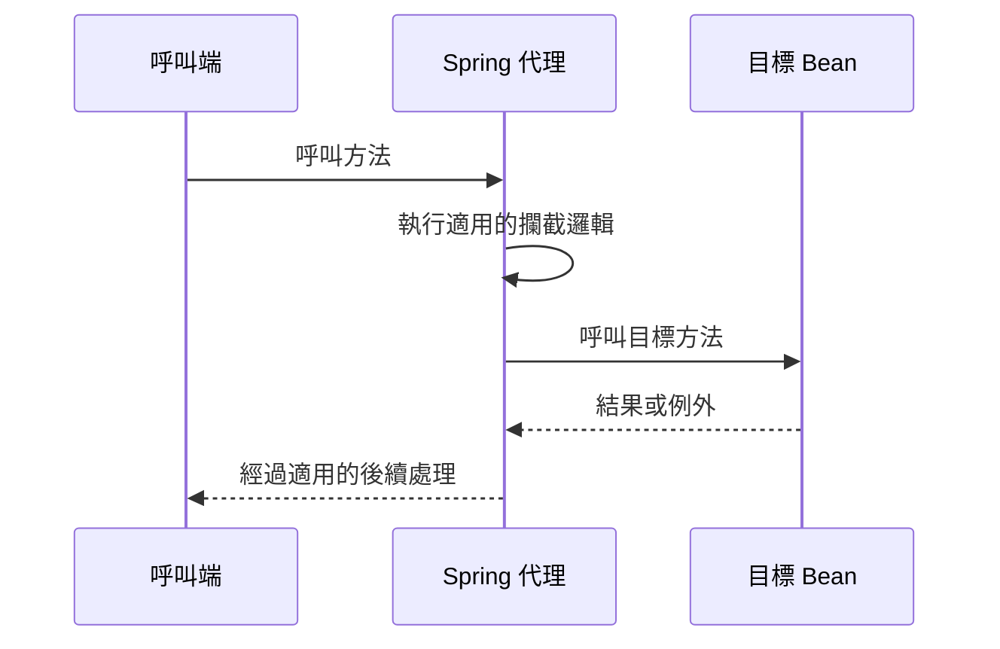

# 剖面導向程式設計（AOP）

Spring Boot 提供剖面導向程式設計（Aspect-Oriented Programming，AOP）的自動設定。關於 Spring AOP 的詳細說明，請參閱 [Spring Framework 參考文件][r1]。

預設情況下，Spring Boot 的自動設定會讓 Spring AOP 使用 CGLib 代理。如果要改用 JDK 代理，請將 `spring.aop.proxy-target-class` 設為 `false`。

如果 classpath 中存在 AspectJ，Spring Boot 的自動設定會自動啟用 AspectJ 自動代理，因此不需要另外加上 [`@EnableAspectJAutoProxy`][r2]。

## 譯者圖解：代理介入的位置

這張圖只示範呼叫經過代理的情況；不代表每個方法呼叫都必然經過代理。代理限制與其他織入方式請對照 Framework 的 AOP 文件。
