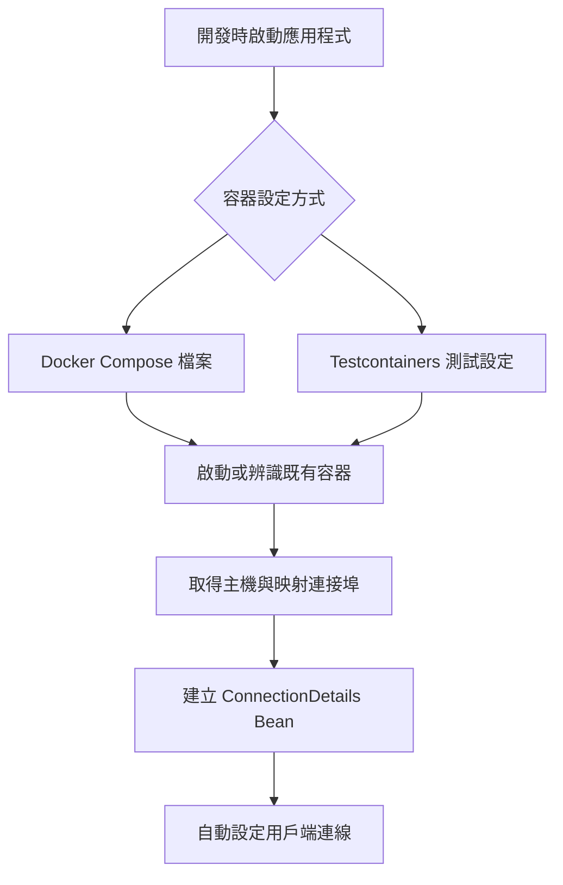

# 開發期間的服務

開發期間的服務提供開發應用程式時執行所需的外部依賴。它們只應用於開發期間，部署應用程式後便會停用。

Spring Boot 支援 Docker Compose 與 Testcontainers 這兩種開發期間服務。以下各節將詳細介紹。

## Docker Compose 支援

Docker Compose 是廣泛使用的技術，可定義及管理應用程式所需服務的多個容器。通常會在應用程式旁建立 `compose.yml`，定義並設定服務容器。

典型的 Docker Compose 工作流程是執行 `docker compose up`，讓應用程式連線至已啟動的服務並進行開發，完成後執行 `docker compose down`。

專案可加入 `spring-boot-docker-compose` 模組，取得使用 Docker Compose 容器的支援。將模組依賴加入建置設定，如下列 Maven 與 Gradle 範例所示：

Maven

{{CODE_0}}

Gradle

{{CODE_1}}

加入此模組依賴後，Spring Boot 會：

- 在工作目錄搜尋 `compose.yml` 與其他常見的 Compose 檔名。
- 使用找到的 `compose.yml` 呼叫 `docker compose up`。
- 為每個支援的容器建立服務連線 Bean。
- 在應用程式關閉時呼叫 `docker compose stop`。

若啟動應用程式時 Docker Compose 服務已在執行，Spring Boot 只會為支援的容器建立服務連線 Bean，不會再次呼叫 `docker compose up`，也不會在應用程式關閉時呼叫 `docker compose stop`。

> [TIP]
>
> 重新封裝的封存檔預設不包含 Spring Boot 的 Docker Compose 支援。若要使用，必須將它納入。使用 Maven 外掛時，將 `excludeDockerCompose` 設為 `false`；使用 Gradle 外掛時，[設定工作的 classpath，使其包含 `developmentOnly` 設定][r1]。

### 先決條件

你的 PATH 必須能找到 `docker` 與 `docker compose`（或 `docker-compose`）命令列程式。最低支援的 Docker Compose 版本為 2.2.0。

### 服務連線

服務連線是連往任何遠端服務的連線。Spring Boot 自動設定可以使用服務連線的詳細資訊，建立遠端服務連線。此時，連線詳細資訊的優先順序高於任何與連線有關的設定屬性。

使用 Spring Boot 的 Docker Compose 支援時，服務連線會連往容器映射的連接埠。

> [NOTE]
>
> Docker Compose 的常見用法，是將容器內部的連接埠映射到電腦上的暫時連接埠。例如 Postgres 伺服器可能在容器中使用 5432，但在本機映射為完全不同的連接埠。服務連線一律會探索並使用本機映射的連接埠。

服務連線根據容器的映像名稱建立。目前支援下列服務連線：

| 連線詳細資訊 | 比對條件 |
| --- | --- |
| [`ActiveMQConnectionDetails`][r2] | 映像名稱為 "symptoma/activemq"、"apache/activemq-classic" 或 "apache/activemq" 的容器 |
| [`ArtemisConnectionDetails`][r3] | 映像名稱為 "apache/activemq-artemis" 或 "apache/artemis" 的容器 |
| [`CassandraConnectionDetails`][r4] | 映像名稱為 "cassandra" 的容器 |
| [`ElasticsearchConnectionDetails`][r5] | 映像名稱為 "elasticsearch" 或 "elasticsearch/elasticsearch" 的容器 |
| [`HazelcastConnectionDetails`][r6] | 映像名稱為 "hazelcast/hazelcast" 的容器 |
| [`JdbcConnectionDetails`][r7] | 映像名稱為 "clickhouse/clickhouse-server"、"gvenzl/oracle-free"、"gvenzl/oracle-xe"、"mariadb"、"mssql/server"、"mysql" 或 "postgres" 的容器 |
| [`LdapConnectionDetails`][r8] | 映像名稱為 "osixia/openldap" 或 "lldap/lldap" 的容器 |
| [`MongoConnectionDetails`][r9] | 映像名稱為 "mongo" 的容器 |
| [`Neo4jConnectionDetails`][r10] | 映像名稱為 "neo4j" 的容器 |
| [`OtlpLoggingConnectionDetails`][r11] | 映像名稱為 "otel/opentelemetry-collector-contrib" 或 "grafana/otel-lgtm" 的容器 |
| [`OtlpMetricsConnectionDetails`][r12] | 映像名稱為 "otel/opentelemetry-collector-contrib" 或 "grafana/otel-lgtm" 的容器 |
| [`OtlpTracingConnectionDetails`][r13] | 映像名稱為 "otel/opentelemetry-collector-contrib" 或 "grafana/otel-lgtm" 的容器 |
| [`PulsarConnectionDetails`][r14] | 映像名稱為 "apachepulsar/pulsar" 的容器 |
| [`R2dbcConnectionDetails`][r15] | 映像名稱為 "clickhouse/clickhouse-server"、"gvenzl/oracle-free"、"gvenzl/oracle-xe"、"mariadb"、"mssql/server"、"mysql" 或 "postgres" 的容器 |
| [`RabbitConnectionDetails`][r16] | 映像名稱為 "rabbitmq" 且映射容器連接埠 5672 的容器 |
| [`RabbitStreamConnectionDetails`][r17] | 映像名稱為 "rabbitmq" 且映射容器連接埠 5552 的容器；設定 SSL 時則為 5551 |
| [`DataRedisConnectionDetails`][r18] | 映像名稱為 "redis"、"redis/redis-stack" 或 "redis/redis-stack-server" 的容器 |
| [`ZipkinConnectionDetails`][r19] | 映像名稱為 "openzipkin/zipkin" 的容器 |

### SSL 支援

某些映像預設啟用 SSL；你也可能想為容器啟用 SSL，以對應正式環境設定。Spring Boot 支援為受支援的服務連線設定 SSL。請注意，你仍須自行在容器內執行的服務啟用 SSL；這項功能只設定應用程式用戶端的 SSL。

下列服務連線支援 SSL：

- Cassandra
- Elasticsearch
- MongoDB
- OpenTelemetry（OTLP 日誌、指標與追蹤）
- RabbitMQ
- RabbitMQ Streams
- Redis

若要啟用服務的 SSL 支援，可以使用[服務標籤][r20]。

使用 JKS 金鑰儲存庫與信任儲存庫時，可以使用下列容器標籤：

- `org.springframework.boot.sslbundle.jks.key.alias`
- `org.springframework.boot.sslbundle.jks.key.password`
- `org.springframework.boot.sslbundle.jks.options.ciphers`
- `org.springframework.boot.sslbundle.jks.options.enabled-protocols`
- `org.springframework.boot.sslbundle.jks.protocol`
- `org.springframework.boot.sslbundle.jks.keystore.type`
- `org.springframework.boot.sslbundle.jks.keystore.provider`
- `org.springframework.boot.sslbundle.jks.keystore.location`
- `org.springframework.boot.sslbundle.jks.keystore.password`
- `org.springframework.boot.sslbundle.jks.truststore.type`
- `org.springframework.boot.sslbundle.jks.truststore.provider`
- `org.springframework.boot.sslbundle.jks.truststore.location`
- `org.springframework.boot.sslbundle.jks.truststore.password`

這些標籤對應 [SSL bundle][r21] 提供的屬性。

使用 PEM 金鑰儲存庫與信任儲存庫時，可以使用下列容器標籤：

- `org.springframework.boot.sslbundle.pem.key.alias`
- `org.springframework.boot.sslbundle.pem.key.password`
- `org.springframework.boot.sslbundle.pem.options.ciphers`
- `org.springframework.boot.sslbundle.pem.options.enabled-protocols`
- `org.springframework.boot.sslbundle.pem.protocol`
- `org.springframework.boot.sslbundle.pem.keystore.type`
- `org.springframework.boot.sslbundle.pem.keystore.certificate`
- `org.springframework.boot.sslbundle.pem.keystore.private-key`
- `org.springframework.boot.sslbundle.pem.keystore.private-key-password`
- `org.springframework.boot.sslbundle.pem.truststore.type`
- `org.springframework.boot.sslbundle.pem.truststore.certificate`
- `org.springframework.boot.sslbundle.pem.truststore.private-key`
- `org.springframework.boot.sslbundle.pem.truststore.private-key-password`

這些標籤對應 [SSL bundle][r22] 提供的屬性。

下例為 Redis 容器啟用 SSL：

{{CODE_2}}

### 自訂映像

有時你需要使用自己的映像版本提供服務。只要行為與標準映像相同，就可以使用任何自訂映像。具體而言，自訂映像必須使用標準映像支援的相同環境變數。

若映像名稱不同，可以在 `compose.yml` 使用標籤，讓 Spring Boot 提供服務連線。使用名稱為 `org.springframework.boot.service-connection` 的標籤指定服務名稱。

例如：

{{CODE_3}}

### 略過特定容器

如果 `compose.yml` 定義了不希望連接至應用程式的容器映像，可以用標籤忽略它。Spring Boot 會忽略所有標註 `org.springframework.boot.ignore` 的容器。

例如：

{{CODE_4}}

### 使用特定 Compose 檔案

如果 Compose 檔案不在應用程式的同一目錄，或使用不同名稱，可以在 `application.properties` 或 `application.yaml` 使用 `spring.docker.compose.file` 指向其他檔案。屬性可以指定完整路徑，或相對於應用程式的路徑。

例如：

{{CODE_5}}

{{CODE_6}}

### 等待容器就緒

由 Docker Compose 啟動的容器可能需要一些時間才能完全就緒。建議在 `compose.yml` 的服務定義下加入 `healthcheck` 區段，檢查是否就緒。

由於 `compose.yml` 常常省略 `healthcheck` 設定，Spring Boot 也會直接檢查服務是否就緒。預設只要能對映射的連接埠建立 TCP/IP 連線，就視為容器已就緒。

你可以在 `compose.yml` 加入 `org.springframework.boot.readiness-check.tcp.disable` 標籤，針對個別容器停用此檢查。

例如：

{{CODE_7}}

也可以在 `application.properties` 或 `application.yaml` 變更逾時值：

{{CODE_8}}

{{CODE_9}}

整體逾時可使用 `spring.docker.compose.readiness.timeout` 設定。

### 控制 Docker Compose 生命週期

Spring Boot 預設在應用程式啟動時呼叫 `docker compose up`，關閉時呼叫 `docker compose stop`。如果偏好不同的生命週期管理方式，可使用 `spring.docker.compose.lifecycle-management`。

支援以下值：

- `none`：不啟動或停止 Docker Compose。
- `start-only`：應用程式啟動時啟動 Docker Compose，之後讓它持續執行。
- `start-and-stop`：應用程式啟動時啟動 Docker Compose，JVM 結束時停止它。

此外，可以使用 `spring.docker.compose.start.command` 選擇呼叫 `docker compose up` 或 `docker compose start`；使用 `spring.docker.compose.stop.command` 選擇呼叫 `docker compose down` 或 `docker compose stop`。

也可以傳入額外的 Docker Compose 命令引數。`spring.docker.compose.arguments` 指定傳給所有 Docker Compose 命令的引數；`spring.docker.compose.start.arguments` 只傳給 up（或 start）命令；`spring.docker.compose.stop.arguments` 只傳給 down（或 stop）命令。

以下範例示範生命週期管理的設定方式：

{{CODE_10}}

{{CODE_11}}

### 啟用 Docker Compose Profile

Docker Compose Profile 與 Spring Profile 類似，可以針對特定環境調整 Docker Compose 設定。若要啟用特定 Docker Compose Profile，可在 `application.properties` 或 `application.yaml` 使用 `spring.docker.compose.profiles.active`：

{{CODE_12}}

{{CODE_13}}

### 在測試中使用 Docker Compose

Spring Boot 的 Docker Compose 支援預設在測試時停用。

若要啟用，將 `spring.docker.compose.skip.in-tests` 設為 `false`。

使用 Gradle 時，也必須將 `spring-boot-docker-compose` 依賴的設定從 `developmentOnly` 改為 `testAndDevelopmentOnly`：

Gradle

{{CODE_14}}

## Testcontainers 支援

除了[使用 Testcontainers 進行整合測試][r23]，也能在開發期間使用。以下各節將詳細介紹。

### 在開發期間使用 Testcontainers

這種方式讓開發者快速啟動應用程式依賴的服務容器，不必手動佈建資料庫伺服器等服務。以此方式使用 Testcontainers 的功能類似 Docker Compose，但容器設定使用 Java，而非 YAML。

若要在開發期間使用 Testcontainers，必須以「test」而非「main」classpath 啟動應用程式。如此即可存取所有宣告的測試依賴，也有自然合適的位置撰寫測試設定。

若要建立可供測試啟動的應用程式版本，應在 `src/test` 建立「Application」類別。例如主程式位於 `src/main/java/com/example/MyApplication.java`，就建立 `src/test/java/com/example/TestMyApplication.java`。

`TestMyApplication` 可使用 `SpringApplication.from(…)` 啟動真正的應用程式：

{{CODE_15}}

{{CODE_16}}

你也必須定義要與應用程式一起啟動的 [`Container`][r24] 實例。為此，先確保已將 `spring-boot-testcontainers` 模組加入 `test` 依賴，接著建立 [`@TestConfiguration`][r25] 類別，以 [`@Bean`][r26] 方法宣告要啟動的容器。

你也可在 [`@Bean`][r26] 方法標註 [`@ServiceConnection`][r27]，建立 [`ConnectionDetails`][r28] Bean。支援的技術詳見[服務連線][r29]一節。

典型的 Testcontainers 設定如下：

{{CODE_17}}

{{CODE_18}}

> [NOTE]
>
> Spring Boot 會自動管理 [`Container`][r24] Bean 的生命週期，自動啟動與停止容器。

> [TIP]
>
> 可使用 `spring.testcontainers.beans.startup` 變更容器啟動方式。預設為 `sequential` 依序啟動；若希望同時啟動多個容器，也可以選擇 `parallel`。

定義測試設定後，可使用 `with(…)` 將其附加到測試啟動器：

{{CODE_19}}

{{CODE_20}}

現在可以像一般 Java `main` 方法應用程式一樣啟動 `TestMyApplication`，同時啟動應用程式及其所需容器。

> [TIP]
>
> 命令列可使用 Maven goal `spring-boot:test-run` 或 Gradle 工作 `bootTestRun`。

#### 在開發期間提供動態屬性

若要在開發期間從 [`Container`][r24] 的 [`@Bean`][r26] 方法提供動態屬性，請額外定義 [`DynamicPropertyRegistrar`][r30] Bean。使用 [`@Bean`][r26] 方法定義 registrar，並以參數注入要讀取屬性的容器。這樣可確保使用屬性之前，容器已啟動。

典型設定如下：

{{CODE_21}}

{{CODE_22}}

> [NOTE]
>
> 建議盡可能使用 [`@ServiceConnection`][r27]；不過對於尚未支援 [`@ServiceConnection`][r27] 的技術，動態屬性是有用的替代方式。

#### 匯入 Testcontainers 宣告類別

使用 Testcontainers 時，常見模式是將 [`Container`][r24] 實例宣告為靜態欄位。這些欄位通常直接定義在測試類別，也可以宣告在父類別，或測試類別實作的介面。

例如，以下 `MyContainers` 介面宣告 `mongo` 與 `neo4j` 容器：

{{CODE_23}}

{{CODE_24}}

如果已用這種方式定義容器，或只是偏好此風格，可以匯入這些宣告類別，而不必以 [`@Bean`][r26] 方法定義容器。做法是在測試設定類別加入 [`@ImportTestcontainers`][r31]：

{{CODE_25}}

{{CODE_26}}

> [TIP]
>
> 如果不打算使用[服務連線功能][r29]，而想改用 [`@DynamicPropertySource`][r32]，請移除 [`Container`][r24] 欄位上的 [`@ServiceConnection`][r27]。也可以在宣告類別加入標註 [`@DynamicPropertySource`][r33] 的方法。

#### 開發期間同時使用 DevTools 與 Testcontainers

使用 Devtools 時，可在 Bean 與 Bean 方法標註 [`@RestartScope`][r34]。Devtools 重新啟動應用程式時，不會重新建立這些 Bean。這對 [`Container`][r24] Bean 特別有用，因為應用程式重新啟動後，容器仍能保留狀態。

{{CODE_27}}

{{CODE_28}}

> [WARNING]
>
> 若使用 Gradle 且想使用此功能，必須將 `spring-boot-devtools` 依賴的設定從 `developmentOnly` 改為 `testAndDevelopmentOnly`。使用預設的 `developmentOnly` 作用域時，由於 Devtools 未啟用，`bootTestRun` 工作不會偵測程式碼變更。

## 譯者補充：服務就緒與連線設定的銜接

這裡省去的是開發者手動同步容器連接埠與應用程式設定的工作。服務連線資訊的優先順序高於一般連線屬性；正式環境仍應採用自己的服務部署與連線設定方式。
