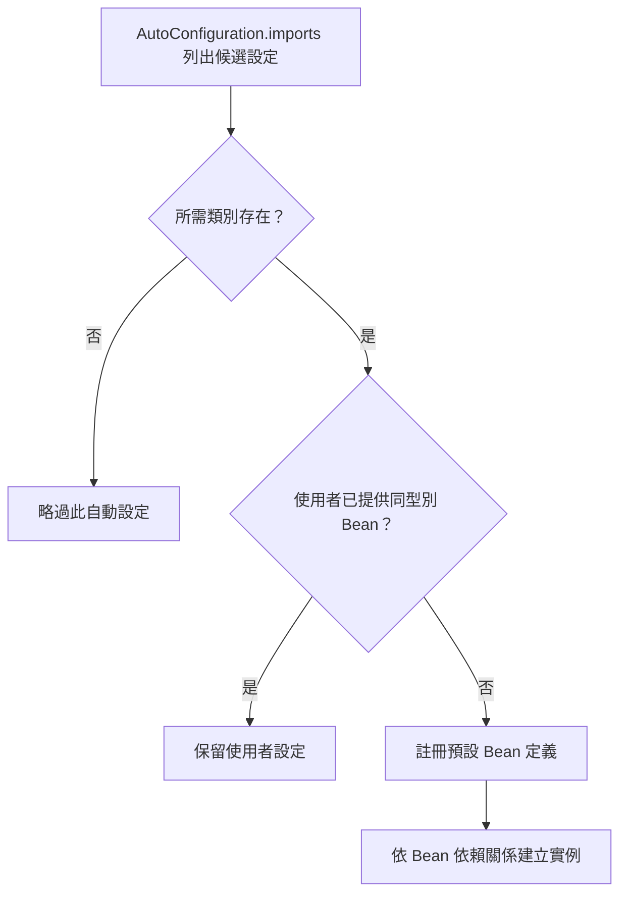

# 建立自己的自動設定

如果你在開發共用函式庫的公司工作，或參與開源或商用函式庫的開發，可能會想開發自己的自動設定。自動設定類別可以封裝於外部 jar 中，Spring Boot 仍然能找到它們。

自動設定可以搭配一個「starter」，提供自動設定程式碼，以及通常會一起使用的函式庫。我們先介紹建立自動設定所需的知識，接著說明[建立自訂 starter 的典型步驟][r1]。

## 了解自動設定的 Bean

實作自動設定的類別會標註 [`@AutoConfiguration`][r2]。這個註解本身以 [`@Configuration`][r3] 作為中繼註解，因此自動設定也是標準的 [`@Configuration`][r3] 類別。額外的 [`@Conditional`][r4] 註解用來限制何時應套用自動設定。自動設定類別通常會使用 [`@ConditionalOnClass`][r5] 與 [`@ConditionalOnMissingBean`][r6]。這可確保只有找到相關類別，而且你尚未宣告自己的 [`@Configuration`][r3] 時，才套用自動設定。

你可以瀏覽 [`spring-boot-autoconfigure`][r7] 原始碼，查看 Spring 提供的核心 [`@AutoConfiguration`][r2] 類別（見 [`META-INF/spring/org.springframework.boot.autoconfigure.AutoConfiguration.imports`][r8]）。你也可以查看其他模組中的同名檔案，了解它們提供哪些自動設定。

## 尋找自動設定候選項目

Spring Boot 會檢查你發布的 jar 中是否存在 `META-INF/spring/org.springframework.boot.autoconfigure.AutoConfiguration.imports`。檔案應列出設定類別，每行一個類別名稱，如下所示：

{{CODE_0}}

> [TIP]
>
> 可以使用 `#` 字元在 imports 檔案中加入註解。

> [TIP]
>
> 在自動設定類別不是頂層類別的少見情況下，其類別名稱應使用 `$` 與外層類別分隔，例如 `com.example.Outer$NestedAutoConfiguration`。

> [NOTE]
>
> 自動設定必須**只透過** imports 檔案中列出的名稱載入。請確保它們定義在專用的套件範圍中，而且不會成為元件掃描的目標。此外，自動設定類別不應啟用元件掃描來尋找其他元件；應改用明確的 [`@Import`][r9] 註解。

如果設定需要依照特定順序套用，可使用 [`@AutoConfiguration`][r2] 的 `before`、`beforeName`、`after`、`afterName` 屬性，或專用的 [`@AutoConfigureBefore`][r10] 與 [`@AutoConfigureAfter`][r11] 註解。例如，若提供 Web 專用設定，你的類別可能需要在 [`WebMvcAutoConfiguration`][r12] 之後套用。

若想排序某些不應直接知道彼此的自動設定，也可以使用 [`@AutoConfigureOrder`][r13]。其語意與一般的 [`@Order`][r14] 相同，但提供自動設定類別專用的順序。

與標準 [`@Configuration`][r3] 類別相同，自動設定類別的套用順序只影響 Bean 定義的順序，不會影響這些 Bean 後續建立的順序；建立順序由各 Bean 的依賴與 [`@DependsOn`][r15] 關係決定。

### 棄用與取代自動設定類別

你偶爾可能需要棄用自動設定類別並提供替代方案，例如變更自動設定類別所在的套件名稱。

由於 `before`／`after` 排序與 `excludes` 可能參照自動設定類別，你需要新增一個檔案，告訴 Spring Boot 如何處理替代關係。建立 `META-INF/spring/org.springframework.boot.autoconfigure.AutoConfiguration.replacements`，指出舊類別與新類別之間的對應。

例如：

{{CODE_1}}

> [NOTE]
>
> 也應更新 `AutoConfiguration.imports`，使其**只**參照替代類別。

## 條件註解

幾乎所有情況下，都應在自動設定類別上加入一個或多個 [`@Conditional`][r4] 註解。[`@ConditionalOnMissingBean`][r6] 是常見的例子，讓不滿意預設值的開發者可以覆寫自動設定。

Spring Boot 提供多種 [`@Conditional`][r4] 註解，可在自己的程式碼中重用，標註於 [`@Configuration`][r3] 類別或個別 [`@Bean`][r16] 方法上，包括：

- [類別條件][r17]
- [Bean 條件][r18]
- [屬性條件][r19]
- [資源條件][r20]
- [Web 應用程式條件][r21]
- [SpEL 運算式條件][r22]

### 類別條件

[`@ConditionalOnClass`][r5] 與 [`@ConditionalOnMissingClass`][r23] 可依特定類別是否存在，決定是否納入 [`@Configuration`][r3] 類別。由於註解中繼資料使用 [ASM][r24] 解析，即使某類別實際上可能不在執行中應用程式的 classpath，仍可用 `value` 屬性參照該類別。如果偏好以 [`String`][r25] 指定類別名稱，也可使用 `name` 屬性。

此機制對 [`@Bean`][r16] 方法的運作方式不同；這類方法通常以回傳型別作為條件目標。在套用方法上的條件之前，JVM 已載入類別，也可能處理方法參照，因此當類別不存在時便會失敗。

若要處理此情況，可以使用獨立的 [`@Configuration`][r3] 類別隔離條件，如下所示：

{{CODE_2}}

{{CODE_3}}

> [TIP]
>
> 若將 [`@ConditionalOnClass`][r5] 或 [`@ConditionalOnMissingClass`][r23] 作為中繼註解的一部分，組成自己的組合註解，必須使用 `name`，因為這種情況不會處理直接參照類別的寫法。

### Bean 條件

[`@ConditionalOnBean`][r26] 與 [`@ConditionalOnMissingBean`][r6] 可依特定 Bean 是否存在，決定是否納入某個 Bean。可以使用 `value` 依型別指定 Bean，或使用 `name` 依名稱指定。`search` 屬性讓你限制搜尋 Bean 時要考慮的 [`ApplicationContext`][r27] 階層。

放在 [`@Bean`][r16] 方法上時，目標型別預設為方法的回傳型別，如下所示：

{{CODE_4}}

{{CODE_5}}

上述範例中，如果 [`ApplicationContext`][r27] 尚未包含 `SomeService` 型別的 Bean，便會建立 `someService` Bean。

> [TIP]
>
> 必須非常注意加入 Bean 定義的順序，因為這些條件會根據目前已處理的內容進行評估。因此，我們建議只在自動設定類別上使用 [`@ConditionalOnBean`][r26] 與 [`@ConditionalOnMissingBean`][r6]，因為它們保證在所有使用者定義的 Bean 定義加入後才載入。

> [NOTE]
>
> [`@ConditionalOnBean`][r26] 與 [`@ConditionalOnMissingBean`][r6] 不會阻止建立 [`@Configuration`][r3] 類別。在類別層級使用這些條件，與在其中每個 [`@Bean`][r16] 方法上標註的唯一差別，是前者會在條件不符合時，阻止將該 [`@Configuration`][r3] 類別註冊為 Bean。

> [TIP]
>
> 宣告 [`@Bean`][r16] 方法時，請在回傳型別提供盡可能完整的型別資訊。例如 Bean 的具體類別實作某個介面時，Bean 方法應以具體類別而非介面作為回傳型別。使用 Bean 條件時，這點尤其重要，因為條件評估只能依賴方法簽章提供的型別資訊。

### 屬性條件

[`@ConditionalOnProperty`][r28] 可依 Spring Environment 屬性決定是否納入設定。以 `prefix` 與 `name` 指定要檢查的屬性。預設情況下，只要屬性存在且不等於 `false`，就會符合條件。另有專為布林屬性設計的 [`@ConditionalOnBooleanProperty`][r29]。兩種註解都可透過 `havingValue` 與 `matchIfMissing` 建立進階檢查。

如果 `name` 指定多個名稱，所有屬性都必須通過檢查才會符合條件。

### 資源條件

[`@ConditionalOnResource`][r30] 讓設定只在特定資源存在時納入。可以按照一般 Spring 慣例指定資源，例如 `file:/home/user/test.dat`。

### Web 應用程式條件

[`@ConditionalOnWebApplication`][r31] 與 [`@ConditionalOnNotWebApplication`][r32] 根據應用程式是否為 Web 應用程式，決定是否納入設定。以 Servlet 為基礎的 Web 應用程式，是指使用 Spring [`WebApplicationContext`][r33]、定義 `session` 作用域，或具有 [`ConfigurableWebEnvironment`][r34] 的應用程式。反應式 Web 應用程式則是使用 [`ReactiveWebApplicationContext`][r35]，或具有 [`ConfigurableReactiveWebEnvironment`][r36] 的應用程式。

[`@ConditionalOnWarDeployment`][r37] 與 [`@ConditionalOnNotWarDeployment`][r38] 根據應用程式是否為部署到 Servlet 容器的傳統 WAR 應用程式，決定是否納入設定。使用內嵌 Web 伺服器執行的應用程式，不符合此條件。

### SpEL 運算式條件

[`@ConditionalOnExpression`][r39] 可依 [SpEL 運算式][r40]的結果決定是否納入設定。

> [NOTE]
>
> 在運算式中參照 Bean，會導致該 Bean 在 context 重新整理過程中非常早就初始化。因此，此 Bean 無法參與後處理（例如設定屬性繫結），其狀態可能不完整。

## 測試自動設定

自動設定可能受到許多因素影響，例如使用者設定（`@Bean` 定義與 [`Environment`][r41] 自訂）、條件評估（特定函式庫是否存在）等。具體而言，每個測試都應建立明確定義的 [`ApplicationContext`][r27]，代表這些自訂項目的一種組合。[`ApplicationContextRunner`][r42] 是很適合達成此目的的工具。

> [WARNING]
>
> 在原生映像中執行測試時，無法使用 [`ApplicationContextRunner`][r42]。

[`ApplicationContextRunner`][r42] 通常定義為測試類別的欄位，用來集中基礎共用設定。下例確保每次都會呼叫 `MyServiceAutoConfiguration`：

{{CODE_6}}

{{CODE_7}}

> [TIP]
>
> 如果需要定義多個自動設定，不必排序它們的宣告，因為呼叫順序與實際執行應用程式時完全相同。

每個測試都可使用 runner 表達特定使用情境。例如，下例套用使用者設定 `UserConfiguration`，檢查自動設定是否正確退讓。呼叫 `run` 會提供可搭配 AssertJ 使用的 context 回呼。

{{CODE_8}}

{{CODE_9}}

也可以輕鬆自訂 [`Environment`][r41]，如下所示：

{{CODE_10}}

{{CODE_11}}

runner 也能顯示 [`ConditionEvaluationReport`][r43]，並以 `INFO` 或 `DEBUG` 層級輸出。下例使用 [`ConditionEvaluationReportLoggingListener`][r44] 在自動設定測試中輸出報告。

{{CODE_12}}

{{CODE_13}}

### 模擬 Web Context

若要測試只適用於 Servlet 或反應式 Web 應用程式 context 的自動設定，請分別使用 [`WebApplicationContextRunner`][r45] 或 [`ReactiveWebApplicationContextRunner`][r46]。

### 覆寫 Classpath

也可以測試執行時缺少特定類別或套件的情況。Spring Boot 提供 [`FilteredClassLoader`][r47]，可輕鬆與 runner 搭配使用。下例驗證當 `MyService` 不存在時，自動設定會正確停用：

{{CODE_14}}

{{CODE_15}}

## 建立自己的 Starter

典型的 Spring Boot starter 包含某項技術基礎設施的自動設定與自訂程式碼；我們把這項技術稱為「acme」。為了便於擴充，可以透過專用命名空間，向 environment 公開一組設定鍵。最後提供單一「starter」依賴，讓使用者盡可能容易上手。

具體而言，自訂 starter 可以包含：

- `acme-spring-boot` 模組：包含「acme」的自動設定程式碼，以及使用該功能的 API。
- `acme-spring-boot-starter` 模組：依賴「acme」需要的其他 starter、`acme-spring-boot`，以及通常有用的其他依賴。簡單說，加入 starter 應提供開始使用該函式庫所需的一切。

拆成兩個模組並非必要。如果「acme」有多種變體、選項或選用功能，將自動設定分開會比較好，因為可以清楚表達某些功能是選用的。此外，你可以建立一個 starter，對這些選用依賴提供預先選定的組合。同時，其他人可以只依賴 `acme-spring-boot`，建立採用不同選擇的 starter。

如果自動設定相對單純且沒有選用功能，將兩個模組合併到 starter 中也是可行的選擇。

如果「acme」有一組運作所必需的基本依賴，但你想提供更明確的預設選擇，則獨立的 starter 是不錯的做法。

測試「acme」功能時，可能需要測試專用的自動設定。例如，提供以記憶體內替代方案取代外部依賴的方式。為此可依相同原則建立獨立、測試作用域的 starter。

### 命名

請確保 starter 使用合適的命名空間。即使使用不同的 Maven `groupId`，模組名稱也不要以 `spring-boot` 開頭。未來我們可能針對你所自動設定的技術提供官方支援。

原則上，合併的模組應以 starter 命名。例如，你為「acme」建立 starter，將自動設定模組命名為 `acme-spring-boot`，starter 命名為 `acme-spring-boot-starter`。若只有一個模組結合兩者，則命名為 `acme-spring-boot-starter`。

若「acme」另有測試作用域的 starter，命名為 `acme-spring-boot-starter-test`。

### 設定鍵

如果 starter 提供設定鍵，請使用唯一的命名空間。尤其不要將設定鍵放在 Spring Boot 使用的命名空間，例如 `server`、`management`、`spring` 等。若使用相同命名空間，未來我們的修改可能破壞你的模組。原則上，所有設定鍵都應加上你擁有的命名空間前綴，例如 `acme`。

請為每個屬性加入欄位 Javadoc，確保設定鍵都有文件，如下所示：

{{CODE_16}}

{{CODE_17}}

> [NOTE]
>
> [`@ConfigurationProperties`][r48] 欄位的 Javadoc 只應使用純文字，因為在加入 JSON 之前不會再處理其內容。

若在 record 類別上使用 [`@ConfigurationProperties`][r48]，應透過類別層級的 Javadoc `@param` 標籤提供 record 元件的說明；record 類別沒有可附加一般欄位 Javadoc 的明確實例欄位。

以下是我們內部用來確保說明一致的規則：

- 不要以「The」或「A」開始說明。
- `boolean` 型別以「Whether」或「Enable」開始。
- 集合型別以「Comma-separated list」開始。
- 使用 [`Duration`][r49] 而非 `long`；若預設單位不是毫秒，請說明，例如「If a duration suffix is not specified, seconds will be used」。
- 除非預設值必須在執行時決定，否則不要在說明中提供預設值。

請確保[觸發中繼資料產生][r50]，讓 IDE 也能對你的設定鍵提供輔助。可以檢視產生的 `META-INF/spring-configuration-metadata.json`，確認設定鍵有適當文件。在相容的 IDE 中使用自己的 starter，也是驗證中繼資料品質的好方法。

### 「autoconfigure」模組

`autoconfigure` 模組包含開始使用函式庫所需的一切。也可以包含設定鍵定義（例如 [`@ConfigurationProperties`][r48]）與回呼介面，以進一步自訂元件初始化方式。

> [TIP]
>
> 應將對該函式庫的依賴標記為選用，以便更容易在專案中納入 `autoconfigure` 模組。如此一來，該函式庫不會自動提供，Spring Boot 預設便會退讓。

Spring Boot 使用註解處理器，將自動設定上的條件收集到中繼資料檔案 `META-INF/spring-autoconfigure-metadata.properties`。若此檔案存在，便用來提早篩除不符合條件的自動設定，改善啟動時間。

使用 Maven 建置時，設定編譯器外掛（3.12.0 或更新版本），將 `spring-boot-autoconfigure-processor` 加入註解處理器路徑：

{{CODE_18}}

使用 Gradle 時，應在 `annotationProcessor` 設定中宣告依賴，如下所示：

{{CODE_19}}

### Starter 模組

starter 實際上是空的 jar，唯一用途是提供使用函式庫所需的依賴。可以將它視為一組對入門所需項目的預先選擇。

不要對使用 starter 的專案做出假設。如果你所自動設定的函式庫通常需要其他 starter，也應將它們列入。若選用依賴很多，要提供合適的**預設**依賴集合可能很困難，因為應避免納入一般使用情境不需要的依賴。換句話說，不應包含選用依賴。

> [NOTE]
>
> 無論如何，starter 都必須直接或間接參照 Spring Boot 核心 starter `spring-boot-starter`；若已依賴其他 starter，就不需要額外加入。如此即使專案只加入你的自訂 starter，仍能因核心 starter 存在而取得 Spring Boot 的核心功能。

## 譯者補充：把預設值設計成可替換的接點

圖中區分「註冊定義」與「建立實例」：自動設定的 before／after 控制前者；依賴與 `@DependsOn` 影響後者。
