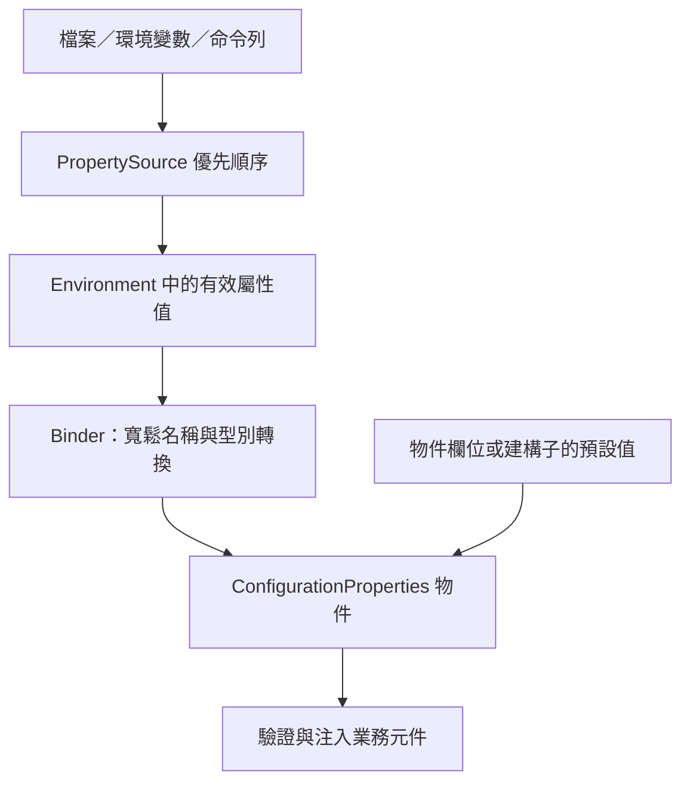
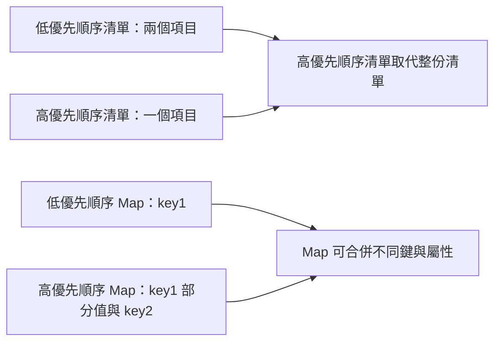

# 外部化設定

Spring Boot 讓你將設定外部化，使用相同應用程式程式碼在不同環境工作。可使用多種外部設定來源，包括 Java properties 檔案、YAML 檔案、環境變數及命令列引數。

屬性值可以透過 [`@Value`][r1] 直接注入 Bean、透過 Spring 的 [`Environment`][r2] 抽象存取，或透過 [`@ConfigurationProperties`][r4] [繫結至結構化物件][r3]。

Spring Boot 使用特定的 [`PropertySource`][r5] 順序，讓值能以合理方式覆寫。後面的屬性來源可覆寫前面的值。

來源依以下順序考慮：

1. 預設屬性，透過 [`SpringApplication.setDefaultProperties(Map)`][r6] 指定。
2. [`@Configuration`][r8] 類別上的 [`@PropertySource`][r7]。請注意，這類來源直到 application context 重新整理時才加入 [`Environment`][r2]，對於在重新整理前就讀取的 `logging.*`、`spring.main.*` 等屬性而言，已經太晚。
3. 設定資料，例如 `application.properties`。
4. 只提供 `random.*` 屬性的 [`RandomValuePropertySource`][r9]。
5. 作業系統環境變數。
6. Java 系統屬性，即 `System.getProperties()`。
7. `java:comp/env` 中的 JNDI 屬性。
8. [`ServletContext`][r10] 初始化參數。
9. [`ServletConfig`][r11] 初始化參數。
10. `SPRING_APPLICATION_JSON` 的屬性，即嵌入環境變數或系統屬性的行內 JSON。
11. 命令列引數。
12. 測試的 `properties` 屬性；可用於 [`@SpringBootTest`][r12] 與[測試應用程式特定切片的註解][r13]。
13. 測試中的 [`@DynamicPropertySource`][r14]。
14. 測試上的 [`@TestPropertySource`][r15]。
15. Devtools 啟用時，`$HOME/.config/spring-boot` 目錄中的 [Devtools 全域設定屬性][r16]。

設定資料檔案依以下順序考慮：

1. 封裝在 jar 內的[應用程式屬性][r17]，即 `application.properties` 與 YAML 版本。
2. 封裝在 jar 內的 [Profile 專用應用程式屬性][r18]，即 `application-{profile}.properties` 與 YAML 版本。
3. 封裝 jar 外的[應用程式屬性][r17]，即 `application.properties` 與 YAML 版本。
4. 封裝 jar 外的 [Profile 專用應用程式屬性][r18]，即 `application-{profile}.properties` 與 YAML 版本。

> [NOTE]
>
> 建議整個應用程式統一使用一種格式。若同一位置同時有 `.properties` 與 YAML 設定檔，`.properties` 優先。

> [NOTE]
>
> 若使用環境變數而非系統屬性，多數作業系統不允許以句點分隔的鍵名稱，但可改用底線，例如使用 `SPRING_CONFIG_NAME` 取代 `spring.config.name`。詳見[從環境變數繫結][r19]。

> [NOTE]
>
> 若應用程式在 Servlet 容器或應用程式伺服器中執行，可以使用 `java:comp/env` 中的 JNDI 屬性或 Servlet context 初始化參數，取代或搭配環境變數、系統屬性。

舉個具體例子，假設你開發使用 `name` 屬性的 [`@Component`][r20]，如下所示：

{{CODE_0}}

{{CODE_1}}

在應用程式 classpath（例如 jar 內）可放置 `application.properties`，提供合理的 `name` 預設值。於新環境執行時，可在 jar 外提供另一份 `application.properties` 覆寫 `name`。進行一次性測試時，可用特定命令列選項啟動，例如 `java -jar app.jar --name="Spring"`。

> [TIP]
>
> `env` 與 `configprops` 端點有助於了解某屬性為何具有特定值，可用來診斷非預期的屬性值。詳見[正式環境功能][r21]。

## 存取命令列屬性

[`SpringApplication`][r22] 預設會將所有命令列選項引數（以 `--` 開頭，例如 `--server.port=9000`）轉為 `property`，加入 Spring [`Environment`][r2]。如前所述，命令列屬性一律優先於檔案型屬性來源。

若不希望將命令列屬性加入 [`Environment`][r2]，可使用 `SpringApplication.setAddCommandLineProperties(false)` 停用。

## JSON 應用程式屬性

環境變數與系統屬性通常有限制，導致部分屬性名稱無法使用。為此，Spring Boot 允許將一組屬性編碼成單一 JSON 結構。

應用程式啟動時，任何 `spring.application.json` 或 `SPRING_APPLICATION_JSON` 屬性都會被解析並加入 [`Environment`][r2]。

例如，可在 UN\*X shell 命令列透過環境變數提供 `SPRING_APPLICATION_JSON`：

{{CODE_2}}

上述範例會在 Spring [`Environment`][r2] 得到 `my.name=test`。

同一份 JSON 也能透過系統屬性提供：

{{CODE_3}}

或透過命令列引數提供：

{{CODE_4}}

部署到傳統應用程式伺服器時，也可使用名稱為 `java:comp/env/spring.application.json` 的 JNDI 變數。

> [NOTE]
>
> JSON 中的 `null` 雖然會加入產生的屬性來源，但 [`PropertySourcesPropertyResolver`][r23] 會將 `null` 屬性視為缺值。因此，JSON 無法用 `null` 覆寫低優先順序來源的屬性。

## 外部應用程式屬性

應用程式啟動時，Spring Boot 會自動從下列位置尋找並載入 `application.properties` 與 `application.yaml`：

1. classpath：
   1. classpath 根目錄。
   2. classpath 的 `/config` 套件。
2. 目前目錄：
   1. 目前目錄本身。
   2. 目前目錄下的 `config/` 子目錄。
   3. `config/` 子目錄的直接子目錄。

此清單依優先順序排列，較下方項目的值覆寫前面的值。載入檔案中的文件會以 [`PropertySource`][r5] 實例加入 Spring [`Environment`][r2]。

若不喜歡 `application` 這個設定檔名，可用 `spring.config.name` 環境屬性改名。例如要尋找 `myproject.properties` 與 `myproject.yaml`，可這樣執行：

{{CODE_5}}

也可以透過 `spring.config.location` 環境屬性指定明確位置。此屬性接受以逗號分隔的一或多個待檢查位置。

下例指定兩個不同檔案：

{{CODE_6}}

> [TIP]
>
> 若[位置是選用的][r24]，不存在也無妨，請使用 `optional:` 前綴。

> [WARNING]
>
> `spring.config.name`、`spring.config.location` 與 `spring.config.additional-location` 很早就會用來決定要載入哪些檔案，必須定義為環境屬性，通常是作業系統環境變數、系統屬性或命令列引數。

如果 `spring.config.location` 包含目錄而非檔案，應以 `/` 結尾。執行時會先在目錄後附加由 `spring.config.name` 產生的名稱，再載入。明確指定的檔案則直接匯入。

> [NOTE]
>
> 目錄與檔案位置都會展開，以檢查 [Profile 專用檔案][r18]。例如 `spring.config.location` 為 `classpath:myconfig.properties` 時，也會載入適用的 `classpath:myconfig-<profile>.properties`。

多數情況下，加入的每個 `spring.config.location` 項目參照單一檔案或目錄。位置按定義順序處理，後者可覆寫前者。

若位置設定複雜，且使用 Profile 專用檔案，可能需提供額外提示，讓 Spring Boot 知道如何分組。位置群組是一組視為同一層級的位置。例如你可能想將所有 classpath 位置分為一組，再將所有外部位置分為一組。群組內項目以 `;` 分隔。詳見 [Profile 專用檔案][r18]一節的範例。

`spring.config.location` 設定的位置會取代預設位置。例如設為 `optional:classpath:/custom-config/,optional:file:./custom-config/` 時，完整搜尋位置為：

1. `optional:classpath:custom-config/`
2. `optional:file:./custom-config/`

若希望增加位置而非取代，可使用 `spring.config.additional-location`。額外位置載入的屬性可覆寫預設位置。例如設為 `optional:classpath:/custom-config/,optional:file:./custom-config/` 時，完整位置為：

1. `optional:classpath:/;optional:classpath:/config/`
2. `optional:file:./;optional:file:./config/;optional:file:./config/*/`
3. `optional:classpath:custom-config/`
4. `optional:file:./custom-config/`

這個搜尋順序讓你在一個設定檔指定預設值，再於另一個檔案選擇性覆寫。可在預設位置的 `application.properties`（或由 `spring.config.name` 選擇的其他基本名稱）提供應用程式預設值，執行時再用自訂位置中的另一個檔案覆寫。

### 選用位置

預設指定的設定資料位置不存在時，Spring Boot 會擲出 [`ConfigDataLocationNotFoundException`][r25]，應用程式無法啟動。

若想指定位置，但允許它有時不存在，可使用 `optional:` 前綴。此前綴可用於 `spring.config.location`、`spring.config.additional-location`，以及 [`spring.config.import`][r26] 宣告。

例如 `spring.config.import` 設為 `optional:file:./myconfig.properties`，允許應用程式即使缺少 `myconfig.properties` 仍能啟動。

若要忽略所有 [`ConfigDataLocationNotFoundException`][r25] 並一律繼續啟動，可透過 `SpringApplication.setDefaultProperties(…)` 或系統／環境變數，將 `spring.config.on-not-found` 設為 `ignore`。

### 萬用字元位置

若設定檔位置的最後一段路徑包含 `*`，即視為萬用字元位置。載入設定時會展開萬用字元，連直接子目錄也一起檢查。在 Kubernetes 等具有多個設定來源的環境中，這特別實用。

例如你有 Redis 與 MySQL 設定，希望分開維護，但兩者都必須存在於 `application.properties`。因此可能有兩份同名檔案，分別掛載於 `/config/redis/application.properties` 與 `/config/mysql/application.properties`。此時，`config/*/` 萬用位置會讓兩者都被處理。

Spring Boot 預設搜尋位置已包含 `config/*/`，因此會搜尋 jar 外 `/config` 目錄的所有子目錄。

也可自行在 `spring.config.location` 與 `spring.config.additional-location` 使用萬用位置。

> [NOTE]
>
> 萬用位置只能包含一個 `*`。搜尋目錄時須以 `*/` 結尾；搜尋檔案時須以 `*/<filename>` 結尾。含萬用字元的位置依檔案絕對路徑的字母順序排序。

> [TIP]
>
> 萬用位置只適用於外部目錄，不能用於 `classpath:` 位置。

### Profile 專用檔案

除了 `application` 屬性檔，Spring Boot 也會嘗試依 `application-{profile}` 命名慣例載入 Profile 專用檔案。例如啟用 `prod` 並使用 YAML 時，會同時考慮 `application.yaml` 與 `application-prod.yaml`。

Profile 專用屬性從與一般 `application.properties` 相同的位置載入，而且一律覆寫非專用檔案。指定多個 Profile 時採後者優先。例如 `spring.profiles.active` 設為 `prod,live`，`application-live.properties` 可覆寫 `application-prod.properties` 的值。

> [NOTE]
>
> 後者優先策略在[位置群組][r27]層級套用。`spring.config.location=classpath:/cfg/,classpath:/ext/` 與 `classpath:/cfg/;classpath:/ext/` 的覆寫規則不同。
>
> 延續 `prod,live` 範例，假設有下列檔案：
>
{{CODE_7}}
>
> 使用 `classpath:/cfg/,classpath:/ext/` 時，先處理所有 `/cfg`，再處理所有 `/ext`：
>
> 1. `/cfg/application-live.properties`
> 2. `/ext/application-prod.properties`
> 3. `/ext/application-live.properties`
>
> 改用 `classpath:/cfg/;classpath:/ext/`，即以 `;` 分隔時，`/cfg` 與 `/ext` 在同一層級處理：
>
> 1. `/ext/application-prod.properties`
> 2. `/cfg/application-live.properties`
> 3. `/ext/application-live.properties`

[`Environment`][r2] 有一組預設 Profile，預設為 `[default]`，在未設定作用中 Profile 時使用。換言之，未明確啟用 Profile 時，會考慮 `application-default` 的屬性。

> [NOTE]
>
> 屬性檔只載入一次。若已直接[匯入][r26]某個 Profile 專用屬性檔，就不會再次匯入。

### 匯入其他資料

應用程式屬性可以透過 `spring.config.import`，從其他位置匯入額外設定資料。匯入在發現時即處理，視為緊接著插入宣告匯入的文件之後的額外文件。

例如 classpath 中的 `application.properties` 可能包含：

{{CODE_8}}

{{CODE_9}}

這會匯入目前目錄的 `dev.properties`（若存在）。匯入檔案的值優先於觸發匯入的檔案。上述例子中，`dev.properties` 可將 `spring.application.name` 改為其他值。

> [NOTE]
>
> 不論宣告多少次，每個匯入只會匯入一次。

properties 檔案預設以 ISO-8859-1 字元集匯入，可用 encoding 屬性變更：

{{CODE_10}}

{{CODE_11}}

現在 `import.properties` 會以 UTF-8 讀取。

#### 使用「固定」與「相對匯入」位置

匯入可指定為**固定**或**相對匯入**位置。固定位置不論 `spring.config.import` 宣告在哪裡，都解析為相同底層資源；相對匯入位置則相對於宣告該屬性的檔案解析。

以斜線 `/` 或 URL 風格前綴（`file:`、`classpath:` 等）開頭者視為固定位置，其餘均為相對匯入位置。

> [NOTE]
>
> 判定固定或相對匯入位置時，不考慮 `optional:` 前綴。

例如 `/demo` 目錄包含 `application.jar`，我們加入以下 `/demo/application.properties`：

{{CODE_12}}

這是相對匯入位置，因此若 `/demo/core/core.properties` 存在，就會嘗試載入。

若 `/demo/core/core.properties` 包含：

{{CODE_13}}

便會嘗試載入 `/demo/core/extra/extra.properties`。`optional:extra/extra.properties` 相對於 `/demo/core/core.properties`，因此完整路徑是 `/demo/core/` 加上 `extra/extra.properties`。

#### 屬性順序

匯入宣告在 properties／YAML 檔案單一文件內的位置不影響結果。例如以下兩種寫法相同：

{{CODE_14}}

{{CODE_15}}

{{CODE_16}}

{{CODE_17}}

兩者都是 `my.properties` 的值優先於觸發匯入的檔案。

同一個 `spring.config.import` 鍵可指定多個位置，依宣告順序處理，後面的匯入優先。

> [NOTE]
>
> 適用時，也會考慮 [Profile 專用版本][r18]。上述例子會匯入 `my.properties` 以及任何 `my-<profile>.properties`。

> [TIP]
>
> Spring Boot 提供可插拔 API，支援不同位置位址。預設可匯入 Java Properties、YAML 與[設定樹][r28]。
>
> 第三方 jar 可支援其他技術，檔案不必位於本機。例如設定資料可能來自 Consul、Apache ZooKeeper 或 Netflix Archaius 等外部儲存系統。
>
> 若要支援自己的位置，請參閱 `org.springframework.boot.context.config` 套件的 [`ConfigDataLocationResolver`][r29] 與 [`ConfigDataLoader`][r30]。

### 匯入沒有副檔名的檔案

部分雲端平台無法為掛載的檔案加上副檔名。匯入時必須給 Spring Boot 提示，讓它知道如何載入；可在方括號內放入副檔名提示。

例如想把 `/etc/config/myconfig` 當作 YAML 匯入，可在 `application.properties` 使用：

{{CODE_18}}

{{CODE_19}}

這是以下寫法的簡寫：

{{CODE_20}}

{{CODE_21}}

### 檔案屬性

`spring.config.import` 支援檔案屬性，如指定[編碼][r26]或[副檔名][r31]時所示。

若需指定多個屬性，可用以下語法：

{{CODE_22}}

{{CODE_23}}

### 使用環境變數

在 Kubernetes 等雲端平台執行應用程式時，通常需要讀取平台提供的設定值。可使用環境變數，或[設定樹][r28]。

甚至能將完整的 properties 或 YAML 設定存於多行環境變數，再以 `env:` 前綴載入。假設環境變數 `MY_CONFIGURATION` 內容為：

{{CODE_24}}

可用 `env:` 匯入該變數中的全部屬性：

{{CODE_25}}

{{CODE_26}}

> [TIP]
>
> 此功能也支援[指定副檔名][r31]，預設為 `.properties`。

### 使用設定樹

將設定值存於環境變數有其缺點，尤其是應保密的值。

作為替代，許多雲端平台允許將設定映射到掛載的資料磁碟區。例如 Kubernetes 可以掛載 [`ConfigMaps`][r32] 與 [`Secrets`][r33]。

常見的掛載模式有兩種：

1. 單一檔案包含完整屬性集合，通常以 YAML 撰寫。
2. 將多個檔案寫入目錄樹，檔名成為「鍵」，檔案內容成為「值」。

第一種情況可依[前文][r26]使用 `spring.config.import` 直接匯入 YAML 或 Properties。第二種則須使用 `configtree:` 前綴，告知 Spring Boot 將所有檔案公開為屬性。

假設 Kubernetes 掛載以下磁碟區：

{{CODE_27}}

`username` 檔案內容是設定值，`password` 內容則是機密資料。

若要匯入，請在 `application.properties` 或 `application.yaml` 加入：

{{CODE_28}}

{{CODE_29}}

接著就能以一般方式從 [`Environment`][r2] 存取或注入 `myapp.username` 與 `myapp.password`。

> [TIP]
>
> 設定樹下的資料夾與檔案名稱共同構成屬性名稱。上述例子若要直接以 `username` 與 `password` 存取，可將 `spring.config.import` 設為 `optional:configtree:/etc/config/myapp`。

> [NOTE]
>
> 含句點的檔名也會正確映射。例如 `/etc/config` 中名為 `myapp.username` 的檔案，會在 [`Environment`][r2] 產生 `myapp.username` 屬性。

> [TIP]
>
> 依預期內容，設定樹的值可繫結為 [`String`][r34] 或 `byte[]`。

若從同一父目錄匯入多個設定樹，可使用萬用字元簡寫。任何以 `/*/` 結尾的 `configtree:` 位置，都會將所有直接子目錄作為設定樹匯入。與沒有萬用字元的匯入相同，各設定樹下的資料夾與檔案名稱構成屬性名稱。

例如有以下磁碟區：

{{CODE_30}}

可將 `configtree:/etc/config/*/` 作為匯入位置：

{{CODE_31}}

{{CODE_32}}

這會加入 `db.username`、`db.password`、`mq.username` 與 `mq.password`。

> [NOTE]
>
> 以萬用字元載入的目錄依字母排序。若需其他順序，應將每個位置列為獨立匯入。

設定樹也可用於 Docker secret。Docker Swarm 服務獲授權存取 secret 後，secret 會掛載到容器。例如名為 `db.password` 的 secret 掛載於 `/run/secrets/`，可透過以下方式讓 Spring environment 取得 `db.password`：

{{CODE_33}}

{{CODE_34}}

### 屬性佔位符

`application.properties` 與 `application.yaml` 的值在使用時會經過現有 [`Environment`][r2] 解析，因此能參照先前定義的值，例如系統屬性或環境變數。標準 `${name}` 佔位符語法可放在值的任何位置。也能以 `:` 分隔屬性名稱與預設值，例如 `${name:default}`。

以下示範有、無預設值的佔位符：

{{CODE_35}}

{{CODE_36}}

假設其他地方未設定 `username`，`app.description` 的值會是 `MyApp is a Spring Boot application written by Unknown`。

> [NOTE]
>
> 佔位符中的屬性名稱應一律採標準形式，即只使用小寫的 kebab-case。這讓 Spring Boot 能使用與 [`@ConfigurationProperties`][r4] [寬鬆繫結][r35]相同的邏輯。
>
> 例如 `${demo.item-price}` 可找到 `application.properties` 的 `demo.item-price` 與 `demo.itemPrice`，以及系統環境的 `DEMO_ITEMPRICE`。若改用 `${demo.itemPrice}`，能找到檔案的 `demo.itemPrice` 與系統環境的 `DEMO_ITEMPRICE`，但不考慮 `demo.item-price`。

> [TIP]
>
> 此技巧也能為既有 Spring Boot 屬性建立「短版」。詳見 How-to Guides 的[使用「短」命令列引數][r36]。

### 使用多文件檔案

Spring Boot 允許將一個實體檔案分成多個邏輯文件，分別加入。文件由上而下依序處理，後面的文件可覆寫前面的屬性。

`application.yaml` 使用標準 YAML 多文件語法。連續三個連字號表示前一文件結束、下一文件開始。

例如以下檔案有兩份邏輯文件：

{{CODE_37}}

`application.properties` 則使用特殊的 `#---` 或 `!---` 註解分隔：

{{CODE_38}}

> [NOTE]
>
> properties 檔案的分隔符前不能有空白，且必須恰好有三個連字號。分隔符前後緊鄰的行，不得使用與分隔符相同的註解前綴。

> [TIP]
>
> 多文件屬性檔經常搭配 `spring.config.activate.on-profile` 等啟用屬性使用，詳見[下一節][r37]。

> [WARNING]
>
> [`@PropertySource`][r7] 與 [`@TestPropertySource`][r15] 無法載入多文件屬性檔。

### 啟用屬性

有時只想在符合特定條件時啟用一組屬性，例如只與某個作用中 Profile 有關的屬性。

可使用 `spring.config.activate.*` 有條件地啟用屬性文件。

提供以下啟用屬性：

表 1. 啟用屬性

| 屬性 | 說明 |
| --- | --- |
| `on-profile` | 文件啟用所須符合的 Profile 運算式；也可為運算式清單，其中至少一個符合即可啟用。 |
| `on-cloud-platform` | 文件啟用時必須偵測到的 [`CloudPlatform`][r38]。 |

例如下例指定第二份文件只在 Kubernetes 上執行，而且「prod」或「staging」Profile 啟用時生效：

{{CODE_39}}

{{CODE_40}}

## 加密屬性

Spring Boot 沒有內建屬性值加密支援，但提供修改 Spring [`Environment`][r2] 值所需的擴充接點。[`EnvironmentPostProcessor`][r39] 允許在應用程式啟動前操作 [`Environment`][r2]。詳見[啟動前自訂 Environment 或 ApplicationContext][r40]。

若需要安全儲存憑證與密碼，[Spring Cloud Vault][r41] 支援將外部化設定儲存在 [HashiCorp Vault][r42]。

## 使用 YAML

[YAML][r43] 是 JSON 的超集合，因此很適合表達階層式設定資料。classpath 中只要有 [SnakeYAML][r44]，[`SpringApplication`][r22] 就自動支援以 YAML 取代 properties。

> [NOTE]
>
> 使用 starter 時，`spring-boot-starter` 會自動提供 SnakeYAML。

### 將 YAML 映射為屬性

YAML 文件必須從階層式格式轉換為 Spring [`Environment`][r2] 可使用的扁平結構。例如：

{{CODE_41}}

為了從 [`Environment`][r2] 存取，會攤平成：

{{CODE_42}}

YAML 清單同樣需要攤平，以帶有 `[index]` 索引的屬性鍵表示。例如：

{{CODE_43}}

會轉為：

{{CODE_44}}

> [TIP]
>
> 使用 `[index]` 表示法的屬性，可透過 Spring Boot [`Binder`][r47] 繫結為 Java [`List`][r45] 或 [`Set`][r46]。詳見下方[型別安全的設定屬性][r3]。

> [WARNING]
>
> [`@PropertySource`][r7] 與 [`@TestPropertySource`][r15] 無法載入 YAML。因此若必須以這些註解載入值，就要使用 properties 檔案。

### 直接載入 YAML

Spring Framework 提供兩個便利類別：[`YamlPropertiesFactoryBean`][r48] 將 YAML 載入為 [`Properties`][r49]；[`YamlMapFactoryBean`][r50] 將 YAML 載入為 [`Map`][r51]。

若要載入為 Spring [`PropertySource`][r5]，也可使用 [`YamlPropertySourceLoader`][r52]。

## 設定隨機值

[`RandomValuePropertySource`][r9] 適合注入隨機值，例如機密值或測試案例。它能產生 integer、long、UUID 或字串，如下所示：

{{CODE_45}}

{{CODE_46}}

`random.int*` 的語法是 `OPEN value (,max) CLOSE`，其中 `OPEN,CLOSE` 代表任意字元，`value,max` 為整數。若提供 `max`，`value` 是最小值，`max` 是最大值且不包含該上限。

## 設定系統環境屬性

Spring Boot 支援為環境屬性設定前綴。當多個設定需求不同的 Spring Boot 應用程式共用系統環境時，這很實用。可在執行前直接對 [`SpringApplication`][r22] 呼叫 `setEnvironmentPrefix(…)`。

例如前綴設為 `input`，`remote.timeout` 會從系統環境解析為 `INPUT_REMOTE_TIMEOUT`。

> [NOTE]
>
> 前綴**只**適用於系統環境屬性。上述例子從其他來源讀取時，仍使用 `remote.timeout`。

## 型別安全的設定屬性

使用 `@Value("${property}")` 注入設定有時很繁瑣，尤其需要處理多個屬性，或資料本身具有階層結構。Spring Boot 提供另一種方式，以強型別 Bean 管理並驗證應用程式設定。

> [TIP]
>
> 另見 [`@Value` 與型別安全設定屬性的差異][r53]。

### JavaBean 屬性繫結

可將設定繫結至宣告標準 JavaBean 屬性的 Bean，例如：

{{CODE_47}}

{{CODE_48}}

上述 POJO 定義：

- `my.service.enabled`：預設值為 `false`。
- `my.service.remote-address`：型別可由 [`String`][r34] 轉換。
- `my.service.security.username`：巢狀「security」物件的名稱取自屬性名稱；此處完全不使用型別名稱，型別也可以是 [`SecurityProperties`][r54]。
- `my.service.security.password`。
- `my.service.security.roles`：[`String`][r34] 集合，預設為 `USER`。

> [TIP]
>
> 若屬性名稱須使用保留字，例如 `my.service.import`，請在欄位標註 [`@Name`][r55]。

> [NOTE]
>
> Spring Boot 提供的 [`@ConfigurationProperties`][r4] 類別，透過 properties、YAML、環境變數等方式設定的對應屬性屬於公開 API；但類別本身的 getter／setter 並非供直接使用。

> [NOTE]
>
> 這種方式依賴預設無參數建構子，通常也必須有 getter 與 setter，因為繫結和 Spring MVC 一樣使用標準 JavaBean 屬性描述器。以下情況可省略 setter：
>
> - 預先初始化的 Map 與 Collection，只要使用可變實作，例如前例 `roles`。
> - 預先初始化的巢狀 POJO，例如前例 `Security`。若希望 binder 透過其預設建構子即時建立實例，則需要 setter。
>
> 有些人使用 Project Lombok 自動加入 getter／setter。請確保 Lombok 不為此型別產生特定建構子，因為容器會自動使用它建立物件。
>
> 最後，只考慮標準 JavaBean 屬性，不支援靜態屬性繫結。

### 建構子繫結

前節範例可改寫為不可變形式：

{{CODE_49}}

{{CODE_50}}

此設定中，存在單一有參數建構子就表示應使用建構子繫結。binder 會尋找帶有所需繫結參數的建構子。若類別有多個建構子，可用 [`@ConstructorBinding`][r56] 指定。

若要讓類別不使用建構子繫結，須在有參數建構子標註 [`@Autowired`][r57]，或將它設為 `private`。Kotlin 可使用空的主要建構子停用建構子繫結。

例如：

{{CODE_51}}

{{CODE_52}}

record 也能使用建構子繫結。除非 record 有多個建構子，否則不必加上 [`@ConstructorBinding`][r56]。

採建構子繫結的類別，其巢狀成員（例如上例的 `Security`）也透過各自建構子繫結。

> [NOTE]
>
> 類別必須透過 [`@EnableConfigurationProperties`][r58] 或設定屬性掃描啟用，才能使用建構子繫結。一般 Spring 機制建立的 Bean 無法使用，例如 [`@Component`][r20]、[`@Bean`][r59] 方法建立的 Bean，或 [`@Import`][r60] 載入的 Bean。

> [NOTE]
>
> 使用建構子繫結時，類別必須以 `-parameters` 編譯。使用 Spring Boot Gradle 外掛，或 Maven 搭配 `spring-boot-starter-parent` 時，會自動處理。

> [NOTE]
>
> 不建議在 [`@ConfigurationProperties`][r4] 使用 [`Optional`][r61]，因為其主要用途是回傳型別，不太適合設定屬性注入。若宣告了建構子繫結的 [`Optional`][r61] 屬性卻沒有值，會繫結為空的 [`Optional`][r61]。

> [TIP]
>
> 若屬性名稱須使用保留字，例如 `my.service.import`，請在建構子參數標註 [`@Name`][r55]。

#### @DefaultValue 與繫結

可在建構子參數與 record 元件使用 [`@DefaultValue`][r62] 指定預設值。當屬性缺值，轉換服務會把註解的 [`String`][r34] 值轉成目標型別。

前述 `MyProperties` 的巢狀 `Security` 類別，在 `roles` 參數使用 `@DefaultValue("USER")`。因此若定義了 `security` 屬性，但沒有 `roles`，便繫結預設值 `"USER"`。

例如以下屬性：

{{CODE_53}}

{{CODE_54}}

會繫結為 `new MyProperties(true, null, new Security("admin", null, List.of("USER")))`。

若完全不存在 `security` 屬性，`Security` 實例就會是 `null`。

例如：

{{CODE_55}}

{{CODE_56}}

會繫結為 `new MyProperties(true, null, null)`。

> [NOTE]
>
> 若希望觸發繫結並建立全部採預設值的 `Security` 實例，可以定義空的 `security` 屬性。
>
> YAML 使用：
>
{{CODE_57}}
>
> Properties 使用：
>
{{CODE_58}}
>
> 會繫結為 `new MyProperties(true, null, new Security(null, null, List.of("USER")))`。

若希望即使缺少屬性，也一律繫結非 null 的 `Security`，可使用空的 [`@DefaultValue`][r62]：

{{CODE_59}}

{{CODE_60}}

> [TIP]
>
> Kotlin 中，`username` 與 `password` 沒有預設值，因此必須宣告為可為 null。

### 預設值

設定屬性中定義的預設值不會反映到 [`Environment`][r2]。前例中，繫結至 `my.service` 的 `MyProperties` 的 `enabled` 屬性預設為 `false`。

但若使用者未設定，`Environment` 並不會出現值為 `false` 的 `my.service.enabled`。因此若未明確提供預設值，無法直接使用 `@Value("${my.service.enabled}")`，或在設定屬性中以 `my.service.enabled` 作為佔位符。若需查詢 [`Environment`][r2]，例如在 [`Condition`][r63] 實作中，也必須自行提供預設值。

### 啟用標註 @ConfigurationProperties 的型別

Spring Boot 提供基礎設施，繫結 [`@ConfigurationProperties`][r4] 型別並註冊為 Bean。可以逐一啟用類別，也可啟用類似元件掃描的設定屬性掃描。

有時這類類別不適合掃描，例如正在開發自己的自動設定，或希望有條件地啟用。此時可用 [`@EnableConfigurationProperties`][r58] 指定要處理的型別清單，放在任何 [`@Configuration`][r8] 類別上：

{{CODE_61}}

{{CODE_62}}

{{CODE_63}}

{{CODE_64}}

若要使用設定屬性掃描，請加入 [`@ConfigurationPropertiesScan`][r64]。通常放在標註 [`@SpringBootApplication`][r65] 的主應用程式類別，也可放在任何 [`@Configuration`][r8]。預設從宣告註解的類別所在套件開始掃描。若要指定套件，可這樣做：

{{CODE_65}}

{{CODE_66}}

> [NOTE]
>
> 透過設定屬性掃描或 [`@EnableConfigurationProperties`][r58] 註冊的 [`@ConfigurationProperties`][r4] Bean，採慣例名稱 `<prefix>-<fqn>`。`<prefix>` 為註解指定的環境鍵前綴，`<fqn>` 為 Bean 的完整限定名稱。未指定前綴時，只使用完整限定名稱。
>
> 假設前述 `SomeProperties` 位於 `com.example.app`，其 Bean 名稱就是 `some.properties-com.example.app.SomeProperties`。

建議 [`@ConfigurationProperties`][r4] 只處理環境資料，尤其不要注入 context 中其他 Bean。特殊情況可用 setter 注入，或框架提供的 `*Aware` 介面，例如需要存取 [`Environment`][r2] 時使用 [`EnvironmentAware`][r66]。若仍想透過建構子注入其他 Bean，設定屬性 Bean 必須標註 [`@Component`][r20]，並使用 JavaBean 屬性繫結。

### 使用標註 @ConfigurationProperties 的型別

這種設定方式特別適合搭配 [`SpringApplication`][r22] 的外部 YAML 設定：

{{CODE_67}}

使用 [`@ConfigurationProperties`][r4] Bean 時，可像其他 Bean 一樣注入：

{{CODE_68}}

{{CODE_69}}

> [TIP]
>
> [`@ConfigurationProperties`][r4] 也能產生中繼資料檔案，供 IDE 為你的設定鍵提供自動完成。詳見[附錄][r67]。

### 第三方設定

除了標註類別，也可將 [`@ConfigurationProperties`][r4] 放在 public [`@Bean`][r59] 方法。當你想將屬性繫結到無法控制原始碼的第三方元件時，這尤其實用。

若要透過 [`Environment`][r2] 屬性設定 Bean，請在 Bean 註冊處加入 [`@ConfigurationProperties`][r4]：

{{CODE_70}}

{{CODE_71}}

所有帶有 `another` 前綴的 JavaBean 屬性，都會以類似前述 `SomeProperties` 的方式映射到 `AnotherComponent` Bean。

### 寬鬆繫結

Spring Boot 將 [`Environment`][r2] 屬性繫結至 [`@ConfigurationProperties`][r4] Bean 時，採用寬鬆規則，因此環境屬性名稱不必與 Bean 屬性名稱完全相同。常見用途包括以連字號分隔的屬性，例如 `context-path` 繫結到 `contextPath`，以及大寫屬性，例如 `PORT` 繫結到 `port`。

考慮以下 [`@ConfigurationProperties`][r4] 類別：

{{CODE_72}}

{{CODE_73}}

以上程式碼可使用下列所有屬性名稱：

表 2. 寬鬆繫結

| 屬性 | 說明 |
| --- | --- |
| `my.main-project.person.first-name` | kebab-case，建議用於 `.properties` 與 YAML。 |
| `my.main-project.person.firstName` | 標準 camelCase。 |
| `my.main-project.person.first_name` | 底線表示法，可作為 `.properties` 與 YAML 的替代格式。 |
| `MY_MAINPROJECT_PERSON_FIRSTNAME` | 大寫格式，建議用於系統環境變數。 |

> [NOTE]
>
> 註解的 `prefix` **必須**採 kebab-case，即小寫並以 `-` 分隔，例如 `my.main-project.person`。

表 3. 各來源的寬鬆繫結規則

| 屬性來源 | 簡單值 | 清單 |
| --- | --- | --- |
| Properties 檔案 | camelCase、kebab-case 或底線表示法 | 使用 `[ ]` 的標準清單語法，或逗號分隔值 |
| YAML 檔案 | camelCase、kebab-case 或底線表示法 | 標準 YAML 清單，或逗號分隔值 |
| 環境變數 | 大寫、以底線分隔，見[從環境變數繫結][r19] | 數字前後以底線包住，見[從環境變數繫結][r19] |
| 系統屬性 | camelCase、kebab-case 或底線表示法 | 使用 `[ ]` 的標準清單語法，或逗號分隔值 |

> [TIP]
>
> 建議盡可能使用小寫 kebab-case 儲存屬性，例如 `my.person.first-name=Rod`。

#### 繫結 Map

繫結 [`Map`][r51] 屬性時，可能需要特殊方括號語法才能保留原始 `key`。若鍵未以 `[]` 包住，非英數字、`-` 或 `.` 的字元都會移除。

例如將以下屬性繫結到 `Map<String,String>`：

{{CODE_74}}

{{CODE_75}}

> [NOTE]
>
> YAML 的方括號必須放在引號內，鍵才能正確解析。

上述屬性會繫結為鍵包含 `/key1`、`/key2` 與 `key3` 的 [`Map`][r51]。`key3` 未用方括號包住，因此斜線被移除。

繫結到純量值時，含 `.` 的鍵不必以 `[]` 包住。純量包括 enum，以及 `java.lang` 中除 [`Object`][r68] 之外的所有型別。將 `a.b=c` 繫結到 `Map<String, String>`，會保留鍵中的 `.`，得到 `{"a.b"="c"}`。其他型別若鍵包含 `.`，就需方括號。例如將 `a.b=c` 繫結到 `Map<String, Object>` 得到 `{"a"={"b"="c"}}`，而 `[a.b]=c` 得到 `{"a.b"="c"}`。

#### 從環境變數繫結

多數作業系統嚴格限制環境變數名稱。例如 Linux shell 變數只能包含字母 `a` 到 `z` 或 `A` 到 `Z`、數字 `0` 到 `9`，以及底線 `_`。依慣例，Unix shell 變數名稱也採大寫。

Spring Boot 的寬鬆繫結規則盡可能相容於這些限制。

標準形式的屬性名稱可依下列規則轉為環境變數名稱：

- 將句點 `.` 改為底線 `_`。
- 移除連字號 `-`。
- 轉為大寫。

例如 `spring.main.log-startup-info` 對應 `SPRING_MAIN_LOGSTARTUPINFO`。

環境變數也能繫結物件清單。繫結 [`List`][r45] 時，變數名稱中的元素編號應以底線前後包住。

例如 `my.service[0].other` 對應 `MY_SERVICE_0_OTHER`。

環境變數繫結支援套用於 `systemEnvironment` 屬性來源，以及任何名稱以 `-systemEnvironment` 結尾的額外來源。

#### 從環境變數繫結 Map

Spring Boot 將環境變數繫結到屬性類別前，會先將變數名稱轉為小寫。多數情況這不重要，但繫結 [`Map`][r51] 時需注意。

[`Map`][r51] 的鍵永遠是小寫，例如：

{{CODE_76}}

{{CODE_77}}

設定 `MY_PROPS_VALUES_KEY=value` 時，`values` [`Map`][r51] 包含 `{"key"="value"}`。

只有環境變數**名稱**轉成小寫，值不會變。設定 `MY_PROPS_VALUES_KEY=VALUE` 時，包含的是 `{"key"="VALUE"}`。

#### 快取

寬鬆繫結使用快取改善效能，預設只用於不可變的屬性來源。若要自訂，例如為可變來源啟用快取，請使用 [`ConfigurationPropertyCaching`][r69]。

### 合併複雜型別

清單在多個位置設定時，覆寫會取代整個清單。

例如 `MyPojo` 的 `name` 與 `description` 預設皆為 `null`。下例由 `MyProperties` 公開 `MyPojo` 清單：

{{CODE_78}}

{{CODE_79}}

考慮以下設定：

{{CODE_80}}

{{CODE_81}}

未啟用 `dev` 時，`MyProperties.list` 含前面定義的一個 `MyPojo`。啟用 `dev` 後，`list` **仍然**只有一個項目，名稱為 `my another name`、說明為 `null`。這**不會**將第二個 `MyPojo` 加入清單，也不會合併項目。

多個 Profile 指定 [`List`][r45] 時，只使用優先順序最高的那一個。考慮：

{{CODE_82}}

{{CODE_83}}

此例啟用 `dev` 後，`MyProperties.list` 包含**一個** `MyPojo`，名稱為 `my another name`、說明為 `null`。YAML 可使用逗號分隔清單或 YAML 清單，完整覆寫清單內容。

[`Map`][r51] 屬性可從多個來源取得值來繫結，但多個來源的同一屬性，仍使用最高優先順序者。下例由 `MyProperties` 公開 `Map<String, MyPojo>`：

{{CODE_84}}

{{CODE_85}}

考慮以下設定：

{{CODE_86}}

{{CODE_87}}

未啟用 `dev` 時，`MyProperties.map` 有一個 `key1` 項目，名稱 `my name 1`、說明 `my description 1`。啟用 `dev` 後，`map` 有兩個項目：`key1` 的名稱為 `dev name 1`、說明仍為 `my description 1`；`key2` 的名稱為 `dev name 2`、說明為 `dev description 2`。

> [NOTE]
>
> 上述合併規則適用於所有屬性來源，不限於檔案。

### 屬性轉換

Spring Boot 將外部屬性繫結到 [`@ConfigurationProperties`][r4] Bean 時，會嘗試轉成正確型別。若需自訂，可提供名稱為 `conversionService` 的 [`ConversionService`][r70] Bean、透過 [`CustomEditorConfigurer`][r71] 提供自訂 property editor，或定義標註 [`@ConfigurationPropertiesBinding`][r72] 的自訂 converter Bean。

> [NOTE]
>
> 屬性轉換 Bean 在應用程式生命週期很早就會被要求，因此務必限制 [`ConversionService`][r70] 的依賴。建立時，它需要的依賴通常可能尚未完整初始化。

> [TIP]
>
> 若自訂 [`ConversionService`][r70] 不用於設定鍵轉換，可考慮改名，只依賴標註 [`@ConfigurationPropertiesBinding`][r72] 的自訂 converter。以 `@ConfigurationPropertiesBinding` 標註 `@Bean` 方法時，方法應為 `static`，避免「bean is not eligible for getting processed by all BeanPostProcessors」警告。

#### 轉換 Duration

Spring Boot 專門支援時間長度。若公開 [`Duration`][r73] 屬性，可使用：

- 一般 `long` 表示法，預設單位為毫秒，除非指定 [`@DurationUnit`][r74]。
- [`Duration` 使用的][r75]標準 ISO-8601 格式。
- 數值與單位組合的易讀格式，例如 `10s` 表示 10 秒。

例如：

{{CODE_88}}

{{CODE_89}}

要將工作階段逾時設為 30 秒，`30`、`PT30S`、`30s` 等效。讀取逾時 500 毫秒可寫為 `500`、`PT0.5S`、`500ms`。

也可使用任何支援的單位：

- `ns`：奈秒。
- `us`：微秒。
- `ms`：毫秒。
- `s`：秒。
- `m`：分鐘。
- `h`：小時。
- `d`：天。

預設單位為毫秒，可依上例用 [`@DurationUnit`][r74] 覆寫。

若偏好建構子繫結，也能公開相同屬性：

{{CODE_90}}

{{CODE_91}}

> [TIP]
>
> 若從 [`Long`][r76] 屬性升級，原單位若不是毫秒，務必使用 [`@DurationUnit`][r74] 定義。這可提供不影響既有設定的升級路徑，同時支援更豐富的格式。

#### 轉換 Period

除時間長度外，Spring Boot 也支援 [`Period`][r77]。可使用：

- 一般 `int` 表示法，預設單位為天，除非指定 [`@PeriodUnit`][r78]。
- [`Period` 使用的][r79]標準 ISO-8601 格式。
- 數值與單位組合的簡單格式，例如 `1y3d` 表示 1 年又 3 天。

簡單格式支援：

- `y`：年。
- `m`：月。
- `w`：週。
- `d`：天。

> [NOTE]
>
> [`Period`][r77] 實際上不儲存週數，週只是「7 天」的簡寫。

#### 轉換資料大小

Spring Framework 的 [`DataSize`][r80] 值型別以位元組表示大小。若公開此屬性，可使用：

- 一般 `long` 表示法，預設單位為位元組，除非指定 [`@DataSizeUnit`][r81]。
- 數值與單位組合的易讀格式，例如 `10MB` 表示 10 MB。

例如：

{{CODE_92}}

{{CODE_93}}

若要將緩衝區設為 10 MB，`10` 與 `10MB` 等效。256 位元組的大小門檻可寫為 `256` 或 `256B`。

也可使用任何支援單位：

- `B`：位元組。
- `KB`：KB。
- `MB`：MB。
- `GB`：GB。
- `TB`：TB。

預設單位為位元組，可依上例用 [`@DataSizeUnit`][r81] 覆寫。

若偏好建構子繫結，也能公開相同屬性：

{{CODE_94}}

{{CODE_95}}

> [TIP]
>
> 若從 [`Long`][r76] 屬性升級，原單位若不是位元組，務必以 [`@DataSizeUnit`][r81] 定義。這可提供不影響既有設定的升級路徑，同時支援更豐富的格式。

#### 轉換 Base64 資料

Spring Boot 支援解析 Base64 編碼的二進位資料。若公開 `Resource` 屬性，可將帶有 `base64:` 前綴的 Base64 文字作為值：

{{CODE_96}}

{{CODE_97}}

> [NOTE]
>
> `Resource` 屬性也可提供資源路徑，因此更加靈活。

### @ConfigurationProperties 驗證

[`@ConfigurationProperties`][r4] 類別標註 Spring [`@Validated`][r82] 時，Spring Boot 會嘗試驗證。可直接在設定類別使用 JSR-303 `jakarta.validation` 約束註解。確保 classpath 有相容的 JSR-303 實作，接著在欄位加入約束：

{{CODE_98}}

{{CODE_99}}

> [TIP]
>
> 也可在建立設定屬性的 [`@Bean`][r59] 方法標註 [`@Validated`][r82]，觸發驗證。

若要將驗證遞迴套用到巢狀屬性，對應欄位必須標註 [`@Valid`][r83]。以下延伸前述 `MyProperties`：

{{CODE_100}}

{{CODE_101}}

也可建立名稱為 `configurationPropertiesValidator` 的 Bean，加入自訂 Spring [`Validator`][r84]。[`@Bean`][r59] 方法應宣告為 `static`。設定屬性驗證器在生命週期很早就建立；靜態方法允許不先建立 [`@Configuration`][r8] 類別就建立該 Bean，避免提早實例化造成問題。

> [TIP]
>
> `spring-boot-actuator` 提供公開所有 [`@ConfigurationProperties`][r4] Bean 的端點。瀏覽 `/actuator/configprops`，或使用對等 JMX 端點。詳見[正式環境功能][r21]。

### @ConfigurationProperties 與 @Value 比較

[`@Value`][r1] 是核心容器功能，不提供與型別安全設定屬性完全相同的功能。下表整理兩者：

| 功能 | `@ConfigurationProperties` | `@Value` |
| --- | --- | --- |
| [寬鬆繫結][r35] | 支援 | 有限支援，見[下方說明][r85] |
| [中繼資料支援][r67] | 支援 | 不支援 |
| `SpEL` 評估 | 不支援 | 支援 |

> [NOTE]
>
> 若確實想用 [`@Value`][r1]，建議以標準形式參照名稱，即只用小寫的 kebab-case。這讓 Spring Boot 使用與 [`@ConfigurationProperties`][r4] [寬鬆繫結][r35]相同的邏輯。
>
> 例如 `@Value("${demo.item-price}")` 能找到 `application.properties` 的 `demo.item-price`、`demo.itemPrice`，以及系統環境的 `DEMO_ITEMPRICE`。若改用 `@Value("${demo.itemPrice}")`，會找到檔案的 `demo.itemPrice` 與系統環境的 `DEMO_ITEMPRICE`，但不考慮 `demo.item-price`。

若為自己的元件定義一組設定鍵，建議集中到標註 [`@ConfigurationProperties`][r4] 的 POJO，取得可注入其他 Bean 的結構化、型別安全物件。

[應用程式屬性檔][r17]中的 `SpEL` 運算式，不會在解析檔案與填入 environment 時處理。不過可以在 [`@Value`][r1] 撰寫 `SpEL`。若屬性檔中的值是 `SpEL` 運算式，透過 [`@Value`][r1] 使用時才會評估。

## 譯者補充：設定來源與物件繫結分成兩層

物件的預設值不會反向填入 Environment。查詢 Environment 的程式與讀取設定 Bean 的程式，必須分別考慮缺值處理。

清單不採逐項合併，Map 則能從多個來源取得不同屬性。不同環境覆寫設定時，這項差異會直接影響結果。
