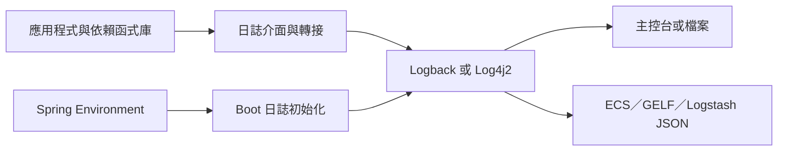

# 日誌

Spring Boot 的所有內部日誌都使用 [Commons Logging][r1]，但不限定底層日誌實作。它為 [Java Util Logging][r2]、[Log4j2][r3] 與 [Logback][r4] 提供預設設定。各種情況下都預先設定為輸出至主控台，也可選擇輸出至檔案。

使用 starter 時，預設採用 Logback。也包含適當的 Logback 轉送設定，確保使用 Java Util Logging、Commons Logging、Log4J 或 SLF4J 的依賴函式庫能正確運作。

> [TIP]
>
> Java 有許多日誌框架。若上述清單讓你感到困惑，不必擔心。通常無須變更日誌依賴，Spring Boot 的預設值即可正常使用。

> [TIP]
>
> 部署到 Servlet 容器或應用程式伺服器時，透過 Java Util Logging API 記錄的日誌，不會轉送到你的應用程式日誌。這可避免容器或部署於其中的其他應用程式日誌出現在你的日誌中。

## 日誌格式

Spring Boot 預設輸出類似下例：

{{CODE_0}}

輸出包含以下項目：

- 日期與時間：毫秒精確度，容易排序。
- 日誌層級：`ERROR`、`WARN`、`INFO`、`DEBUG` 或 `TRACE`。
- 處理程序 ID。
- `---` 分隔符：區分實際日誌訊息的起點。
- 應用程式名稱：以方括號括住；預設只在設定 `spring.application.name` 時記錄。
- 應用程式群組：以方括號括住；預設只在設定 `spring.application.group` 時記錄。
- 執行緒名稱：以方括號括住；主控台輸出時可能截短。
- 關聯 ID：啟用追蹤時顯示；上例未顯示。
- Logger 名稱：通常為來源類別名稱，經常採縮寫。
- 日誌訊息。

> [NOTE]
>
> Logback 沒有 `FATAL` 層級，會將它對應為 `ERROR`。

> [TIP]
>
> 若已設定 `spring.application.name`，但不想記錄，可將 `logging.include-application-name` 設為 `false`。

> [TIP]
>
> 若已設定 `spring.application.group`，但不想記錄，可將 `logging.include-application-group` 設為 `false`。

> [TIP]
>
> 關聯 ID 的更多細節請見[此文件][r5]。

## 主控台輸出

預設日誌設定會在寫入訊息時同步輸出到主控台。預設記錄 `ERROR`、`WARN`、`INFO` 層級。也可在啟動時加上 `--debug`，啟用「debug」模式。

{{CODE_1}}

> [NOTE]
>
> 也可在 `application.properties` 指定 `debug=true`。

啟用 debug 模式後，部分核心 logger（內嵌容器、Hibernate、Spring Boot）會輸出更多資訊。這**不會**讓應用程式記錄所有 `DEBUG` 層級訊息。

或者，可在啟動時加上 `--trace`（或在 `application.properties` 設定 `trace=true`），啟用「trace」模式。這會為部分核心 logger 啟用 trace 日誌，包括內嵌容器、Hibernate schema 產生，以及整個 Spring 專案群。

若要停用主控台日誌，可將 `logging.console.enabled` 設為 `false`。

### 彩色輸出

若終端機支援 ANSI，會使用彩色輸出改善可讀性。可將 `spring.output.ansi.enabled` 設為[支援的值][r6]，覆寫自動偵測。

色彩透過 `%clr` 轉換詞設定。最簡單的形式會依日誌層級上色，例如：

{{CODE_2}}

日誌層級與色彩的對應如下：

| 層級 | 色彩 |
| --- | --- |
| `FATAL` | 紅色 |
| `ERROR` | 紅色 |
| `WARN` | 黃色 |
| `INFO` | 綠色 |
| `DEBUG` | 綠色 |
| `TRACE` | 綠色 |

也可將色彩與樣式作為轉換選項明確指定。例如要顯示黃色粗體文字，使用：

{{CODE_3}}

支援下列文字色彩：

- `black`
- `blue`
- `bright_black`
- `bright_blue`
- `bright_cyan`
- `bright_green`
- `bright_magenta`
- `bright_red`
- `bright_white`
- `bright_yellow`
- `cyan`
- `green`
- `magenta`
- `red`
- `white`
- `yellow`

支援下列背景色彩：

- `bg_black`
- `bg_blue`
- `bg_bright_black`
- `bg_bright_blue`
- `bg_bright_cyan`
- `bg_bright_green`
- `bg_bright_magenta`
- `bg_bright_red`
- `bg_bright_white`
- `bg_bright_yellow`
- `bg_cyan`
- `bg_green`
- `bg_magenta`
- `bg_red`
- `bg_white`
- `bg_yellow`

支援下列樣式：

- `bold`
- `faint`
- `italic`
- `normal`
- `reverse`
- `underline`

## 檔案輸出

Spring Boot 預設只輸出到主控台，不寫入日誌檔案。若要在主控台之外也寫入檔案，需設定 `logging.file.name` 或 `logging.file.path`，例如在 `application.properties` 中設定。若兩者都設定，會忽略 `logging.file.path`，只使用 `logging.file.name`。

下表說明 `logging.*` 屬性的搭配方式：

表 1. 日誌屬性

| `logging.file.name` | `logging.file.path` | 說明 |
| --- | --- | --- |
| *未設定* | *未設定* | 只輸出至主控台。 |
| 特定檔案，例如 `my.log` | *未設定* | 寫入 `logging.file.name` 指定的位置，可為絕對路徑或相對目前目錄的路徑。 |
| *未設定* | 特定目錄，例如 `/var/log` | 在 `logging.file.path` 指定的目錄寫入 `spring.log`，目錄可為絕對路徑或相對目前目錄的路徑。 |
| 特定檔案 | 特定目錄 | 寫入 `logging.file.name` 指定的位置，忽略 `logging.file.path`；位置可為絕對路徑或相對目前目錄的路徑。 |

日誌檔案達到 10 MB 時會輪替；與主控台相同，預設記錄 `ERROR`、`WARN` 與 `INFO`。請注意，Log4J2 使用此類設定時，需要設定 `logging.file.path`。

> [TIP]
>
> 日誌屬性獨立於實際的日誌基礎設施。因此，特定實作的設定鍵（例如 Logback 的 `logback.configurationFile`）不由 Spring Boot 管理。

## 檔案輪替

使用 Logback 或 Log4j2 時，可透過 `application.properties` 或 `application.yaml` 微調日誌輪替。其他日誌系統則須自行直接設定輪替。

Logback 支援以下輪替策略屬性：

| 名稱 | 說明 |
| --- | --- |
| `logging.logback.rollingpolicy.file-name-pattern` | 建立日誌封存檔時使用的檔名模式。 |
| `logging.logback.rollingpolicy.clean-history-on-start` | 應用程式啟動時是否清理日誌封存檔。 |
| `logging.logback.rollingpolicy.max-file-size` | 封存前日誌檔案的大小上限。 |
| `logging.logback.rollingpolicy.total-size-cap` | 刪除前允許日誌封存檔占用的總大小上限。 |
| `logging.logback.rollingpolicy.max-history` | 保留的日誌封存檔數量上限，預設為 7。 |

Log4j2 提供以下輪替策略屬性：

| 名稱 | 說明 |
| --- | --- |
| `logging.log4j2.rollingpolicy.file-name-pattern` | 建立日誌封存檔時使用的檔名模式。 |
| `logging.log4j2.rollingpolicy.max-file-size` | 封存前日誌檔案大小上限，預設為 10MB。 |
| `logging.log4j2.rollingpolicy.max-history` | 保留的日誌封存檔數量上限，預設為 7。 |
| `logging.log4j2.rollingpolicy.strategy` | 輪替策略，預設為 `size`。 |
| `logging.log4j2.rollingpolicy.cron` | 策略為 `cron` 時使用的 Cron 運算式，預設為每天午夜。 |
| `logging.log4j2.rollingpolicy.time-interval` | 策略為 `time` 或 `size-and-time` 時，依時間觸發的間隔，預設為 1。 |
| `logging.log4j2.rollingpolicy.time-modulate` | 依時間輪替時，是否將下次輪替時間對齊至間隔起點，預設為 `false`。 |

## 日誌層級

所有支援的日誌系統都可透過 Spring [`Environment`][r7]（例如 `application.properties`）設定 logger 層級，格式為 `logging.level.<logger-name>=<level>`；`level` 可為 TRACE、DEBUG、INFO、WARN、ERROR、FATAL 或 OFF。根 `root` logger 使用 `logging.level.root` 設定。

以下是在 `application.properties` 中可能採用的設定：

{{CODE_4}}

{{CODE_5}}

也可透過環境變數設定層級。例如 `LOGGING_LEVEL_ORG_SPRINGFRAMEWORK_WEB=DEBUG` 會將 `org.springframework.web` 設為 `DEBUG`。

> [NOTE]
>
> 上述方式只適用於套件層級。由於寬鬆繫結[一律將環境變數轉成小寫][r8]，無法以此設定個別類別。若需設定類別，可使用 [`SPRING_APPLICATION_JSON`][r9] 變數。

## 日誌群組

將相關 logger 分組，便能一次設定整組，通常很有幫助。例如你可能經常變更**所有** Tomcat 相關 logger 的層級，卻不容易記住其頂層套件。

為此，Spring Boot 允許在 Spring [`Environment`][r7] 定義日誌群組。例如在 `application.properties` 加入以下設定，定義「tomcat」群組：

{{CODE_6}}

{{CODE_7}}

定義後，只需一行就能變更群組內所有 logger 的層級：

{{CODE_8}}

{{CODE_9}}

Spring Boot 內建以下可直接使用的群組：

| 名稱 | Logger |
| --- | --- |
| web | `org.springframework.core.codec`、`org.springframework.http`、`org.springframework.web`、`org.springframework.boot.actuate.endpoint.web`、`org.springframework.boot.web.servlet.ServletContextInitializerBeans` |
| sql | `org.springframework.jdbc.core`、`org.hibernate.SQL`、[`LoggerListener`][r10] |

## 使用日誌 Shutdown Hook

為了在應用程式終止時釋放日誌資源，系統提供 shutdown hook，在 JVM 結束時觸發日誌系統清理。除非應用程式部署為 WAR，否則會自動註冊。若應用程式具有複雜的 context 階層，此 hook 可能不符合需求；此時應停用，並研究底層日誌系統直接提供的選項。例如 Logback 的 [context selector][r11] 允許在各自的 context 建立 logger。可將 `logging.register-shutdown-hook` 設為 `false`，停用註冊。在 `application.properties` 或 `application.yaml` 設定：

{{CODE_10}}

{{CODE_11}}

## 自訂日誌設定

在 classpath 加入適當函式庫，即可啟用各種日誌系統。可在 classpath 根目錄提供適當設定檔，或透過 Spring [`Environment`][r7] 的 `logging.config` 指定位置，進一步自訂。

可使用系統屬性 `org.springframework.boot.logging.LoggingSystem`，強制 Spring Boot 採用特定系統。值應為 [`LoggingSystem`][r12] 實作的完整限定類別名稱。設為 `none` 也可完全停用 Spring Boot 的日誌設定。

> [NOTE]
>
> 由於日誌在建立 [`ApplicationContext`][r13] **之前**初始化，無法透過 Spring [`@Configuration`][r15] 檔案中的 [`@PropertySources`][r14] 控制。變更日誌系統或完全停用它的唯一方式，是系統屬性。

依日誌系統，會載入以下檔案：

| 日誌系統 | 自訂設定 |
| --- | --- |
| Logback | `logback-spring.xml`、`logback-spring.groovy`、`logback.xml` 或 `logback.groovy` |
| Log4j2 | `log4j2-spring.xml` 或 `log4j2.xml` |
| JDK（Java Util Logging） | `logging.properties` |

> [NOTE]
>
> 建議盡可能使用 `-spring` 版本的設定檔，例如使用 `logback-spring.xml` 而非 `logback.xml`。使用標準設定位置時，Spring 無法完整控制日誌初始化。

> [WARNING]
>
> Java Util Logging 有已知的類別載入問題，從「可執行 jar」執行時會造成問題。若可能，建議此情況避免使用它。

為便於自訂，一些屬性會從 Spring [`Environment`][r7] 轉移到系統屬性，供日誌系統設定使用。例如在 `application.properties` 設定 `logging.file.name`，或設定環境變數 `LOGGING_FILE_NAME`，都會設定 `LOG_FILE` 系統屬性。轉移的屬性如下：

| Spring Environment | 系統屬性 | 說明 |
| --- | --- | --- |
| `logging.exception-conversion-word` | `LOG_EXCEPTION_CONVERSION_WORD` | 記錄例外時使用的轉換詞。 |
| `logging.file.name` | `LOG_FILE` | 定義後會用於預設日誌設定。 |
| `logging.file.path` | `LOG_PATH` | 定義後會用於預設日誌設定。 |
| `logging.pattern.console` | `CONSOLE_LOG_PATTERN` | 主控台 stdout 的日誌模式。 |
| `logging.pattern.dateformat` | `LOG_DATEFORMAT_PATTERN` | 日誌日期格式的 appender 模式。 |
| `logging.charset.console` | `CONSOLE_LOG_CHARSET` | 主控台日誌字元集。 |
| `logging.threshold.console` | `CONSOLE_LOG_THRESHOLD` | 主控台日誌層級門檻。 |
| `logging.pattern.file` | `FILE_LOG_PATTERN` | 啟用 `LOG_FILE` 時的檔案日誌模式。 |
| `logging.charset.file` | `FILE_LOG_CHARSET` | 啟用 `LOG_FILE` 時的檔案日誌字元集。 |
| `logging.threshold.file` | `FILE_LOG_THRESHOLD` | 檔案日誌層級門檻。 |
| `logging.pattern.level` | `LOG_LEVEL_PATTERN` | 顯示日誌層級的格式，預設為 `%5p`。 |
| `logging.structured.format.console` | `CONSOLE_LOG_STRUCTURED_FORMAT` | 主控台結構化日誌格式。 |
| `logging.structured.format.file` | `FILE_LOG_STRUCTURED_FORMAT` | 檔案結構化日誌格式。 |
| `PID` | `PID` | 目前處理程序 ID；若尚未定義為作業系統環境變數，會盡可能探索。 |

使用 Logback 時，也會轉移以下屬性：

| Spring Environment | 系統屬性 | 說明 |
| --- | --- | --- |
| `logging.logback.rollingpolicy.file-name-pattern` | `LOGBACK_ROLLINGPOLICY_FILE_NAME_PATTERN` | 輪替檔名模式，預設 `${LOG_FILE}.%d{yyyy-MM-dd}.%i.gz`。 |
| `logging.logback.rollingpolicy.clean-history-on-start` | `LOGBACK_ROLLINGPOLICY_CLEAN_HISTORY_ON_START` | 啟動時是否清理封存日誌檔。 |
| `logging.logback.rollingpolicy.max-file-size` | `LOGBACK_ROLLINGPOLICY_MAX_FILE_SIZE` | 日誌檔案大小上限。 |
| `logging.logback.rollingpolicy.total-size-cap` | `LOGBACK_ROLLINGPOLICY_TOTAL_SIZE_CAP` | 保留的日誌備份總大小。 |
| `logging.logback.rollingpolicy.max-history` | `LOGBACK_ROLLINGPOLICY_MAX_HISTORY` | 保留的封存日誌檔案數量上限。 |

所有支援的日誌系統都能在解析設定檔時讀取系統屬性。範例可參閱 `spring-boot.jar` 中的預設設定：

- [Logback][r16]
- [Log4j 2][r17]
- [Java Util Logging][r18]

> [TIP]
>
> 若要在日誌屬性中使用佔位符，應採用 [Spring Boot 語法][r19]，而非底層框架語法。特別是 Logback，屬性名稱與預設值之間應使用 `:`，而非 `:-`。

> [TIP]
>
> 只要覆寫 `LOG_LEVEL_PATTERN`（Logback 也可用 `logging.pattern.level`），就能將 MDC 與其他臨時資訊加入日誌行。例如設定 `logging.pattern.level=user:%X{user} %5p`，若存在「user」MDC 項目，預設日誌格式就會包含它：
>
{{CODE_12}}

## 結構化日誌

結構化日誌將輸出寫成明確定義、通常可由機器讀取的格式。Spring Boot 內建支援以下 JSON 格式：

- [Elastic Common Schema（ECS）][r20]
- [Graylog Extended Log Format（GELF）][r21]
- [Logstash][r22]

若要啟用，將 `logging.structured.format.console`（主控台）或 `logging.structured.format.file`（檔案）設為所需格式的 ID。

若使用[自訂日誌設定][r23]，請更新設定，讓它遵循 `CONSOLE_LOG_STRUCTURED_FORMAT` 與 `FILE_LOG_STRUCTURED_FORMAT` 系統屬性。以 `CONSOLE_LOG_STRUCTURED_FORMAT` 為例：

{{CODE_13}}

也可參考 Spring Boot 內建的預設設定：

- [Logback 結構化主控台 Appender][r24]
- [Logback 結構化檔案 Appender][r25]

{{CODE_14}}

也可參考 Spring Boot 內建的預設設定：

- [Log4j2 主控台 Appender][r17]
- [Log4j2 主控台與檔案 Appender][r26]

### Elastic Common Schema

[Elastic Common Schema][r27] 是以 JSON 為基礎的日誌格式。

若要啟用，將適當的 `format` 屬性設為 `ecs`：

{{CODE_15}}

{{CODE_16}}

一行日誌如下：

{{CODE_17}}

此格式也會將 MDC 中的每個鍵值組加入 JSON 物件。也可使用 [SLF4J fluent logging API][r28] 的 [addKeyValue][r29] 方法，將鍵值組加入記錄的 JSON 物件。

可使用 `logging.structured.ecs.service` 屬性自訂 `service` 值：

{{CODE_18}}

{{CODE_19}}

> [NOTE]
>
> 未指定 `logging.structured.ecs.service.name` 時，預設使用 `spring.application.name`。

> [NOTE]
>
> 未指定 `logging.structured.ecs.service.version` 時，預設使用 `spring.application.version`。

### Graylog Extended Log Format（GELF）

[Graylog Extended Log Format][r30] 是 Graylog 日誌分析平台使用的 JSON 日誌格式。

若要啟用，將適當的 `format` 屬性設為 `gelf`：

{{CODE_20}}

{{CODE_21}}

一行日誌如下：

{{CODE_22}}

此格式也會將 MDC 中的每個鍵值組加入 JSON 物件。也可使用 [SLF4J fluent logging API][r28] 的 [addKeyValue][r29] 方法加入鍵值組。

可使用 `logging.structured.gelf` 自訂多個欄位：

{{CODE_23}}

{{CODE_24}}

> [NOTE]
>
> 未指定 `logging.structured.gelf.host` 時，預設使用 `spring.application.name`。

> [NOTE]
>
> 未指定 `logging.structured.gelf.service.version` 時，預設使用 `spring.application.version`。

### Logstash JSON 格式

[Logstash JSON 格式][r31] 是以 JSON 為基礎的日誌格式。

若要啟用，將適當的 `format` 屬性設為 `logstash`：

{{CODE_25}}

{{CODE_26}}

一行日誌如下：

{{CODE_27}}

此格式也會將 MDC 中的每個鍵值組加入 JSON 物件。也可使用 [SLF4J fluent logging API][r28] 的 [addKeyValue][r29] 方法加入鍵值組。

若加入 [marker][r32]，它們會出現在 JSON 的 `tags` 字串陣列中。

### 自訂結構化日誌 JSON

Spring Boot 會為結構化日誌輸出的 JSON 名稱與值選擇合理預設值。不過有時你可能需要小幅調整，例如為符合日誌收集系統的預期而變更名稱，或篩除你認為無用的成員。

以下屬性可變更 JSON 寫出方式：

| 屬性 | 說明 |
| --- | --- |
| `logging.structured.json.include` 與 `logging.structured.json.exclude` | 篩選 JSON 中的特定路徑。 |
| `logging.structured.json.rename` | 重新命名 JSON 中的特定成員。 |
| `logging.structured.json.add` | 在 JSON 加入額外成員。 |

例如，下例排除 `log.level`、將 `process.id` 改名為 `procid`，並加入固定的 `corpname` 欄位：

{{CODE_28}}

{{CODE_29}}

> [TIP]
>
> 更進階的自訂可使用 [`StructuredLoggingJsonMembersCustomizer`][r33]。透過 `logging.structured.json.customizer` 參照一或多個實作，也可在 `META-INF/spring.factories` 列出實作來宣告。

### 自訂結構化日誌堆疊追蹤

記錄帶有例外的訊息時，JSON 輸出會包含完整堆疊追蹤。這些資訊可能增加日誌收集系統的處理成本，因此你可能想調整堆疊追蹤的輸出方式。

可使用以下一或多個屬性：

| 屬性 | 說明 |
| --- | --- |
| `logging.structured.json.stacktrace.root` | `last` 將根項目放最後，與 Java 相同；`first` 則將根項目放最前。 |
| `logging.structured.json.stacktrace.max-length` | 輸出長度上限。 |
| `logging.structured.json.stacktrace.max-throwable-depth` | 每份堆疊追蹤輸出的 frame 數量上限，含共用與受抑制的 frame。 |
| `logging.structured.json.stacktrace.include-common-frames` | 包含或移除共用 frame。 |
| `logging.structured.json.stacktrace.include-hashes` | 是否包含堆疊追蹤雜湊值。 |

例如，下例將根項目放最前、限制長度，並包含雜湊值：

{{CODE_30}}

{{CODE_31}}

> [TIP]
>
> 若需完全控制堆疊追蹤輸出，可將 `logging.structured.json.stacktrace.printer` 設為 [`StackTracePrinter`][r34] 實作名稱。也可設為 `logging-system`，強制使用一般日誌系統的堆疊追蹤輸出。
>
> 若希望進一步自訂依屬性建立的輸出器，你的 `StackTracePrinter` 實作也可宣告接收 [`StandardStackTracePrinter`][r35] 的建構子引數。

### 支援其他結構化日誌格式

Spring Boot 的結構化日誌支援可擴充，允許自訂格式。實作 [`StructuredLogFormatter`][r36] 即可。使用 Logback 時，泛型引數須為 [`ILoggingEvent`][r37]；使用 Log4j2 時則為 [`LogEvent`][r38]，這表示實作會綁定特定日誌系統。系統會將日誌事件傳入你的實作，並由實作回傳要記錄的 [`String`][r39]，例如：

{{CODE_32}}

{{CODE_33}}

如範例所示，可以回傳任何格式，不必是 JSON。

若要啟用，將 `logging.structured.format.console` 或 `logging.structured.format.file` 設為實作的完整限定類別名稱。

實作可以使用某些會自動注入的建構子參數，詳見 [`StructuredLogFormatter`][r36] Javadoc。

## Logback 擴充

Spring Boot 提供多項 Logback 擴充以協助進階設定，可在 `logback-spring.xml` 使用。

> [NOTE]
>
> 標準 `logback.xml` 載入得太早，無法使用擴充。必須改用 `logback-spring.xml`，或定義 `logging.config`。

> [WARNING]
>
> 擴充無法與 Logback 的[設定掃描][r40]一起使用。若嘗試這樣做，變更設定檔後會記錄類似以下的錯誤：

{{CODE_34}}

### 特定 Profile 的設定

`<springProfile>` 標籤可依作用中的 Spring Profile，選擇納入或排除設定區段。Profile 區段可放在 `<configuration>` 內任何位置。使用 `name` 指定接受此設定的 Profile。`<springProfile>` 可包含 Profile 名稱，例如 `staging`，或 Profile 運算式。運算式可表達較複雜的邏輯，例如 `production & (eu-central | eu-west)`。更多細節見 [Spring Framework 參考指南][r41]。下例展示三種 Profile：

{{CODE_35}}

### Environment 屬性

`<springProperty>` 可將 Spring [`Environment`][r7] 的屬性公開給 Logback 使用。若要在 Logback 設定中存取 `application.properties` 的值，這很有用。其運作方式類似 Logback 標準的 `<property>`，但不直接指定 `value`，而是指定屬性的 `source`（來自 [`Environment`][r7]）。若需將屬性儲存在 `local` 以外的作用域，可用 `scope`；若需要在 [`Environment`][r7] 未設定屬性時使用備援值，可用 `defaultValue`。下例示範如何公開屬性：

{{CODE_36}}

> [NOTE]
>
> `source` 必須使用 kebab-case，例如 `my.property-name`；但加入 [`Environment`][r7] 的屬性仍可遵循寬鬆規則。

## Log4j2 擴充

Spring Boot 提供多項 Log4j2 擴充以協助進階設定，可在任何 `log4j2-spring.xml` 使用。

> [NOTE]
>
> 標準 `log4j2.xml` 載入得太早，無法使用擴充。必須改用 `log4j2-spring.xml`，或定義 `logging.config`。

> [NOTE]
>
> 這些擴充取代 Log4J 提供的 [Spring Boot 支援][r42]。請確保建置中不包含 `org.apache.logging.log4j:log4j-spring-boot` 模組。

### 特定 Profile 的設定

`<SpringProfile>` 標籤可依作用中的 Spring Profile，選擇納入或排除設定區段。Profile 區段可放在 `<Configuration>` 內任何位置。使用 `name` 指定接受設定的 Profile。`<SpringProfile>` 可包含 Profile 名稱，例如 `staging`，或 Profile 運算式。運算式可表達較複雜邏輯，例如 `production & (eu-central | eu-west)`。更多細節見 [Spring Framework 參考指南][r41]。下例展示三種 Profile：

{{CODE_37}}

### 查詢 Environment 屬性

若要在 Log4j2 設定中參照 Spring [`Environment`][r7] 屬性，可使用帶有 `spring:` 前綴的 [lookup][r43]。若要存取 `application.properties` 的值，這很有用。

下例設定 Log4j2 的 `applicationName` 與 `applicationGroup` 屬性，分別從 Spring [`Environment`][r7] 讀取 `spring.application.name` 與 `spring.application.group`：

{{CODE_38}}

> [NOTE]
>
> lookup 鍵應使用 kebab-case，例如 `my.property-name`。

### Log4j2 系統屬性

Log4j2 支援許多用於設定各種項目的[系統屬性][r44]。例如 `log4j2.skipJansi` 可控制 [`ConsoleAppender`][r45] 是否嘗試在 Windows 使用 [Jansi][r46] 輸出串流。

所有在 Log4j2 初始化之後載入的系統屬性，都可以從 Spring [`Environment`][r7] 取得。例如在 `application.properties` 加入 `log4j2.skipJansi=false`，讓 [`ConsoleAppender`][r45] 在 Windows 使用 Jansi。

> [NOTE]
>
> 只有系統屬性與作業系統環境變數未包含要載入的值時，才會考慮 Spring [`Environment`][r7]。

> [WARNING]
>
> Log4j2 早期初始化期間載入的系統屬性，無法參照 Spring [`Environment`][r7]。例如 Log4j2 用來選擇預設實作的屬性，會在 Spring Environment 可用之前使用。

## 譯者補充：統一介面、設定與輸出格式

日誌初始化早於 ApplicationContext，因此 `@PropertySource` 太晚才出現，無法負責此階段的日誌設定。這也是官方建議採用 `-spring` 設定檔名稱的重要背景。
