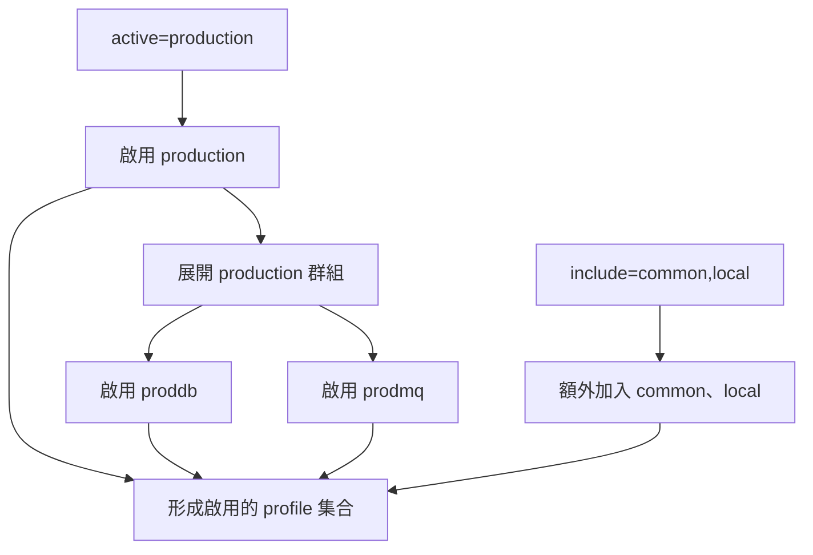

# Profiles（環境設定）

Spring Profiles 提供一種方式，將應用程式的部分設定區隔開來，讓它們只在特定環境中可用。任何 [`@Component`][r1]、[`@Configuration`][r2] 或 [`@ConfigurationProperties`][r3] 都能加上 [`@Profile`][r4]，限制載入時機，如下例所示：

{{CODE_0}}

{{CODE_1}}

> **注意：**如果 [`@ConfigurationProperties`][r3] Bean 是透過 [`@EnableConfigurationProperties`][r5] 註冊，而非自動掃描，則必須把 [`@Profile`][r4] 加在帶有 [`@EnableConfigurationProperties`][r5] 的 [`@Configuration`][r2] 類別上。若採用掃描方式，則可直接把 [`@Profile`][r4] 加在 [`@ConfigurationProperties`][r3] 類別本身。

可以使用 [`Environment`][r6] 屬性 `spring.profiles.active` 指定啟用哪些 profile。設定方式可採用本章前面介紹的任一種方式，例如在 `application.properties` 中設定：

{{CODE_2}}

{{CODE_3}}

也可以在命令列使用 `--spring.profiles.active=dev,hsqldb` 指定。

如果沒有任何啟用的 profile，就會啟用預設 profile。預設名稱是 `default`，可以透過 [`Environment`][r6] 屬性 `spring.profiles.default` 調整，如下例：

{{CODE_4}}

{{CODE_5}}

`spring.profiles.active` 與 `spring.profiles.default` 只能用在不專屬於特定 profile 的文件中。因此，它們不能放在 [profile 專用檔案][r7]，也不能放在由 `spring.config.activate.on-profile` [啟用的文件][r8]內。

例如，以下第二份文件的設定無效：

{{CODE_6}}

{{CODE_7}}

`spring.profiles.active` 遵循與其他屬性相同的優先順序規則，以優先順序最高的 [`PropertySource`][r9] 為準。因此，可以先在 `application.properties` 指定啟用的 profile，再用命令列選項**取代**它們。

> **提示：**屬性來源的判定順序，詳見[外部化設定][r10]。

> **注意：**預設情況下，Spring Boot 的 profile 名稱可以包含字母、數字及允許的字元（`-`、`_`、`.`、`+`、`@`），但開頭與結尾只能是字母或數字。
>
> 此限制有助於避免常見的解析問題。如果需要更有彈性的名稱，可以在 `application.properties` 或 `application.yaml` 將 `spring.profiles.validate` 設為 `false`：

{{CODE_8}}

{{CODE_9}}

## 增加啟用的 Profiles

有時需要透過屬性**增加**啟用的 profile，而不是取代既有清單。`spring.profiles.include` 可在 `spring.profiles.active` 啟用的 profile 之外，再增加其他 profile。[`SpringApplication`][r11] 入口也提供 Java API 來設定額外的 profile，請參閱其 `setAdditionalProfiles()` 方法。

例如，具有下列設定的應用程式，即使使用 `--spring.profiles.active` 選項啟動，也仍會啟用 `common` 與 `local`：

{{CODE_10}}

{{CODE_11}}

> **注意：**透過 include 加入的 profile，會先於所有 `spring.profiles.active` 指定的 profile 加入。

> **提示：**`spring.profiles.include` 會針對每個屬性來源分別處理，因此一般清單的[複雜型別合併規則][r12]不適用。

> **警告：**與 `spring.profiles.active` 相同，`spring.profiles.include` 只能用在不專屬於特定 profile 的文件，不能放在 [profile 專用檔案][r7]或由 `spring.config.activate.on-profile` [啟用的文件][r8]內。

[下一節][r13]介紹的 profile 群組，也能在指定 profile 啟用時，額外啟用其他 profile。

## Profile 群組

有時應用程式的 profile 劃分得太細，使用起來反而繁瑣。例如，可能分別用 `proddb` 與 `prodmq` 啟用資料庫及訊息功能。

Spring Boot 允許定義 profile 群組，以改善這種情況。群組能為一組相關 profile 定義邏輯名稱。

例如，可以建立包含 `proddb` 與 `prodmq` 的 `production` 群組：

{{CODE_12}}

{{CODE_13}}

接著使用 `--spring.profiles.active=production` 啟動應用程式，即可一次啟用 `production`、`proddb` 與 `prodmq`。

> **警告：**與 `spring.profiles.active`、`spring.profiles.include` 相同，`spring.profiles.group` 只能用在不專屬於特定 profile 的文件，不能放在 [profile 專用檔案][r7]或由 `spring.config.activate.on-profile` [啟用的文件][r8]內。

## 以程式設定 Profiles

可以在應用程式執行前呼叫 `SpringApplication.setAdditionalProfiles(...)`，以程式設定啟用的 profile；也可以透過 Spring 的 [`ConfigurableEnvironment`][r14] 介面啟用。

## Profile 專用設定檔

`application.properties`（或 `application.yaml`），以及透過 [`@ConfigurationProperties`][r3] 參照的檔案，其 profile 專用變體也會被納入考量並載入。詳見 [Profile 專用檔案][r7]。

## 譯者圖解：active、include 與 group

圖解表達三者用途，不代表設定載入的完整優先順序；實際優先順序仍以本章與外部化設定章的規則為準。
