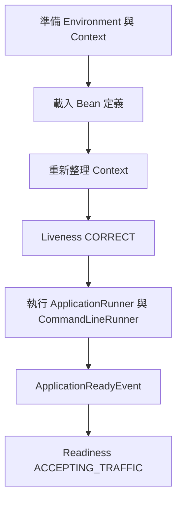

# SpringApplication

[`SpringApplication`][r1] 類別提供便利的方式，啟動從 `main()` 方法執行的 Spring 應用程式。多數情況可委派給靜態方法 [`SpringApplication.run(Class, String...)`][r2]，如下所示：

{{CODE_0}}

{{CODE_1}}

應用程式啟動時，應會看到類似下列的輸出：

{{CODE_2}}

預設顯示 `INFO` 日誌訊息，包含啟動應用程式的使用者等相關啟動資訊。若需要 `INFO` 以外的層級，可依[日誌層級][r3]的說明設定。應用程式版本取自主應用程式類別所在套件的 implementation version。將 `spring.main.log-startup-info` 設為 `false` 可關閉啟動資訊日誌，同時也會關閉作用中 Profile 的日誌。

> [TIP]
>
> 若要在啟動期間加入額外日誌，可在 [`SpringApplication`][r1] 子類別中覆寫 `logStartupInfo(boolean)`。

## 啟動失敗

應用程式若無法啟動，已註冊的 [`FailureAnalyzer`][r4] Bean 會有機會提供專門的錯誤訊息，以及解決問題的具體動作。例如在連接埠 `8080` 啟動 Web 應用程式，而該連接埠已被使用，就會看到類似下列訊息：

{{CODE_3}}

> [NOTE]
>
> Spring Boot 提供多種 [`FailureAnalyzer`][r4] 實作，你也可以[加入自己的實作][r5]。

如果沒有失敗分析器能處理例外，仍可顯示完整的條件報告，以進一步了解問題。做法是[啟用 `debug` 屬性][r6]，或為 [`ConditionEvaluationReportLoggingListener`][r7] [啟用 `DEBUG` 日誌][r3]。

例如透過 `java -jar` 執行應用程式時，可以這樣啟用 `debug`：

{{CODE_4}}

## 延遲初始化

[`SpringApplication`][r1] 允許應用程式採用延遲初始化。啟用後，Bean 會在需要時才建立，而非應用程式啟動期間建立，因此可縮短啟動時間。在 Web 應用程式中，許多與 Web 有關的 Bean 會等收到 HTTP 請求才初始化。

延遲初始化的缺點是可能延後發現應用程式問題。如果設定錯誤的 Bean 採用延遲初始化，啟動期間不再發生錯誤，直到該 Bean 初始化時問題才會顯現。也必須確保 JVM 有足夠記憶體容納應用程式的所有 Bean，而不只是啟動時初始化的 Bean。基於這些理由，延遲初始化預設停用，並建議啟用前先調整好 JVM heap 大小。

可以透過 [`SpringApplicationBuilder`][r8] 的 `lazyInitialization`，或 [`SpringApplication`][r1] 的 `setLazyInitialization` 方法，以程式方式啟用。也可以設定 `spring.main.lazy-initialization`，如下所示：

{{CODE_5}}

{{CODE_6}}

> [TIP]
>
> 若應用程式大部分採用延遲初始化，但某些 Bean 不應延遲，可使用 `@Lazy(false)` 明確將其 lazy 屬性設為 false。

## 自訂 Banner

在 classpath 加入 `banner.txt`，或將 `spring.banner.location` 設為該檔案的位置，就能變更啟動時顯示的 banner。若檔案編碼不是 UTF-8，可設定 `spring.banner.charset`。

在 `banner.txt` 中，可以使用 [`Environment`][r9] 提供的任何鍵，以及下列佔位符：

表 1. Banner 變數

| 變數 | 說明 |
| --- | --- |
| `${application.version}` | `MANIFEST.MF` 宣告的應用程式版本。例如 `Implementation-Version: 1.0` 會顯示為 `1.0`。 |
| `${application.formatted-version}` | `MANIFEST.MF` 宣告的版本，並格式化為適合顯示的形式：外加括號並加上 `v` 前綴，例如 `(v1.0)`。 |
| `${spring-boot.version}` | 使用中的 Spring Boot 版本，例如 `4.1.1`。 |
| `${spring-boot.formatted-version}` | 使用中的 Spring Boot 版本，外加括號並加上 `v` 前綴，例如 `(v4.1.1)`。 |
| `${Ansi.NAME}`（或 `${AnsiColor.NAME}`、`${AnsiBackground.NAME}`、`${AnsiStyle.NAME}`） | `NAME` 是 ANSI 跳脫碼名稱，詳見 [`AnsiPropertySource`][r10]。 |
| `${application.title}` | `MANIFEST.MF` 宣告的應用程式標題。例如 `Implementation-Title: MyApp` 會顯示為 `MyApp`。 |

> [TIP]
>
> 如果想以程式產生 banner，可使用 `SpringApplication.setBanner(…)`。實作 [`Banner`][r11] 介面並提供自己的 `printBanner()` 方法。

也可以用 `spring.main.banner-mode` 決定將 banner 輸出到 [`System.out`][r12]（`console`）、傳送到設定的 logger（`log`），或完全不產生（`off`）。

顯示的 banner 會以 `springBootBanner` 名稱註冊為 singleton Bean。

> [NOTE]
>
> 只有透過 `java -jar`，或搭配 Spring Boot launcher 的 `java -cp` 執行時，才提供 `application.title`、`application.version`、`application.formatted-version`。如果執行解開的 jar，並以 `java -cp <classpath> <mainclass>` 啟動，或以原生映像執行，便不會解析這些值。
>
> 若要使用 `application.*`，請以 `java -jar` 啟動封裝的 jar，或以 `java org.springframework.boot.loader.launch.JarLauncher` 啟動解開的 jar。這會在建構 classpath 與啟動應用程式之前，先初始化 `application.*` banner 屬性。

## 自訂 SpringApplication

如果 [`SpringApplication`][r1] 的預設行為不符合需求，可自行建立實例並自訂。例如要關閉 banner，可以寫成：

{{CODE_7}}

{{CODE_8}}

> [NOTE]
>
> 傳入 [`SpringApplication`][r1] 建構子的引數，是 Spring Bean 的設定來源。多數情況為 [`@Configuration`][r13] 類別參照，也可以直接參照 [`@Component`][r14] 類別。

也可以使用 `application.properties` 設定 [`SpringApplication`][r1]，詳見[外部化設定][r6]。

完整選項清單請參閱 [`SpringApplication`][r1] API 文件。

## Fluent Builder API

若需要建立 [`ApplicationContext`][r15] 階層（多個具有父子關係的 context），或偏好 fluent builder API，可使用 [`SpringApplicationBuilder`][r8]。

[`SpringApplicationBuilder`][r8] 允許串接多次方法呼叫，並提供建立階層的 `parent` 與 `child` 方法，例如：

{{CODE_9}}

{{CODE_10}}

> [NOTE]
>
> 建立 [`ApplicationContext`][r15] 階層時有一些限制。例如 Web 元件**必須**位於子 context，而且父子 context 共用相同的 [`Environment`][r9]。完整細節請參閱 [`SpringApplicationBuilder`][r8] API 文件。

## 應用程式可用性

部署到平台時，應用程式可透過 [Kubernetes Probe][r16] 等基礎設施向平台提供可用性資訊。Spring Boot 內建支援常用的「liveness」與「readiness」狀態。若使用 Spring Boot 的 Actuator 支援，這些狀態會以健康端點群組公開。

也可以將 [`ApplicationAvailability`][r17] 介面注入自己的 Bean，取得可用性狀態。

### Liveness 狀態

應用程式的「Liveness」表示內部狀態是否能正常工作，或目前失敗時是否能自行復原。Liveness 損壞代表應用程式已無法自行復原，基礎設施應重新啟動應用程式。

> [NOTE]
>
> 一般而言，Liveness 不應根據外部檢查（例如[健康檢查][r18]）判定。否則外部系統（資料庫、Web API、外部快取）故障時，會引發整個平台大量重新啟動與連鎖故障。

Spring Boot 應用程式的內部狀態主要由 Spring [`ApplicationContext`][r15] 表達。如果 application context 成功啟動，Spring Boot 就假設應用程式狀態有效。context 完成重新整理後，應用程式就被視為存活，詳見 [Spring Boot 應用程式生命週期與相關事件][r19]。

### Readiness 狀態

應用程式的「Readiness」表示是否已準備好處理流量。Readiness 失敗告訴平台目前不應將流量導向此應用程式。這通常發生在啟動期間、處理 [`CommandLineRunner`][r20] 與 [`ApplicationRunner`][r21] 元件時，或應用程式判斷自己太忙而無法接收更多流量的任何時刻。

application runner 與 command-line runner 呼叫完成後，應用程式即被視為就緒，詳見 [Spring Boot 應用程式生命週期與相關事件][r19]。

> [TIP]
>
> 預期在啟動期間執行的工作，應透過 [`CommandLineRunner`][r20] 與 [`ApplicationRunner`][r21] 元件執行，而非使用 [`@PostConstruct`][r22] 等 Spring 元件生命週期回呼。

### 管理應用程式可用性狀態

應用程式元件可注入 [`ApplicationAvailability`][r17] 並呼叫其方法，隨時取得目前狀態。更常見的需求則是監聽狀態更新，或更新應用程式狀態。

例如，可以將 Readiness 匯出至檔案，讓 Kubernetes 的 exec Probe 檢查：

{{CODE_11}}

{{CODE_12}}

當應用程式損壞且無法復原時，也可以更新狀態：

{{CODE_13}}

{{CODE_14}}

Spring Boot 透過 [Actuator 健康端點提供 Kubernetes 的 Liveness 與 Readiness HTTP Probe][r23]。[部署 Spring Boot 至 Kubernetes 的專節][r24]提供更多指引。

## 應用程式事件與監聽器

除了 [`ContextRefreshedEvent`][r25] 等一般 Spring Framework 事件，[`SpringApplication`][r1] 也會傳送額外的應用程式事件。

> [NOTE]
>
> 某些事件在建立 [`ApplicationContext`][r15] 之前就已觸發，因此無法以 [`@Bean`][r26] 註冊監聽器。可以透過 `SpringApplication.addListeners(…)` 或 `SpringApplicationBuilder.listeners(…)` 註冊。
>
> 如果希望不論如何建立應用程式，都自動註冊這些監聽器，可在專案加入 `META-INF/spring.factories`，使用 [`ApplicationListener`][r27] 鍵參照監聽器，例如：
>
{{CODE_15}}

應用程式執行時，事件依下列順序傳送：

1. 執行開始時傳送 [`ApplicationStartingEvent`][r28]；除註冊監聽器與初始化器之外，其他處理尚未開始。
2. 確定 context 要使用的 [`Environment`][r9] 後、建立 context 前，傳送 [`ApplicationEnvironmentPreparedEvent`][r29]。
3. [`ApplicationContext`][r15] 準備完成、ApplicationContextInitializer 已呼叫，但尚未載入任何 Bean 定義時，傳送 [`ApplicationContextInitializedEvent`][r30]。
4. Bean 定義載入後、即將開始重新整理前，傳送 [`ApplicationPreparedEvent`][r31]。
5. context 重新整理後、尚未呼叫任何 application runner 與 command-line runner 時，傳送 [`ApplicationStartedEvent`][r32]。
6. 隨即傳送帶有 [`LivenessState.CORRECT`][r34] 的 [`AvailabilityChangeEvent`][r33]，表示應用程式被視為存活。
7. 所有 [application runner 與 command-line runner][r36] 呼叫完成後，傳送 [`ApplicationReadyEvent`][r35]。
8. 隨即傳送帶有 [`ReadinessState.ACCEPTING_TRAFFIC`][r37] 的 [`AvailabilityChangeEvent`][r33]，表示應用程式已準備好服務請求。
9. 啟動期間若發生例外，會傳送 [`ApplicationFailedEvent`][r38]。

以上只列出與 [`SpringApplication`][r1] 綁定的 `SpringApplicationEvent`。除此之外，在 [`ApplicationPreparedEvent`][r31] 之後、[`ApplicationStartedEvent`][r32] 之前，也會發布以下事件：

- [`WebServer`][r40] 就緒後，傳送 [`WebServerInitializedEvent`][r39]。[`ServletWebServerInitializedEvent`][r41] 與 [`ReactiveWebServerInitializedEvent`][r42] 分別為 Servlet 與反應式版本。
- [`ApplicationContext`][r15] 重新整理時，傳送 [`ContextRefreshedEvent`][r25]。

> [TIP]
>
> 通常不必使用應用程式事件，但知道它們存在仍有幫助。Spring Boot 內部使用事件處理各種工作。

> [NOTE]
>
> 事件監聽器預設在相同執行緒執行，因此不應執行可能耗時很長的工作。可考慮改用 [application runner 與 command-line runner][r36]。

應用程式事件透過 Spring Framework 的事件發布機制傳送。此機制會確保發布到子 context 監聽器的事件，也發布到所有祖先 context 的監聽器。因此，如果應用程式使用具有階層關係的 [`SpringApplication`][r1] 實例，監聽器可能收到同型別事件的多個實例。

若要區分事件來自自己的 context 還是後代 context，監聽器應要求注入自己的 application context，並將其與事件中的 context 比較。可透過實作 [`ApplicationContextAware`][r43] 注入；若監聽器是 Bean，也可以使用 [`@Autowired`][r44]。

## Web 環境

[`SpringApplication`][r1] 會嘗試代你建立正確型別的 [`ApplicationContext`][r15]。判定 [`WebApplicationType`][r45] 的演算法如下：

- 若存在 Spring MVC，使用 [`AnnotationConfigServletWebServerApplicationContext`][r46]。
- 若不存在 Spring MVC，但存在 Spring WebFlux，使用 [`AnnotationConfigReactiveWebServerApplicationContext`][r47]。
- 否則使用 [`AnnotationConfigApplicationContext`][r48]。

這表示在同一應用程式同時使用 Spring MVC 與 Spring WebFlux 的新 [`WebClient`][r49] 時，預設採用 Spring MVC。可呼叫 `setWebApplicationType(WebApplicationType)` 輕鬆覆寫此行為。

也可以呼叫 `setApplicationContextFactory(…)`，完整控制使用的 [`ApplicationContext`][r15] 型別。

> [TIP]
>
> 在 JUnit 測試中使用 [`SpringApplication`][r1] 時，通常適合呼叫 `setWebApplicationType(WebApplicationType.NONE)`。

## 存取應用程式引數

若需要存取傳給 `SpringApplication.run(…)` 的應用程式引數，可注入 [`ApplicationArguments`][r50] Bean。此介面提供原始 `String[]` 引數，以及解析後的 `option` 與 `non-option` 引數，例如：

{{CODE_16}}

{{CODE_17}}

> [TIP]
>
> Spring Boot 也會向 Spring [`Environment`][r9] 註冊 [`CommandLinePropertySource`][r51]，讓你可使用 [`@Value`][r52] 注入單一應用程式引數。

## 使用 ApplicationRunner 或 CommandLineRunner

若要在 [`SpringApplication`][r1] 啟動後執行特定程式碼，可以實作 [`ApplicationRunner`][r21] 或 [`CommandLineRunner`][r20]。兩者運作方式相同，提供單一 `run` 方法，在 `SpringApplication.run(…)` 完成之前呼叫。

> [NOTE]
>
> 這種契約非常適合應用程式啟動後、開始接收流量前應執行的工作。

[`CommandLineRunner`][r20] 以字串陣列提供引數；[`ApplicationRunner`][r21] 則使用前述 [`ApplicationArguments`][r50]。下例示範帶有 `run` 方法的 [`CommandLineRunner`][r20]：

{{CODE_18}}

{{CODE_19}}

若定義多個必須依特定順序呼叫的 [`CommandLineRunner`][r20] 或 [`ApplicationRunner`][r21] Bean，可另外實作 [`Ordered`][r53] 或使用 [`Order`][r54] 註解。

## 應用程式結束

每個 [`SpringApplication`][r1] 都會向 JVM 註冊 shutdown hook，確保結束時 [`ApplicationContext`][r15] 能妥善關閉。所有標準 Spring 生命週期回呼皆可使用，例如 [`DisposableBean`][r55] 與 [`@PreDestroy`][r56]。

此外，Bean 若希望在呼叫 `SpringApplication.exit()` 時回傳特定結束碼，可以實作 [`ExitCodeGenerator`][r57]。之後可將結束碼傳給 `System.exit()`，作為狀態碼回傳，例如：

{{CODE_20}}

{{CODE_21}}

例外也可以實作 [`ExitCodeGenerator`][r57]。遇到這種例外時，Spring Boot 會回傳其 `getExitCode()` 提供的結束碼。

若有多個 [`ExitCodeGenerator`][r57]，使用第一個產生的非零結束碼。若要控制產生器呼叫順序，可另外實作 [`Ordered`][r53] 或使用 [`Order`][r54]。

## 管理功能

指定 `spring.application.admin.enabled` 可啟用應用程式的管理功能。這會在平台 [`MBeanServer`][r59] 公開 [`SpringApplicationAdminMXBean`][r58]，可用於遠端管理 Spring Boot 應用程式，也適合服務包裝器的實作。

> [TIP]
>
> 若想知道應用程式執行在哪個 HTTP 連接埠，可取得鍵為 `local.server.port` 的屬性。

## 追蹤應用程式啟動

啟動期間，[`SpringApplication`][r1] 與 [`ApplicationContext`][r15] 會執行許多與應用程式生命週期、Bean 生命週期甚至應用程式事件處理有關的工作。透過 [`ApplicationStartup`][r60]，Spring Framework [讓你使用 `StartupStep` 物件追蹤啟動順序][r62]。可收集這些資料進行效能分析，或單純深入了解啟動過程。

設定 [`SpringApplication`][r1] 實例時，可以選擇 [`ApplicationStartup`][r60] 實作。例如使用 [`BufferingApplicationStartup`][r63]：

{{CODE_22}}

{{CODE_23}}

第一種可用的實作 [`FlightRecorderApplicationStartup`][r64] 由 Spring Framework 提供。它向 Java Flight Recorder 工作階段加入 Spring 專用的啟動事件，用來分析應用程式效能，並將 Spring context 生命週期與 JVM 事件（例如記憶體配置、GC、類別載入等）關聯。完成設定後，可啟用 Flight Recorder 執行應用程式來記錄資料：

{{CODE_24}}

Spring Boot 提供 [`BufferingApplicationStartup`][r63] 變體，將啟動步驟緩衝起來，再取出送至外部指標系統。應用程式可在任何元件要求注入 [`BufferingApplicationStartup`][r63] Bean。

也可設定 Spring Boot 公開 [`startup` 端點][r65]，以 JSON 文件提供這些資訊。

## 虛擬執行緒

虛擬執行緒需要 Java 21 或更新版本。為獲得最佳體驗，強烈建議使用 Java 24 或更新版本。將 `spring.threads.virtual.enabled` 設為 `true` 即可啟用。

啟用前，應考慮[閱讀 Java 官方虛擬執行緒文件][r66]。某些情況下，應用程式可能因「Pinned Virtual Threads」而降低吞吐量；該頁也說明如何使用 JDK Flight Recorder 或 `jcmd` 命令列工具偵測這些情況。

> [NOTE]
>
> 啟用虛擬執行緒後，設定執行緒池的屬性便不再生效，因為虛擬執行緒由 JVM 共用的平台執行緒池排程，而非由專用執行緒池排程。

> [WARNING]
>
> 虛擬執行緒的一個副作用是它們屬於 daemon 執行緒。如果 JVM 內所有執行緒都是 daemon，JVM 就會結束。例如依賴 [`@Scheduled`][r67] Bean 維持應用程式存活時，這可能造成問題。使用虛擬執行緒時，排程器執行緒也是虛擬執行緒，因此是 daemon，不會維持 JVM 存活。這不只影響排程，也可能影響其他技術。為確保所有情況下 JVM 都保持執行，建議將 `spring.main.keep-alive` 設為 `true`；即使所有執行緒都是虛擬執行緒，也會維持 JVM 存活。

## 譯者補充：存活與就緒是不同的時間點

容器初始化成功不等於已完成所有啟動工作。需要在接流量前完成的初始化，可放進 runner，讓 Readiness 的時間點表達這項要求。
