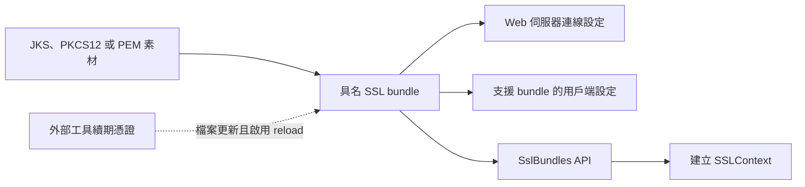

# SSL

Spring Boot 可以設定 SSL 信任素材（trust material），並套用至多種類型的連線，以支援安全通訊。使用 `spring.ssl.bundle` 前綴的設定屬性，可為信任素材及相關資訊定義具名集合。

## 使用 Java KeyStore 檔案設定 SSL

`spring.ssl.bundle.jks` 前綴的設定屬性，可以設定由 Java `keytool` 工具建立、以 JKS 或 PKCS12 格式儲存在 Java KeyStore 檔案中的信任素材 bundle。每個 bundle 都有使用者指定的名稱，供其他設定參照。

若用來保護內嵌 Web 伺服器，通常會將 `keystore` 設為包含憑證與私密金鑰的 Java KeyStore：

{{CODE_0}}

{{CODE_1}}

若用來保護用戶端連線，通常會將 `truststore` 設為包含伺服器憑證的 Java KeyStore：

{{CODE_2}}

{{CODE_3}}

> **提示：**除了檔案位置，也可以提供檔案內容的 [Base64 編碼][r1]；選擇此方式時，屬性值必須以 `base64:` 開頭。

完整支援的屬性請參閱 [`JksSslBundleProperties`][r2]。

> **注意：**如果使用環境變數設定 bundle，其名稱[一律轉為小寫][r3]。

## 使用 PEM 編碼憑證設定 SSL

`spring.ssl.bundle.pem` 前綴的設定屬性，可以設定 PEM 編碼文字形式的信任素材 bundle。每個 bundle 都有使用者指定的名稱，供其他設定參照。

若用來保護內嵌 Web 伺服器，通常會為 `keystore` 設定憑證與私密金鑰：

{{CODE_4}}

{{CODE_5}}

若用來保護用戶端連線，通常會為 `truststore` 設定伺服器憑證：

{{CODE_6}}

{{CODE_7}}

> **提示：**除了檔案位置，也可以提供檔案內容的 [Base64 編碼][r1]；選擇此方式時，屬性值必須以 `base64:` 開頭。
>
> `certificate` 與 `private-key` 屬性也能直接填入 PEM 內容。若屬性值包含 `BEGIN` 與 `END` 標記，就會被視為 PEM 內容，而不是資源位置。
>
> 以下示範如何定義 truststore 憑證：

{{CODE_8}}

{{CODE_9}}

完整支援的屬性請參閱 [`PemSslBundleProperties`][r4]。

> **注意：**如果使用環境變數設定 bundle，其名稱[一律轉為小寫][r3]。

## 套用 SSL Bundles

透過屬性完成設定後，可在 Spring Boot 自動設定的各種連線屬性中，以名稱參照 SSL bundle。詳情請參閱[內嵌 Web 伺服器][r5]、[資料技術][r6]及 [REST 用戶端][r7]章節。

## 使用 SSL Bundles

Spring Boot 會自動設定 [`SslBundles`][r8] Bean，讓程式能取得透過 `spring.ssl.bundle` 屬性設定的各個具名 bundle。

可從自動設定的 [`SslBundles`][r8] Bean 取得 [`SslBundle`][r9]，再建立用戶端函式庫設定 SSL 連線所需的物件。[`SslBundle`][r9] 提供分層存取這些 SSL 物件的方式：

- `getStores()`：取得金鑰儲存區與信任儲存區的 [`KeyStore`][r10] 實例，以及所需的金鑰儲存區密碼。
- `getManagers()`：取得 [`KeyManagerFactory`][r11]、[`TrustManagerFactory`][r12] 實例，以及它們建立的 [`KeyManager`][r13] 與 [`TrustManager`][r14] 陣列。
- `createSslContext()`：方便地取得新的 [`SSLContext`][r15] 實例。

此外，[`SslBundle`][r9] 也提供使用中的金鑰、要採用的協定，以及應套用至 SSL engine 的選項等資訊。

下例示範取得 [`SslBundle`][r9]，並用它建立 [`SSLContext`][r15]：

{{CODE_10}}

{{CODE_11}}

## 重新載入 SSL Bundles

當金鑰素材變更時，可以重新載入 SSL bundle。使用 bundle 的元件也必須支援可重新載入的 SSL bundle。目前相容的元件包括：

- Tomcat Web 伺服器
- Netty Web 伺服器

必須透過設定屬性明確啟用重新載入，如下例：

{{CODE_12}}

{{CODE_13}}

接著，檔案監看器會監看這些檔案；如果檔案變更，就會重新載入 SSL bundle，並觸發使用端元件的重新載入。例如，Tomcat 會輪替已啟用 SSL 的 connector 中的憑證。

可以使用 `spring.ssl.bundle.watch.file.quiet-period`，設定檔案監看器的靜默期間，確認檔案不再持續變更後再處理。

### 搭配 Let's Encrypt 重新載入 SSL Bundles

如果使用 [Let's Encrypt][r16] 簽發、由 [Certbot][r17] 等外部工具續期的憑證，可以讓 PEM bundle 使用產生的檔案，並啟用重新載入。Certbot 通常將檔案放在 `/etc/letsencrypt/live/` 下、以網域命名的目錄。以下示範為 `example.com` 設定 PEM bundle：

{{CODE_14}}

{{CODE_15}}

Spring Boot 不會申請或續期 Let's Encrypt 憑證。當 Certbot 或其他 ACME 用戶端更新設定中的檔案時，SSL bundle 就會重新載入。Tomcat、Netty Web 伺服器等相容的使用端，接著就能採用更新的憑證，不必重新啟動應用程式。

`/etc/letsencrypt/live` 內的檔案通常是指向 `/etc/letsencrypt/archive` 的符號連結。檔案監看器會追蹤符號連結，因此目標檔案的更新也能觸發重新載入。

## 譯者圖解：設定素材與套用連線分成兩步

bundle 集中描述素材；建立 bundle 不代表所有連線都會自動改用它，仍要由對應的連線設定或程式使用。
