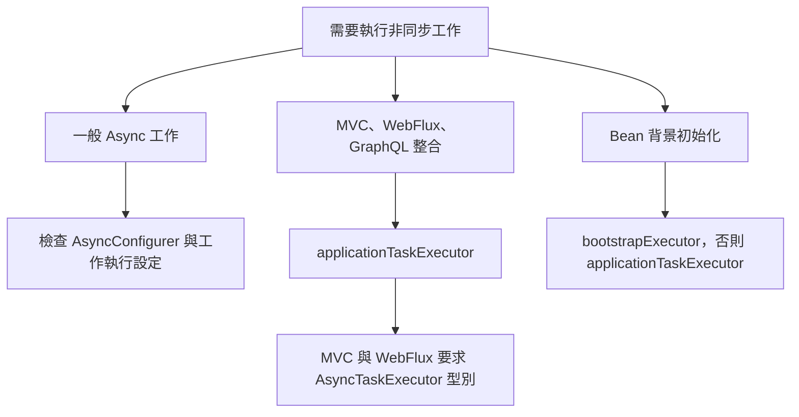

# 工作執行與排程

當應用程式內容中沒有 [`Executor`][r1] Bean 時，Spring Boot 會自動設定 [`AsyncTaskExecutor`][r2]。若已啟用虛擬執行緒（使用 Java 21 以上，並將 `spring.threads.virtual.enabled` 設為 `true`），它會是使用虛擬執行緒的 [`SimpleAsyncTaskExecutor`][r3]；否則，會是具有合理預設值的 [`ThreadPoolTaskExecutor`][r4]。

除非定義自訂 [`Executor`][r1] Bean，否則下列整合會使用自動設定的 [`AsyncTaskExecutor`][r2]：

- 透過 [`@EnableAsync`][r5] 執行非同步工作；若有 [`AsyncConfigurer`][r6] Bean，則以其設定為準。
- Spring for GraphQL 對 Controller 方法回傳的 [`Callable`][r7] 進行非同步處理。
- Spring MVC 的非同步請求處理。
- Spring WebFlux 的阻塞式執行支援。
- Spring WebSocket 的輸入與輸出訊息通道。
- JPA 的啟動 executor，依 JPA Repository 的啟動模式而定。
- `ApplicationContext` 中 Bean 的[背景初始化][r8] executor。

雖然這種方式適用於大多數情況，Spring Boot 也允許覆寫自動設定的 [`AsyncTaskExecutor`][r2]。預設情況下，只要註冊自訂 [`Executor`][r1] Bean，自動設定的 [`AsyncTaskExecutor`][r2] 就會退讓，而一般工作執行（透過 [`@EnableAsync`][r5]）會改用自訂的 [`Executor`][r1]。

不過，Spring MVC、Spring WebFlux 與 Spring GraphQL 都要求名為 `applicationTaskExecutor` 的 Bean。對 MVC 與 WebFlux 而言，型別還必須是 [`AsyncTaskExecutor`][r2]；GraphQL 則沒有強制這項型別要求。

如果只有一個 [`AsyncTaskExecutor`][r2] Bean，或有名為 `applicationTaskExecutor` 的 Bean，Spring WebSocket 與 JPA 就會使用它。

最後，`ApplicationContext` 的啟動 executor 會使用名為 `applicationTaskExecutor` 的 Bean，除非另有名為 `bootstrapExecutor` 的 Bean。

下例示範如何註冊自訂 [`AsyncTaskExecutor`][r2]，供 Spring MVC、Spring WebFlux、Spring GraphQL、Spring WebSocket、JPA 與 Bean 背景初始化使用：

{{CODE_0}}

{{CODE_1}}

> **注意：**如果應用程式內容中沒有 [`@Primary`][r9] 的 `Executor` Bean、名為 `taskExecutor` 的 [`Executor`][r1] Bean，也沒有 [`AsyncConfigurer`][r6]，一般工作執行也會使用 `applicationTaskExecutor`。

> **警告：**若既沒有自動設定的 `AsyncTaskExecutor`，也沒有 `applicationTaskExecutor`，應用程式會遵循 Spring Framework 的行為，預設使用名為 `taskExecutor` 的 Bean 執行一般工作（[`@EnableAsync`][r5]）。但是 Spring MVC、Spring WebFlux、Spring GraphQL 不會使用這個 Bean。如果其型別是 [`AsyncTaskExecutor`][r2]，Spring WebSocket 或 JPA 則可能使用它。

如果不同整合需要多個 `Executor` Bean，例如一個供 [`@EnableAsync`][r5] 一般工作執行使用，另一個供 MVC、WebFlux、WebSocket 與 JPA 使用，可以如下設定：

{{CODE_2}}

{{CODE_3}}

> **提示：**自動設定的 [`ThreadPoolTaskExecutorBuilder`][r10] 或 [`SimpleAsyncTaskExecutorBuilder`][r11]，能方便地建立與自動設定預設行為相同的 [`AsyncTaskExecutor`][r2] 實例。

{{CODE_4}}

{{CODE_5}}

如果無法使用 `taskExecutor` 這個 Bean 名稱，可以將 Bean 標記為 [`@Primary`][r9]，或定義 [`AsyncConfigurer`][r6] Bean，指定由哪個 `Executor` 負責 [`@EnableAsync`][r5] 的一般工作執行。以下示範此作法：

{{CODE_6}}

{{CODE_7}}

若要註冊自訂 [`Executor`][r1]，同時保留自動設定的 [`AsyncTaskExecutor`][r2]，可以在自訂 Bean 的 [`@Bean`][r12] 上設定 `defaultCandidate=false`：

{{CODE_8}}

{{CODE_9}}

如此就能把自訂 [`Executor`][r1] 自動注入其他元件，同時保留自動設定的 [`AsyncTaskExecutor`][r2]。不過，請記得搭配 [`@Autowired`][r14] 使用 [`@Qualifier`][r13]。

如果無法採用這種方式，也可以要求 Spring Boot 無論如何都自動設定 [`AsyncTaskExecutor`][r2]：

{{CODE_10}}

{{CODE_11}}

這時，即使已註冊自訂 [`Executor`][r1] Bean，包括標記為 [`@Primary`][r9] 的 Bean，所有下列整合仍會自動使用自動設定的 [`AsyncTaskExecutor`][r2]：

- 非同步工作執行（[`@EnableAsync`][r5]），除非存在 [`AsyncConfigurer`][r6] Bean。
- Spring for GraphQL 對 Controller 方法回傳的 [`Callable`][r7] 進行非同步處理。
- Spring MVC 的非同步請求處理。
- Spring WebFlux 的阻塞式執行支援。
- Spring WebSocket 的輸入與輸出訊息通道。
- JPA 的啟動 executor，依 JPA Repository 的啟動模式而定。
- `ApplicationContext` 內 Bean 的[背景初始化][r8] executor，除非定義名為 `bootstrapExecutor` 的 Bean。

> **提示：**依希望採用的配置，可將 `spring.task.execution.mode` 設為 `force`，自動設定 `applicationTaskExecutor`；也可以把自己的 [`Executor`][r1] 改成 [`AsyncTaskExecutor`][r2]，或同時定義 [`AsyncTaskExecutor`][r2] 與包裝自訂 [`Executor`][r1] 的 [`AsyncConfigurer`][r6]。

> **警告：**啟用 `force` 模式後，即使存在 [`@Primary`][r9] 的 `Executor` Bean，或名為 `taskExecutor` 的 [`Executor`][r1] Bean，`applicationTaskExecutor` 仍會用於 [`@EnableAsync`][r5] 的一般工作執行。此時要覆寫一般工作的 `Executor`，唯一方式是註冊 [`AsyncConfigurer`][r6] Bean。

自動設定 [`ThreadPoolTaskExecutor`][r4] 時，執行緒集區預設具有 8 個核心執行緒，並可依負載增減。可透過 `spring.task.execution` 命名空間微調：

{{CODE_12}}

{{CODE_13}}

這個範例會改用有界佇列；當佇列填滿 100 個工作時，執行緒集區會增加執行緒，上限為 16。縮減策略也更積極：執行緒閒置 10 秒就會回收，而非預設的 60 秒。

如果需要排程工作執行，例如使用 [`@EnableScheduling`][r15]，也可以自動設定 scheduler。

若已啟用虛擬執行緒（Java 21 以上，`spring.threads.virtual.enabled=true`），會使用基於虛擬執行緒的 [`SimpleAsyncTaskScheduler`][r16]，並忽略所有與執行緒集區相關的屬性。

若未啟用虛擬執行緒，則使用具合理預設值的 [`ThreadPoolTaskScheduler`][r17]。它預設使用一個執行緒，可透過 `spring.task.scheduling` 命名空間微調：

{{CODE_14}}

{{CODE_15}}

若需要建立自訂 executor 或 scheduler，應用程式內容中也會提供 [`ThreadPoolTaskExecutorBuilder`][r10]、[`SimpleAsyncTaskExecutorBuilder`][r11]、[`ThreadPoolTaskSchedulerBuilder`][r18] 與 [`SimpleAsyncTaskSchedulerBuilder`][r19] Bean。啟用虛擬執行緒時（Java 21 以上，`spring.threads.virtual.enabled=true`），後兩個名稱中含 `SimpleAsync` 的 builder 會自動設定為使用虛擬執行緒。

## 譯者圖解：同樣是執行工作，Bean 名稱與型別也會影響選擇

這是選擇條件的閱讀索引；`force`、`@Primary` 與多 Bean 的細節仍以正文規則為準。
