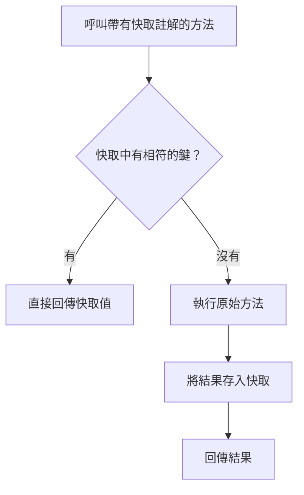

# 快取

Spring Framework 支援以透明方式為應用程式加入快取。
這項抽象的核心，是將快取套用到方法上，依據快取內已有的資訊減少執行次數。
快取邏輯會透明地套用，不會干擾呼叫端。
詳情請參閱 Spring Framework 參考文件的[相關章節][r1]。

只要使用 [`@EnableCaching`][r2] 註解啟用快取支援，Spring Boot 就會自動設定快取基礎設施。

> [TIP]
>
> 避免在包含 main 方法的應用程式類別上加入 [`@EnableCaching`][r2]。
> 這樣會讓快取成為必要功能，[執行測試套件時][r3]也不例外。

若要為服務中的某項操作加入快取，請在其方法上加入相關註解，如下例所示：

{{CODE_0}}

{{CODE_1}}

此範例示範對可能耗費大量資源的操作使用快取。
在呼叫 `computePiDecimal` 前，快取抽象會在 `piDecimals` 快取中，尋找符合 `precision` 引數的項目。
若找到項目，就立即將快取內容回傳給呼叫端，而不呼叫該方法。
否則會呼叫方法，並在回傳值之前更新快取。

> [CAUTION]
>
> 你也可以透明地使用標準 JSR-107（JCache）註解，例如 [`@CacheResult`][r4]。
> 不過，我們強烈建議不要混用 Spring Cache 與 JCache 註解。

如果沒有加入特定快取程式庫，Spring Boot 會自動設定使用記憶體內並行 Map 的[簡易提供者][r5]。
需要某個快取時（例如前例的 `piDecimals`），此提供者會為你建立它。
簡易提供者不太建議用於正式環境，但很適合入門，以及確認你理解這些功能。
決定要使用哪種快取提供者後，請務必閱讀其文件，了解如何設定應用程式所使用的快取。
幾乎所有提供者都要求你明確設定應用程式中的每個快取。
有些提供者允許自訂 `spring.cache.cache-names` 屬性所定義的預設快取。

> [TIP]
>
> 也可以透明地[更新][r6]或[移除][r7]快取中的資料。

## 支援的快取提供者

快取抽象不提供實際儲存，而是依賴 [`Cache`][r8] 與 [`CacheManager`][r9] 介面所具體化的抽象。

如果尚未定義 [`CacheManager`][r9] 型別的 Bean，或名為 `cacheResolver` 的 [`CacheResolver`][r10]（請參閱 [`CachingConfigurer`][r11]），Spring Boot 就會依照下列順序嘗試偵測提供者：

1. [通用][r12]
2. [JCache（JSR-107）][r13]（EhCache 3、Hazelcast、Infinispan 等）
3. [Hazelcast][r14]
4. [Infinispan][r15]
5. [Couchbase][r16]
6. [Redis][r17]
7. [Caffeine][r18]
8. [Cache2k][r19]
9. [簡易][r5]

> [TIP]
>
> 如果 [`CacheManager`][r9] 是由 Spring Boot 自動設定，就可以設定 `spring.cache.type` 屬性，*強制*使用特定快取提供者。

> [TIP]
>
> 使用 `spring-boot-starter-cache` starter，可快速加入基本快取相依項。
> 此 starter 會帶入 `spring-context-support`。
> 若手動加入相依項，必須包含 `spring-context-support`，才能使用 JCache 或 Caffeine 支援。

如果 [`CacheManager`][r9] 是由 Spring Boot 自動設定，你可以公開實作 [`CacheManagerCustomizer`][r20] 介面的 Bean，在它完全初始化之前進一步調整設定。
下例設定一個旗標，表示不應將 `null` 值傳遞到下層 Map：

{{CODE_2}}

{{CODE_3}}

> [NOTE]
>
> 上例預期存在自動設定的 [`ConcurrentMapCacheManager`][r21]。
> 如果不是這種情況（你提供了自己的設定，或自動設定了另一種快取提供者），就完全不會呼叫該自訂器。
> 自訂器數量不限，也可以使用 [`@Order`][r22] 或 [`Ordered`][r23] 排序。

### 通用

如果上下文定義了*至少*一個 [`Cache`][r8] Bean，就會使用通用快取。
系統會建立一個 [`CacheManager`][r9]，包裝所有這個型別的 Bean。

### JCache（JSR-107）

當 classpath 上存在 [`CachingProvider`][r25] 時，就會啟動 [JCache][r24]（也就是 classpath 上有符合 JSR-107 的快取程式庫）；[`JCacheCacheManager`][r26] 則由 `spring-boot-starter-cache` starter 提供。
符合標準的程式庫有多種，Spring Boot 為 Ehcache 3、Hazelcast 與 Infinispan 提供相依性管理。
也可以加入其他符合標準的程式庫。

可能同時存在多個提供者，此時必須明確指定要使用哪個。
雖然 JSR-107 標準沒有強制規定設定檔位置的統一指定方式，Spring Boot 仍盡可能配合各實作細節來設定快取，如下例所示：

{{CODE_4}}

{{CODE_5}}

> [NOTE]
>
> 若快取程式庫同時提供原生實作與 JSR-107 支援，Spring Boot 會優先使用 JSR-107 支援，讓你在切換至另一種 JSR-107 實作時，仍能使用相同功能。

> [TIP]
>
> Spring Boot 提供 [Hazelcast 的一般支援][r27]。
> 如果只有一個可用的 [`HazelcastInstance`][r28]，也會自動將它重用於 [`CacheManager`][r29]，除非指定了 `spring.cache.jcache.config` 屬性。

自訂下層 [`CacheManager`][r29] 有兩種方式：

- 設定 `spring.cache.cache-names` 屬性，可以在啟動時建立快取。
  如果定義了自訂 [`Configuration`][r30] Bean，會用它自訂這些快取。
- 呼叫 [`CacheManagerCustomizer`][r20] Bean 時會傳入 [`CacheManager`][r29] 參考，以進行完整自訂。

> [TIP]
>
> 如果定義了標準 [`CacheManager`][r29] Bean，它會自動包裝成快取抽象所預期的 [`CacheManager`][r9] 實作。
> 不會再對它套用其他自訂。

### Hazelcast

Spring Boot 提供 [Hazelcast 的一般支援][r27]。
如果已自動設定 [`HazelcastInstance`][r28]，且 classpath 上有 `com.hazelcast:hazelcast-spring`，它就會自動包裝在 [`CacheManager`][r9] 中。

> [NOTE]
>
> Hazelcast 可作為符合 JCache 的快取，也可作為符合 Spring [`CacheManager`][r9] 的快取。
> 將 `spring.cache.type` 設為 `hazelcast` 時，Spring Boot 會使用以 [`CacheManager`][r9] 為基礎的實作。
> 若想讓 Hazelcast 作為符合 JCache 的快取，請將 `spring.cache.type` 設為 `jcache`。
> 如果有多個符合 JCache 的快取提供者，而且想強制使用 Hazelcast，就必須[明確設定 JCache 提供者][r13]。

### Infinispan

[Infinispan][r31] 沒有預設設定檔位置，因此必須明確指定。
否則會使用預設啟動方式。

{{CODE_6}}

{{CODE_7}}

設定 `spring.cache.cache-names` 屬性，可以在啟動時建立快取。
若定義了自訂 [`ConfigurationBuilder`][r32] Bean，就會用它自訂快取。

詳情請參閱[文件][r33]。

### Couchbase

如果有 Spring Data Couchbase，而且已[設定 Couchbase][r34]，就會自動設定 [`CouchbaseCacheManager`][r35]。
設定 `spring.cache.cache-names` 屬性，可在啟動時建立其他快取；使用 `spring.cache.couchbase.*` 屬性則可設定快取預設值。
例如，下列設定會建立 `cache1` 與 `cache2` 快取，項目的*到期時間*為 10 分鐘：

{{CODE_8}}

{{CODE_9}}

若需要進一步掌控設定，可考慮註冊 [`CouchbaseCacheManagerBuilderCustomizer`][r36] Bean。
下例的自訂器為 `cache1` 與 `cache2` 設定各自的項目到期時間：

{{CODE_10}}

{{CODE_11}}

### Redis

若有 [Redis][r37] 且已完成設定，就會自動設定 [`RedisCacheManager`][r38]。
設定 `spring.cache.cache-names` 屬性，可在啟動時建立其他快取；使用 `spring.cache.redis.*` 屬性則可設定快取預設值。
例如，下列設定會建立 `cache1` 與 `cache2` 快取，*存活時間*為 10 分鐘：

{{CODE_12}}

{{CODE_13}}

> [NOTE]
>
> 預設會加入鍵前綴，因此即使兩個不同快取使用相同鍵，Redis 中的鍵也不會重疊，不會回傳錯誤的值。
> 如果你自行建立 [`RedisCacheManager`][r38]，我們強烈建議保留此設定。

> [TIP]
>
> 加入你自己的 [`RedisCacheConfiguration`][r39] [`@Bean`][r40]，即可完全掌控預設設定。
> 需要自訂預設序列化策略時，這會很有用。

若需要進一步掌控設定，可考慮註冊 [`RedisCacheManagerBuilderCustomizer`][r41] Bean。
下例的自訂器為 `cache1` 與 `cache2` 設定各自的存活時間：

{{CODE_14}}

{{CODE_15}}

### Caffeine

[Caffeine][r42] 是以 Java 8 改寫的 Guava 快取，取代了 Guava 支援。
若有 Caffeine，就會自動設定 [`CaffeineCacheManager`][r43]（由 `spring-boot-starter-cache` starter 提供）。
設定 `spring.cache.cache-names` 屬性，可以在啟動時建立快取，並依下列順序透過其中一項自訂：

1. `spring.cache.caffeine.spec` 定義的快取規格。
2. 已定義的 [`CaffeineSpec`][r44] Bean。
3. 已定義的 [`Caffeine`][r45] Bean。

例如，下列設定會建立 `cache1` 與 `cache2` 快取，大小上限為 500，*存活時間*為 10 分鐘：

{{CODE_16}}

{{CODE_17}}

如果定義了 [`CacheLoader`][r46] Bean，會自動將它與 [`CaffeineCacheManager`][r43] 關聯。
由於 [`CacheLoader`][r46] 會與該快取管理器管理的*所有*快取關聯，必須將它定義為 `CacheLoader<Object, Object>`。
自動設定會忽略其他泛型型別。

### Cache2k

[Cache2k][r47] 是記憶體內快取。
若有 Cache2k 的 Spring 整合，就會自動設定 `SpringCache2kCacheManager`。

設定 `spring.cache.cache-names` 屬性，可以在啟動時建立快取。
快取預設值可透過 [`Cache2kBuilderCustomizer`][r48] Bean 自訂。
下例的自訂器將快取容量設為 200 個項目，到期時間為 5 分鐘：

{{CODE_18}}

{{CODE_19}}

### 簡易

如果找不到其他提供者，就會設定使用 [`ConcurrentHashMap`][r49] 作為快取儲存的簡易實作。
應用程式中沒有快取程式庫時，這就是預設選項。
預設會依需要建立快取，但你可以設定 `cache-names` 屬性，限制可用快取清單。
例如，若只想要 `cache1` 與 `cache2`，可如下設定 `cache-names`：

{{CODE_20}}

{{CODE_21}}

如此設定後，如果應用程式使用未列出的快取，會在執行期間實際需要該快取時失敗，而非在啟動時失敗。
這類似「真正的」快取提供者在使用未宣告快取時的行為。

### 無快取

如果某個環境需要使用不執行任何快取操作的實作，而不是自動設定的快取管理器，請將快取型別設為 `none`，如下例所示：

{{CODE_22}}

{{CODE_23}}

## 測試

執行測試套件時，使用不執行任何操作的快取實作通常很有幫助。
本節列出幾種適合測試的策略。

若定義了自訂 [`CacheManager`][r9]，最佳做法是確保快取設定定義在獨立的 [`@Configuration`][r50] 類別中。
這可確保切片測試不會要求快取。
對 [`@SpringBootTest`][r51] 等啟用完整上下文的測試，則需要明確提供覆寫一般設定的設定。

若快取是自動設定的，就有更多選項。
測試可標註 [`@AutoConfigureCache`][r52]，將自動設定的 [`CacheManager`][r9] 替換為不執行任何操作的實作。

{{CODE_24}}

{{CODE_25}}

另一種方式，是強制讓自動設定的 [`CacheManager`][r9] 使用不執行任何操作的實作：

{{CODE_26}}

{{CODE_27}}

## 譯者補充：快取命中如何省掉手作邏輯

