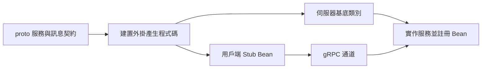

# gRPC

Google Remote Procedure Call（gRPC）是高效能 RPC 框架，讓用戶端與伺服器使用二進位訊息通訊。
Spring Boot 支援開發與測試 gRPC 用戶端和伺服器應用程式。

gRPC 使用的底層訊息格式是 Protocol Buffers，讓多種程式語言都能建立和使用訊息。

## 服務定義

開發 gRPC 應用程式時，首先需要 Protocol Buffers 服務定義檔。
`.proto` 檔定義應用程式可以使用或提供的服務與訊息。

以下是典型 `.proto` 檔範例，使用 Protocol Buffers 語言的 [`proto3` 修訂版][r1]：

{{CODE_0}}

此檔定義 `HelloWorld` 服務，只有一個方法，接受 `HelloRequest` 訊息並回傳 `HelloReply` 訊息。
`HelloRequest` 訊息包含字串欄位 `name`。
`HelloReply` 訊息包含字串欄位 `message`。

除了 `java_package` 與 `java_multiple_files` 選項，`.proto` 檔沒有任何專屬 Java 程式語言的內容。

### 產生 Java 程式碼

由於 `.proto` 檔與語言無關，我們需要一個流程，將它轉換為可用的 Java 程式碼。
接著就能使用產生的程式碼，對執行中的服務進行遠端程序呼叫，或自行實作服務讓其他人呼叫。

確切的程式碼產生流程取決於建置系統。
Spring Boot 支援 Maven 與 Gradle 的 protobuf 外掛，但你可以自由採用最適合自己的方案。

#### 使用 Maven 外掛

Spring Boot 為 `io.github.ascopes:protobuf-maven-plugin` Maven 外掛提供相依性管理。
若使用 `spring-boot-starter-parent` POM，也會取得可直接使用的合理設定。

下例是使用該外掛的典型 Maven POM 檔：

{{CODE_1}}

由於上述 POM 繼承 `spring-boot-starter-parent`，你會取得：

- `protoc` 版本設定。
- `binary-maven` 外掛設定。
- `generate` goal 的執行設定。

`.proto` 檔應放在 `src/main/proto`。

> [TIP]
>
> 若不使用 `spring-boot-starter-parent`，或想直接設定外掛，請參閱 [protobuf-maven-plugin 文件][r2]。
> 若使用 Spring Boot 相依性管理，`${protobuf-java.version}` 與 `${grpc-java.version}` 屬性會很有用。

#### 使用 Gradle 外掛

Spring Boot 為 `com.google.protobuf:protobuf-gradle-plugin` Gradle 外掛提供相依性管理。
此外，`spring-boot-gradle-plugin` 會在 protobuf 外掛存在時，對它進行適當設定。

下例是使用該外掛的典型 Gradle 檔：

{{CODE_2}}

`org.springframework.boot` 會回應 `com.google.protobuf` 外掛的存在，設定 `protoc` 及其版本。
此外，由於 `protobuf` 擴充已設定為使用 `grpc` 外掛，`org.springframework.boot` 外掛也會設定 `protoc-gen-grpc-java` 及其版本。

`.proto` 檔應放在 `src/main/proto`。

> [TIP]
>
> 若不使用 `org.springframework.boot` 外掛，或想直接設定外掛，請參閱 [protobuf-gradle-plugin 文件][r3]。

## 撰寫 gRPC 伺服器應用程式

Spring Boot 提供 `spring-boot-grpc-server` 模組與 `spring-boot-starter-grpc-server` starter POM，供伺服器應用程式使用。

撰寫實際伺服器程式碼時，需要繼承從 `.proto` 檔產生的一個或多個基底類別，並將它們公開為 Spring Bean。
Spring gRPC 會自動將任何實作 [`BindableService`][r4] 的 Bean 公開為 gRPC 服務。
由於所有從 `.proto` 產生的類別都實作 [`BindableService`][r4]，只要將它們加入為 Bean，就足以透過 gRPC 公開。

> [TIP]
>
> 詳情請參閱 [Spring gRPC 文件][r5]。

下例展示前述 `.proto` 檔中 `HelloWorld` 服務的實作方式。
此例使用 [`@GrpcService`][r6] 註解，並假設程式碼所在套件會被元件掃描找到：

{{CODE_3}}

{{CODE_4}}

如果應用程式使用 `spring-boot-starter-grpc-server`，就會使用 Netty 作為伺服器實作，監聽連接埠 `9090`。

你可以使用 [grpcurl][r7] 測試應用程式：

{{CODE_5}}

{{CODE_6}}

### 切換到 Netty Shaded 伺服器

如果發現 `spring-boot-starter-grpc-server` starter POM 提供的 Netty 版本，與其他程式庫不相容，可以切換到「shaded」版本。

若要切換，請排除 `io.grpc:grpc-netty`，並加入 `io.grpc:grpc-netty-shaded`。
例如：

{{CODE_7}}

{{CODE_8}}

### 切換到 Servlet 容器

可以使用 Tomcat 等一般 Servlet 容器公開 gRPC 服務，而不使用 Netty。
此時 Servlet 容器必須設定為支援 HTTP/2。

若要切換到 Servlet gRPC 實作，請排除 `io.grpc:grpc-netty`，並加入 `io.grpc:grpc-servlet-jakarta`。
例如：

{{CODE_9}}

{{CODE_10}}

> [TIP]
>
> 記得加入 Servlet 容器相依項，例如 `spring-boot-starter-tomcat`，並將 `server.http2.enabled` 設為 `true`。

> [NOTE]
>
> 使用 Servlet 容器時，某些 gRPC 伺服器設定屬性不適用，會被忽略。
> 例如，`spring.grpc.server.port` 會被忽略，因為 Web 伺服器連接埠是透過 `server.port` 設定。

### SSL 支援

`grpc-netty` 與 `grpc-netty-shaded` 伺服器都可以透過 SSL bundle 設定 SSL。
如何宣告 SSL bundle，請參閱 [SSL 核心文件][r8]。

定義好 bundle 後，可以在 gRPC 伺服器應用程式使用下列屬性套用它：

{{CODE_11}}

{{CODE_12}}

也可以將 `spring.grpc.server.ssl.client-auth` 設為 `optional` 或 `require`，設定用戶端身分驗證。

> [TIP]
>
> 若要暫時停用伺服器 SSL 支援，例如為了協助測試，請將 `spring.grpc.server.ssl.enabled` 設為 `false`。

### 使用行程內伺服器

在 classpath 中加入 `io.grpc:grpc-inprocess` 相依項，並定義 `spring.grpc.server.inprocess.name` 屬性，就能執行行程內伺服器。
在此模式下，除了一般伺服器工廠，也會自動設定行程內伺服器工廠。

提供的名稱可以用 `in-process:<name>` 形式作為用戶端通道目標。

### 反射

可用時，Spring Boot 會自動設定 [gRPC Reflection 服務][r9]。
這讓用戶端可以瀏覽服務中繼資料，並下載其 `.proto` 檔。

反射服務位於選用的相依程式庫 `io.grpc:grpc-services` 中。
你必須將此相依項加入專案，才會套用自動設定。

> [TIP]
>
> 若已有 `io.grpc:grpc-services` 程式庫，但不想自動設定反射，可將 `spring.grpc.server.reflection.enabled` 設為 `false`。

### 伺服器健康狀態

gRPC 伺服器可透過標準服務 API（[health/v1][r10]）提供健康資訊。
這讓用戶端可以檢查伺服器服務的健康狀態，並適當路由流量。

Spring Boot 提供橋接，連結自身的 `spring-boot-health` 模組與標準 gRPC 健康服務。
只要 classpath 上有 `io.grpc:grpc-services` 與 `org.springframework.boot:spring-boot-health` 模組，就會提供健康資訊。

> [TIP]
>
> 如果不想公開健康指標，可將 `spring.grpc.server.health.enabled` 設為 `false`。

#### 個別服務的健康對映

預設會使用所有可用的健康指標，提供整體伺服器狀態（`""`）的健康資訊。

也可以只包含一部分健康指標，為特定服務提供細緻的健康資訊。
各個服務也能定義自訂對映與排序規則。

例如，下列設定只使用 `db` 與 `redis` 指標，提供「myservice」的健康資訊。

{{CODE_13}}

{{CODE_14}}

> [TIP]
>
> 若只想提供個別服務的健康資訊，可將 `spring.grpc.server.health.include-overall-health` 設為 `false`，停用整體伺服器健康狀態。

#### 推送設定

與 Web 型健康檢查不同，gRPC 健康資訊會定期推送，而不是由外部拉取。
預設在應用程式啟動 5 秒後進行首次推送，之後每 5 秒推送一次。

可以使用下列屬性微調：

{{CODE_15}}

{{CODE_16}}

> [TIP]
>
> 如果想透過其他方式傳送健康更新，也可以將 `spring.grpc.server.health.schedule.enabled` 設為 `false`。

### 保護 gRPC 伺服器應用程式

#### 以 Netty 為基礎的伺服器

Spring gRPC 包含安全功能，讓你使用 Spring Security，以宣告式方式保護 Netty 伺服器應用程式。
採用的模式與保護一般 Web 應用程式類似。

Spring Boot 為 [`GrpcSecurity`][r11] 與 [`SecurityGrpcExceptionHandler`][r12] Bean 提供自動設定。
gRPC 應用程式通常會在 gRPC 服務 Bean 上使用 [`@PreAuthorize`][r13] 註解，或透過 [`AuthenticationProcessInterceptor`][r14] Bean 保護。

詳情請參閱 [Spring gRPC 文件][r15]。

#### 以 Servlet 容器為基礎的伺服器

如果 gRPC 伺服器[在標準 Servlet 容器中執行][r16]，可以使用一般的 [Web 安全性設定][r17]保護應用程式。
Spring Boot 會自動設定 [`GrpcServerExecutorProvider`][r18] 與 [`SecurityContextServerInterceptor`][r19] Bean，確保 Spring Security 正常運作。

跨站請求偽造（CSRF）防護與 gRPC 協定不相容，因此預設會對所有 gRPC 請求停用。
如果想自行設定 CSRF 防護，可以將 `spring.grpc.server.security.csrf.enabled` 設為 `false`，關閉此預設處理。

為協助手動設定安全性，Spring Boot 提供 gRPC 服務的請求比對器。
Servlet 與反應式技術堆疊都有對應比對器。
例如，下例會包含「special」以外的所有 gRPC 服務。

{{CODE_17}}

{{CODE_18}}

> [NOTE]
>
> 反應式比對請使用 [`org.springframework.boot.grpc.server.autoconfigure.security.web.servlet.GrpcRequest`][r20]。

#### OAuth2 Resource Server

[OAuth2][r21] 是廣泛使用的授權框架。
Spring Boot 的 OAuth2 Resource Server 支援與 gRPC 相容，可依一般方式設定。

如何設定 OAuth2 Resource Server 供 gRPC 伺服器應用程式使用，請參閱「Security」下的 [OAuth2 章節][r22]。

## 撰寫 gRPC 用戶端應用程式

Spring Boot 提供 `spring-boot-grpc-client` 模組與 `spring-boot-starter-grpc-client` starter POM，供用戶端應用程式使用。

用戶端可匯入從 `.proto` 檔產生的一個或多個「stub」類別，呼叫遠端 gRPC 服務。
可以使用 [`@ImportGrpcClients`][r23] 註解，匯入要使用的 stub 類別。

每項匯入都包含 `target`，可以是邏輯通道名稱，也可以是遠端伺服器的基底 URL。
我們通常建議使用通道名稱，而不是寫死目標。

以下是典型範例：

{{CODE_19}}

{{CODE_20}}

> [NOTE]
>
> 若未指定 `target`，會使用「default」。

> [TIP]
>
> 可以使用 [`@ImportGrpcClients`][r23] 的 `basePackageClasses` 或 `basePackages` 屬性，匯入指定套件中的所有 stub。

### 通道屬性

當 [`@ImportGrpcClients`][r23] 的 `target` 屬性使用邏輯通道名稱時，需要提供一些屬性，讓 Spring Boot 找到實際要呼叫的 gRPC 伺服器。

為此，可使用 `spring.grpc.channel.<name>.*` 屬性加入項目。
通常會設定實際 `target`，以及其他通道專屬設定。

例如，下列設定會讓 `myservice` 使用實際目標 `static://grpc.example.com:9090`。
它也修改了 keep-alive 逾時與允許的訊息大小上限：

{{CODE_21}}

{{CODE_22}}

### 使用 Stub Bean

加入 [`@ImportGrpcClients`][r23] 註解並寫好屬性後，就可以像使用其他 Bean 一樣使用 stub。

例如，以下將 `HelloWorldStub` 注入 `ApplicationRunner` Bean：

{{CODE_23}}

{{CODE_24}}

### 切換到 Netty Shaded 用戶端傳輸

底層的遠端 gRPC 網路呼叫使用 Netty。
若發現 `spring-boot-starter-grpc-client` starter POM 提供的 Netty 版本與其他程式庫不相容，可以切換到「shaded」版本。

若要切換，請排除 `io.grpc:grpc-netty`，並加入 `io.grpc:grpc-netty-shaded`。
例如：

{{CODE_25}}

{{CODE_26}}

### SSL 支援

gRPC 用戶端應用程式可透過 SSL/TLS 加密連線連接 gRPC 服務。
你可以將 gRPC 連線設為標準單向 TLS，或雙向 TLS。

#### 標準單向 TLS

若要使用標準單向 TLS，可將通道屬性中的 `ssl.enabled` 設為 `true`。
例如，下列設定會為 `myservice` 通道啟用 SSL/TLS 連線：

{{CODE_27}}

{{CODE_28}}

#### 雙向 TLS

雙向 TLS（mTLS）是一種安全協定，要求用戶端與伺服器彼此出示憑證。
若要使用雙向 TLS，可以設定通道屬性中的 `ssl.bundle`。
如何宣告 SSL bundle，請參閱 [SSL 核心功能文件][r8]。

下例設定 `myservice` 通道使用 `mybundle` bundle 進行雙向 TLS：

{{CODE_29}}

{{CODE_30}}

> [TIP]
>
> 若要暫時停用用戶端 SSL 支援，例如為了協助測試，請在通道設定中將 `bypass-certificate-validation` 設為 `true`：
>
{{CODE_31}}
>
{{CODE_32}}

### 使用行程內通道

在 classpath 中加入 `io.grpc.grpc-inprocess` 相依項，就可以與[行程內伺服器][r24]通訊（也就是不監聽網路連接埠的伺服器）。

在此模式下，除了一般通道工廠（例如 Netty），也會自動設定行程內通道工廠。
為避免使用者需要處理多個通道工廠，系統會將複合通道工廠設為主要通道工廠 Bean。
複合工廠會查詢其組成工廠，找到第一個支援該通道目標的工廠。

若要使用行程內伺服器，通道目標必須設為 `in-process:<name>`。

> [TIP]
>
> 若要停用行程內通道工廠，可將 `spring.grpc.client.inprocess.enabled` 屬性設為 `false`。

### 可觀測性

只要有 Micrometer，Spring Boot 就會自動設定 [`ObservationGrpcClientInterceptor`][r25]。
此攔截器為 gRPC 用戶端應用程式提供可觀測性。

> [TIP]
>
> 若使用 Micrometer，但不想將它用於 gRPC，可將 `spring.grpc.client.observation.enabled` 設為 `false`。

### 自訂通道

如果需要超出基本屬性的 gRPC 通道自訂，可使用 [`GrpcChannelBuilderCustomizer`][r26]。
每個自訂器在呼叫時，都會取得邏輯目標名稱，以及將建立該通道的 [`ManagedChannelBuilder`][r27]。
也有便利的 `matching(String pattern)` 工廠方法，將自訂限制在符合指定正規表示式的目標。

常見的自訂器用途，是為建構器加入[安全性攔截器][r28]。
例如，這裡為符合「hello」的目標加入 [`BearerTokenAuthenticationInterceptor`][r29]：

{{CODE_33}}

{{CODE_34}}

## 測試 gRPC 應用程式

若要協助測試 gRPC 用戶端與伺服器應用程式，可使用 `spring-boot-grpc-test` 模組，或 `spring-boot-starter-grpc-client-test`／`spring-boot-starter-grpc-server-test` starter POM。

### 使用行程內測試傳輸

[`@AutoConfigureTestGrpcTransport`][r30] 註解讓你快速將 gRPC 通訊通道，替換為專為測試設計的行程內通道。
與一般行程內通道不同，這些測試通道不需要任何設定。

使用測試 gRPC 傳輸，表示啟動應用程式時不必實際監聽網路連接埠。
這讓測試能快速執行，同時確認應用程式依預期運作。

預設使用 [`@AutoConfigureTestGrpcTransport`][r30] 時會：

- 設定測試用 [`GrpcServerFactory`][r31]／[`GrpcChannelFactory`][r32] Bean。
- 停用所有 gRPC Servlet 註冊。
- 停用 [`GrpcServerFactory`][r31] Bean 自動設定。
- 停用 [`GrpcChannelFactory`][r32] Bean 自動設定。

下例展示如何使用 [`@AutoConfigureTestGrpcTransport`][r30] 測試 gRPC 伺服器應用程式：

{{CODE_35}}

{{CODE_36}}

### 使用執行中的伺服器測試

如果偏好啟動真正的伺服器並使用實際網路連線測試 gRPC 應用程式，我們建議使用隨機連接埠。
這可確保測試能在任何環境執行，也避免意外呼叫真實服務。

若要使用隨機連接埠啟動 gRPC 伺服器，請將 `spring.grpc.server.port` 設為 `0`。
可以使用 [`@LocalGrpcServerPort`][r33] 註解，取得伺服器實際啟動的連接埠。

以下是測試範例：

{{CODE_37}}

{{CODE_38}}

## 譯者註：原文疑點

原文「反應式比對」列出的套件路徑卻含 `web.servlet`，此處依原文保留，請透過 API 連結核對適用型別。行程內通道一節的相依項原文寫成 `io.grpc.grpc-inprocess`；前文伺服器段落使用的是 Maven 座標 `io.grpc:grpc-inprocess`。此外，`bypass-certificate-validation` 的名稱表示略過憑證驗證，不能把它等同於關閉 TLS 加密；上方提示是原文的說法，請區分這兩件事。

## 譯者補充：從契約到呼叫

