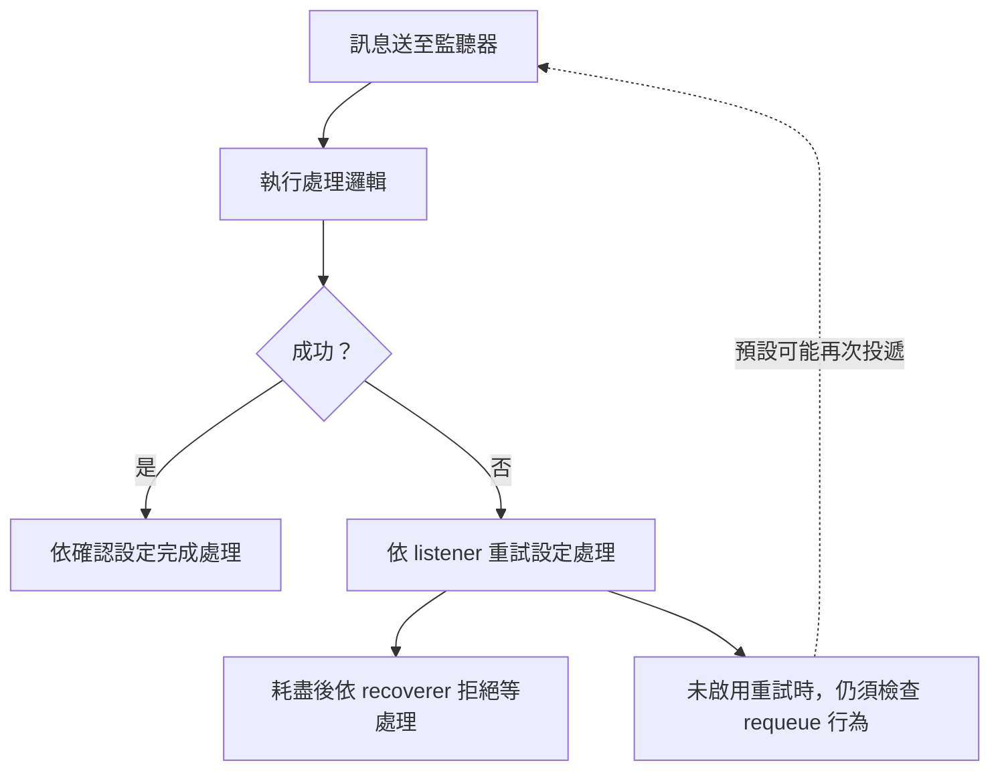

# AMQP

Advanced Message Queuing Protocol（AMQP）是訊息導向中介軟體使用的平台中立線路層協定。Spring AMQP 將 Spring 核心概念套用到以 AMQP 為基礎的訊息解決方案。Spring Boot 提供透過 RabbitMQ 使用 AMQP 的多項便利功能，包括 `spring-boot-starter-amqp`。

## RabbitMQ 支援

[RabbitMQ][r1] 是以 AMQP 協定為基礎、輕量、可靠、可擴展且可攜的訊息 broker。Spring 使用 RabbitMQ 透過 AMQP 協定通訊。

RabbitMQ 設定由 `spring.rabbitmq.*` 外部化設定屬性控制。例如，可以在 `application.properties` 宣告：

{{CODE_0}}

{{CODE_1}}

也可以用 `addresses` 屬性設定相同連線：

{{CODE_2}}

{{CODE_3}}

> **注意：**以這種方式指定地址時，會忽略 `host` 與 `port` 屬性。若地址使用 `amqps` 協定，會自動啟用 SSL 支援。

其他屬性設定選項請參閱 [`RabbitProperties`][r2]。若要設定 Spring AMQP 使用的 RabbitMQ [`ConnectionFactory`][r3] 底層細節，請定義 [`ConnectionFactoryCustomizer`][r4] Bean。

如果應用程式內容中存在 [`ConnectionNameStrategy`][r5] Bean，會自動用來為自動設定的 [`CachingConnectionFactory`][r6] 所建立的連線命名。

若要對整個應用程式的 [`RabbitTemplate`][r7] 進行附加式客製，請使用 [`RabbitTemplateCustomizer`][r8] Bean。

> **提示：**更多資訊請參閱[理解 RabbitMQ 使用的 AMQP 協定][r9]。

## 傳送訊息

Spring 的 [`AmqpTemplate`][r10] 與 [`AmqpAdmin`][r11] 會自動設定，可直接注入自己的 Bean：

{{CODE_4}}

{{CODE_5}}

> **注意：**[`RabbitMessagingTemplate`][r12] 也可以用類似方式注入。如果定義 [`MessageConverter`][r13] Bean，會自動與自動設定的 [`AmqpTemplate`][r10] 關聯。

如有需要，任何定義成 Bean 的 [`Queue`][r14] 都會自動用來在 RabbitMQ 實例上宣告對應佇列。

可以為 [`AmqpTemplate`][r10] 啟用重試，例如在 broker 連線中斷時重試操作：

{{CODE_6}}

{{CODE_7}}

預設不啟用重試。也可以宣告 [`RabbitTemplateRetrySettingsCustomizer`][r16] Bean，以程式客製 [`RetryTemplate`][r15]。

如果需要建立更多 [`RabbitTemplate`][r7] 實例，或覆寫預設值，Spring Boot 提供 [`RabbitTemplateConfigurer`][r17] Bean，可使用與自動設定所使用工廠相同的設定，初始化自己的 `RabbitTemplate`。

如果應用程式內容中有 [`RabbitTemplateObservationConvention`][r18] Bean，會自動設定到 [`RabbitTemplate`][r7]。

## 傳送訊息至 Stream

若要傳送訊息至特定 stream，請指定其名稱：

{{CODE_8}}

{{CODE_9}}

如果定義 [`MessageConverter`][r13]、[`StreamMessageConverter`][r19]、[`ProducerCustomizer`][r20] 或 [`RabbitStreamTemplateObservationConvention`][r21] Bean，會自動關聯至自動設定的 [`RabbitStreamTemplate`][r22]。

若需要建立更多 [`RabbitStreamTemplate`][r22] 實例，或覆寫預設值，Spring Boot 提供 [`RabbitStreamTemplateConfigurer`][r23] Bean，可使用與自動設定工廠相同的設定，初始化自己的 `RabbitStreamTemplate`。

### SSL

若要讓 RabbitMQ Streams 使用 SSL，請將 `spring.rabbitmq.stream.ssl.enabled` 設為 `true`，或透過 `spring.rabbitmq.stream.ssl.bundle` 指定要使用的 [SSL bundle][r24]。

## 接收訊息

當 Rabbit 基礎設施存在時，可以在 Bean 使用 [`@RabbitListener`][r25] 建立監聽端點。如果未定義 [`RabbitListenerContainerFactory`][r26]，會自動設定預設的 [`SimpleRabbitListenerContainerFactory`][r27]；可透過 `spring.rabbitmq.listener.type` 改用 direct 容器。

如果定義 [`MessageConverter`][r13]、[`MessageRecoverer`][r28] 或 [`RabbitListenerObservationConvention`][r29] Bean，會自動與預設工廠關聯。

下例在 `someQueue` 佇列上建立監聽端點：

{{CODE_10}}

{{CODE_11}}

> **提示：**更多資訊請參閱 [`@EnableRabbit`][r30]。

若需要建立更多 [`RabbitListenerContainerFactory`][r26] 實例，或覆寫預設工廠，Spring Boot 提供 [`SimpleRabbitListenerContainerFactoryConfigurer`][r31] 與 [`DirectRabbitListenerContainerFactoryConfigurer`][r32]，可分別用與自動設定相同的設定，初始化 [`SimpleRabbitListenerContainerFactory`][r27] 及 [`DirectRabbitListenerContainerFactory`][r33]。

> **提示：**不論選擇哪種容器，自動設定都會提供這兩個 configurer Bean。

例如，下列組態類別提供另一個使用特定 [`MessageConverter`][r13] 的工廠：

{{CODE_12}}

{{CODE_13}}

接著可在任何帶有 [`@RabbitListener`][r25] 的方法使用它：

{{CODE_14}}

{{CODE_15}}

可以啟用重試，處理監聽器拋出例外的情況。預設使用 [`RejectAndDontRequeueRecoverer`][r34]，也可以自行定義 [`MessageRecoverer`][r28]。重試次數耗盡後，訊息會被拒絕，接著遭丟棄，或在 broker 已有對應設定時送至 dead-letter exchange。

預設不啟用重試。也可以宣告 [`RabbitListenerRetrySettingsCustomizer`][r36] Bean，以程式客製 [`RetryPolicy`][r35]。

> **重要：**預設情況下，如果未啟用重試，而監聽器拋出例外，訊息投遞會無限重試。可用兩種方式改變：將 `defaultRequeueRejected` 設為 `false`，不再重新投遞；或拋出 [`AmqpRejectAndDontRequeueException`][r37]，指示應拒絕此訊息。啟用重試且達到最大投遞次數後，也會使用後者機制。

## 譯者圖解：應用端重試與 broker 重新投遞要分開看

「停用重試」不等於 broker 永遠不再投遞；應一起閱讀正文的 `defaultRequeueRejected` 與 recoverer 規則。
