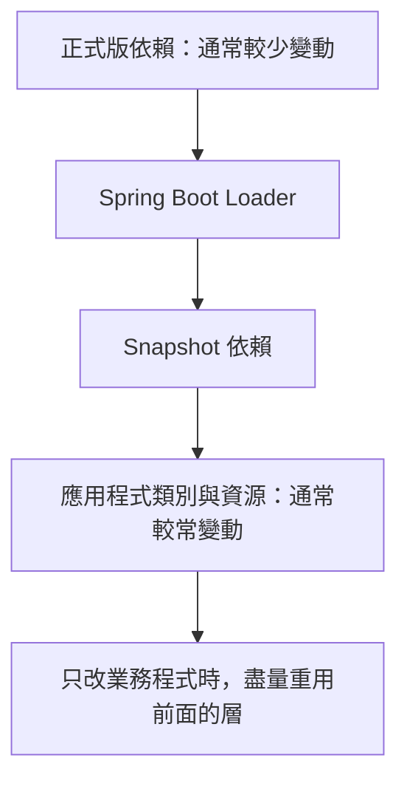

# 有效率的容器映像

將 Spring Boot uber jar 封裝為 Docker 映像並不困難，不過直接把 uber jar 複製進映像並原樣執行，也有數項缺點。未解開的 uber jar 在執行時總會有一些額外成本，在容器化環境中可能更明顯。

另一個問題，是把應用程式碼與所有依賴都放在同一個映像層並不理想。通常重新編譯應用程式碼的頻率高於更新 Spring Boot 版本，因此適度拆分會更好。若將 jar 檔案放在應用程式類別之前的映像層，Docker 通常只需變更最下方的應用層，其他層則能直接使用快取。

## Docker 映像分層

為了更容易建立最佳化映像，Spring Boot 支援在 jar 中加入分層索引檔。索引會列出各個層，以及 jar 中哪些部分應包含在哪一層。索引中的順序，就是這些層應加入 Docker／OCI 映像的順序。預設支援：

- `dependencies`：一般正式發布的依賴。
- `spring-boot-loader`：`org/springframework/boot/loader` 下的所有內容。
- `snapshot-dependencies`：snapshot 依賴。
- `application`：應用程式類別與資源。

以下是 `layers.idx` 範例：

{{CODE_0}}

這種分層依據，是程式碼在不同應用程式建置之間發生變更的可能性。函式庫較少變動，因此放在獨立層，讓工具重複使用快取；應用程式碼較常變動，因此隔離在另一層。

Spring Boot 也能透過 `layers.idx` 支援 war 檔案分層。

Maven 如何將分層索引加入封存檔，請參閱[封裝分層 jar 或 war][r1]；Gradle 則請參閱 Gradle 外掛文件中的[封裝分層 jar 或 war][r2]。

## 譯者圖解：按變動頻率分開

圖示為加入層的順序；原文「最下方」描述的是其示意位置，不應與映像底層／基底映像的術語混淆。
