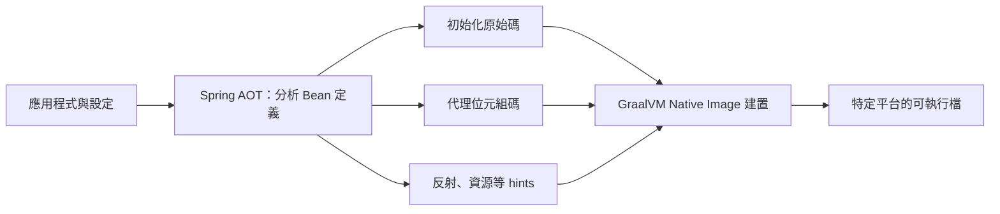

# GraalVM 原生映像介紹

GraalVM 原生映像提供部署與執行 Java 應用程式的新方式。與 Java 虛擬機器相比，它能使用較少記憶體，且啟動速度快得多。

原生映像適合透過容器映像部署的應用程式，搭配 Function as a Service（FaaS）平台時尤其值得關注。

與傳統 JVM 應用程式不同，GraalVM 原生映像應用程式需要先進行預先處理，才能建立可執行檔。這個過程會從主要入口開始，對應用程式碼進行靜態分析。

GraalVM 原生映像是完整、針對特定平台的可執行檔；執行時不需要另外隨附 Java 虛擬機器。

> **提示：**如果只想先開始試用 GraalVM，可以跳到[開發第一個 GraalVM 原生應用程式][r1]，之後再回來閱讀本節。

## 與 JVM 部署的重要差異

原生映像是預先產生的，因此與 JVM 應用程式存在數項重要差異：

- 在建置階段，從 `main` 入口開始對應用程式進行靜態分析。
- 建立原生映像時無法到達的程式碼會被移除，不會成為可執行檔的一部分。
- GraalVM 無法直接得知程式中的動態元素，必須另外告知反射、資源、序列化與動態代理的使用情況。
- 應用程式的 classpath 在建置時固定，之後不能改變。
- 沒有延遲類別載入；可執行檔中隨附的所有內容都會在啟動時載入記憶體。
- Java 應用程式的部分能力仍有尚未完整支援的限制。

除了這些差異，Spring 還會執行稱為 [Spring 預先處理][r2]的流程，帶來額外限制。請至少閱讀下一節開頭，以了解這些限制。

> **提示：**GraalVM 參考文件的 [Native Image 相容性指南][r3]提供更多限制細節。

## 理解 Spring 預先處理

典型 Spring Boot 應用程式具有高度動態性，設定工作是在執行階段完成。事實上，Spring Boot 自動設定的概念，很大程度上依靠回應執行階段的狀態，來完成正確設定。

雖然可以將這些動態特性告知 GraalVM，但這樣會抵銷靜態分析的大部分好處。因此，使用 Spring Boot 建立原生映像時，會採用封閉世界假設（closed-world assumption），限制應用程式的動態特性。

除了 [GraalVM 本身的限制][r4]，封閉世界假設還包含下列限制：

- 應用程式中定義的 Bean 不能在執行階段改變，因此：
  - Spring 的 [`@Profile`][r5] 與 profile 專用設定[有其限制][r6]。
  - 不支援會改變是否建立 Bean 的屬性，例如 [`@ConditionalOnProperty`][r7] 與 `.enabled` 屬性。

在這些限制下，Spring 就能在建置階段進行預先處理，產生 GraalVM 可使用的額外產物。經 Spring AOT 處理的應用程式，通常會產生：

- Java 原始碼。
- 位元組碼，例如動態代理所需的位元組碼。
- 位於 `META-INF/native-image/{groupId}/{artifactId}/` 的 GraalVM JSON hint 檔案：
  - 資源 hints：`resource-config.json`。
  - 反射 hints：`reflect-config.json`。
  - 序列化 hints：`serialization-config.json`。
  - Java 代理 hints：`proxy-config.json`。
  - JNI hints：`jni-config.json`。

如果產生的 hints 不足，也可以[自行提供][r8]。

### 原始碼產生

Spring 應用程式由 Spring Bean 組成。Spring Framework 內部使用兩個不同概念管理 Bean：一個是 Bean 實例，也就是已建立、可注入其他 Bean 的實際物件；另一個是 Bean 定義，用來描述 Bean 的屬性與建立實例的方式。

以下是典型的 [`@Configuration`][r9] 類別：

{{CODE_0}}

Spring 會解析 [`@Configuration`][r9] 類別，尋找 [`@Bean`][r10] 方法，據此建立 Bean 定義。上例定義了名為 `myBean` 的 singleton Bean 的 [`BeanDefinition`][r11]；同時也為 `MyConfiguration` 類別本身建立 [`BeanDefinition`][r11]。

需要 `myBean` 實例時，Spring 知道必須呼叫 `myBean()`，並使用其結果。在 JVM 上執行時，Spring 會在應用程式啟動時解析 [`@Configuration`][r9]，並透過反射呼叫 [`@Bean`][r10] 方法。

建立原生映像時則不同：解析組態類別與產生 Bean 定義的工作，會從執行階段移到建置階段。發現 Bean 定義後，Spring 會處理並將它們轉成 GraalVM 編譯器能分析的原始碼。

Spring AOT 會將前面的組態類別轉成類似以下的程式碼：

{{CODE_1}}

> **注意：**實際產生的程式碼，可能因 Bean 定義的性質而有所不同。

可以看到，產生的程式碼會建立與 [`@Configuration`][r9] 類別等價的 Bean 定義，但採用 GraalVM 能直接理解的方式。

其中包含 `myConfiguration` 與 `myBean` 各自的 Bean 定義。需要 `myBean` 實例時，會呼叫 [`BeanInstanceSupplier`][r12]；它再呼叫 `myConfiguration` Bean 上的 `myBean()` 方法。

> **注意：**Spring AOT 處理期間，應用程式只會啟動到 Bean 定義可用的階段；AOT 處理階段不會建立 Bean 實例。

Spring AOT 會為所有 Bean 定義產生這類程式碼；若需要 Bean 後處理，例如呼叫 [`@Autowired`][r13] 方法，也會產生對應程式碼。此外還會產生 [`ApplicationContextInitializer`][r14]，讓 Spring Boot 在真正執行經 AOT 處理的應用程式時，用它初始化 [`ApplicationContext`][r15]。

> **提示：**AOT 產生的原始碼雖然冗長，但相當容易閱讀，有助於除錯。Maven 的產生檔案位於 `target/spring-aot/main/sources`；Gradle 則位於 `build/generated/aotSources`。

### Hint 檔案產生

除了原始碼，Spring AOT 引擎也會產生供 GraalVM 使用的 hint 檔案。檔案以 JSON 描述：對於無法直接檢查程式碼而理解的行為，GraalVM 應該如何處理。

例如，可能在 private 方法上使用 Spring 註解。即使在 GraalVM 中，Spring 仍必須透過反射呼叫 private 方法。遇到這類情況時，Spring 可以寫入反射 hint，告知 GraalVM：即使此方法沒有被直接呼叫，也必須保留在原生映像中。

Hint 檔案會產生在 `META-INF/native-image` 下，GraalVM 會自動讀取。

> **提示：**Maven 的產生檔案位於 `target/spring-aot/main/resources`；Gradle 則位於 `build/generated/aotResources`。

### 代理類別產生

Spring 有時需要產生代理類別，替你的程式碼加上額外功能。為此，它會使用直接產生位元組碼的 cglib 函式庫。

應用程式在 JVM 上執行時，代理類別會於執行過程中動態產生。建立原生映像時，則必須在建置階段就產生這些代理，才能讓 GraalVM 將它們納入。

> **注意：**不同於產生的原始碼，產生的位元組碼對應用程式除錯通常沒有太大幫助。不過，若需要使用 `javap` 等工具檢查 `.class` 內容，Maven 的檔案位於 `target/spring-aot/main/classes`，Gradle 則位於 `build/generated/aotClasses`。

## 譯者圖解：把可提前決定的工作移到建置階段

AOT 並非單純把啟動結果存成快取：它會產生初始化程式碼與提示資料，因此建置時就必須確定某些原本能在執行時決定的內容。
