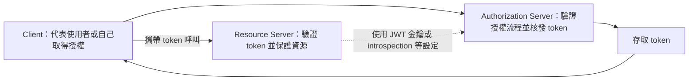

# OAuth2

[OAuth2][r1] 是廣泛使用的授權框架。

## 用戶端

當 classpath 中有 `spring-security-oauth2-client`，即可透過自動設定建立 OAuth2／OpenID Connect 用戶端。設定使用 [`OAuth2ClientProperties`][r2] 中的屬性；同一套屬性適用於 Servlet 與 Reactive Web 應用程式。

每個 registration 都必須指定 OAuth 2 provider。如果設定 `spring.security.oauth2.client.registration.<registration-id>.provider`，就使用其值指定提供者；若未設定，則以 registration ID 作為 provider ID。以下同時展示這兩種方式：

{{CODE_0}}

{{CODE_1}}

`my-client` 與 `example` 兩個 registration 都使用 ID 為 `example` 的 provider。前者依 `spring.security.oauth2.client.registration.my-client.provider` 的值選擇；後者因自己的 ID 是 `example`，且未設定 `provider`，因此採用相同提供者。

指定的 provider 可以參照由 `spring.security.oauth2.client.provider.<provider-id>.*` 設定的提供者，也可以是[已知的常見提供者][r3]。

可以在 `spring.security.oauth2.client` 前綴下註冊多個 OAuth2 用戶端與 provider：

{{CODE_2}}

{{CODE_3}}

此例有三個 registration，依宣告順序，其 ID 為 `my-login-client`、`my-client-1`、`my-client-2`；另外有一個 ID 為 `my-oauth-provider` 的 provider。

若 OpenID Connect provider 支援 [OpenID Connect discovery][r4]，設定可再簡化。必須為 provider 設定 `issuer-uri`，其值是提供者宣告作為 Issuer Identifier 的 URI。例如，若設為 `https://example.com`，就會向 `https://example.com/.well-known/openid-configuration` 發出 OpenID Provider Configuration Request，預期取得 OpenID Provider Configuration Response。以下展示使用 `issuer-uri` 設定提供者：

{{CODE_4}}

{{CODE_5}}

預設情況下，Spring Security 的 [`OAuth2LoginAuthenticationFilter`][r5] 只處理符合 `/login/oauth2/code/*` 的 URL。如果自訂 `redirect-uri` 使用不同模式，也必須提供能處理該模式的設定。例如，Servlet 應用程式可加入類似以下的 [`SecurityFilterChain`][r6]：

{{CODE_6}}

{{CODE_7}}

> **提示：**Spring Boot 會自動設定 [`InMemoryOAuth2AuthorizedClientService`][r7]，供 Spring Security 管理用戶端註冊。其能力有限，原文建議只用於開發環境；正式環境可考慮 [`JdbcOAuth2AuthorizedClientService`][r8]，或自行實作 [`OAuth2AuthorizedClientService`][r9]。

> **譯者校對註：**上述原文使用「管理用戶端註冊」的說法；`OAuth2AuthorizedClientService` 實際負責 authorized client 的管理，閱讀 API 時請與 client registration 的描述區分。

### 常見提供者的 OAuth2 用戶端註冊

對常見的 OAuth2 與 OpenID provider——Google、GitHub、Facebook、X、Okta——Spring Boot 提供一組預設設定，其 ID 分別為 `google`、`github`、`facebook`、`x` 與 `okta`。

若不需客製提供者，可將 registration 的 `provider` 設為其中一個 ID；也可以[讓 registration ID 與 provider ID 相同][r10]。下例兩種設定都使用常見的 `google` provider：

{{CODE_8}}

{{CODE_9}}

## 資源伺服器

當 classpath 中有 `spring-security-oauth2-resource-server`，Spring Boot 可以設定 OAuth2 Resource Server。JWT 設定必須指定 JWK Set URI 或 OIDC Issuer URI，例如：

{{CODE_10}}

{{CODE_11}}

{{CODE_12}}

{{CODE_13}}

> **注意：**如果授權伺服器不支援 JWK Set URI，可以為資源伺服器設定用於驗證 JWT 簽章的公開金鑰。使用 `spring.security.oauth2.resourceserver.jwt.public-key-location`，其值必須指向包含 PEM 編碼 X.509 格式公開金鑰的檔案。

`spring.security.oauth2.resourceserver.jwt.audiences` 可指定預期的 JWT `aud` claim 值。例如，要求 JWT 包含值為 `my-audience` 的 `aud` claim：

{{CODE_14}}

{{CODE_15}}

同一套屬性適用於 Servlet 與 Reactive 應用程式。也可以在 Servlet 應用程式自行定義 [`JwtDecoder`][r11]，或在 Reactive 應用程式定義 [`ReactiveJwtDecoder`][r12]。

若使用 opaque token，而非 JWT，可以設定以下屬性，透過 introspection 驗證 token：

{{CODE_16}}

{{CODE_17}}

同樣地，這套屬性適用於 Servlet 與 Reactive 應用程式。

結果會自動設定 introspector：一般應用程式使用 [`SpringOpaqueTokenIntrospector`][r13]，Reactive 應用程式使用 [`SpringReactiveOpaqueTokenIntrospector`][r14]。可分別透過 [`SpringOpaqueTokenIntrospectorBuilderCustomizer`][r15] 與 [`SpringReactiveOpaqueTokenIntrospectorBuilderCustomizer`][r16] Bean 客製。

若要完整掌控 introspection，請自行定義 [`OpaqueTokenIntrospector`][r17] 或 [`ReactiveOpaqueTokenIntrospector`][r18] Bean。

## 授權伺服器

當 classpath 中有 `spring-security-oauth2-authorization-server`，即可透過自動設定建立以 Servlet 為基礎的 OAuth2 Authorization Server。

可以在 `spring.security.oauth2.authorizationserver.client` 前綴下註冊多個 OAuth2 用戶端：

{{CODE_18}}

{{CODE_19}}

> **注意：**`client-secret` 格式必須能由設定的 [`PasswordEncoder`][r19] 比對。預設 `PasswordEncoder` 是透過 `PasswordEncoderFactories.createDelegatingPasswordEncoder()` 建立。

Spring Boot 提供的 Spring Authorization Server 自動設定，目的是協助快速入門。大多數應用程式仍需要客製，通常會定義數個 Bean 來覆寫自動設定。

可以定義下列元件 Bean，覆寫授權伺服器特有的自動設定：

- [`RegisteredClientRepository`][r20]
- [`AuthorizationServerSettings`][r21]
- [`SecurityFilterChain`][r6]
- `com.nimbusds.jose.jwk.source.JWKSource<com.nimbusds.jose.proc.SecurityContext>`
- [`JwtDecoder`][r11]

> **提示：**Spring Boot 會自動設定 [`InMemoryRegisteredClientRepository`][r22]，供 Spring Authorization Server 管理註冊用戶端。其能力有限，建議只用於開發環境；正式環境可考慮 [`JdbcRegisteredClientRepository`][r23]，或自行實作 [`RegisteredClientRepository`][r20]。

其他資訊請參閱 Spring Security 參考文件的 [Getting Started][r24] 章節。

## 譯者圖解：先分清三種角色

圖示是角色概念，不表示所有 OAuth2 grant 都有相同互動步驟；JWT 驗證也不一定每次請求都連回授權伺服器。
