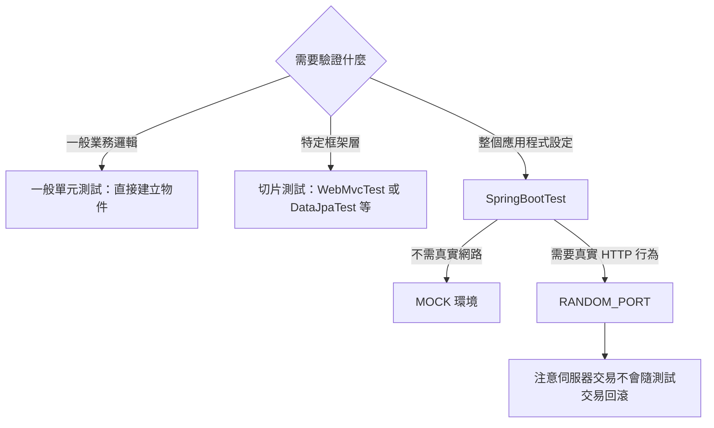

# 測試 Spring Boot 應用程式

Spring Boot 應用程式本身就是 Spring [`ApplicationContext`][r1]，因此除了平常測試一般 Spring 上下文的作法，不必進行特別的處理。

> [NOTE]
>
> 預設只有透過 [`SpringApplication`][r2] 建立上下文時，才會安裝外部屬性、日誌與其他 Spring Boot 功能。

Spring Boot 提供 [`@SpringBootTest`][r3] 註解；需要 Spring Boot 功能時，可用它取代標準 `spring-test` 的 [`@ContextConfiguration`][r4]。
此註解會[透過 `SpringApplication` 建立測試所使用的 `ApplicationContext`][r5]。
除了 [`@SpringBootTest`][r3]，也提供多種其他註解，用來[測試應用程式中特定的切片][r6]。

> [TIP]
>
> 如果使用 JUnit 4，別忘記在測試加入 `@RunWith(SpringRunner.class)`，否則註解會被忽略。
> 如果使用 JUnit 6，則不必加入對應的 `@ExtendWith(SpringExtension.class)`，因為 [`@SpringBootTest`][r3] 與其他 `@…​Test` 註解已標註它。

[`@SpringBootTest`][r3] 預設不會啟動伺服器。
可使用其 `webEnvironment` 屬性，進一步調整測試執行方式：

- `MOCK`（預設）：載入 Web [`ApplicationContext`][r1]，提供模擬 Web 環境，不會啟動嵌入式伺服器。如果 classpath 沒有 Web 環境，會透明地退回建立一般非 Web 的 [`ApplicationContext`][r1]。可以搭配 [`@AutoConfigureMockMvc`][r7] 或 [`@AutoConfigureWebTestClient`][r8]，以模擬方式測試 Web 應用程式。
- `RANDOM_PORT`：載入 [`WebServerApplicationContext`][r9]，提供真實 Web 環境，啟動嵌入式伺服器並監聽隨機連接埠。
- `DEFINED_PORT`：載入 [`WebServerApplicationContext`][r9]，提供真實 Web 環境，啟動嵌入式伺服器並監聽指定連接埠（來自 `application.properties`），或預設的 `8080`。
- `NONE`：透過 [`SpringApplication`][r2] 載入 [`ApplicationContext`][r1]，但不提供任何 Web 環境，無論模擬或其他形式。

> [NOTE]
>
> 若測試標註 [`@Transactional`][r10]，預設會在每個測試方法結束時回滾交易。
> 然而搭配 `RANDOM_PORT` 或 `DEFINED_PORT` 時，會隱含提供真實 Servlet 環境，HTTP 用戶端與伺服器在不同執行緒執行，因此交易也不同。
> 在這種情況下，伺服器端發起的交易不會回滾。

> [NOTE]
>
> 若應用程式的管理伺服器使用不同連接埠，`webEnvironment = WebEnvironment.RANDOM_PORT` 的 [`@SpringBootTest`][r3] 也會讓管理伺服器在另一個隨機連接埠啟動。

## 偵測 Web 應用程式類型

如果 Spring MVC 可用，會設定一般以 MVC 為基礎的應用程式上下文。
如果只有 Spring WebFlux，則會偵測並改為設定 WebFlux 上下文。

兩者都存在時，Spring MVC 優先。
若要在此情況測試反應式 Web 應用程式，必須設定 `spring.main.web-application-type` 屬性：

{{CODE_0}}

{{CODE_1}}

## 偵測測試設定

若熟悉 Spring Test Framework，你可能習慣透過 `@ContextConfiguration(classes=…​)` 指定要載入的 Spring [`@Configuration`][r11]。
也可能經常在測試中使用巢狀 [`@Configuration`][r11] 類別。

測試 Spring Boot 應用程式時，通常不需要這麼做。
只要沒有明確定義主要設定，Spring Boot 的 `@*Test` 註解就會自動尋找。

搜尋演算法從測試所在套件往上尋找，直到找到標註 [`@SpringBootApplication`][r12] 或 [`@SpringBootConfiguration`][r13] 的類別。
只要合理地[組織程式碼][r14]，通常就能找到主要設定。

> [NOTE]
>
> 如果使用[測試註解測試應用程式特定切片][r6]，應避免在[包含 main 方法的應用程式類別][r15]上加入只屬於特定領域的設定。
>
> [`@SpringBootApplication`][r12] 底層的元件掃描設定定義了排除篩選器，確保切片如預期運作。
> 若在標註 [`@SpringBootApplication`][r12] 的類別上明確宣告 [`@ComponentScan`][r16]，請注意這些篩選器會被停用。
> 如果使用切片，就應重新定義它們。

若要自訂主要設定，可以使用巢狀 [`@TestConfiguration`][r17] 類別。
巢狀 [`@Configuration`][r11] 會取代應用程式主要設定；巢狀 [`@TestConfiguration`][r17] 則是在主要設定之外額外使用。

> [NOTE]
>
> Spring 測試框架會在測試之間快取應用程式上下文。
> 因此只要測試共用相同設定，不論如何找到設定，可能相當耗時的上下文載入程序都只會執行一次。

## 使用測試設定的 Main 方法

[`@SpringBootTest`][r3] 找到的測試設定，通常是主要的 [`@SpringBootApplication`][r12]。
在多數結構良好的應用程式中，此設定類別也包含啟動應用程式的 `main` 方法。

例如以下是典型 Spring Boot 應用程式很常見的程式碼模式：

{{CODE_2}}

{{CODE_3}}

上例的 `main` 方法除了委派給 [`SpringApplication.run(Class, String...)`][r18]，不做其他事。
不過，`main` 也可能更複雜，在呼叫 [`SpringApplication.run(Class, String...)`][r18] 前先進行自訂。

例如以下應用程式修改 banner 模式，並設定額外的 Profile：

{{CODE_4}}

{{CODE_5}}

由於 `main` 中的自訂設定可能影響建立出的 [`ApplicationContext`][r1]，你可能希望測試也使用 `main` 方法建立 [`ApplicationContext`][r1]。
預設 [`@SpringBootTest`][r3] 不會呼叫 `main`，而是直接使用類別本身建立 [`ApplicationContext`][r1]。

若要修改此行為，可以將 [`@SpringBootTest`][r3] 的 `useMainMethod` 設為 [`SpringBootTest.UseMainMethod.ALWAYS`][r19] 或 [`SpringBootTest.UseMainMethod.WHEN_AVAILABLE`][r20]。
設為 `ALWAYS` 時，找不到 `main` 方法就會讓測試失敗。
設為 `WHEN_AVAILABLE` 時，有 `main` 就使用，否則使用標準載入機制。

例如以下測試會呼叫 `MyApplication` 的 `main` 來建立 [`ApplicationContext`][r1]。
如果 main 設定額外的 Profile，這些 Profile 就會在 [`ApplicationContext`][r1] 啟動時啟用。

{{CODE_6}}

{{CODE_7}}

## 排除測試設定

若應用程式使用元件掃描，例如 [`@SpringBootApplication`][r12] 或 [`@ComponentScan`][r16]，你可能發現原本只為特定測試建立的頂層設定類別，意外在所有地方都被掃描到。

如[前文所述][r5]，[`@TestConfiguration`][r17] 可以放在測試內部類別上，自訂主要設定。
它也可放在頂層類別，表示該類別不應被掃描納入。
接著可在需要的地方明確匯入，如下例：

{{CODE_8}}

{{CODE_9}}

> [NOTE]
>
> 若直接使用 [`@ComponentScan`][r16]，而不是透過 [`@SpringBootApplication`][r12]，就需要向它註冊 [`TypeExcludeFilter`][r21]。
> 詳情請參閱 [`TypeExcludeFilter`][r21] API 文件。

> [NOTE]
>
> 匯入的 [`@TestConfiguration`][r17] 會比內部類別的 [`@TestConfiguration`][r17] 更早處理，也會先於任何透過元件掃描找到的設定。
> 一般而言，這個順序差異沒有明顯影響；但如果依賴 Bean 覆寫，就應留意。

## 使用應用程式引數

若應用程式需要[引數][r22]，可以透過 [`@SpringBootTest`][r3] 的 `args` 屬性注入。

{{CODE_10}}

{{CODE_11}}

## 使用模擬環境測試

[`@SpringBootTest`][r3] 預設不啟動伺服器，而是建立模擬環境，測試 Web 端點。

對 Spring MVC，可以使用 [`MockMvc`][r23] 查詢 Web 端點。
提供以下整合：

- 使用 Hamcrest 的一般 [`MockMvc`][r24]。
- 包裝 [`MockMvc`][r26] 並使用 AssertJ 的 [`MockMvcTester`][r25]。
- 將 [`MockMvc`][r26] 接為處理請求之伺服器的 [`RestTestClient`][r27]。
- 將 [`MockMvc`][r26] 接為處理請求之伺服器的 [`WebTestClient`][r28]。

以下範例示範這些整合：

{{CODE_12}}

{{CODE_13}}

> [TIP]
>
> 若只想專注 Web 層，不啟動完整的 [`ApplicationContext`][r1]，可考慮[改用 `@WebMvcTest`][r30]。

Spring WebFlux 端點可以使用 [`WebTestClient`][r28]，如下例：

{{CODE_14}}

{{CODE_15}}

> [TIP]
>
> 在模擬環境中測試，通常比執行完整 Servlet 容器更快。
> 不過模擬發生在 Spring MVC 層，因此依賴更底層 Servlet 容器行為的程式碼，無法直接透過 MockMvc 測試。
>
> 例如 Spring Boot 的錯誤處理依賴 Servlet 容器提供的「錯誤頁面」支援。
> 這表示雖然可以測試 MVC 層是否如預期擲出及處理例外，但無法直接測試特定[自訂錯誤頁面][r31]是否呈現。
> 若需要測試這些底層行為，可以依下一節說明啟動完整伺服器。

## 使用執行中的伺服器測試

若需要啟動完整運作的伺服器，建議使用隨機連接埠。
使用 `@SpringBootTest(webEnvironment=WebEnvironment.RANDOM_PORT)` 時，每次測試都會隨機選擇可用連接埠。

可使用 [`@LocalServerPort`][r32] 將[實際使用的連接埠注入][r33]測試。

若測試需要對已啟動的伺服器發出 REST 呼叫，可在測試類別標註 [`@AutoConfigureRestTestClient`][r34]，自動注入 [`RestTestClient`][r27]。

設定完成的用戶端會將相對連結解析至執行中的伺服器，並提供驗證回應的專用 API，如下例：

{{CODE_16}}

{{CODE_17}}

若偏好 AssertJ，可使用 [`RestTestClientResponse`][r35] 的專用斷言，如下例：

{{CODE_18}}

{{CODE_19}}

若 classpath 包含 `spring-webflux`，也能在測試類別標註 [`@AutoConfigureWebTestClient`][r8]，自動注入 [`WebTestClient`][r28]。

`WebTestClient` 提供類似 API，如下例：

{{CODE_20}}

{{CODE_21}}

> [TIP]
>
> [`WebTestClient`][r36] 也能搭配[模擬環境][r7]，免去啟動伺服器：在測試類別標註 `spring-boot-webflux-test` 的 [`@AutoConfigureWebTestClient`][r8] 即可。

> [NOTE]
>
> 某些[切片測試][r6]可能需要 [`@AutoConfigureWebServer`][r37]，以自動設定嵌入式 Web 伺服器。

`spring-boot-resttestclient` 模組也提供 [`TestRestTemplate`][r38] 工具：

{{CODE_22}}

{{CODE_23}}

使用 `TestRestTemplate` 還需要 `spring-boot-restclient` 依賴。
加入時請留意，它會啟用 `RestClient.Builder` 自動設定。
若主要程式碼使用 `RestClient.Builder`，請將 `spring-boot-restclient` 放在應用程式主要 classpath，而不只是測試 classpath。

## 自訂 RestTestClient

若要自訂 [`RestTestClient`][r39] Bean，請設定 [`RestTestClientBuilderCustomizer`][r40] Bean。
每個這類 Bean 都會收到用來建立 [`RestTestClient`][r39] 的 [`RestTestClient.Builder`][r41]。

## 自訂 WebTestClient

若要自訂 [`WebTestClient`][r36] Bean，請設定 [`WebTestClientBuilderCustomizer`][r42] Bean。
每個這類 Bean 都會收到用來建立 [`WebTestClient`][r36] 的 [`WebTestClient.Builder`][r43]。

## 使用 JMX

由於測試上下文框架會快取上下文，JMX 預設停用，以免相同元件註冊到同一 domain。
若測試需要存取 [`MBeanServer`][r44]，也應考慮將上下文標為 dirty：

{{CODE_24}}

{{CODE_25}}

## 使用 Observation

若在[切片測試][r6]標註 `spring-boot-micrometer-tracing-test` 的 [`@AutoConfigureTracing`][r45]，或 `spring-boot-micrometer-metrics-test` 的 [`@AutoConfigureMetrics`][r46]，就會自動設定 [`ObservationRegistry`][r47]。

## 使用指標

不論 classpath 為何，使用 [`@SpringBootTest`][r3] 時，除了記憶體實作以外的 meter registry 都不會自動設定。

若整合測試需要將指標匯出到其他後端，請標註 [`@AutoConfigureMetrics`][r46]。

在[切片測試][r6]標註 [`@AutoConfigureMetrics`][r46]，會自動設定記憶體中的 [`MeterRegistry`][r48]。
此註解不支援在切片測試中匯出資料。

## 使用追蹤

不論 classpath 為何，使用 [`@SpringBootTest`][r3] 時，會向外回報資料的追蹤元件都不會自動設定。

若整合測試需要這些元件，請標註 [`@AutoConfigureTracing`][r45]。

若自行建立回報元件，例如自訂 [`SpanExporter`][r49] 或 `brave.handler.SpanHandler`，但不想讓它們在測試中啟用，可使用 [`@ConditionalOnEnabledTracingExport`][r50] 停用。

在[切片測試][r6]標註 [`@AutoConfigureTracing`][r45]，會自動設定不執行實際動作的 [`Tracer`][r51]。
此註解不支援在切片測試中匯出資料。

## 模擬與監看 Bean

測試時有時必須模擬應用程式上下文中的某些元件。
例如某個遠端服務的門面，在開發期間無法連到該服務。
模擬也適合用來重現真實環境難以觸發的失敗。

Spring Framework 包含 [`@MockitoBean`][r52]，可以為 [`ApplicationContext`][r1] 中的 Bean 定義 Mockito mock。
另可使用 [`@MockitoSpyBean`][r53] 定義 Mockito spy。
詳情請閱讀 [Spring Framework 文件][r54]。

## 自動設定的測試

Spring Boot 自動設定系統很適合應用程式，但對測試有時稍嫌過多。
只載入測試某個「切片」所需的設定，通常更有幫助。
例如只想測試 Spring MVC controller 是否正確對應 URL，不希望涉及資料庫呼叫；或只想測試 JPA 實體，不關心 Web 層。

搭配 `spring-boot-test-autoconfigure` 時，Spring Boot [測試模組][r55]包含多個可自動設定這些「切片」的註解。
它們的運作方式相似：提供載入 [`ApplicationContext`][r1] 的 `@…​Test`，以及一或多個可自訂自動設定的 `@AutoConfigure…​`。

> [NOTE]
>
> 每個切片都將元件掃描限制在適合的元件，並只載入非常有限的自動設定類別。
> 若要排除其中某個，多數 `@…​Test` 提供 `excludeAutoConfiguration` 屬性。
> 也可以使用 `@ImportAutoConfiguration#exclude`。

> [NOTE]
>
> 不支援在同一測試使用多個 `@…​Test` 註解加入多個切片。
> 若需要多個切片，請選擇其中一個 `@…​Test`，再手動加入其他切片的 `@AutoConfigure…​` 註解。

> [TIP]
>
> `@AutoConfigure…​` 也可搭配標準 [`@SpringBootTest`][r3]。
> 如果不想將應用程式切片，但需要部分自動設定的測試 Bean，可使用此組合。

## 自動設定 JSON 測試

若要測試物件的 JSON 序列化與反序列化是否如預期運作，可使用 `spring-boot-test-autoconfigure` 的 [`@JsonTest`][r56]。
它會自動設定可用且受支援的 JSON mapper，可能是以下函式庫之一：

- Jackson [`JsonMapper`][r57]、任何 [`@JacksonComponent`][r58] Bean 與 Jackson [`JacksonModule`][r59]。
- Jackson 2（已棄用）的 [`ObjectMapper`][r60]、任何 [`@JsonComponent`][r61] Bean 與 Jackson [`Module`][r62]。
- `Gson`
- `Jsonb`

> [TIP]
>
> [`@JsonTest`][r56] 啟用的自動設定清單可在[附錄][r63]找到。

若要調整自動設定中的項目，可使用 [`@AutoConfigureJsonTesters`][r64]。

Spring Boot 包含以 AssertJ 為基礎的輔助工具，搭配 JSONAssert 與 JsonPath 檢查 JSON 是否符合預期。
[`JacksonTester`][r65]、[`GsonTester`][r66]、[`JsonbTester`][r67] 與 [`BasicJsonTester`][r68] 分別適用於 Jackson、Gson、Jsonb 與字串。
使用 [`@JsonTest`][r56] 時，測試類別上的這些輔助欄位都能以 [`@Autowired`][r69] 注入。
以下是 Jackson 測試類別範例：

{{CODE_26}}

{{CODE_27}}

> [NOTE]
>
> JSON 輔助類別也能直接用在一般單元測試。
> 若未使用 [`@JsonTest`][r56]，請在 [`@BeforeEach`][r70] 方法呼叫輔助類別的 `initFields`。

若使用 Spring Boot 的 AssertJ 輔助工具，對指定 JSON path 的數值進行斷言，依型別而定，可能無法使用 `isEqualTo`。
可改用 AssertJ 的 `satisfies`，斷言值符合指定條件。
例如以下範例斷言實際數字是接近 `0.15` 的浮點值，容許誤差 `0.01`。

{{CODE_28}}

{{CODE_29}}

## 自動設定 Spring MVC 測試

若要測試 Spring MVC controller 是否如預期運作，請使用 `spring-boot-webmvc-test` 的 [`@WebMvcTest`][r29]。
它會自動設定 Spring MVC 基礎設施，並將掃描的 Bean 限制為 [`@Controller`][r71]、[`@ControllerAdvice`][r72]、[`@JacksonComponent`][r58]、[`@JsonComponent`][r61]（已棄用）、[`Converter`][r73]、[`GenericConverter`][r74]、[`Filter`][r75]、[`HandlerInterceptor`][r76]、[`WebMvcConfigurer`][r77]、[`WebMvcRegistrations`][r78] 與 [`HandlerMethodArgumentResolver`][r79]。
使用 [`@WebMvcTest`][r29] 時，不會掃描一般 [`@Component`][r80] 與 [`@ConfigurationProperties`][r81] Bean。
可使用 [`@EnableConfigurationProperties`][r82] 納入 [`@ConfigurationProperties`][r81] Bean。

> [TIP]
>
> [`@WebMvcTest`][r29] 啟用的自動設定清單可在[附錄][r63]找到。

> [TIP]
>
> 若需註冊額外元件，例如 [`JacksonModule`][r59]，可在測試上使用 [`@Import`][r83] 匯入其他設定類別。

通常會將 [`@WebMvcTest`][r29] 限制在單一 controller，並搭配 [`@MockitoBean`][r52]，為所需協作物件提供模擬實作。

[`@WebMvcTest`][r29] 也會自動設定 [`MockMvc`][r26]。
Mock MVC 提供強大的快速測試方式，不必啟動完整 HTTP 伺服器即可測試 MVC controller。
如果 AssertJ 可用，也會自動設定 [`MockMvcTester`][r84] 提供的 AssertJ 支援。
若想在測試使用 [`RestTestClient`][r39]，請在測試類別標註 [`@AutoConfigureRestTestClient`][r34]。
這會自動設定以 Mock MVC 基礎設施運作的 `RestTestClient`。

> [TIP]
>
> 在非 `@WebMvcTest` 的測試，例如 [`@SpringBootTest`][r3]，也能透過 [`@AutoConfigureMockMvc`][r85] 自動設定 [`MockMvc`][r26] 與 [`MockMvcTester`][r84]。
> 下例使用 [`MockMvcTester`][r84]：

{{CODE_30}}

{{CODE_31}}

> [TIP]
>
> 若需設定自動設定的細節，例如何時套用 Servlet filter，可使用 [`@AutoConfigureMockMvc`][r85] 的屬性。

若使用 HtmlUnit 與 Selenium，自動設定也提供 HtmlUnit [`WebClient`][r86] Bean 及／或 Selenium [`WebDriver`][r87] Bean。
下例使用 HtmlUnit：

{{CODE_32}}

{{CODE_33}}

> [NOTE]
>
> Spring Boot 預設將 [`WebDriver`][r87] Bean 放在特殊 scope，確保每次測試後驅動程式都會結束，並注入新實例。
> 若不需要此行為，可在 [`WebDriver`][r87] 的 [`@Bean`][r88] 定義加入 `@Scope(ConfigurableBeanFactory.SCOPE_SINGLETON)`。

> [WARNING]
>
> Spring Boot 建立的 `webDriver` scope 會取代任何使用者定義的同名 scope。
> 若自行定義 `webDriver` scope，使用 [`@WebMvcTest`][r29] 時可能會發現它不再運作。

如果 classpath 含 Spring Security，[`@WebMvcTest`][r29] 也會掃描 [`WebSecurityConfigurer`][r89] Bean。
不必為這些測試完全停用安全性，可使用 Spring Security 測試支援。
關於 Spring Security 的 [`MockMvc`][r26] 支援，詳見操作指南的[使用 Spring Security 測試][r90]章節。

> [TIP]
>
> 有時只寫 Spring MVC 測試還不夠；Spring Boot 可協助執行[使用實際伺服器的完整端對端測試][r91]。

## 自動設定 Spring WebFlux 測試

若要測試 [Spring WebFlux][r92] controller 是否如預期運作，可使用 `spring-boot-webflux-test` 的 [`@WebFluxTest`][r93]。
它會自動設定 Spring WebFlux 基礎設施，並將掃描的 Bean 限制為 [`@Controller`][r71]、[`@ControllerAdvice`][r72]、[`@JacksonComponent`][r58]、[`@JsonComponent`][r61]（已棄用）、[`Converter`][r73]、[`GenericConverter`][r74] 與 [`WebFluxConfigurer`][r94]。
使用 [`@WebFluxTest`][r93] 時，不會掃描一般 [`@Component`][r80] 與 [`@ConfigurationProperties`][r81] Bean。
可使用 [`@EnableConfigurationProperties`][r82] 納入 [`@ConfigurationProperties`][r81] Bean。

> [TIP]
>
> [`@WebFluxTest`][r93] 啟用的自動設定清單可在[附錄][r63]找到。

> [TIP]
>
> 若需註冊額外元件，例如 [`JacksonModule`][r59]，可在測試上使用 [`@Import`][r83] 匯入其他設定類別。

通常會將 [`@WebFluxTest`][r93] 限制在單一 controller，並搭配 [`@MockitoBean`][r52]，為所需協作物件提供模擬實作。

它也會自動設定 [`WebTestClient`][r28]，提供強大的快速測試方式，不必啟動完整 HTTP 伺服器即可測試 WebFlux controller。

> [TIP]
>
> 在非 `@WebFluxTest` 的測試，例如 [`@SpringBootTest`][r3]，也能透過 [`@AutoConfigureWebTestClient`][r8] 自動設定 [`WebTestClient`][r36]。

下例同時使用 [`@WebFluxTest`][r93] 與 [`WebTestClient`][r36]：

{{CODE_34}}

{{CODE_35}}

> [TIP]
>
> 此設定只支援 WebFlux 應用程式，因為在模擬 Web 應用程式中使用 [`WebTestClient`][r36]，目前僅能與 WebFlux 搭配。

> [NOTE]
>
> [`@WebFluxTest`][r93] 無法偵測透過函數式 Web 框架註冊的路由。
> 若要測試上下文中的 [`RouterFunction`][r95] Bean，可考慮透過 [`@Import`][r83] 自行匯入 [`RouterFunction`][r95]，或使用 [`@SpringBootTest`][r3]。

> [NOTE]
>
> [`@WebFluxTest`][r93] 無法偵測以 [`SecurityWebFilterChain`][r96] 型別 [`@Bean`][r88] 註冊的自訂安全性設定。
> 若要納入測試，必須使用 [`@Import`][r83] 匯入註冊該 Bean 的設定，或使用 [`@SpringBootTest`][r3]。

> [TIP]
>
> 有時只寫 Spring WebFlux 測試還不夠；Spring Boot 可協助執行[使用實際伺服器的完整端對端測試][r91]。

## 自動設定 Spring GraphQL 測試

Spring GraphQL 提供專用測試支援模組，必須加入專案：

Maven

{{CODE_36}}

Gradle

{{CODE_37}}

此模組提供 [GraphQlTester][r97]。
測試中會大量使用它，因此請務必熟悉操作方式。
[`GraphQlTester`][r98] 有不同變體，Spring Boot 會依測試類型自動設定：

- [`ExecutionGraphQlServiceTester`][r99] 在伺服器端測試，不涉及用戶端或傳輸層。
- [`HttpGraphQlTester`][r100] 使用連接伺服器的用戶端進行測試，可有或沒有實際運作的伺服器。

Spring Boot 透過 `spring-boot-graphql-test` 的 [`@GraphQlTest`][r102]，協助測試 [Spring GraphQL controller][r101]。
它會自動設定 Spring GraphQL 基礎設施，不涉及傳輸層或伺服器。
掃描的 Bean 限制為 [`@Controller`][r71]、[`@ControllerAdvice`][r72]、[`RuntimeWiringConfigurer`][r103]、[`JacksonComponent`][r58]、[`@JsonComponent`][r61]（已棄用）、[`Converter`][r73]、[`GenericConverter`][r74]、[`DataFetcherExceptionResolver`][r104]、[`Instrumentation`][r105] 與 [`GraphQlSourceBuilderCustomizer`][r106]。
使用 [`@GraphQlTest`][r102] 時，不掃描一般 [`@Component`][r80] 與 [`@ConfigurationProperties`][r81] Bean。
可使用 [`@EnableConfigurationProperties`][r82] 納入 [`@ConfigurationProperties`][r81] Bean。

> [TIP]
>
> [`@GraphQlTest`][r102] 啟用的自動設定清單可在[附錄][r63]找到。

通常會將 [`@GraphQlTest`][r102] 限制在一組 controller，並搭配 [`@MockitoBean`][r52]，為所需協作物件提供模擬實作。

{{CODE_38}}

{{CODE_39}}

[`@SpringBootTest`][r3] 是完整整合測試，涉及整個應用程式。
在測試類別標註 `spring-boot-graphql-test` 的 [`@AutoConfigureHttpGraphQlTester`][r107]，即可加入 [`HttpGraphQlTester`][r100] Bean：

{{CODE_40}}

{{CODE_41}}

[`HttpGraphQlTester`][r100] Bean 使用整合測試對應的傳輸方式。
使用隨機或指定連接埠時，tester 會對準實際伺服器。
若要將 tester 繫結至 `MockMvc`，請確保測試類別標註 [`@AutoConfigureMockMvc`][r85]。

## 自動設定 Data Cassandra 測試

可以使用 `spring-boot-data-cassandra-test` 的 [`@DataCassandraTest`][r108] 測試 Data Cassandra 應用程式。
預設會設定 [`CassandraTemplate`][r109]、掃描 [`@Table`][r110] 類別，並設定 Spring Data Cassandra repository。
使用此註解時，不掃描一般 [`@Component`][r80] 與 [`@ConfigurationProperties`][r81] Bean。
可使用 [`@EnableConfigurationProperties`][r82] 納入 [`@ConfigurationProperties`][r81] Bean。
關於 Spring Boot 與 Cassandra 的整合，請參閱 [Cassandra][r111]。

> [TIP]
>
> [`@DataCassandraTest`][r108] 啟用的自動設定清單可在[附錄][r63]找到。

以下是 Spring Boot Cassandra 測試的典型設定：

{{CODE_42}}

{{CODE_43}}

## 自動設定 Data Couchbase 測試

可以使用 `spring-boot-data-couchbase-test` 的 [`@DataCouchbaseTest`][r112] 測試 Data Couchbase 應用程式。
預設會設定 [`CouchbaseTemplate`][r113] 或 [`ReactiveCouchbaseTemplate`][r114]、掃描 [`@Document`][r115] 類別，並設定 Spring Data Couchbase repository。
使用此註解時，不掃描一般 [`@Component`][r80] 與 [`@ConfigurationProperties`][r81] Bean。
可使用 [`@EnableConfigurationProperties`][r82] 納入 [`@ConfigurationProperties`][r81] Bean。
關於 Spring Boot 與 Couchbase 的整合，請參閱本章前述的 [Couchbase][r116]。

> [TIP]
>
> [`@DataCouchbaseTest`][r112] 啟用的自動設定清單可在[附錄][r63]找到。

以下是 Spring Boot Couchbase 測試的典型設定：

{{CODE_44}}

{{CODE_45}}

## 自動設定 Data Elasticsearch 測試

可以使用 `spring-boot-data-elasticsearch-test` 的 [`@DataElasticsearchTest`][r117] 測試 Data Elasticsearch 應用程式。
預設會設定 [`ElasticsearchTemplate`][r118]、掃描 [`@Document`][r119] 類別，並設定 Spring Data Elasticsearch repository。
使用此註解時，不掃描一般 [`@Component`][r80] 與 [`@ConfigurationProperties`][r81] Bean。
可使用 [`@EnableConfigurationProperties`][r82] 納入 [`@ConfigurationProperties`][r81] Bean。
關於 Spring Boot 與 Elasticsearch 的整合，請參閱本章前述的 [Elasticsearch][r120]。

> [TIP]
>
> [`@DataElasticsearchTest`][r117] 啟用的自動設定清單可在[附錄][r63]找到。

以下是 Spring Boot Elasticsearch 測試的典型設定：

{{CODE_46}}

{{CODE_47}}

## 自動設定 Data JPA 測試

可以使用 `spring-boot-data-jpa-test` 的 [`@DataJpaTest`][r121] 測試 Data JPA 應用程式。
預設會掃描 [`@Entity`][r122] 類別，並設定 Spring Data JPA repository。
若 classpath 有可用的嵌入式資料庫，也會一併設定。
預設透過將 `spring.jpa.show-sql` 設為 `true`，記錄 SQL 查詢。
可透過註解的 `showSql` 屬性停用。

使用 [`@DataJpaTest`][r121] 時，不掃描一般 [`@Component`][r80] 與 [`@ConfigurationProperties`][r81] Bean。
可使用 [`@EnableConfigurationProperties`][r82] 納入 [`@ConfigurationProperties`][r81] Bean。

> [TIP]
>
> [`@DataJpaTest`][r121] 啟用的自動設定清單可在[附錄][r63]找到。

Data JPA 測試預設具有交易性，每個測試結束時回滾。
詳情請參閱 Spring Framework 參考文件的[相關章節][r123]。
若不希望如此，可為個別測試或整個類別停用交易管理：

{{CODE_48}}

{{CODE_49}}

Data JPA 測試也可注入 [`TestEntityManager`][r124] Bean，它是專為測試設計、可取代標準 JPA [`EntityManager`][r125] 的工具。

> [TIP]
>
> 在任何以 Spring 為基礎的測試類別加入 [`@AutoConfigureTestEntityManager`][r126]，也能自動設定 [`TestEntityManager`][r124]。
> 這時請確保測試在交易內執行，例如在測試類別或方法加入 [`@Transactional`][r10]。

需要時也可使用 [`JdbcTemplate`][r127]。
下例示範 [`@DataJpaTest`][r121]：

{{CODE_50}}

{{CODE_51}}

記憶體內嵌入式資料庫通常很適合測試，因為速度快、不需安裝。
但若偏好對真實資料庫執行測試，可使用 [`@AutoConfigureTestDatabase`][r128]，如下例：

{{CODE_52}}

{{CODE_53}}

## 自動設定 JDBC 測試

`spring-boot-jdbc-test` 的 [`@JdbcTest`][r129] 類似 [`@DataJdbcTest`][r130]，但適用於只需要 [`DataSource`][r131]、不使用 Spring Data JDBC 的測試。
預設會設定記憶體內嵌入式資料庫與 [`JdbcTemplate`][r127]。
使用 [`@JdbcTest`][r129] 時，不掃描一般 [`@Component`][r80] 與 [`@ConfigurationProperties`][r81] Bean。
可使用 [`@EnableConfigurationProperties`][r82] 納入 [`@ConfigurationProperties`][r81] Bean。

> [TIP]
>
> [`@JdbcTest`][r129] 啟用的自動設定清單可在[附錄][r63]找到。

JDBC 測試預設具有交易性，每個測試結束時回滾。
詳情請參閱 Spring Framework 參考文件的[相關章節][r123]。
若不希望如此，可為個別測試或整個類別停用交易管理：

{{CODE_54}}

{{CODE_55}}

若偏好對真實資料庫執行測試，可比照 [`@DataJpaTest`][r121] 使用 [`@AutoConfigureTestDatabase`][r128]。
請參閱[自動設定 Data JPA 測試][r132]。

## 自動設定 Data JDBC 測試

`spring-boot-data-jdbc-test` 的 [`@DataJdbcTest`][r130] 類似 [`@JdbcTest`][r129]，但適用於使用 Spring Data JDBC repository 的測試。
預設會設定記憶體內嵌入式資料庫、[`JdbcTemplate`][r127] 與 Spring Data JDBC repository。
使用 [`@DataJdbcTest`][r130] 時，只會掃描 [`AbstractJdbcConfiguration`][r133] 的子類別，不掃描一般 [`@Component`][r80] 與 [`@ConfigurationProperties`][r81] Bean。
可使用 [`@EnableConfigurationProperties`][r82] 納入 [`@ConfigurationProperties`][r81] Bean。

> [TIP]
>
> [`@DataJdbcTest`][r130] 啟用的自動設定清單可在[附錄][r63]找到。

Data JDBC 測試預設具有交易性，每個測試結束時回滾。
詳情請參閱 Spring Framework 參考文件的[相關章節][r123]。
若不希望如此，可依 [JDBC 範例][r134]，為個別測試或整個測試類別停用交易管理。

若偏好對真實資料庫執行測試，可比照 [`@DataJpaTest`][r121] 使用 [`@AutoConfigureTestDatabase`][r128]。
請參閱[自動設定 Data JPA 測試][r132]。

## 自動設定 Data R2DBC 測試

`spring-boot-data-r2dbc-test` 的 [`@DataR2dbcTest`][r135] 類似 [`@DataJdbcTest`][r130]，但適用於使用 Spring Data R2DBC repository 的測試。
預設會設定記憶體內嵌入式資料庫、[`R2dbcEntityTemplate`][r136] 與 Spring Data R2DBC repository。
使用 [`@DataR2dbcTest`][r135] 時，不掃描一般 [`@Component`][r80] 與 [`@ConfigurationProperties`][r81] Bean。
可使用 [`@EnableConfigurationProperties`][r82] 納入 [`@ConfigurationProperties`][r81] Bean。

> [TIP]
>
> [`@DataR2dbcTest`][r135] 啟用的自動設定清單可在[附錄][r63]找到。

Data R2DBC 測試預設不具有交易性。

若偏好對真實資料庫執行測試，可比照 [`@DataJpaTest`][r121] 使用 [`@AutoConfigureTestDatabase`][r128]。
請參閱[自動設定 Data JPA 測試][r132]。

## 自動設定 jOOQ 測試

可以類似 [`@JdbcTest`][r129] 的方式，使用 `spring-boot-jooq-test` 的 [`@JooqTest`][r137] 進行 jOOQ 相關測試。
由於 jOOQ 高度依賴對應資料庫 schema 的 Java schema，因此會使用現有 [`DataSource`][r131]。
若要以記憶體資料庫取代，可使用 [`@AutoConfigureTestDatabase`][r128] 覆寫設定。
關於 Spring Boot 與 jOOQ 的整合，請參閱[使用 jOOQ][r138]。
使用 [`@JooqTest`][r137] 時，不掃描一般 [`@Component`][r80] 與 [`@ConfigurationProperties`][r81] Bean。
可使用 [`@EnableConfigurationProperties`][r82] 納入 [`@ConfigurationProperties`][r81] Bean。

> [TIP]
>
> [`@JooqTest`][r137] 啟用的自動設定清單可在[附錄][r63]找到。

[`@JooqTest`][r137] 會設定 [`DSLContext`][r139]。
以下示範此註解：

{{CODE_56}}

{{CODE_57}}

JOOQ 測試預設具有交易性，每個測試結束時回滾。
若不希望如此，可依 [JDBC 範例][r134]，為個別測試或整個測試類別停用交易管理。

## 自動設定 Data MongoDB 測試

可以使用 `spring-boot-data-mongodb-test` 的 [`@DataMongoTest`][r140] 測試 MongoDB 應用程式。
預設會設定 [`MongoTemplate`][r141]、掃描 [`@Document`][r142] 類別，並設定 Spring Data MongoDB repository。
使用此註解時，不掃描一般 [`@Component`][r80] 與 [`@ConfigurationProperties`][r81] Bean。
可使用 [`@EnableConfigurationProperties`][r82] 納入 [`@ConfigurationProperties`][r81] Bean。
關於 Spring Boot 與 MongoDB 的整合，請參閱 [MongoDB][r143]。

> [TIP]
>
> [`@DataMongoTest`][r140] 啟用的自動設定清單可在[附錄][r63]找到。

以下類別示範 [`@DataMongoTest`][r140]：

{{CODE_58}}

{{CODE_59}}

## 自動設定 Data Neo4j 測試

可以使用 `spring-boot-data-neo4j-test` 的 [`@DataNeo4jTest`][r144] 測試 Neo4j 應用程式。
預設會掃描 [`@Node`][r145] 類別，並設定 Spring Data Neo4j repository。
使用此註解時，不掃描一般 [`@Component`][r80] 與 [`@ConfigurationProperties`][r81] Bean。
可使用 [`@EnableConfigurationProperties`][r82] 納入 [`@ConfigurationProperties`][r81] Bean。
關於 Spring Boot 與 Neo4j 的整合，請參閱 [Neo4j][r146]。

> [TIP]
>
> [`@DataNeo4jTest`][r144] 啟用的自動設定清單可在[附錄][r63]找到。

以下是 Spring Boot Neo4j 測試的典型設定：

{{CODE_60}}

{{CODE_61}}

Data Neo4j 測試預設具有交易性，每個測試結束時回滾。
詳情請參閱 Spring Framework 參考文件的[相關章節][r123]。
若不希望如此，可為個別測試或整個類別停用交易管理：

{{CODE_62}}

{{CODE_63}}

> [NOTE]
>
> 反應式存取不支援交易式測試。
> 若採用這種存取方式，必須依上述方式設定 [`@DataNeo4jTest`][r144] 測試。

## 自動設定 Data Redis 測試

可以使用 `spring-boot-data-redis-test` 的 [`@DataRedisTest`][r147] 測試 Data Redis 應用程式。
預設會掃描 [`@RedisHash`][r148] 類別，並設定 Spring Data Redis repository。
使用此註解時，不掃描一般 [`@Component`][r80] 與 [`@ConfigurationProperties`][r81] Bean。
可使用 [`@EnableConfigurationProperties`][r82] 納入 [`@ConfigurationProperties`][r81] Bean。
關於 Spring Boot 與 Redis 的整合，請參閱 [Redis][r149]。

> [TIP]
>
> [`@DataRedisTest`][r147] 啟用的自動設定清單可在[附錄][r63]找到。

下例示範 [`@DataRedisTest`][r147]：

{{CODE_64}}

{{CODE_65}}

## 自動設定 Data LDAP 測試

可以使用 [`@DataLdapTest`][r150] 測試 Data LDAP 應用程式。
預設會設定可用的記憶體內嵌入式 LDAP、設定 [`LdapTemplate`][r151]、掃描 [`@Entry`][r152] 類別，並設定 Spring Data LDAP repository。
使用此註解時，不掃描一般 [`@Component`][r80] 與 [`@ConfigurationProperties`][r81] Bean。
可使用 [`@EnableConfigurationProperties`][r82] 納入 [`@ConfigurationProperties`][r81] Bean。
關於 Spring Boot 與 LDAP 的整合，請參閱 [LDAP][r153]。

> [TIP]
>
> [`@DataLdapTest`][r150] 啟用的自動設定清單可在[附錄][r63]找到。

下例示範 [`@DataLdapTest`][r150]：

{{CODE_66}}

{{CODE_67}}

記憶體內嵌入式 LDAP 通常適合測試，因為速度快，也不需開發者安裝。
若偏好對真實 LDAP 伺服器執行測試，應排除嵌入式 LDAP 自動設定，如下例：

{{CODE_68}}

{{CODE_69}}

## 自動設定 REST 用戶端

可以使用 `spring-boot-restclient-test` 的 [`@RestClientTest`][r154] 測試 REST 用戶端。
預設會自動設定 Jackson、GSON 與 Jsonb 支援，設定 [`RestTemplateBuilder`][r155] 與 [`RestClient.Builder`][r156]，並加入 [`MockRestServiceServer`][r157] 支援。
使用此註解時，不掃描一般 [`@Component`][r80] 與 [`@ConfigurationProperties`][r81] Bean。
可使用 [`@EnableConfigurationProperties`][r82] 納入 [`@ConfigurationProperties`][r81] Bean。

> [TIP]
>
> [`@RestClientTest`][r154] 啟用的自動設定清單可在[附錄][r63]找到。

應透過 [`@RestClientTest`][r154] 的 `value` 或 `components` 屬性，指定要測試的 Bean。

若受測 Bean 使用 [`RestTemplateBuilder`][r155]，而建立 [`RestTemplate`][r158] 時呼叫過 `RestTemplateBuilder.baseUri(String baseUri)`，則 [`MockRestServiceServer`][r157] 的預期條件應省略 base URI，如下例：

{{CODE_70}}

{{CODE_71}}

若受測 Bean 使用 [`RestClient.Builder`][r156]，或使用 [`RestTemplateBuilder`][r155] 但未呼叫 `baseUri(String baseUri)`，則 [`MockRestServiceServer`][r157] 的預期條件必須使用完整 URI，如下例：

{{CODE_72}}

{{CODE_73}}

## 自動設定 Web 用戶端

可以使用 `spring-boot-webclient-test` 的 [`@WebClientTest`][r159]，測試使用 `WebClient` 的程式碼。
預設會自動設定 Jackson、GSON 與 Jsonb 支援，以及 [`WebClient.Builder`][r160]。
使用此註解時，不掃描一般 [`@Component`][r80] 與 [`@ConfigurationProperties`][r81] Bean。
可使用 [`@EnableConfigurationProperties`][r82] 納入 [`@ConfigurationProperties`][r81] Bean。

> [TIP]
>
> [`@WebClientTest`][r159] 啟用的自動設定清單可在[附錄][r63]找到。

應透過 [`@WebClientTest`][r159] 的 `value` 或 `components` 屬性，指定要測試的 Bean。

## 自動設定 Spring REST Docs 測試

可以透過 `spring-boot-restdocs-` 模組的 [`@AutoConfigureRestDocs`][r161]，在使用 Mock MVC 或 WebTestClient 的測試中使用 [Spring REST Docs][r162]。
這樣就不再需要 Spring REST Docs 的 JUnit 擴充。

[`@AutoConfigureRestDocs`][r161] 可覆寫預設輸出目錄：Maven 為 `target/generated-snippets`，Gradle 為 `build/generated-snippets`。
也可設定文件中 URI 所呈現的主機、scheme 與連接埠。

### 搭配 Mock MVC 的自動設定 Spring REST Docs 測試

[`@AutoConfigureRestDocs`][r161] 會自訂 [`MockMvc`][r26] Bean，讓以 Servlet 為基礎的 Web 應用程式測試使用 Spring REST Docs。
可透過 [`@Autowired`][r69] 注入，並按照平常使用 Mock MVC 與 Spring REST Docs 的方式測試，如下例：

{{CODE_74}}

若偏好 AssertJ 整合，也可使用 [`MockMvcTester`][r84]，如下例：

{{CODE_75}}

兩者底層重複使用同一個 [`MockMvc`][r26] 實例，因此對它的任何設定都會同時套用。

若 [`@AutoConfigureRestDocs`][r161] 的屬性不足以滿足設定需求，可使用 [`RestDocsMockMvcConfigurationCustomizer`][r163] Bean，如下例：

{{CODE_76}}

{{CODE_77}}

若要使用 Spring REST Docs 的參數化輸出目錄支援，可建立 [`RestDocumentationResultHandler`][r164] Bean。
自動設定會以此結果處理器呼叫 `alwaysDo`，使每次 [`MockMvc`][r26] 呼叫自動產生預設片段。
下例定義 [`RestDocumentationResultHandler`][r164]：

{{CODE_78}}

{{CODE_79}}

### 搭配 WebTestClient 的自動設定 Spring REST Docs 測試

測試反應式 Web 應用程式時，[`@AutoConfigureRestDocs`][r161] 也可搭配 [`WebTestClient`][r36]。
可透過 [`@Autowired`][r69] 注入，並按照平常使用 [`@WebFluxTest`][r93] 與 Spring REST Docs 的方式測試，如下例：

{{CODE_80}}

{{CODE_81}}

若 [`@AutoConfigureRestDocs`][r161] 的屬性不足以滿足設定需求，可使用 [`RestDocsWebTestClientConfigurationCustomizer`][r165] Bean，如下例：

{{CODE_82}}

{{CODE_83}}

若要使用 Spring REST Docs 的參數化輸出目錄支援，可透過 [`WebTestClientBuilderCustomizer`][r42]，為每個實體交換結果設定 consumer。
下例定義這樣的 [`WebTestClientBuilderCustomizer`][r42]：

{{CODE_84}}

{{CODE_85}}

## 自動設定 Spring Web Services 測試

### 自動設定 Spring Web Services 用戶端測試

可以使用 `spring-boot-webservices-test` 的 [`@WebServiceClientTest`][r166]，測試透過 Spring Web Services 專案呼叫 Web 服務的應用程式。
預設會設定 [`MockWebServiceServer`][r167] Bean，並自動自訂 [`WebServiceTemplateBuilder`][r168]。
關於 Spring Boot 與 Web Services 的整合，請參閱 [Web Services][r169]。

> [TIP]
>
> [`@WebServiceClientTest`][r166] 啟用的自動設定清單可在[附錄][r63]找到。

下例示範 [`@WebServiceClientTest`][r166]：

{{CODE_86}}

{{CODE_87}}

### 自動設定 Spring Web Services 伺服器測試

可以使用 `spring-boot-webservices-test` 的 [`@WebServiceServerTest`][r170]，測試透過 Spring Web Services 專案實作 Web 服務的應用程式。
預設會設定 [`MockWebServiceClient`][r171] Bean，供你呼叫 Web 服務端點。
關於 Spring Boot 與 Web Services 的整合，請參閱 [Web Services][r169]。

> [TIP]
>
> [`@WebServiceServerTest`][r170] 啟用的自動設定清單可在[附錄][r63]找到。

下例示範 [`@WebServiceServerTest`][r170]：

{{CODE_88}}

{{CODE_89}}

## 額外自動設定與切片

每個切片提供一或多個 `@AutoConfigure…​` 註解，明確定義切片應納入的自動設定。
可以建立自訂 `@AutoConfigure…​`，或在測試加入 [`@ImportAutoConfiguration`][r172]，為各個測試增加自動設定，如下例：

{{CODE_90}}

{{CODE_91}}

> [NOTE]
>
> 請勿使用一般 [`@Import`][r83] 匯入自動設定，因為 Spring Boot 會以特定方式處理它們。

另一種方式是在 `META-INF/spring` 的檔案中註冊額外自動設定，讓每次使用該切片註解時都生效，如下例：

`META-INF/spring/org.springframework.boot.jdbc.test.autoconfigure.JdbcTest.imports`

{{CODE_92}}

此例會為每個標註 [`@JdbcTest`][r129] 的測試啟用 `com.example.IntegrationAutoConfiguration`。

> [TIP]
>
> 這個檔案可使用 `#` 撰寫註解。

> [TIP]
>
> 只要切片或 `@AutoConfigure…​` 註解以 [`@ImportAutoConfiguration`][r172] 作為中繼註解，就能用此方式自訂。

## 使用者設定與切片

若合理地[組織程式碼][r14]，[`@SpringBootApplication`][r12] 類別會[預設作為][r5]測試設定。

因此，應避免在應用程式主類別堆放只屬於特定功能領域的設定。

假設你使用 Spring Data MongoDB、依賴其自動設定，並啟用了稽核。
你可能這樣定義 [`@SpringBootApplication`][r12]：

{{CODE_93}}

{{CODE_94}}

因為此類別是測試設定來源，每個切片測試都會嘗試啟用 Mongo 稽核，這顯然不是你要的行為。
建議將特定領域設定移到與應用程式同層級的獨立 [`@Configuration`][r11] 類別，如下例：

{{CODE_95}}

{{CODE_96}}

> [NOTE]
>
> 依應用程式複雜度，可將自訂設定集中在單一 [`@Configuration`][r11] 類別，也可每個領域各有一個類別。
> 後者讓你能在有需要的測試中，透過 [`@Import`][r83] 啟用該領域設定。
> 關於何時應為切片測試啟用特定 [`@Configuration`][r11] 類別，詳見[此操作指南][r173]。

測試切片會從掃描中排除 [`@Configuration`][r11] 類別。
例如對 [`@WebMvcTest`][r29]，以下設定不會讓給定的 [`WebMvcConfigurer`][r77] Bean 進入切片測試載入的應用程式上下文：

{{CODE_97}}

{{CODE_98}}

不過，以下設定會讓切片測試載入自訂 [`WebMvcConfigurer`][r77]：

{{CODE_99}}

{{CODE_100}}

另一個容易混淆的來源是 classpath 掃描。
假設程式碼結構合理，但仍需掃描另一個套件。
應用程式可能類似以下程式碼：

{{CODE_101}}

{{CODE_102}}

這實際上覆寫了預設元件掃描指令，副作用是不論選擇哪個切片，都會掃描這兩個套件。
例如 [`@DataJpaTest`][r121] 看起來突然開始掃描應用程式的元件與使用者設定。
同樣地，將自訂掃描指令移到獨立類別，是修正此問題的好方法。

> [TIP]
>
> 如果無法這樣做，可在測試的階層中建立 [`@SpringBootConfiguration`][r13]，讓測試改用它。
> 也可以直接指定測試的設定來源，停用尋找預設來源的行為。

## 使用 Spock 測試 Spring Boot 應用程式

可使用 Spock 2.4 或更新版本測試 Spring Boot 應用程式。
請在應用程式建置加入 Spock `spock-spring` 模組的 `-groovy-5.0` 版本依賴。
`spock-spring` 會將 Spring 測試框架整合進 Spock。
詳情請參閱 [Spock Spring 模組文件][r174]。

## 譯者補充：選擇測試範圍

> 譯者註：原文 REST Docs 模組名稱截斷為 `spring-boot-restdocs-`，此處保留並提醒核對依賴。原文也在 WebFlux 段落稱模擬環境的 WebTestClient 僅支援 WebFlux，但同頁前文已描述 MockMvc 整合；這是原文件內部表述不一致，實際整合請以對應 API 與範例為準。
