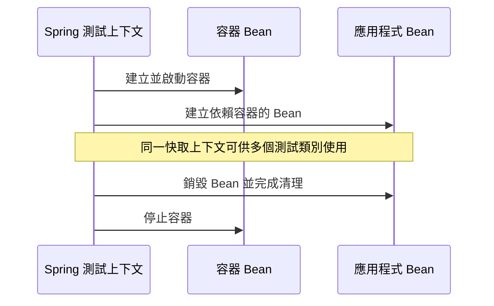

# Testcontainers

[Testcontainers][r1] 函式庫提供管理 Docker 容器內執行服務的方法。
它與 JUnit 整合，讓你撰寫能在任何測試執行前啟動容器的測試類別。
對於需要與 MySQL、MongoDB、Cassandra 等真實後端服務通訊的整合測試，Testcontainers 特別實用。

以下章節介紹幾種將 Testcontainers 整合到測試的方法。

## 使用 Spring Bean

Spring Boot 可以將 Testcontainers 提供的容器作為 Bean 管理。

若要將容器宣告為 Bean，請在測試設定中加入 [`@Bean`][r2] 方法：

{{CODE_0}}

{{CODE_1}}

接著在測試類別匯入該設定類別，即可注入並使用容器：

{{CODE_2}}

{{CODE_3}}

> [TIP]
>
> 這種容器管理方式常與[服務連線註解][r3]搭配使用。

## 使用 JUnit 擴充

Testcontainers 提供 JUnit 擴充，可管理測試中的容器。
在測試類別套用 Testcontainers 的 [`@Testcontainers`][r4] 註解，即可啟用此擴充。

接著可以在靜態容器欄位使用 [`@Container`][r5] 註解。

[`@Testcontainers`][r4] 可用於一般 JUnit 測試，也能與 [`@SpringBootTest`][r6] 搭配：

{{CODE_4}}

{{CODE_5}}

上例會在任何測試執行前啟動 Neo4j 容器。
容器實例的生命週期由 Testcontainers 管理，詳見其[官方文件][r7]。

使用 JUnit 擴充時，靜態欄位的容器實例會在測試類別執行完畢後停止；非靜態欄位則在每個測試方法結束後停止。
這在 Spring Boot 測試中可能造成問題，因為 Spring 的 TestContext Framework 可能將 [`ApplicationContext`][r8] 快取到該時間點之後，並讓設定相同的另一個測試類別或方法重複使用。
如果快取的應用程式上下文含有依賴已停止容器的 Bean，後續測試或 Bean 銷毀回呼就可能失敗。
因此，若應用程式上下文應在被快取期間持續可用，應優先[將容器作為 Spring Bean 管理][r9]，或[匯入容器宣告][r10]。

> [NOTE]
>
> 多數情況下，你還需要設定應用程式，使其連接容器內執行的服務。

## 匯入容器設定介面

Testcontainers 的常見模式，是將容器實例宣告為介面中的靜態欄位。

例如以下介面宣告兩個容器：名為 `mongo`、型別為 [`MongoDBContainer`][r11] 的容器，以及名為 `neo4j`、型別為 [`Neo4jContainer`][r12] 的容器：

{{CODE_6}}

{{CODE_7}}

採取這種宣告方式後，只要讓測試類別實作該介面，就能在多個測試中重複使用設定。

Spring Boot 測試也可以使用同一份介面設定。
請在測試設定類別加入 [`@ImportTestcontainers`][r13]：

{{CODE_8}}

{{CODE_9}}

## 受管理容器的生命週期

如果你使用 Testcontainers 提供的註解與擴充，容器實例的生命週期就完全由 Testcontainers 管理。
相關資訊請參閱 [Testcontainers 官方文件][r14]。

當容器作為 Bean 交由 Spring 管理時，其生命週期也由 Spring 管理：

- 容器 Bean 會在所有其他 Bean 之前建立並啟動。
- 容器 Bean 會在所有其他 Bean 銷毀之後停止。

這個流程確保依賴容器功能的 Bean 能使用那些功能，也確保這些 Bean 在容器仍可用時完成清理。

> [TIP]
>
> 當應用程式 Bean 依賴容器功能時，應優先將容器設定為 Spring Bean，以確保正確的生命週期行為。

> [NOTE]
>
> 讓 Testcontainers 管理容器，而不是將其作為 Spring Bean 管理，無法保證 Bean 與容器的關閉順序。
> 容器可能在依賴其功能的 Bean 完成清理前就關閉。
> 這可能導致用戶端 Bean 因連線中斷等原因擲出例外。
> 若應用程式上下文應在快取期間持續可用，應優先將容器作為 Spring Bean 管理，或使用 [`@ImportTestcontainers`][r13] 匯入容器宣告。

對於 Spring TestContext Framework 管理的每個應用程式上下文，容器 Bean 只會建立並啟動一次。
關於 TestContext Framework 如何管理底層應用程式上下文及其中的 Bean，請參閱 [Spring Framework 文件][r15]。

容器 Bean 會在 TestContext Framework 的標準應用程式上下文關閉流程中停止。
當應用程式上下文關閉時，容器也會關閉。
通常是在所有使用該特定快取上下文的測試執行完畢後發生。
依 TestContext Framework 設定的快取行為，也可能更早發生。

> [NOTE]
>
> 單一測試容器實例可以，而且經常會，跨多個測試類別的測試執行期間保留。

## 服務連線

服務連線是連到任意遠端服務的連線。
Spring Boot 的自動設定可使用服務連線的詳細資訊，建立與遠端服務的連線。
此時，連線詳細資訊的優先順序高於任何與連線相關的設定屬性。

使用 Testcontainers 時，只要在測試類別的容器欄位加上註解，就能自動為容器內的服務建立連線詳細資訊。

{{CODE_10}}

{{CODE_11}}

透過 [`@ServiceConnection`][r16]，上述設定讓應用程式中與 Neo4j 相關的 Bean，能與 Testcontainers 管理的 Docker 容器內執行的 Neo4j 通訊。
它會自動定義 [`Neo4jConnectionDetails`][r17] Bean，交由 Neo4j 自動設定使用，覆寫任何與連線相關的設定屬性。

> [NOTE]
>
> 若要搭配 Testcontainers 使用服務連線，必須將 `spring-boot-testcontainers` 模組加入測試依賴。

服務連線註解由透過 `spring.factories` 註冊的 [`ContainerConnectionDetailsFactory`][r18] 類別處理。
[`ContainerConnectionDetailsFactory`][r18] 可以根據特定 [`Container`][r20] 子類別或 Docker 映像名稱，建立 [`ConnectionDetails`][r19] Bean。

`spring-boot-testcontainers` jar 提供以下服務連線工廠：

| 連線詳細資訊 | 比對條件 |
| --- | --- |
| [`ActiveMQConnectionDetails`][r21] | 名為 "symptoma/activemq" 的容器，或 [`ActiveMQContainer`][r22] |
| [`ArtemisConnectionDetails`][r23] | 型別為 [`ArtemisContainer`][r24] 的容器 |
| [`CassandraConnectionDetails`][r25] | 型別為 [`CassandraContainer`][r26] 的容器 |
| [`CouchbaseConnectionDetails`][r27] | 型別為 [`CouchbaseContainer`][r28] 的容器 |
| [`ElasticsearchConnectionDetails`][r29] | 型別為 [`ElasticsearchContainer`][r30] 的容器 |
| [`FlywayConnectionDetails`][r31] | 型別為 [`JdbcDatabaseContainer`][r32] 的容器 |
| [`JdbcConnectionDetails`][r33] | 型別為 [`JdbcDatabaseContainer`][r32] 的容器 |
| [`KafkaConnectionDetails`][r34] | 型別為 [`KafkaContainer`][r35]、[`ConfluentKafkaContainer`][r36] 或 [`RedpandaContainer`][r37] 的容器 |
| [`LdapConnectionDetails`][r38] | 名為 "osixia/openldap" 或型別為 [`LLdapContainer`][r39] 的容器 |
| [`LiquibaseConnectionDetails`][r40] | 型別為 [`JdbcDatabaseContainer`][r32] 的容器 |
| [`MongoConnectionDetails`][r41] | 型別為 [`MongoDBContainer`][r11] 或 [`MongoDBAtlasLocalContainer`][r42] 的容器 |
| [`Neo4jConnectionDetails`][r17] | 型別為 [`Neo4jContainer`][r12] 的容器 |
| [`OtlpLoggingConnectionDetails`][r43] | 名為 "otel/opentelemetry-collector-contrib" 或型別為 [`LgtmStackContainer`][r44] 的容器 |
| [`OtlpMetricsConnectionDetails`][r45] | 名為 "otel/opentelemetry-collector-contrib" 或型別為 [`LgtmStackContainer`][r44] 的容器 |
| [`OtlpTracingConnectionDetails`][r46] | 名為 "otel/opentelemetry-collector-contrib" 或型別為 [`LgtmStackContainer`][r44] 的容器 |
| [`PulsarConnectionDetails`][r47] | 型別為 [`PulsarContainer`][r48] 的容器 |
| [`R2dbcConnectionDetails`][r49] | 型別為 [`ClickHouseContainer`][r50]、[`MariaDBContainer`][r51]、[`MSSQLServerContainer`][r52]、[`MySQLContainer`][r53]、[OracleContainer (free)][r54]、[OracleContainer (XE)][r55] 或 [`PostgreSQLContainer`][r56] 的容器 |
| [`RabbitConnectionDetails`][r57] | 型別為 [`RabbitMQContainer`][r58] 的容器 |
| [`RabbitStreamConnectionDetails`][r59] | 型別為 [`RabbitMQContainer`][r58]，且 `@ServiceConnection` 的 `type` 屬性包含 [`RabbitStreamConnectionDetails`][r59] 的容器 |
| [`DataRedisConnectionDetails`][r60] | 型別為 [`RedisContainer`][r61] 或 [`RedisStackContainer`][r62] 的容器，或名為 "redis"、"redis/redis-stack"、"redis/redis-stack-server" 的容器 |
| [`ZipkinConnectionDetails`][r63] | 名為 "openzipkin/zipkin" 的容器 |

> [TIP]
>
> 預設情況下，除了 [`RabbitStreamConnectionDetails`][r59]，會為指定的 [`Container`][r20] 建立所有適用的連線詳細資訊 Bean。
> 例如 [`PostgreSQLContainer`][r56] 會同時建立 [`JdbcConnectionDetails`][r33] 與 [`R2dbcConnectionDetails`][r49]。
>
> 如果只想建立部分適用型別，可使用 [`@ServiceConnection`][r16] 的 `type` 屬性。
>
> 若要從 [`RabbitMQContainer`][r58] 建立 [`RabbitStreamConnectionDetails`][r59] Bean，必須透過 [`@ServiceConnection`][r16] 的 `type` 屬性明確啟用。
> 容器還必須為 RabbitMQ Streams 開放連接埠 5552，或在設定 SSL 時開放 5551。

預設使用 `Container.getDockerImageName().getRepository()` 取得尋找連線詳細資訊所需的名稱。
Docker 映像名稱的 repository 部分不包含 registry 與版本。
只要 Spring Boot 能取得 [`Container`][r20] 實例，這個方式就可運作，例如上例使用 `static` 欄位的情況。

如果使用 [`@Bean`][r2] 方法，Spring Boot 不會為取得 Docker 映像名稱而呼叫 Bean 方法，因為這會造成提前初始化的問題。
它會改用 Bean 方法的回傳型別判斷應採用哪種連線詳細資訊。
只要使用 [`Neo4jContainer`][r12] 或 [`RabbitMQContainer`][r58] 之類具體型別的容器，這個方式即可運作。
若使用 [`GenericContainer`][r64]，則無法運作，例如下例的 Redis：

{{CODE_12}}

{{CODE_13}}

Spring Boot 無法從 [`GenericContainer`][r64] 判斷所用的容器映像，因此必須使用 [`@ServiceConnection`][r16] 的 `name` 屬性提供提示。

你也可以使用 [`@ServiceConnection`][r16] 的 `name` 屬性，覆寫要使用的連線詳細資訊，例如使用自訂映像時。
若 Docker 映像是 `registry.mycompany.com/mirror/myredis`，可以使用 `@ServiceConnection(name="redis")`，確保建立 [`DataRedisConnectionDetails`][r60]。

### 服務連線的 SSL

你可以在支援的容器使用 [`@Ssl`][r65]、[`@JksKeyStore`][r66]、[`@JksTrustStore`][r67]、[`@PemKeyStore`][r68] 與 [`@PemTrustStore`][r69] 註解，啟用該服務連線的 SSL 支援。
請注意，你仍必須自行啟用 Testcontainer 內服務的 SSL；這些註解只會設定應用程式用戶端的 SSL。

{{CODE_14}}

上述程式碼使用 [`@PemKeyStore`][r68] 將用戶端憑證與金鑰載入 keystore，並使用 [`@PemTrustStore`][r69] 將 CA 憑證載入 truststore。
這會讓用戶端向伺服器驗證身分，而 truststore 中的 CA 憑證則確保伺服器憑證有效且受信任。

此例的 `SecureRedisContainer` 是自訂的 `RedisContainer` 子類別，會將憑證複製到正確位置，並以啟用 SSL 的命令列參數呼叫 `redis-server`。

以下服務連線支援 SSL 註解：

- Cassandra
- Couchbase
- Elasticsearch
- Kafka
- MongoDB
- OpenTelemetry（OTLP 日誌、指標與追蹤）
- RabbitMQ
- RabbitMQ Streams
- Redis

`ElasticsearchContainer` 還支援自動偵測伺服器端 SSL。
若要使用此功能，請如下例在容器標註 [`@Ssl`][r65]，Spring Boot 就會替你處理用戶端 SSL 設定：

{{CODE_15}}

## 動態屬性

[`@DynamicPropertySource`][r70] 是服務連線的替代方案，寫法稍微冗長，但更有彈性。
靜態的 [`@DynamicPropertySource`][r70] 方法可以將動態屬性值加入 Spring Environment。

{{CODE_16}}

{{CODE_17}}

上述設定讓應用程式中與 Neo4j 相關的 Bean，能與 Testcontainers 管理的 Docker 容器內執行的 Neo4j 通訊。

## 譯者圖解：容器與應用程式的關閉順序

