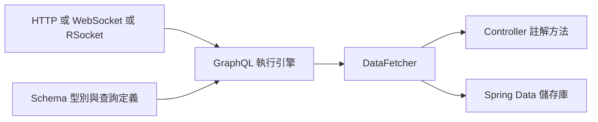

# Spring for GraphQL

如果想建置 GraphQL 應用程式，可以使用 Spring Boot 為 [Spring for GraphQL][r1] 提供的自動設定。
Spring for GraphQL 專案以 [GraphQL Java][r2] 為基礎。
你至少需要 `spring-boot-starter-graphql` starter。
由於 GraphQL 與傳輸方式無關，應用程式還需要一個或多個額外 starter，才能透過 Web 公開 GraphQL API：

| Starter | 傳輸方式 | 實作 |
| --- | --- | --- |
| `spring-boot-starter-web` | HTTP | Spring MVC |
| `spring-boot-starter-websocket` | WebSocket | Servlet 應用程式的 WebSocket |
| `spring-boot-starter-webflux` | HTTP、WebSocket | Spring WebFlux |
| `spring-boot-starter-rsocket` | TCP、WebSocket | Reactor Netty 上的 Spring WebFlux |

## GraphQL 綱要

Spring GraphQL 應用程式在啟動時需要已定義的綱要。
預設可將 `.graphqls` 或 `.gqls` 綱要檔寫在 `src/main/resources/graphql/**` 下，Spring Boot 就會自動找到它們。
你可以透過 `spring.graphql.schema.locations` 自訂位置，透過 `spring.graphql.schema.file-extensions` 自訂副檔名。

> [NOTE]
>
> 如果希望 Spring Boot 在應用程式所有模組與相依項中偵測該位置的綱要檔，可將 `spring.graphql.schema.locations` 設為 `"classpath*:graphql/**/"`（注意 `classpath*:` 前綴）。

接下來的各節會使用這個 GraphQL 綱要範例，其中定義兩個型別與兩個查詢：

{{CODE_0}}

> [NOTE]
>
> 預設允許綱要的[欄位內省][r3]，因為 GraphiQL 等工具需要它。
> 如果不想公開綱要資訊，可將 `spring.graphql.schema.introspection.enabled` 設為 `false`，停用內省。

## GraphQL RuntimeWiring

GraphQL Java 的 [`RuntimeWiring.Builder`][r4] 可用來註冊自訂純量型別、指令、型別解析器、[`DataFetcher`][r5] 等。
你可以在 Spring 設定中宣告 [`RuntimeWiringConfigurer`][r6] Bean，以存取 [`RuntimeWiring.Builder`][r4]。
Spring Boot 會偵測這些 Bean，並將它們加入 [GraphQlSource 建構器][r7]。

不過，應用程式通常不會直接實作 [`DataFetcher`][r5]，而是建立[使用註解的控制器][r8]。
Spring Boot 會自動偵測含有註解處理方法的 [`@Controller`][r9] 類別，並將這些方法註冊為 `DataFetcher`。
以下是使用 [`@Controller`][r9] 類別實作 greeting 查詢的範例：

{{CODE_1}}

{{CODE_2}}

## 支援 Querydsl 與 QueryByExample 儲存庫

Spring Data 支援 Querydsl 與 QueryByExample 儲存庫。
Spring GraphQL 可以[將 Querydsl 與 QueryByExample 儲存庫設定為 `DataFetcher`][r10]。

如果 Spring Data 儲存庫標註了 [`@GraphQlRepository`][r11]，且繼承下列其中一個介面：

- [`QuerydslPredicateExecutor`][r12]
- [`ReactiveQuerydslPredicateExecutor`][r13]
- [`QueryByExampleExecutor`][r14]
- [`ReactiveQueryByExampleExecutor`][r15]

Spring Boot 就會偵測它們，將其視為相符頂層查詢的 [`DataFetcher`][r5] 候選。

## 傳輸方式

### HTTP 與 WebSocket

GraphQL HTTP 端點預設為 HTTP POST `/graphql`。
它也支援透過 Server Sent Events 使用 `"text/event-stream"` 媒體型別，但僅供訂閱使用。
路徑可透過 `spring.graphql.http.path` 自訂。

> [TIP]
>
> Spring MVC 與 Spring WebFlux 的 HTTP 端點，都是由 [`@Order`][r16] 值為 `0` 的 `RouterFunction` Bean 提供。
> 如果你自行定義 `RouterFunction` Bean，可能需要加入適當的 [`@Order`][r16] 註解，確保排序正確。

GraphQL WebSocket 端點預設停用。若要啟用：

- Servlet 應用程式需加入 WebSocket starter：`spring-boot-starter-websocket`。
- WebFlux 應用程式不需要額外相依項。
- 兩者都必須設定 `spring.graphql.websocket.path` 應用程式屬性。

Spring GraphQL 提供 [Web 攔截][r17] 模型。
這很適合從 HTTP 請求標頭擷取資訊並放入 GraphQL 上下文，或從相同上下文擷取資訊並寫入回應標頭。
使用 Spring Boot 時，可以宣告 [`WebGraphQlInterceptor`][r18] Bean，將它註冊到 Web 傳輸層。

[Spring MVC][r19] 與 [Spring WebFlux][r20] 支援 CORS（跨來源資源共用）請求。
若瀏覽器從不同網域存取 GraphQL 應用程式，CORS 是 Web 設定的重要部分。

Spring Boot 在 `spring.graphql.cors.*` 命名空間下支援多項設定屬性；以下是一個簡短設定範例：

{{CODE_3}}

{{CODE_4}}

### RSocket

也支援以 WebSocket 或 TCP 為底層的 RSocket 傳輸。
[設定好 RSocket 伺服器][r21]後，就可以使用 `spring.graphql.rsocket.mapping` 將 GraphQL 處理器設定到特定路由。
例如將對映設為 `"graphql"`，就可以在使用 [`RSocketGraphQlClient`][r22] 傳送請求時，將它作為路由。

Spring Boot 會自動設定 `RSocketGraphQlClient.Builder<?>` Bean，供你注入元件：

{{CODE_5}}

{{CODE_6}}

接著傳送請求：

> **譯者校對註：**官方網頁此處未展開範例；以下從同版本官方原始碼的 `request` 區段還原，僅調整共同縮排。

[官方 kotlin 範例來源](../sources/spring-boot/documentation/spring-boot-docs/src/main/kotlin/org/springframework/boot/docs/web/graphql/transports/rsocket/RSocketGraphQlClientExample.kt)

```kotlin
val book = graphQlClient.document(
	"""
	{
		bookById(id: "book-1"){
			id
			name
			pageCount
			author
		}
	}				
	"""
)
	.retrieve("bookById").toEntity(Book::class.java)
```

[官方 java 範例來源](../sources/spring-boot/documentation/spring-boot-docs/src/main/java/org/springframework/boot/docs/web/graphql/transports/rsocket/RSocketGraphQlClientExample.java)

```java
Mono<Book> book = this.graphQlClient.document("{ bookById(id: \"book-1\"){ id name pageCount author } }")
	.retrieve("bookById")
	.toEntity(Book.class);
```

## 例外處理

Spring GraphQL 讓應用程式註冊一個或多個 Spring [`DataFetcherExceptionResolver`][r23] 元件，並依序呼叫它們。
例外必須解析為 [`GraphQLError`][r24] 物件的清單，請參閱 [Spring GraphQL 例外處理文件][r25]。
Spring Boot 會自動偵測 [`DataFetcherExceptionResolver`][r23] Bean，並將它們註冊到 [`GraphQlSource.Builder`][r26]。

## GraphiQL 與綱要列印器

Spring GraphQL 提供基礎設施，協助開發人員使用或開發 GraphQL API。

Spring GraphQL 隨附預設的 [GraphiQL][r27] 頁面，預設公開於 `"/graphiql"`。
此頁面預設停用，可透過 `spring.graphql.graphiql.enabled` 屬性啟用。
許多公開此頁面的應用程式會選擇自訂建置版本。
預設實作在開發期間相當實用，因此使用 [`spring-boot-devtools`][r28] 時，會在開發期間自動公開。

啟用 `spring.graphql.schema.printer.enabled` 屬性時，也可以在 `/graphql/schema` 以文字格式公開 GraphQL 綱要。

## 譯者註：原文範例展開問題

本版官方網頁在「接著傳送請求」後直接顯示 `include-code::RSocketGraphQlClientExample[tag=request]`，未展開程式碼；本譯文已從同版本官方範例原始碼補回，並附檔案連結供對照。上表的 `spring-boot-starter-web` 名稱亦依原文保留。

## 譯者補充：傳輸與資料解析分工


