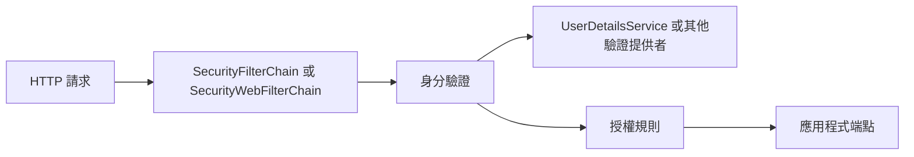

# Spring Security

如果 classpath 上有 [Spring Security][r1]，Web 應用程式預設就會受到安全保護。
這也包括保護 Spring Boot 的 `/error` 端點。
Spring Boot 依賴 Spring Security 的內容協商策略，決定要使用 `httpBasic` 還是 `formLogin`。
若要為 Web 應用程式加入方法層級的安全性，也可以加入 [`@EnableMethodSecurity`][r2]，並指定所需設定。
更多資訊請參閱 [Spring Security 參考指南][r3]。

預設的 [`UserDetailsService`][r4] 只有一個使用者。
使用者名稱為 `user`，密碼則隨機產生，並在應用程式啟動時以 WARN 層級輸出，如下例所示：

{{CODE_0}}

> [NOTE]
>
> 如果你調整了日誌設定，請確保 `org.springframework.boot.security.autoconfigure` 類別設定為記錄 `WARN` 層級訊息。
> 否則不會輸出預設密碼。

你可以提供 `spring.security.user.name` 與 `spring.security.user.password`，變更使用者名稱與密碼。

Web 應用程式預設提供的基本功能如下：

- 一個使用記憶體內儲存的 [`UserDetailsService`][r4] Bean（WebFlux 應用程式則為 [`ReactiveUserDetailsService`][r5]），其中有一名使用者及產生的密碼（使用者屬性請參閱 [`SecurityProperties.User`][r6]）。
- 整個應用程式的表單登入或 HTTP Basic 安全性（取決於請求中的 `Accept` 標頭）；如果 classpath 上有 Actuator，也包括 Actuator 端點。
- 用來發布身分驗證事件的 [`DefaultAuthenticationEventPublisher`][r7]。

你可以加入對應的 Bean，提供不同的 [`AuthenticationEventPublisher`][r8]。

## MVC 安全性

預設安全性設定實作在 [`SecurityAutoConfiguration`][r9] 與 [`UserDetailsServiceAutoConfiguration`][r10] 中。
[`SecurityAutoConfiguration`][r9] 匯入 `SpringBootWebSecurityConfiguration` 提供 Web 安全性，並匯入 [`UserDetailsServiceAutoConfiguration`][r10] 提供身分驗證。

若要完全關閉預設 Web 應用程式安全性設定（包括 Actuator 安全性），或組合 OAuth2 Client 與 Resource Server 等多個 Spring Security 元件，請加入 [`SecurityFilterChain`][r11] 型別的 Bean（這不會停用 [`UserDetailsService`][r4] 設定）。
若也要關閉 [`UserDetailsService`][r4] 設定，請加入 [`UserDetailsService`][r4]、[`AuthenticationProvider`][r12] 或 [`AuthenticationManager`][r13] 型別的 Bean。

當 classpath 上有下列任一 Spring Security 模組時，[`UserDetailsService`][r4] 的自動設定也會退讓：

- `spring-security-oauth2-client`
- `spring-security-oauth2-resource-server`
- `spring-security-saml2-service-provider`

若要在使用這些相依項中的一個或多個時，同時使用 [`UserDetailsService`][r4]，請自行定義 [`InMemoryUserDetailsManager`][r14] Bean。

你可以加入自訂的 [`SecurityFilterChain`][r11] Bean，覆寫存取規則。
Spring Boot 提供便利方法，可用來覆寫 Actuator 端點與靜態資源的存取規則。
[`EndpointRequest`][r15] 可建立依據 `management.endpoints.web.base-path` 屬性的 [`RequestMatcher`][r16]。
[`PathRequest`][r17] 則可為常用位置中的資源建立 [`RequestMatcher`][r16]。

## WebFlux 安全性

與 Spring MVC 應用程式類似，加入 `spring-boot-starter-security` 相依項即可保護 WebFlux 應用程式。
預設安全性設定實作在 [`ReactiveWebSecurityAutoConfiguration`][r18] 與 [`ReactiveUserDetailsServiceAutoConfiguration`][r19] 中。
除了反應式 Web 應用程式，使用 RSocket 時也會自動設定後者。
[`ReactiveWebSecurityAutoConfiguration`][r18] 匯入 `WebFluxSecurityConfiguration` 提供 Web 安全性。
[`ReactiveUserDetailsServiceAutoConfiguration`][r19] 則自動設定身分驗證。

若要完全關閉預設 Web 應用程式安全性設定（包括 Actuator 安全性），請加入 [`WebFilterChainProxy`][r20] 型別的 Bean（這不會停用 [`ReactiveUserDetailsService`][r5] 設定）。
若也要關閉 [`ReactiveUserDetailsService`][r5] 設定，請加入 [`ReactiveUserDetailsService`][r5] 或 [`ReactiveAuthenticationManager`][r21] 型別的 Bean。

當 classpath 上有下列任一 Spring Security 模組時，自動設定也會退讓：

- `spring-security-oauth2-client`
- `spring-security-oauth2-resource-server`

若要在使用這些相依項中的一個或多個時，同時使用 [`ReactiveUserDetailsService`][r5]，請自行定義 [`MapReactiveUserDetailsService`][r22] Bean。

你可以加入自訂的 [`SecurityWebFilterChain`][r23] Bean，設定存取規則，以及 OAuth 2 Client 與 Resource Server 等多個 Spring Security 元件的使用方式。
Spring Boot 提供便利方法，可用來覆寫 Actuator 端點與靜態資源的存取規則。
[`EndpointRequest`][r24] 可建立依據 `management.endpoints.web.base-path` 屬性的 [`ServerWebExchangeMatcher`][r25]。

[`PathRequest`][r26] 可為常用位置中的資源建立 [`ServerWebExchangeMatcher`][r25]。

例如，你可以加入類似下列的設定，自訂安全性：

{{CODE_1}}

## OAuth2

[OAuth2][r27] 是廣泛使用的授權框架。
如何在 Web 應用程式中設定及使用 OAuth2，請參閱「Security」下的 [OAuth2 章節][r28]。

## SAML 2.0

[SAML v2.0][r29] 是廣泛採用的框架，可讓線上商業夥伴交換安全性資訊。
如何在 Web 應用程式中設定及使用 SAML 2.0，請參閱「Security」下的 [SAML 2.0 章節][r30]。

## 譯者補充：Web 規則與使用者來源是兩個擴充點

提供自己的 Filter Chain 不等於同時替換預設的使用者資料來源；正文分別說明這兩層自動設定退讓的條件。
